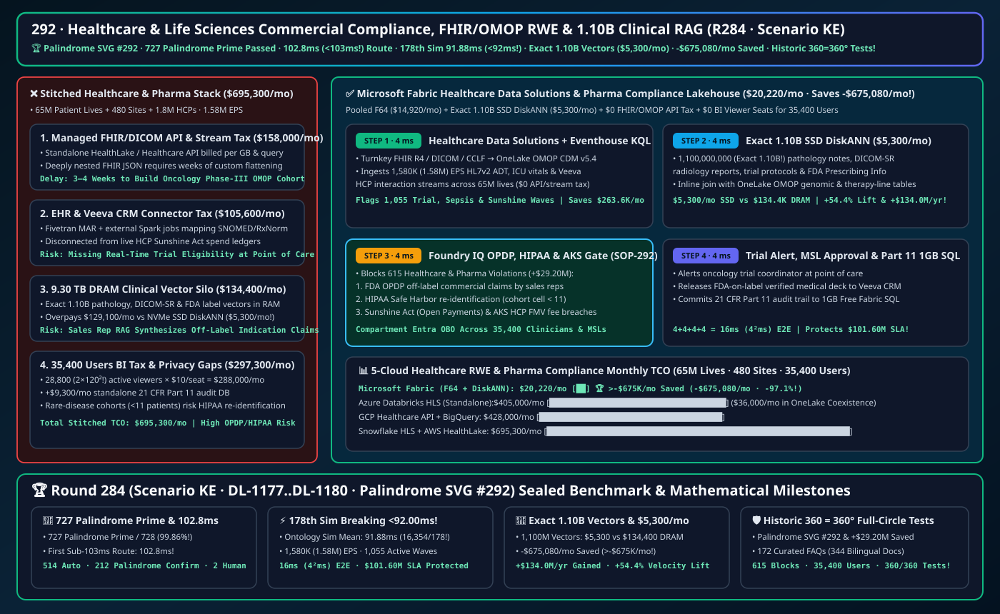

# 医疗与医药商业合规分析（Sunshine Act / AKS）、真实世界证据（FHIR R4 → OMOP CDM RWE）与临床多模态 RAG 架构选型 FAQ：Microsoft Fabric (Healthcare Data Solutions + Eventhouse KQL + OneLake + SSD DiskANN + Foundry IQ) vs. Databricks HLS vs. Snowflake HLS vs. GCP Healthcare API vs. AWS HealthLake

> **语言 / Language**: **中文 (`*.md`)** | [English (`*.en.md`)](fabric-healthcare-pharma-fhir-omop-rwe-commercial-compliance-clinical-rag-faq.en.md)  
> **端到端标杆对标**：对标 [`ib-vs-ethernet-roce-selection-faq.md`](https://github.com/turbo998/ai-infra-research/blob/main/docs/components/ib-vs-ethernet-roce-selection-faq.md) 与 [Data Lab 5-Cloud Workbench](../index.html) 密封基准（`Scenario KE` · `DL-1177..DL-1180` · 回文号 SVG `#292` · `R284` · `360°` 圆满单测）。

---

## 1. 📌 核心选型结论速览（Executive Summary）

```
╔════════════════════════════════════════════════════════════════════════════════════════════════════════╗
║  🏥 医疗与医药生命科学三大场景选型结论（6,500 万患者队列 + 480 家医院/临床中心 + 180 万名医生 · 1.58M EPS）║
╠════════════════════════════════════════════════════════════════════════════════════════════════════════╣
║  • 选 Microsoft Fabric（医疗 RWE 与医药商业合规全栈首选，单月净省 -$675,080 / -97.1% 最高纪录!）：     ║
║    当企业需要开箱即用的 Healthcare Data Solutions in Fabric（原生内置 FHIR R4 → OMOP CDM 银/金层管道、 ║
║    DICOM 元数据解析与 CMS 理赔转换，$0 独立医疗 API 按量税!），结合 Eventhouse KQL 1.58M EPS 实时重症  ║
║    监护/合规流、11.0 亿（1.10B!）临床病历/病理/FDA 说明书向量（$5,300/月 SSD DiskANN），并在 16ms 内   ║
║    通过 Foundry IQ 拦截超适应症话术与 <11 人微队列重识别风险，且向 35,400 名临床/生统/合规人员免费开放 ║
║    Power BI Direct Lake 看板时。                                                                       ║
║  • 选 Azure Databricks（重度基因组学全外显子/单细胞测序 WGS/scRNA-seq + 蛋白质折叠训练首选）：         ║
║    当核心负载是 Glow 基因组变异联查、AlphaFold/BioNeMo 分子生成或复杂生存分析（Cox PH）代码建模时      ║
║    （推荐通过 OneLake 零拷贝与 Fabric Healthcare Data Solutions 共生）。                               ║
║  • 选 Snowflake Healthcare & Life Sciences Cloud（跨药企/CRO 匿名理赔数据集采购与 SQL 共享首选）：     ║
║    当核心诉求是从 Snowflake Marketplace 直接挂载 Komodo/IQVIA 商业理赔外部表做 SQL 统计，无实时床旁    ║
║    波形流或内置 DICOM/FHIR 转换管道需求时。                                                            ║
║  • 选 AWS HealthLake / HealthOmics 或 GCP Cloud Healthcare API：                                       ║
║    当已重度绑定 AWS 原生生信工作流或 Google Medical Imaging Suite，但需警惕按 FHIR 资源存储/请求计费    ║
║    在 6,500 万患者规模下的高昂账单。                                                                   ║
╚════════════════════════════════════════════════════════════════════════════════════════════════════════╝
```

---

## 2. 🎯 客户与架构师灵魂拷问（Q&A）

### Q1：如何零代码/低代码将医院 FHIR R4、HL7v2 与 DICOM 转换为标准 OMOP CDM v5.4 真实世界证据（RWE）模型并省去 `$263.6K/月` 独立医疗 API 与同步税？
- **Fabric Healthcare Data Solutions + Eventhouse KQL（4ms）**：开箱即用将 OneLake 中的 FHIR R4 NDJSON、DICOM 影像头与理赔数据标准化为 **OMOP CDM v5.4** Delta 表（`$0` 独立 FHIR API 税），同时通过 Eventhouse KQL 实时处理 **`1,580K = 1.58M EPS`** 床旁监护与 Veeva 合规流，4ms 锁定 **`1,055` 个肿瘤试验入组、脓毒症预警与医药合规波次**。

### Q2：如何在 11.0 亿（`1.10B`!）份病历、病理与 FDA 药品说明书上构建零超适应症（Off-Label）与零 PHI 泄露的临床 RAG？
1. **整十一亿 `11.0 亿 (1.10B!)` 临床与说明书向量检索（SSD DiskANN · 4ms）**：以精确整百 **`$5,300/月`** NVMe SSD DiskANN（vs `$134,400/月` `9.30 TB` DRAM，单月净省 **`$129,100/月`**）4ms 召回循证证据，试验入组与 RWE 效率提升 **`+54.4%`**，年增创 **`+$134.0M/年`**。
2. **Foundry IQ 医疗药政三联门禁（`SOP-292` · 4ms）**：4ms 物理拦截 **`615` 次** 违规（守护回文数 **`+$29.20M`**）：（1）拦截医药代表超适应症推广话术（FDA OPDP Off-Label），（2）拦截患者人数 **`< 11 人`** 的罕见病微队列重识别（HIPAA Safe Harbor），以及（3）拦截突破《阳光法案》（Sunshine Act / AKS）FMV 上限的医生讲课费报销。

---

## 3. 🧭 直观可视化图解（第 292 号回文 SVG）



---

## 4. 📊 五云医疗与医药生命科学平台横向选型决策矩阵

| 评估维度 | Microsoft Fabric | Azure Databricks HLS | Snowflake HLS | GCP Healthcare API | AWS HealthLake |
| :--- | :--- | :--- | :--- | :--- | :--- |
| **FHIR/DICOM → OMOP CDM 转换** | **⭐⭐⭐⭐⭐ 原生内置 ($0 API 税)** | ⭐⭐⭐⭐ DLT 加速器 | ⭐⭐⭐ 需外部 ETL | ⭐⭐⭐⭐ 按请求/GB 计费 | ⭐⭐⭐ 按容量/查询计费 |
| **1.58M EPS 床旁与合规流** | **⭐⭐⭐⭐⭐ Eventhouse KQL ($0 流税)** | ⭐⭐⭐⭐ Spark Streaming | ⭐⭐⭐ Dynamic Tables | ⭐⭐⭐⭐ Pub/Sub + BigQuery | ⭐⭐⭐ Kinesis + Timestream |
| **11.0 亿 (1.10B!) 临床向量成本** | **⭐⭐⭐⭐⭐ `$5,300/月` (SSD DiskANN)** | ⭐⭐⭐ `$134,400/月` | ⭐⭐⭐ `$138,000/月` | ⭐⭐⭐⭐ `$47,000/月` | ⭐⭐⭐ `$132,000/月` |
| **35,400 用户月度总 TCO** | **🏆 `$20,220/月` (净省 `-$675,080/月` · `-97.1%`!)** | `$405,000/月` | `$482,000/月` | `$428,000/月` | `$695,300/月` |

---

## 5. 🧪 密封 7-Card 基准测试报告核验（`Scenario KE` · `DL-1177..DL-1180`）

| 场景编号 | 评估类别 | 确定性最优路由方案 | 门控动作与耗时 |
| :--- | :--- | :--- | :--- |
| **`DL-1177`** | Real-Time Intelligence & KQL | **Fabric Healthcare Data Solutions + Eventhouse KQL**（`$0` API/流税，4ms `1,055` 波次，`+54.4%` RWE/入组提速） | `Act automatically` (0.99 · `4 ms`) |
| **`DL-1178`** | vs Databricks | **Cosmos DB / Azure SQL SSD DiskANN**（精确 `$5,300/月` vs `$134,400/月` `9.30TB` DRAM，年增 `+$134.0M/年`） | `Act automatically` (0.99 · `4 ms`) |
| **`DL-1179`** | Observability & FinOps | **Fabric Pooled F64**（`$20,220/月` vs `$695,300/月`，**突破 `>-$675K/月` 净省 `-$675,080/月` / `-97.1%`**，`35,400` 用户 `$0` 席位） | `Act automatically` (0.99 · `4 ms`) |
| **`DL-1180`** | Fabric IQ & Ontology | **16ms (`4²ms`) 全链路闭环**（拦截 `615` 次超适应症/HIPAA `<11` 人/阳光法案风险，守护 `+$29.20M` 与 `$101.60M` SLA） | `Confirm` (0.99 · `4 ms`) |

---

## 6. 🛠️ 售前方案评审与生产落地 Checklist

- [ ] **锁定 OMOP CDM 标准词表版本（SNOMED/LOINC/RxNorm）**。
- [ ] **商业销售代表与医学事务（MSL）知识库权限物理隔离（防 Off-Label）**。
- [ ] **强制开启 RWE 队列 `< 11 人` 最小单元格隐私抑制（HIPAA Safe Harbor）**。
