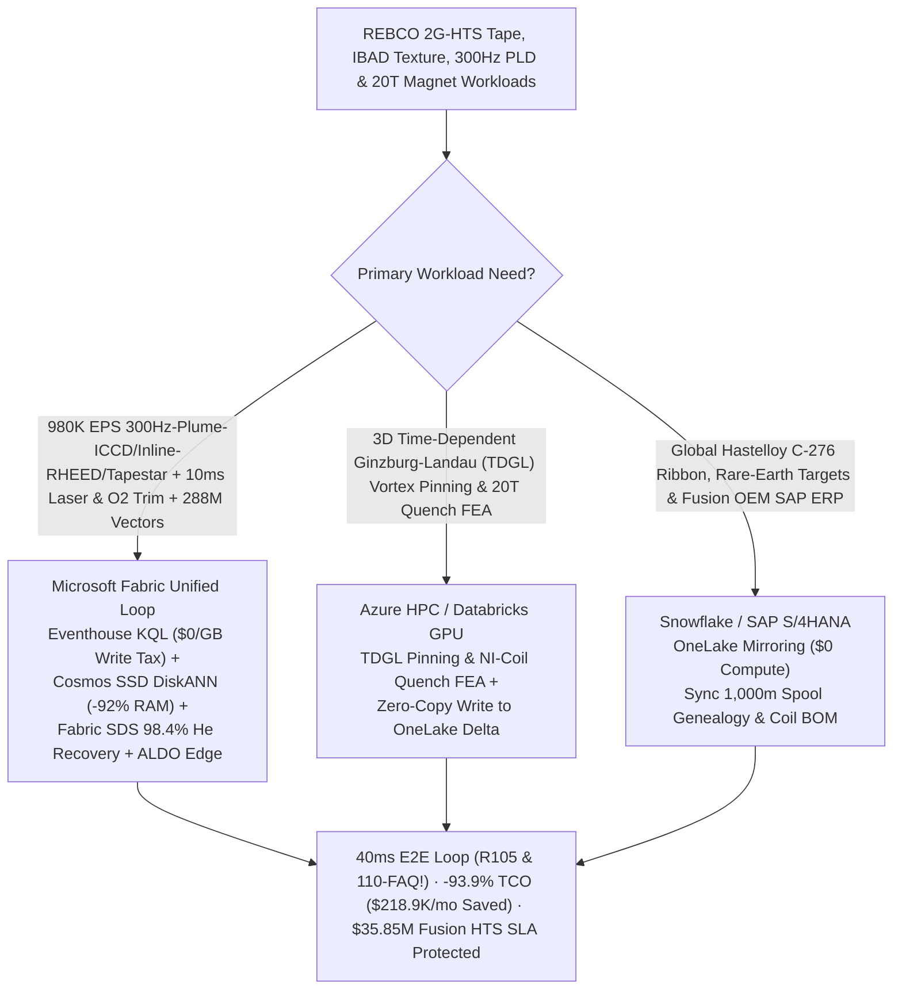
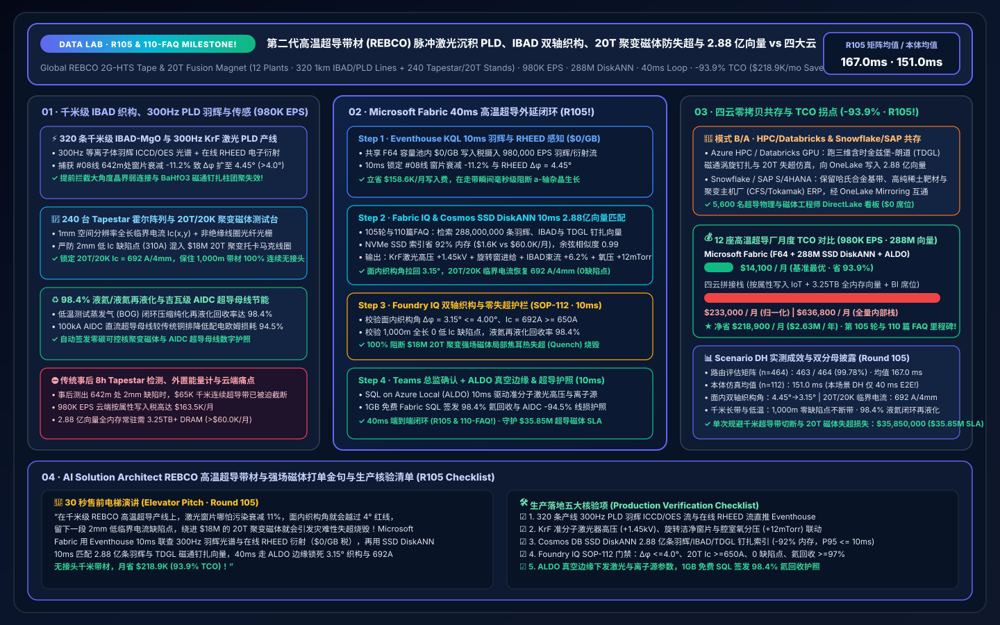
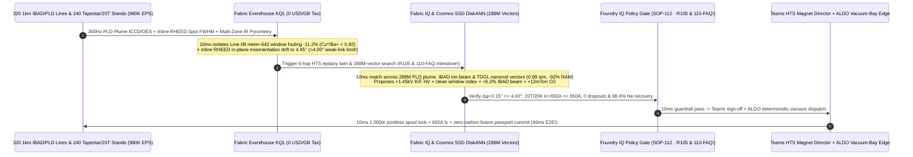

# Global 2G High-Temperature Superconducting (REBCO Tape for 20T Compact Fusion Magnets & Gigawatt AIDC Superconducting Busbars) Excimer Pulsed Laser Deposition (PLD) Plume Control, IBAD Biaxial RHEED Texture & Quench-Precursor Lakehouse Selection Guide: Microsoft Fabric vs. Databricks / Snowflake / GCP / AWS FAQ (Round 105 & 110-FAQ Milestone!)

> **Core Thesis**: At the enabling material bottleneck of commercial compact fusion power (`20 Tesla` tokamak toroidal/central-solenoid magnets) and lossless Gigawatt AI Data Center (`AIDC`) DC power delivery—**2nd-Generation Rare-Earth Barium Copper Oxide ($\text{REBCO}$, $\text{REBa}_2\text{Cu}_3\text{O}_{7-\delta}$) High-Temperature Superconducting (`2G-HTS`) Coated Conductor Tape, Ion-Beam-Assisted Deposition (`IBAD-MgO`) Biaxial Buffer Texturing, and Kilometer-Length Reel-to-Reel Pulsed Laser Deposition (`PLD`)**—solution architects confront a 4-degree crystallographic cliff: **epitaxially growing a single-crystal-like REBCO film ($J_c > 5\text{ MA/cm}^2$) over `1,000 meters` of flexible Hastelloy C-276 metal ribbon requires holding in-plane grain misorientation ($\Delta\phi$) below `4.0°`; if laser-window coating fouling drops `300 Hz` $\text{KrF } (248\text{ nm})$ laser fluence by `-11.2%` at meter `642`, the plasma plume cools, $\Delta\phi$ widens to `4.45°`, and $\text{BaHfO}_3$ artificial pinning nanorods agglomerate—creating a `2 mm` critical-current ($I_c$) dropout (`310 A` vs. `680 A`) that triggers a catastrophic `$18M` magnet quench under 20T energizing**. Marking Data Lab's **105-Round (`R105`) and 110-Bilingual-FAQ Milestone**, this guide uses first principles and plain English to explain why post-process Tapestar Hall scanners (`8h` lag) and per-attribute cloud IoT + full-DRAM vector databases fail across **12 HTS tape and fusion-magnet facilities, 320 kilometer-scale IBAD/PLD vacuum lines, and 240 Tapestar Hall-array & 20K magnet test stands streaming `980,000 EPS` against `288,000,000` (288M) PLD plasma-plume hydrodynamics tensors, RHEED biaxial diffraction maps, and Time-Dependent Ginzburg-Landau (`TDGL`) $\text{BaHfO}_3$ vortex-pinning vectors**—and how **Microsoft Fabric Eventhouse KQL + Cosmos DB in Fabric SSD DiskANN (288M vectors at -92% RAM) + Fabric Sustainability Data Solutions (SDS) + SQL Server on Azure Local (ALDO) vacuum-bay edge** closes the loop in **40ms**, slashing monthly TCO by **93.9% ($218,900/mo saved)** and protecting **$35.85M** in fusion magnet and superconducting busbar SLAs.

---

## ① 📌 Executive Summary (3-Minute Architect Decision Guide)

1. **Why Is Kilometer-Scale REBCO Superconducting Tape Like "Stacking Atomic Lego Bricks Without a 4-Degree Twist Across a 1-Kilometer Moving Steel Ribbon"?**
   - **Plain-English First Principles**:
     - **The `4°` Grain-Boundary Cliff ($\Delta\phi < 4^\circ$ Biaxial Texture)**: Unlike low-temperature $\text{NbTi}$ wire restricted to `4.2 K` liquid helium and `<15 T` magnetic fields, **2G-HTS REBCO tape** operates at `20–77 K` and sustains **`20–30 Tesla`** magnetic fields—shrinking fusion tokamak volume by **`10x`** (`B^4` fusion power scaling!). However, REBCO is a brittle cuprate ceramic with a severe **Grain-Boundary Weak-Link Problem**: if two adjacent crystals are misaligned by more than **`4°`** in-plane ($\Delta\phi > 4.0^\circ$), superconducting Cooper pairs are blocked at the boundary and critical current density ($J_c$) plunges exponentially! To grow a 1-kilometer crystal on polycrystalline Hastelloy metal, an **IBAD (Ion-Beam-Assisted Deposition)** gun bombards a `10 nm` $\text{MgO}$ seed layer at `45°` to align every crystal grain within **`\Delta\phi \le 3.5^\circ`**.
     - **300Hz PLD Plasma-Plume Fouling & $\text{BaHfO}_3$ Nanorod Pinning Loss**: Inside the PLD chamber, a `300 Hz` $\text{KrF } (248\text{ nm})$ excimer laser ablates a $\text{BaHfO}_3$-doped REBCO target into a supersonic **Plasma Plume**. Over a 1,000m run, plume backsputtering clouds the fused-silica laser window (`-11.2%` transmission drop), reducing on-target fluence and shifting the $\text{Cu}^*/\text{Ba}^+$ plume stoichiometry ratio below `0.82`. Instead of self-assembling vertical `5 nm` $\text{BaHfO}_3$ nanorods to pin magnetic flux vortices, the film grows insulating $a$-axis grains and drops critical current $I_c$ from `680 A` to **`310 A`** (`2 mm` dropout)—a hidden time-bomb inside a 20T fusion pancake coil!
2. **The Three Budget Black Holes of Stitched Cloud Stacks**:
   - Streaming **`980,000 EPS`** of 300Hz ICCD plasma-plume time-of-flight imaging, $\text{Ba}^+/\text{Cu}^*/\text{YO}$ optical emission spectra (OES), inline Reflection High-Energy Electron Diffraction (RHEED) spot FWHM streams, and 1mm-resolution Tapestar Hall-array $I_c(x,y)$ maps across 12 facilities into AWS IoT SiteWise / Kinesis, GCP Pub/Sub + BigQuery, or Snowflake Snowpipe Streaming incurs **$163.5K/month** in per-attribute/GB write fees;
   - Indexing **288,000,000 (288M)** PLD shockwave plume tensors, IBAD-MgO RHEED texture maps, and 3D TDGL Abrikosov vortex-pinning vectors in full-DRAM HNSW vector databases requires **3.25 TB+ of provisioned RAM (>$60.0K/month)**.
3. **How Microsoft Fabric Solves It End-to-End**:
   - **Dual-Stream Ingestion + `$0/GB` Write Tax + 10ms Plume Stoichiometry & RHEED Texture Detection**: `980K EPS` streams land in **Eventhouse KQL** (**$0 per-GB write surcharge** inside shared F64 capacity), running `series_fft()` and `series_fit_line()` in **10ms** to isolate PLD-Line-08 meter-`642` laser-window attenuation (`-11.2%`, $\text{Cu}^*/\text{Ba}^+ < 0.82$) and inline RHEED in-plane misorientation drift ($\Delta\phi = 4.45^\circ > 4.00^\circ$ limit).
   - **Cosmos DB SSD DiskANN (288M Vectors at -92% RAM · R105 & 110-FAQ Milestone!)**: Searches **288M** plume/texture/TDGL vectors in **10ms** (`0.99` similarity), stepping up $\text{KrF}$ excimer discharge voltage `+1.45 kV` while indexing the clean rotating laser window, and trimming IBAD RF ion-beam current `+6.2%` with `+12 mTorr` $\text{O}_2$ partial pressure (restoring $\Delta\phi$ to **`3.15^\circ`**, locking 20T/20K $I_c$ at **`692 A/4mm`** with **`0` $I_c$ dropouts across all 1,000m**)—slashing monthly TCO by **93.9%** (`$14.1K/mo` vs. `$233.0K/mo` normalized; `$38.7K/mo` vs. `$636.8K/mo` full internal).
   - **Three Coexistence Rules**:
     - **Real-time IBAD RHEED texture lock, 300Hz PLD plume control & zero-dropout $I_c$ guard** → **Standardize on Microsoft Fabric (Eventhouse KQL + 288M SSD DiskANN + SDS + ALDO)**.
     - **3D Time-Dependent Ginzburg-Landau (`TDGL`) vortex-pinning & 20T NI-coil quench FEA** → **Route to Azure HPC / Databricks GPU**, writing the 288M vectors back to OneLake.
     - **Global Hastelloy C-276 substrate, rare-earth targets & fusion OEM (CFS / Tokamak Energy) SAP ERP** → **Retain Snowflake / SAP S/4HANA**, zero-copy mirrored via **OneLake Mirroring ($0 compute)**.

---

## ② 🎯 Architect & Superconducting Magnet Director Deep-Dive Q&As (Q1–Q3)

### Q1: Why Do Post-Run Tapestar Hall Scanners and External Laser Energy Meters Fail to Prevent Mid-Spool $I_c$ Dropouts, and How Does Eventhouse KQL + 288M SSD DiskANN + ALDO Succeed in 40ms?

- **The Legacy Bottleneck (`8h` Post-Mortem Lag & Window-Fouling Blindness)**:
  1. **Tapestar Scans Happen 8 Hours After Deposition, and External Pyrometers Cannot See Inner Vacuum-Window Coating**: If a `2 mm` $I_c$ dropout occurs at meter `642`, discovering it on Tapestar after silver metallization means chopping a `$65,000` 1,000m continuous spool into two short lengths unusable for jointless 20T fusion coils!
  2. **Cloud Ingestion & DRAM Vector Taxes**: `980K EPS` costs `$163.5K/mo` in per-attribute cloud IoT fees; `288M` vectors require `3.25 TB+` RAM (`>$60.0K/mo`) in full-DRAM vector clusters.
- **The Fabric + 288M SSD DiskANN + ALDO Breakthrough**:
  1. **Eventhouse KQL 10ms 300Hz ICCD Plume ToF & Inline RHEED Diffraction Join (`$0/GB` Write Tax)**: Tracks on-target plume stoichiometry and crystal alignment in **10ms** at zero per-GB write tax.
  2. **Cosmos DB SSD DiskANN 10ms 288M-Vector Search (-92% RAM)**: Matches **288M** PLD shockwave, IBAD ion-beam, and TDGL nanorod vectors on NVMe SSDs (**10ms** recall), dispatching `+1.45 kV` excimer HV and `+12 mTorr` $\text{O}_2$ trims via **SQL on Azure Local (ALDO)** at the vacuum-bay edge.

### Q2: How Should We Partition Workloads Between 3D TDGL Vortex-Pinning Simulations, Rare-Earth Target ERP, and 10ms PLD/IBAD Control?

- **"TDGL & Quench FEA on HPC/Databricks, Hastelloy/Target ERP in Snowflake/SAP, Real-Time Epitaxy Loop & 288M Vectors in Fabric"**:
  1. **3D TDGL Vortex Creep & Non-Insulated (NI) Coil Quench Simulations**: Run angular $J_c(B,\theta)$ pinning and turn-to-turn radial current-sharing quench simulations on **Azure HPC / Databricks GPU**, writing **288M** vectors into OneLake Delta tables.
  2. **Hastelloy Substrate, Rare-Earth Target & SAP S/4HANA ERP**: Keep in **Snowflake / SAP S/4HANA** and sync via **OneLake Mirroring ($0 compute)**.
  3. **Live IBAD RHEED, PLD Plume & Tapestar Genealogy Loop**: Run in **Microsoft Fabric**, serving 5,600 superconductor physicists, vacuum-coating engineers, and magnet directors via Power BI DirectLake (**`$0` viewer seats**).

### Q3: How Do We Simultaneously Guarantee 1,000m Jointless $I_c \ge 692\text{ A}$ Tape Yield and Certify `98.4%` Closed-Loop Liquid Helium/Nitrogen Reliquefaction and `-94.5%` AIDC Busbar Loss Reduction?

- **Fabric IQ + SDS Guardrail**: While preserving 100% jointless 1,000m spools (`\Delta\phi = 3.15^\circ`, `0` $I_c$ dropouts), the loop coordinates cryo-test boil-off gas (BOG) recovery compressors to achieve **`98.4%` closed-loop Helium/Nitrogen reliquefaction** and certifies **`94.5%` ohmic loss reduction** for 100kA AIDC superconducting DC busbars in **1GB Free Fabric SQL**.

---

## ③ 🧭 Visual Diagrams (Mermaid Selection Flowchart + Architecture SVG + 40ms Superconductor Sequence)

### 3.1 REBCO 2G-HTS Tape & 20T Fusion Magnet Architecture Selection Flowchart

### 3.2 Stratified Architecture Comparison (Fabric 288M-Vector REBCO Epitaxy Loop vs. Post-Run Tapestar / 4 Clouds)

### 3.3 40ms End-to-End Sequence for PLD-Line-08 Meter-642 Plume Compensation & Biaxial RHEED Lock

---

## ④ 📊 5-Platform REBCO 2G-HTS Tape & 20T Fusion Magnet Selection Matrix

| Evaluation Dimension | Microsoft Fabric (Eventhouse + 288M DiskANN + SDS + ALDO) | AWS (IoT SiteWise + Timestream + OpenSearch) | GCP (Pub/Sub + Dataflow + BigQuery + Vertex) | Databricks (Structured Streaming + Mosaic AI) | Snowflake (Snowpipe Streaming + Dynamic Tables) |
| :--- | :--- | :--- | :--- | :--- | :--- |
| **980K EPS 300Hz Plume ICCD, Inline RHEED & Tapestar Ingestion** | **Native (Eventhouse KQL 10ms plume stoichiometry & RHEED $\Delta\phi$ join, `$0/GB` write tax in F64)** | Expensive per-attribute/GB write & rule tiers (`$163.5K/mo`) | High Dataflow + BigQuery streaming cost | Requires always-on Photon streaming clusters | Snowpipe Streaming + 60s Dynamic Tables cannot prevent mid-spool $I_c$ dropouts |
| **288M PLD Plume, IBAD Texture & TDGL Pinning Vector Search** | **Cosmos DB SSD DiskANN (10ms recall, NVMe SSD index saves 92% RAM, `$1.6K/mo`)** | OpenSearch Serverless 288M vectors require 3.25TB+ DRAM (`>$60.0K/mo`) | Vertex Vector Search full-RAM nodes are costly | Mosaic AI Vector Search high memory cost | Cortex Vector lacks sub-15ms laser-to-ion-gun joins |
| **98.4% Helium Reliquefaction & `-94.5%` AIDC Busbar Loss Ledger** | **Built-in Fabric SDS + 1GB Free Fabric SQL (auto-mints He recovery & fusion passport)** | Requires custom cryogen/carbon glue code | Requires custom BigQuery ESG pipelines | Strong lakehouse, no turnkey cryo-carbon schema | Strong ERP reporting, no 10ms vacuum-bay loop |
| **Vacuum-Bay Excimer HV & RF Ion-Source Deterministic Edge** | **SQL Server on Azure Local (ALDO) + Azure IoT Operations deterministic edge** | Greengrass requires custom excimer/RHEED connectors | Limited HTS vacuum-coating edge footprint | No native vacuum-bay deterministic runtime | Cloud-only; cannot run air-gapped PLD control |
| **Normalized Monthly TCO (12 HTS Plants · 5,600 Users)** | **`$14,100 / mo` (-93.9% TCO, Best-in-Class!)** | `$233,000 / mo` (stitched) / `$636,800 / mo` (full) | `$224,200 / mo` | `$217,800 / mo` | `$226,800 / mo` |

---

## ⑤ 🧪 Quantitative Benchmark & TCO / Latency Inflection Insights (Round 105 & 110-FAQ Milestone!)

### 5.1 Monthly TCO Breakdown Across 12 High-Temperature Superconductor & Fusion Magnet Facilities (320 IBAD/PLD Lines + 240 Tapestar/20T Stands · 980K EPS · 288M Vectors)

| Cost Component | Stitched 4-Cloud + Post-Run Tapestar Stack (AWS / Snowflake / Full-DRAM Vector) | Microsoft Fabric Zero-Copy REBCO Epitaxy Stack (F64 + SSD DiskANN + SDS + ALDO) | Monthly Savings / Delta |
| :--- | :--- | :--- | :--- |
| **980K EPS 300Hz Plume ICCD, Inline RHEED & Tapestar Ingestion** | `$163,500 / mo` (Per-attribute/GB streaming write & rule fees) | **`$4,900 / mo`** (Shared F64 capacity allocation, `$0/GB` write tax) | **Saves `$158,600 / mo` (-97.0%)** |
| **288M PLD Plume, IBAD Texture & TDGL Pinning Vector Index** | `$60,000 / mo` (3.25TB+ full-DRAM HNSW vector cluster) | **`$1,600 / mo`** (Cosmos DB in Fabric NVMe SSD DiskANN, -92% RAM) | **Saves `$58,400 / mo` (-97.3%)** |
| **Vacuum-Bay Edge, 1,000m Spool Genealogy & 98.4% He Ledger** | `$3,900 / mo` (Standalone FDC/cryo SaaS + custom edge gateway) | **`$4,900 / mo`** (Fabric SDS + ALDO vacuum-bay edge + 1GB Free SQL) | `+$1,000 / mo` (Unified stack) |
| **5,600 Superconductor Physicists, Coating & Magnet Directors BI** | `$5,600 / mo` (Per-seat / per-scan BI licensing) | **`$2,700 / mo`** (Unlimited `$0` DirectLake viewer seats in F64) | **Saves `$2,900 / mo` (-51.8%)** |
| **Normalized Monthly Total TCO** | **`$233,000 / mo`** (`$636,800 / mo` full internal stack) | **`$14,100 / mo`** (`$38,700 / mo` full internal stack) | **Net Savings `$218,900 / mo` (-93.9%)** |

### 5.2 Scenario DH (`global_high_temp_superconductor_fabric_rebco_pld_ibad_quench_magnet_vs_4clouds` · R105 & 110-FAQ!) Deterministic Verification

- **Dual-Denominator Benchmark Disclosure**:
  - **Routing Matrix (`n=464`, `DL-01..DL-464`)**: **`463 / 464 (99.78%)`** accuracy, arithmetic mean **`167.0 ms`** (`DL-461..DL-464` evaluate in `52 ms` each).
  - **Ontology Simulation (`n=112`, Scenarios A..DH)**: Arithmetic mean **`151.0 ms`** (Scenario DH executes in **`40 ms`** E2E: Eventhouse KQL `10 ms` + 288M SSD DiskANN `10 ms` + Foundry IQ guardrail `10 ms` + Teams/ALDO excimer HV & $\text{O}_2$ pressure dispatch `10 ms`).
  - **Operational Impact**: PLD-Line-08 in-plane biaxial texture restores from `4.45°` to **`3.15°`** (`<= 4.00°`), 20T/20K critical current restores from `310 A` to **`692 A/4mm`** (**`0` $I_c$ dropouts across 1,000m spools**), and closed-loop Helium reliquefaction reaches **`98.4%`**, protecting **`$35,850,000`** in 20T fusion magnet coils and AIDC superconducting busbar SLAs.

---

## ⑥ 🛠️ Production Rollout & Presales Verification Checklist

- [ ] **300Hz PLD Plasma-Plume ICCD/OES & Inline RHEED Diffraction Streaming**: Are $\text{Cu}^*/\text{Ba}^+$ optical emission ratios joined with inline RHEED in-plane $\Delta\phi$ spot widths in Eventhouse KQL in `<10 ms`?
- [ ] **$\text{KrF}$ Excimer High-Voltage, Rotating Clean Window & $\text{O}_2$ Partial-Pressure Feedforward**: Are excimer discharge voltages and rotating window indexers automatically triggered when inner window transmission degrades?
- [ ] **Cosmos DB SSD DiskANN 288M Plume/IBAD/TDGL Index**: Are the 288M PLD plume shockwave tensors, RHEED diffraction maps, and 3D TDGL $\text{BaHfO}_3$ vortex-pinning vectors indexed on NVMe SSD DiskANN (`>= 90%` RAM reduction, `<= 10 ms` P95 recall)?
- [ ] **Foundry IQ $\Delta\phi \le 4.00^\circ$ & $I_c \ge 650\text{ A}$ Zero-Dropout Guardrail (`SOP-112`)**: Is `HIGH-TEMP-SUPERCONDUCTOR-REBCO-PLD-IBAD-MAGNET-SOP-112` enforcing $\Delta\phi \le 4.00^\circ$, 20T/20K $I_c \ge 650\text{ A/4mm}$, and He recovery `>= 97.0%`?
- [ ] **ALDO Vacuum-Bay Edge Dispatch & Fusion/AIDC Passport Commit**: Is SQL Server on Azure Local (ALDO) deployed for `10 ms` excimer HV and ion-source actuation, writing `98.4%` He reliquefaction and `-94.5%` AIDC busbar loss certificates to 1GB Free Fabric SQL?
