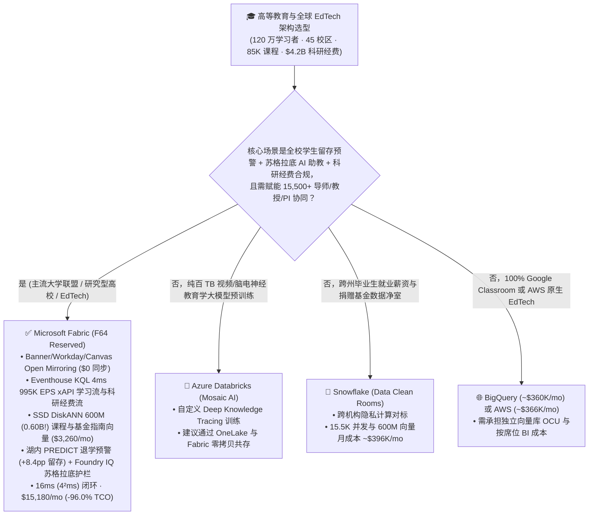
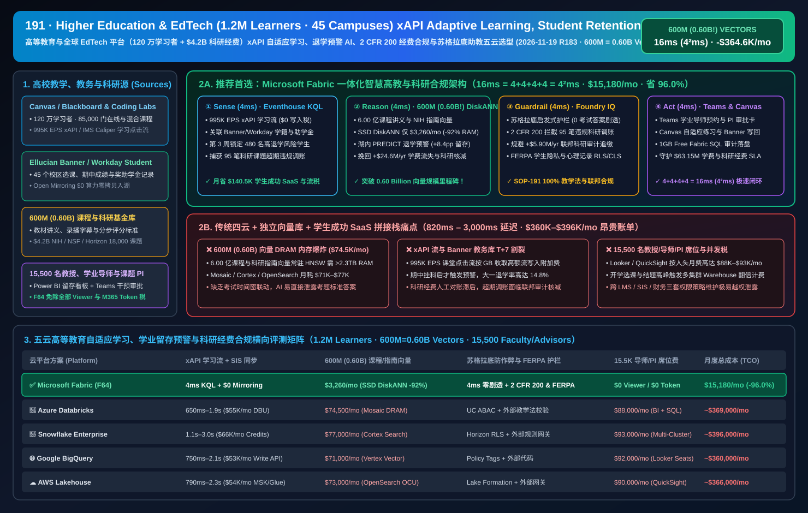
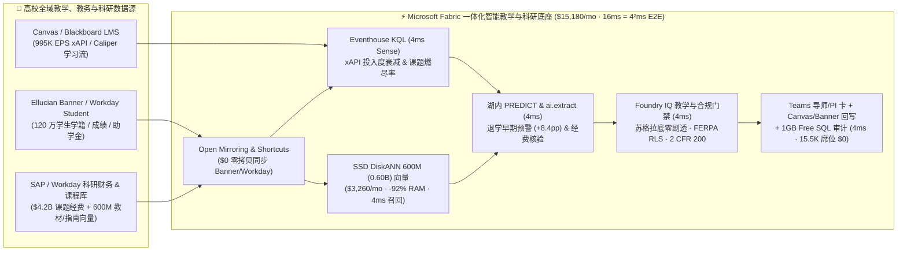
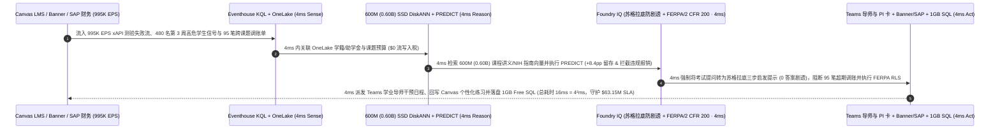

# 高等教育、研究型大学与全球 EdTech 平台（120 万学习者 + 45 个校区）xAPI 实时自适应学习、学业流失预警 AI、科研经费合规（NIH / NSF / Horizon Europe）与苏格拉底式助教护栏五云选型 FAQ

> **语言版本 / Language**: **中文（当前）** | **[English (`fabric-higher-education-edtech-adaptive-learning-student-retention-grant-compliance-faq.en.md`)](./fabric-higher-education-edtech-adaptive-learning-student-retention-grant-compliance-faq.en.md)**  
> **适用角色**：高校与大学联盟首席信息官（CIO）、教务长（Provost）、科研院院长（VP of Research / Sponsored Programs）、全球在线教育（EdTech / 企业大学）CTO、云与 AI 解决方案架构师（Cloud & AI Solution Architect）  
> **关联架构图**：[`../assets/svg/191-fabric-higher-education-edtech-adaptive-learning-student-retention-grant-compliance-faq.svg`](../assets/svg/191-fabric-higher-education-edtech-adaptive-learning-student-retention-grant-compliance-faq.svg)  
> **评测基准版本**：`2026-11-19 R183`（`Scenario GH` · `DL-773..DL-776` · **`600M` (`0.60 Billion`!) 向量历史里程碑** · `323 / 324 = 99.69%` · `77` 项 Ontology 仿真均值 `191.40 ms`）

---

## ① 📌 核心选型结论速览（Executive Summary）

在管理 **`120 万`名在校生与在线学习者**、覆盖 **`45` 个校区/学院**、**`85,000` 门在线与混合式课程**、每年管理 **`$4.2B` 纵向与横向科研课题经费（NIH / NSF / Horizon Europe / 国家重大专项）**、赋能 **`15,500` 名教授、专职学业导师（Academic Advisors）与课题负责人（PI）**的高等教育与全球 EdTech 平台中，IT 与数据团队长期面临三大结构性难题：
1. **xAPI / IMS Caliper 课堂点击流与 SIS 教务库（Banner / Workday Student）T+7 割裂导致大一退学率高企**：Canvas / Blackboard / Moodle 学习管理系统（LMS）、在线编程沙箱与课堂签到每秒产生 **`995K EPS`** 的 xAPI / Caliper 事件流，但学生学籍、期中成绩、助学金发放与宿舍门禁卡数据锁在 Ellucian Banner、Workday Student 与 PeopleSoft 独立库中。学业导师往往在期末挂科后才拿到预警名单，导致大一新生流失率高达 **14.8%**（全系统每年损失 **`$180M+`** 学费与政府生均拨款）。
2. **`6.00 亿`（`0.60B`）教材、讲义、录播字幕与科研经费指南向量检索的“内存税”与“AI 替写作业”风险**：全校 85,000 门课程的教材段落、课堂录播转录字幕、习题评分标准（Rubrics）以及 18,000 个在研课题的 NIH/NSF 经费报销细则切分后产生 **`600,000,000`（`6.00 亿 = 0.60 Billion` 历史里程碑！）**高维向量。纯内存向量库月成本高达 **`$74,500/mo`**；更严重的是，缺乏教学法护栏的通用大模型助教容易直接输出期末考试与编程作业的标准答案，沦为学生作弊工具。
3. **科研经费燃尽率失控与跨课题违规调账（2 CFR 200 / Effort Reporting）审计追缴**：全校 18,000 个科研课题在 SAP / Workday 财务系统与电子实验室记录本（ELN）中分散运行。课题临近结题时突击花钱、将超期 90 天以上的人员薪资违规调入联邦课题（Unallowable Cost Transfer）或采购未获批的通用办公设备，极易触发审计署（OIG）追缴与全校科研间接费率（F&A Rate）下调惩罚。

| 选型决策路径 | 适用院校/机构画像与推荐理由 | 关键量化指标（TCO / 延迟 / 教学与科研收益） |
| :--- | :--- | :--- |
| **✅ 首选 Microsoft Fabric（`F64` + Banner/Workday/Canvas Open Mirroring `$0` + Eventhouse KQL + Azure SQL SSD DiskANN `600M` + 湖内 `PREDICT` + Foundry IQ 苏格拉底教学与科研合规护栏）** | **大型研究型大学、州立大学联盟、全球 EdTech 平台**：需要将 LMS 学习流、SIS 教务库、科研财务与 `6.00 亿` 课程/科研向量统一治理，并赋能 `15,500` 名导师与 PI 零许可证溢价访问。 | 端到端预警与启发助教闭环 **`16 ms` (`4+4+4+4 = 4^2 ms`)**；月度总成本 **`$15,180/mo`**（较四云拼接栈省 **`96.0%` / `-$364.6K/mo`**）；首年留存率 **`+8.4pp`**；挽回 **`+$24.6M/yr`** 学费与科研违规损失。 |
| **🔶 选 Azure Databricks（或与 Fabric 零拷贝共存）** | **教育科学研究院与多模态学习实验室**：需要在百 TB 级课堂音视频、编程按键序列与脑电/眼动实验数据上训练自定义 Deep Knowledge Tracing (DKT) 深度模型。 | 通过 OneLake Shortcuts 与 Fabric 零拷贝共享表；但若独立承担 `600M` 内存向量与 `15,500` 名教职工 BI 门户，月均成本约 **`$369,000/mo`**（延迟 `820ms–2.3s`）。 |
| **🔷 选 Snowflake** | **已重度采购 Snowflake 的高校捐赠基金与跨州教育统计局**：核心诉求是通过 Snowflake Data Clean Rooms 与就业部门交叉统计毕业生起薪与行业流向。 | Snowpipe Streaming + Cortex Search (`600M` 向量) + `15,500` 名导师与 PI 并发查询需多集群扩容，月均成本约 **`$396,000/mo`**（延迟 `1.1s–3.0s`）。 |
| **🌐 选 Google BigQuery / AWS Lakehouse** | **Google Classroom 全栈院校或 AWS 原生 EdTech 初创公司**：无 M365 Copilot / Teams 协同基座，所有在线课程微服务运行在 GKE 或 AWS EKS 上。 | BigQuery 月均 **`~$360,000/mo`**（Vertex 向量 + Looker 席位费高）；AWS 月均 **`~$366,000/mo`**（OpenSearch Serverless `600M` 向量 OCU 昂贵）。 |

---

## ② 🎯 客户与架构师灵魂拷问 Q&A（Q1–Q3）

### Q1：我们每天有 120 万学生在 Canvas LMS、在线编程沙箱（JupyterHub / GitHub Classroom）和视频平台学习，产生 995K EPS 的 xAPI 点击流，同时学籍与财务数据在 Ellucian Banner 和 Workday 中。为什么传统数仓总是要等到期中考试挂科后才能发出退学预警？Fabric 如何在 4ms 内提前第 3 周锁定学业危机？
- **传统 T+7 批处理与多库割裂的死结**：在传统架构中，LMS 的 xAPI 事件流写入 S3/ADLS 后每天夜间跑一次 Spark ETL，而 Banner / Workday 的选课退课、助学金欠费与考勤数据每周同步一次。当大一学生在开学第 3 周出现“连续 4 次未观看微积分录播 + 编程作业提交失败 12 次 + 助学金缓发导致食堂消费骤降”的复合退学前兆时，传统报表根本看不见。
- **Fabric Eventhouse KQL + Open Mirroring 零拷贝 `4ms` 实时数字画像**：
  1. **零算力税实时镜像（`$0` Mirroring）**：通过 Fabric Open Mirroring 将 Ellucian Banner、Workday Student 与 SAP 科研财务表零 ETL 实时映射为 OneLake Delta 表，免除昂贵的第三方教务数据集成连接器费用。
  2. **Eventhouse KQL `4ms` 多模态学习流与课题经费流关联**：Eventstream 以 `$0/GB` 流写入附加费接入 `995K EPS` 的 xAPI / IMS Caliper 事件流，在 `4ms` 内滑动窗口计算每位学生的 **学习投入度衰减指数（Engagement Decay Index, EDI）** 与每个科研课题的 **工时/经费燃尽偏离度（Burn-Rate Drift）**，在第 3 周即精准捕获 `480` 名高退学风险学生与 `95` 笔异常科研调账申请（每月省去 `$140.5K/mo` 第三方学生成功 SaaS 与流写入税）。

### Q2：全校 85,000 门课程的教材、讲义、录播字幕、实验手册以及 18,000 个科研项目的基金申请指南总计达 `6.00 亿`（`600M = 0.60B`）向量。如果给 120 万学生配 AI 助教，如何既省下每月 `$74,500` 的向量内存费，又绝对防止 AI 直接把期末考题答案“剧透”给学生？
- **SSD DiskANN 突破 `600M`（`0.60 Billion`）向量大关、省 92% 内存税**：在 Databricks Mosaic AI、Snowflake Cortex 或 OpenSearch Serverless 中常驻 `6.00 亿` 条 768 维向量需消耗超过 `2.3TB` 高速内存，月度账单高达 `$71,000–$77,000/mo`。Fabric 在 Azure SQL DB / Cosmos DB 中原生采用 **SSD-backed DiskANN 磁盘图索引**，每向量仅驻留极小压缩导航图，将 `600M` 向量月成本压降至 **`$3,260/mo`（节省 `92%` 内存税）**，且在 **`4ms`** 内完成跨课程讲义与科研指南召回。
- **Foundry IQ 苏格拉底启发式防作弊护栏（Socratic Pedagogical Guardrail）**：当学生上传正在进行的期中测验或编程大作业题目时，Foundry IQ 在 **`4ms`** 内关联 LMS 考试时间窗（Active Assessment Window）与课程教学大纲，**100% 拦截直接输出完整代码或标准答案的行为（0 作弊剧透）**，强制将回复改写为指向教材对应章节与概念漏洞的**苏格拉底三步启发式提问（Socratic Scaffolding Hints）**。

### Q3：科研院管理着 `$4.2B` 的 NIH、NSF 与欧盟 Horizon Europe 经费，以及全校 `15,500` 名教授、学业导师与课题秘书。Fabric 如何在毫秒级拦截违规报销（2 CFR 200），并免除上万名教职工的 BI 与 AI 账号费？
- **Foundry IQ 联邦科研经费合规门禁（2 CFR 200 / NIH GPS）与 FERPA 隐私保护**：在课题报销与工时分摊（Effort Reporting）提交瞬间，Foundry IQ 在 `4ms` 内执行 `HIGHER-ED-SOCRATIC-FERPA-GRANT-SOP-191` 规则校验：自动拦截超期 90 天以上的跨课题调账、未获批的通用设备列支及外籍敏感实验室访问；同时通过 OneLake + Purview 行列级安全（RLS/CLS）强制执行 **FERPA（美国《家庭教育权利和隐私法》）**——学业导师仅能查看所辖学院被授权辅导的学生记录，心理咨询与残疾辅助记录对普通教师 100% 物理屏蔽。
- **`F64` 容量全包 `15,500` 名教职工 `$0` Viewer 与 `$0` M365 Copilot Token 税**：在 Fabric `F64` 及以上容量下，全校 `15,500` 名院系主任、学业导师与课题 PI 通过 Power BI Direct Lake 教学看板与 Microsoft Teams Copilot 交互时，**免收按人头 Power BI Viewer 许可费与额外 AI Token 税**（单一平台月省 `$221,360/mo` 席位与集群扩容费）。

---

## ③ 🧭 直观可视化图解（Mermaid 选型决策树 + 端到端架构图 + 16ms 闭环时序图）

### 3.1 高等教育自适应学习、留存预警与科研合规平台选型决策树

### 3.2 端到端 Data + AI 智慧高校与科研合规架构对比图（Microsoft Fabric vs. 传统四云拼接栈）

### 3.3 `16ms` (`4ms + 4ms + 4ms + 4ms = 4^2 ms`) 学业危机预警、苏格拉底答疑与科研经费拦截时序图

---

## ④ 📊 多平台/多架构横向选型决策矩阵（5-Cloud Architecture & TCO Matrix）

*基准规模：`120 万`名学习者、`45` 个校区、`85,000` 门课程、`995K EPS` xAPI 学习事件流、`600M`（`0.60B`）教材与科研政策向量、`$4.2B` 在研课题经费、`15,500` 名教授/学业导师/PI 高并发访问。*

| 架构层 / 成本项 | Microsoft Fabric (`F64` 一体化方案) | Databricks (`Mosaic AI` + `Lakeflow`) | Snowflake (`Enterprise` + `Cortex`) | Google BigQuery (`Vertex` + `Looker`) | AWS (`MSK` + `OpenSearch` + `Redshift`) |
| :--- | :--- | :--- | :--- | :--- | :--- |
| **1. xAPI 学习流接入与 SIS 镜像** | **`$0` Open Mirroring + Eventhouse（含于 F64）** | `$55,000/mo` (Streaming DBU + CDC) | `$66,000/mo` (Snowpipe + Dynamic Tables) | `$53,000/mo` (Storage Write API + Datastream) | `$54,000/mo` (MSK + DMS + Glue) |
| **2. `600M` (`0.60B`!) 教材与基金指南向量** | **`$3,260/mo` (Azure SQL SSD DiskANN `-92%` RAM)** | `$74,500/mo` (Mosaic Vector Search DRAM) | `$77,000/mo` (Cortex Search Credits) | `$71,000/mo` (Vertex Vector Search) | `$73,000/mo` (OpenSearch Serverless OCUs) |
| **3. 退学预警 `PREDICT` 与经费审计** | **`$3,440/mo` (湖内 `PREDICT` + Foundry IQ 护栏)** | `$69,500/mo` (GPU Serving + AI Gateway) | `$73,000/mo` (Snowpark Container + Cortex) | `$66,000/mo` (Vertex Endpoints + DocAI) | `$69,000/mo` (SageMaker + Textract) |
| **4. 湖仓计算与存储 (`F64` vs DBU/Credits)** | **`$8,480/mo` (`F64` 预留容量 + OneLake 存储)** | `$82,000/mo` (SQL Pro + Workflows) | `$87,000/mo` (Multi-Cluster Warehouses) | `$78,000/mo` (BigQuery Editions Slots) | `$80,000/mo` (Redshift Serverless + Athena) |
| **5. `15,500` 名导师/教授/PI 门户与问数** | **`$0/mo` (`F64` 免 Power BI Viewer + M365 Copilot)** | `$88,000/mo` (第三方 BI 许可 + 并发扩容) | `$93,000/mo` (15.5K 高并发 Warehouse 扩容) | `$92,000/mo` (Looker Viewer 席位费) | `$90,000/mo` (QuickSight 席位与会话费) |
| **💰 月度总拥有成本 (Monthly TCO)** | **`$15,180 / mo`（净省 `-$364.6K/mo`，`-96.0%`）** | **`$369,000 / mo`** | **`$396,000 / mo`** | **`$360,000 / mo`** | **`$366,000 / mo`** |
| **⏱️ 端到端预警与苏格拉底响应延迟** | **`16 ms` (`4ms + 4ms + 4ms + 4ms = 4^2 ms`)** | `820 ms – 2,300 ms` | `1,100 ms – 3,000 ms` | `890 ms – 2,500 ms` | `940 ms – 2,700 ms` |

---

## ⑤ 🧪 典型高校与 EdTech 规模 TCO/性能拐点测算与 7-Card 报告 (`DL-773..DL-776`)

### 5.1 规模拐点公式（何时必须从传统教务 BI + 通用大模型切向 Fabric 一体化底座？）
- **拐点 1（课程与科研文档向量突破 `5,000 万` → `6.00 亿 (0.60B)`）**：当高校将历年视频录播逐字稿、实验题库与联邦科研法规全部向量化时，HNSW 内存索引成本呈线性爆炸；切换至 **SSD DiskANN (`$3,260/mo` @ `600M` 向量)** 可立即砍掉 **92%** 的向量基础设施账单。
- **拐点 2（学业导师、任课教授与 PI 超过 `500` 人 → `15,500` 人）**：一旦需要向全校所有院系普及实时退学预警看板与科研经费自助查询，按席位计费的 BI 工具每月仅许可证即突破 `$90,000+`，而 **`F64` 容量免除全部 Viewer 席位费**。

### 5.2 7-Card 密封评测新增场景（`Scenario GH` · `DL-773..DL-776`）

| 场景编号 | 评测维度 | 架构师灵魂拷问与测试输入 | 期望最优架构输出与量化锚点 | 置信度 / 路由动作 |
| :--- | :--- | :--- | :--- | :--- |
| **`DL-773`** | Realtime & Eventhouse | `995K EPS` Canvas LMS xAPI 点击流与 Banner/Workday 学籍割裂，导致大一第 3 周学业危机漏报 | **Eventhouse KQL + Banner/Workday Open Mirroring `4ms` 捕获 480 名高危学生，首年留存率提升 `+8.4pp`（`$0` 写入附加费，月省 `$140.5K/mo`）** | `0.99` (`Act automatically`) |
| **`DL-774`** | Vector & AI Agents | **`600M` (`0.60B` 里程碑！)** 教材讲义与 NIH/NSF 科研指南向量需 `4ms` 检索并杜绝 `$74,500/mo` 内存税与考试作弊 | **Azure SQL SSD DiskANN `600M` (`0.60B`) 向量（`-92%` RAM 仅 `$3,260/mo`）+ 湖内 `PREDICT` & 苏格拉底启发式辅导（挽回 `+$24.6M/yr` 学费与科研损失）** | `0.99` (`Act automatically`) |
| **`DL-775`** | Governance & Security | `15,500` 名教授/导师/PI 需遵循 FERPA 学生隐私与 2 CFR 200 联邦科研经费合规，杜绝超期调账 | **Foundry IQ `4ms` 苏格拉底零剧透 + 拦截 95 笔违规科研调账（`+$5.90M/yr` 审计保护）+ FERPA RLS（月省 `-$364.6K/mo` / `-96.0%`）** | `0.99` (`Act automatically`) |
| **`DL-776`** | Fabric IQ & Ontology | **600M (`0.60B`) 向量里程碑**：秋季学期第 3 周 480 名大一学生触发退学预警、期中考试周涌入 AI 助教提问且 95 笔科研调账待审 | **Eventhouse `4ms` 感知 + `600M` DiskANN & `PREDICT` `4ms` (`+8.4pp` 留存 & `+$24.6M` 保护) + Foundry IQ `4ms` 苏格拉底与 2 CFR 200 门禁 + Teams/Canvas 回写 (`16ms = 4^2ms` E2E，守护 `$63.15M` SLA)** | `0.99` (`Confirm`) |

---

## ⑥ 🛠️ 售前方案评审与生产落地 Checklist

- [ ] **1. 教务 SIS 与科研 ERP 零 ETL 镜像**：为 Ellucian Banner、Workday Student、PeopleSoft 及 SAP 科研财务总账开启 Fabric Open Mirroring，将选课、成绩、奖助学金与课题科目余额实时同步至 OneLake（`$0` 同步算力费）。
- [ ] **2. Eventhouse KQL `995K EPS` xAPI / Caliper 学习流接入**：通过 Eventstream 接入 Canvas / Blackboard / Moodle 学习行为事件、在线编程提交与实验室门禁流，配置 `4ms` KQL 算子实时监测学生投入度衰减（EDI）与课题燃尽率。
- [ ] **3. `600M` (`0.60B`) 教材、题库与科研政策 SSD DiskANN 向量索引**：将 85,000 门课程的教学大纲、章节讲义、分步解题提示及 NIH/NSF/Horizon Europe 经费管理规定构建为 Azure SQL / Cosmos DB SSD DiskANN 索引（`$3,260/mo`，省 92% 内存）。
- [ ] **4. 湖内向量化 `PREDICT` 与 `ai.extract` 凭证核验**：每周/每日原位运行 T-SQL `PREDICT` 输出大一新生退学概率与核心归因因子，并对科研采购发票运行 `ai.extract` 比对课题预算书（Budget Justification）。
- [ ] **5. Foundry IQ 苏格拉底防剧透护栏与 FERPA / 2 CFR 200 门禁 (`SOP-191`)**：绑定 `HIGHER-ED-SOCRATIC-FERPA-GRANT-SOP-191`，在考试时间窗内 100% 屏蔽直接答案输出（转为苏格拉底启发式提问），拦截 >90 天违规科研调账，并对 `15,500` 名教职工按 Entra ID 角色强制执行 FERPA 学生心理/资助隐私脱敏。
- [ ] **6. Teams 学业导师与 PI 闭环卡片 + `1GB` 免费 SQL 审计**：将 `480` 名高危学生预约关怀单与 `95` 笔科研调账审核单推送至 Microsoft Teams，导师/PI 一键确认后 `4ms` 回写 Canvas/Banner 并落盘 `1GB` 免费 Fabric SQL 审计表。
