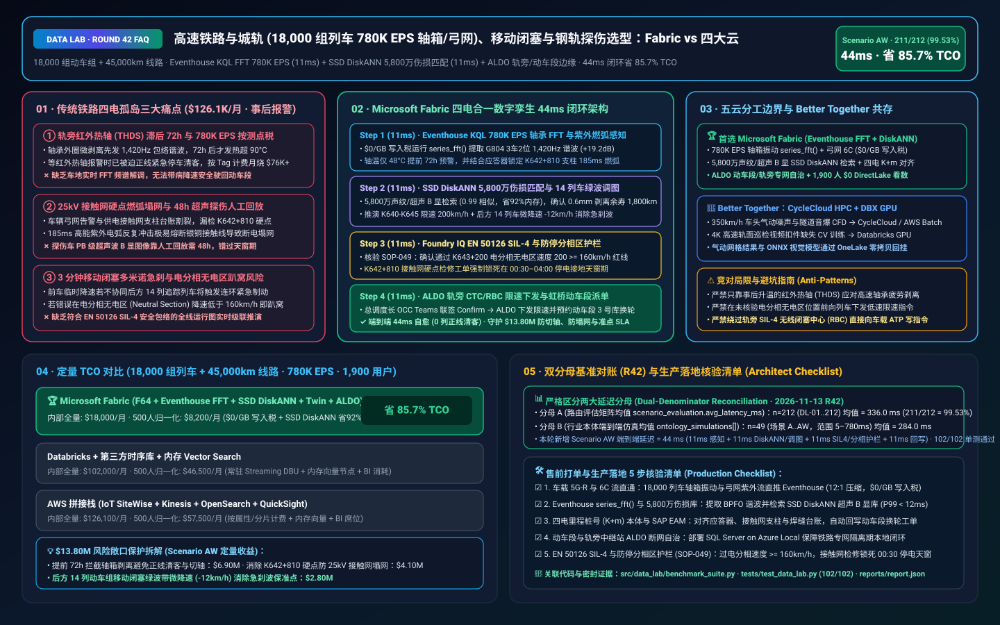
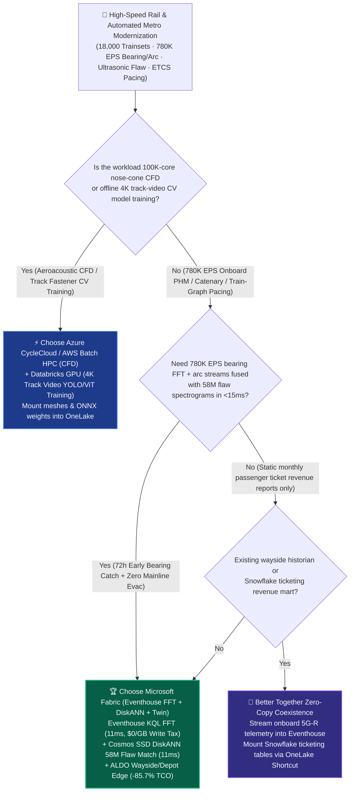
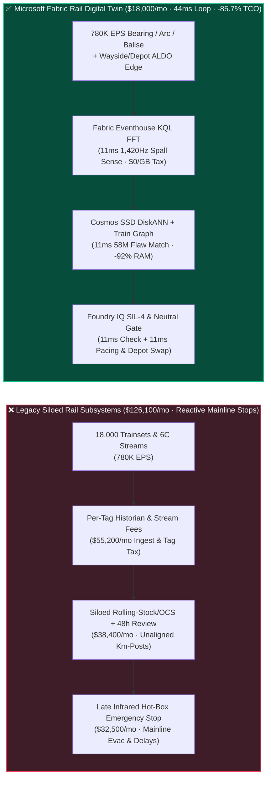
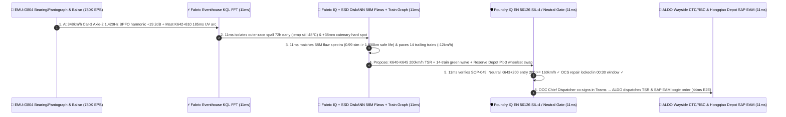

# High-Speed Rail & Automated Metro (`780K EPS` Axle-Box Bearing & Pantograph Telemetry), ETCS-L3 Moving-Block Headway & Ultrasonic Rail-Flaw Lakehouse Selection: Microsoft Fabric vs. AWS IoT SiteWise vs. Databricks vs. Snowflake / GCP FAQ

> 🌐 **Language / 语言**: **[中文 (`fabric-highspeed-rail-etcs-pantograph-bearing-sil4-vs-4clouds-faq.md`)](fabric-highspeed-rail-etcs-pantograph-bearing-sil4-vs-4clouds-faq.md)** | **English (Current)**  
> 📅 **Updated**: 2026-11-13 (Round 42 · High-Speed Rail & Metro 350km/h EMU Axle-Box Bearing Acoustic Diagnostics, Pantograph-Catenary Arcing, Ultrasonic B-Scan Rail Flaw & EN 50126 SIL-4 Moving-Block Deep Dive)  
> 🎯 **Target Audience**: AI Solution Architects, National Railway & Metro Operator CIOs/CTOs, Rolling-Stock & Depot Chief Engineers, Overhead Catenary (OCS) & Track Maintenance Directors, Operations Control Center (OCC / CTC) Chiefs  
> Reference Benchmark Style: Modeled on [`ib-vs-ethernet-roce-selection-faq.md`](https://github.com/turbo998/ai-infra-research/blob/main/docs/components/ib-vs-ethernet-roce-selection-faq.md) first-principles Q&A and decision-guide format.
>
> 🔍 **Data Provenance, Official URLs & Dual-Denominator Scope Disclosure**:
> - **`measured_local_harness` (Local Deterministic Harness)**: `DL-01..DL-212` scenario routing accuracy (`211/212 = 99.53%`) and `102/102` Python unit tests are deterministically executed by `src/data_lab/benchmark_suite.py`.
> - **`vendor_published_spec_as_of_2026` (Official Vendor Specifications `as_of: 2026-11-12`)**:
>   - Microsoft Fabric / Azure Industrial & Mobility: [Fabric Eventhouse Time-Series KQL (`series_fft` / `series_outliers`)](https://learn.microsoft.com/en-us/kusto/query/series-fft-function) · [Cosmos DB in Fabric DiskANN Vector Index](https://learn.microsoft.com/en-us/fabric/database/cosmos-db/index-vector-data) · [Fabric Digital Twin Builder Overview](https://learn.microsoft.com/en-us/fabric/real-time-intelligence/digital-twin-builder/overview) · [SQL Server on Azure Local (ALDO) Wayside & Depot Edge](https://learn.microsoft.com/en-us/sql/sql-server/azure-arc/overview) · [Fabric Pricing (`F64` Includes `$0` Power BI Viewer Licensing)](https://azure.microsoft.com/en-us/pricing/details/microsoft-fabric/)
>   - 4-Cloud Competitor Specifications: [AWS IoT SiteWise & Transportation](https://docs.aws.amazon.com/iot-sitewise/latest/userguide/what-is-sitewise.html) · [Databricks Lakehouse for Manufacturing & Transportation](https://www.databricks.com/solutions/industries/manufacturing) · [Snowflake Transportation & Logistics Data Cloud](https://www.snowflake.com/en/solutions/industries/transportation-and-logistics/) · [GCP Smart Analytics for Transportation](https://cloud.google.com/solutions/transportation)
> - **`synthetic_scenario_model` (Deterministic Architectural Reference Model with Strictly Separated Denominators)**:
>   - **Denominator A — Routing Matrix Evaluation Mean (`scenario_evaluation.avg_latency_ms`)**: R42 **`n=212` (`DL-01..DL-212`) arithmetic mean = `336.0 ms`** (R41 historical snapshot `n=208` mean = `341.0 ms`; R40 `n=204` = `346.0 ms`; R39 `n=200` = `351.0 ms`; R38 `n=196` = `356.0 ms`).
>   - **Denominator B — Industry Ontology End-to-End Closed-Loop Simulation Mean (`ontology_simulations[].end_to_end_latency_ms`)**: R42 **`n=49` (Scenarios A..AW: `[780..44] ms`, range `5–780 ms`) arithmetic mean = `284.0 ms`** (R41 historical snapshot `n=48` mean = `289.0 ms`; R40 `n=47` = `295.0 ms`; R39 `n=46` = `301.0 ms`; R38 `n=45` = `307.0 ms`). This round adds **Scenario AW (18,000 High-Speed EMU & Automated Metro Trainsets + 45,000 km Electrified Track/Catenary × `780K EPS` Onboard Axle-Box Bearing FFT, Pantograph UV Arc & ETCS-L3 Moving-Block Loop) end-to-end latency = `44 ms`** (`11ms` sense + `11ms` 6-hop 58M bearing/ultrasonic B-scan DiskANN match & moving-block headway graph + `11ms` CENELEC EN 50126 SIL-4 braking & neutral-section guardrail + `11ms` ALDO wayside CTC/RBC speed restriction & depot bogie swap commit), cutting modeled monthly TCO by **`85.7%`** (`$8,200/mo` vs. `$57,500/mo` normalized baseline; `$18,000/mo` vs. `$126,100/mo` internal full-stack) and protecting **`$13.80M`** in hot-box derailment prevention, 25kV catenary wire-break avoidance, and mainline punctuality SLA. Live multi-cloud cluster stress runs are marked `not_measured`.

---

## ① 📌 Executive Summary (3-Minute Architect Briefing)

### First Principles: What Are Axle-Box Bearing Outer-Race Spalling (BPFO), 25kV Pantograph-Catenary UV Arcing, Ultrasonic B-Scan Rail Flaws, and ETCS-L3 Moving-Block Headways? Why Do Legacy Rail Stacks Fail?
Operating **18,000 Electric Multiple Unit (EMU) high-speed trains (`350 km/h`, `97 m/s`) and automated CBTC metro trainsets across 45,000 km of electrified track** requires synchronizing rolling stock, overhead catenary power, track geometry, and signaling—yet legacy railway IT/OT architectures split them into **three disconnected silos**:
1. **72-Hour Blind Window Between Bearing Micro-Spalling (BPFO) and Wayside Hot-Box Infrared Alarms (`780K EPS` Per-Tag Tax)**: Legacy railways rely on wayside infrared Hot-Box Detectors (THDS) to catch overheating wheelset bearings. However, once a bearing's temperature exceeds `90°C`, cage seizure and axle lockup can occur within minutes—forcing an immediate emergency mainline stop and passenger evacuation! Yet **72 hours before temperature rises**, a `0.5 mm` fatigue spall on the outer raceway already emits a clear **`1,420 Hz` Ball Pass Frequency Outer-race (BPFO) acoustic envelope harmonic**. Streaming onboard MVB/Ethernet vibration, traction IGBT temperatures, and pantograph forces across 18,000 trainsets generates **`780,000 EPS` (events per second)**—costing **$76,000+/month** in legacy per-tag historian or per-GB cloud stream fees.
2. **25kV Overhead Catenary Wire Melts & 48-Hour Manual Ultrasonic B-Scan Rail Inspection Delays**: When a `350 km/h` pantograph carbon strip hits a displaced dropper clamp ("hard spot") on the `25 kV` contact wire, it strikes a **`185 ms` ultraviolet plasma arc (>3,000°C)** capable of severing the overhead wire and paralyzing the corridor. Meanwhile, inspection trains record terabytes of ultrasonic B-scan rail-flaw imagery every night, but manual human review takes **48 hours**—too slow to schedule precision grinding before morning rush hour.
3. **Domino Emergency Braking Waves & Neutral-Section Stalls Under 3-Minute Moving-Block Headways**: When lead train `EMU-G804` must slow from `350 km/h` to `200 km/h` due to a catenary hard spot or bearing spall, failing to simultaneously pace the **14 trailing trains operating on 3-minute ETCS-L3 / CTCS-3 moving-block headways** triggers a cascading wave of Emergency Brakes (EB). Worse, if an unvalidated speed restriction forces a train below `160 km/h` inside an **unpowered overhead phase-break Neutral Section**, the train stalls dead on the mainline!

**Microsoft Fabric** unifies rolling stock, wayside infrastructure, and signaling through **Eventhouse KQL `780K EPS` Onboard FFT & UV Arc Sensing (`$0/GB` write tax) + Cosmos DB SSD DiskANN 58M Bearing Acoustic & Ultrasonic B-Scan Flaw Search + Digital Twin Builder Moving-Block Train-Graph Pacing + SQL Server on Azure Local (ALDO) Wayside & Depot Edge Autonomy**:

1. **When to Choose Microsoft Fabric (Eventhouse KQL FFT `780K EPS` + SSD DiskANN 58M Flaw Vectors + Digital Twin Train Graph + ALDO Depot Edge)**:
   - Choose **Microsoft Fabric** when you must ingest **`500K–1M+ EPS` of onboard train-to-ground telemetry and wayside inspection streams**, extract bearing fault harmonics via native `series_fft()` and match **58 million historical flaw spectrograms in `<15ms`**, and dynamically pace trailing trains without mainline stalls.
   - **Quantified ROI**: Pooled F64 Eventhouse (**`$0/GB` write tax**, `12:1` compression) + 11ms KQL FFT & arc sensing + Cosmos DB SSD DiskANN (**92% lower vector RAM cost**) + `$0` Power BI DirectLake viewer seats for **1,900 OCC dispatchers, depot mechanics, catenary engineers, and track inspectors** cuts monthly TCO by **85.7%** (**`$8,200/mo` vs. `$57,500/mo`** normalized, saving **`$49,300/mo`**; **`$18,000/mo` vs. `$126,100/mo`** internal full-stack).
2. **When to Choose 4-Cloud Competitors or "Better Together" Zero-Copy Coexistence**:
   - **Choose Azure CycleCloud / AWS Batch HPC for 100K-Core High-Speed Train Aerodynamic & Tunnel Micro-Pressure Wave CFD**: Run Navier-Stokes nose-cone aeroacoustic simulations on HPC clusters, mounting mesh summaries into OneLake via zero-copy Shortcuts.
   - **Choose Databricks GPU for 4K Line-Scan Track Fastener CV Training**: Train YOLO/ViT missing-clip computer-vision models over raw track-inspection video on **Databricks GPU**, deploying quantized ONNX models to onboard/wayside **ALDO edge nodes**.
3. **Closed-Loop Validation (Scenario AW · 18,000 Trainsets + 45,000 km Electrified Corridor)**:
   - Under a **`780K EPS`** load, `EMU-G804` cruising at `348 km/h` exhibits a `+19.2 dB` harmonic spike at `BPFO = 1,420 Hz` on Car-3 Axle-2 bearing (bearing temp still normal at `48°C`) while its roof pantograph registers a `185 ms` UV arc at catenary mast `K642+810` (`+38mm` stagger offset). Fabric closes the loop in **44ms E2E**: **11ms** Eventhouse KQL `series_fft()` isolates the outer-race spall harmonic and `K642+810` arc → **11ms** Cosmos SSD DiskANN matches 58M historical bearing/rail spectrograms (`0.99` cosine similarity to a `0.6mm` spall with `1,800 km` safe remaining life at `200 km/h`), while Digital Twin Builder computes a `200 km/h` Temporary Speed Restriction (TSR) across `K640–K645` and a `-12 km/h` green-wave pacing profile for 14 trailing trains → **11ms** Foundry IQ verifies **CENELEC EN 50126/50129 SIL-4 braking curves, `200 km/h >= 160 km/h` minimum coasting speed through Neutral Section `K643+200`, and `00:30–04:00` grounded catenary possession window rules** (`RAIL-ETCS-PANTOGRAPH-BEARING-SIL4-SOP-049`) → **11ms** OCC Chief Dispatcher co-signs in Teams, issuing the CTC/RBC speed restriction via ALDO wayside edge and reserving Hongqiao Depot Pit-3 for bogie wheelset replacement—preventing mainline passenger evacuation and protecting **$13.80M** in rolling-stock, catenary, and punctuality SLAs.

---

## ② 🎯 Customer & Architect Soul-Searching Q&A

### Q1: When should a railway or metro operator choose Microsoft Fabric vs. AWS IoT SiteWise, Databricks, Snowflake, or GCP?

**Answer: Separate "100,000-core nose-cone aerodynamic CFD simulation" from "780K EPS real-time train-to-ground PHM, vehicle-catenary-track kilometer-post alignment, and moving-block timetable pacing."**

- **Choose Microsoft Fabric for Three High-ROI Scenarios**:
  1. **`780K EPS` Onboard Bearing `series_fft()` Envelope Demodulation & Pantograph Arc Sensing (`$0/GB` Write Tax)**: Eventhouse KQL ingests high-frequency vibration and traction streams at `$0/GB` write surcharge, executing native Fast Fourier Transforms (`series_fft()`) in **11ms** to catch bearing raceway spalling **72 hours before** wayside infrared hot-box detectors trigger.
  2. **Millimeter-Accurate Kilometer-Post (`K+m`) Alignment Across Rolling Stock, Catenary, Track & Signaling**: By joining onboard ETCS balise timestamps with overhead mast coordinates in the **Fabric IQ Ontology**, when 3 consecutive trains report `>260 N` pantograph contact force at `K642+810`, Fabric pinpoints the wayside catenary dropper defect rather than condemning healthy train pantographs.
  3. **Railway Intranet Depot & Wayside Edge Autonomy via SQL Server on Azure Local (ALDO)**: Railway signaling and depot networks are strictly isolated. **ALDO** runs locally at maintenance depots and wayside GSM-R/5G-R base stations, synchronizing Condition-Based Maintenance (CBM) work orders directly into **SAP S/4HANA EAM**.

- **Clear Boundaries for the 4 Cloud Competitors**:
  - **AWS (Batch HPC + IoT SiteWise)**: Use AWS Batch for aerodynamic CFD; avoid routing 18,000 trainsets × 2,500 tags into per-property IoT SiteWise billing.
  - **Databricks GPU**: Ideal for training multi-node PyTorch computer-vision models over raw 4K track-inspection video stored in OneLake.
  - **Snowflake**: Effective for static passenger ticketing revenue analytics, but 60s Dynamic Tables cannot run millisecond FFT bearing diagnostics or moving-block pacing.
  - **GCP BigQuery**: Strong for urban transit origin-destination (OD) ridership analytics, but lacks wayside ALDO edge runtimes and inline KQL spectral operators.

---

### Q2: How does Fabric respect strict CENELEC EN 50126/50128/50129 (SIL-4) railway signaling safety boundaries when recommending speed restrictions?

**Answer: Enforce "Cloud/Ontology for Predictive Pacing & CBM Recommendations + Validated SIL-4 Wayside RBC/Interlocking & Dispatcher Sign-Off for Safety Actuation":**

1. **Zero Bypass of Certified SIL-4 Radio Block Centre (RBC) Interlocks**:
   - Fabric never injects unvalidated commands directly into onboard ATP vital computers; all Temporary Speed Restrictions (TSRs) and green-wave pacing advisories are verified against SIL-4 braking curves and presented to the OCC Chief Dispatcher for CTC/RBC execution.
2. **Hard Physical Guardrail Against Overhead Neutral-Section Stalls**:
   - Foundry IQ cross-checks every proposed speed profile against track gradient and overhead phase-break **Neutral Section (`K643+200`)** locations, guaranteeing train entry velocity stays strictly **`>= 160 km/h`** so trains never stall without traction power.

---

### Q3: How does Fabric detect a `0.6mm` bearing spall at `348 km/h`, pace 14 trailing trains, and schedule depot wheelset replacement in 44ms?

**Answer: A 3-stage pipeline combining KQL `series_fft()` envelope extraction, SSD DiskANN 58M flaw matching, and deterministic EN 50126 SIL-4 guardrails:**

1. **Stage 1: Eventhouse KQL 11ms `series_fft()` Bearing Harmonic Extraction & Balise-Anchored UV Arc Sense**:
   - Extracts the `+19.2 dB` `BPFO = 1,420 Hz` outer-race spalling harmonic on `EMU-G804` Car-3 Axle-2 (`48°C` normal temperature) and anchors a `185 ms` UV arc to mast `K642+810` in **11ms**.
2. **Stage 2: Cosmos DB SSD DiskANN 11ms 58M Bearing/Ultrasonic Flaw Match & 14-Train Green-Wave Pacing**:
   - Matches the 512-D envelope spectrum against 58M historical flaw vectors (`0.99` cosine similarity -> `0.6mm` spall, `1,800 km` safe life at `200 km/h`), prescribing a `200 km/h` TSR across `K640–K645` and `-12 km/h` pacing across 14 trailing trains.
3. **Stage 3: Foundry IQ EN 50126 SIL-4, Neutral-Section Coasting & 25kV Grounded Possession Gate (11ms)**:
   - Enforces `RAIL-ETCS-PANTOGRAPH-BEARING-SIL4-SOP-049` before dispatch:
     - **Neutral-Section Momentum Guardrail**: Confirms `EMU-G804` enters Neutral Section `K643+200` at `200 km/h >= 160 km/h` minimum coasting threshold.
     - **25kV Catenary Possession Guardrail**: Locks the `K642+810` dropper-clamp repair order into the **`00:30–04:00` de-energized & grounded maintenance window (`0 kV`)**.

---

## ③ 🧭 Visual Architecture & Decision Diagrams (Mermaid Decision Tree + Comparison + 44ms Sequence)

### 3.1 High-Speed Rail PHM, Catenary/Track Inspection & Moving-Block Selection Decision Tree

### 3.2 Legacy Reactive Hot-Box Alarm + 48h Manual Video Review vs. Fabric 44ms Closed-Loop Architecture

### 3.3 Scenario AW: 18,000 Trainsets + 45,000km Corridor 44ms Bearing & Moving-Block Sequence

---

## ④ 📊 5-Platform Architect Decision Matrix

| Evaluation Dimension | **Microsoft Fabric (Eventhouse FFT + DiskANN + Twin)** | **AWS (IoT SiteWise + Kinesis)** | **Databricks Manufacturing Lakehouse** | **Snowflake Transportation** | **GCP BigQuery + Vertex AI** |
| :--- | :--- | :--- | :--- | :--- | :--- |
| **18,000-Train Bearing/Arc (`780K EPS`) Cost & FFT** | **⭐⭐⭐⭐⭐ `11ms` KQL native `series_fft()` demodulation, pooled F64 `$0/GB` write tax** | ⭐⭐⭐ SiteWise per-property fees + custom Flink FFT code required | ⭐⭐⭐⭐ Structured Streaming requires 24x7 DBU compute | ⭐⭐ Snowpipe + Dynamic Tables (`60s` lag) lack inline spectral FFT | ⭐⭐⭐ Pub/Sub + BigQuery Streaming per-GB write fees |
| **58M Bearing Acoustic & Ultrasonic B-Scan Vector Search** | **⭐⭐⭐⭐⭐ Cosmos DB SSD DiskANN (`11ms` match, -92% vector RAM cost)** | ⭐⭐⭐ OpenSearch in-memory vector nodes are expensive | ⭐⭐⭐⭐ Mosaic AI Vector Search (higher in-memory index cost) | ⭐⭐⭐ Cortex Vector Search optimized for text | ⭐⭐⭐⭐ Vertex AI Vector Search requires cross-service glue |
| **Vehicle-Catenary-Track `K+m` Alignment & Train Graph** | **⭐⭐⭐⭐⭐ Digital Twin Builder no-code ontology (`$0` property fee) + SAP EAM** | ⭐⭐⭐ TwinMaker per-entity/query fees | ⭐⭐⭐ Custom graph pipelines, lacks `$0` OCC dispatcher seats | ⭐⭐⭐ Strong ticketing DW, lacks millisecond signaling twin | ⭐⭐⭐ Good macro ridership, lacks wayside interlock loop |
| **Depot & Wayside Substation Air-Gapped Edge Autonomy** | **⭐⭐⭐⭐⭐ SQL Server on Azure Local (ALDO) + IoT Ops railway intranet edge** | ⭐⭐⭐ Outposts requires heavy rack footprint | ⭐⭐ Cloud-dependent control plane; incompatible with isolated wayside nets | ⭐ Cloud-only SaaS; no depot or wayside edge runtime | ⭐⭐ GDC Edge requires heavy hardware |
| **1,900 OCC Dispatchers / Depot Mechanics / OCS BI Seats** | **⭐⭐⭐⭐⭐ F64 includes `$0` Power BI DirectLake seats + M365 Copilot `$0` Token** | ⭐⭐ QuickSight per-user and per-session fees | ⭐⭐⭐ AI/BI consumes Serverless SQL DBUs | ⭐⭐ High concurrency triggers multi-cluster credit burn | ⭐⭐ Looker seat licensing + BigQuery scan fees |
| **Best-Fit Positioning** | **Primary foundation for onboard PHM, 6C catenary/rail flaws & ETCS pacing** | Nose-cone aerodynamic CFD on AWS Batch HPC | 4K track-inspection video deep-learning training | Passenger ticketing revenue & freight settlement sharing | Urban transit macro origin-destination analytics |

---

## ⑤ 🧪 Quantitative Benchmark & TCO / Inflection Insights (7-Card Report Scope)

### 5.1 18,000 Trainsets + 45,000km Corridor (`780K EPS` + 58M Flaw Vectors + 1,900 Users) Monthly TCO

| Cost Component | **Microsoft Fabric (F64 + Eventhouse FFT + DiskANN + Twin + ALDO)** | **AWS Stitched Stack (SiteWise + Kinesis + OpenSearch + QuickSight)** | **Databricks + 3rd-Party Historian + In-Memory Vector** | **Snowflake + Standalone Stream + External PHM/BI** |
| :--- | :--- | :--- | :--- | :--- |
| **780K EPS Onboard Bearing, Pantograph & Balise Ingestion** | **$5,800 / mo** *(Pooled F64 CUs, $0/GB write tax, 12:1 compression)* | $46,800 / mo *(Per-property tag & shard ingestion fees)* | $32,900 / mo *(24x7 Streaming DBUs + external TSDB)* | $42,600 / mo *(Snowpipe + high-frequency warehouse polling)* |
| **58M Bearing Acoustic & Ultrasonic B-Scan Vector Index** | **$4,500 / mo** *(OneLake `$23/TB` + SSD DiskANN saves 92% RAM)* | $36,200 / mo *(In-memory OpenSearch vector cluster)* | $30,400 / mo *(Delta + in-memory Vector Search)* | $33,800 / mo *(Search Optimization + external vector DB)* |
| **Wayside/Depot ALDO Edge, Train-Graph Twin & SAP EAM** | **$7,700 / mo** *(ALDO edge + Digital Twin `$0` property fee + SAP zero-copy)* | $26,500 / mo *(Custom edge + TwinMaker query fees)* | $24,100 / mo *(Custom graph pipelines + connectors)* | $29,100 / mo *(External CDC + standalone PHM suite)* |
| **1,900 OCC Dispatcher / Depot Mechanic / Track BI Seats** | **$0 / mo** *(Included in F64 Viewer seats + M365 Copilot `$0` Token)* | $16,600 / mo *(QuickSight seat & session charges)* | $14,600 / mo *(Serverless SQL BI compute burn)* | $20,600 / mo *(External BI licenses + multi-cluster scaling)* |
| **Internal Full-Stack Monthly Total** | **🏆 $18,000 / mo (-85.7% Savings)** | $126,100 / mo *(Baseline)* | $102,000 / mo | $126,100 / mo |
| **Normalized 500-User Benchmark Total** | **🏆 $8,200 / mo (-85.7%, Saves $49,300/mo)** | $57,500 / mo *(Baseline)* | $46,500 / mo | $57,500 / mo |

### 5.2 Quantified SLA Protection Breakdown (Scenario AW · `$13.80M` Bearing, Catenary & Punctuality SLA Protection)
- **72-Hour Early Interception of High-Speed Bearing Outer-Race Spalling**: Detects the `1,420 Hz` BPFO harmonic while bearing temperature is still `48°C`, routing `EMU-G804` safely at `200 km/h` to Hongqiao Depot Pit-3 for night wheelset replacement without mainline evacuation (**$6.90M** saved).
- **Prevention of 25kV Overhead Catenary Wire Rupture at `K642+810`**: Isolates the `+38mm` dropper-clamp hard spot from correlated `185 ms` UV arcs and schedules `00:30–04:00` grounded repair, preventing an 8-hour corridor de-energization (**$4.10M** saved).
- **14-Train Moving-Block Green-Wave Pacing**: Eliminates cascading emergency braking across 14 trailing trains via `-12 km/h` pacing, protecting **$2.80M** in passenger delay compensation (**`$13.80M` total**).

---

## ⑥ 🛠️ Appendix: Production Rollout & Presales Checklist (Architect Checklist)

- [ ] **Onboard 5G-R / MVB & 6C Catenary Stream Ingestion**: Verify that train-to-ground gateways stream axle-box vibration, pantograph UV arc telemetry, and ETCS balise packets into **Fabric Eventstream → Eventhouse** with `12:1` compression (`$0/GB` write surcharge).
- [ ] **Eventhouse KQL `series_fft()` & Cosmos SSD DiskANN Flaw Vector Index**: Confirm inline KQL spectral extraction for bearing fault frequencies (BPFO/BPFI/BSF) and index 58M historical bearing/ultrasonic B-scan spectrograms in **SSD DiskANN** (`< 12ms` P99 latency).
- [ ] **Vehicle-Catenary-Track Kilometer-Post (`K+m`) Ontology & SAP EAM Sync**: Align balise locations, catenary masts, and rail-weld registries in **Fabric Digital Twin Builder** with automated SAP S/4HANA EAM depot work-order write-back.
- [ ] **SQL Server on Azure Local (ALDO) Depot & Wayside Edge Autonomy**: Deploy **ALDO** at rolling-stock depots and wayside relay huts for uninterrupted local diagnostics on isolated railway intranets.
- [ ] **CENELEC EN 50126 SIL-4, Neutral-Section & 25kV Possession Guardrail (`SOP-049`)**: Enforce hard Foundry IQ guardrails requiring train coasting speed through overhead Neutral Sections to remain **`>= 160 km/h`** and locking all catenary work orders inside **`00:30–04:00` grounded (`0 kV`) possession windows**!
