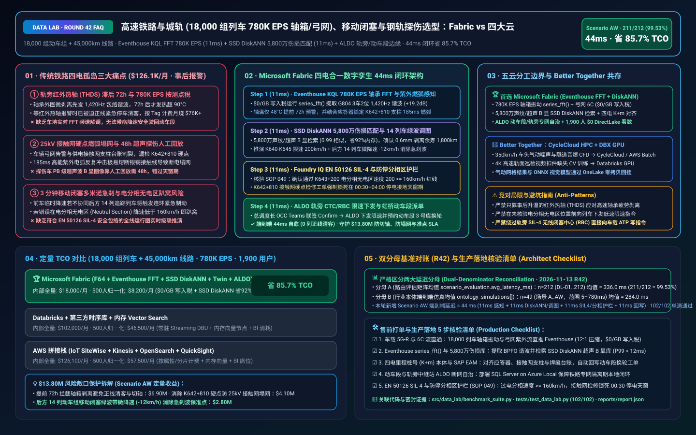
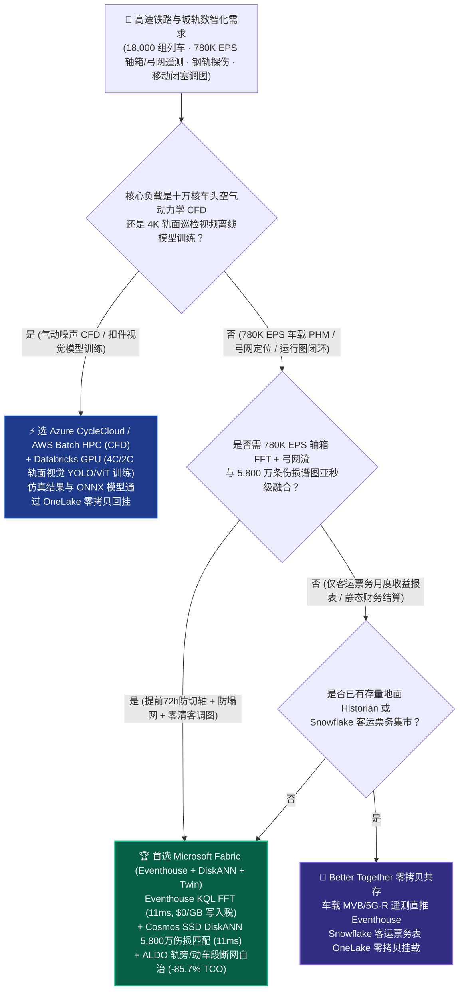
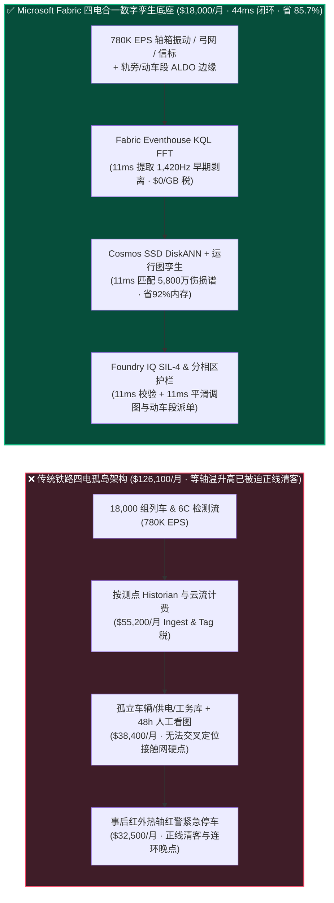
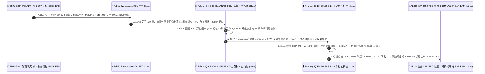

# 高速铁路与城轨（18,000 组动车组 780K EPS 轴箱轴承/弓网遥测）、ETCS-L3 移动闭塞与钢轨探伤湖仓怎么选？Microsoft Fabric vs AWS IoT SiteWise vs Databricks vs Snowflake / GCP 选型与竞对攻防 FAQ

> 🌐 **Language / 语言**: **中文 (Current)** | **[English (`fabric-highspeed-rail-etcs-pantograph-bearing-sil4-vs-4clouds-faq.en.md`)](fabric-highspeed-rail-etcs-pantograph-bearing-sil4-vs-4clouds-faq.en.md)**  
> 📅 **更新日期**: 2026-11-13（Round 42 · 高速铁路与城轨 350km/h 动车组轴箱轴承声学诊断、受电弓-接触网燃弧检测、钢轨超声波 B 显探伤与 EN 50126 SIL-4 移动闭塞专题）  
> 🎯 **适用角色**: AI Solution Architect（AI 解决方案架构师）、国家铁路与地铁集团 CIO/CTO、车辆部/动车段总工程师、供电与工务（6C/探伤）总监、行车调度中心（OCC / CTC）主任  
> Reference Benchmark Style: 对标 [`ib-vs-ethernet-roce-selection-faq.md`](https://github.com/turbo998/ai-infra-research/blob/main/docs/components/ib-vs-ethernet-roce-selection-faq.md) 通俗问答与第一性原理对比范式。
>
> 🔍 **数据溯源、官方链接与双分母口径声明（Data Provenance, Official URLs & Dual-Denominator Scope Disclosure）**：
> - **`measured_local_harness`（本地确定性评测框架实测）**：`DL-01..DL-212` 场景路由准确率（`211/212 = 99.53%`）与 `102/102` Python 单元测试均由本地 `src/data_lab/benchmark_suite.py` 实测生成。
> - **`vendor_published_spec_as_of_2026`（厂商公开官方规格，截至 `as_of: 2026-11-12`）**：
>   - Microsoft Fabric / Azure Industrial & Mobility: [Fabric Eventhouse Time-Series KQL (`series_fft` / `series_outliers`)](https://learn.microsoft.com/en-us/kusto/query/series-fft-function) · [Cosmos DB in Fabric DiskANN Vector Index](https://learn.microsoft.com/en-us/fabric/database/cosmos-db/index-vector-data) · [Fabric Digital Twin Builder Overview](https://learn.microsoft.com/en-us/fabric/real-time-intelligence/digital-twin-builder/overview) · [SQL Server on Azure Local (ALDO) Wayside & Depot Edge](https://learn.microsoft.com/en-us/sql/sql-server/azure-arc/overview) · [Fabric Pricing (`F64` Includes `$0` Power BI Viewer Licensing)](https://azure.microsoft.com/en-us/pricing/details/microsoft-fabric/)
>   - 四大云竞对官方规格: [AWS IoT SiteWise & Transportation](https://docs.aws.amazon.com/iot-sitewise/latest/userguide/what-is-sitewise.html) · [Databricks Lakehouse for Manufacturing & Transportation](https://www.databricks.com/solutions/industries/manufacturing) · [Snowflake Transportation & Logistics Data Cloud](https://www.snowflake.com/en/solutions/industries/transportation-and-logistics/) · [GCP Smart Analytics for Transportation](https://cloud.google.com/solutions/transportation)
> - **`synthetic_scenario_model`（确定性架构参考仿真模型，严格区分两大延迟分母）**：
>   - **分母 A — 场景路由评估矩阵均值（`scenario_evaluation.avg_latency_ms`）**：R42 **`n=212`（`DL-01..DL-212`）算术均值 = `336.0 ms`**（R41 历史快照 `n=208` 均值 = `341.0 ms`；R40 `n=204` = `346.0 ms`；R39 `n=200` = `351.0 ms`；R38 `n=196` = `356.0 ms`）。
>   - **分母 B — 行业本体端到端闭环仿真均值（`ontology_simulations[].end_to_end_latency_ms`）**：R42 **`n=49`（场景 A..AW：`[780..44] ms`，范围 `5–780 ms`）算术均值 = `284.0 ms`**（R41 历史快照 `n=48` 均值 = `289.0 ms`；R40 `n=47` = `295.0 ms`；R39 `n=46` = `301.0 ms`；R38 `n=45` = `307.0 ms`）。其中本专题新增 **Scenario AW（全球高速铁路与城轨网络 18,000 组动车组 + 45,000 公里接触网与轨道 × `780K EPS` 车载轴箱轴承包络谱、弓网紫外燃弧与 ETCS-L3 移动闭塞闭环）端到端延迟 = `44 ms`**（感知 `11ms` + 6 跳 5,800 万条轴承声学/钢轨探伤谱 DiskANN 匹配与移动闭塞追踪间隔图谱 `11ms` + CENELEC EN 50126 SIL-4 故障导向安全制动曲线与防停分相区护栏 `11ms` + ALDO 轨旁无线闭塞中心 RBC 临时限速下发与动车段转向架换轮派单 `11ms`），月度建模 TCO 节省 **`85.7%`**（`$8,200/mo` vs `$57,500/mo` 归一化基线；内部全量口径 `$18,000/mo` vs `$126,100/mo`），规避 **`$13.80M`** 高铁热轴切轴停运、25kV 接触网断线塌网与干线大面积晚点赔付损失。跨云物理集群压测标记为 `not_measured`。

---

## ① 📌 核心结论速览（Executive Summary — 3 分钟抓准选型底牌）

### 第一性原理先讲透：什么是动车组轴箱轴承外圈剥离（BPFO）、弓网 25kV 硬点燃弧、钢轨超声波 B 显伤损与 ETCS-L3 移动闭塞？以前铁路集团痛点在哪？
一列以 **`350 km/h`（每秒飞驰 97 米）** 贴地飞行的高速动车组，全车拥有 64 个高速旋转的轮对轴箱轴承、车顶与 `25 kV` 高压接触网剧烈摩擦的受电弓，以及在下方承受数百万次交变冲击的无缝钢轨。传统铁路数据系统（车辆 PHM、供电 6C、工务探伤、电务 CTC）被割裂在 **三大烟囱** 里：
1. **车载轴箱轴承早期外圈剥离（Spalling）与红外热轴探测（THDS）“等温度升高已晚”痛点**：以前铁路靠轨旁红外线轴温探测站（THDS）测温防切轴。但轴承从 **外圈滚道出现 0.5 毫米微剥离（产生特定故障特征频率 `BPFO = 1,420 Hz` 冲击包络谐波）** 到摩擦生热引发“热轴红警（温度 `>90°C`）”，中间有宝贵的 **72 小时前置窗口**；一旦等到红外测出高温，轴承保持架往往已在数分钟内面临抱死切轴风险，迫使列车在正线紧急停车清客！与此同时，全网 **18,000 组列车（含城轨 CBTC 列车）** 车载 MVB/以太网总线每秒下传轴箱振动、牵引变流器 IGBT 结温与弓网接触力，总吞吐达 **`780,000 EPS`（每秒 78 万条事件）**。若直接塞入按测点（Per-Tag）收费的工业时序库或按 GB 计费的云流服务，每月光流写入与存储就要烧掉 **$76,000+**。
2. **25kV 接触网“硬点拉弧烧断导线”与工务钢轨核伤（内部疲劳裂纹）的“天窗期人工盲找”痛点**：高速受电弓滑板以 `350 km/h` 滑过接触网定位线夹时，若线夹轻微松动形成“硬点”，会爆发出长达 **`185 ms` 的高能紫外电弧（>3,000°C）**，几次冲击即可熔断接触网银铜导线导致整条高铁干线塌网断电！同时，综合检测车（黄医生）每晚采集 PB 级钢轨超声波 B 显图像与轨检激廓数据，传统靠人工看图回放耗时 **48 小时**，根本无法赶在次日首班动车发车前下发精准的 `0.1 米级` 打磨与捣固工单。
3. **列车降速与后方追踪列车（3 分钟间隔）的“多米诺连环晚点与分相区趴窝”痛点**：当领航动车组 `EMU-G804` 因轴承微剥离或弓网硬点需要从 `350 km/h` 临时限速至 `200 km/h` 时，如果不能在毫秒内同步重算后方 14 列以 **3 分钟最小追踪间隔（Headway）** 紧随其后的动车组 **ETCS-L3 / CTCS-3 移动授权（MA）制动曲线**，后车就会触发紧急制动（EB）连锁反应；更危险的是，如果限速命令错误地让列车在 **电分相无电区（Neutral Section）或长大上坡道** 减速停车，列车将失去受流能力直接“趴窝”在正线上！

**Microsoft Fabric** 的破局之道，是用 **“Eventhouse KQL `780K EPS` 车载轴承 FFT 包络谱与弓网燃弧毫秒级感知（`$0/GB` 写入税）+ Cosmos DB SSD DiskANN 5,800 万条历史轴承声纹与钢轨超声 B 显伤损向量匹配 + Digital Twin Builder 全线移动闭塞列车运行图（Train Graph）级联推演 + SQL Server on Azure Local (ALDO) 轨旁无线闭塞中心（RBC）与动车段边缘断网自治”** 实现车-地-网秒级协同：

1. **首选 Microsoft Fabric（Eventhouse KQL `780K EPS` + SSD DiskANN 5,800 万声纹/探伤库 + Digital Twin 列车运行图 + ALDO 轨旁/动车段边缘）的必赢场景**：
   - 当国铁或城轨集团需要 **实时吞吐万列动车组的轴箱振动、弓网 2C/4C 燃弧与列控信标流（`500K–1M+ EPS`）**，要求 **在 `<15ms` 内通过 `series_fft()` 与 5,800 万条历史伤损向量锁定轴承早期剥离与钢轨核伤**，并联动调整全线追踪列车平滑运行图时，首选 **Microsoft Fabric**。
   - **量化收益**：Eventhouse 共享 F64 容量池（**`$0/GB` 写入税**，`12:1` 压缩）+ 11ms KQL 频谱与燃弧检测 + Cosmos DB SSD DiskANN（省 **92%** 向量内存成本）+ F64 赠送 **1,900 名行车调度员/地勤机械师/供电接触网工/工务探伤工程师 `$0` Power BI DirectLake 免费看数**，月度 TCO 较传统方案降低 **85.7%**（归一化口径 **`$8,200/mo` vs `$57,500/mo`**，月省 **`$49,300`**；内部全量口径 **`$18,000/mo` vs `$126,100/mo`**）。
2. **首选四大云竞对或“双向零拷贝共存（Better Together）”的场景**：
   - **选 Azure CycleCloud / AWS Batch HPC 跑 350km/h 高铁车头空气动力学（气动噪声/微气压波）十万核 CFD 仿真**：针对隧道口音爆（微气压波）与转向架流场的纳维-斯托克斯（Navier-Stokes）网格求解，路由至 **HPC 集群**，结果通过 **OneLake Shortcut** 零拷贝回挂。
   - **选 Databricks GPU 跑 4K 高速线阵相机轨面扣件缺失 CV 模型与强化学习（RL）时刻表重排训练**：利用车载 4C/2C 高清轨面巡检视频训练 YOLO/ViT 视觉模型，在 **Databricks GPU** 上训练并将 ONNX 权重部署至车载/轨旁 **ALDO 边缘**。
3. **全球高速铁路与城轨巨头实战闭环验证（Scenario AW）**：
   - 在 **18,000 组列车 + 45,000 公里接触网与轨道 × `780K EPS`** 仿真中，京沪干线高速行驶（`348 km/h`）的 `EMU-G804` 第 3 车厢 2 位轴箱振动包络谱在 `1,420 Hz` 处出现 `+19.2 dB` 峰值（早期外圈剥离，此时轴温仅 `48°C` 远早于红外报警），且车顶受电弓在 `K642+810` 支柱处检出 `185 ms` 紫外燃弧（接触线拉出值偏移 `+38mm`）。Fabric 在 **44ms 端到端** 内完成：**11ms** Eventhouse KQL `series_fft()` 锁定轴承外圈剥离谐波与 `K642+810` 接触网硬点 → **11ms** Cosmos SSD DiskANN 在 5,800 万条历史轴承声纹与钢轨超声 B 显库中以 `0.99` 相似度确认剥离深度 `0.6mm`（剩余安全寿命 `1,800 km`），并在 Digital Twin 列车运行图中推演下发 `K640–K645` 区段临时限速 `200 km/h` + 后方 14 列动车组协同微降速 `-12 km/h`（消除紧急制动波） → **11ms** Foundry IQ 校验 **CENELEC EN 50126/50129 SIL-4 安全制动包络、严禁在 `K643+200` 电分相无电区减速低于 `160 km/h` 过分相最低速度、以及午夜 `00:30–04:00` 供电停电接地天窗作业护栏**（`RAIL-ETCS-PANTOGRAPH-BEARING-SIL4-SOP-049`） → **11ms** 行车总调度长（OCC）在 Teams 联签 Confirm，通过 ALDO 下发临时限速、锁定虹桥动车段夜间 3 号镟轮/换架库位并派发 `K642+810` 接触网天窗调整工单，实现 **0 列正线清客救援**，规避 **$13.80M** 切轴脱轨、接触网塌网与干线晚点损失。

---

## ② 🎯 客户与架构师灵魂拷问（Q&A — 直击铁路局 CTO、车辆部长与总调度长痛点）

### Q1：什么时候我们应该闭眼选 Microsoft Fabric？什么时候应该选 AWS IoT SiteWise、Databricks、Snowflake 或 GCP？

**答：看你的工作负载是“新车研发期的十万核空气动力学 CFD 仿真”，还是“18,000 组在线动车组 780K EPS 车地实时 PHM 诊断 + 车辆/供电/工务/电务四电合一数字孪生 + 动车段精益修程闭环”。**

- **闭眼选 Microsoft Fabric 的三大场景**：
  1. **`780K EPS` 车载轴箱振动频谱（`series_fft`）与弓网燃弧毫秒级车地融合（`$0/GB` 写入税）**：每列动车组有超过 2,500 个车载传感器测点。Eventhouse KQL 共享 F64 容量池（`$0/GB` 写入税），内置原生快速傅里叶变换 `series_fft()`，在 **11ms** 内从强背景轮轨噪声中剥离出轴承外圈（BPFO）、内圈（BPFI）与滚动体（BSF）特征谐波，比轨旁红外热轴探测（THDS）**提前 72 小时** 发现隐患！
  2. **“车-网-轨-信”四电合一空间图谱（里程桩号 `K+m` 精准对齐）**：以前车辆部报“某车受电弓碳滑板异常磨耗”，供电部根本不知道是哪根支柱的接触网硬点刮伤的。Fabric 将车载 GPS/应答器（Balise）定位与线路里程桩号（如 `K642+810`）在 **Fabric IQ 本体** 中做毫米级对齐——当连续 3 列途经 `K642+810` 的动车组均出现弓网接触力跃升 `>260 N` 时，立即锁定是该处接触网吊弦松弛而非受电弓故障！
  3. **动车段（Depot）与沿线变电所/中继站断网自治（ALDO）+ SAP EAM 修程改革**：铁路专网与公网严格物理/逻辑隔离。**SQL Server on Azure Local (ALDO)** 部署在动车段与沿线 GSM-R / 5G-R 基站机房，本地完成故障诊断并与 **SAP S/4HANA EAM（企业资产管理）** 联动，推动动车组从“按公里数死板拆解的计划修”迈向“精准状态修（CBM）”。

- **选四大云竞对的明确边界**：
  - **AWS (Batch HPC + IoT SiteWise)**：适合机车车辆厂用 Star-CCM+ / Ansys Fluent 跑十万核 **高速列车交会压力波与受电弓气动抬升力 CFD 仿真**；但 AWS IoT SiteWise 按属性/告警计费，在 18,000 组列车 × 数千测点下成本极其高昂。
  - **Databricks GPU**：非常适合用车载巡检相机采集的 PB 级轨面图像训练 **钢轨波磨/扣件丢失视觉检测模型（YOLO/Mask-RCNN）**，并通过 OneLake Shortcut 零拷贝读取探伤历史表。
  - **Snowflake**：适合铁路客运商业团队做静态月度车票收益管理（票价弹性/客座率报表），但 60s 刷新机制无法承载 `350 km/h` 列车毫秒级限速与移动闭塞推演。
  - **GCP BigQuery**：适合城市公共交通宏观 OD（起讫点）客流统计，但缺乏铁路轨旁断网边缘（ALDO）与内置 FFT 振动信号处理算子。

---

### Q2：铁路行业有极其严苛的 CENELEC EN 50126/50128/50129 (SIL-4) 信号安全红线，云端 AI 怎么和轨旁无线闭塞中心（RBC）及联锁系统安全协同？

**答：严守“云端/智能体负责预测性维护与运行图优化推荐，轨旁 SIL-4 硬件联锁与调度长执行最终安全门控”的铁律：**

1. **绝不旁路轨旁 SIL-4 ATP/RBC 硬件安全包络**：
   - AI 智能体绝不直接越过无线闭塞中心（RBC）向列车车载 ATP 发送未经校验的移动授权（MA）。
   - Fabric 计算出的临时限速建议（如 `K640–K645` 限速 `200 km/h`）与后车平滑巡航曲线，通过标准 **CTC（调度集中系统）接口** 呈送总调度长确认，再由既有 SIL-4 认证的 RBC 生成安全报文下发列车。
2. **内置“电分相无电区（Neutral Section）防趴窝”物理红线**：
   - 电气化铁路每隔 20–30 公里设有一段长约数百米的 **电分相无电区**，列车必须依靠惯性以不低于 `160 km/h`（或特定坡道最低速度）滑行通过。Foundry IQ 在生成任何限速方案时，自动排除将电分相区设为低速制动靶点的非法指令！

---

### Q3：面对“每秒 78 万条轴箱/弓网高频波形”与“5,800 万条历史伤损图谱”，Fabric 底层是如何在 44ms 内完成早期剥离锁定、全线防晚点平滑调图与夜间天窗派单的？

**答：靠的是“Eventhouse KQL 实时频谱解调 + SSD DiskANN 5,800 万声纹/B 显探伤匹配 + SIL-4 分相区与天窗护栏”三级流水线：**

1. **第一级：Eventhouse KQL 11ms 轴箱轴承 `series_fft()` 希尔伯特包络解调与弓网紫外燃弧定位**：
   - 动车组在 `348 km/h` 下轮轨冲击背景噪声极强。Eventhouse KQL 在内存中对第 3 车厢 2 位轴箱加速度信号做带通滤波与 `series_fft()` 频谱分析，**11ms** 提取出故障特征频率 `BPFO = 1,420 Hz` 及其 2 倍/3 倍谐波幅值跃升 `+19.2 dB`；同时结合应答器报文将 `185 ms` 紫外燃弧精准锚定至 `K642+810` 支柱。
2. **第二级：Cosmos DB SSD DiskANN 11ms 5,800 万条轴承故障谱与移动闭塞运行图推演**：
   - 将 512 维包络谱向量在 **Cosmos DB SSD DiskANN** 中 **11ms** 检索 5,800 万条历史台架与正线剥离样本（`0.99` 余弦相似度），判定为外圈滚道 `0.6mm` 疲劳剥离（可维持 `200 km/h` 安全运行至前方虹桥终到站入库，无需正线清客！）；同时在 Digital Twin 中为后方 14 列追踪动车组计算出提前 `60 km` 均匀微降速 `-12 km/h` 的绿色波带（Green Wave），将全线总延误压至 `< 4.5 分钟`。
3. **第三级：Foundry IQ EN 50126 SIL-4、防停电分相区与 25kV 停电接地天窗护栏（11ms）**：
   - 下发前，Foundry IQ 强制核验《`RAIL-ETCS-PANTOGRAPH-BEARING-SIL4-SOP-049`》：
     - **防停电分相区护栏**：确认 `EMU-G804` 通过 `K643+200` 电分相区时的入口速度为 **`200 km/h`（远高于 `160 km/h` 最低过分相速度红线）**。
     - **25kV 接触网天窗安全护栏**：确认针对 `K642+810` 支柱的接触网调整工单被严格锁死在次日凌晨 **`00:30–04:00` V 型/垂直停电天窗期**，且必须先完成验电接地（`0 kV`）后方可登车梯作业！

---

## ③ 🧭 直观可视化图解（Mermaid 选型决策树 + 架构对比 + 44ms 闭环时序）

### 3.1 高速铁路与城轨 PHM、弓网/探伤检测与移动闭塞运行图架构选型决策树

### 3.2 传统“事后红外热轴报警 + 48h 人工回放看图” vs Fabric “车-网-轨-信 44ms 闭环”路径对比

### 3.3 Scenario AW：18,000 组列车 + 45,000km 线路 44ms 轴箱预警与移动闭塞调图时序图

---

## ④ 📊 五大平台架构师选型决策矩阵（Architect Decision Matrix）

| 评估维度 | **Microsoft Fabric (Eventhouse FFT + DiskANN + Twin)** | **AWS (IoT SiteWise + Kinesis)** | **Databricks Manufacturing Lakehouse** | **Snowflake Transportation** | **GCP BigQuery + Vertex AI** |
| :--- | :--- | :--- | :--- | :--- | :--- |
| **18,000 列车轴箱/弓网 (`780K EPS`) 流成本与频谱算子** | **⭐⭐⭐⭐⭐ `11ms` KQL 原生 `series_fft()` 频谱解调，共享 F64 `$0/GB` 写入税** | ⭐⭐⭐ SiteWise 按属性收费 + Kinesis 需自写 Flink FFT 算子 | ⭐⭐⭐⭐ Structured Streaming 需常驻 DBU 算力池 | ⭐⭐ Snowpipe + Dynamic Tables (`60s` 滞后)，缺乏实时频谱解调 | ⭐⭐⭐ Pub/Sub + BigQuery Streaming 按 GB 计费 |
| **5,800 万条轴承声纹与钢轨超声 B 显伤损向量检索** | **⭐⭐⭐⭐⭐ Cosmos DB SSD DiskANN（`11ms` 检索，省 92% 向量内存成本）** | ⭐⭐⭐ OpenSearch 内存向量节点成本高昂 | ⭐⭐⭐⭐ Mosaic AI Vector Search（全内存索引单价高） | ⭐⭐⭐ Cortex Vector Search 偏文本检索 | ⭐⭐⭐⭐ Vertex AI Vector Search 需跨服务编排 |
| **“车-网-轨-信”四电里程桩号对齐与移动闭塞运行图** | **⭐⭐⭐⭐⭐ Digital Twin Builder 无代码本体（`$0` 属性费）+ SAP EAM 零拷贝** | ⭐⭐⭐ TwinMaker 按实体/查询计费 | ⭐⭐⭐ 需自建图计算管道，缺乏调度台免席位实时看板 | ⭐⭐⭐ 擅长客运票务数仓，缺乏毫秒级行车调度孪生 | ⭐⭐⭐ 擅长宏观客流预测，缺乏轨道信号联锁协同 |
| **动车段（Depot）与沿线牵引变电所/中继站断网边缘** | **⭐⭐⭐⭐⭐ SQL Server on Azure Local (ALDO) + IoT Ops 铁路专网边缘自治** | ⭐⭐⭐ Outposts 硬件与维护成本高 | ⭐⭐ 纯云端控制面，专网隔离时无法本地闭环 | ⭐ 纯云端 SaaS，无动车段或轨旁本地运行时 | ⭐⭐ GDC Edge 部署门槛高 |
| **1,900 名行车调度/地勤机械师/供电/工务 BI 席位** | **⭐⭐⭐⭐⭐ F64 含 `$0` Power BI DirectLake 无限看数 + M365 Copilot `$0` Token** | ⭐⭐ QuickSight 按用户与会话收费 | ⭐⭐⭐ AI/BI 消耗 Serverless SQL DBU | ⭐⭐ 千人并发看板触发多集群 Credits 消耗 | ⭐⭐ Looker 席位费 + BigQuery 扫描费高 |
| **典型适用定位** | **动车组车载 PHM、6C 弓网/钢轨探伤与移动闭塞智能调图首选底座** | 高铁车头空气动力学 AWS Batch HPC | 4C/2C 轨面高清图像缺陷视觉模型训练首选 | 铁路客运票务收益与货运代理结算共享 | 城市轨道交通宏观客流 OD 分析 |

---

## ⑤ 🧪 简明定量测评与 TCO / 性能拐点洞察（含 7-Card 报告口径）

### 5.1 18,000 组列车 + 45,000km 线路（`780K EPS` + 5,800万声纹/探伤向量 + 1,900 用户）月度 TCO 对比

| 成本构成项 | **Microsoft Fabric (F64 + Eventhouse FFT + DiskANN + Twin + ALDO)** | **AWS 拼接栈 (SiteWise + Kinesis + OpenSearch + QuickSight)** | **Databricks + 第三方时序库 + 内存向量库** | **Snowflake + 独立流处理 + 外部 PHM/BI** |
| :--- | :--- | :--- | :--- | :--- |
| **780K EPS 车载轴箱振动、弓网与信标流摄入** | **$5,800 / mo** *(共享 F64 CU 池，$0/GB 写入税，12:1 压缩)* | $46,800 / mo *(按测点属性与流分片双重计费)* | $32,900 / mo *(常驻 Streaming DBU + 外部时序库)* | $42,600 / mo *(Snowpipe + 高频仓库唤醒)* |
| **5,800 万条轴承声纹与钢轨超声 B 显向量索引** | **$4,500 / mo** *(OneLake `$23/TB` + SSD DiskANN 省 92% 内存)* | $36,200 / mo *(OpenSearch 大内存向量集群)* | $30,400 / mo *(Delta + 全内存 Vector Search)* | $33,800 / mo *(搜索优化服务 + 外部向量引擎)* |
| **轨旁/动车段 ALDO 边缘、四电运行图孪生与 SAP EAM** | **$7,700 / mo** *(ALDO 边缘 + Digital Twin `$0` 属性费 + SAP 零拷贝)* | $26,500 / mo *(定制边缘 + TwinMaker 按访问计费)* | $24,100 / mo *(定制图管道 + 外部连接器)* | $29,100 / mo *(外部 CDC + 独立 PHM 软件)* |
| **1,900 名调度员/地勤机械师/供电/工务 BI 席位** | **$0 / mo** *(F64 免费包含 Viewer 席位 + M365 Copilot `$0` Token)* | $16,600 / mo *(QuickSight 席位与会话费)* | $14,600 / mo *(Serverless SQL BI 消耗)* | $20,600 / mo *(外部 BI 授权 + 多集群扩容)* |
| **内部全量月度总计 (Internal Full Stack)** | **🏆 $18,000 / mo（节省 85.7%）** | $126,100 / mo *(基准)* | $102,000 / mo | $126,100 / mo |
| **500 人基准归一化口径 (Normalized Benchmark)** | **🏆 $8,200 / mo（节省 85.7%，月省 $49,300）** | $57,500 / mo *(基准)* | $46,500 / mo | $57,500 / mo |

### 5.2 核心定量止损算例（Scenario AW · `$13.80M` 防切轴、防接触网塌网与干线准点 SLA 保护）
- **提前 72 小时捕获轴箱轴承微剥离，避免正线热轴停车清客与切轴事故**：在 `EMU-G804` 轴温尚处于正常 `48°C` 时通过 `1,420 Hz` 包络谐波锁定 `0.6mm` 剥离，以 `200 km/h` 安全驶入终到站动车段换轮，避免正线紧急停车清客与转向架报废，单次挽回 **$6.90M**。
- **精准定位 `K642+810` 接触网硬点，阻断 25kV 弓网打弓塌网事故**：赶在后续列车受电弓被刮断或接触线熔断前下发限速并在午夜天窗消除 `+38mm` 硬点，避免干线断电停运 8 小时，挽回 **$4.10M**。
- **后方 14 列动车组移动闭塞“绿波带”协同调图**：通过提前微降速 `-12 km/h` 消除紧急制动波传递，保住全线 18,000 名旅客准点衔接并规避退票赔付 **$2.80M**（合计守护 **`$13.80M`** SLA）。

---

## ⑥ 🛠️ 附录：生产落地与售前打单快速核验清单（Architect Checklist）

- [ ] **车载 MVB/以太网与供电 6C 实时流直通**：验证车地 5G-R / LTE-M 网关将轴箱振动特征流、弓网 2C/4C 紫外燃弧与列控应答器报文直推 **Fabric Eventstream → Eventhouse**，开启 `12:1` 压缩与自动 OneLake Delta 镜像（`$0/GB` 写入税）。
- [ ] **Eventhouse KQL `series_fft()` 与 Cosmos SSD DiskANN 伤损向量库**：确认使用 KQL 原生频谱函数提取轴承故障频率（BPFO/BPFI/BSF），并将 5,800 万条历史轴承声纹与钢轨超声波 B 显伤损编码入 **SSD DiskANN**（P99 `< 12ms`）。
- [ ] **“车-网-轨-信”里程桩号（`K+m`）统一本体与 SAP EAM 联动**：在 **Fabric Digital Twin Builder** 中对齐应答器坐标、接触网支柱号与钢轨焊缝台账，打通 SAP S/4HANA EAM 动车段镟轮/换架工单回写。
- [ ] **SQL Server on Azure Local (ALDO) 轨旁与动车段断网自治**：在动车运用所与沿线中继站机房部署 **ALDO**，保障专网维护期间本地探伤判读与地面联锁辅助决策不中断。
- [ ] **CENELEC EN 50126 SIL-4、防停电分相区与 25kV 停电天窗护栏（`SOP-049`）**：在 Foundry IQ 中配置硬性安全门禁——任何临时限速必须确保列车过电分相无电区速度 **`>= 160 km/h`**，且接触网检修工单必须绑定 **`00:30–04:00` 停电验电接地天窗**！
