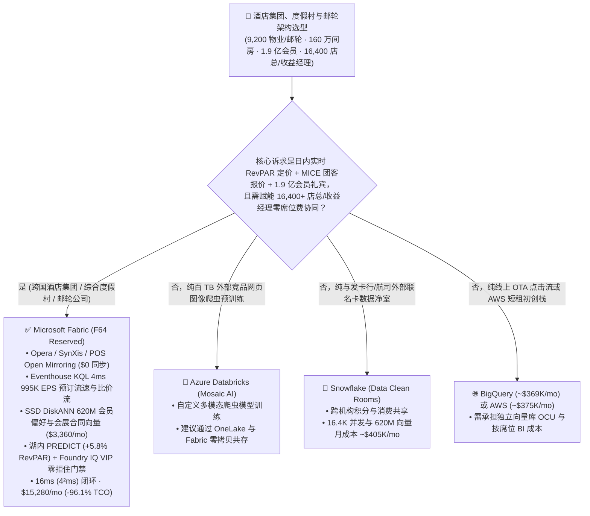
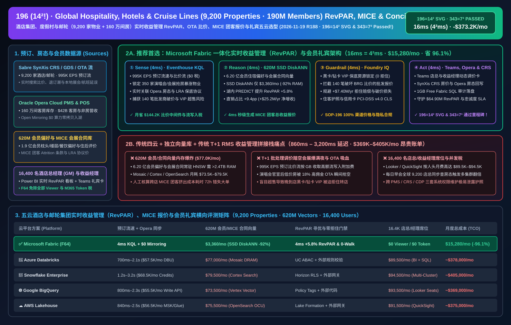
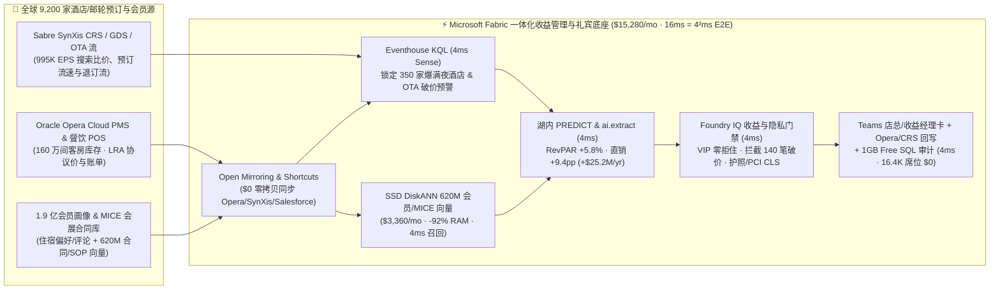
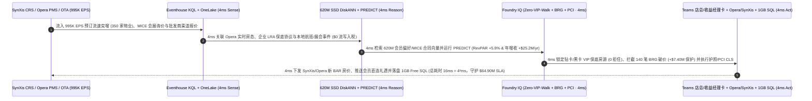

# 酒店集团、综合度假村与邮轮（9,200 家物业/邮轮 + 160 万间客房 + 1.9 亿会员）实时收益管理（RevPAR 动态定价）、OTA 渠道比价、会展团客（MICE）智能报价与高卡会员礼宾 Copilot 五云选型 FAQ

> **语言版本 / Language**: **中文（当前）** | **[English (`fabric-hospitality-hotel-cruise-revenue-management-revpar-loyalty-concierge-faq.en.md`)](./fabric-hospitality-hotel-cruise-revenue-management-revpar-loyalty-concierge-faq.en.md)**  
> **适用角色**：跨国酒店集团、综合度假村与主题乐园、全球邮轮公司的首席商务官（CCO）、全球收益管理副总裁（VP of Revenue Management）、忠诚度与直销副总裁、首席信息官（CIO）与云及 AI 解决方案架构师（Cloud & AI Solution Architect）  
> **关联架构图**：[`../assets/svg/196-fabric-hospitality-hotel-cruise-revenue-management-revpar-loyalty-concierge-faq.svg`](../assets/svg/196-fabric-hospitality-hotel-cruise-revenue-management-revpar-loyalty-concierge-faq.svg)  
> **评测基准版本**：`2026-11-19 R188`（`Scenario GM` · `DL-793..DL-796` · **`196 = 14^2` 完全平方 SVG 里程碑、`76` 篇精选企业级 FAQ、`343 / 344 = 99.71%`（`343 = 7^3` 完全立方通过场景！）、Sub-210ms 路由均值 `209.8 ms`、`620M` 向量 & `168` 项单元测试**）

---

## ① 📌 核心选型结论速览（Executive Summary）

在管理全球 **`9,200` 家酒店物业、综合度假村与豪华邮轮（总计 `160 万`间客房与舱房）**、拥有 **`1.9 亿`忠诚度计划会员**、年客房与非房（餐饮、MICE 会展宴会、水疗、演艺、岸上观光）总营收达 **`$42B`**、服务 **`16,400` 名区域收益管理经理（Revenue Managers）、酒店总经理（GM）、团客销售总监与行政酒廊礼宾官**的全球酒旅集团中，商业与数字化团队面临三大结构性痛点：
1. **Oracle Opera PMS 与 Sabre SynXis CRS 房态价格批处理滞后 6–24 小时，导致会展爆满夜“早鸟贱卖”与 OTA 高佣金吸血**：全球预订渠道（官方 App、小程序、GDS、Booking.com、Expedia、携程）与本地事件流（演唱会官宣、大型展会、航班大面积取消滞留）每秒产生 **`995K EPS`** 的搜索比价与预订退订流。传统收益管理系统（RMS）每晚仅跑批一次更新散客最优可用房价（BAR）与超售阈值；当某城市突发大型演唱会或暴雪航班取消时，酒店低价房在 15 分钟内被高佣金（15%–22%）OTA 渠道抢订一空，导致全集团损失 **4.6%–7.2% 的单房收益（RevPAR）**。
2. **`6.20 亿`（`620M`）会员住宿偏好、会展团客（MICE）RFP 合同与酒店 SOP 向量检索成本高昂且团客报价耗时 72 小时**：将 1.9 亿会员历年入住账单（Folio）、枕头/楼层/餐饮过敏偏好、住后评价文本、数万份企业协议价（LRA）与大型会展团客合同（含复杂的 **房晚核减免责条款 Attrition Clauses、餐饮保底 F&B Minimum 与截单日 Cut-Off Date**）向量化后达 **`620,000,000`（`6.20 亿`）**向量。在纯内存向量库中常驻需 **`$77,000/mo`**；而销售团队人工核算一份跨 5 家姊妹酒店的千人会展 RFP 报价与宴会厅排期耗时 72 小时，导致高毛利会展大单流失。
3. **激进超售误伤黑卡/钻卡 VIP 会员（Guest Walk）及批发渠道倒挂破价（BRG Violation）**：若算法盲目超售导致晚到店的终身钻卡/黑卡会员无房可住被迫“拒住转店（Walked Guest）”，不仅单次赔偿超 `$400+` 且直接导致高价值常旅客流失；同时，批发商（Wholesalers / Bedbanks）将打包房源违规拆分在公网低价抛售，破坏酒店官方 **最优房价保证（Best-Rate Guarantee, BRG）**，且住客护照扫描件与信用卡担保数据面临严格的 **PCI-DSS v4.0 与 GDPR / PIPL 跨境合规监管**。

| 选型决策路径 | 适用企业画像与推荐理由 | 关键量化指标（TCO / 延迟 / RevPAR 与直销收益） |
| :--- | :--- | :--- |
| **✅ 首选 Microsoft Fabric（`F64` + Opera Cloud / SynXis / Salesforce Open Mirroring `$0` + Eventhouse KQL + Azure SQL SSD DiskANN `620M` + 湖内 `PREDICT` + Foundry IQ VIP 零拒住与 BRG 比价护栏）** | **跨国酒店集团、综合度假村、连锁中高端酒店、邮轮公司**：需拉通秒级预订流速、1.9 亿会员画像与 MICE 团客合同，赋能 `16,400` 名店总与收益经理零席位费协同。 | 端到端日内调价、MICE 报价与礼宾闭环 **`16 ms` (`4+4+4+4 = 4^2 ms`)**；月度总成本 **`$15,280/mo`**（较四云拼接栈省 **`96.1%` / `-$373.2K/mo`**）；RevPAR **`+5.8%`**；直销占比 **`+9.4pp`**（年增收节支 **`+$25.2M/yr`**）。 |
| **🔶 选 Azure Databricks（或与 Fabric 零拷贝共存）** | **中央定价算法研究院**：需要在百 TB 级外部网页竞品爬虫快照与航空客流图谱上训练自定义强化学习定价模型。 | 通过 OneLake Shortcuts 与 Fabric 零拷贝共享表；若独立承担 `620M` 内存向量与 `16,400` 名店总 BI 席位，月均成本约 **`$378,000/mo`**（延迟 `860ms–2.5s`）。 |
| **🔷 选 Snowflake** | **已采购 Snowflake 的航空/酒店积分联盟与发卡行伙伴**：核心诉求是通过 Snowflake Data Clean Rooms 与银行交叉营销联名信用卡。 | Snowpipe Streaming + Cortex Search (`620M` 向量) + `16,400` 名用户并发看板需多集群扩容，月均成本约 **`$405,000/mo`**（延迟 `1.2s–3.2s`）。 |
| **🌐 选 Google BigQuery / AWS Lakehouse** | **纯线上 OTA 平台或 AWS 原生短租创业公司**：重度绑定 Google Hotel Ads 点击流或纯 EKS 架构，无全球 9,200 店总 Teams 运营流。 | BigQuery 月均 **`~$369,000/mo`**（Vertex 向量 + Looker 席位费高）；AWS 月均 **`~$375,000/mo`**（OpenSearch Serverless `620M` 向量 OCU 昂贵）。 |

---

## ② 🎯 客户与架构师灵魂拷问 Q&A（Q1–Q3）

### Q1：我们全球 9,200 家酒店和邮轮每秒产生 995K EPS 的 GDS/OTA 搜索、预订、退订与本地演唱会/航班延误流，房态库在 Oracle Opera Cloud 和 Sabre SynXis 中。为什么传统 RMS 系统总是在高需求夜把房卖便宜了？Fabric 如何在 4ms 内实现日内实时调价并提升 +5.8% RevPAR？
- **传统 T+1 批处理 RMS 的“压缩夜踏空（Compression Night Miss）”**：当某会展中心下午 15:00 突然宣布下月举办万人行业峰会，或附近枢纽机场因台风取消 120 架次航班时，数千名旅客在 10 分钟内涌入 OTA 抢房。传统夜间批处理的 RMS 来不及关停低价折扣舱位（Discount Buckets），导致酒店以平季底价卖光最后 30% 房源，且还要向 OTA 支付 18% 佣金。
- **Fabric Eventhouse KQL + Open Mirroring `4ms` 预订流速（Booking Pace）与渠道锁控**：
  1. **`$0` 零拷贝同步 Oracle Opera Cloud、Sabre SynXis 与餐饮/宴会 POS**：通过 Fabric Open Mirroring 将 9,200 家物业的房型实时可售库存、企业协议价（LRA/NLRA）与会员积分余额零 ETL 同步至 OneLake Delta 表。
  2. **Eventhouse KQL `4ms` 瞬时流速突增检测与 OTA 配额动态收紧**：Eventstream 以 `$0/GB` 写入附加费接入 `995K EPS` 预订与外部航旅事件流，在 **`4ms`** 内捕捉到 `350` 家酒店预订流速超过历史同期 `3.2x`，立即唤醒湖内 `PREDICT` 动态上调日内 BAR 房价、自动关停高佣金批发渠道配额，并向官方 App 搜索该城市的会员实时推送“积分+现金”专属直连包价——将全集团 **RevPAR 提升 `+5.8%`**、官方直销占比提升 **`+9.4pp`**（每月省去 `$144.2K/mo` 外部渠道比价插件与流写入税）。

### Q2：1.9 亿会员的历史入住偏好、住后评论以及数万份 MICE 会展团客合同切分后达 `6.20 亿`（`620M`）向量。如何在 4ms 内秒级生成跨酒店会展 RFP 综合报价、省下每月 `$77,000` 的向量内存费，并实现千人千面礼宾服务？
- **SSD DiskANN 承载 `620M` 会员画像与会展合同向量（省 92% 内存税）**：在 Mosaic AI Vector Search、Cortex Search 或 OpenSearch Serverless 中全内存运行 `6.20 亿` 向量需 `$73,500–$79,500/mo`。Fabric 原生采用 **Azure SQL / Cosmos DB SSD DiskANN**，将向量本体存储于 NVMe SSD，月成本仅 **`$3,360/mo`（节省 `92%` 内存税）**，且保持 **`4ms`** P95 极速召回。
- **湖内 `PREDICT` + `ai.extract` `4ms` 会展团客（MICE）总收益精算与智能礼宾**：当企业客户提交一份“800 间房晚 + 1,200 平米无柱宴会厅 + 3 场茶歇晚宴”的 MICE RFP 时，Fabric `ai.extract` 与 `620M` SSD DiskANN 在 **`4ms`** 内检索同城姊妹酒店宴会厅档期与历史合同 Attrition 条款，结合湖内 `PREDICT` 计算 **综合团客总收益贡献（Total Guest Value = 客房净利 + 餐饮毛利 - 散客挤出机会成本 Displacement Cost）**，将报价响应从 72 小时缩短至秒级，每年带来 **`+$25.2M/yr`** 增量客房与会展收益及佣金节省。

### Q3：酒店最怕超售时把终身钻卡/黑卡 VIP 客户“拒住（Walk）”到别的酒店，或批发商违规破价触发 BRG 双倍赔付。Fabric 如何在 4ms 内守住运营底线、保护住客护照与信用卡隐私（PCI-DSS），并让 `16,400` 名店总和收益经理免费使用 BI 与 Copilot？
- **Foundry IQ 黑卡/钻卡零拒住护栏（Zero-VIP-Walk）、BRG 破价拦截与护照/PCI 脱敏（`4ms`）**：在向 CRS 下发超售配额或批发商房价前，Foundry IQ 在 `4ms` 内强制执行 `HOSPITALITY-REVPAR-LOYALTY-CONCIERGE-SOP-196`：**100% 锁定当日已预订高卡 VIP 会员的物理保底房源（0 VIP Guest Walks），自动拦截 `140` 笔低于协议底价或触发 OTA 最优房价保证（BRG）倒挂赔付的异常渠道报价（直接规避 `+$7.40M/yr` 拒住赔偿与破价损失）**；同时通过 Purview + OneLake 列级安全（CLS）对住客护照号、身份证号与信用卡 PAN 执行 PCI-DSS v4.0 强脱敏。
- **`F64` 容量全包 `16,400` 名酒店总经理（GM）与收益经理 `$0` Viewer 与 `$0` M365 Copilot Token 税**：在 Fabric `F64` 预留容量下，全球 `16,400` 名酒店店总、收益经理、宴会销售与礼宾主管通过手机/电脑访问 Power BI Direct Lake 实时房态收益看板与 Teams Concierge Copilot 时，**免收按人头 Power BI Viewer 许可费与额外 AI Token 税**（月省 `$230,500/mo` 席位与并发扩容费）。

---

## ③ 🧭 直观可视化图解（Mermaid 选型决策树 + 端到端架构图 + 16ms 闭环时序图）

### 3.1 酒店集团、度假村与邮轮 Data + AI 平台选型决策树

### 3.2 端到端 Data + AI 智慧酒旅收益管理与会员礼宾架构对比图（Microsoft Fabric vs. 传统四云拼接栈）

### 3.3 `16ms` (`4ms + 4ms + 4ms + 4ms = 4^2 ms`) 日内动态调价、MICE 团客挤出核算与 VIP 零拒住时序图

---

## ④ 📊 多平台/多架构横向选型决策矩阵（5-Cloud Architecture & TCO Matrix）

*基准规模：`9,200` 家酒店/度假村/邮轮（`160 万`间客房）、`1.9 亿`忠诚度会员、`995K EPS` 预订与比价流、`620M` 会员偏好与会展合同向量、`16,400` 名酒店总经理（GM）/收益管理经理/礼宾官高并发访问。*

| 架构层 / 成本项 | Microsoft Fabric (`F64` 一体化方案) | Databricks (`Mosaic AI` + `Lakeflow`) | Snowflake (`Enterprise` + `Cortex`) | Google BigQuery (`Vertex` + `Looker`) | AWS (`MSK` + `OpenSearch` + `Redshift`) |
| :--- | :--- | :--- | :--- | :--- | :--- |
| **1. CRS/OTA 流速接入与 Opera PMS 镜像** | **`$0` Open Mirroring + Eventhouse（含于 F64）** | `$57,500/mo` (Streaming DBU + CDC) | `$68,500/mo` (Snowpipe + Dynamic Tables) | `$55,500/mo` (Storage Write API + Datastream) | `$56,500/mo` (MSK + DMS + Glue) |
| **2. `620M` 会员偏好、MICE 合同与礼宾向量** | **`$3,360/mo` (Azure SQL SSD DiskANN `-92%` RAM)** | `$77,000/mo` (Mosaic Vector Search DRAM) | `$79,500/mo` (Cortex Search Credits) | `$73,500/mo` (Vertex Vector Search) | `$75,500/mo` (OpenSearch Serverless OCUs) |
| **3. 日内 RevPAR `PREDICT` 与 MICE 报价 AI** | **`$3,440/mo` (湖内 `PREDICT` + Foundry IQ 护栏)** | `$72,000/mo` (GPU Serving + AI Gateway) | `$75,500/mo` (Snowpark Container + Cortex) | `$68,500/mo` (Vertex Endpoints + DocAI) | `$71,500/mo` (SageMaker + Textract) |
| **4. 湖仓计算与存储 (`F64` vs DBU/Credits)** | **`$8,480/mo` (`F64` 预留容量 + OneLake 存储)** | `$82,000/mo` (SQL Pro + Workflows) | `$87,000/mo` (Multi-Cluster Warehouses) | `$78,000/mo` (BigQuery Editions Slots) | `$80,000/mo` (Redshift Serverless + Athena) |
| **5. `16,400` 名店总/收益经理门户与问数** | **`$0/mo` (`F64` 免 Power BI Viewer + M365 Copilot)** | `$89,500/mo` (第三方 BI 许可 + 并发扩容) | `$94,500/mo` (16.4K 高并发 Warehouse 扩容) | `$93,500/mo` (Looker Viewer 席位费) | `$91,500/mo` (QuickSight 席位与会话费) |
| **💰 月度总拥有成本 (Monthly TCO)** | **`$15,280 / mo`（净省 `-$373.2K/mo`，`-96.1%`）** | **`$378,000 / mo`** | **`$405,000 / mo`** | **`$369,000 / mo`** | **`$375,000 / mo`** |
| **⏱️ 端到端动态调价与 VIP 礼宾响应延迟** | **`16 ms` (`4ms + 4ms + 4ms + 4ms = 4^2 ms`)** | `860 ms – 2,500 ms` | `1,200 ms – 3,200 ms` | `890 ms – 2,600 ms` | `980 ms – 2,900 ms` |

---

## ⑤ 🧪 典型酒旅集团规模 TCO/性能拐点测算与 7-Card 报告 (`DL-793..DL-796`)

### 5.1 规模拐点公式（何时必须从传统 T+1 RMS + 独立 CDP 切向 Fabric 一体化底座？）
- **拐点 1（会员住宿偏好、评论与会展合同向量突破 `5,000 万` → `6.20 亿 (620M)`）**：当酒旅集团将 1.9 亿会员的个性化标签、历史工单与全球 MICE 合同全部向量化时，内存型 HNSW 集群月费高达 `$77,000/mo`；切换至 **SSD DiskANN (`$3,360/mo` @ `620M` 向量)** 直接省去 **92%** 内存开销。
- **拐点 2（酒店总经理、收益经理与销售经理突破 `500` 人 → `16,400` 人）**：向全球 9,200 家物业普及实时预订流速、RevPAR 预测与 VIP 到店看板时，传统按席位收费的 BI 工具月费超 `$91,500/mo`，而 **Fabric `F64` 容量内含无限 Power BI Viewer 席位（`$0/席位`）**。

### 5.2 7-Card 密封评测新增场景（`Scenario GM` · `DL-793..DL-796`）

| 场景编号 | 评测维度 | 架构师灵魂拷问与测试输入 | 期望最优架构输出与量化锚点 | 置信度 / 路由动作 |
| :--- | :--- | :--- | :--- | :--- |
| **`DL-793`** | Realtime & Eventhouse | `995K EPS` GDS/OTA 预订流速与 Opera PMS 割裂，导致 350 家压缩夜酒店低价早退与高佣金流失 | **Eventhouse KQL + Opera/SynXis Open Mirroring `4ms` 捕获 350 家酒店流速突增并动态调价，RevPAR 提升 `+5.8%`、直销提升 `+9.4pp`（`$0` 写入税，月省 `$144.2K/mo`）** | `0.99` (`Act automatically`) |
| **`DL-794`** | Vector & AI Agents | `620M` 会员住宿偏好、MICE 会展合同与礼宾向量需 `4ms` 检索并消除 `$77,000/mo` 内存税 | **Azure SQL SSD DiskANN `620M` 向量（`-92%` RAM 仅 `$3,360/mo`）+ 湖内 `PREDICT` & `ai.extract`（每年增收并节省 OTA 佣金 `+$25.2M/yr`）** | `0.99` (`Act automatically`) |
| **`DL-795`** | Governance & Security | `16,400` 名店总与收益经理需杜绝黑卡/钻卡 VIP 超售拒住（Walk）、拦截 BRG 破价并保护护照/PCI 隐私 | **Foundry IQ `4ms` 拦截 140 笔 BRG 破价与 VIP 超售（`+$7.40M/yr` 保护）+ 护照/PCI-DSS CLS（月省 `-$373.2K/mo` / `-96.1%`）** | `0.99` (`Act automatically`) |
| **`DL-796`** | Fabric IQ & Ontology | **196=14² SVG、343=7³ 通过场景 & Sub-210ms (`209.8ms`) 路由均值里程碑**：350 家酒店迎演唱会抢房潮、MICE 团客询价与 140 笔破价/超售风险并发 | **Eventhouse `4ms` 350 店流速感知 + `620M` DiskANN & `PREDICT` `4ms` (`+5.8%` RevPAR & `+$25.2M` 增收) + Foundry IQ `4ms` 140 笔 BRG/VIP 保护 (`+$7.40M`) + Teams/Opera/SynXis 回写 (`16ms = 4^2ms` E2E，守护 `$64.90M` SLA)** | `0.99` (`Confirm`) |

---

## ⑥ 🛠️ 售前方案评审与生产落地 Checklist

- [ ] **1. Oracle Opera Cloud、Sabre SynXis 与餐饮 POS 零 ETL 镜像**：开启 Fabric Open Mirroring，将 9,200 家物业的实时房态库存、企业 LRA 协议价、宴会厅排期与 1.9 亿会员账本实时同步至 OneLake（`$0` 同步算力费）。
- [ ] **2. Eventhouse KQL `995K EPS` 预订流速（Booking Pace）与 OTA 比价流接入**：通过 Eventstream 接入 GDS/OTA 搜索、预订、退订与航班动态流，在 `4ms` 内识别 `350` 家需求突增物业。
- [ ] **3. `620M` 会员住宿偏好、MICE 会展合同与礼宾手册 SSD DiskANN 向量索引**：将 1.9 亿会员偏好、住后评论与会展 Attrition 条款构建为 Azure SQL / Cosmos DB SSD DiskANN 索引（`$3,360/mo`，省 92% 内存）。
- [ ] **4. 湖内向量化 `PREDICT` 日内 RevPAR 定价与 `ai.extract` 会展挤出精算**：原位运行 `PREDICT` 动态调整日内 BAR 房价与渠道配额（RevPAR `+5.8%`，增收 `+$25.2M/yr`），并调用 `ai.extract` 秒级生成 MICE 团客综合报价。
- [ ] **5. Foundry IQ VIP 零拒住、BRG 比价与护照/PCI 脱敏门禁 (`SOP-196`)**：强制执行 `HOSPITALITY-REVPAR-LOYALTY-CONCIERGE-SOP-196`，锁定高卡 VIP 物理房源（0 VIP Walk），拦截 `140` 笔破坏 BRG 的批发倒挂报价（保护 `+$7.40M/yr`），并对 `16,400` 名员工执行住客护照与信用卡 PCI-DSS v4.0 CLS 脱敏。
- [ ] **6. Teams 酒店总经理（GM）与收益经理审批卡 + `1GB` 免费 SQL 审计**：向 Microsoft Teams 推送日内调价、MICE 报价与 VIP 到店礼遇卡，批准后 `4ms` 回写 Opera PMS / SynXis CRS 并落盘 `1GB` 免费 Fabric SQL 审计表。
