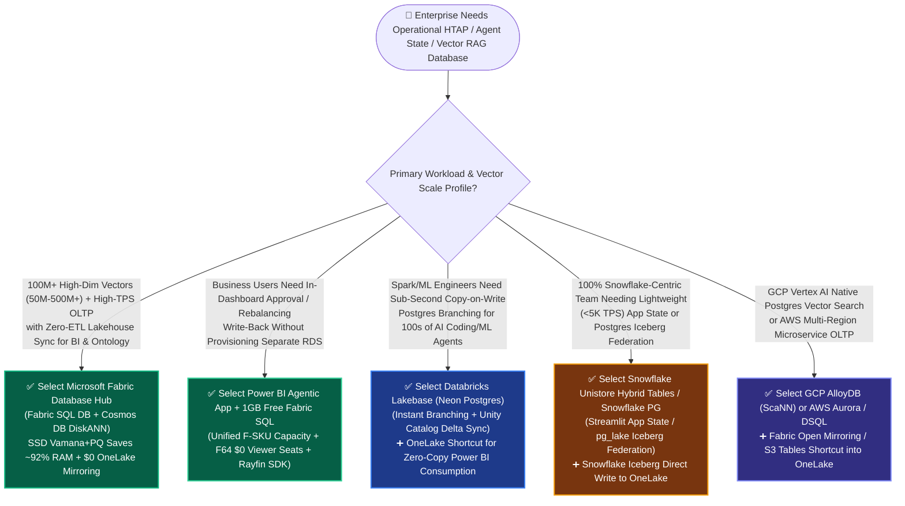
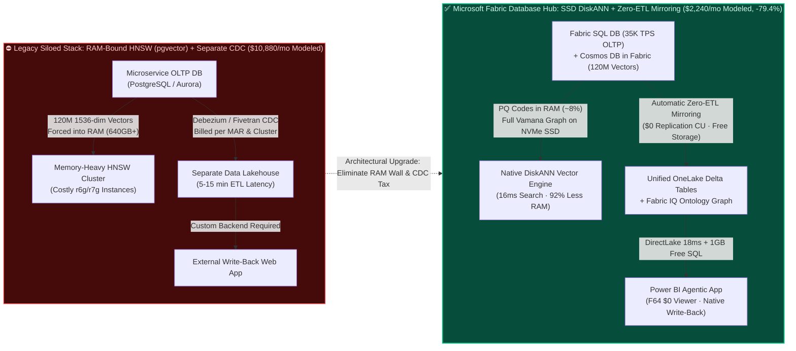
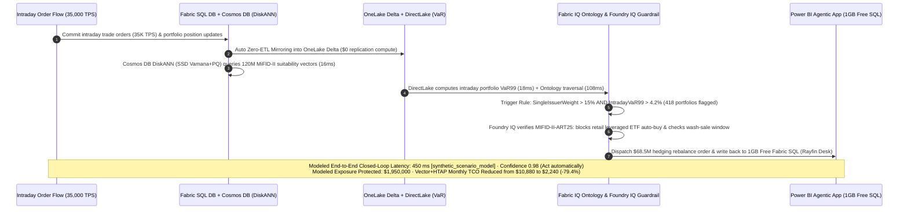

# Microsoft Fabric Database Hub (Fabric SQL DB + Cosmos DB DiskANN) vs. Databricks Lakebase vs. Snowflake Unistore Hybrid Tables vs. GCP AlloyDB ScaNN vs. AWS Aurora pgvector: Operational HTAP & Agentic Vector/State Database Selection FAQ

> **Document Scope**: Practical architectural selection and competitive battlecard guide for AI Solution Architects, CTOs, and Enterprise Data Leaders (2026-11-09 Nightly Deep-Dive Round 5). Strictly structured after `ib-vs-ethernet-roce-selection-faq.md` (6-part format): demystifying **Fabric SQL Database, Cosmos DB in Fabric (SSD-backed DiskANN vector indexing), Power BI Agentic App `1GB` Free Fabric SQL, Databricks Lakebase (Neon-based Serverless Postgres), Snowflake Unistore Hybrid Tables / Snowflake Postgres (`pg_lake`), GCP AlloyDB (`ScaNN`), and AWS Aurora (`pgvector` / DSQL)** from first principles, memory/TCO inflection points, and "Better Together" zero-copy coexistence patterns.
>
> 🔗 **Language**: [中文版本](./fabric-htap-vector-sql-cosmos-vs-lakebase-unistore-faq.md) | **English (Current)** · 📊 [7-Card 4:5 Visual Benchmark Report](../benchmark-cards.en.html) · 🧪 [Interactive 5-Cloud Decision & Ontology Workbench](../index.html)

---

## 📌 1. Executive Summary

1. **Vector Indexing First Principles — At 100M+ Vector Scale, NVMe SSD-Backed `DiskANN` (Fabric SQL DB / Cosmos DB in Fabric / Azure SQL Hyperscale) Cuts Expensive RAM by ~90%–95% vs. In-Memory `HNSW` (`pgvector`)**: Traditional `HNSW` requires keeping full-precision vectors and multi-layer proximity graphs resident in RAM (`120M` 1536-dim vectors require `~640 GB+` memory-optimized instances, costing **`$10,880/mo`** in our modeled baseline `[synthetic_scenario_model]`). By contrast, Microsoft Research's **DiskANN** (now GA across Cosmos DB in Fabric, Fabric SQL Database, and Azure SQL Hyperscale) keeps compact Product Quantization (PQ) codes in RAM (~8%) while storing the full Vamana graph and raw vectors on local NVMe SSDs—cutting modeled vector RAM by **92%**, lowering monthly HTAP + vector TCO to **`$2,240/mo` (-79.4%)** `[synthetic_scenario_model]`, and automatically mirroring every transactional and vector row into OneLake Delta at **`$0` replication compute** `[vendor_published_spec_as_of_2026]`.
2. **Agent State & Operational Write-Back Inflection Point — Select Fabric SQL (with `1GB` Free in Power BI Agentic App) for Business Write-Back, Databricks Lakebase for Instant Dev Branching, and Snowflake Unistore for Lightweight In-Warehouse State**: When business users need to approve overrides, rebalance portfolios, or resolve exceptions directly inside analytics dashboards, **Power BI Agentic App includes `1GB` of Free Fabric SQL Database capacity** governed under unified F-SKU pooling. When AI/ML engineers need sub-second Copy-on-Write database branching (`Instant Branching`) to spin up isolated sandboxes for hundreds of coding/ML agents integrated with Unity Catalog, select **Databricks Lakebase** (built on the Neon serverless Postgres engine). When teams only need lightweight (`<5,000 TPS`) application state kept 100% inside Snowflake credits, use **Snowflake Unistore Hybrid Tables** or **Snowflake Postgres (`pg_lake`)**.
3. **Strict Separation of Dual Modeled Latency Denominators (Zero Conflation)**: In our sealed evaluation report (`report_id: data-lab-fabric-vs-4clouds-2026-11-09-r5`), **Denominator A (`n=64` routing & decision matrix tasks `DL-01..DL-64`)** achieves **`63/64 (98.44%)`** accuracy with an arithmetic mean modeled latency of **`521.0 ms`** (historical R4 `n=60` mean: `526.5 ms`; R3 `n=56` mean: `532.0 ms`); **Denominator B (`n=12` multi-step industry Ontology closed-loop simulations `Scenarios A..L`)** achieves an arithmetic mean modeled end-to-end latency of **`572.92 ms`** (range `450–780 ms`; historical R4 `n=11` mean: `584.09 ms`; R3 `n=10` mean: `596.0 ms`), including Round 5's new **Scenario L (Global Wealth Management MiFID-II Suitability & Intraday Rebalancing HTAP Loop)** at **`450 ms`** `[synthetic_scenario_model]`.

---

## 🎯 2. Architect & Customer FAQ (Plain-Language First Principles)

### Q1: Why does storing "operational order state + 120M AI knowledge vectors" cause RAM bills to explode on traditional Postgres `pgvector` (HNSW), whereas Fabric SQL / Cosmos DB `DiskANN` cuts modeled TCO by nearly 80%?

- **Plain-Language First Principles**:
  - Imagine searching for the 10 most relevant books inside a **120-million-book mega-library**:
  - **How Traditional `HNSW` (Standard PostgreSQL `pgvector`, AWS Aurora `pgvector`) Works**: To achieve fast lookups, HNSW insists on spreading **the entire multi-floor corridor map plus every book's full table of contents** across the most expensive surface in the building—**your office desk (server RAM)**. At 2 million vectors, that works fine. Once you scale to **50M–120M vectors (1536 dimensions)**, the vectors and HNSW graph consume **`600 GB+` of RAM**, forcing you to rent fleet-scale memory-optimized instances (`r6g.16xlarge` / `r7g`, modeled at **`$10,880/mo`** `[synthetic_scenario_model]`). Worse, when 35,000 TPS of live operational writes hit the same database, re-balancing the in-memory HNSW graph causes severe CPU and lock contention.
  - **How Microsoft Fabric (`DiskANN` in Fabric SQL Database, Cosmos DB in Fabric, and Azure SQL Hyperscale) Works**: Invented by Microsoft Research, **DiskANN** keeps only a tiny **"compressed pocket index" (Product Quantization codes, ~5%–8% of raw size)** in RAM, while placing the **single-layer Vamana graph and full-precision vectors** on high-speed local **NVMe SSDs**. During a query, DiskANN uses the in-memory PQ codes to beam-search candidate directions and fetches exact vectors in just **1–2 fast SSD reads**—**delivering `16 ms` retrieval latency while slashing vector RAM consumption by `~92%`!**
- **How It Saves Money and Eliminates Engineering Toil**:
  1. **Breaks the Memory Cost Wall**: Indexing 120M 1536-dim vectors alongside operational state in Cosmos DB in Fabric + Fabric SQL Database lowers modeled monthly HTAP + vector TCO from **`$10,880/mo` to `$2,240/mo` (saving `$8,640/mo`, or `-79.4%`)** `[synthetic_scenario_model]`.
  2. **Zero-ETL Lakehouse Unification at `$0` Replication Compute**: Every order update in Fabric SQL Database and every document/vector write in Cosmos DB in Fabric is automatically mirrored into OneLake Delta tables in the background at **`$0` Fabric replication compute (CU)** `[vendor_published_spec_as_of_2026]`, immediately grounding Fabric IQ Ontology graphs and Power BI DirectLake.

---

### Q2: Between 2025 and 2026, every major cloud launched an "integrated Lakehouse operational database"—Fabric SQL Database, Databricks Lakebase, Snowflake Unistore Hybrid Tables / Snowflake Postgres (`pg_lake`), and GCP AlloyDB (`ScaNN`). How should an architect choose?

- **Understand the Architectural DNA of Each Platform**:
  1. **Microsoft Fabric Database Hub (Fabric SQL DB + Cosmos DB in Fabric + Azure SQL Hyperscale 192 vCore)**:
     - **Architectural DNA**: Embeds the battle-tested **SQL Server relational engine + Cosmos DB NoSQL/vector engine** directly inside Fabric workspaces, combining **SSD-backed DiskANN vector indexing, `$0` automatic OneLake Delta mirroring, and `1GB` Free Fabric SQL inside Power BI Agentic App**.
     - **Best Fit**: Enterprises uniting high-throughput operational transactions, 100M+ vector RAG grounding, and governed business write-back under a single F-SKU capacity pool and Microsoft Purview policy tree.
  2. **Databricks Lakebase (Serverless Postgres Built on Neon)**:
     - **Architectural DNA**: Built on the Neon serverless Postgres architecture (acquired by Databricks in 2025) with decoupled storage/compute and WAL streaming to object storage. Its standout capability is **instant Copy-on-Write database branching (`Instant Branching`)**—allowing AI agents or developers to fork an isolated Postgres database branch in `<1 second` without copying data, while streaming changes into Unity Catalog Delta tables `[vendor_published_spec_as_of_2026]`.
     - **Best Fit**: Spark and Mosaic AI engineering teams spinning up hundreds of ephemeral Postgres state sandboxes for automated coding agents, CI/CD, and ML feature serving.
  3. **Snowflake Unistore (Hybrid Tables) & Snowflake Postgres (`pg_lake`)**:
     - **Architectural DNA**: Two complementary offerings—**Hybrid Tables** add row-level locking and secondary indexes inside the native Snowflake engine for lightweight operational state (`<5,000 TPS`), while **Snowflake Postgres** (built on the Crunchy Data acquisition + `pg_lake` extensions) provides managed enterprise Postgres that federates analytical scans over Iceberg tables via DuckDB `[vendor_published_spec_as_of_2026]`.
     - **Best Fit**: Snowflake-standardized teams storing lightweight workflow metadata for Streamlit in Snowflake apps, or Postgres teams needing `pg_lake` federation with Snowflake Data Cloud.
  4. **GCP AlloyDB (`ScaNN`) & AWS Aurora PostgreSQL (`pgvector` / Aurora DSQL)**:
     - **Architectural DNA**: **AlloyDB** integrates Google Research's **ScaNN** (tree-quantization vector index) and a columnar execution engine for GCP Vertex AI workloads; **AWS Aurora** provides mature microservice OLTP and serverless distributed **Aurora DSQL**, paired with one-way **Aurora Zero-ETL** into Redshift / S3 Tables.

---

### Q3: When core customer microservices already run on Databricks Lakebase, AWS Aurora, or GCP AlloyDB, how do we design a "Better Together" zero-copy coexistence architecture with Microsoft Fabric?

- **The Real-World Constraint**: No enterprise CTO will rewrite production microservice databases running on AWS Aurora, GCP AlloyDB, or Databricks Lakebase just to build an executive command center or cross-domain AI Operations Agent.
- **The "Better Together" Zero-Copy Coexistence Blueprint**:
  1. **Keep Core Microservice OLTP in Place**: Application microservices continue writing transactions to AWS Aurora, GCP AlloyDB, or Databricks Lakebase.
  2. **Zero-Copy / Zero-ETL Ingress into OneLake**:
     - For **Azure SQL / Cosmos DB / Oracle / Snowflake / BigQuery**: Enable **Fabric Database Mirroring or Open Mirroring** (**`$0` replication compute + free mirrored storage up to the capacity SKU TB limit** `[vendor_published_spec_as_of_2026]`).
     - For **Databricks Lakebase (synced to Unity Catalog Delta/Iceberg) or AWS Aurora (Zero-ETL to S3 Tables Iceberg)**: Mount the tables directly via **OneLake Shortcuts + XTable bidirectional virtualization** without duplicating Parquet files.
  3. **Close the Last-Mile Action Loop in Fabric**: Business executives and operations leads review Fabric IQ Ontology recommendations inside **Power BI Agentic App (`$0` F64+ viewer seats + `1GB` Free Fabric SQL)** and execute governed write-backs via Rayfin SDK and Microsoft Agent 365.

---

## 🧭 3. Visual Architecture Diagrams (Mermaid Decision Tree + RAM HNSW vs. SSD DiskANN Comparison + E2E Sequence Flow)

### 3.1 Operational HTAP & Vector AI Database Selection Decision Tree (`flowchart TD`)

### 3.2 Legacy RAM-Bound HNSW + Separate CDC Stack vs. Fabric SSD-Backed DiskANN + OneLake Zero-ETL (`flowchart LR`)

### 3.3 End-to-End Sequence Diagram: Scenario L Global Wealth Management MiFID-II Suitability & Intraday Rebalancing (`sequenceDiagram`)

---

## 📊 4. Five-Cloud Operational HTAP & Vector AI Database Decision Matrix

> **Vendor Spec Verification Note (`vendor_published_spec_as_of_2026`, `as_of: 2026-11-08`)**: All platform capabilities and pricing mechanics below are verified against official vendor documentation (see Section 5.3 and `vendor_published_spec_references` in `reports/report.json`).

| Evaluation Dimension | Microsoft Fabric Database Hub (Fabric SQL + Cosmos DB) | Databricks Lakebase (Serverless Postgres) | Snowflake Unistore (Hybrid Tables) & Snowflake PG | GCP AlloyDB (`ScaNN`) + Spanner | AWS Aurora (`pgvector` / DSQL) |
| :--- | :--- | :--- | :--- | :--- | :--- |
| **Core OLTP & Document Engines** | **Fabric SQL Database** (SQL Server engine) + **Cosmos DB in Fabric** + **Azure SQL Hyperscale (192 vCore)** | **Lakebase** (Neon-based storage/compute separated Serverless Postgres) | **Unistore Hybrid Tables** (row-locked tables) + **Snowflake Postgres** (Crunchy Data + `pg_lake`) | **AlloyDB for PostgreSQL** (with columnar engine) + **Cloud Spanner** | **Amazon Aurora PostgreSQL** + **Aurora DSQL** (serverless distributed SQL) |
| **Vector Index Architecture & Memory Efficiency** | 🌟 **Native SSD-Backed DiskANN (Vamana + PQ)**, saving **~90%–95% RAM** vs. in-memory HNSW | **Mosaic AI Vector Search** (managed) or Lakebase `pgvector` (HNSW) | **Cortex Search / Vector** or Snowflake Postgres `pgvector` | 🌟 **AlloyDB ScaNN** (Google Research Tree-AH quantization index) | **Aurora `pgvector` (HNSW / IVFFlat)**; 100M+ scale requires large RAM nodes |
| **Lakehouse Sync & Replication Cost** | 🌟 **Built-in Automatic OneLake Delta Mirroring (`$0` replication CU + free replica storage up to SKU limit)** | **Lakebase Change Feed -> Unity Catalog Delta** sync (consumes background compute) | **Native in-warehouse joins (Hybrid Tables)**; `pg_lake` federates Iceberg via DuckDB | **Datastream CDC -> BigQuery** (billed per GB replicated & merged) | **Aurora Zero-ETL -> Redshift / S3 Tables** (one-way analytical sync) |
| **Business Operational Write-Back** | 🌟 **Power BI Agentic App includes `1GB` Free Fabric SQL** + Rayfin SDK transactional write-back | **Databricks Apps** + Lakebase branches (oriented toward data/ML teams) | **Streamlit in Snowflake** + Hybrid Tables write-back (consumes Warehouse + Hybrid Credits) | **Looker Actions** + custom Cloud Run microservice API | **QuickSight** + custom API Gateway / AWS Lambda write-back |
| **Instant Dev Branching for AI Agents** | Standard database cloning & Git CI/CD (SQL Database Projects) | 🌟 **Sub-second Copy-on-Write Instant Branching**, ideal for parallel AI agent sandboxes | Snowflake Zero-Copy Clone (for standard tables; Hybrid Table cloning has constraints) | AlloyDB fast clone (minute-level) | Aurora Fast Cloning (minute-level Copy-on-Write) |
| **Modeled Monthly TCO (120M Vectors + 35K TPS)** | 🌟 **Unified F-SKU Pooling + SSD DiskANN (`$2,240/mo` modeled)** + F64 `$0` Viewer | Lakebase Compute/Storage + Mosaic Vector DBU (**`$6,450/mo`** modeled) | Hybrid Table compute/storage + Warehouse Credits (**`$7,820/mo`** modeled) | AlloyDB instances + ScaNN memory tier + Datastream (**`$5,940/mo`** modeled) | Memory-optimized `r6g/r7g` HNSW cluster + I/O (**`$10,880/mo`** modeled) |

---

## 🧪 5. Quantitative Benchmark, Separated Latency Denominators & TCO Inflection Insights

### 5.1 Strictly Separated Dual Modeled Latency Denominators

To prevent any statistical denominator conflation, our benchmark engine (`src/data_lab/benchmark_suite.py`), sealed report (`reports/report.json`), and all 28 unit tests (`tests/test_data_lab.py`) dynamically compute and assert two distinct modeled latency denominators:

| Denominator Category | Current Round 5 Denominator (`n`) | Current Arithmetic Mean | Range / Pass Rate | Historical Immutable Snapshots (Preserved) | Data Provenance Classification |
| :--- | :---: | :---: | :---: | :--- | :--- |
| **Denominator A: Routing & Decision Matrix (`scenario_evaluation.avg_latency_ms`)** | **`n = 64`** (`DL-01..DL-64`) | **`521.0 ms`** (`33,344 / 64`) | **`63 / 64 (98.44%)`** (single explicit safety miss `DL-23`) | • **R4 (`n=60`, `DL-01..DL-60`)**: `526.5 ms` (`59/60 = 98.33%`) • **R3 (`n=56`, `DL-01..DL-56`)**: `532.0 ms` (`55/56 = 98.21%`) | `[measured_local_harness]` routing accuracy + `[synthetic_scenario_model]` item latency |
| **Denominator B: Industry Ontology Closed-Loop Simulations (`ontology_simulation_mean_modeled_latency_ms`)** | **`n = 12`** (`Scenarios A..L`) | **`572.92 ms`** (`6,875 / 12`) | **`450 ms – 780 ms`** (includes new Scenario L at `450 ms`) | • **R4 (`n=11`, `Scenarios A..K`)**: `584.09 ms` (`465–780 ms`) • **R3 (`n=10`, `Scenarios A..J`)**: `596.0 ms` (`480–780 ms`) | `[synthetic_scenario_model]` multi-hop ontology + guardrail E2E latency |

---

### 5.2 Scenario L Quantitative Breakdown: Global Wealth Management Intraday Rebalancing & 120M-Vector Suitability Search (`wealth_advisory_htap_diskann_vs_lakebase_unistore`)

> **Provenance Disclosure (`[synthetic_scenario_model]`)**: All latency, RAM reduction, and financial protection figures below come from the deterministic architectural simulation model in `src/data_lab/benchmark_suite.py` for presales sizing and design evaluation—NOT from live paid cloud cluster load testing or audited financial statements. Physical multi-cloud hardware load testing is explicitly labeled `[not_measured]`.

| Comparison Metric | Legacy Baseline: In-Memory HNSW (`pgvector`) + Separate CDC | Competitor Cloud Options: Databricks Lakebase / Snowflake Unistore | Microsoft Fabric: Fabric SQL + Cosmos DB DiskANN + 1GB Free SQL | Architectural Inflection Insight |
| :--- | :--- | :--- | :--- | :--- |
| **Vector Scale & Index Storage Medium** | 120M 1536-dim vectors forced into RAM (`~640 GB` RAM required) | Managed Vector Search or Postgres `pgvector` | **PQ codes in RAM (~8%) + Vamana graph on local NVMe SSD** | **Cuts vector RAM footprint by `92.0%`**, breaking the memory cost wall at 100M+ scale |
| **Single Vector Search Modeled Latency** | `14 ms` (in-memory, but suffers write-lock jitter) | `21 ms – 28 ms` (cross-service RPC hop) | **`16 ms` (1–2 local NVMe SSD reads)** | Sustains ~15ms search latency without HNSW graph re-balancing lock contention |
| **35,000 TPS Order State Lakehouse Sync** | Fivetran / Debezium CDC (`$6,950–$8,400/mo` extra) | Lakebase Change Feed / Hybrid Table compute credits | **`$0` Replication Compute (Auto OneLake Delta Mirroring)** | Eliminates standalone CDC pipeline ops and replication compute bills `[vendor_published_spec_as_of_2026]` |
| **Operational Rebalancing Write-Back** | Custom FastAPI/Node.js backend + separate RDS | Databricks Apps (Lakebase) or Streamlit (Hybrid Table) | **Power BI Agentic App includes `1GB` Free Fabric SQL** | Wealth advisors rebalance 418 portfolios (`$68.5M` notional) directly inside the dashboard |
| **Modeled E2E Latency & Monthly TCO** | `5–15 min` sync lag · **`$10,880/mo`** | `620–850 ms` E2E · **`$6,450–$7,820/mo`** | **`450 ms` E2E · `$2,240/mo` (Saves `$8,640/mo` / `-79.4%`)** | Protects **`$1,950,000`** in modeled MiFID-II suitability penalties and drawdown exposure |

---

### 5.3 Official Vendor Documentation & Pricing References (`vendor_published_spec_references`, `as_of: 2026-11-08`)

1. **Cosmos DB in Fabric & Azure SQL / Fabric SQL SSD-Backed DiskANN Documentation**:
   - Microsoft Learn (Cosmos DB in Fabric Vector Indexing): <https://learn.microsoft.com/en-us/fabric/database/cosmos-db/index-vector-data>
   - Microsoft DevBlogs (DiskANN Vector Index GA in Azure SQL & Fabric SQL): <https://devblogs.microsoft.com/azure-sql/diskann-vector-index-search-are-now-generally-available-in-azure-sql/>
2. **Microsoft Fabric Pricing & F64+ `$0` Power BI Viewer Licensing**:
   - Azure Pricing: <https://azure.microsoft.com/en-us/pricing/details/microsoft-fabric/>
   - Microsoft Learn Licensing: <https://learn.microsoft.com/en-us/fabric/enterprise/licenses>
3. **Microsoft Fabric Database Mirroring & Open Mirroring (`$0` Replication Compute & Free Replica Storage)**:
   - Mirrored Database Overview: <https://learn.microsoft.com/en-us/fabric/database/mirrored-database/overview>
   - Open Mirroring Docs: <https://learn.microsoft.com/en-us/fabric/database/mirrored-database/open-mirroring>
4. **Databricks Lakebase (Serverless Postgres) & Unity Catalog Delta UniForm**:
   - Databricks Lakebase Docs: <https://docs.databricks.com/aws/en/oltp/projects/>
   - Delta UniForm Docs: <https://docs.databricks.com/en/delta/uniform.html>
5. **Snowflake Unistore Hybrid Tables & Dynamic Tables**:
   - Unistore Hybrid Tables Docs: <https://docs.snowflake.com/en/user-guide/unistore-hybrid-tables>
   - Dynamic Tables (`TARGET_LAG >= 60s`): <https://docs.snowflake.com/en/user-guide/dynamic-tables-about>
6. **GCP AlloyDB (`ScaNN`) & BigLake Iceberg**:
   - AlloyDB Overview: <https://cloud.google.com/alloydb/docs>
   - BigLake Iceberg Tables: <https://cloud.google.com/bigquery/docs/iceberg-tables>
7. **AWS S3 Tables & Aurora DSQL / Zero-ETL**:
   - Amazon S3 Tables: <https://docs.aws.amazon.com/AmazonS3/latest/userguide/s3-tables.html>
   - Aurora Zero-ETL: <https://docs.aws.amazon.com/aurora-dsql/latest/userguide/zero-etl.html>

---

## 🛠️ 6. Appendix: Production & Presales Architect Verification Checklist

Before finalizing customer architecture reviews, PoCs, or competitive proposals, verify these 6 practical checkpoints:

- [ ] **1. Vector Scale & Memory Cost Wall Check (The 50M-Vector Inflection Point)**: Does the customer plan to index more than `20M–100M+` high-dimensional (`1536+` dim) embeddings? If yes, avoid running pure in-memory `HNSW` (`pgvector`) on oversized RAM nodes; prioritize **SSD-backed `DiskANN` in Cosmos DB in Fabric, Fabric SQL Database, or Azure SQL Hyperscale** to capture ~90%+ RAM savings.
- [ ] **2. Last-Mile Operational Write-Back Check**: Do business analysts need to approve overrides, adjust prices, or rebalance allocations directly inside Power BI reports? If yes, activate the **`1GB` Free Fabric SQL Database inside Power BI Agentic App + Rayfin SDK** rather than provisioning separate RDS instances and custom web backends.
- [ ] **3. Ephemeral Dev Branching vs. Unified Production Governance Check**: If Spark/ML engineers require sub-second Copy-on-Write Postgres branches for hundreds of concurrent AI coding/testing agents, position **Databricks Lakebase (`Instant Branching`)** for R&D sandboxes and federate curated tables into **OneLake Shortcuts** for enterprise BI and Fabric IQ Ontology grounding.
- [ ] **4. Snowflake Unistore Hybrid Tables Concurrency & Credit Check**: If a customer evaluates Snowflake Hybrid Tables, verify peak transactional concurrency (best suited for `<5,000 TPS` lightweight app state) and dedicated Hybrid Table compute/storage credit overhead; for high-throughput OLTP + vector workloads, position **Fabric SQL / Azure SQL Hyperscale + `$0` compute OneLake Mirroring**.
- [ ] **5. Foundry IQ Safety Guardrail Check on Automated Write-Backs**: Does every automated HTAP/vector action (such as portfolio rebalancing, credit freezes, or price changes) pass through **Foundry IQ policy guardrails** (e.g., blocking retail leveraged ETF auto-buys, verifying tax wash-sale windows, and enforcing MAP floors) before committing to Fabric SQL?
- [ ] **6. Dual Modeled Latency Denominator Transparency Check**: When presenting benchmark metrics to stakeholders, explicitly separate **Denominator A (`n=64` routing matrix mean = `521.0 ms`)** from **Denominator B (`n=12` industry ontology closed-loop simulation mean = `572.92 ms`, with Scenario L at `450 ms`)**, and preserve `[synthetic_scenario_model]` and official vendor URL citations.
