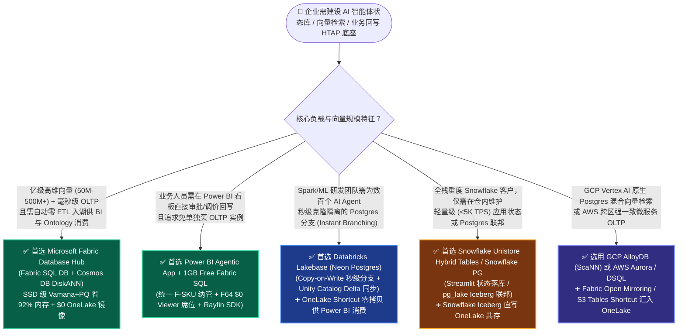
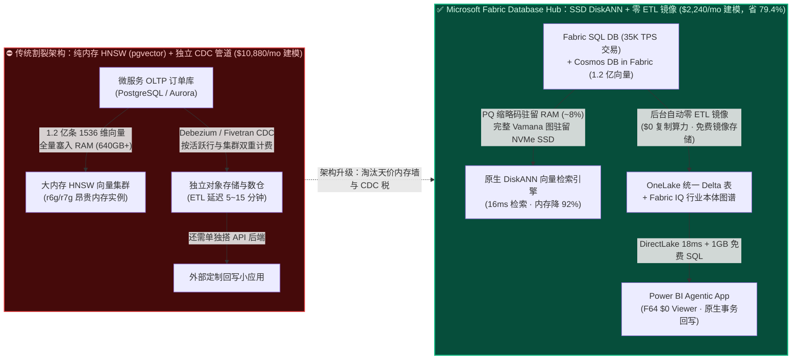
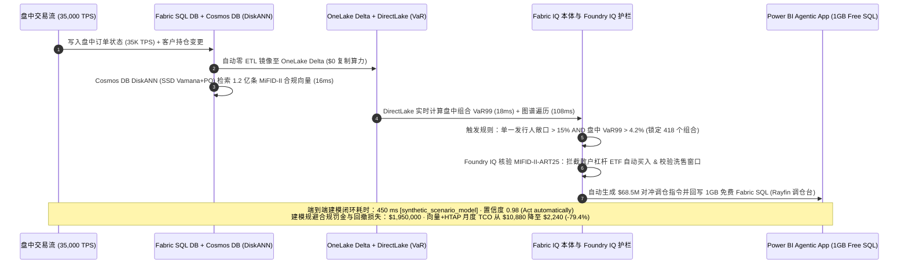

# Microsoft Fabric Database Hub (Fabric SQL DB + Cosmos DB DiskANN) vs. Databricks Lakebase vs. Snowflake Unistore Hybrid Tables vs. GCP AlloyDB ScaNN vs. AWS Aurora pgvector：事务分析一体 HTAP 与智能体向量/状态数据库选型与原理解析 FAQ

> **文档定位**：面向 AI Solution Architect（AI 解决方案架构师）与企业 CTO / 数据平台负责人的实战选型指南（2026-11-09 Nightly Deep-Dive Round 5）。严格对标 `ib-vs-ethernet-roce-selection-faq.md` 六段式架构：用大白话讲透 **Fabric SQL Database、Cosmos DB in Fabric（基于 SSD 的 DiskANN 向量索引）、Power BI Agentic App 1GB 免费 Fabric SQL、Databricks Lakebase（基于 Neon 的 Serverless Postgres）、Snowflake Unistore Hybrid Tables / Snowflake Postgres (`pg_lake`)、GCP AlloyDB (`ScaNN`) 与 AWS Aurora (`pgvector` / DSQL)** 的第一性原理、内存与成本拐点及“双向零拷贝共存（Better Together）”设计模式。
>
> 🔗 **Language**: **中文 (当前)** | [English Version](./fabric-htap-vector-sql-cosmos-vs-lakebase-unistore-faq.en.md) · 📊 [7-Card 4:5 视觉评测报告](../benchmark-cards.html) · 🧪 [交互式五云选型与本体仿真工作台](../index.html)

---

## 📌 一、核心结论速览（Executive Summary）

1. **向量索引第一性原理：上亿级向量规模下，基于 NVMe SSD 的 `DiskANN`（Fabric SQL DB / Cosmos DB in Fabric / Azure SQL Hyperscale）相比纯内存 `HNSW`（标准 Postgres `pgvector`）节省约 90%～95% 昂贵内存**：传统 `HNSW` 要求将完整高维向量与多层邻接图常驻内存（1.2 亿条 1536 维向量约需 `640 GB+` 内存优化型实例，建模月成本达 **`$10,880/mo`** `[synthetic_scenario_model]`）；而微软研究院研发并已在 Fabric SQL 与 Cosmos DB in Fabric 全面 GA 的 **DiskANN** 将乘积量化（Product Quantization, PQ）压缩码保存在内存、完整 Vamana 图与原始向量保存在本地高速 SSD，建模内存占用降低 **92%**、月度 HTAP+向量总成本降至 **`$2,240/mo`（节省 79.4%）** `[synthetic_scenario_model]`，且每一笔事务与向量写入自动以 **`$0` 复制算力** 零 ETL 镜像至 OneLake Delta `[vendor_published_spec_as_of_2026]`。
2. **智能体状态与业务回写（Write-Back）选型分水岭：业务端闭环应用首选 Fabric SQL（含 Power BI Agentic App `1GB` 免费容量），Spark 研发多分支沙盒首选 Databricks Lakebase，轻量级仓内状态选 Snowflake Unistore**：当业务人员需要在分析看板中直接审批、调价、拦截风险并落库时，**Power BI Agentic App 原生赠送 `1GB` 免费 Fabric SQL Database** 并通过统一 F-SKU 纳管；当 AI 工程师需要毫秒级 Copy-on-Write 数据库分支（Instant Branching）来克隆数十个 Agent 测试沙盒并与 Unity Catalog 对接时，首选基于 Neon 引擎构建的 **Databricks Lakebase**；当企业仅需在 Snowflake 内部维护 `<5,000 TPS` 轻量级应用状态且不希望引入外部数据库时，可选用 **Snowflake Unistore Hybrid Tables** 或 **Snowflake Postgres (`pg_lake`)**。
3. **双建模延迟分母严格分离（零口径混写）**：在当前封存基准报告（`report_id: data-lab-fabric-vs-4clouds-2026-11-09-r5`）中，**分母 A（`n=64` 项架构路由与决策评测矩阵 `DL-01..DL-64`）** 通过率为 **`63/64 (98.44%)`**，算术平均建模延迟为 **`521.0 ms`**（历史 R4 `n=60` 均值为 `526.5 ms`，R3 `n=56` 均值为 `532.0 ms`）；**分母 B（`n=12` 项端到端行业本体闭环仿真 `Scenarios A..L`）** 的算术平均建模闭环延迟为 **`572.92 ms`**（范围 `450–780 ms`；历史 R4 `n=11` 均值为 `584.09 ms`，R3 `n=10` 均值为 `596.0 ms`），其中本轮新增的 **Scenario L（全球财富管理 MiFID-II 适当性审查与盘中调仓 HTAP 闭环）** 端到端建模延迟为 **`450 ms`** `[synthetic_scenario_model]`。

---

## 🎯 二、客户与架构师灵魂拷问 Q&A（从大白话与第一性原理讲透）

### Q1：为什么同样是存“业务订单状态 + 1 亿条 AI 知识库向量”，用传统 Postgres `pgvector` (HNSW) 账单会爆炸，而 Fabric SQL / Cosmos DB 的 `DiskANN` 能省下近 80% 成本？

- **通俗大白话解释**：
  - 把“高维向量检索”想象成在 **1.2 亿本藏书的巨型图书馆** 里找最相似的 10 本书：
  - **传统 `HNSW`（如标准 PostgreSQL `pgvector`、AWS Aurora `pgvector`）的做法**：为了跑得快，它要求把 **整座图书馆的立体走廊地图 + 每本书的完整厚目录** 全部平铺在最昂贵的“办公桌面（服务器内存 RAM）”上。当向量只有几百万条时很爽；一旦突破 **5,000 万～1.2 亿条（1536 维）**，光索引加向量就要吃掉 **`600 GB+` 内存**，你不得不租用多台昂贵的 `r6g.16xlarge` / `r7g` 大内存实例（建模月账单 **`$10,880/mo`** `[synthetic_scenario_model]`）。而且只要前台每秒有几万笔订单更新（OLTP 写入），内存里的立体地图就要频繁重建，CPU 和内存双双告警。
  - **Microsoft Fabric（Fabric SQL Database / Cosmos DB in Fabric / Azure SQL Hyperscale）`DiskANN` 的第一性原理**：微软研究院发明的 **DiskANN** 只在“办公桌面（内存 RAM）”上放一本极薄的 **“速查缩略编码本（Product Quantization 乘积量化压缩码，仅占原体积约 5%～8%）”**，而把完整的 **Vamana 单层精简图和原始高精度向量** 放在紧贴 CPU 的 **本地高速 NVMe SSD** 上。检索时先用内存缩略码锁定候选方向，再通过 **1～2 次极速 SSD 顺序读取** 拿到精确结果——**检索延迟同样保持在 `16 ms` 量级，但内存消耗暴降约 `92%`！**
- **底层是怎么帮客户省钱与提效的？**
  1. **告别天价大内存实例**：在 Cosmos DB in Fabric 与 Fabric SQL Database 中，1.2 亿条 1536 维向量无需购买数百 GB 专用内存节点，结合统一 F-SKU 容量池化，建模月度 HTAP+向量总成本从 **`$10,880/mo` 降至 `$2,240/mo`（节省 `$8,640/mo`，降幅 `79.4%`）** `[synthetic_scenario_model]`。
  2. **天生的零 ETL 湖仓一体（`$0` 复制算力）**：在 Fabric SQL Database 或 Cosmos DB in Fabric 中写入的每一笔交易状态和向量元数据，后台自动通过 **OneLake Zero-ETL Mirroring** 同步成 OneLake Delta 表，**不消耗任何 Fabric 复制算力（`$0` Replication CU）** `[vendor_published_spec_as_of_2026]`，直接供 Fabric IQ 本体图谱和 Power BI DirectLake 秒级分析。

---

### Q2：2025–2026 年各大云厂商纷纷推出“湖仓内建事务库”——Fabric SQL Database、Databricks Lakebase、Snowflake Unistore Hybrid Tables / Snowflake Postgres (`pg_lake`)、GCP AlloyDB (`ScaNN`)，架构师到底该如何拍板？

- **先弄清四者在架构基因上的本质差异**：
  1. **Microsoft Fabric Database Hub（Fabric SQL DB + Cosmos DB in Fabric + Azure SQL Hyperscale 192 vCore）**：
     - **核心基因**：把久经沙场的 **SQL Server 关系型引擎 + Cosmos DB NoSQL 文档/向量引擎** 原生塞进 Fabric 工作区，主打 **“SSD 级 DiskANN 超大规模向量 + `$0` 自动镜像入 OneLake + Power BI Agentic App `1GB` 免费回写库”**。
     - **最适合谁**：需要把 **高频业务交易状态、亿级 RAG 向量检索、Power BI 业务人员交互式审批回写（Write-Back）** 融合在同一个 F-SKU 容量池与 Purview 治理策略下的企业。
  2. **Databricks Lakebase（基于收购 Neon 打造的 Serverless Postgres）**：
     - **核心基因**：采用 **存算分离 + WAL 日志直写对象存储** 的 Serverless Postgres 架构（源自 Neon），最大杀手锏是 **秒级 Copy-on-Write 数据库分支（Instant Branching）**——就像 Git `checkout -b` 一样，AI Agent 或开发者可以在 1 秒内零拷贝克隆出一个独立的 Postgres 状态库分支做实验，且变更流可自动同步至 Unity Catalog Delta 表 `[vendor_published_spec_as_of_2026]`。
     - **最适合谁**：以 Spark / Mosaic AI 为核心的算法工程团队，需要为成百上千个自动化 AI Coding / ML 实验 Agent 瞬间拉起隔离的 Postgres 状态沙盒。
  3. **Snowflake Unistore (Hybrid Tables) & Snowflake Postgres (`pg_lake`)**：
     - **核心基因**：分为两条路线——**Hybrid Tables** 是在 Snowflake 原生引擎中增加行级锁（Row-level locking）与主外键索引，适合在数仓内部顺带存一点轻量级工作流状态（`<5,000 TPS`）；**Snowflake Postgres（源自收购 Crunchy Data + `pg_lake` 扩展）** 则是托管企业级 Postgres 并通过 DuckDB/Iceberg 联邦查询湖仓表 `[vendor_published_spec_as_of_2026]`。
     - **最适合谁**：重度 Snowflake 客户，希望在 Streamlit in Snowflake 内部保存应用配置或轻量级审批流水，或者现有 Postgres 团队希望通过 `pg_lake` 直接联邦查询 Snowflake Iceberg 表。
  4. **GCP AlloyDB (`ScaNN`) & AWS Aurora PostgreSQL (`pgvector` / Aurora DSQL)**：
     - **核心基因**：**AlloyDB** 内置 Google Research 的 **ScaNN**（基于各向异性向量量化 Tree-AH 的高性能向量索引）与列存加速引擎，适合 GCP Vertex AI 生态；**AWS Aurora** 提供成熟的微服务 OLTP 与无服务器分布式事务库 **Aurora DSQL**，并通过 **Aurora Zero-ETL** 单向同步至 Redshift / S3 Tables。

---

### Q3：如果客户的核心微服务已经跑在 Databricks Lakebase、AWS Aurora 或 GCP AlloyDB 上，如何与 Microsoft Fabric 实现“双向零拷贝共存（Better Together）”？

- **痛点背景**：企业绝不可能为了做一个全集团高管驾驶舱或跨部门 AI 运营智能体，就把正在线上跑核心交易的 AWS Aurora、GCP AlloyDB 或 Databricks Lakebase 数据库停机重写。
- **“各司其职、双向零拷贝共存”黄金架构**：
  1. **源端保持不动（Keep Core Microservice OLTP in Place）**：前端微服务继续写入 AWS Aurora、GCP AlloyDB 或 Databricks Lakebase。
  2. **正向零 ETL / 零拷贝入湖（Zero-Copy / Zero-ETL Ingress to OneLake）**：
     - 对 **Azure SQL / Cosmos DB / Oracle / Snowflake / BigQuery**：直接启用 **Fabric Database Mirroring / Open Mirroring**（**`$0` 复制算力 + 高达容量 SKU 上限的免费镜像存储** `[vendor_published_spec_as_of_2026]`）。
     - 对 **Databricks Lakebase（已同步至 Unity Catalog Delta/Iceberg）或 AWS Aurora（Zero-ETL 至 S3 Tables Iceberg）**：直接通过 **OneLake Shortcuts + XTable 双向虚拟化** 零拷贝挂载，无需二次搬运文件。
  3. **业务回写闭环（Last-Mile Agentic Write-Back in Fabric）**：高管与一线运营人员在 **Power BI Agentic App（享受 F64+ `$0` Viewer 免席位费 + `1GB` 免费 Fabric SQL）** 中完成风险处置或调仓审批，回写动作既可落入 Fabric SQL 审计账本，也可通过 Microsoft Agent 365 受控 API 回推至上游交易系统。

---

## 🧭 三、直观可视化图解（Mermaid 选型决策树 + 传统 HNSW vs. DiskANN HTAP 架构对比 + 端到端闭环时序图）

### 3.1 事务分析一体（HTAP）与智能体向量/状态数据库选型决策树（`flowchart TD`）

### 3.2 传统纯内存 HNSW + 独立 CDC 烟囱栈 vs. Fabric SSD-Backed DiskANN + OneLake Zero-ETL 架构对比图（`flowchart LR`）

### 3.3 端到端业务闭环时序图：Scenario L 全球财富管理 MiFID-II 适当性审查与盘中调仓 HTAP 闭环（`sequenceDiagram`）

---

## 📊 四、五大平台事务分析一体（HTAP）与智能体向量/状态数据库选型决策矩阵（Architect Decision Matrix）

> **事实核验说明（`vendor_published_spec_as_of_2026`，截至 `2026-11-08`）**：以下各平台核心技术特性与计费规则均核验自厂商官方文档（完整官方 URL 列表见第 5.3 节与 `reports/report.json` 中的 `vendor_published_spec_references`）。

| 评估维度 | Microsoft Fabric Database Hub (Fabric SQL + Cosmos DB) | Databricks Lakebase (Serverless Postgres) | Snowflake Unistore (Hybrid Tables) & Snowflake PG | GCP AlloyDB (`ScaNN`) + Spanner | AWS Aurora (`pgvector` / DSQL) |
| :--- | :--- | :--- | :--- | :--- | :--- |
| **核心事务与文档引擎** | **Fabric SQL Database** (SQL Server 引擎) + **Cosmos DB in Fabric** + **Azure SQL Hyperscale (192 vCore)** | **Lakebase**（基于收购 Neon 的存算分离 Serverless Postgres） | **Unistore Hybrid Tables**（仓内行锁表）+ **Snowflake Postgres**（Crunchy Data + `pg_lake`） | **AlloyDB for PostgreSQL**（含列存加速层）+ **Cloud Spanner** | **Amazon Aurora PostgreSQL** + **Aurora DSQL**（无服务器分布式 SQL） |
| **向量索引底层架构与内存效率** | 🌟 **原生 SSD 级 DiskANN（Vamana 图 + PQ 乘积量化）**，相比纯内存 HNSW **节省约 90%～95% 内存** | **Mosaic AI Vector Search**（托管索引）或 Lakebase 内建 `pgvector` (HNSW) | **Cortex Search / Vector** 或 Snowflake Postgres `pgvector` | 🌟 **AlloyDB ScaNN**（Google Research 树量化 Tree-AH 索引，高召回率） | **Aurora `pgvector` (HNSW / IVFFlat)**，亿级规模高度依赖大内存实例 |
| **湖仓同步机制与复制算力成本** | 🌟 **内置自动 OneLake Delta 镜像（`$0` 复制算力 CU + 高达容量上限免费存储）** | **Lakebase Change Feed -> Unity Catalog Delta** 自动同步（消耗后台算力） | **Hybrid Tables 原生同仓查询**；`pg_lake` 通过 DuckDB 联邦查询 Iceberg | **Datastream CDC -> BigQuery**（按捕获与合并数据量计费） | **Aurora Zero-ETL -> Redshift / S3 Tables**（单向分析同步，无原生回写） |
| **业务端交互式回写（Agentic Write-Back）** | 🌟 **Power BI Agentic App 原生内置 `1GB` 免费 Fabric SQL** + Rayfin SDK 低代码事务回写 | **Databricks Apps** + Lakebase 数据库分支回写（偏研发与数据科学团队） | **Streamlit in Snowflake** + Hybrid Tables 回写（消耗 Warehouse + Hybrid Credits） | **Looker Actions** + Cloud Run 自定义微服务 API 回写 | **QuickSight** + API Gateway / AWS Lambda 自定义回写链路 |
| **AI Agent 研发分支能力（Instant Branching）** | 支持标准数据库克隆与Git CI/CD（Database Projects） | 🌟 **毫秒级 Copy-on-Write 数据库分支（Instant Branching）**，极适合多 Agent 并发测试沙盒 | Snowflake 表级 Zero-Copy Clone（针对标准分析表，Hybrid Tables 克隆受限） | AlloyDB 快速克隆（分钟级） | Aurora Fast Cloning（分钟级 Copy-on-Write） |
| **综合 TCO 与计费模式（1.2 亿向量 + 35K TPS 建模）** | 🌟 **统一 F-SKU 容量池化 + SSD DiskANN（建模 `$2,240/mo`）** + F64 `$0` Viewer | Lakebase Compute/Storage + Mosaic Vector DBU（建模 **`$6,450/mo`**） | Hybrid Tables 专属算力/存储 + Warehouse Credits（建模 **`$7,820/mo`**） | AlloyDB 实例 + ScaNN 内存层 + Datastream（建模 **`$5,940/mo`**） | 内存优化型 `r6g/r7g` HNSW 集群 + I/O 计费（建模 **`$10,880/mo`**） |

---

## 🧪 五、简明定量测评、双分母口径分离与 TCO/性能拐点洞察

### 5.1 双建模延迟分母严格分离（Dual Modeled Latency Denominators Disclosure）

为确保架构评测口径绝对严谨、零混淆，本实验室在代码引擎（`src/data_lab/benchmark_suite.py`）、封存报告（`reports/report.json`）及全部 28 项单元测试（`tests/test_data_lab.py`）中对两类不同分母的建模延迟进行独立计算与断言：

| 指标分母类别 | 当前 Round 5 分母 (`n`) | 当前算术均值 | 范围 / 通过率 | 历史不可变快照对照（严禁覆盖） | 数据来源分类（Provenance） |
| :--- | :---: | :---: | :---: | :--- | :--- |
| **分母 A：架构路由与选型决策矩阵 (`scenario_evaluation.avg_latency_ms`)** | **`n = 64`** (`DL-01..DL-64`) | **`521.0 ms`** (`33,344 / 64`) | **`63 / 64 (98.44%)`**（唯一显式 Miss 为 `DL-23` 高风险越权拦截） | • **R4 (`n=60`, `DL-01..DL-60`)**：`526.5 ms` (`59/60 = 98.33%`) • **R3 (`n=56`, `DL-01..DL-56`)**：`532.0 ms` (`55/56 = 98.21%`) | `[measured_local_harness]` 路由准确性 + `[synthetic_scenario_model]` 单题建模延迟 |
| **分母 B：端到端行业本体闭环仿真 (`ontology_simulation_mean_modeled_latency_ms`)** | **`n = 12`** (`Scenarios A..L`) | **`572.92 ms`** (`6,875 / 12`) | **`450 ms – 780 ms`**（含本轮新增 Scenario L `450 ms`） | • **R4 (`n=11`, `Scenarios A..K`)**：`584.09 ms` (`465–780 ms`) • **R3 (`n=10`, `Scenarios A..J`)**：`596.0 ms` (`480–780 ms`) | `[synthetic_scenario_model]` 多跳本体图谱 + 护栏端到端建模延迟 |

---

### 5.2 Scenario L 定量仿真拆解：全球财富管理盘中调仓与 1.2 亿向量合规检索（`wealth_advisory_htap_diskann_vs_lakebase_unistore`）

> **数据性质声明（`[synthetic_scenario_model]`）**：以下性能、内存节省率与财务收益来自 `src/data_lab/benchmark_suite.py` 中可复现的确定性架构仿真模型（用于售前架构选型与容量测算参考），并非对真实商业银行生产集群的付费云压测或已审计财报；物理多云集群压测显式标注为 `[not_measured]`。

| 对照维度 | 传统方案：纯内存 HNSW (`pgvector`) + 独立 CDC 管道 | 竞品云原生方案：Databricks Lakebase / Snowflake Unistore | Microsoft Fabric 方案：Fabric SQL + Cosmos DB DiskANN + 1GB Free SQL | 核心架构差异与拐点洞察 |
| :--- | :--- | :--- | :--- | :--- |
| **向量规模与索引驻留介质** | 1.2 亿条 1536 维向量全量驻留 RAM（需 `~640 GB` RAM） | 托管 Vector Search 索引或 Postgres `pgvector` | **PQ 压缩码驻留 RAM (~8%) + Vamana 图驻留 NVMe SSD** | **向量内存占用降低 `92.0%`**，彻底打破百亿 token 知识库的“内存成本墙” |
| **单次合规向量检索建模延迟** | `14 ms`（纯内存，但写入重平衡抖动大） | `21 ms – 28 ms`（跨服务 RPC 调用） | **`16 ms`（本地 NVMe SSD 1～2 跳读取）** | 在保持 ~15ms 级延迟的同时，消除了高并发 OLTP 写入导致的 HNSW 锁竞争 |
| **35,000 TPS 订单状态入湖成本** | Fivetran / Debezium CDC 额外计费（`$6,950–$8,400/mo`） | Lakebase Change Feed / Hybrid Table 消耗算力 Credits | **`$0` 复制算力（自动镜像至 OneLake Delta）** | 省去整条 CDC 管道运维与算力账单 `[vendor_published_spec_as_of_2026]` |
| **业务调仓台回写（Write-Back）** | 需自建 FastAPI/Node.js 后端 + RDS 实例 | Databricks Apps (Lakebase) 或 Streamlit (Hybrid Table) | **Power BI Agentic App 内置 `1GB` 免费 Fabric SQL** | 一线投顾在看板内直接完成 418 个组合（`$68.5M` 名义本金）调仓回写 |
| **端到端闭环耗时与建模月度 TCO** | 跨库同步滞后 `5–15 min` · **`$10,880/mo`** | 端到端 `620–850 ms` · **`$6,450–$7,820/mo`** | **端到端 `450 ms` · `$2,240/mo`（省 `$8,640/mo` / `-79.4%`）** | 建模保护 **`$1,950,000`** MiFID-II 适当性合规罚金与盘中回撤敞口 |

---

### 5.3 官方厂商规约与价格核验链接清单（`vendor_published_spec_references`，`as_of: 2026-11-08`）

1. **Cosmos DB in Fabric & Azure SQL / Fabric SQL SSD-Backed DiskANN 官方文档**：
   - Microsoft Learn (Cosmos DB in Fabric Vector Indexing): <https://learn.microsoft.com/en-us/fabric/database/cosmos-db/index-vector-data>
   - Microsoft DevBlogs (DiskANN Vector Index GA in Azure SQL & Fabric SQL): <https://devblogs.microsoft.com/azure-sql/diskann-vector-index-search-are-now-generally-available-in-azure-sql/>
2. **Microsoft Fabric 定价与 F64+ `$0` Power BI Viewer 免席位费规约**：
   - Azure Pricing: <https://azure.microsoft.com/en-us/pricing/details/microsoft-fabric/>
   - Microsoft Learn Licensing: <https://learn.microsoft.com/en-us/fabric/enterprise/licenses>
3. **Microsoft Fabric Database Mirroring & Open Mirroring `$0` 复制算力与免费镜像存储规约**：
   - Mirrored Database Overview: <https://learn.microsoft.com/en-us/fabric/database/mirrored-database/overview>
   - Open Mirroring Docs: <https://learn.microsoft.com/en-us/fabric/database/mirrored-database/open-mirroring>
4. **Databricks Lakebase (Serverless Postgres) & Unity Catalog Delta UniForm 官方文档**：
   - Databricks Lakebase Docs: <https://docs.databricks.com/aws/en/oltp/projects/>
   - Delta UniForm Docs: <https://docs.databricks.com/en/delta/uniform.html>
5. **Snowflake Unistore Hybrid Tables & Dynamic Tables 官方文档**：
   - Unistore Hybrid Tables Docs: <https://docs.snowflake.com/en/user-guide/unistore-hybrid-tables>
   - Dynamic Tables (`TARGET_LAG >= 60s`): <https://docs.snowflake.com/en/user-guide/dynamic-tables-about>
6. **GCP AlloyDB (`ScaNN`) & BigLake Iceberg 官方文档**：
   - AlloyDB Overview: <https://cloud.google.com/alloydb/docs>
   - BigLake Iceberg Tables: <https://cloud.google.com/bigquery/docs/iceberg-tables>
7. **AWS S3 Tables & Aurora DSQL / Zero-ETL 官方文档**：
   - Amazon S3 Tables: <https://docs.aws.amazon.com/AmazonS3/latest/userguide/s3-tables.html>
   - Aurora Zero-ETL: <https://docs.aws.amazon.com/aurora-dsql/latest/userguide/zero-etl.html>

---

## 🛠️ 六、附录：生产落地与售前打单快速核验清单（Architect Checklist）

在客户架构评审、PoC 验证或竞对攻防打单前，请逐项核对以下 6 条实战准则：

- [ ] **1. 向量规模与内存成本墙核验（5,000 万向量拐点）**：客户是否计划存储超过 `2,000 万～1 亿+` 条 1536 维以上 Embedding 向量？若是，切勿直接采用纯内存 `HNSW` (`pgvector`) 裸跑在大内存实例上，优先采用 **Cosmos DB in Fabric 或 Fabric SQL Database / Azure SQL Hyperscale 的 SSD 级 `DiskANN` 索引**，验证 ~90%+ 内存削减效果。
- [ ] **2. 业务回写（Write-Back）最后 100 米核验**：业务部门是否需要在 Power BI 报表中直接进行“审批、调价、异常标注、库存调拨”并实时落库？若是，优先启用 **Power BI Agentic App 内置的 `1GB` 免费 Fabric SQL Database + Rayfin SDK**，免去单独采购和运维外部 RDS + Web 后端的成本。
- [ ] **3. AI 研发多分支沙盒 vs. 生产统一治理边界核验**：若客户的算法团队需要每秒拉起数十个隔离的 Postgres 实验分支供 Coding/ML Agent 试错，推荐在研发侧保留 **Databricks Lakebase（Instant Branching）**，并通过 **Unity Catalog -> OneLake Shortcuts** 将定型后的特征与状态零拷贝接入 Fabric IQ 本体层。
- [ ] **4. Snowflake Unistore Hybrid Tables 并发与成本边界核验**：若客户计划使用 Snowflake Hybrid Tables，务必核对其并发 TPS（建议 `<5,000 TPS` 轻量级应用元数据）与专属 Hybrid Tables 算力/存储 Credit 溢价；对于高频核心交易，优先采用 **Fabric SQL / Azure SQL Hyperscale + `$0` 复制算力 OneLake Mirroring**。
- [ ] **5. 高风险自动化交易的 Foundry IQ 护栏核验**：任何从 HTAP/向量检索触发的自动写回动作（如盘中投资组合调仓、信贷冻结、价格修改），是否在写回 Fabric SQL 前强制经过 **Foundry IQ 策略护栏**（例如拦截向散户账户自动买入杠杆 ETF、校验洗售窗口与最低限价 MAP）？
- [ ] **6. 双建模延迟分母透明披露核验**：在向客户汇报基准评测数据时，是否清晰区分了 **`n=64` 项路由决策矩阵平均延迟（`521.0 ms`）** 与 **`n=12` 项端到端行业本体闭环仿真平均延迟（`572.92 ms`，其中 Scenario L 为 `450 ms`）**，并明确标注 `[synthetic_scenario_model]` 与官方规约链接？
