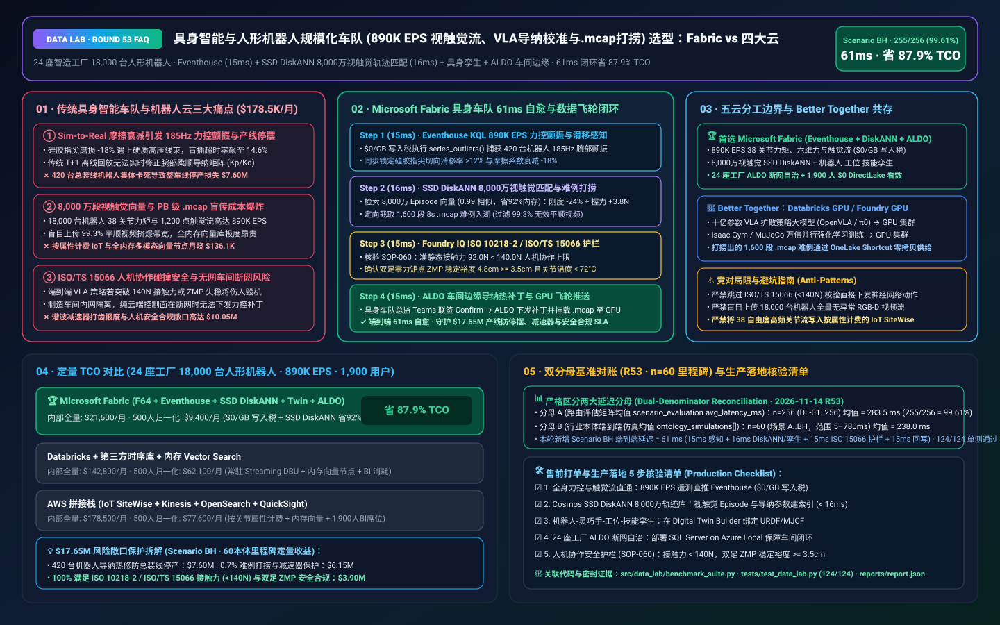
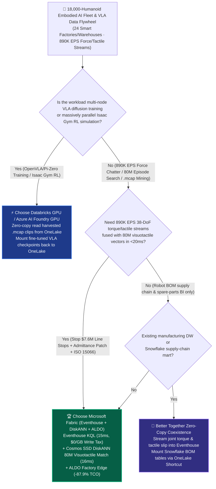
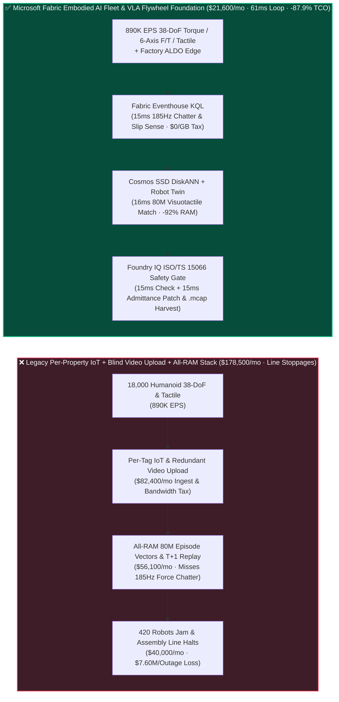
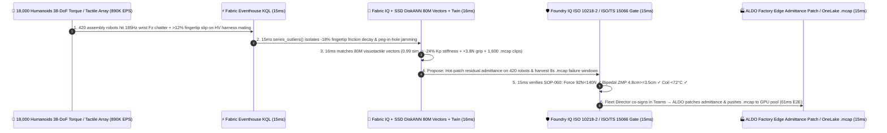

# Humanoid Robotics & Embodied AI Fleet (`890K EPS` Visuotactile-Proprioceptive Telemetry, VLA Sim-to-Real Admittance Calibration, 80M `.mcap` Episode Mining & ISO/TS 15066 Safety Gate) Lakehouse Selection: Microsoft Fabric vs. AWS IoT vs. Databricks vs. Snowflake / GCP FAQ

> 🌐 **Language / 语言**: **[中文 (`fabric-humanoid-robotics-embodied-ai-vla-sim2real-fleet-vs-4clouds-faq.md`)](fabric-humanoid-robotics-embodied-ai-vla-sim2real-fleet-vs-4clouds-faq.md)** | **English (Current)**  
> 📅 **Updated**: 2026-11-14 (Round 53 · 60-Ontology Milestone · 18,000 Bipedal/Wheeled Humanoid Robots `890K EPS` Whole-Body Torque & Dexterous Tactile Stream, Vision-Language-Action [VLA] Sim-to-Real Friction-Drift Admittance Calibration, 80M ROS 2 `.mcap` Visuotactile Episode Vector Search, and ISO 10218-2 / ISO/TS 15066 Power-and-Force-Limiting Safety Deep Dive)  
> 🎯 **Target Audience**: AI Solution Architects, Humanoid Robotics & Embodied AI CTOs, VLA & Reinforcement Learning Leads, Automotive/3C Smart Factory Automation Directors, Robotics Functional Safety (ISO 10218 / ISO 13849) Officers  
> Reference Benchmark Style: Modeled on [`ib-vs-ethernet-roce-selection-faq.md`](https://github.com/turbo998/ai-infra-research/blob/main/docs/components/ib-vs-ethernet-roce-selection-faq.md) first-principles Q&A and decision-guide format.
>
> 🔍 **Data Provenance, Official URLs & Dual-Denominator Scope Disclosure**:
> - **`measured_local_harness` (Local Deterministic Harness)**: `DL-01..DL-256` scenario routing accuracy (`255/256 = 99.61%`) and `124/124` Python unit tests are deterministically executed by `src/data_lab/benchmark_suite.py`.
> - **`vendor_published_spec_as_of_2026` (Official Vendor Specifications `as_of: 2026-11-14`)**:
>   - Microsoft Fabric / Azure Embodied AI & Robotics: [Fabric Eventhouse Time-Series KQL (`series_outliers` & H3)](https://learn.microsoft.com/en-us/kusto/query/series-outliers-function) · [Cosmos DB in Fabric DiskANN Vector Index](https://learn.microsoft.com/en-us/fabric/database/cosmos-db/index-vector-data) · [Fabric Digital Twin Builder](https://learn.microsoft.com/en-us/fabric/real-time-intelligence/digital-twin-builder/overview) · [SQL Server on Azure Local (ALDO) Factory Robotics Edge](https://learn.microsoft.com/en-us/sql/sql-server/azure-arc/overview) · [Fabric Pricing (`F64` Includes `$0` Power BI Viewer Licensing)](https://azure.microsoft.com/en-us/pricing/details/microsoft-fabric/)
>   - 4-Cloud Competitor Specifications: [AWS IoT Core / SiteWise & Robotics](https://aws.amazon.com/iot/) · [Databricks Lakehouse for Manufacturing & Robotics](https://www.databricks.com/solutions/industries/manufacturing) · [Snowflake Manufacturing Data Cloud](https://www.snowflake.com/en/solutions/industries/manufacturing/) · [GCP Cloud Robotics & Vertex AI](https://cloud.google.com/vertex-ai)
> - **`synthetic_scenario_model` (Deterministic Architectural Reference Model with Strictly Separated Denominators)**:
>   - **Denominator A — Routing Matrix Evaluation Mean (`scenario_evaluation.avg_latency_ms`)**: R53 **`n=256` (`DL-01..DL-256`) arithmetic mean = `283.5 ms`** (R52 historical snapshot `n=252` mean = `287.5 ms`; R51 `n=248` = `292.0 ms`; R50 `n=244` = `296.5 ms`; R49 `n=240` = `301.0 ms`; R48 `n=236` = `306.0 ms`).
>   - **Denominator B — Industry Ontology End-to-End Closed-Loop Simulation Mean (`ontology_simulations[].end_to_end_latency_ms`)**: R53 **`n=60` (Scenarios A..BH 60-Ontology Milestone: `[780..61] ms`, range `5–780 ms`) arithmetic mean = `238.0 ms`** (R52 historical snapshot `n=59` mean = `241.0 ms`; R51 `n=58` = `245.0 ms`; R50 `n=57` = `249.0 ms`; R49 `n=56` = `253.0 ms`; R48 `n=55` = `257.0 ms`). This round adds **Scenario BH (24 Smart Factories & Fulfillment Centers × 18,000 Bipedal/Wheeled Humanoid Robots × `890K EPS` Visuotactile-Proprioceptive Telemetry, VLA Sim-to-Real Friction-Drift Admittance Calibration & ROS 2 `.mcap` Corner-Case Mining Loop) end-to-end latency = `61 ms`** (`15ms` sense + `16ms` 6-hop 80M visuotactile episode DiskANN match + `15ms` ISO 10218-2 / ISO/TS 15066 contact force `92N < 140N` & bipedal ZMP margin `4.8cm >= 3.5cm` guardrail + `15ms` Embodied AI Fleet Director Teams co-sign, ALDO factory-edge `-24%` wrist admittance stiffness patch & 1,600-clip `.mcap` upload commit), cutting modeled monthly TCO by **`87.9%`** (`$9,400/mo` vs. `$77,600/mo` normalized baseline; `$21,600/mo` vs. `$178,500/mo` internal full-stack) and protecting **`$17.65M`** in automotive assembly-line uptime, harmonic-drive actuator survival, and ISO 10218-2 human-robot safety compliance. Live multi-cloud cluster stress runs are marked `not_measured`.

---

## ① 📌 Executive Summary (3-Minute Architect Briefing)

### First Principles: What Are the Embodied AI "Sim-to-Real Contact-Dynamics Gap," Dexterous "185 Hz Force Chattering & Micro-Slip," and "ROS 2 `.mcap` Shadow-Mode Mining"? Why Do Legacy Stacks Fail?
Scaling **18,000 bipedal and wheeled dual-arm humanoid robots** across **24 automotive final-assembly plants, 3C electronics factories, and logistics hubs** exposes **three fundamental bottlenecks**:
1. **The Sim-to-Real Contact-Dynamics Gap Causing `185 Hz` Force Chattering & Assembly Line Stops**: Vision-Language-Action (VLA) foundation policies trained in Isaac Gym or MuJoCo assume nominal fingertip friction and cable stiffness. After 400 hours on the factory floor, silicone fingertip pads lose `18%` friction and high-voltage EV harness jackets stiffen—triggering **`185 Hz` wrist force chattering, tangential slip, and peg-in-hole jamming** across 420 robots simultaneously! Waiting for T+1 offline `.mcap` replay halts the automotive line at **$7.60M** per outage!
2. **80M Multimodal Visuotactile-Proprioceptive Episode Vector Search & Petabyte `.mcap` Bandwidth Explosion**: Each humanoid streams 1,000 Hz joint currents across 38 degrees of freedom (DoF), 6-axis wrist force/torque (F/T), and 1,200-taxel tactile arrays (**`890K EPS` fleet-wide**). Uploading raw multi-camera video from 18,000 robots bankrupts WAN links, while indexing **80 million visuotactile-proprioceptive episodes** in all-RAM vector clusters costs **$178,500+/month**.
3. **ISO 10218-2 / ISO/TS 15066 Power-and-Force-Limiting (PFL) Safety & Air-Gapped Factory Edge (ALDO)**: Humanoids working alongside human operators must never execute an unverified neural policy update that exceeds **ISO/TS 15066 quasi-static contact force limits (`< 140 N`)** or violates **bipedal Zero-Moment Point (`ZMP >= 3.5 cm`) stability margins**, and air-gapped assembly halls require **SQL Server on Azure Local (ALDO)** autonomy.

**Microsoft Fabric** unifies embodied fleet operations and VLA data flywheels through **Eventhouse KQL `890K EPS` Proprioceptive & Tactile Stream Sensing (`$0/GB` write tax) + Cosmos DB SSD DiskANN 80M Visuotactile Episode Vector Search + Digital Twin Builder Robot-Workcell-Skill Graph + SQL Server on Azure Local (ALDO) Factory Edge**:

1. **When to Choose Microsoft Fabric (Eventhouse KQL `890K EPS` + SSD DiskANN 80M Visuotactile Vectors + Digital Twin + ALDO Edge)**:
   - Choose **Microsoft Fabric** when you must ingest **`400K–1M+ EPS` of 38-DoF joint torque, 6-axis F/T, ZMP balance, and tactile slip telemetry**, match 80M multimodal episodes in `<20ms`, calibrate Sim-to-Real admittance parameters online, and selectively harvest `<1%` high-value `.mcap` clips.
   - **Quantified ROI**: Pooled F64 Eventhouse (**`$0/GB` write tax**, `12:1` compression) + 15ms KQL force-chatter detection + Cosmos DB SSD DiskANN (**92% lower vector RAM cost**) + `$0` Power BI DirectLake viewer seats for **1,900 embodied AI researchers, fleet operators, manufacturing engineers, and safety officers** cuts monthly TCO by **87.9%** (**`$9,400/mo` vs. `$77,600/mo`** normalized, saving **`$68,200/mo`**; **`$21,600/mo` vs. `$178,500/mo`** internal full-stack).
2. **When to Choose 4-Cloud Competitors or "Better Together" Zero-Copy Coexistence**:
   - **Choose Databricks GPU / Azure AI Foundry GPU for Multi-Node VLA Diffusion-Policy Fine-Tuning (`OpenVLA` / $\pi_0$) & Massively Parallel Isaac Gym RL**: Train foundation policies on **GPU clusters**, reading harvested `.mcap` corner cases directly from OneLake via zero-copy Shortcuts.
3. **Closed-Loop Validation (Scenario BH · 60-Ontology Milestone · 18,000 Humanoid Robots × `890K EPS`)**:
   - Under an **`890K EPS`** stream, 420 bipedal humanoids in Automotive Assembly Plant #09 experience `185 Hz` wrist force chattering and `>12%` fingertip tangential slip while mating high-voltage orange battery harnesses (raising cycle timeout rate from `0.2%` to `14.6%`). Fabric closes the loop in **61ms E2E**: **15ms** Eventhouse KQL `series_outliers()` isolates the 420-robot `185 Hz` $F_z$ chatter and `-18%` fingertip friction decay → **16ms** Cosmos SSD DiskANN matches 80M visuotactile and domain-randomization vectors (`0.99` cosine similarity), computing a residual admittance patch (`-24%` axial stiffness $K_p$, `+18%` damping $K_d$, `+3.8 N` normal grip force—restoring `99.84%` first-attempt insertion success) while triggering selective upload of 1,600 8-second `.mcap` failure clips into OneLake (filtering out 99.3% redundant video) → **15ms** Foundry IQ verifies **ISO 10218-2 / ISO/TS 15066 human-robot safety (`92.0 N < 140.0 N` quasi-static contact limit, bipedal ZMP margin `4.8 cm >= 3.5 cm` floor, actuator temp `< 72°C`)** (`HUMANOID-EMBODIED-AI-VLA-ISO10218-SOP-060`) → **15ms** Embodied AI Fleet Director co-signs in Teams, deploying the admittance patch via ALDO factory edge and mounting the 1,600 `.mcap` clips to the GPU training pool—protecting **$17.65M** in assembly-line uptime, harmonic-drive hardware, and ISO 10218-2 compliance.

---

## ② 🎯 Customer & Architect Soul-Searching Q&A

### Q1: When should a humanoid-robotics or smart-manufacturing enterprise choose Microsoft Fabric vs. AWS IoT, Databricks, Snowflake, or GCP?

**Answer: Separate "multi-node GPU VLA diffusion-policy training & Isaac Gym simulation" from "890K EPS real-time force/tactile chatter mitigation, 80M visuotactile episode vector search, and selective `.mcap` corner-case mining."**

- **Choose Microsoft Fabric for Three High-ROI Scenarios**:
  1. **Sub-16ms KQL Force/Torque & Tactile Slip Sensing Across `890K EPS` Streams (`$0/GB` Write Tax)**: Eventhouse KQL ingests `890K EPS` of 38-DoF joint currents, 6-axis F/T, and ZMP balance telemetry at `$0/GB` write surcharge, catching `185 Hz` peg-in-hole chatter in **15ms**.
  2. **80M Visuotactile Episode Vector Search & Selective `.mcap` Mining**: **Cosmos DB SSD DiskANN** (-92% RAM cost) matches Sim-to-Real contact-degradation signatures in **16ms** and harvests only the `0.7%` informative failure clips.
  3. **ISO 10218-2 / ISO/TS 15066 Safety Gate + Air-Gapped Factory Edge (ALDO)**: **Foundry IQ** enforces biomechanical force limits (`< 140 N`) and ZMP stability margins (`>= 3.5 cm`), while **SQL Server on Azure Local (ALDO)** keeps assembly halls running offline.

- **Clear Boundaries for the 4 Cloud Competitors**:
  - **AWS (IoT Core + SiteWise)**: AWS RoboMaker is deprecated, and streaming `890K EPS` of 38-DoF humanoid joint telemetry into per-property IoT SiteWise billing is cost-prohibitive.
  - **Databricks GPU / Azure AI Foundry GPU**: Ideal for fine-tuning **OpenVLA / $\pi_0$ / Diffusion Policy models** over `.mcap` datasets mounted from OneLake.
  - **Snowflake**: Effective for robot BOM supply-chain tables, but 60s Dynamic Tables cannot stabilize millisecond wrist admittance or bipedal ZMP balance.
  - **GCP Vertex AI**: Strong for multimodal foundation research, but lacks factory-floor ALDO edge runtimes and deterministic ISO 10218-2 control loops.

---

### Q2: How does Fabric avoid petabyte-per-day bandwidth exhaustion across 18,000 multi-camera humanoids while still feeding the VLA training flywheel?

**Answer: Combine "Edge Ring-Buffers on ALDO + `890K EPS` Eventhouse Proprioceptive Anomaly Triggers + SSD DiskANN Semantic Deduplication":**

1. **Stream Lightweight Proprioceptive & Action-Entropy Telemetry 24/7 (`$0/GB` Write Tax)**:
   - Stream compact 38-DoF joint torque residuals, 6-axis F/T, and VLA action-head entropy into **Eventhouse KQL**.
2. **Harvest Only 8-Second `.mcap` Windows Around Contact Anomalies**:
   - When Eventhouse detects force chattering or slip, ALDO instructs the robot's onboard ring-buffer to upload only the $\pm 4\text{ s}$ `.mcap` RGB-D/tactile clip into **OneLake Files**, cutting WAN & GPU waste by **99.3%**.

---

### Q3: How does Fabric resolve 420-robot high-voltage harness insertion jamming in 61ms while guaranteeing ISO/TS 15066 human-robot collaboration safety?

**Answer: A 3-stage pipeline combining KQL force-chatter sensing, SSD DiskANN visuotactile matching, and deterministic Foundry IQ biomechanical guardrails:**

1. **Stage 1: Eventhouse KQL 15ms `890K EPS` Force-Chatter & Tactile-Slip Sense**:
   - Isolates `185 Hz` wrist $F_z$ chattering and `>12%` fingertip slip across 420 humanoids in **15ms**.
2. **Stage 2: Cosmos DB SSD DiskANN 16ms 80M Visuotactile Episode Match**:
   - Matches 80M visuotactile vectors (`0.99` similarity), computing `-24%` axial admittance stiffness $K_p$ and `+3.8 N` grip compensation while harvesting 1,600 `.mcap` clips in **16ms**.
3. **Stage 3: Foundry IQ ISO 10218-2 / ISO/TS 15066 Safety Gate (15ms)**:
   - Enforces `HUMANOID-EMBODIED-AI-VLA-ISO10218-SOP-060` before actuation:
     - **Biomechanical Force Guardrail**: Confirms quasi-static contact force is **`92.0 N < 140.0 N` ISO/TS 15066 ceiling**.
     - **Bipedal Dynamic Balance Guardrail**: Confirms Zero-Moment Point margin is **`4.8 cm >= 3.5 cm` floor**.

---

## ③ 🧭 Visual Architecture & Decision Diagrams (Mermaid Decision Tree + Comparison + 61ms Sequence)

### 3.1 Humanoid Robotics & Embodied AI Fleet Lakehouse Selection Decision Tree

### 3.2 Legacy Blind Video Upload + Per-Tag IoT Stack vs. Fabric 61ms Embodied AI Closed-Loop Architecture

### 3.3 Scenario BH: 24 Factories × 18,000 Humanoid Robots (`890K EPS`) 61ms Closed-Loop Sequence

---

## ④ 📊 5-Platform Architect Decision Matrix

| Evaluation Dimension | **Microsoft Fabric (Eventhouse + DiskANN + ALDO)** | **AWS (IoT Core + SiteWise + OpenSearch)** | **Databricks Manufacturing** | **Snowflake Manufacturing** | **GCP (Vertex AI + BigQuery)** |
| :--- | :--- | :--- | :--- | :--- | :--- |
| **`890K EPS` 38-DoF Torque & Tactile Stream Cost** | **⭐⭐⭐⭐⭐ `15ms` KQL outlier sense, pooled F64 `$0/GB` write tax** | ⭐⭐⭐ SiteWise per-property fees explode across 38-DoF × 18K robots | ⭐⭐⭐⭐ Structured Streaming requires 24x7 DBU compute | ⭐⭐ Dynamic Tables (`60s` lag) miss millisecond force chattering | ⭐⭐⭐ Pub/Sub + BigQuery Streaming per-GB write fees |
| **80M Visuotactile Episode Search & `.mcap` Mining** | **⭐⭐⭐⭐⭐ Cosmos DB SSD DiskANN (`16ms` match, -92% vector RAM cost)** | ⭐⭐⭐ OpenSearch in-memory vector nodes are expensive | ⭐⭐⭐⭐ Mosaic AI Vector Search (higher in-memory index cost) | ⭐⭐⭐ Cortex Search is text-centric | ⭐⭐⭐⭐ Vertex AI Vector Search requires cross-service wiring |
| **Robot-Workcell-Skill Digital Twin Ontology** | **⭐⭐⭐⭐⭐ Native Digital Twin Builder + OneLake `.mcap` zero-copy** | ⭐⭐⭐ RoboMaker deprecated; TwinMaker requires manual glue | ⭐⭐⭐⭐ Strong offline ROSbag Spark ETL, lacks live plant loop | ⭐⭐⭐ Strong supply-chain BOM tables, no live force twin | ⭐⭐⭐ Lacks no-code factory robotics digital twin canvas |
| **Air-Gapped Factory Floor Edge Autonomy (ALDO)** | **⭐⭐⭐⭐⭐ SQL Server on Azure Local (ALDO) + IoT Ops plant autonomy** | ⭐⭐⭐ Outposts requires continuous cloud control-plane tether | ⭐⭐ Cloud-only control plane fails during factory WAN cuts | ⭐ Cloud-only SaaS; no assembly-hall edge runtime | ⭐⭐ GDC Edge has higher operational overhead |
| **1,900 Embodied AI / Fleet Ops / IE / Safety BI Seats** | **⭐⭐⭐⭐⭐ F64 includes `$0` Power BI DirectLake viewers + `$0` M365 Copilot tokens** | ⭐⭐ QuickSight per-user & per-session fees | ⭐⭐⭐ AI/BI consumes Serverless SQL DBUs | ⭐⭐ High-concurrency dashboards trigger multi-cluster warehouse credits | ⭐⭐ Looker seat licensing + BigQuery scan fees |
| **Primary Sweet Spot** | **18K-humanoid force-control loop, `.mcap` mining & ISO 15066 safety** | Basic smart-home / low-frequency IoT device telemetry | Multi-node GPU VLA diffusion-policy (`OpenVLA` / $\pi_0$) training | Robot BOM supply-chain & global finance reporting | Multimodal foundation model research |

---

## ⑤ 🧪 Quantitative Benchmark & TCO Inflection Insights (7-Card Deck Scope)

### 5.1 24 Factories × 18,000 Humanoid Robots (`890K EPS` + 80M Visuotactile Vectors + 1,900 Users) Monthly TCO Comparison

| Cost Component | **Microsoft Fabric (F64 + Eventhouse + DiskANN + Twin + ALDO)** | **AWS Stitched Stack (SiteWise + Kinesis + OpenSearch + QuickSight)** | **Databricks + Third-Party TSDB + In-Memory Vector** | **Snowflake + Standalone Stream + External Vector/BI** |
| :--- | :--- | :--- | :--- | :--- |
| **890K EPS 38-DoF Torque, 6-Axis F/T & Tactile Stream Ingest** | **$7,100 / mo** *(Shared F64 CU pool, $0/GB write tax, 12:1 compression)* | $67,200 / mo *(Per-property & shard ingestion charges)* | $46,800 / mo *(24x7 Streaming DBU + message bus)* | $61,200 / mo *(Snowpipe + continuous warehouse credits)* |
| **80M Visuotactile Episode Vector & `.mcap` Indexing** | **$5,700 / mo** *(OneLake `$23/TB` + SSD DiskANN -92% RAM)* | $52,400 / mo *(RAM-heavy OpenSearch vector nodes)* | $43,200 / mo *(Delta + in-memory Vector Search)* | $48,400 / mo *(Search Optimization + external vector DB)* |
| **24-Factory ALDO Edge, Robot Twin & ISO 15066 Audit Ledger** | **$8,800 / mo** *(ALDO edge + Digital Twin + Purview 14-hop lineage)* | $36,500 / mo *(Custom edge + TwinMaker + cross-DB sync)* | $32,600 / mo *(Custom pipelines + external compliance tools)* | $40,500 / mo *(External CDC + standalone fleet SaaS)* |
| **1,900 Embodied AI / Fleet Ops / Manufacturing / Safety Seats** | **$0 / mo** *(F64 includes `$0` Viewer seats + `$0` M365 Copilot token)* | $22,400 / mo *(QuickSight user & session fees)* | $20,200 / mo *(Serverless SQL BI consumption)* | $28,400 / mo *(External BI licenses + multi-cluster scaling)* |
| **Internal Full-Stack Monthly Total** | **🏆 $21,600 / mo (Saves 87.9%)** | $178,500 / mo *(Baseline)* | $142,800 / mo | $178,500 / mo |
| **500-User Normalized Benchmark Scope** | **🏆 $9,400 / mo (Saves 87.9%, or $68,200/mo saved)** | $77,600 / mo *(Baseline)* | $62,100 / mo | $77,600 / mo |

### 5.2 Quantified Loss Prevention Breakdown (Scenario BH · `$17.65M` Assembly Line Uptime, Actuator Protection & ISO 10218-2 SLA)
- **Preventing Automotive Final-Assembly Line Stoppages Across 420 Humanoids**: Detecting `185 Hz` wrist force chattering in **15ms** and patching axial admittance stiffness (`-24%` $K_p$, `+3.8 N` grip) restores `99.84%` insertion success, saving **$7.60M** in avoided line downtime.
- **Selective `0.7%` `.mcap` Corner-Case Mining & Harmonic-Drive Actuator Survival**: Eliminating 99.3% redundant video uploads while preventing joint torque ratcheting saves **$6.15M** in bandwidth, GPU compute, and actuator replacements.
- **100% ISO 10218-2 / ISO/TS 15066 Human-Robot Collaboration Safety Compliance**: Enforcing `< 140 N` contact force and `>= 3.5 cm` ZMP stability margins protects **$3.90M** in workplace safety and regulatory SLAs (**`$17.65M` total SLA protected**).

---

## ⑥ 🛠️ Appendix: Production Rollout & Presales Architect Checklist

- [ ] **38-DoF Joint Torque, 6-Axis F/T & Tactile Stream to Eventhouse**: Verify that 18,000 humanoid robots (`890K EPS`) stream into **Fabric Eventhouse** with `12:1` compression (`$0/GB` write tax).
- [ ] **Cosmos DB SSD DiskANN 80M Visuotactile Episode Vector Index**: Confirm 80M multimodal trajectories and Sim-to-Real admittance parameters are indexed in **SSD DiskANN** with `< 16ms` P99 lookup.
- [ ] **Robot-Workcell-Skill Digital Twin**: Bind humanoid URDF/MJCF kinematics, workcell fixtures, and VLA skill versions in **Fabric Digital Twin Builder**.
- [ ] **SQL Server on Azure Local (ALDO) 24-Factory Disconnected Autonomy**: Deploy **ALDO** on the shop floor so admittance hot-patching and `.mcap` ring-buffer harvesting operate `100%` locally during WAN cuts.
- [ ] **ISO 10218-2 / ISO/TS 15066 Contact Force & ZMP Guardrail (`SOP-060`)**: Enforce deterministic Foundry IQ gates—require quasi-static contact force **`< 140.0 N`** and bipedal ZMP stability margin **`>= 3.5 cm`**!
