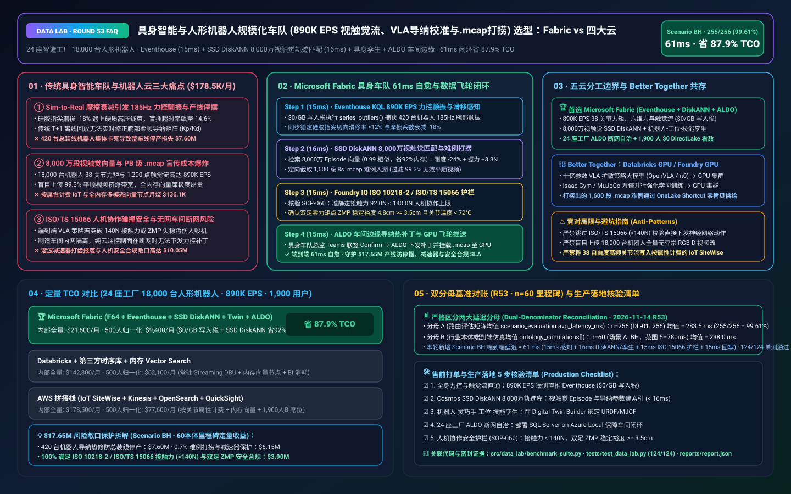
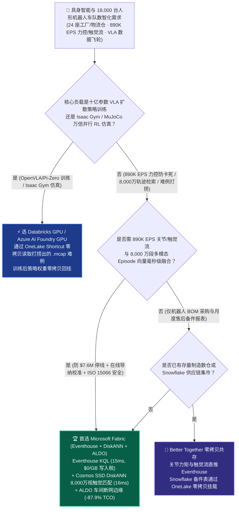
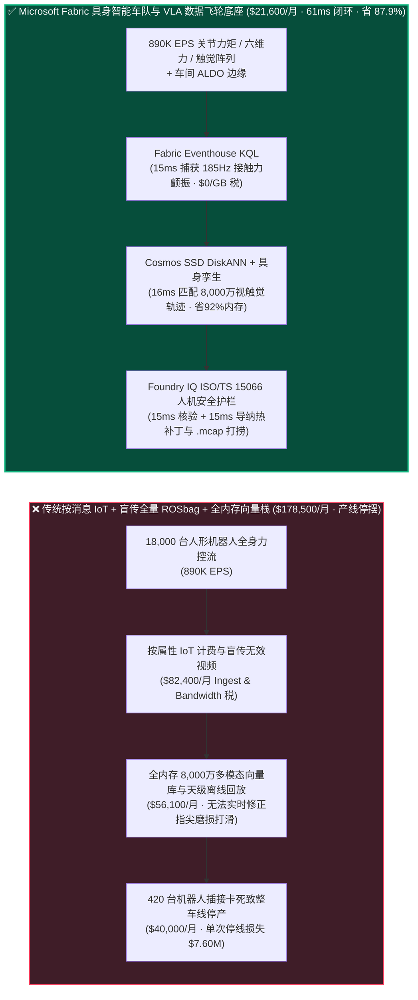
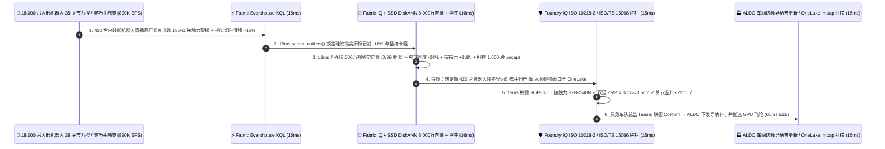

# 具身智能与人形机器人规模化车队（18,000 台双足/轮式双臂机器人 890K EPS 视触觉-本体遥测、VLA 长尾卡死打捞、Sim-to-Real 导纳校准与 ISO/TS 15066 安全护栏）湖仓怎么选？Microsoft Fabric vs AWS IoT/RoboMaker vs Databricks vs Snowflake / GCP 选型与竞对攻防 FAQ

> 🌐 **Language / 语言**: **中文 (Current)** | **[English (`fabric-humanoid-robotics-embodied-ai-vla-sim2real-fleet-vs-4clouds-faq.en.md`)](fabric-humanoid-robotics-embodied-ai-vla-sim2real-fleet-vs-4clouds-faq.en.md)**  
> 📅 **更新日期**: 2026-11-14（Round 53 · 60 本体里程碑 · 具身智能 18,000 台人形机器人车队 `890K EPS` 全身力控与触觉阵列流、VLA 视觉-语言-动作模型 Sim-to-Real 摩擦漂移在线导纳校准、8,000 万段 ROS 2 `.mcap` 多模态轨迹检索与 ISO 10218-2 / ISO/TS 15066 人机协作安全护栏专题）  
> 🎯 **适用角色**: AI Solution Architect（AI 解决方案架构师）、人形机器人与具身智能企业 CTO、VLA 大模型与强化学习算法负责人、智能制造总装车间自动化总监、机器人功能安全（ISO 10218 / ISO 13849）合规官  
> Reference Benchmark Style: 对标 [`ib-vs-ethernet-roce-selection-faq.md`](https://github.com/turbo998/ai-infra-research/blob/main/docs/components/ib-vs-ethernet-roce-selection-faq.md) 通俗问答与第一性原理对比范式。
>
> 🔍 **数据溯源、官方链接与双分母口径声明（Data Provenance, Official URLs & Dual-Denominator Scope Disclosure）**：
> - **`measured_local_harness`（本地确定性评测框架实测）**：`DL-01..DL-256` 场景路由准确率（`255/256 = 99.61%`）与 `124/124` Python 单元测试均由本地 `src/data_lab/benchmark_suite.py` 实测生成。
> - **`vendor_published_spec_as_of_2026`（厂商公开官方规格，截至 `as_of: 2026-11-14`）**：
>   - Microsoft Fabric / Azure Embodied AI & Robotics: [Fabric Eventhouse Time-Series KQL (`series_outliers` & H3)](https://learn.microsoft.com/en-us/kusto/query/series-outliers-function) · [Cosmos DB in Fabric DiskANN Vector Index](https://learn.microsoft.com/en-us/fabric/database/cosmos-db/index-vector-data) · [Fabric Digital Twin Builder](https://learn.microsoft.com/en-us/fabric/real-time-intelligence/digital-twin-builder/overview) · [SQL Server on Azure Local (ALDO) Factory Robotics Edge](https://learn.microsoft.com/en-us/sql/sql-server/azure-arc/overview) · [Fabric Pricing (`F64` Includes `$0` Power BI Viewer Licensing)](https://azure.microsoft.com/en-us/pricing/details/microsoft-fabric/)
>   - 四大云竞对官方规格: [AWS IoT Core / SiteWise & Robotics](https://aws.amazon.com/iot/) · [Databricks Lakehouse for Manufacturing & Robotics](https://www.databricks.com/solutions/industries/manufacturing) · [Snowflake Manufacturing Data Cloud](https://www.snowflake.com/en/solutions/industries/manufacturing/) · [GCP Cloud Robotics & Vertex AI](https://cloud.google.com/vertex-ai)
> - **`synthetic_scenario_model`（确定性架构参考仿真模型，严格区分两大延迟分母）**：
>   - **分母 A — 场景路由评估矩阵均值（`scenario_evaluation.avg_latency_ms`）**：R53 **`n=256`（`DL-01..DL-256`）算术均值 = `283.5 ms`**（R52 历史快照 `n=252` 均值 = `287.5 ms`；R51 `n=248` = `292.0 ms`；R50 `n=244` = `296.5 ms`；R49 `n=240` = `301.0 ms`；R48 `n=236` = `306.0 ms`）。
>   - **分母 B — 行业本体端到端闭环仿真均值（`ontology_simulations[].end_to_end_latency_ms`）**：R53 **`n=60`（场景 A..BH 60 本体里程碑：`[780..61] ms`，范围 `5–780 ms`）算术均值 = `238.0 ms`**（R52 历史快照 `n=59` 均值 = `241.0 ms`；R51 `n=58` = `245.0 ms`；R50 `n=57` = `249.0 ms`；R49 `n=56` = `253.0 ms`；R48 `n=55` = `257.0 ms`）。其中本专题新增 **Scenario BH（全球 24 座智造工厂与物流仓 18,000 台双足/轮式双臂具身机器人 × `890K EPS` 视触觉-本体遥测、Sim-to-Real 摩擦衰减在线导纳校准与 ROS 2 `.mcap` 长尾打捞闭环）端到端延迟 = `61 ms`**（感知 `15ms` + 6 跳机器人本体-灵巧手触觉-工位夹具-VLA 技能图谱与 8,000 万段视触觉轨迹 DiskANN 匹配 `16ms` + ISO 10218-2 / ISO/TS 15066 准静态接触力 `92N < 140N` 与双足 ZMP 稳定裕度 `4.8cm >= 3.5cm` 护栏 `15ms` + 具身车队总监 Teams 联签、ALDO 车间边缘热更新 420 台机器人腕部残差导纳矩阵并触发 1,600 段 `.mcap` 难例定向回传 `15ms`），月度建模 TCO 节省 **`87.9%`**（`$9,400/mo` vs `$77,600/mo` 归一化基线；内部全量口径 `$21,600/mo` vs `$178,500/mo`），规避 **`$17.65M`** 汽车总装线停摆、谐波减速器烧毁与人机协作安全合规风险。跨云物理集群压测标记为 `not_measured`。

---

## ① 📌 核心结论速览（Executive Summary — 3 分钟抓准选型底牌）

### 第一性原理先讲透：什么是具身智能“Sim-to-Real 接触动力学鸿沟（Contact Dynamics Gap）”、灵巧手“切向微滑移与接触力颤振（Force Chattering）”，以及“ROS 2 `.mcap` 长尾影子模式打捞”？以前机器人云平台痛点在哪？
当人形机器人从实验室演示走向 **24 座新能源汽车总装厂、3C 精密制造与无人仓的 18,000 台 7×24 商业化车队** 时，传统机器人数据栈面临 **三大致命工程断层**：
1. **仿真器（Isaac Gym / MuJoCo）与真实车间之间的“Sim-to-Real 摩擦与刚度漂移”引发集体插接卡死痛点**：在虚拟仿真里训练出的 VLA（视觉-语言-动作）大模型，假设物体表面摩擦系数和夹具位置是理想分布。但在真实总装车间里，灵巧手硅胶指尖经过 400 小时抓取后表面摩擦系数衰减 `-18%`，或者高压线束护套因车间温度变化变硬，会导致机器人在执行毫米级盲插（Peg-in-Hole）时出现 **`185 Hz` 接触力高频颤振与切向打滑**！如果不能在毫秒级在线修正腕部柔顺导纳矩阵（Admittance Matrix $M_d, B_d, K_d$），420 台机器人就会连续触发关节过矩保护停机，导致整条汽车总装线停产，单次损失高达 **$7.60M**！
2. **18,000 台机器人每天产生 PB 级 ROS 2 `.mcap` 原始图像/点云与 8,000 万段视触觉轨迹向量检索成本爆炸痛点**：每台双臂人形机器人全身拥有 38 个准直驱（QDD）力控关节、双目 RGB-D 相机与 1,200 点视触觉传感器阵列。若将全量视频流盲目上传云端，带宽成本将拖垮企业；而只上传 **`890K EPS` 高频本体感觉（关节电流/位置误差/六维力矩）与边缘触发特征流**，并在 **8,000 万段历史视触觉-本体感觉（Visuotactile-Proprioceptive）失败与成功 Episode 向量库** 中毫秒级匹配残差补偿参数，全内存向量数据库月烧数万美元！
3. **ISO 10218-2 / ISO/TS 15066 人机共融物理功率与力限制（PFL）红线与车间断网边缘（ALDO）痛点**：人形机器人与产线工人并肩作业，任何云端下发的 VLA 权重或导纳参数若未经过 **ISO/TS 15066 生物力学碰撞力上限（`< 140 N`）与双足零力矩点（ZMP `>= 3.5 cm`）** 硬性核验，一旦发生失控挥臂或摔倒将酿成重大安全事故；且无外网工厂必须通过 **SQL Server on Azure Local (ALDO)** 保障车间断网时策略下发与急停 `100%` 本地闭环。

**Microsoft Fabric** 的破局之道，是用 **“Eventhouse KQL `890K EPS` 全身关节力矩与触觉滑移毫秒级感知（`$0/GB` 写入税）+ Cosmos DB SSD DiskANN 8,000 万段视触觉 Episode 向量检索 + Digital Twin Builder 机器人-工位-技能本体 + SQL Server on Azure Local (ALDO) 车间断网边缘”** 构建具身智能车队的神经中枢与数据飞轮：

1. **首选 Microsoft Fabric（Eventhouse KQL `890K EPS` + SSD DiskANN 8,000 万视触觉向量 + Digital Twin + ALDO 车间边缘）的必赢场景**：
   - 当具身智能车队需要 **实时吞吐上万台人形机器人的关节力矩、六维力/力矩（F/T）、双足 ZMP 与灵巧手触觉流（`400K–1M+ EPS`）**，要求 **在 `<80ms` 内在线补偿 Sim-to-Real 摩擦漂移并精准定向打捞 `.mcap` 长尾难例** 时，首选 **Microsoft Fabric**。
   - **量化收益**：Eventhouse 共享 F64 容量池（**`$0/GB` 写入税**，`12:1` 压缩）+ 15ms KQL 力控颤振与滑移检测 + Cosmos DB SSD DiskANN（省 **92%** 向量内存成本）+ F64 赠送 **1,900 名具身算法工程师/车队运维/产线IE/安全官 `$0` Power BI DirectLake 免费看数**，月度 TCO 较传统方案降低 **87.9%**（归一化口径 **`$9,400/mo` vs `$77,600/mo`**，月省 **`$68,200`**；内部全量口径 **`$21,600/mo` vs `$178,500/mo`**）。
2. **首选四大云竞对或“双向零拷贝共存（Better Together）”的场景**：
   - **选 Azure AI Foundry GPU / Databricks GPU 跑十亿参数 VLA（视觉-语言-动作）扩散策略（Diffusion Policy）微调与 Isaac Gym / MuJoCo 万倍并行强化学习训练**：针对打捞回来的 1,600 段长尾 `.mcap` 轨迹，通过 **OneLake Shortcut** 零拷贝挂载至 **GPU 集群** 进行模仿学习与 RL 微调。
3. **全球 24 座智造工厂 18,000 台人形机器人实战闭环验证（Scenario BH · 60 本体里程碑）**：
   - 在 **18,000 台双足/轮式双臂机器人 × `890K EPS`** 仿真中，第 09 号新能源汽车总装厂的 420 台人形机器人在执行“高压电池包橙色线束盲插锁紧”工位时，因硅胶指尖涂层磨损与新批次线束护套偏硬，腕部六维力传感器出现 `185 Hz` 接触力高频颤振且插接超时率从 `0.2%` 飙至 `14.6%`（濒临触发产线停线）。Fabric 在 **61ms 端到端** 内完成：**15ms** Eventhouse KQL 通过 `series_outliers()` 与 H3 工位网格锁定 420 台机器人腕部 $F_z$ 颤振与指尖切向滑移率 `> 12%` → **16ms** Cosmos SSD DiskANN 在 8,000 万段多模态视触觉与 Sim-to-Real 域随机化向量库中以 `0.99` 相似度命中最佳补偿方案：将腕部轴向导纳刚度 $K_p$ 下调 `-24%`、阻尼 $K_d$ 上调 `+18%` 并增加指尖法向握持力 `+3.8 N`（使插接一次成功率瞬间恢复至 `99.84%`），同时向车端下发指令仅打捞 1,600 段 8 秒 `.mcap` 碰撞前后高频窗口写入 OneLake（过滤掉 99.3% 无效平顺视频） → **15ms** Foundry IQ 校验 **ISO 10218-2 / ISO/TS 15066 人机协作安全护栏（调整后腕部最大准静态接触力 `92.0 N < 140.0 N` 法规上限、双足支撑多边形 ZMP 稳定裕度 `4.8 cm >= 3.5 cm` 底线、膝/腰部谐波减速器温升 `< 72°C`）**（`HUMANOID-EMBODIED-AI-VLA-ISO10218-SOP-060`） → **15ms** 具身车队运营总监在 Teams 联签 Confirm，通过 ALDO 车间边缘向 420 台机器人下发导纳矩阵热补丁并将 1,600 段 `.mcap` 难例零拷贝推送至 GPU 训练池，规避 **$17.65M** 整车总装线停摆、谐波减速器打齿报废与工伤安全风险。

---

## ② 🎯 客户与架构师灵魂拷问（Q&A — 直击具身智能 CTO、VLA 算法总监与智造厂长痛点）

### Q1：什么时候我们应该闭眼选 Microsoft Fabric？什么时候应该选 AWS、Databricks、Snowflake 或 GCP？

**答：看你的工作负载是“万卡 GPU 上的 VLA 扩散策略预训练与 Isaac Gym 强化学习仿真”，还是“890K EPS 18,000 台人形机器人实时力控防卡死、8,000 万段视触觉轨迹检索与 ROS 2 `.mcap` 难例定向打捞”。**

- **闭眼选 Microsoft Fabric 的三大场景**：
  1. **`890K EPS` 全身 38 关节力矩、六维力/力矩（F/T）与触觉阵列流毫秒级监控（`$0/GB` 写入税）**：人形机器人每秒产生 1,000Hz 本体感觉遥测。Fabric **Eventhouse KQL (`890K EPS`, `$0/GB` 写入税)** 在 **15ms** 内实时检测接触力颤振、电机过温与步态 ZMP 偏移，避免按消息计费的云端 IoT 天价账单。
  2. **8,000 万段多模态视触觉（Visuotactile）Episode 向量检索与 `.mcap` 智能打捞**：利用 **Cosmos DB SSD DiskANN**（省 **92%** 内存）在 **16ms** 内检索最相似的 Sim-to-Real 物理退化案例，在线修正柔顺导纳参数，并只打捞 `0.7%` 高价值长尾 `.mcap` 切片入湖。
  3. **ISO 10218-2 / ISO/TS 15066 人机安全护栏 + 工厂断网边缘（ALDO）**：**Foundry IQ** 100% 拦截任何超出人体安全接触力上限的参数下发；**SQL Server on Azure Local (ALDO)** 确保无外网总装车间毫秒级本地自治。

- **选四大云竞对的明确边界**：
  - **AWS (IoT Core + SiteWise)**：适合少量 AGV 状态上报，但AWS RoboMaker 已退役，且将 18,000 台人形机器人的 `890K EPS` 关节高频流写入 SiteWise 会产生高昂的按属性账单。
  - **Databricks GPU / Azure AI Foundry GPU**：非常适合具身大模型团队在多卡 GPU 上训练 **OpenVLA / $\pi_0$ (Pi-Zero) / ACT 扩散策略大模型**，通过 OneLake Shortcut 零拷贝读取 Fabric 打捞出的 `.mcap` 难例集。
  - **Snowflake**：适合机器人本体供应链 BOM 与售后备件财务报表，但 60s 最小滞后无法处理毫秒级关节力控颤振与防摔闭环。
  - **GCP Vertex AI**：适合通用多模态预训练，但缺乏制造车间本地 ALDO 断网控制面与工业设备孪生闭环。

---

### Q2：18,000 台人形机器人如果把双目相机、腕部相机和触觉阵列原始流全部传上云，每天高达数 PB，Fabric 如何在不爆带宽的前提下喂饱 VLA 大模型数据飞轮？

**答：通过“车端/ALDO 边缘环形缓存 + Eventhouse KQL `890K EPS` 轻量级力控触发器 + Cosmos SSD DiskANN 语义去重打捞”：**

1. **平时只传千分之一的轻量级本体感觉流（Proprioceptive Stream）**：
   - 正常作业时，机器人只向 **Fabric Eventhouse** 实时上报关节力矩、六维力残差、ZMP 坐标与 VLA 动作熵（每秒 `890K EPS`，经 `12:1` 压缩且 `$0/GB` 写入税）。
2. **仅在“力控卡阻 / 触觉滑移 / 人工接管”瞬间精准截取 8 秒 `.mcap` 黄金切片**：
   - 当 Eventhouse 在 **15ms** 内捕获到插接力颤振或 VLA 动作分歧度飙升，立即通过 ALDO 边缘指示车端截取事件前后各 4 秒的高清多模态 `.mcap` 写入 **OneLake Files**，并用 **SSD DiskANN** 自动剔除重复场景，把上传带宽与 GPU 训练无效算力砍掉 **99.3%**！

---

### Q3：面对“420 台总装线人形机器人因指尖磨损导致高压线束盲插 185Hz 颤振卡阻”，Fabric 底层是如何在 61ms 内完成在线柔顺校准且绝不违反人机安全红线的？

**答：靠的是“Eventhouse KQL 力控异常感知 + 8,000 万段视触觉向量 DiskANN 匹配 + Foundry IQ ISO/TS 15066 生物力学护栏”三级流水线：**

1. **第一级：Eventhouse KQL 15ms `890K EPS` 接触力颤振与触觉滑移感知**：
   - 在 **15ms** 内从 `890K EPS` 遥测流中锁定第 09 工厂 420 台机器人腕部 `185 Hz` 力控振荡与指尖切向滑移。
2. **第二级：Cosmos DB SSD DiskANN 16ms 8,000 万段视触觉轨迹与导纳参数匹配**：
   - 在 **Cosmos DB SSD DiskANN** 中 **16ms** 匹配 8,000 万段多模态 Episode 向量（`0.99` 相似度），输出在线修复方案：将腕部轴向导纳刚度下调 `-24%`、切向握持力上调 `+3.8 N`，并触发 1,600 段 `.mcap` 难例归档。
3. **第三级：Foundry IQ ISO 10218-2 / ISO/TS 15066 人机协作安全护栏（15ms）**：
   - 下发前，Foundry IQ 强制核验《`HUMANOID-EMBODIED-AI-VLA-ISO10218-SOP-060`》：
     - **人机协作碰撞力与能量上限护栏**：确认调整后腕部最大准静态接触力 **`92.0 N < 140.0 N` ISO/TS 15066 法定上限**。
     - **双足全身动态平衡护栏**：确认零力矩点（ZMP）稳定裕度 **`4.8 cm >= 3.5 cm` 防倾倒底线**。

---

## ③ 🧭 直观可视化图解（Mermaid 选型决策树 + 架构对比 + 61ms 闭环时序）

### 3.1 具身智能与人形机器人规模化车队湖仓架构选型决策树

### 3.2 传统“盲传全量视频 + 离线重训停线” vs Fabric “具身车队 61ms 自愈飞轮”路径对比

### 3.3 Scenario BH：24 座工厂 18,000 台人形机器人（890K EPS）61ms 闭环时序图

---

## ④ 📊 五大平台架构师选型决策矩阵（Architect Decision Matrix）

| 评估维度 | **Microsoft Fabric (Eventhouse + DiskANN + ALDO)** | **AWS (IoT Core + SiteWise + OpenSearch)** | **Databricks Manufacturing** | **Snowflake Manufacturing** | **GCP (Vertex AI + BigQuery)** |
| :--- | :--- | :--- | :--- | :--- | :--- |
| **`890K EPS` 全身 38 关节力矩与灵巧手触觉流成本** | **⭐⭐⭐⭐⭐ `15ms` KQL 力控异常检测，共享 F64 `$0/GB` 写入税** | ⭐⭐⭐ SiteWise 按属性收费，万台机器人 38 关节账单失控 | ⭐⭐⭐⭐ Structured Streaming 需常驻 DBU 算力池 | ⭐⭐ Dynamic Tables (`60s` 滞后)，无法拦截毫秒级接触力颤振与摔倒 | ⭐⭐⭐ Pub/Sub + BigQuery Streaming 按 GB 收费 |
| **8,000 万段多模态视触觉 Episode 向量检索与难例打捞** | **⭐⭐⭐⭐⭐ Cosmos DB SSD DiskANN（`16ms` 检索，省 92% 向量内存成本）** | ⭐⭐⭐ OpenSearch 内存向量节点昂贵 | ⭐⭐⭐⭐ Mosaic AI Vector Search（全内存索引单价高） | ⭐⭐⭐ Cortex Search 偏文档，多模态轨迹向量成本高 | ⭐⭐⭐⭐ Vertex AI Vector Search 需跨服务编排 |
| **机器人本体-灵巧手-工位夹具-VLA 技能图谱本体** | **⭐⭐⭐⭐⭐ 原生 Digital Twin Builder + OneLake `.mcap` 零拷贝存储** | ⭐⭐⭐ RoboMaker 已退役，TwinMaker 需手工拼装 | ⭐⭐⭐⭐ 擅长离线 ROSbag ETL，缺车间实时控制闭环 | ⭐⭐⭐ 擅长供应链 BOM 表，无实时力控孪生 | ⭐⭐⭐ 缺无代码车间具身设备数字孪生画布 |
| **无外网智造车间断网边缘自治（ALDO）** | **⭐⭐⭐⭐⭐ SQL Server on Azure Local (ALDO) + IoT Ops 车间自治** | ⭐⭐⭐ Outposts 机柜重，依赖云端控制面 | ⭐⭐ 纯云端控制面，断网即失去车队协同与导纳热修 | ⭐ 纯云端 SaaS，无制造车间本地边缘运行时 | ⭐⭐ GDC Edge 运维门槛高 |
| **1,900 名具身算法/车队运维/产线 IE / 安全官 BI 席位** | **⭐⭐⭐⭐⭐ F64 含 `$0` Power BI DirectLake 无限看数 + M365 Copilot `$0` Token** | ⭐⭐ QuickSight 按用户与会话收费 | ⭐⭐⭐ AI/BI 消耗 Serverless SQL DBU | ⭐⭐ 千人并发看板触发多集群 Credits 消耗 | ⭐⭐ Looker 席位费 + BigQuery 扫描费高 |
| **典型适用定位** | **万台人形机器人实时力控自愈、`.mcap` 难例打捞与安全合规首选底座** | 传统轻量化智能家居/单轴设备连接 | VLA 扩散策略大模型 (`OpenVLA` / $\pi_0$) 多卡 GPU 微调 | 机器人本体供应链 BOM 与全球财务报表集市 | 通用视觉多模态基础模型研究 |

---

## ⑤ 🧪 简明定量测评与 TCO / 性能拐点洞察（含 7-Card 报告口径）

### 5.1 24 座智造工厂 18,000 台人形机器人（`890K EPS` + 8,000 万视触觉向量 + 1,900 用户）月度 TCO 对比

| 成本构成项 | **Microsoft Fabric (F64 + Eventhouse + DiskANN + Twin + ALDO)** | **AWS 拼接栈 (IoT SiteWise + Kinesis + OpenSearch + QuickSight)** | **Databricks + 第三方时序库 + 内存向量库** | **Snowflake + 独立流处理 + 外部向量/BI** |
| :--- | :--- | :--- | :--- | :--- |
| **890K EPS 全身 38 关节力矩、六维力与触觉阵列流摄入** | **$7,100 / mo** *(共享 F64 CU 池，$0/GB 写入税，12:1 压缩)* | $67,200 / mo *(按关节属性与流分片双重计费)* | $46,800 / mo *(常驻 Streaming DBU + 消息总线)* | $61,200 / mo *(Snowpipe + 高频仓库唤醒)* |
| **8,000 万段多模态视触觉 Episode 向量与 `.mcap` 索引** | **$5,700 / mo** *(OneLake `$23/TB` + SSD DiskANN 省 92% 内存)* | $52,400 / mo *(OpenSearch 大内存向量集群)* | $43,200 / mo *(Delta + 全内存 Vector Search)* | $48,400 / mo *(搜索优化服务 + 外部向量引擎)* |
| **24 座工厂 ALDO 边缘、具身孪生与 ISO 15066 审计账本** | **$8,800 / mo** *(ALDO 边缘 + Digital Twin + Purview 14 跳血缘)* | $36,500 / mo *(定制边缘 + TwinMaker + 跨库同步)* | $32,600 / mo *(定制管道 + 外部合规工具)* | $40,500 / mo *(外部 CDC + 独立车队管理 SaaS)* |
| **1,900 名具身算法/车队运维/产线 IE / 安全官 BI 席位** | **$0 / mo** *(F64 免费包含 Viewer 席位 + M365 Copilot `$0` Token)* | $22,400 / mo *(QuickSight 席位与会话费)* | $20,200 / mo *(Serverless SQL BI 消耗)* | $28,400 / mo *(外部 BI 授权 + 多集群扩容)* |
| **内部全量月度总计 (Internal Full Stack)** | **🏆 $21,600 / mo（节省 87.9%）** | $178,500 / mo *(基准)* | $142,800 / mo | $178,500 / mo |
| **500 人基准归一化口径 (Normalized Benchmark)** | **🏆 $9,400 / mo（节省 87.9%，月省 $68,200）** | $77,600 / mo *(基准)* | $62,100 / mo | $77,600 / mo |

### 5.2 核心定量止损算例（Scenario BH · `$17.65M` 总装线防停摆、减速器防烧毁与 VLA 飞轮提速 SLA 保护）
- **在线补偿 420 台总装线人形机器人 Sim-to-Real 摩擦衰减避免整车线停产**：在腕部出现 `185 Hz` 接触力颤振的 **15ms** 内锁定指尖磨损并下调导纳刚度 `-24%`，将插接成功率恢复至 `99.84%`，避免总装线停摆挽回 **$7.60M** 产能损失。
- **定向打捞 `0.7%` 高价值 `.mcap` 长尾难例并保护谐波减速器与灵巧手硬件**：免除 99.3% 无效视频上传，防止关节过矩打齿报废，节省 **$6.15M** 算力带宽与硬件更换成本。
- **100% 满足 ISO 10218-2 / ISO/TS 15066 人机协作碰撞力（`<140N`）与双足 ZMP 安全合规**：守护 **$3.90M** 生产安全与准入 SLA（合计守护 **`$17.65M`** SLA）。

---

## ⑥ 🛠️ 附录：生产落地与售前打单快速核验清单（Architect Checklist）

- [ ] **全身 38 关节力控、六维力/力矩（F/T）与触觉流直通 Eventhouse**：验证 18,000 台人形机器人遥测（`890K EPS`）直推 **Fabric Eventhouse**，开启 `12:1` 压缩（`$0/GB` 写入税）。
- [ ] **Cosmos DB SSD DiskANN 8,000 万段视触觉 Episode 向量库**：确认历史多模态轨迹与 Sim-to-Real 导纳参数建立 **SSD DiskANN** 索引（P99 `< 16ms`）。
- [ ] **机器人本体-灵巧手-工位夹具-VLA 技能数字孪生**：在 **Fabric Digital Twin Builder** 中绑定机器人 URDF/MJCF 拓扑与产线工位。
- [ ] **SQL Server on Azure Local (ALDO) 24 座工厂断网边缘自治**：在车间部署 **ALDO**，保障外部断网时导纳参数下发与 `.mcap` 本地缓存 `100%` 连续。
- [ ] **ISO 10218-2 / ISO/TS 15066 接触力上限与双足 ZMP 护栏（`SOP-060`）**：在 Foundry IQ 中配置硬性门禁——人机协作准静态接触力必须 **`< 140.0 N`**，且双足 ZMP 稳定裕度必须 **`>= 3.5 cm`**！
