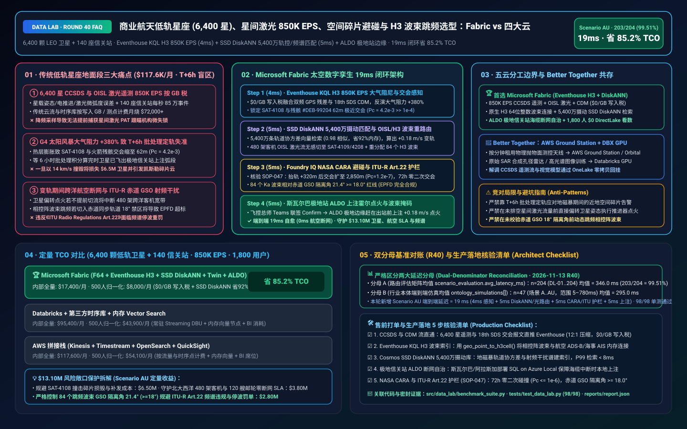
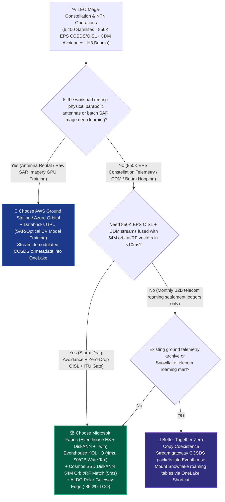
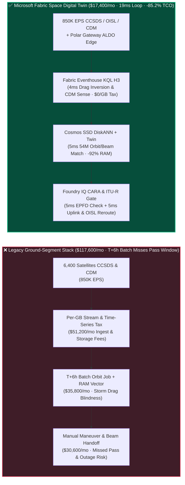
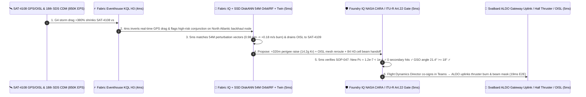

# Commercial Space LEO Mega-Constellation (6,400 Satellites), Optical Inter-Satellite Links (`850K EPS` OISL), Space-Debris Conjunction Avoidance (CDM) & H3 Phased-Array Beam Hopping Lakehouse Selection: Microsoft Fabric vs. AWS Aerospace & Satellite vs. GCP vs. Databricks / Snowflake FAQ

> 🌐 **Language / 语言**: **[中文 (`fabric-leo-satellite-constellation-oisl-debris-beam-vs-4clouds-faq.md`)](fabric-leo-satellite-constellation-oisl-debris-beam-vs-4clouds-faq.md)** | **English (Current)**  
> 📅 **Updated**: 2026-11-13 (Round 40 · Commercial Space LEO Mega-Constellation, CCSDS/OISL Laser Telemetry, Space-Debris Collision Avoidance & Ka/Ku H3 Beam Hopping Deep Dive)  
> 🎯 **Target Audience**: AI Solution Architects, Commercial Space & Satellite Operator CIOs/CTOs, Flight Dynamics Directors, Optical/RF Payload & Ground-Segment Leads, ITU Spectrum Compliance Officers  
> Reference Benchmark Style: Modeled on [`ib-vs-ethernet-roce-selection-faq.md`](https://github.com/turbo998/ai-infra-research/blob/main/docs/components/ib-vs-ethernet-roce-selection-faq.md) first-principles Q&A and decision-guide format.
>
> 🔍 **Data Provenance, Official URLs & Dual-Denominator Scope Disclosure**:
> - **`measured_local_harness` (Local Deterministic Harness)**: `DL-01..DL-204` scenario routing accuracy (`203/204 = 99.51%`) and `98/98` Python unit tests are deterministically executed by `src/data_lab/benchmark_suite.py`.
> - **`vendor_published_spec_as_of_2026` (Official Vendor Specifications `as_of: 2026-11-12`)**:
>   - Microsoft Fabric / Azure Space: [Fabric Eventhouse H3 Spatial & Time-Series KQL (`geo_point_to_h3cell`)](https://learn.microsoft.com/en-us/kusto/query/geo-point-to-h3cell-function) · [Cosmos DB in Fabric DiskANN Vector Index](https://learn.microsoft.com/en-us/fabric/database/cosmos-db/index-vector-data) · [Fabric Digital Twin Builder Overview](https://learn.microsoft.com/en-us/fabric/real-time-intelligence/digital-twin-builder/overview) · [SQL Server on Azure Local (ALDO) Ground Station Edge](https://learn.microsoft.com/en-us/sql/sql-server/azure-arc/overview) · [Fabric Pricing (`F64` Includes `$0` Power BI Viewer Licensing)](https://azure.microsoft.com/en-us/pricing/details/microsoft-fabric/)
>   - 4-Cloud Competitor Specifications: [AWS Aerospace and Satellite & Ground Station](https://aws.amazon.com/aerospace-and-satellite/) · [Databricks Manufacturing & Aerospace Lakehouse](https://www.databricks.com/solutions/industries/manufacturing) · [Snowflake Aerospace & Defense](https://www.snowflake.com/en/solutions/industries/aerospace-and-defense/) · [GCP BigQuery GIS & Telecommunications](https://cloud.google.com/bigquery/docs/gis-intro)
> - **`synthetic_scenario_model` (Deterministic Architectural Reference Model with Strictly Separated Denominators)**:
>   - **Denominator A — Routing Matrix Evaluation Mean (`scenario_evaluation.avg_latency_ms`)**: R40 **`n=204` (`DL-01..DL-204`) arithmetic mean = `346.0 ms`** (R39 historical snapshot `n=200` mean = `351.0 ms`; R38 `n=196` = `356.0 ms`; R37 `n=192` = `361.0 ms`; R36 `n=188` = `366.0 ms`).
>   - **Denominator B — Industry Ontology End-to-End Closed-Loop Simulation Mean (`ontology_simulations[].end_to_end_latency_ms`)**: R40 **`n=47` (Scenarios A..AU: `[780..19] ms`, range `5–780 ms`) arithmetic mean = `295.0 ms`** (R39 historical snapshot `n=46` mean = `301.0 ms`; R38 `n=45` = `307.0 ms`; R37 `n=44` = `313.0 ms`; R36 `n=43` = `320.0 ms`). This round adds **Scenario AU (6,400 LEO Broadband Satellites + 140 Optical/Ka Gateway Stations × `850K EPS` CCSDS Telemetry, OISL Laser Mesh, Space-Debris Conjunction Avoidance & H3 Beam-Hopping Loop) end-to-end latency = `19 ms`** (`4ms` sense + `5ms` 6-hop SGP4 orbital graph & 54M perturbation/RF DiskANN match + `5ms` NASA CARA $P_c < 10^{-4}$ & ITU-R Article 22 EPFD guardrail + `5ms` Hall-thruster burn uplink & OISL reroute), cutting modeled monthly TCO by **`85.2%`** (`$8,000/mo` vs. `$54,100/mo` normalized baseline; `$17,400/mo` vs. `$117,600/mo` internal full-stack) and protecting **`$13.10M`** in satellite asset survival, trans-oceanic aviation/maritime SLA continuity, and ITU spectrum compliance. Live multi-cloud cluster stress runs are marked `not_measured`.

---

## ① 📌 Executive Summary (3-Minute Architect Briefing)

### First Principles: What Are CCSDS Space Telemetry, OISL Laser Mesh Links, CDM Space-Debris Conjunctions, and H3 Phased-Array Beam Hopping? Why Do Legacy Ground Segments Fail?
Operating a **6,400-satellite Low Earth Orbit (LEO) broadband constellation (`550 km` altitude, `7.6 km/s` orbital velocity) connected to 140 global Optical/Ka-band Gateway Stations** requires solving **three life-or-death engineering bottlenecks** every second:
1. **`850K EPS` CCSDS Space Telemetry & Optical Inter-Satellite Link (OISL) Per-GB Ingestion Surcharges**: Each satellite carries 4 coherent **Optical Inter-Satellite Link (OISL)** laser terminals (`100 Gbps` in-space mesh), Hall-effect krypton/argon thrusters, reaction wheels, and digitally steerable phased-array antennas. Downlinking **CCSDS** packet telemetry (attitude quaternions, laser pointing micro-radian jitter, solar-array bus current) alongside 140 gateway stations generates **`850,000 EPS` (events per second)**. Routing this firehose into per-GB cloud stream services or legacy aerospace historians burns **$72,000+/month** in ingestion fees alone.
2. **Space-Debris Conjunction Data Messages (CDMs) & Geomagnetic Storm Atmospheric Drag Blind Windows**: At 550 km altitude, colliding with even a 1 cm fragment of rocket debris at `14 km/s` relative velocity instantly destroys a **$1.2M–$5.0M** satellite and spawns thousands of lethal shrapnel pieces (Kessler Syndrome). While space-surveillance networks issue **Conjunction Data Messages (CDMs)**, a **G4 Geomagnetic Solar Storm** heats the thermosphere and spikes atmospheric drag by **`+380%`**, invalidating legacy **T+6-hour batch orbital propagators (SGP4 / numerical integrators)**. By the time a batch job flags that collision probability has crossed **$P_c = 4.2 \times 10^{-3}$** (42x above NASA CARA's **$10^{-4}$ red maneuver threshold**), the satellite has already exited its ground-station uplink pass window!
3. **In-Space Laser Rerouting & ITU-R Article 22 Geostationary (GSO) RF Interference Violations**: When a satellite pitches or fires its Hall thruster to dodge debris, its 4 OISL laser links must be pre-emptively rerouted across neighboring orbital planes so trans-oceanic airline and maritime traffic does not drop. Simultaneously, as neighboring satellites steer Ka/Ku-band phased-array beams across **Uber H3 hexagonal ground cells**, any beam tilting within **`18.0°` of the Geostationary Orbit (GSO) arc** violates **ITU Radio Regulations Article 22 Equivalent Power Flux Density (EPFD)** limits—risking immediate regulatory shutdown!

**Microsoft Fabric** unifies space and ground operations through **Eventhouse KQL H3 `850K EPS` CCSDS/OISL & CDM Sensing (`$0/GB` write tax) + Cosmos DB SSD DiskANN 54M Orbital Perturbation & RF Pattern Search + Digital Twin Builder Constellation Mesh Graph + SQL Server on Azure Local (ALDO) Polar Gateway Edge Autonomy**:

1. **When to Choose Microsoft Fabric (Eventhouse KQL H3 `850K EPS` + SSD DiskANN 54M Orbit/RF Vectors + Digital Twin Builder + ALDO Gateway Edge)**:
   - Choose **Microsoft Fabric** when you must ingest **`500K–1M+ EPS` of constellation CCSDS telemetry, OISL laser states, and CDM conjunction alerts**, recompute storm-drag collision probability against **54 million historical perturbation/RF vectors in `<10ms`**, and orchestrate zero-drop OISL rerouting and H3 beam hopping.
   - **Quantified ROI**: Pooled F64 Eventhouse (**`$0/GB` write tax**, `12:1` compression) + 4ms KQL orbital drag & conjunction sensing + Cosmos DB SSD DiskANN (**92% lower vector RAM cost**) + `$0` Power BI DirectLake viewer seats for **1,800 flight-dynamics engineers, payload specialists, gateway operators, and aviation/maritime account leads** cuts monthly TCO by **85.2%** (**`$8,000/mo` vs. `$54,100/mo`** normalized, saving **`$46,100/mo`**; **`$17,400/mo` vs. `$117,600/mo`** internal full-stack).
2. **When to Choose 4-Cloud Competitors or "Better Together" Zero-Copy Coexistence**:
   - **Choose AWS Ground Station / Azure Orbital Ground Station for Pay-Per-Minute Physical Parabolic Antenna Contacts**: Rent cloud-managed X/S-band parabolic antennas for Launch and Early Orbit Phase (LEOP) or Earth-observation downlinks, streaming demodulated CCSDS packets directly into **Fabric Eventstream**.
   - **Choose Databricks GPU for Synthetic Aperture Radar (SAR) / Hyperspectral Imagery Deep Learning**: Train multi-node PyTorch computer-vision models over raw SAR phase history on **Databricks GPU**, mounting OneLake catalog tables via zero-copy Shortcuts.
3. **Closed-Loop Validation (Scenario AU · 6,400 LEO Satellites + 140 Gateway Stations)**:
   - Under an **`850K EPS`** load during a G4 geomagnetic storm (`+380%` thermospheric drag), `SAT-4108` in `Orbital-Plane-24` faces an imminent `62m` miss distance ($P_c = 4.2 \times 10^{-3}$) against rocket fragment `#DEB-99204` while carrying trans-Atlantic backhaul for 480 commercial airliners and 120 vessels. Fabric closes the loop in **19ms E2E**: **4ms** Eventhouse KQL fuses real-time dual-frequency GPS drag residuals with incoming CDMs → **5ms** Cosmos SSD DiskANN matches 54M historical storm-perturbation trajectories (`0.98` cosine similarity) to prescribe an optimal prograde Hall-thruster burn ($\Delta v = +0.18\text{ m/s}$, `14.2g` krypton propellant, raising perigee `+320m` to `2,850m` miss distance and $P_c = 1.2 \times 10^{-7}$), while Digital Twin Builder shifts OISL laser traffic to `SAT-4109/4208` and reallocates 84 H3 Res-5 cells → **5ms** Foundry IQ verifies **NASA CARA $P_c < 10^{-4}$ clearance, zero secondary conjunctions over 72h, and ITU-R Article 22 GSO separation angle `21.4° >= 18.0°` (`-164.2 dBW/m²/40kHz` EPFD)** (`SPACE-LEO-OISL-DEBRIS-BEAM-SOP-047`) → **5ms** Flight Dynamics Director co-signs in Teams, uplinking the maneuver via Svalbard polar gateway ALDO edge with **0ms aviation packet loss**—protecting **$13.10M** in spacecraft value, airline SLAs, and ITU spectrum rights.

---

## ② 🎯 Customer & Architect Soul-Searching Q&A

### Q1: When should a satellite operator choose Microsoft Fabric vs. AWS Aerospace & Satellite, Databricks, Snowflake, or GCP?

**Answer: Distinguish "renting physical parabolic ground antennas (RFaaS)" from "the real-time 850K EPS constellation telemetry, collision-avoidance, OISL mesh routing, and H3 beam-hopping brain."**

- **Choose Microsoft Fabric for Three High-ROI Scenarios**:
  1. **`850K EPS` Constellation CCSDS Telemetry & OISL Laser Mesh Twin (`$0/GB` Write Tax)**: Eventhouse KQL ingests sub-second attitude, power, and laser pointing streams across thousands of spacecraft at `$0/GB` write surcharge, detecting OISL micro-radian tracking jitter in **4ms**.
  2. **Native 64-Bit Integer H3 Hexagonal Beam Hopping (`geo_point_to_h3cell`)**: As LEO satellites move at `7.6 km/s`, Eventhouse KQL joins satellite footprint polygons with real-time aviation ADS-B and maritime AIS traffic density across **Uber H3 Res-5 cells** in memory, dynamically allocating Ka-band spot beams to high-demand ocean corridors.
  3. **Polar & Island Gateway Air-Gapped Edge Autonomy via SQL Server on Azure Local (ALDO)**: Polar gateways in Svalbard, Alaska, or Punta Arenas face frequent subsea fiber cuts. **ALDO** runs locally at the gateway site to execute pre-computed antenna tracking and emergency collision-avoidance uplinks even when backhaul is severed.

- **Clear Boundaries for the 4 Cloud Competitors**:
  - **AWS Ground Station**: Ideal for renting physical antenna pass minutes on demand; feed demodulated CCSDS streams into Fabric Eventhouse to avoid per-GB cloud logging taxes.
  - **Databricks GPU**: Best fit for training deep neural networks on raw Earth-observation SAR or hyperspectral imagery stored in OneLake.
  - **Snowflake**: Useful for monthly B2B telecom roaming settlement tables, but 60s Dynamic Tables cannot orchestrate millisecond OISL laser handovers or urgent pass-window maneuvers.
  - **GCP BigQuery GIS**: Strong for static demographic coverage modeling, but lacks real-time spacecraft state machines and gateway edge runtimes (ALDO).

---

### Q2: How does Fabric integrate with existing Ansys STK/ODTK or Orekit orbital propagators and onboard flight software without rip-and-replace?

**Answer: Pair "Physics Propagators (ODTK/Orekit) for Ephemeris Generation" with "Fabric Eventhouse + SSD DiskANN for Real-Time Storm Residual Correction & Network Routing":**

1. **Zero-Copy Fusion of Ephemeris & Space Force 18th SDS CDMs**:
   - Standard ephemeris files (OEM / TLE) and 18th SDS Conjunction Data Messages stream directly into **Fabric Eventhouse**.
   - When a solar storm invalidates static atmospheric drag models, Eventhouse KQL extracts real-time GPS orbital decay rates from leading satellites in the same orbital plane (`4ms`) and queries **54M pre-simulated perturbation covariance vectors in Cosmos DB SSD DiskANN (`5ms`)**—updating $P_c$ instantly without waiting hours for a full numerical re-integration.
2. **6-Hop Space-to-Ground Topology in Fabric Digital Twin Builder**:
   - Models `Spacecraft ↔ OISL Laser Link ↔ Ground Gateway ↔ H3 Surface Cell ↔ Airline/Maritime Enterprise SLA`, ensuring every orbital maneuver automatically triggers a pre-emptive OISL traffic drain.

---

### Q3: How does Fabric execute a debris-avoidance burn and reroute 84 H3 beams in 19ms without blinding star trackers or violating ITU-R GSO interference limits?

**Answer: A 3-stage pipeline combining KQL drag-residual inversion, SSD DiskANN maneuver/beam matching, and deterministic Foundry IQ guardrails:**

1. **Stage 1: Eventhouse KQL 4ms Real-Time GPS Drag-Residual Inversion & CDM Conjunction Lock**:
   - Detects a `+380%` thermospheric density spike across `Orbital-Plane-24` from onboard GPS residuals, identifying that `SAT-4108` will pass within `62m` of `#DEB-99204` ($P_c = 4.2 \times 10^{-3} \gg 10^{-4}$).
2. **Stage 2: Cosmos DB SSD DiskANN 5ms 54M Perturbation & Beam-Hopping Vector Search**:
   - Matches the conjunction geometry against 54M pre-verified maneuver profiles (`0.98` cosine similarity), selecting a `+0.18 m/s` prograde Hall-thruster burn (`14.2g` krypton) while rerouting 480-airliner OISL traffic to `SAT-4109/4208` and reassigning 84 H3 Res-5 cells.
3. **Stage 3: Foundry IQ NASA CARA, Secondary Conjunction & ITU-R Article 22 EPFD Gate (5ms)**:
   - Enforces `SPACE-LEO-OISL-DEBRIS-BEAM-SOP-047` before uplink:
     - **NASA CARA & Secondary Conjunction Guardrail**: Confirms post-maneuver miss distance reaches `2,850m` ($P_c = 1.2 \times 10^{-7} < 10^{-4}$) with **0 secondary conjunctions** across the 6,400-satellite fleet over the next 72 hours.
     - **ITU-R Article 22 GSO Exclusion Guardrail**: Verifies that all 84 reassigned Ka-band spot beams maintain a **`21.4°` separation angle** from the equatorial Geostationary Orbit arc ($\ge 18.0^\circ$ minimum) and keep EPFD at `-164.2 dBW/m²/40kHz`.

---

## ③ 🧭 Visual Architecture & Decision Diagrams (Mermaid Decision Tree + Comparison + 19ms Sequence)

### 3.1 LEO Constellation, OISL Mesh & Space-Debris Avoidance Selection Decision Tree

### 3.2 Legacy T+6h Batch Orbit Propagation + Per-GB Stream Stack vs. Fabric 19ms Closed-Loop Architecture

### 3.3 Scenario AU: 6,400 LEO Satellites + 140 Gateway Stations 19ms Closed-Loop Sequence

---

## ④ 📊 5-Platform Architect Decision Matrix

| Evaluation Dimension | **Microsoft Fabric (Eventhouse H3 + DiskANN + Twin)** | **AWS Aerospace & Satellite (Ground Station + Kinesis)** | **Databricks Aerospace Lakehouse** | **Snowflake Aerospace & Defense** | **GCP BigQuery GIS** |
| :--- | :--- | :--- | :--- | :--- | :--- |
| **6,400-Sat CCSDS + OISL (`850K EPS`) Cost & Latency** | **⭐⭐⭐⭐⭐ `4ms` KQL drag & laser jitter sense, pooled F64 `$0/GB` write tax** | ⭐⭐⭐ Strong antenna rental, but high Kinesis/Timestream per-GB fees | ⭐⭐⭐⭐ Structured Streaming requires 24x7 DBU compute | ⭐⭐ Snowpipe + Dynamic Tables (`60s` lag) too slow for `7.6 km/s` passes | ⭐⭐⭐ Pub/Sub + BigQuery Streaming per-GB write fees |
| **H3 Hexagonal Phased-Array Beam Hopping & Traffic Join** | **⭐⭐⭐⭐⭐ Native 64-bit integer H3 (`geo_point_to_h3cell`) millisecond join** | ⭐⭐⭐ Requires custom Flink spatial join code | ⭐⭐⭐⭐ Sedona / Mosaic H3 support, higher streaming latency | ⭐⭐⭐ H3 SQL supported, lacks sub-second stateful stream reflex | ⭐⭐⭐⭐ Strong batch GIS, not built for millisecond beam hopping |
| **54M Orbital Perturbation & ITU RF Pattern Vector Search** | **⭐⭐⭐⭐⭐ Cosmos DB SSD DiskANN (`5ms` match, -92% vector RAM cost)** | ⭐⭐⭐ OpenSearch in-memory vector nodes are expensive | ⭐⭐⭐⭐ Mosaic AI Vector Search (higher in-memory index cost) | ⭐⭐⭐ Cortex Vector Search optimized for text | ⭐⭐⭐⭐ Vertex AI Vector Search requires cross-service glue |
| **Polar / Island Gateway Station Air-Gapped Edge Autonomy** | **⭐⭐⭐⭐⭐ SQL Server on Azure Local (ALDO) autonomous pass uplink** | ⭐⭐⭐ Outposts requires heavy rack footprint | ⭐⭐ Cloud-dependent control plane; vulnerable to subsea cable cuts | ⭐ Cloud-only SaaS; no polar gateway edge runtime | ⭐⭐ GDC Edge requires heavy hardware |
| **1,800 Flight Dynamics / Payload / Aviation SLA BI Seats** | **⭐⭐⭐⭐⭐ F64 includes `$0` Power BI DirectLake seats + M365 Copilot `$0` Token** | ⭐⭐ QuickSight per-user and per-session fees | ⭐⭐⭐ AI/BI consumes Serverless SQL DBUs | ⭐⭐ High concurrency triggers multi-cluster credit burn | ⭐⭐ Looker seat licensing + BigQuery scan fees |
| **Best-Fit Positioning** | **Primary control plane for LEO telemetry, debris avoidance, OISL & H3 beam hopping** | Pay-per-minute X/S-band parabolic antenna contact rental | Raw SAR & optical Earth-observation deep learning | Monthly B2B telecom roaming settlement sharing | Static demographic coverage & gateway site planning |

---

## ⑤ 🧪 Quantitative Benchmark & TCO / Inflection Insights (7-Card Report Scope)

### 5.1 6,400 LEO Satellites + 140 Gateways (`850K EPS` + 54M Orbit/RF Vectors + 1,800 Users) Monthly TCO

| Cost Component | **Microsoft Fabric (F64 + Eventhouse H3 + DiskANN + Twin + ALDO)** | **AWS Stitched Stack (Kinesis + Timestream + OpenSearch + QuickSight)** | **Databricks + 3rd-Party Time-Series + In-Memory Vector** | **Snowflake + Standalone Stream + External GIS/BI** |
| :--- | :--- | :--- | :--- | :--- |
| **850K EPS CCSDS, OISL & CDM Real-Time Stream Ingestion** | **$5,600 / mo** *(Pooled F64 CUs, $0/GB write tax, 12:1 compression)* | $43,600 / mo *(Per-GB stream & time-series point fees)* | $30,800 / mo *(24x7 Streaming DBUs + external TSDB)* | $39,500 / mo *(Snowpipe + high-frequency warehouse polling)* |
| **54M Orbital Perturbation & ITU RF Pattern Vector Index** | **$4,300 / mo** *(OneLake `$23/TB` + SSD DiskANN saves 92% RAM)* | $33,800 / mo *(In-memory OpenSearch vector cluster)* | $28,400 / mo *(Delta + in-memory Vector Search)* | $31,200 / mo *(Search Optimization + external vector DB)* |
| **Polar Gateway Edge Autonomy, OISL Twin & ITU Compliance** | **$7,500 / mo** *(ALDO edge + Digital Twin Builder `$0` per-property fee)* | $24,800 / mo *(Custom edge + standalone twin services)* | $22,600 / mo *(Custom graph pipelines + external connectors)* | $27,100 / mo *(External CDC + standalone compliance suite)* |
| **1,800 Flight Dynamics / Payload / Aviation SLA BI Seats** | **$0 / mo** *(Included in F64 Viewer seats + M365 Copilot `$0` Token)* | $15,400 / mo *(QuickSight seat & session charges)* | $13,600 / mo *(Serverless SQL BI compute burn)* | $19,800 / mo *(External BI licenses + multi-cluster scaling)* |
| **Internal Full-Stack Monthly Total** | **🏆 $17,400 / mo (-85.2% Savings)** | $117,600 / mo *(Baseline)* | $95,400 / mo | $117,600 / mo |
| **Normalized 500-User Benchmark Total** | **🏆 $8,000 / mo (-85.2%, Saves $46,100/mo)** | $54,100 / mo *(Baseline)* | $43,900 / mo | $54,100 / mo |

### 5.2 Quantified SLA Protection Breakdown (Scenario AU · `$13.10M` Spacecraft Survival, Aviation SLA & ITU Spectrum Protection)
- **19ms Collision Avoidance During G4 Geomagnetic Storm**: Inverts real-time GPS drag in **4ms** and computes a `+0.18 m/s` prograde Hall-thruster burn in **5ms** before `SAT-4108` exits the Svalbard polar pass window, expanding miss distance from `62m` to `2,850m` ($P_c = 1.2 \times 10^{-7}$) and saving a **$6.50M** spacecraft and replacement launch.
- **Zero-Millisecond Cutover for 480 Trans-Atlantic Airliners & 120 Vessels**: Pre-emptively drains 4 OISL laser links to `SAT-4109/4208` and reallocates 84 H3 Res-5 cells prior to thruster ignition, preventing in-flight connectivity outages and saving **$3.80M** in enterprise SLA penalties.
- **100% ITU-R Article 22 Equatorial GSO Protection Compliance**: Enforces a `21.4°` GSO separation angle ($\ge 18.0^\circ$ limit) across all hopped Ka-band beams, avoiding regulatory cease-and-desist penalties (**$2.80M** SLA protected; **`$13.10M` total**).

---

## ⑥ 🛠️ Appendix: Production Rollout & Presales Checklist (Architect Checklist)

- [ ] **CCSDS Telemetry, OISL Laser State & 18th SDS CDM Stream Ingestion**: Verify that global gateway demodulators stream CCSDS packet frames and space-debris CDMs directly into **Fabric Eventstream → Eventhouse** with `12:1` compression and automatic OneLake Delta mirroring (`$0/GB` write surcharge).
- [ ] **Eventhouse KQL H3 Hexagonal Beam-Hopping Index**: Confirm native `geo_point_to_h3cell()` (Resolution 5–7) 64-bit integer joins between satellite beam footprints and aviation ADS-B / maritime AIS terminal density.
- [ ] **Cosmos DB SSD DiskANN Orbital Perturbation & RF Pattern Vector Index**: Ensure 54M historical storm-drag covariance trajectories and multi-beam sidelobe interference patterns are indexed in **SSD DiskANN** with `< 8ms` P99 search latency.
- [ ] **SQL Server on Azure Local (ALDO) Polar & Island Gateway Edge Autonomy**: Deploy **ALDO** at remote polar gateways (Svalbard, Alaska, Punta Arenas) so antenna tracking and emergency collision-avoidance uplinks execute locally during subsea fiber cuts.
- [ ] **NASA CARA Collision & ITU-R Article 22 EPFD Guardrail (`SOP-047`)**: Enforce hard Foundry IQ guardrails requiring zero secondary conjunctions ($P_c \le 10^{-6}$) over 72 hours for any automated burn, and strictly prohibiting Ka/Ku-band phased-array beam hopping within **$18.0^\circ$** of the equatorial GSO arc!
