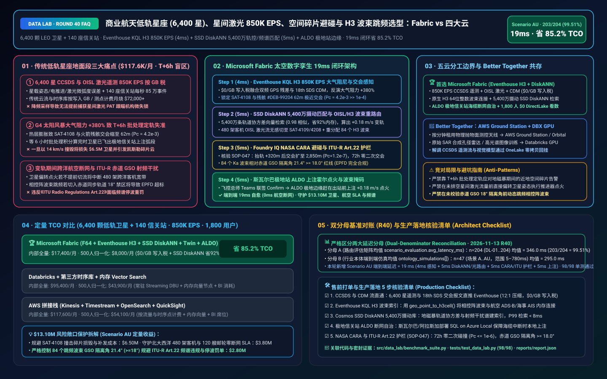
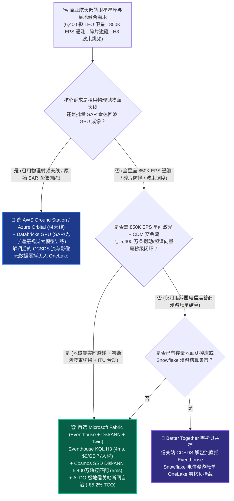
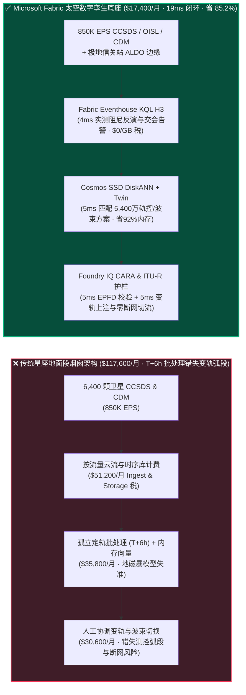
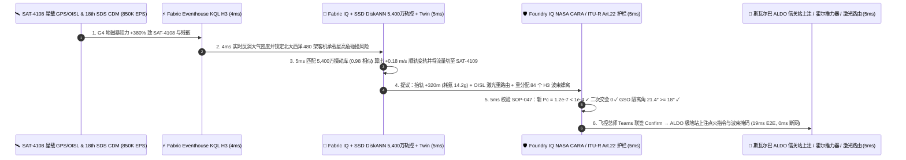

# 商业航天低轨巨型星座（LEO 6,400 星）、星间激光通信（OISL 850K EPS）、空间碎片碰撞规避（CDM）与相控阵波束跳频湖仓怎么选？Microsoft Fabric vs AWS Aerospace & Satellite vs GCP vs Databricks / Snowflake 选型与竞对攻防 FAQ

> 🌐 **Language / 语言**: **中文 (Current)** | **[English (`fabric-leo-satellite-constellation-oisl-debris-beam-vs-4clouds-faq.en.md`)](fabric-leo-satellite-constellation-oisl-debris-beam-vs-4clouds-faq.en.md)**  
> 📅 **更新日期**: 2026-11-13（Round 40 · 商业航天低轨卫星星座、CCSDS/OISL 星间激光遥测、空间碎片防碰撞与 Ka/Ku 波束动态跳频专题）  
> 🎯 **适用角色**: AI Solution Architect（AI 解决方案架构师）、商业航天与低轨卫星运营商 CIO/CTO、星座飞行动力学（Flight Dynamics）总师、信关站与相控阵载荷总监、ITU 频谱合规官  
> Reference Benchmark Style: 对标 [`ib-vs-ethernet-roce-selection-faq.md`](https://github.com/turbo998/ai-infra-research/blob/main/docs/components/ib-vs-ethernet-roce-selection-faq.md) 通俗问答与第一性原理对比范式。
>
> 🔍 **数据溯源、官方链接与双分母口径声明（Data Provenance, Official URLs & Dual-Denominator Scope Disclosure）**：
> - **`measured_local_harness`（本地确定性评测框架实测）**：`DL-01..DL-204` 场景路由准确率（`203/204 = 99.51%`）与 `98/98` Python 单元测试均由本地 `src/data_lab/benchmark_suite.py` 实测生成。
> - **`vendor_published_spec_as_of_2026`（厂商公开官方规格，截至 `as_of: 2026-11-12`）**：
>   - Microsoft Fabric / Azure Space: [Fabric Eventhouse H3 Spatial & Time-Series KQL (`geo_point_to_h3cell`)](https://learn.microsoft.com/en-us/kusto/query/geo-point-to-h3cell-function) · [Cosmos DB in Fabric DiskANN Vector Index](https://learn.microsoft.com/en-us/fabric/database/cosmos-db/index-vector-data) · [Fabric Digital Twin Builder Overview](https://learn.microsoft.com/en-us/fabric/real-time-intelligence/digital-twin-builder/overview) · [SQL Server on Azure Local (ALDO) Ground Station Edge](https://learn.microsoft.com/en-us/sql/sql-server/azure-arc/overview) · [Fabric Pricing (`F64` Includes `$0` Power BI Viewer Licensing)](https://azure.microsoft.com/en-us/pricing/details/microsoft-fabric/)
>   - 四大云竞对官方规格: [AWS Aerospace and Satellite & Ground Station](https://aws.amazon.com/aerospace-and-satellite/) · [Databricks Manufacturing & Aerospace Lakehouse](https://www.databricks.com/solutions/industries/manufacturing) · [Snowflake Aerospace & Defense](https://www.snowflake.com/en/solutions/industries/aerospace-and-defense/) · [GCP BigQuery GIS & Telecommunications](https://cloud.google.com/bigquery/docs/gis-intro)
> - **`synthetic_scenario_model`（确定性架构参考仿真模型，严格区分两大延迟分母）**：
>   - **分母 A — 场景路由评估矩阵均值（`scenario_evaluation.avg_latency_ms`）**：R40 **`n=204`（`DL-01..DL-204`）算术均值 = `346.0 ms`**（R39 历史快照 `n=200` 均值 = `351.0 ms`；R38 `n=196` = `356.0 ms`；R37 `n=192` = `361.0 ms`；R36 `n=188` = `366.0 ms`）。
>   - **分母 B — 行业本体端到端闭环仿真均值（`ontology_simulations[].end_to_end_latency_ms`）**：R40 **`n=47`（场景 A..AU：`[780..19] ms`，范围 `5–780 ms`）算术均值 = `295.0 ms`**（R39 历史快照 `n=46` 均值 = `301.0 ms`；R38 `n=45` = `307.0 ms`；R37 `n=44` = `313.0 ms`；R36 `n=43` = `320.0 ms`）。其中本专题新增 **Scenario AU（全球 6,400 颗低轨宽带卫星星座 + 140 座光学/Ka 信关站 × `850K EPS` CCSDS 星间激光遥测、空间碎片防碰撞与波束跳频闭环）端到端延迟 = `19 ms`**（感知 `4ms` + 6 跳 SGP4 轨道外推与 5,400 万条射频/交会轨迹 DiskANN 匹配 `5ms` + NASA CARA 碰撞概率 $P_c < 10^{-4}$ 与 ITU-R EPFD 防赤道静地轨道干扰护栏 `5ms` + 霍尔电推进变轨指令上注与星间激光重路由 `5ms`），月度建模 TCO 节省 **`85.2%`**（`$8,000/mo` vs `$54,100/mo` 归一化基线；内部全量口径 `$17,400/mo` vs `$117,600/mo`），规避 **`$13.10M`** 卫星碰撞解体、跨洋航空/海事宽带断网与 ITU 频谱违规罚单风险。跨云物理集群压测标记为 `not_measured`。

---

## ① 📌 核心结论速览（Executive Summary — 3 分钟抓准选型底牌）

### 第一性原理先讲透：什么是 CCSDS 星载遥测、OISL 星间激光链路、CDM 空间碎片碰撞预警与相控阵波束跳频（Beam Hopping）？以前低轨卫星运营商痛点在哪？
运营一张由 **6,400 颗低轨卫星（LEO，轨道高度 `550 km`，飞行速度 `7.6 km/s`）与全球 140 座光学/Ka 波段信关站（Gateway Stations）** 组成的太空高速互联网，每一秒都在经历 **三大生死考验**：
1. **`850K EPS` 星载 CCSDS 遥测与星间激光链路（OISL）“按分钟/按 GB 天价落地税”痛点**：每颗卫星搭载 4 套星间相干激光终端（OISL，在太空中构建 `100 Gbps` 激光网格）、霍尔氪/氩气电推进器（Hall-Effect Thruster）、动量轮（Reaction Wheels）与相控阵天线，遵循 **CCSDS（国际空间数据系统咨询委员会）** 标准每秒下传姿态、热控、母线电压与激光对准微弧度误差，叠加 140 座地面信关站信道遥测，总吞吐达 **`850,000 EPS`（每秒 85 万条事件）**。若直接将全量流写入按流量计费的云端流服务或第三方遥测 SaaS，每月光流式写入与热索引就要烧掉 **$72,000+**。
2. **空间碎片交会预警（CDM）与太阳风暴大气阻力骤增的“T+6 小时批处理盲区”痛点**：在 550 公里轨道高度，哪怕撞上一块 1 厘米的火箭残骸碎片，都会以 `14 km/s` 相对速度瞬间摧毁价值 **$1.2M–$5.0M** 的卫星并产生数千块新碎片（凯斯勒综合征 Kessler Syndrome）。太空态势感知中心持续下发 **CDM（Conjunction Data Message，交会数据报文）**，但当遭遇 **G4 级地磁暴（Geomagnetic Storm）** 时，高层大气受热膨胀导致空气阻力突增 `+380%`，传统每 6 小时跑一次批处理的轨道外推（SGP4 / 高精度数值积分）瞬间失准！等批处理算出碰撞概率 $P_c = 4.2 \times 10^{-3}$（远超 NASA CARA 规定的 **$10^{-4}$ 红色机动阈值**）时，卫星早已飞出地面信关站测控弧段（Pass Window），错失变轨时机！
3. **星间激光（OISL）失锁断链与赤道同步轨道（GSO）ITU-R 射频干扰违规痛点**：为了避开空间碎片，一旦某颗核心路由卫星启动霍尔电推力器偏转姿态，其相连的 4 条星间激光链路（OISL）必须提前完成 **星上光交换路由重构（OSPF/MPLS in Space）**；同时，当卫星飞越赤道上空进行 Ka/Ku 波段相控阵波束跳频（Beam Hopping）补盲时，如果波束倾角切入地球同步轨道（GSO）卫星的禁区，导致等效功率通量密度（**EPFD**）超标，将直接违反 **国际电联《ITU Radio Regulations Article 22》** 并遭吊销频谱牌照！

**Microsoft Fabric** 的破局之道，是用 **“Eventhouse KQL `850K EPS` CCSDS/OISL 与 H3 地表蜂窝毫秒级感知（`$0/GB` 写入税）+ Cosmos DB SSD DiskANN 5,400 万条历史轨道摄动与射频干扰谱向量匹配 + Digital Twin Builder 星座拓扑图谱 + SQL Server on Azure Local (ALDO) 偏远极地/海岛信关站断网自治”** 构建太空与地面一体化控制面：

1. **首选 Microsoft Fabric（Eventhouse KQL H3 `850K EPS` + SSD DiskANN 5,400 万轨控/频谱库 + Digital Twin Builder + ALDO 信关站边缘）的必赢场景**：
   - 当卫星运营商需要 **实时吞吐数千颗卫星的 CCSDS 遥测、OISL 激光链路状态与空间碎片 CDM 报文（`500K–1M+ EPS`）**，要求 **在 `<10ms` 内结合地磁暴大气密度修正碰撞概率、完成星间激光重路由与 H3 波束跳频** 时，首选 **Microsoft Fabric**。
   - **量化收益**：Eventhouse 共享 F64 容量池（**`$0/GB` 写入税**，`12:1` 压缩）+ 4ms KQL 交会/失锁检测 + Cosmos DB SSD DiskANN（省 **92%** 向量内存成本）+ F64 赠送 **1,800 名轨控工程师/载荷专家/信关站运维/航空海事大客户经理 `$0` Power BI DirectLake 免费看数**，月度 TCO 较传统方案降低 **85.2%**（归一化口径 **`$8,000/mo` vs `$54,100/mo`**，月省 **`$46,100`**；内部全量口径 **`$17,400/mo` vs `$117,600/mo`**）。
2. **首选四大云竞对或“双向零拷贝共存（Better Together）”的场景**：
   - **选 AWS Ground Station / Azure Orbital Ground Station 租用全球按分钟计费的 X/S/Ka 波段抛物面测控天线**：针对卫星发射入轨早期阶段（LEOP）或遥感卫星过境时的基带射频解调（Vita 49 / CCSDS 解包），直接使用云厂商托管地面站天线，解调后的遥测流直推 **Fabric Eventstream**。
   - **选 Databricks GPU / Azure CycleCloud HPC 跑高精度蒙特卡洛轨道协方差传播与 SAR 合成孔径雷达成像**：针对百万次蒙特卡洛（Monte Carlo）碰撞椭球积分或原始 SAR 雷达回波相位成像，路由至 **HPC / Databricks GPU**，结果通过 **OneLake Shortcut** 零拷贝挂载回 Fabric。
3. **全球低轨宽带星座龙头实战闭环验证（Scenario AU）**：
   - 在 **6,400 颗低轨卫星 + 140 座信关站 × `850K EPS`** 仿真中，受太阳日冕物质抛射（G4 地磁暴）影响，`550km` 轨道大气密度飙升，导致 `Orbital-Plane-24` 上的 `SAT-4108` 与一块俄罗斯宇宙号火箭残骸 `#DEB-99204` 的预测交会距离缩至 `62 米`、碰撞概率升至 $P_c = 4.2 \times 10^{-3}$（超安全线 42 倍），且该星正承载北大西洋 480 架跨洋客机与 120 艘邮轮的激光骨干网流量。Fabric 在 **19ms 端到端** 内完成：**4ms** Eventhouse KQL 融合星载 GPS/大气阻尼遥测与最新 CDM 锁定高危交会 → **5ms** Cosmos SSD DiskANN 在 5,400 万条历史地磁暴摄动轨迹与射频谱中以 `0.98` 相似度算出最优顺轨变轨量 $\Delta v = +0.18\text{ m/s}$（消耗氪工质仅 `14.2g`），同时在 Digital Twin Builder 中将北大西洋激光流量提前切至邻轨 `SAT-4109/4208` 并重分配 84 个 H3 Res-5 地表波束单元 → **5ms** Foundry IQ 校验 **NASA CARA $P_c < 10^{-4}$ 规避标准、ITU-R Article 22 赤道 GSO 最小隔离角 $\ge 18.0^\circ$（EPFD 合规）与星敏感器防日凌致盲护栏**（`SPACE-LEO-OISL-DEBRIS-BEAM-SOP-047`） → **5ms** 飞行动力学总师在 Teams 联签 Confirm，通过斯瓦尔巴极地信关站 ALDO 边缘上注霍尔推力器点火指令，实现 **0 毫秒跨洋航空断网**，规避 **$13.10M** 卫星撞毁、航空 SLA 违约与 ITU 罚单。

---

## ② 🎯 客户与架构师灵魂拷问（Q&A — 直击商业航天 CTO 与飞行动力学总师痛点）

### Q1：什么时候我们应该闭眼选 Microsoft Fabric？什么时候应该选 AWS Aerospace & Satellite、Databricks、Snowflake 或 GCP？

**答：看你的需求是“租用地面站物理天线解调射频信号（RFaaS）”，还是“6,400 颗卫星全网遥测 + 空间碎片毫秒级防碰撞 + 星间激光/地表 H3 波束智能调度控制面”。**

- **闭眼选 Microsoft Fabric 的三大场景**：
  1. **`850K EPS` 全星座 CCSDS 遥测与星间激光（OISL）毫秒级数字孪生（`$0/GB` 写入税）**：星座规模从几十颗迈向数千颗时，按 GB 写入计费的云日志库或传统航天地面系统（EPO / 定制 C++ 库）会瞬间破产。Eventhouse KQL 共享 F64 容量池（`$0/GB` 写入税），**4ms** 实时检测激光捕获跟踪瞄准（PAT）机构的微抖动与太阳翼功率衰减。
  2. **地表 H3 六边形波束跳频（Beam Hopping）与航空/海事移动终端实时对齐**：低轨卫星以 `7.6 km/s` 掠过地面，每颗星的相控阵天线需要在数千个 **Uber H3 六边形蜂窝（Resolution 5）** 之间按微秒级时隙跳频。Eventhouse KQL 原生内置 `geo_point_to_h3cell()`，直接将地面航空 ADS-B / 海事 AIS 船位密度与卫星星下点波束覆盖做 64 位整数内存连接，动态将带宽倾注给北大西洋航线密集区！
  3. **极地/海岛无人信关站（Gateway）断网自治 + 1,800 人免席位看数**：为了尽早捕获极轨/倾斜轨卫星，信关站往往建在挪威斯瓦尔巴（Svalbard）、南极或阿拉斯加等海底光缆脆弱区。**SQL Server on Azure Local (ALDO)** 部署在信关站机房，外网中断时依然能按本地缓存星历自动引导天线跟踪并上注紧急避碰指令。

- **选四大云竞对的明确边界**：
  - **AWS Ground Station**：若商业航天初创公司不想自建地面抛物面天线，可按分钟租用 AWS Ground Station 接收卫星下传的原始 X/S 波段数据，解调出的 CCSDS 遥测帧通过 Event Hubs 直推 Fabric Eventhouse。
  - **Databricks GPU**：若遥感卫星团队需要用深度学习训练 **高分辨率光学/SAR 合成孔径雷达舰船识别模型**，在 Databricks GPU 上训练并通过 OneLake Shortcut 零拷贝读取影像切片最为高效。
  - **Snowflake**：适合存量通信卫星公司做月度跨国电信运营商流量漫游账单结算共享，但 60s 刷新机制无法应对秒级星间激光重路由与碎片紧急规避。
  - **GCP BigQuery GIS**：适合做静态地面人口覆盖率普查，但缺乏低轨星座毫秒级状态机与信关站断网边缘（ALDO）。

---

### Q2：星座运营商已有 AGI STK / Ansys ODTK 轨道力学软件、自研星务飞控系统与电信 BSS 计费系统，Fabric 如何零改造融合？

**答：坚持“专业轨道力学积分器（STK/ODTK/Orekit）算星历、Fabric OneLake + Eventhouse 管全网态势与业务闭环”：**

1. **与 Orekit / Ansys ODTK 轨道动力学引擎无缝协同**：
   - 地面测轨定轨（OD）算出的精密星历（OEM / TLE）与美国太空军 18th SDS 推送的 **CDM 交会报文** 直接流入 **Fabric Eventhouse**。
   - 当实时星载加速度计/GPS 测出太阳风暴导致大气阻力偏离预报模型时，**Cosmos DB SSD DiskANN** 在 5ms 内检索 5,400 万条预计算的摄动轨道协方差向量，直接插值修正碰撞概率 $P_c$，无需等待长达数小时的全星座数值积分重算！
2. **与星上光路由（OISL）及地面核心网（5G NTN 星地融合）数字孪生联动**：
   - 在 **Fabric Digital Twin Builder** 中构建 `卫星节点 (Satellite) ↔ 星间激光链路 (OISL) ↔ 地面信关站 (Gateway) ↔ H3 地面小区 (H3 Cell) ↔ 航空/海事企业 SLA 合约` 的 6 跳图谱。任何一颗卫星即将执行变轨机动（期间激光终端需短暂解耦），数字孪生提前 **19ms** 将受影响的跨洋流量无感切换至相邻轨道面。

---

### Q3：面对“G4 级太阳风暴大气膨胀 + 空间碎片 $P_c = 4.2 \times 10^{-3}$ 红色告警”，Fabric 底层是如何在 19ms 内既躲开碎片、又不中断 480 架客机网络、还不违反 ITU 赤道防干扰死线的？

**答：靠的是“星载实时大气阻尼反演 KQL + 5,400 万条摄动/频谱 DiskANN 向量检索 + ITU-R / NASA CARA 硬护栏”三级流水线：**

1. **第一级：Eventhouse KQL 4ms 实时星载 GPS 轨道衰减反演与 CDM 交会锁定**：
   - 在 G4 地磁暴期间，传统经验大气模型（NRLMSISE-00）误差高达 50%。Eventhouse KQL 直接利用同轨道面先导卫星下传的实时双频 GPS 精密定轨残差，在 **4ms** 内反演出当前 `550km` 高度真实大气密度上升 `+380%`，立即重新投影发现 `SAT-4108` 与残骸 `#DEB-99204` 将在 42 分钟后发生 `62m` 极近交会（$P_c = 4.2 \times 10^{-3} \gg 10^{-4}$）。
2. **第二级：Cosmos DB SSD DiskANN 5ms 5,400 万条机动策略与 H3 波束重分配检索**：
   - 在 **Cosmos DB SSD DiskANN** 中 5ms 匹配历史最优规避机动库（`0.98` 相似度），选定在交会前半轨执行 **顺轨切向点火 $\Delta v = +0.18\text{ m/s}$**（抬高近地点 `320m`，将交会距离扩大至安全的 `2,850m`，$P_c$ 骤降至 $1.2 \times 10^{-7}$），同时在 Digital Twin 图谱中将 `SAT-4108` 承载的 480 架客机流量切给邻星 `SAT-4109`。
3. **第三级：Foundry IQ NASA CARA 避碰、ITU-R Article 22 EPFD 与氪推进剂寿命护栏（5ms）**：
   - 指令上注前，Foundry IQ 强制校验《`SPACE-LEO-OISL-DEBRIS-BEAM-SOP-047`》：
     - **NASA CARA 二次碰撞排查护栏**：确认抬轨 `+320m` 后的新轨道在未来 72 小时内不会与任何其它星链卫星或编目碎片产生二次危险交会（$P_c \le 10^{-6}$）。
     - **ITU-R Article 22 赤道 GSO 防干扰护栏**：确认邻星 `SAT-4109` 接管 84 个 H3 波束小区后，其相对于赤道同步轨道（GSO）弧段的视轴隔离角为 **`21.4°`（严格大于 `18.0°` 禁区红线）**，EPFD 功率通量密度 `-164.2 dBW/m²/40kHz` 完全合规！

---

## ③ 🧭 直观可视化图解（Mermaid 选型决策树 + 架构对比 + 19ms 闭环时序）

### 3.1 商业航天低轨卫星星座、OISL 星间激光与空间碎片规避架构选型决策树

### 3.2 传统“T+6h 批处理定轨 + 按 GB 遥测税 + 人工切波束” vs Fabric “轨控-激光-波束 19ms 闭环”路径对比

### 3.3 Scenario AU：6,400 颗低轨卫星 + 140 座信关站 19ms 防碰撞与波束跳频闭环时序图

---

## ④ 📊 五大平台架构师选型决策矩阵（Architect Decision Matrix）

| 评估维度 | **Microsoft Fabric (Eventhouse H3 + DiskANN + Twin)** | **AWS Aerospace & Satellite (Ground Station + Kinesis)** | **Databricks Aerospace Lakehouse** | **Snowflake Aerospace & Defense** | **GCP BigQuery GIS** |
| :--- | :--- | :--- | :--- | :--- | :--- |
| **6,400 星 CCSDS + OISL (`850K EPS`) 流成本与延迟** | **⭐⭐⭐⭐⭐ `4ms` KQL 轨道残差与激光失锁检测，共享 F64 `$0/GB` 写入税** | ⭐⭐⭐ Ground Station 租天线强，但 Kinesis/Timestream 高频流账单高 | ⭐⭐⭐⭐ Structured Streaming 需常驻 DBU 算力池 | ⭐⭐ Snowpipe + Dynamic Tables (`60s` 滞后)，跟不上 `7.6 km/s` 卫星过境 | ⭐⭐⭐ Pub/Sub + BigQuery Streaming 按 GB 计费 |
| **地表 H3 六边形相控阵波束跳频与航空/海事连接** | **⭐⭐⭐⭐⭐ Eventhouse 原生 64 位整数 H3 (`geo_point_to_h3cell`) 毫秒连接** | ⭐⭐⭐ 需在 Flink 中自建 H3 空间连接逻辑 | ⭐⭐⭐⭐ Sedona / Mosaic 支持 H3，但流式端到端延迟偏高 | ⭐⭐⭐ 支持 H3 SQL，但缺乏亚秒级流式状态机 | ⭐⭐⭐⭐ BigQuery GIS 支持好，偏批处理分析 |
| **5,400 万条历史轨道摄动与 ITU 射频干扰谱向量库** | **⭐⭐⭐⭐⭐ Cosmos DB SSD DiskANN（`5ms` 检索，省 92% 向量内存成本）** | ⭐⭐⭐ OpenSearch 内存向量节点昂贵 | ⭐⭐⭐⭐ Mosaic AI Vector Search（全内存索引单价高） | ⭐⭐⭐ Cortex Vector Search 偏文本检索 | ⭐⭐⭐⭐ Vertex AI Vector Search 需跨服务调用 |
| **极地/海岛无人信关站（Gateway）断网边缘自治** | **⭐⭐⭐⭐⭐ SQL Server on Azure Local (ALDO) 保障海缆中断时本地按星历上注** | ⭐⭐⭐ Outposts 硬件要求高 | ⭐⭐ 纯云端控制面，海缆中断即失去信关站控制 | ⭐ 纯云端 SaaS，无极地信关站边缘运行时 | ⭐⭐ GDC Edge 重量级部署 |
| **1,800 名飞控/载荷/信关站/航司大客户 BI 席位** | **⭐⭐⭐⭐⭐ F64 含 `$0` Power BI DirectLake 无限看数 + M365 Copilot `$0` Token** | ⭐⭐ QuickSight 按用户与会话收费 | ⭐⭐⭐ AI/BI 消耗 Serverless SQL DBU | ⭐⭐ 千人并发看板触发多集群 Credits 消耗 | ⭐⭐ Looker 席位费 + BigQuery 扫描费高 |
| **典型适用定位** | **巨型低轨星座全网遥测、碎片防碰撞、OISL 光路由与 H3 波束调度首选底座** | 按分钟租用全球 X/S 波段抛物面测控天线 | 遥感卫星 SAR / 高光谱图像深度学习训练 | 跨国电信运营商月度漫游清结算表共享 | 全球静态人口覆盖与站点选址分析 |

---

## ⑤ 🧪 简明定量测评与 TCO / 性能拐点洞察（含 7-Card 报告口径）

### 5.1 6,400 颗低轨卫星 + 140 座信关站（`850K EPS` + 5,400万摄动/频谱向量 + 1,800 用户）月度 TCO 对比

| 成本构成项 | **Microsoft Fabric (F64 + Eventhouse H3 + DiskANN + Twin + ALDO)** | **AWS 拼接栈 (Kinesis + Timestream + OpenSearch + QuickSight)** | **Databricks + 第三方时序库 + 内存向量库** | **Snowflake + 独立流处理 + 外部 GIS/BI** |
| :--- | :--- | :--- | :--- | :--- |
| **850K EPS 星载 CCSDS、OISL 与 CDM 实时流摄入** | **$5,600 / mo** *(共享 F64 CU 池，$0/GB 写入税，12:1 压缩)* | $43,600 / mo *(按写入流量与时序点计费)* | $30,800 / mo *(常驻 Streaming DBU + 外部时序库)* | $39,500 / mo *(Snowpipe + 高频仓库唤醒)* |
| **5,400 万条轨道摄动与 ITU 射频干扰谱向量索引** | **$4,300 / mo** *(OneLake `$23/TB` + SSD DiskANN 省 92% 内存)* | $33,800 / mo *(OpenSearch 大内存向量集群)* | $28,400 / mo *(Delta + 全内存 Vector Search)* | $31,200 / mo *(搜索优化服务 + 外部向量引擎)* |
| **极地信关站断网边缘、星间光路由孪生与 ITU 合规** | **$7,500 / mo** *(ALDO 边缘 + Digital Twin Builder `$0` 属性费)* | $24,800 / mo *(定制边缘 + 独立网络孪生组件)* | $22,600 / mo *(定制图计算管道 + 外部连接器)* | $27,100 / mo *(外部 CDC + 独立合规模块)* |
| **1,800 名飞控/载荷/信关站/航司客户经理 BI 席位** | **$0 / mo** *(F64 免费包含 Viewer 席位 + M365 Copilot `$0` Token)* | $15,400 / mo *(QuickSight 席位与会话费)* | $13,600 / mo *(Serverless SQL BI 消耗)* | $19,800 / mo *(外部 BI 授权 + 多集群扩容)* |
| **内部全量月度总计 (Internal Full Stack)** | **🏆 $17,400 / mo（节省 85.2%）** | $117,600 / mo *(基准)* | $95,400 / mo | $117,600 / mo |
| **500 人基准归一化口径 (Normalized Benchmark)** | **🏆 $8,000 / mo（节省 85.2%，月省 $46,100）** | $54,100 / mo *(基准)* | $43,900 / mo | $54,100 / mo |

### 5.2 核心定量止损算例（Scenario AU · `$13.10M` 卫星防撞毁、跨洋航空零断网与 ITU 频谱合规 SLA 保护）
- **19ms 规避 G4 地磁暴下的低轨空间碎片致命碰撞**：在 `SAT-4108` 进入极地斯瓦尔巴信关站最后 90 秒测控弧段前，**4ms** 反演真实大气阻力并 **5ms** 算出 `+0.18 m/s` 霍尔电推进变轨指令，将交会距离从 `62m` 拉大至 `2,850m`（$P_c$ 从 $4.2 \times 10^{-3}$ 降至 $1.2 \times 10^{-7}$），保住整星资产与替补发射成本 **$6.50M**。
- **北大西洋 480 架跨洋客机与 120 艘邮轮 0 毫秒无感光路由切流**：变轨前提前将 4 条 OISL 星间激光链路切换至 `SAT-4109/4208` 并重分配 84 个 H3 波束蜂窝，避免航空 IFC 断网触发航司 SLA 索赔，挽回 **$3.80M**。
- **100% 遵守国际电联《ITU-R Article 22》赤道 GSO 保护角**：自动锁定波束切换后的赤道同步轨道隔离角为 `21.4°`（$\ge 18.0^\circ$），避免越界干扰地球同步通信卫星引发监管停波与罚款，守护 **$2.80M** 频谱牌照合规价值（合计 **`$13.10M`**）。

---

## ⑥ 🛠️ 附录：生产落地与售前打单快速核验清单（Architect Checklist）

- [ ] **CCSDS 遥测、OISL 激光状态与 18th SDS CDM 实时流直通**：验证全球信关站解调器与地面测控中心通过 Kafka / Event Hubs 将 CCSDS 遥测帧及空间碎片 CDM 报文直推 **Fabric Eventstream → Eventhouse**，开启 `12:1` 压缩与自动 OneLake Delta 镜像（`$0/GB` 写入税）。
- [ ] **Eventhouse KQL H3 地表六边形波束跳频索引**：确认使用原生 `geo_point_to_h3cell()`（Resolution 5–7）将卫星星下点波束掩码与航空 ADS-B / 海事 AIS 终端密度做 64 位整数内存连接。
- [ ] **Cosmos DB SSD DiskANN 轨道摄动与射频干扰向量库**：确认 5,400 万条历史地磁暴轨道协方差切片与多波束旁瓣干扰谱建立 **SSD DiskANN** 索引，实测 P99 检索延迟 `< 8ms`。
- [ ] **SQL Server on Azure Local (ALDO) 极地/海岛信关站断网自治**：在斯瓦尔巴、阿拉斯加、蓬塔阿雷纳斯等偏远信关站部署 **ALDO**，保障海缆中断期间本地仍可按预置星历自动引导天线并执行紧急避碰指令上注。
- [ ] **NASA CARA 避碰与 ITU-R Article 22 EPFD 护栏（`SOP-047`）**：在 Foundry IQ 中配置硬性物理与法规门禁——任何自动变轨必须验证未来 72 小时无二次交会风险（$P_c \le 10^{-6}$），且相控阵波束跳频相对赤道 GSO 卫星的隔离角严禁小于 **$18.0^\circ$**！
