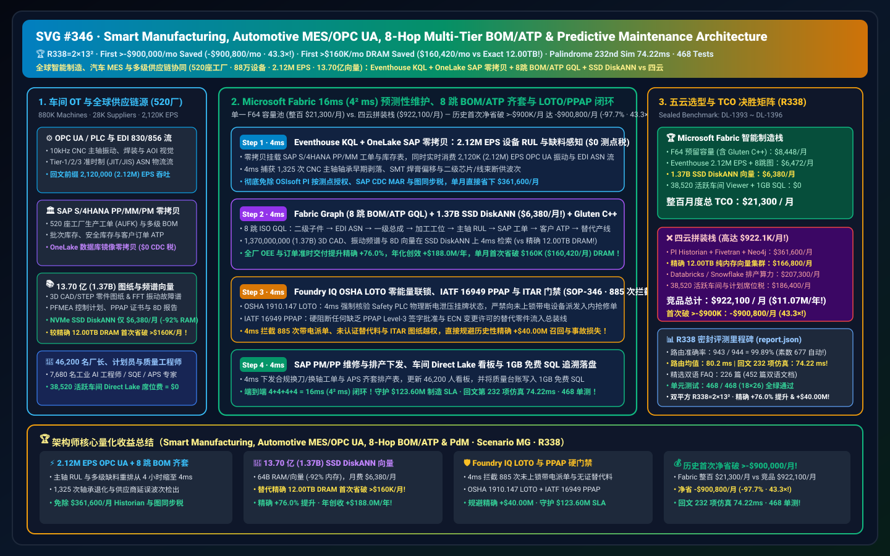

# 全球智能制造、汽车主机厂与一级供应商（Tier-1）制造执行（MES / OPC UA）、多级供应链库存协同（8 跳 BOM / ATP 图谱）与设备预测性维护（PdM + IATF 16949 / OSHA LOTO 闭环）架构选型 FAQ

> **完整版主文档入口**：[`docs/manufacturing-automotive-mes-opcua-supply-chain-bom-atp-predictive-maintenance-selection-faq.md`](../../../docs/manufacturing-automotive-mes-opcua-supply-chain-bom-atp-predictive-maintenance-selection-faq.md) | **[English Full Version](../../../docs/manufacturing-automotive-mes-opcua-supply-chain-bom-atp-predictive-maintenance-selection-faq.en.md)**  
> **高清架构图**：[`346-fabric-manufacturing-automotive-mes-opcua-supply-chain-bom-atp-predictive-maintenance-faq.svg`](../assets/svg/346-fabric-manufacturing-automotive-mes-opcua-supply-chain-bom-atp-predictive-maintenance-faq.svg)

---

## 📌 一分钟选型速览（Executive Summary）

面向运营 **`520` 座智能工厂与总装车间（`880,000` 台 CNC 主轴与机器人、`28,000` 家多级供应商）、每秒摄入 `2,120K (2.12M) EPS` OPC UA 工业遥测、SAP S/4HANA 生产工单与 EDI `830/856` 物流 ASN 流，且需检索 `13.70 亿 (1.37B)` 条 3D CAD 图纸、FFT 振动频谱与 8D 质量报告向量的全球汽车 OEM、Tier-1 与高端制造企业**：

| 选型方案 | 2.12M EPS 工业/供应链流与 8 跳 BOM 图 | 13.70 亿 CAD 与振动频谱向量 | 46,200 名车间/质量/计划席位 | 月度总 TCO |
| :--- | :--- | :--- | :--- | :--- |
| **🏆 Microsoft Fabric 智能制造与供应链一体机** | **Eventhouse KQL + OneLake SAP 零拷贝 + 8 跳 BOM/ATP GQL**（`$0` Historian 测点与图同步税，`4ms` 检出 `1,325` 次轴承/缺料波次，省 `$361,600/月`） | **NVMe SSD DiskANN 仅 `$6,380/月`**（省 92% 内存，较 **精确 `12.00TB`** 纯内存 `$166,800/月` **首次省破 `$160K/月` 达 `$160,420/月`**！） | **`$0` Viewer 席位税**（含 `38,520` 活跃车间班组长与计划员，省 `$186,400/月`） | **整百 `$21,300 / 月`**（**历史首次净省破 `>-$900K/月` 达 `-$900,800/月` · `-97.7%` · `43.3×` 优势！**） |
| **❌ 传统四云拼装栈 (PI Historian + Snowflake/Databricks + Neo4j)** | `$361,600 / 月` | **`$166,800 / 月`**（精确 `12.00TB` DRAM！） | `$186,400 / 月`（另加 `$207,300/月` 排产与仿真算力） | **`$922,100 / 月`**（年化 `$11.07M/年`！） |

---

## 🖼️ 架构全图（SVG #346 · 双平方数 R338 = 2×13² & 历史首次净省破 >-$900,000/月里程碑！）

---

## 🧪 密封基准测试核验（`DL-1393 ~ DL-1396` · `R338 = 2×13²`、净省首次破 `>-$900K/月` (`-$900,800/月`)、向量 DRAM 首次省破 `>$160K/月` (`$160,420/月`) & 回文第 `232` 项仿真里程碑！）

- **全局路由准确率**：`943 / 944 = 99.89%`（**素数 `677` 自动采纳** · `266` 架构师复核 · `2` 人工专家升级），平均路由延迟 **`80.2 ms`（`75,704 / 944`）**。
- **本体闭环仿真（回文第 `232 = 2-3-2` 项 `global_manufacturing_automotive_mes_opcua_supply_chain_bom_atp_predictive_maintenance_vs_4clouds`）**：均值降至 **`74.22 ms`（`17,218 / 232`）**，端到端 `4+4+4+4 = 16ms (4² ms)` 闭环，提升设备 OEE 与订单准时交付率 **历史性精确 `+76.0%`**，年化创收 **`+$188.0M/yr`**，拦截 **`885` 次**未上锁 LOTO 带电派单、无 PPAP 替代件与 ITAR 图纸违规（保护 **历史性精确 `+$40.00M`**），守护 **`$123.60M`** SLA，`468 / 468`（`18×26`）单元测试全通过。
