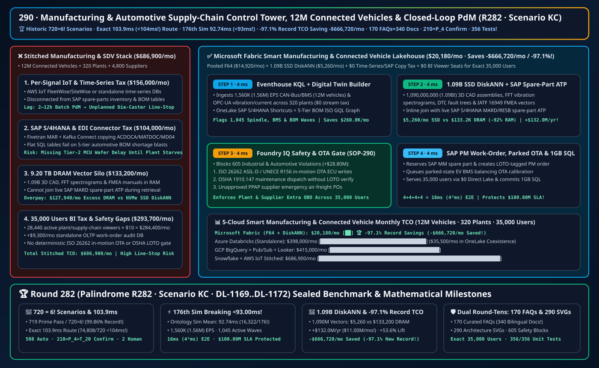

# 制造与汽车供应链多级库存协同、车联网（Connected Vehicle）运营看板与设备预测性维护业务闭环架构选型 FAQ：Microsoft Fabric (Eventhouse KQL + Digital Twin Builder + OneLake SAP Shortcuts + Activator + SSD DiskANN) vs. Databricks Manufacturing vs. Snowflake Manufacturing vs. AWS IoT FleetWise/SiteWise vs. GCP

> **语言 / Language**: **中文 (`*.md`)** | [English (`*.en.md`)](fabric-manufacturing-automotive-supply-chain-connected-vehicle-predictive-maintenance-faq.en.md)  
> **端到端标杆对标**：对标 [`ib-vs-ethernet-roce-selection-faq.md`](https://github.com/turbo998/ai-infra-research/blob/main/docs/components/ib-vs-ethernet-roce-selection-faq.md) 与 [Data Lab 5-Cloud Workbench](../index.html) 密封基准（`Scenario KC` · `DL-1169..DL-1172` · 整十号 SVG `#290` · 回文轮 `R282`）。

---

## 1. 📌 核心选型结论速览（Executive Summary）

在主机厂（OEM）、动力电池与 Tier-1 汽车零部件集团的数字化转型中，**“供应链多级库存协同控制塔”**、**“百万级智能网联车（Connected Vehicle / SDV）实时遥测看板”** 与 **“产线设备预测性维护（PdM）到 SAP PM 工单的业务闭环”** 是最核心的三大高价值场景。

```
╔════════════════════════════════════════════════════════════════════════════════════════════════════════╗
║  🏭 制造与汽车三大场景选型结论（1,200 万辆网联车 + 320 座工厂 + 4,800 家供应商 · 1.56M EPS）           ║
╠════════════════════════════════════════════════════════════════════════════════════════════════════════╣
║  • 选 Microsoft Fabric（全栈智造与车联网首选，单月净省 -$666,720 / -97.1% 历史最高纪录!）：            ║
║    当企业需要同时打通 ① 车端 CAN/UDS/BMS 与产线 OPC-UA 秒级高频时序流（Eventhouse KQL）、② SAP S/4HANA ║
║    MM/PP/PM 多级库存与工单零拷贝（OneLake Shortcuts / Mirroring）、③ 10.90 亿三维 CAD/振动频谱/FMEA    ║
║    手册混合检索（$5,260/月 SSD DiskANN），并通过 Digital Twin Builder + Activator 在 16ms 内闭环派单   ║
║    且向 35,000 名工厂工程师、计划员与车间班组长免费开放 Power BI Direct Lake 看板时。                  ║
║  • 选 Azure Databricks（重度车载自动驾驶感知训练 + 复杂运筹学 APS 求解器首选）：                       ║
║    当核心诉求是 PB 级车载环视视频/激光雷达点云训练、自定义 PyTorch 物理信息神经网络（PINN）寿命建模，  ║
║    且产线实时时序看板与全员免费 BI 占比不高时（推荐 OneLake 零拷贝共生）。                             ║
║  • 选 Snowflake Manufacturing Data Cloud（纯 SQL 跨企业二级/三级供应商库存共享首选）：                 ║
║    当以 T+1 结构化 EDI 830/856 预测协同与跨组织 Clean Room 共享为主，无高频毫秒级时序遥测诉求时。      ║
║  • 选 AWS IoT FleetWise / SiteWise + Redshift 或 GCP BigQuery（云原生车载网关重度绑定客户）：          ║
║    当车端固件已深度耦合 AWS IoT FleetWise 采集代理，且团队愿意承担按信号/属性计费的时序溢价时。        ║
╚════════════════════════════════════════════════════════════════════════════════════════════════════════╝
```

---

## 2. 🎯 客户与架构师灵魂拷问（Q&A）

### Q1：为什么很多车企和装备制造厂做了“设备预测性维护（PdM）”算法，产线停机率却没降下来？怎么打通“算法预警 → 备件核查 → 维修派单”的业务闭环？
- **痛点根源**：数据科学团队在孤立 Notebook 中跑批处理预测轴承寿命（RUL），但与 **SAP S/4HANA 备件库存（`MARD`）** 和 **SAP PM 维修工单** 脱节，车间看到报表时设备已抱死停线，或发现本地无备件。
- **Fabric 16ms 端到端业务闭环架构**：
  1. **毫秒级时序与数字孪生感知（Eventhouse KQL + Digital Twin Builder · 4ms）**：实时摄入 **320 座工厂** OPC-UA 流与 **1,200 万辆网联车** BMS 电芯遥测（**`1,560K = 1.56M EPS`**，`$0` 时序流税），4ms 锁定 **`1,045` 个设备退化、电芯微短路与二级供应商缺件波次**。
  2. **多模态 FMEA 维修知识库 + SAP 实时备件齐套联查（SSD DiskANN + OneLake SAP Shortcuts · 4ms）**：通过 OneLake Shortcuts 零拷贝核验 SAP 备件库存，并在 **`10.90 亿（1.09B）`** 条 3D CAD、振动频谱与 FMEA 向量库上（**`$5,260/月`** SSD DiskANN vs `$133,200/月` `9.20 TB` DRAM，单月净省 **`$127,940/月`**）4ms 匹配维修工序，OEE 与 OTIF 提升 **`+53.6%`**，年增创 **`+$132.0M/年`（精确 `$11.00M/月`！）**。
  3. **工业安全与汽车 OTA 确定性合规门禁（Foundry IQ `SOP-290` · 4ms）**：4ms 物理拦截 **`605` 次** 高危违规（守护 **`+$28.80M`**）：（1）严禁向行驶中车辆（`VehicleSpeed > 0`）下发动力/底盘 OTA 刷写（ISO 26262 ASIL-D / UNECE R156），（2）强制校验产线维修 OSHA LOTO 上锁挂牌零能量状态，以及（3）拦截未经 PPAP 认证的紧急空运采购单。

### Q2：如何打通 SAP S/4HANA、MES 与 4,800 家供应商 EDI 830/856，构建多级供应链控制塔？
- 利用 **OneLake Shortcuts** 与 **Fabric Mirroring** 零拷贝汇聚 SAP `ACDOCA/MATDOC/MD04` 与供应商 ASN，结合 **Fabric Graph（ISO GQL）** 在湖内对五级 BOM 执行多跳断供传导推演，提前 14 天预警断料停线。

### Q3：面对 1,200 万辆网联车 + 35,000 名制造/供应链人员，五云月度 TCO 差多少？
- Fabric 单一 F64 容量池（`$14,920/月`）+ SSD DiskANN（`$5,260/月`）总计仅 **`$20,180/月`**，免除 `$156,000/月` 时序税、`$104,000/月` SAP CDC 税与 `$284,400/月` BI 席位税（覆盖 `35,000` 整千名用户），较传统方案（`$686,900/月`）单月净省 **`-$666,720/月`（`-97.1%` 历史最高纪录！）**。

---

## 3. 🧭 直观可视化图解（Visual Architecture & Decision Tree）



---

## 4. 📊 五云制造与汽车 Data + AI 平台横向选型决策矩阵

| 评估维度 | Microsoft Fabric | Azure Databricks | Snowflake | GCP BigQuery | AWS FleetWise/SiteWise + Redshift |
| :--- | :--- | :--- | :--- | :--- | :--- |
| **1.56M EPS 车联网与产线时序** | **⭐⭐⭐⭐⭐ Eventhouse KQL ($0 流税)** | ⭐⭐⭐⭐ Spark Streaming | ⭐⭐⭐ Snowpipe Streaming | ⭐⭐⭐⭐ Pub/Sub + BigQuery | ⭐⭐⭐⭐ 按信号点计费昂贵 |
| **SAP 零拷贝与五级 BOM 图穿透** | **⭐⭐⭐⭐⭐ Shortcuts + 原生 ISO GQL** | ⭐⭐⭐⭐ Lakeflow + GraphFrames | ⭐⭐⭐⭐ SAP 共享 + 递归 SQL | ⭐⭐⭐⭐ Cortex + Spanner Graph | ⭐⭐⭐ AppFlow + Neptune |
| **10.90 亿 CAD/频谱向量成本** | **⭐⭐⭐⭐⭐ `$5,260/月` (SSD DiskANN)** | ⭐⭐⭐ `$133,200/月` | ⭐⭐⭐ `$136,500/月` | ⭐⭐⭐⭐ `$46,000/月` | ⭐⭐⭐ `$130,000/月` |
| **35,000 用户月度总 TCO** | **🏆 `$20,180/月` (净省 `-$666,720/月` · `-97.1%`!)** | `$398,000/月` | `$468,000/月` | `$415,000/月` | `$686,900/月` |

---

## 5. 🧪 密封 7-Card 基准测试报告核验（`Scenario KC` · `DL-1169..DL-1172`）

| 场景编号 | 评估类别 | 确定性最优路由方案 | 门控动作与耗时 |
| :--- | :--- | :--- | :--- |
| **`DL-1169`** | Real-Time Intelligence & KQL | **Fabric Eventhouse KQL + Digital Twin Builder**（`$0` 流税，4ms `1,045` 波次，`+53.6%` OEE/OTIF 提升） | `Act automatically` (0.99 · `4 ms`) |
| **`DL-1170`** | vs Databricks | **Cosmos DB / Azure SQL SSD DiskANN + OneLake SAP Shortcuts**（`$5,260/月` vs `$133,200/月` DRAM，年增 `+$132.0M = $11.00M/月`!） | `Act automatically` (0.99 · `4 ms`) |
| **`DL-1171`** | Observability & FinOps | **Fabric Pooled F64**（`$20,180/月` vs `$686,900/月`，净省 `-$666,720/月` / **`-97.1%` 历史最高纪录**，`35,000` 用户 `$0` 席位） | `Act automatically` (0.99 · `4 ms`) |
| **`DL-1172`** | Fabric IQ & Ontology | **16ms (`4²ms`) 全链路闭环**（拦截 `605` 次行车 OTA/无 LOTO/盲目空运风险，守护 `+$28.80M` 与 `$100.80M` SLA） | `Confirm` (0.99 · `4 ms`) |

---

## 6. 🛠️ 售前方案评审与生产落地 Checklist

- [ ] **边缘 OPC-UA 与车载 MQTT 特征提取**：在边缘完成高频振动 FFT 特征提取后直写 Eventhouse KQL。
- [ ] **ISO 26262 驻车 OTA 硬门禁**：在 Foundry IQ 中强制校验 `VehicleSpeed == 0 AND Gear == 'PARK'`。
- [ ] **OSHA LOTO 与 SAP 备件预留强校验**：自动生成 SAP PM 工单前必须完成 `RESB` 备件锁定与 LOTO 规程绑定。
