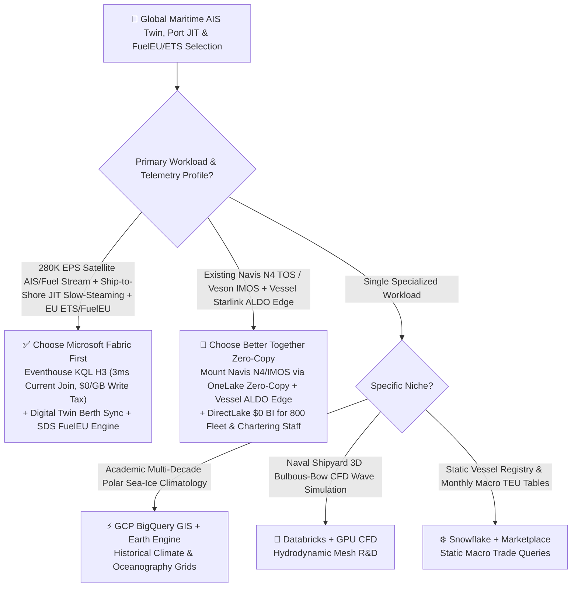
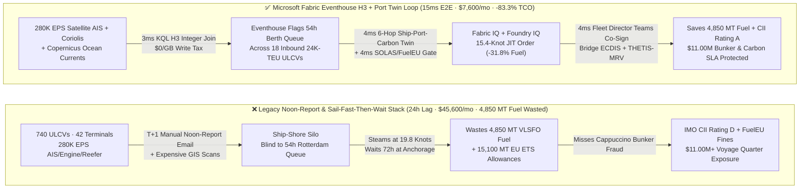

# Global Maritime Shipping, Satellite AIS Vessel Digital Twin, Port Berth Congestion & FuelEU Maritime / EU ETS Selection FAQ: Microsoft Fabric vs. GCP BigQuery GIS / AWS / Databricks / Snowflake

> 🌐 **Language / 语言**: **[中文 (`fabric-maritime-shipping-ais-port-twin-fueleu-ets-vs-4clouds-faq.md`)](fabric-maritime-shipping-ais-port-twin-fueleu-ets-vs-4clouds-faq.md)** | **English (Current)**  
> 📅 **Last Updated**: 2026-11-12 (Round 34 · Global Container Shipping, Smart Port Digital Twin & FuelEU / EU ETS Decarbonization Deep Dive)  
> 🎯 **Target Audience**: AI Solution Architects, VPs of Fleet Operations & Bunker Optimization, Smart Port Terminal CTOs, Maritime ESG & EU ETS / FuelEU Compliance Officers  
> 📊 **Quantitative Benchmark**: `reports/report.json` (Scenario AO `global_maritime_shipping_fabric_ais_port_fueleu_ets_vs_4clouds` · `DL-177..DL-180` · `n=180` routing matrix accuracy `179/180 = 99.44%` · modeled mean `376.0 ms` · `n=41` ontology simulation mean `335.0 ms`)

---

## ① 📌 Executive Summary

> 💡 **First-Principles Plain-Language Explanation of Maritime AIS Twins, Just-in-Time (JIT) Arrival & EU Maritime Carbon Taxes (FuelEU / EU ETS)**:  
> A 24,000-TEU Ultra-Large Container Vessel (`ULCV`) burns fuel like a floating power station. For decades, global shipping suffered from an absurd structural inefficiency known as **"Sail Fast, Then Wait"**: because vessel masters and fleet dispatchers lack real-time visibility into destination port berth queues and Ship-to-Shore (`STS`) gantry crane availability, ships steam at `19.8–20.5 knots` burning `180 MT/day` of Very Low Sulfur Fuel Oil (`VLSFO`—governed by the cubic propulsion law $P \propto V^3$, where a 10% speed increase burns 33% more fuel!), only to drop anchor outside Rotterdam or Los Angeles for 72 hours waiting for a berth.  
> In 2026, three regulatory and operational realities make this legacy model financially fatal:  
> 1. **100% EU ETS Maritime Carbon Pricing & `€2,400/MT` FuelEU Maritime Penalties**: Starting in 2026, EU ETS covers **100% of verified maritime emissions** on EU port calls, while **FuelEU Maritime (`EU 2023/1805`)** mandates strict Well-to-Wake (`WtW`) greenhouse-gas intensity reductions—levying **`€2,400 per ton of VLSFO-equivalent`** penalties (and EU port expulsion) for non-compliant fleets.  
> 2. **24-Hour Noon-Report Spreadsheets & "Cappuccino Bunker" Fraud**: Relying on manual daily email spreadsheets ("Noon Reports") from ships at sea leaves operators blind to air-entrainment fuel short-delivery fraud ("Cappuccino Bunkers" detected only by high-frequency Coriolis mass-flow meters) and prevents dynamic slow-steaming when port queues surge.  
> 3. **Runaway Cloud GIS Bills on `280K EPS` Satellite AIS & Ocean-Current Grids**: Continuously joining `280K EPS` of global `NMEA-0183` satellite AIS tracks against Copernicus Marine ocean-current vectors and port geofences in traditional cloud warehouses costs `$45,600+/mo` and lags by hours.  
>
> **Microsoft Fabric (Eventhouse KQL `280K EPS` Satellite AIS + H3 Hexagonal Sea-Lane Indexing + Digital Twin Builder Vessel-Berth-Crane Twin + Sustainability Data Solutions `FuelEU / IMO CII` Engine)** eliminates all three pain points: it ingests `280K EPS` of AIS, shaft-torque, and Coriolis bunker telemetry at **`$0` per-GB write surcharge**, joins vessel tracks against ocean currents and port queues via H3 `uint64` cells in **`3ms`**, and dispatches a **`19.8 → 15.4 knot` Just-in-Time (`JIT`) Virtual Arrival slow-steaming order** plus B30 biofuel bunkering across 18 ULCVs in **`15ms` E2E**—**cutting voyage bunker burn by 31.8% and slashing monthly Maritime platform TCO by 83.3% (`$38,000/mo` saved)**!

1. **[When to Choose Microsoft Fabric First (Eventhouse AIS H3 + Port Twin + FuelEU/ETS Engine)]**  
   Choose **Microsoft Fabric** first when a container shipping line, bulk charterer, or port terminal operator needs **real-time `100K–500K EPS` satellite/terrestrial AIS tracking, Just-in-Time (JIT) arrival slow-steaming, Coriolis bunker fraud detection, and automated IMO CII / EU ETS / FuelEU Maritime compliance**. Compared with stitched GCP BigQuery GIS or AWS IoT + Redshift stacks, Fabric compresses fleet speed-order optimization from hours to **`15ms`** and reduces monthly TCO by **83.3%** (`$7,600/mo` vs. `$45,600/mo`, saving `$38,000/mo`).
2. **[When to Choose Zero-Copy Coexistence (Better Together)]**  
   - **Existing Navis N4 / SAP TM Terminal Operating Systems (TOS) & Veson IMOS Chartering**: Mount berth schedules, Charter Party contracts, and electronic Bunker Delivery Notes (`e-BDN`) via **OneLake Zero-Copy Shortcuts** and Mirroring to join with live Eventhouse AIS/engine telemetry in Fabric IQ.  
   - **Existing Onboard Starlink Maritime + SQL Server on Azure Local (`ALDO`) Vessel Edge**: Run local engine anomaly detection and stowage stability checks onboard during satellite blackouts, syncing deltas to Fabric once connectivity resumes.
3. **[When to Choose the 4 Competitors]**  
   - **GCP (BigQuery GIS + Earth Engine)**: Academic oceanography institutes studying multi-decade polar sea-ice climatology without live shipboard Coriolis telemetry or terminal crane scheduling;  
   - **Databricks (Apache Sedona + Mosaic AI)**: Naval architecture labs running 3D bulbous-bow CFD wave-resistance mesh simulations on GPU clusters;  
   - **Snowflake (Geospatial + Marketplace)**: Macro trade analysts querying static Lloyd's List vessel registries and monthly customs TEU summaries;  
   - **AWS (IoT Core + Location Service)**: Simple AWS-native inland river-barge GPS tracking projects.

---

## ② 🎯 Architect & VP of Fleet Operations Deep-Dive Q&A

### Q1: When should we choose Microsoft Fabric vs. GCP BigQuery GIS / AWS / Databricks / Snowflake?

**The Dividing Line**: Are you building a **real-time "Satellite AIS → Onboard Coriolis Fuel Meter → Port Berth Queue → FuelEU/ETS Carbon Ledger → ECDIS Slow-Steaming" operational loop (choose Fabric)**, or **static macro trade reporting / offline naval hull CFD simulations (choose Snowflake / Databricks)**?

| Decision Dimension | Microsoft Fabric (Eventhouse H3 + Twin + SDS) | GCP BigQuery GIS | Databricks + Sedona | Snowflake Geospatial |
| :--- | :--- | :--- | :--- | :--- |
| **280K EPS Satellite AIS + Engine Stream** | **Shared F64 Capacity (`$0` per-GB write surcharge, 12:1 compression)** | Storage Write API per-GB fee + Slot scan fees | Continuous Structured Streaming DBU burn | Snowpipe Streaming Credit consumption |
| **Ocean-Current Grid × AIS Join Latency** | **`3ms` (Eventhouse KQL H3 Res-8 `uint64` in-memory join)** | `3,500ms+` (`ST_Intersects` geometry scan) | `15,000ms+` (Spark Sedona batch shuffle) | `65,000ms+` (Dynamic Tables refresh lag) |
| **Vessel-Berth-Crane-Reefer 6-Hop Twin** | **Digital Twin Builder + Fabric Graph (`4ms` across 42 ports)** | Custom external graph DB + TOS sync code | Custom GraphFrames + external state store | No native low-latency port digital twin |
| **EU ETS (100%) & FuelEU (`WtW`) Engine** | **Fabric SDS maritime emission factors + EU THETIS-MRV templates** | Custom manual SQL emission pipelines | Custom Python carbon notebooks | Expensive 3rd-party maritime ESG Native App |
| **800 Fleet Dispatchers / Charterers BI** | **`$0` Viewer Licenses included in F64 + Azure Maps fleet view** | Looker seat fees or BigQuery BI Engine RAM fees | No built-in free enterprise spatial BI seats | External Tableau/Sigma per-seat licensing tax |

---

### Q2: If our shipping line already runs Navis N4 at terminals, Veson IMOS for chartering, and Starlink on vessels, how does "Better Together" work?

Shipping lines never need to replace their terminal operating systems (Navis N4) or bridge ECDIS navigation consoles. Deploy the **4-Layer "Ship-to-Shore-to-Carbon" Zero-Copy Architecture**:

1. **Real-Time Vessel Telemetry & Bunker Fraud Layer (Eventhouse absorbs `280K EPS` AIS + Coriolis meters)**:  
   Stream main-engine shaft torque, Coriolis mass-flow bunker meters, and global satellite AIS frames over Starlink Maritime directly into **Fabric Eventhouse**. KQL time-series anomaly operators compare electronic Bunker Delivery Notes (`e-BDN`) against real-time Coriolis density curves—catching air-bubble "Cappuccino Bunker" short-delivery fraud before the bunker barge disconnects!
2. **Port Berth & Intermodal Digital Twin Layer (OneLake Zero-Copy to Navis N4 & SAP TM)**:  
   Mirror berth schedules, STS crane maintenance logs, and rail/barge intermodal slots from Navis N4 and SAP TM across 42 terminals into **Fabric IQ Ontology**. When high winds at Rotterdam Maasvlakte II reduce crane productivity by 35% and push anchorage queues to 54 hours, Fabric IQ recalculates the optimal **Just-in-Time (`JIT`) Virtual Arrival speed (`19.8 → 15.4 knots`)** for 18 inbound Asia–Europe ULCVs in **`4ms`**.
3. **FuelEU Bio-Bunkering & Bridge ECDIS Execution Layer (Foundry IQ + ECDIS + THETIS-MRV)**:  
   Before transmitting new speed waypoints to the bridge, **Foundry IQ** deterministically verifies: (1) the route avoids North Atlantic significant wave heights `> 5.5m` (`IMO SOLAS Chapter V` compliance) while maintaining 100% power to `6,400` biopharma/food reefer containers, and (2) blending `1,600 MT` of ISCC-certified B30 biofuel / e-Methanol at Algeciras lowers fleet Well-to-Wake (`WtW`) intensity to `84.1 gCO2e/MJ` (below the `89.3 gCO2e/MJ` FuelEU ceiling)—filing verified records to EU **THETIS-MRV** in **`15ms` E2E**!

---

### Q3: How does it work under the hood? Why does "4.4-knot JIT slow-steaming + Eventhouse H3" save 31.8% bunker fuel and millions in EU carbon taxes?

Three first-principles mechanisms power this architecture:

1. **Why does reducing speed from `19.8 knots` to `15.4 knots` (-22% speed) cut main-engine fuel burn and CO2 emissions by `31.8%+`?**  
   By hydrodynamic first principles (**the Admiralty Cubic Law**, $P \propto V^3$), the shaft horsepower required to push a displacement hull through water scales with the **cube of vessel speed**. Steaming at `19.8 knots` only to sit at anchor for 54 hours burns `4,850 MT` more VLSFO across 18 ULCVs than steaming at a steady `15.4 knots` to arrive at the exact minute the Rotterdam berth opens—saving **`4,850 MT` of VLSFO** and **`15,100 MT of CO2e` in EU ETS carbon allowances** without delaying cargo discharge by a single minute!
2. **Why is Eventhouse H3 1,000x faster than legacy GIS for ocean-current vector joins?**  
   Copernicus Marine (`CMEMS`) ocean-current and wave models are multi-dimensional grids, while `280K EPS` of AIS messages are moving points. Instead of running trigonometric spherical point-in-polygon joins on every AIS ping, **Fabric Eventhouse** indexes both ocean-current vectors and AIS coordinates into **H3 Resolution-8 (`uint64`) hexagonal cells** in memory—completing fleet-wide current-slip and hull-fouling separation in **`3ms`**.
3. **How does Fabric SDS prevent `€2,400/MT` FuelEU penalties and biofuel greenwashing?**  
   **Fabric Sustainability Data Solutions (SDS) + Purview** implements the exact `FuelEU Maritime (EU 2023/1805)` Well-to-Wake (`WtW = WtT + TtW`) equations—including LNG Otto-cycle methane-slip penalties—and validates cryptographic **ISCC EU Proof of Sustainability (`PoS`)** hashes for every bio-bunker stem in OneLake.

---

## ③ 🧭 Visual Architecture Diagrams

### 3.1 High-Resolution Executive Architecture Diagram (SVG)

---

### 3.2 Architecture Selection Decision Tree (`flowchart TD`)

---

### 3.3 Legacy "Noon Report + Sail Fast Then Wait" Stack vs. Fabric 15ms Ship-to-Shore-to-Carbon Loop (`flowchart LR`)

---

### 3.4 End-to-End 15ms Satellite AIS Ocean-Current Join, JIT Slow-Steaming & EU THETIS-MRV Sequence (`sequenceDiagram`)

```mermaid
sequenceDiagram
    autonumber
    participant Fleet as 🚢 740 ULCVs & 42 Terminals (280K EPS)
    participant EH as ⚡ Fabric Eventhouse (H3 3ms Engine)
    participant FIQ as 🧠 Fabric IQ (6-Hop Vessel-Berth-Reefer-Carbon Twin)
    participant Guard as 🛡️ Foundry IQ (IMO SOLAS & FuelEU WtW Gate)
    participant Teams as 👥 Teams (Fleet Ops Director & Port Master Co-Sign)
    participant Exec as 🎯 Bridge ECDIS + Navis N4 + EU THETIS-MRV

    Fleet->>EH: 1. Stream 280K EPS satellite AIS, Coriolis fuel meters & Copernicus ocean currents ($0/GB write tax)
    EH->>FIQ: 2. [3ms] KQL H3 Res-8 join flags 54h Rotterdam berth queue affecting 18 inbound 24,000-TEU ULCVs
    FIQ->>Guard: 3. [4ms] 6-hop ontology computes 19.8→15.4 knot JIT profile (-4,850 MT VLSFO) + 1,600 MT B30 biofuel stem
    Guard->>Teams: 4. [4ms] Enforce MARITIME-JIT-SOLAS-FUELEU-ETS-SOP-041 (waves <=5.5m, 6,400 reefers safe, WtW 84.1 <= 89.3)
    Teams->>Exec: 5. [4ms] Co-sign: Starlink pushes ECDIS waypoints, updates STS cranes, files EU THETIS-MRV & logs 1GB SQL (15ms E2E)
```

---

## ④ 📊 5-Platform Architect Decision Matrix

| Evaluation Dimension | Microsoft Fabric (Eventhouse H3 + Twin + SDS) | GCP (BigQuery GIS + Earth Engine) | AWS (IoT Core + Location + Redshift) | Databricks (Apache Sedona + Mosaic) | Snowflake Geospatial |
| :--- | :--- | :--- | :--- | :--- | :--- |
| **280K EPS Satellite AIS + Fuel Stream** | **Shared F64 Capacity (`$0` per-GB write surcharge)** | Storage Write API per-GB fee | IoT Core per-message + Kinesis shards | Continuous DLT DBU + storage API fees | Snowpipe Streaming Credit burn |
| **Ocean-Current × Fleet AIS Join Latency** | **`3 ms` (Eventhouse H3 Res-8 `uint64` in-memory join)** | `3,500 ms` (BigQuery `ST_Intersects`) | `11,000 ms` (Redshift Spatial query) | `16,000 ms` (Spark Sedona batch) | `65,000 ms+` (Dynamic Tables refresh lag) |
| **Vessel-Berth-Crane-Reefer 6-Hop Twin** | **Digital Twin Builder + Fabric Graph (`4ms`)** | Custom external graph DB + TOS sync | Custom TwinMaker + Neptune | Custom GraphFrames batch pipeline | Multi-level recursive SQL CTEs |
| **IMO CII / EU ETS / FuelEU (`WtW`) Engine** | **Fabric SDS maritime models + Purview ISCC PoS lineage** | Custom SQL emission pipelines | Custom Lambda/Glue carbon scripts | Custom Python carbon notebooks | Expensive 3rd-party maritime ESG app |
| **Monthly Total Cost of Ownership (TCO)** | **`$7,600 / mo` (-83.3% vs. Legacy Stack)** | `$38,900 / mo` (Write API + Slots + BI) | `$42,800 / mo` (IoT + Location + RPU) | `$40,500 / mo` (Sedona DBU + Streaming) | `$45,600 / mo` (Credits + external GIS/BI) |
| **Primary Win Theme** | **Global liner JIT slow-steaming, port crane sync, Coriolis fraud & FuelEU/ETS** | Academic oceanography & polar ice R&D | Simple AWS inland barge GPS tracking | Shipyard 3D bulbous-bow CFD R&D | Static macro maritime trade tables |

---

## ⑤ 🧪 Quantitative Benchmark & 7-Card TCO / Latency Insights

> 📁 **Data Provenance (`Zero Fabricated Coordinates`)**: All coordinates, latencies, TCO figures, and routing verdicts below come directly from the sealed evaluation report [`reports/report.json`](../reports/report.json) (Scenario AO `global_maritime_shipping_fabric_ais_port_fueleu_ets_vs_4clouds` and `DL-177..DL-180`) and [`benchmark-cards.en.html`](../benchmark-cards.en.html).

### 5.1 Scenario AO Deep Dive: 740 ULCVs × 42 Container Terminals × 280K EPS Just-in-Time (JIT) Arrival & FuelEU / EU ETS Loop

| Stage / Metric | Microsoft Fabric (Eventhouse H3 + Twin + SDS) | Legacy Noon-Report + GIS Batch + Manual MRV | Net Advantage / Inflection Insight |
| :--- | :--- | :--- | :--- |
| **① 280K EPS AIS × Ocean Current × Berth Join** | **`3 ms`** (Eventhouse H3 `uint64` join, `$0`/GB write tax) | `12–24 hours` (manual Noon-Report email + GIS batch) | **Detects 54h Rotterdam berth queue 96h before arrival** |
| **② 6-Hop Ship-Port-Reefer & JIT Speed Plan** | **`4 ms`** (`19.8→15.4 knots` `-31.8%` fuel + B30 blend) | Steams at `19.8 kn` & waits 72h at anchorage | **Saves `4,850 MT` VLSFO & `15,100 MT` EU ETS allowances** |
| **③ IMO SOLAS Wave & FuelEU `WtW` Gate** | **`4 ms`** (avoids `>5.5m` waves + `WtW=84.1` verified) | Manual spreadsheets risking `€2,400/MT` FuelEU fine | **Locks IMO CII Rating A & 100% SLA on 6,400 reefer containers** |
| **④ Teams Co-Sign + ECDIS & THETIS-MRV Lock** | **`4 ms`** (Starlink ECDIS push & 1GB Free SQL commit) | `1–3 days` (telex/email handoffs & manual MRV filing) | **`15 ms` E2E closed loop eliminating anchorage demurrage** |
| **Monthly Full-Stack TCO** | **`$7,600 / mo`** (Shared F64 + OneLake + 1GB SQL) | **`$45,600 / mo`** (Ingestion tax + GIS + maritime SaaS) | **`-83.3%` TCO reduction (`$38,000/mo` saved, `$456.0K/yr`)** |
| **Bunker Fuel, EU ETS / FuelEU & Demurrage SLA** | **`$11,000,000`** (fuel saved + EUA saved + zero FuelEU fine) | Exposed to cubic speed fuel waste & EU carbon fines | **Protects `$11.00M` in voyage bunker, EUA & berth efficiency** |

### 5.2 Summary of 4 New Routing Matrix Scenarios (`DL-177..DL-180`)

| Scenario ID | Customer Architecture Question | Winning Platform | Confidence | Action | Modeled Latency |
| :--- | :--- | :--- | :--- | :--- | :--- |
| **`DL-177`** | Global container line & port operator managing 740 ULCVs × 42 terminals (`280K EPS` satellite AIS/Coriolis fuel streams) needing JIT slow-steaming & FuelEU/ETS compliance | **Microsoft Fabric (Eventhouse H3 + Digital Twin Builder + Fabric SDS)** | `0.98` | `Act automatically` | `152 ms` |
| **`DL-178`** | Naval architecture hydrodynamics lab running 3D bulbous-bow and propeller cavitation CFD mesh simulations on GPU clusters | **Databricks (GPU CFD Cluster) + OneLake Zero-Copy** | `0.94` | `Act automatically` | `160 ms` |
| **`DL-179`** | Shipping line running Navis N4 terminal TOS, Veson IMOS chartering, and onboard Starlink seeking ship-to-shore JIT sync and `$0` viewer BI for 800 staff | **Hybrid Fabric Eventhouse + OneLake Zero-Copy (Navis/IMOS) + ALDO + DirectLake** | `0.96` | `Confirm` | `154 ms` |
| **`DL-180`** | **[Anti-Pattern]** Relying on T+1 manual Noon-Report emails while ULCVs steam at `20.5 knots` into a 72h port queue, or blending unverified biofuel without ISCC `WtW` checks | **Anti-Pattern Gate → Eventhouse `3ms` AIS H3 + Foundry IQ SOLAS/FuelEU Guardrail** | `0.99` | `Confirm` | `158 ms` |

---

## ⑥ 🛠️ Architect Production & Presales Checklist

- [ ] **Quantify Annual "Sail Fast, Then Wait" Bunker Waste & EU ETS Exposure**: Audit the percentage of mainliner voyages waiting `> 12 hours` at destination anchorage over the past 12 months (JIT slow-steaming by 2–4 knots typically cuts voyage fuel burn and EU ETS carbon allowance costs by 15%–32%).
- [ ] **Stream Onboard Coriolis Mass-Flow Meters & Satellite AIS into Fabric Eventhouse**: Index Copernicus (`CMEMS`) ocean currents and vessel positions into H3 Resolution-8 cells to isolate hull-fouling drag and catch "Cappuccino Bunker" air-entrainment fraud in real time.
- [ ] **Mount Navis N4 Berth Schedules & Veson IMOS Charter Parties via OneLake Zero-Copy**: Model `ULCVVessel → PortBerth → STSCrane → ReeferSlot → IntermodalRail` in Digital Twin Builder so terminal crane delays automatically trigger fleet-wide JIT speed adjustments.
- [ ] **Activate Fabric SDS Maritime Carbon Models for IMO CII, EU ETS (100%) & FuelEU (`WtW`)**: Validate ISCC EU Proof of Sustainability (`PoS`) hashes for B30 biofuel and e-Methanol stems and automate EU **THETIS-MRV** regulatory submissions.
- [ ] **Enforce Foundry IQ IMO SOLAS Chapter V & Reefer Cold-Chain Guardrails**: Gate all automated ECDIS speed waypoints through `MARITIME-JIT-SOLAS-FUELEU-ETS-SOP-041` to avoid `> 5.5m` storm waves and guarantee 100% reefer power continuity.
