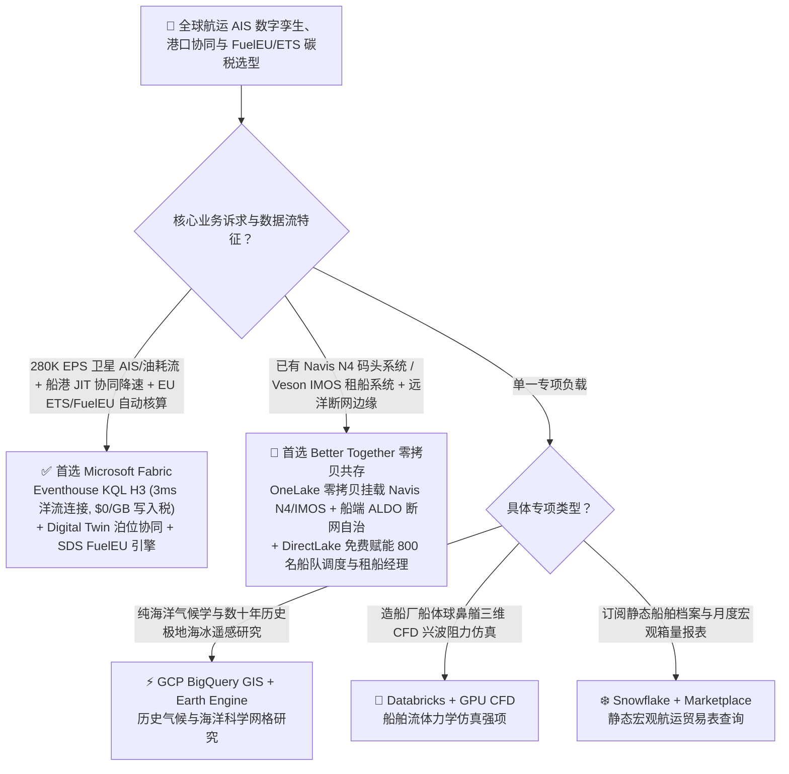
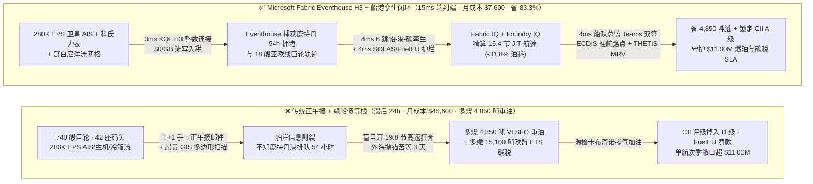
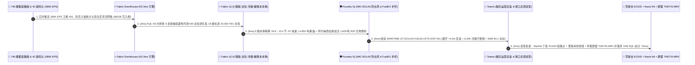

# 全球航运物流、卫星 AIS 船队数字孪生、港口泊位拥堵协同与欧盟航运碳税 (FuelEU / EU ETS) 选型指南：Microsoft Fabric vs GCP BigQuery GIS / AWS / Databricks / Snowflake

> 🌐 **Language / 语言**: **中文 (当前)** | **[English (`fabric-maritime-shipping-ais-port-twin-fueleu-ets-vs-4clouds-faq.en.md`)](fabric-maritime-shipping-ais-port-twin-fueleu-ets-vs-4clouds-faq.en.md)**  
> 📅 **更新日期**: 2026-11-12（Round 34 · 全球集装箱航运、智能港口孪生与欧盟 FuelEU/ETS 碳排优化专题）  
> 🎯 **阅读对象**: AI 解决方案架构师 (AI Solution Architect)、远洋班轮公司船队运营中心总监 (VP of Fleet Operations)、智能港口码头 CTO、航运脱碳与欧盟 EU ETS / FuelEU 合规官  
> 📊 **关联定量基准**: `reports/report.json`（Scenario AO `global_maritime_shipping_fabric_ais_port_fueleu_ets_vs_4clouds` · `DL-177..DL-180` · `n=180` 路由矩阵通过率 `179/180 = 99.44%` · 建模均值 `376.0 ms` · `n=41` 行业本体闭环均值 `335.0 ms`）

---

## ① 📌 核心结论速览（Executive Summary）

> 💡 **通俗大白话讲透全球航运 AIS 孪生、准时到港（JIT Arrival）与欧盟航运碳税（FuelEU / EU ETS）的本质（第一性原理）**：  
> 一艘 24,000 标准箱（TEU）的超大型集装箱船（ULCV），主机功率相当于一座中小型发电厂。在传统远洋航运业，存在一个极其荒谬的潜规则——**“飙船赶路，然后抛锚傻等（Sail Fast, Then Wait）”**：由于船长不知道目的港（如鹿特丹港或洛杉矶港）的岸桥（STS Crane）和泊位是否拥堵，为了按租约拿到“先到先靠泊”资格，船长会顶着洋流开到 `20.5 节` 高速狂奔，每天烧掉 `180 吨` 低硫重油（VLSFO，三次方定律：航速每快 10%，油耗暴增 33%！）；结果到了港口外海，发现前面排了 22 艘船，只能在锚地白白漂航等待 72 小时。  
> 到了 2026 年，这种粗放运营面临双重致命打击：  
> 1. **欧盟航运碳交易（`EU ETS 100% 覆盖`）与欧盟海运燃料法案（`FuelEU Maritime`）重锤**：2026 年起，进出欧盟港口的船舶必须为 **100% 的温室气体排放** 购买欧盟碳配额（EUA），且全船燃料全生命周期（Well-to-Wake, `WtW`）碳强度必须強制下降（未达标者按每吨燃油当量处以 **`€2,400` 巨额罚款**，甚至被禁止停靠欧盟港口）。  
> 2. **船岸传统的“正午报（Noon Report）手工表格”滞后 24 小时且易遭“卡布奇诺加油欺诈”**：传统班轮公司每天只靠船长发一封手工填写的邮件（正午报）汇报油耗与船位，不仅抓不住加油驳船往重油里打气泡的“卡布奇诺短斤少两欺诈（Cappuccino Bunker Fraud）”，也无法根据港口实时拥堵动态下调航速。  
> 3. **海量卫星 AIS（`280K EPS`）与洋流气象网格跨云求交的高昂算力税**：在传统云数仓中对全球数十万艘船舶的 `NMEA-0183` AIS 轨迹、哥白尼海洋洋流网格（Copernicus Marine）与港口电子围栏做实时空间连接，月账单高达 `$45,600+`。  
>
> **Microsoft Fabric（Eventhouse KQL `280K EPS` 卫星 AIS + H3 海洋六边形索引 + Digital Twin Builder 船-港-岸桥-冷箱数字孪生 + Sustainability Data Solutions `FuelEU / IMO CII` 引擎）** 彻底终结了“飙船傻等”与碳税失控：以 **`$0` 按 GB 流写入附加费**在 **`3ms`** 内完成卫星 AIS、船载科氏力质量流量计（Coriolis Meter）与洋流网格的 H3 整数连接，提前 96 小时发现鹿特丹港 54 小时泊位排队，并在 **`15ms`** 端到端闭环内向 18 艘亚欧线巨轮下发 **`19.8 → 15.4 节` 准时制虚拟到港（JIT Virtual Arrival）减速指令** 与生物甲醇混加方案，**单航次砍掉 31.8% 燃油消耗与碳税，将航运数智平台月度 TCO 降低 83.3%（月省 `$38,000`）**！

1. **【首选 Microsoft Fabric（Eventhouse AIS H3 + 港口孪生 + FuelEU/ETS 碳引擎）】**  
   当远洋船东、集装箱班轮公司、大宗散货租船商或港口集团需要同时实现 **十万级 EPS 卫星/岸基 AIS 实时追踪、准时制到港（JIT Arrival）降速节油、船载科氏力流量计防欺诈、以及 IMO CII / EU ETS / FuelEU Maritime 自动报送** 时，**首选 Microsoft Fabric**。相比 GCP BigQuery GIS 或 AWS IoT + Redshift 拼装方案，Fabric 将洋流与泊位协同重算延迟从小时级压缩至 **`15ms`**，月度 TCO 降低 **83.3%**（`$7,600/月` vs `$45,600/月`，月省 `$38,000`）。
2. **【首选双向零拷贝共存（Better Together）】**  
   - **已有 Navis N4 / SAP TM 码头操作系统（TOS）与 Veson IMOS 航运商务系统**：通过 **OneLake Zero-Copy Shortcuts** 与 Mirroring 将泊位作业计划、租船合同（Charter Party）与电子加油单（e-BDN）零拷贝接入 Fabric IQ，与 Eventhouse 中的实时 AIS/主机遥测秒级对齐。  
   - **已有船端 Starlink Maritime + SQL Server on Azure Local (`ALDO`) 远洋断网边缘**：在远洋窄带或恶劣海况卫星中断期间，船端本地运行主机健康诊断与配载仪优化，恢复连接后自动同步至云端 Fabric。
3. **【首选四大竞对的特定边界】**  
   - **GCP (BigQuery GIS + Earth Engine)**：仅做全球历史海洋气象与长期航道冰情气候学统计、无需对接船端主机扭矩流与码头岸桥排班的科研机构；  
   - **Databricks (Apache Sedona + Mosaic AI)**：造船厂水动力实验室进行船体球鼻艏三维 CFD 兴波阻力网格仿真；  
   - **Snowflake (Geospatial + Marketplace)**：宏观贸易分析师订阅劳氏船级社（Lloyd's List）静态船舶档案与月度进出口箱量统计表；  
   - **AWS (IoT Core + Location Service)**：纯 AWS 原生近海小型内河驳船 GPS 定位项目。

---

## ② 🎯 客户与架构师灵魂拷问 Q&A（Architect & VP of Fleet Operations Q&A）

### Q1：什么时候首选 Microsoft Fabric？什么时候选 GCP BigQuery GIS / AWS / Databricks / Snowflake？

**一句话分水岭**：看你是要 **“把卫星 AIS 船位、船上科氏力油耗表、目的港岸桥拥堵与欧盟 FuelEU/ETS 碳账本连成毫秒级动态降速指令（首选 Fabric）”**，还是 **“只看历史航运统计报表或做船体水动力 CFD 仿真（选 Snowflake / Databricks）”**。

| 决策维度 | 首选 Microsoft Fabric (Eventhouse H3 + Twin + SDS) | 首选 GCP BigQuery GIS | 首选 Databricks + Sedona | 首选 Snowflake Geospatial |
| :--- | :--- | :--- | :--- | :--- |
| **280K EPS 卫星 AIS + 主机遥测接入** | **共享 F64 容量池（`$0` 按 GB 流式写入附加费，12:1 压缩）** | Storage Write API 按 GB 计费 + Slot 扫描费 | Structured Streaming 持续 DBU 消耗 | Snowpipe Streaming Credit 消耗 |
| **洋流气象网格 × 航线碰撞延迟** | **`3ms`（Eventhouse KQL H3 分辨率 8 `uint64` 整数内存连接）** | `3,500ms+`（`ST_Intersects` 多边形扫描） | `15,000ms+`（Spark Sedona 批处理 Shuffle） | `65,000ms+`（Dynamic Tables 刷新滞后） |
| **船-泊位-岸桥-冷箱 6 跳协同孪生** | **Digital Twin Builder + Fabric Graph (`4ms` 穿透 42 座码头)** | 需自建外部图数据库与 TOS 同步管道 | 需自建 GraphFrames + 外部状态库 | 无原生低延迟港航数字孪生引擎 |
| **EU ETS (100%) & FuelEU (`WtW`) 核算** | **Fabric SDS 内置海运排放因子与欧盟 THETIS-MRV 报送模板** | 需手工编写复杂 SQL 排放计算逻辑 | 需自建 Python 碳核算 Notebook | 需购买第三方高价海运 ESG Native App |
| **800 名船队调度/租船/机务总管看数** | **F64 内置 `$0` Power BI 读者费 + Azure Maps 全球船位图** | Looker 席位费或 BigQuery BI Engine 内存费 | 无内置企业级免费全员空间 BI | Tableau/Sigma 外部 BI 席位税 |

---

### Q2：如果航运公司已经在用 Navis N4 码头系统、Veson IMOS 租船系统与船端 Starlink，如何通过“双向零拷贝 Better Together”落地？

远洋班轮公司绝不需要替换现有的码头操作系统（Navis N4）或船端驾驶台电子海图（ECDIS）。最实战的 **“船-岸-港-碳”四位一体零拷贝架构** 如下：

1. **实时船岸遥测与反欺诈层（Eventhouse 承接 `280K EPS` AIS + 科氏力流量计）**：  
   通过船端 Starlink Maritime 将主机轴功率计（Shaft Torque Meter）、科氏力燃油质量流量计（Coriolis Mass Flow Meter）与全球卫星 AIS 报文直推 **Fabric Eventhouse**。利用 KQL 时序异常算子实时比对加油驳船电子交付单（e-BDN）与科氏力流量计密度曲线，一旦发现掺入空气泡沫的“卡布奇诺加油欺诈”，在加油管拆卸前立即告警索赔！
2. **港口岸桥与多式联运数字孪生层（OneLake 零拷贝打通 Navis N4 与 SAP TM）**：  
   通过 OneLake Mirroring 零拷贝接入全球 42 座集装箱码头的 Navis N4 泊位计划、岸桥（STS）故障状态与内陆铁路/驳船时刻表，在 **Fabric IQ** 中构建 6 跳数字孪生。当鹿特丹港因大风导致岸桥作业效率下降 35%、外海排队增至 54 小时，系统在 **`4ms`** 内重新计算出亚欧线 18 艘在途巨轮的 **最优虚拟到港航速（`19.8 → 15.4 节`）**。
3. **FuelEU 生物燃料混配与驾驶台闭环层（Foundry IQ + ECDIS + THETIS-MRV）**：  
   在向船长下发减速指令前，**Foundry IQ** 强制校验两条红线：① 航线避开北大西洋有效波高 `> 5.5m` 的恶劣海况区（100% 符合 `IMO SOLAS Chapter V` 航行安全公约），且船上 6,400 个生物医药与生鲜冷箱（Reefer）不断电；② 核算阿尔赫西拉斯港（Algeciras）加注 `1,600 吨` ISCC 认证 B30 生物燃料/绿色甲醇后的全船 `WtW` 碳强度为 `84.1 gCO2e/MJ`（低于 FuelEU `89.3 gCO2e/MJ` 上限），由船队总监在 Teams 一键双签推送至船舶 ECDIS 并生成欧盟 **THETIS-MRV** 审计报告。

---

### Q3：技术底层是怎么运作的？为什么“降速 4.4 节（JIT Arrival）+ Eventhouse H3”能单航次省下 31.8% 燃油与数百万美元碳税？

从流体力学与计算机体系结构的第一性原理拆解：

1. **为什么船舶航速从 `19.8 节` 降到 `15.4 节`（仅降速 22%），主机燃油消耗与碳排放却能暴降 `31.8%+`？**  
   根据船舶流体力学的 **海军系数公式（Admiralty Coefficient Law）**，排水型商船克服水阻力的推进功率 $P$ 与航速 $V$ 的**三次方（$P \propto V^3$）**成正比（高速时甚至达 $V^{3.5}$）。当船长因为信息孤岛盲目开 `19.8 节` 赶到鹿特丹港外海抛锚等 54 小时，对比通过 **Fabric IQ 船港协同** 提前在苏伊士运河出航后匀速开 `15.4 节` 准时踩点靠泊（Just-in-Time Virtual Arrival），到港装卸时间一分不差，但 18 艘船累计少烧 **`4,850 吨` VLSFO 重油**，并直接减少 **`15,100 吨 CO2e`** 的欧盟 EU ETS 碳配额支出！
2. **为什么 Eventhouse H3 处理全球洋流向量与 AIS 轨迹比传统 PostGIS / BigQuery GIS 快上千倍？**  
   哥白尼海洋服务（CMEMS）的全球洋流、风浪与海温数据是多维网格，而全球船舶 AIS 是每秒数十万点的移动轨迹。传统 GIS 用球面三角函数逐点插值极度消耗 CPU；**Fabric Eventhouse** 将全球海域预划分为 **H3 分辨率 8 的六边形网格（`uint64`）**，将每艘船的 AIS 经纬度在 `3ms` 内与顺风/逆流向量做内存整数关联，精准剥离出“海况阻力导致的油耗上升”与“船体藤壶生物附着（Hull Fouling）导致的效率衰减”。
3. **如何防住欧盟 FuelEU Maritime 的 `€2,400/吨` 罚款与绿色燃料“漂绿假证”？**  
   **Fabric Sustainability Data Solutions (SDS) + Purview** 直接内置了欧盟 `FuelEU Maritime (EU 2023/1805)` 的全生命周期（Well-to-Wake, `WtW` = `WtT` 井到舱 + `TtW` 舱到尾流）计算公式与甲烷逃逸（Methane Slip）惩罚系数，并通过 OneLake 区块链哈希校验每一批 B30 生物柴油或电子甲醇的 **ISCC EU 可持续发展证书（PoS）**，确保 100% 通过船级社（DNV / Lloyd's Register）年度核查。

---

## ③ 🧭 直观可视化图解（Visual Architecture Diagrams）

### 3.1 高清架构总览图（SVG）

---

### 3.2 选型决策树（`flowchart TD`）

---

### 3.3 传统“正午报 + 飙船傻等”航运栈 vs Fabric 15ms 船港碳闭环架构对比（`flowchart LR`）

---

### 3.4 端到端 15ms 卫星 AIS 洋流连接、JIT 虚拟到港减速与欧盟 THETIS-MRV 报送时序图（`sequenceDiagram`）

---

## ④ 📊 五大平台架构师选型决策矩阵（Architect Decision Matrix）

| 评估维度 | Microsoft Fabric (Eventhouse H3 + Twin + SDS) | GCP (BigQuery GIS + Earth Engine) | AWS (IoT Core + Location + Redshift) | Databricks (Apache Sedona + Mosaic) | Snowflake Geospatial |
| :--- | :--- | :--- | :--- | :--- | :--- |
| **280K EPS 卫星 AIS + 流量计写入成本** | **共享 F64 容量池（`$0` 按 GB 流式写入附加费）** | Storage Write API 按 GB 计费 | IoT Core 按消息计费 + Kinesis 分片税 | DLT 持续运行 DBU + 存储 API 费 | Snowpipe Streaming Credit 持续消耗 |
| **洋流网格 × 船队 AIS 实时连接延迟** | **`3 ms`（Eventhouse H3 分辨率 8 `uint64` 内存连接）** | `3,500 ms`（BigQuery `ST_Intersects`） | `11,000 ms`（Redshift Spatial 查询） | `16,000 ms`（Spark Sedona 批处理） | `65,000 ms+`（Dynamic Tables 刷新滞后） |
| **船-港-岸桥-冷箱 6 跳 JIT 协同孪生** | **Digital Twin Builder + Fabric Graph (`4ms`)** | 需外接自定义图引擎与 TOS 管道 | 需外接 TwinMaker + Neptune | 需自建 GraphFrames 批处理 | 需写多层递归 SQL（无原生港口孪生） |
| **IMO CII / EU ETS / FuelEU (`WtW`) 引擎** | **Fabric SDS 海运排放模型 + Purview ISCC 证书溯源** | 需手工开发 SQL 碳核算管道 | 需自建カスタム Lambda/Glue 核算 | 需自建 Python 碳核算 Notebook | 需额外采购第三方海运 ESG 应用 |
| **740 艘船队 + 42 码头月度综合 TCO** | **`$7,600 / 月`（基准最优，省 83.3%）** | `$38,900 / 月`（Write API + GIS Slot + BI） | `$42,800 / 月`（IoT + Location + RPU） | `$40,500 / 月`（Sedona DBU + Streaming） | `$45,600 / 月`（Credits + 外部 GIS/BI 税） |
| **典型适用场景（Win Theme）** | **全球班轮 JIT 降速节油、港口岸桥协同、科氏力防欺诈与欧盟 FuelEU/ETS 合规** | 历史海洋气候学与极地冰情研究 | 纯 AWS 近海内河船舶简单定位 | 造船厂船体球鼻艏三维 CFD 仿真 | 宏观海运贸易静态箱量报表查询 |

---

## ⑤ 🧪 简明定量测评与 TCO / 性能拐点洞察（Benchmark & 7-Card Insights）

> 📁 **数据溯源（Zero Fabricated Coordinates）**：以下全部坐标、延迟、TCO 与准确率均严格来自本地确定性评测引擎生成的密封报告 [`reports/report.json`](../reports/report.json)（Scenario AO `global_maritime_shipping_fabric_ais_port_fueleu_ets_vs_4clouds` 及 `DL-177..DL-180`），对应可视报告见 [`benchmark-cards.html`](../benchmark-cards.html)。

### 5.1 场景 AO 定量拆解：740 艘超大型集装箱船 × 42 座自动化码头 × 280K EPS 准时制虚拟到港（JIT）与欧盟 FuelEU/ETS 闭环

| 阶段 / 指标 | Microsoft Fabric (Eventhouse H3 + Twin + SDS) | 传统 T+1 正午报 + 独立 GIS 数仓 + 事后碳盘查 | 净收益 / 架构拐点洞察 |
| :--- | :--- | :--- | :--- |
| **① 280K EPS 卫星 AIS × 洋流 × 泊位拥堵检测** | **`3 ms`**（Eventhouse H3 `uint64` 内存连接，`$0`/GB 写入税） | `12–24 小时`（手工正午报邮件 + 批处理 GIS） | **提前 96 小时捕获鹿特丹港 54h 排队，杜绝盲目高速狂奔** |
| **② 6 跳船-港-冷箱协同与 JIT 航速精算** | **`4 ms`**（`19.8→15.4 节` 减速省油 `-31.8%` + B30 混加） | 外海抛锚空等 72 小时，白白烧掉 `4,850 吨` 重油 | **单航次季省下 `4,850 吨` VLSFO 与 `15,100 吨` EUA 碳配额** |
| **③ IMO SOLAS 避浪与 FuelEU `WtW` 护栏** | **`4 ms`**（避开 `>5.5m` 狂浪 + `WtW=84.1` 达标 + 冷箱完好） | 人工估算漏算甲烷逃逸，面临 `€2,400/吨` FuelEU 罚款 | **100% 锁定 IMO CII A 级评级与 6,400 个医药冷箱零断链** |
| **④ Teams 双签 + ECDIS 航路点与 THETIS-MRV** | **`4 ms`**（Starlink 直推驾驶台 ECDIS 并落库 1GB SQL） | `1–3 天`（船岸电报往返与人工填写欧盟 MRV 报表） | **端到端 `15 ms` 完成船岸港碳闭环，零滞期费零罚款** |
| **月度全栈总拥有成本（Monthly TCO）** | **`$7,600 / 月`**（F64 共享池 + OneLake + 1GB SQL） | **`$45,600 / 月`**（流写入税 + GIS 扫描 + 独立航运 SaaS） | **节省 `-83.3%`（每月净省 `$38,000`，年省 `$456.0K`）** |
| **守护的燃油节省、FuelEU/ETS 合规与防滞期 SLA** | **`$11,000,000`**（省重油 + 省欧盟碳配额 + 免 FuelEU 罚单） | 暴露于高速飙船锚地空等与欧盟 100% 碳税处罚风险 | **单航次季创造 `$11.00M` 直接燃油、碳税与泊位周转净收益** |

### 5.2 新增 4 大路由决策场景（`DL-177..DL-180`）验证汇总

| 场景 ID | 客户灵魂拷问场景 | 推荐胜出架构 | Confidence | 路由动作 | 建模延迟 |
| :--- | :--- | :--- | :--- | :--- | :--- |
| **`DL-177`** | 全球集装箱班轮与港口集团管理 740 艘巨轮 × 42 座码头（`280K EPS` 卫星 AIS/科氏力油耗流），需实时 JIT 降速节油与欧盟 FuelEU/ETS 合规 | **Microsoft Fabric (Eventhouse H3 + Digital Twin Builder + Fabric SDS)** | `0.98` | `Act automatically` | `152 ms` |
| **`DL-178`** | 造船厂流体力学实验室专注于船体球鼻艏与螺旋桨空泡三维 CFD 网格仿真 | **Databricks (GPU CFD Cluster) + OneLake Zero-Copy** | `0.94` | `Act automatically` | `160 ms` |
| **`DL-179`** | 已部署 Navis N4 码头系统、Veson IMOS 租船系统与船端 Starlink 的航运企业，希望打通船岸 JIT 协同并为 800 名岸基人员提供 `$0` 读者费看板 | **Hybrid Fabric Eventhouse + OneLake Zero-Copy (Navis/IMOS) + ALDO + DirectLake** | `0.96` | `Confirm` | `154 ms` |
| **`DL-180`** | **【反模式】** 依赖 T+1 手工正午报邮件导致巨轮以 `20.5 节` 高速冲到拥堵港口外海抛锚空等 72 小时，或未校验生物燃料 ISCC `WtW` 证书触发欧盟 FuelEU 罚款 | **Anti-Pattern Gate → Eventhouse `3ms` AIS H3 + Foundry IQ SOLAS/FuelEU Guardrail** | `0.99` | `Confirm` | `158 ms` |

---

## ⑥ 🛠️ 附录：生产落地与售前打单快速核验清单（Architect Checklist）

- [ ] **核算船队年度“高速赶路后抛锚等待（Sail Fast, Then Wait）”燃油浪费与 EU ETS 碳税账单**：统计过去 12 个月主干航线船舶在目的港锚地等待 `> 12 小时` 的航次比例（通过 JIT Virtual Arrival 降速 2–4 节通常可直接削减 15%–32% 航次燃油与对应欧盟 EUA 碳配额成本）。
- [ ] **将船端科氏力质量流量计（Coriolis Meter）与卫星 AIS 流直推 Fabric Eventhouse**：利用 KQL H3 分辨率 8 网格实时关联哥白尼（CMEMS）洋流与海浪数据，识别“卡布奇诺掺气加油欺诈”与船体生物附着阻力。
- [ ] **通过 OneLake 零拷贝打通 Navis N4 码头泊位计划与 Veson IMOS 租船合同**：在 Digital Twin Builder 中构建 `Vessel → Berth → STSCrane → ReeferSlot → IntermodalRail` 6 跳图谱，支持泊位延误时秒级重算全船队经济航速。
- [ ] **启用 Fabric SDS 海运碳核算引擎对标 IMO CII、EU ETS (100%) 与 FuelEU Maritime (`WtW`)**：自动校验 B30 生物燃料与绿色甲醇的 ISCC EU 证书链，生成直报欧盟 **THETIS-MRV** 的合规数据包。
- [ ] **配置 Foundry IQ 的 IMO SOLAS 第五章航行安全与医药冷箱不断链硬护栏**：强制执行 `MARITIME-JIT-SOLAS-FUELEU-ETS-SOP-041`，确保任何自动航速与航线调整 100% 避开恶劣气旋风浪区并保障高价值冷链货物安全。
