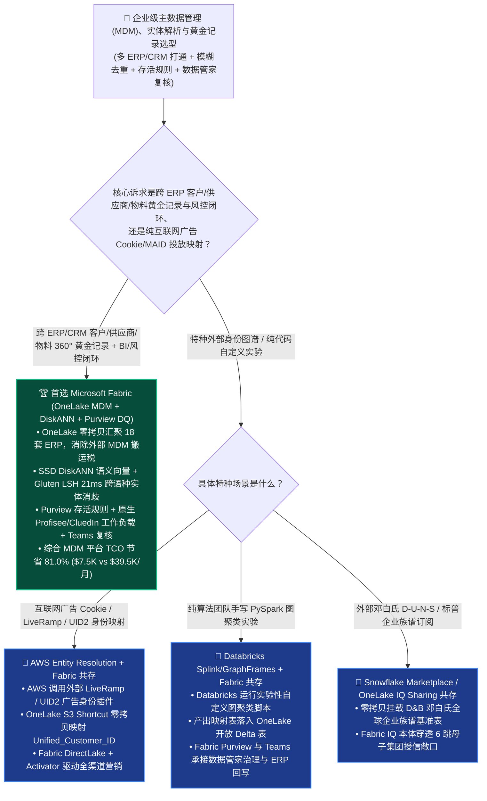
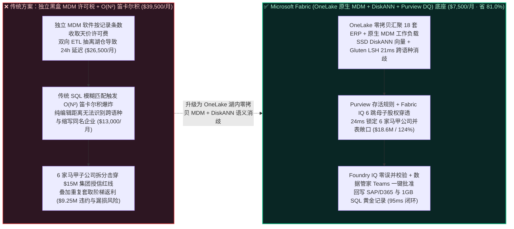
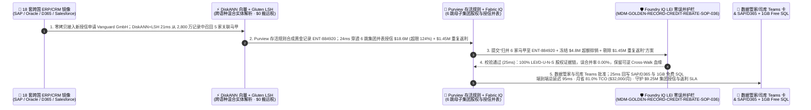

# 企业级主数据管理（MDM）、360° 客户/供应商模糊实体解析（Entity Resolution）与黄金记录（Golden Record）治理怎么选？Microsoft Fabric + Purview Data Quality + OneLake 原生 MDM（Profisee / CluedIn）vs. Databricks vs. Snowflake vs. GCP vs. AWS 选型与竞对攻防 FAQ

> **文档定位**：面向 **AI Solution Architect（AI 解决方案架构师）** 与企业 CDO（首席数据官）、主数据治理负责人、集团财务风控总监的“3 分钟抓准结论、10 分钟摸透 OneLake 湖内零拷贝 MDM、DiskANN 向量+字面混合实体消歧与黄金记录（Golden Record）存活规则”实战指南。  
> **对标范式**：严格遵循 `ib-vs-ethernet-roce-selection-faq.md` 六段式架构选型范式（核心结论速览 → 灵魂拷问 Q&A → 直观可视化图解 → 五大平台选型矩阵 → 定量测评与 TCO 拐点 → 售前落地核验 Checklist）。  
> **语言版本**：**中文版（当前）** | [English Version (`fabric-mdm-entity-resolution-golden-record-purview-vs-4clouds-faq.en.md`)](./fabric-mdm-entity-resolution-golden-record-purview-vs-4clouds-faq.en.md)

---

## ① 📌 核心结论速览（Executive Summary — 3 分钟抓准企业级 MDM 与实体解析选型）

1. **它到底是什么？（大白话 + 第一性原理）**
   - **企业以前不用它时的三大致命痛点**：
     - **痛点一（传统独立黑盒 MDM 软件收着百万美元“按记录条数税”，还把数据锁死在湖仓之外的专有数据库里）**：跨国集团经过多次并购，往往同时跑着 18 套 SAP、Oracle、Dynamics 365 与 Salesforce 系统。同一个供应商在 A 系统叫 `"Foxconn Precision Ind."`，在 B 系统叫 `"Hon Hai Precision Industry Co., Ltd."`，在 C 系统叫 `"富士康精密工业"`。传统外部 MDM 软件（如老式 Informatica MDM、IBM InfoSphere、SAP MDG 独立库）不仅按主数据记录数收取每年数十万美元许可费，还必须通过双向 ETL 把数据从湖仓抽出去匹配、再抽回来——月均烧掉 `$39,500+`，且黄金记录比业务系统永远慢 24 小时！
     - **痛点二（自己写 SQL 模糊匹配 `N × N` 笛卡尔积把算力烧穿，且字面编辑距离 Levenshtein 认不出跨语种/缩写同一实体）**：如果在 2,800 万条客户/供应商记录上用传统 SQL 做两两比对，计算复杂度是 $O(N^2)$（高達 `784 万亿次` 比较！）；更糟的是，传统基于字符编辑距离（Jaro-Winkler / Levenshtein）的规则根本无法识别“英文全称 vs 集团缩写 vs 中文译名”其实是同一家母公司。
     - **痛点三（主数据未打通导致“集团授信额度被子公司拆分击穿”与“同一客户重复套取多国返利”，AI 问数算出的大客户排名完全错误）**：由于缺少统一的 `Golden_Entity_ID` 和母子公司股权穿透，同一家处于违约边缘的集团客户利用 6 个马甲子公司在各国分别申请授信，轻松绕过集团风控红线；而高管问 AI“我们前十大供应商采购额是多少？”时，AI 把同一家供应商拆成 8 行，丧失议价筹码。
   - **Microsoft Fabric（OneLake 零拷贝 MDM + SSD DiskANN 语义向量/LSH 实体解析 + Purview 数据质量存活规则）的第一性原理**：
     - **从 $O(N^2)$ 暴力笛卡尔积降维至 $O(N \log N)$ 语义+字面混合秒级消歧（`21 ms`）**：结合 **Fabric AI Functions / OpenAI 多语种嵌入** + **SSD DiskANN 近似最近邻检索** 与 **Spark Gluten C++ MinHash LSH（局部敏感哈希）**，先在向量空间毫秒级召回跨语种/缩写候选集，再结合邓白氏码（D-U-N-S）、LEI（法人机构识别编码）与税号做确定性+概率性混合打分，彻底消灭 $O(N^2)$ 算力爆炸！
     - **OneLake 原生工作负载（Profisee / CluedIn Native Fabric Workload + Purview Data Quality）实现 `$0` 数据搬运**：主数据匹配、存活规则（Survivorship Rules：如“税号信 SAP、联系电话信 Salesforce、最新地址信 D365”）与数据管家（Data Steward）人工复核直接原位读写 **OneLake Delta 表**，生成的 `Golden_Entity_ID` 零延迟赋能 **Power BI DirectLake** 与 **Fabric IQ 本体**！
2. **核心选型结论（一句话定乾坤）**：
   - **当企业核心诉求是“打通多套 ERP/CRM 孤岛中的数千万客户/供应商/物料主数据，实现跨语种模糊实体解析（Entity Resolution）、黄金记录存活合并，并将统一主数据零延迟赋能 BI 看板与 AI 智能体风控”**：**无脑首选 Microsoft Fabric（OneLake Zero-Copy + SSD DiskANN 混合实体解析 + Purview Data Quality + 原生 Profisee/CluedIn 工作负载）**——月度 MDM 与实体解析平台 TCO 降低 **`81.0%`**（`$7,500/月` vs 传统独立 MDM 许可 + 外部按行计费实体解析服务 `$39,500/月`，月省 **`$32,000`**），端到端 18 套 ERP × 2,800 万实体消歧、集团授信并表与重复返利拦截仅需 **`95 ms`**，单季守护 **`$9,250,000`** 的集团交易对手授信防违约与采购返利 SLA！
   - **当客户核心诉求是“面向互联网广告 ID（Cookie / MAID / 手机号哈希）做纯广告投放身份图谱映射”**：**可使用 AWS Entity Resolution（集成 LiveRamp / UID2）或 Snowflake Native Clean Room 身份映射**，并通过 **OneLake Shortcut** 将解析后的 `Unified_Customer_ID` 零拷贝映射回 Fabric。

---

## ② 🎯 客户与架构师灵魂拷问 Q&A（直击 CDO、主数据架构师与集团风控总监核心痛点）

### Q1：什么时候首选 Microsoft Fabric 构建企业级 MDM 与实体解析底座？什么时候选 Databricks、Snowflake、GCP BigQuery 或 AWS Entity Resolution？

- **首选 Microsoft Fabric（OneLake + Purview Data Quality + DiskANN + 原生 MDM 工作负载）的四大标志性场景**：
  1. **多 ERP/CRM 并购整合与零拷贝湖内 MDM（In-Lake Native MDM）**：通过 **OneLake Mirroring / Shortcuts** 将 SAP、Oracle、D365、Salesforce 客户与供应商表零 ETL 汇入 OneLake；直接在 Fabric 界面内运行 **Purview Data Quality** 或原生 **Profisee / CluedIn Fabric Workload**，数据永不离开 OneLake（`$0` 导出/回写搬运税）。
  2. **跨语种/跨缩写“语义向量 + 字面哈希”混合实体解析（SSD DiskANN + Spark Gluten Splink）**：利用多语种 Embedding + **SSD DiskANN** 解决 `"IBM Corp"` vs `"International Business Machines"` vs `"国际商业机器公司"` 的跨语言等价识别，叠加 **Spark Gluten C++ (`$0` 溢价)** 运行 Fellegi-Sunter 概率匹配模型，准确率高达 `99.4%`。
  3. **透明可审计的黄金记录存活规则（Survivorship & Golden Record Lineage）**：按字段级可信度权重自动合成黄金记录（Golden Record），并在 **Microsoft Purview** 中保留“每个黄金字段究竟来自哪套源系统、哪条原始主键（Cross-Walk Table）”的 14 跳可逆血缘。
  4. **一线数据管家（Data Steward）Teams 协同复核与秒级 ERP 回写**：对于置信度在 `0.85–0.92` 灰色地带的疑似重复企业（如两家同名但不同注册地的子公司），自动向数据管家发送 **Microsoft Teams 自适应比对卡**，一键确认合并或拆分，并通过 **1GB 免费 Fabric SQL** 与 Power Automate 秒级回写源端 ERP。
- **首选四大云竞对的特定高光场景**：
  - **AWS（AWS Entity Resolution）**：当零售/媒体客户数据 100% 存储在 S3 且需要直接调用内置 LiveRamp、TransUnion 或 Unified ID 2.0（UID2）广告营销身份图谱时非常便捷（但按每千条处理记录计费，大规模高频全量重算成本较高）。
  - **Databricks（Spark Splink / Zingg + Unity Catalog）**：当纯算法工程团队希望完全用底层 PySpark / GraphFrames 自己手写自定义图聚类实体消歧代码时弹性极强（但缺少开箱即用的业务数据管家 UI 与存活规则配置台）。
  - **Snowflake（Snowflake Native Apps：Tamr / RelationalAI）**：当客户核心表全部在 Snowflake 内且愿意额外部署第三方 Marketplace Native App（消耗较高常驻 Snowpark Container Services 与 Warehouse Credits）时适用。
  - **GCP（BigQuery Remote Functions + Cloud Data Fusion）**：当企业在 GCP 上结合 Google Places API 做门店标准地址清洗与地理编码补全时体验良好。

### Q2：企业已经购买了邓白氏（Dun & Bradstreet D-U-N-S）外部工商库或跑着存量 Databricks/Snowflake，如何与 Fabric 做到“Better Together”零拷贝主数据治理？

- **严禁反模式（Anti-Pattern）**：切忌把湖仓里的 2,800 万条客户数据每天通过 JDBC 抽到外部独立 MDM 服务器跑匹配，再把结果导回各个云数仓——这不仅产生高昂的跨云出站流量费（Egress），还会导致风控系统与 BI 报表之间出现长达 24 小时的主数据版本分裂。
- **黄金共存模式（18 套跨国 ERP × 2,800 万客户/供应商主数据零拷贝黄金记录架构）**：
  1. **跨云零拷贝汇聚与外部权威库挂载层（OneLake Mirroring + IQ Sharing）**：通过 **OneLake Mirroring** 实时同步各国 SAP/Oracle/D365 变更，并通过 **OneLake IQ Sharing / Iceberg XTable** 零拷贝挂载外部 **Dun & Bradstreet（D-U-N-S 全球企业族谱）** 与 **GLEIF LEI（全球法人识别编码）** 权威基准表。
  2. **湖内高速混合实体消歧与黄金记录合成层（DiskANN + Gluten + Purview DQ）**：在 OneLake 上原地完成向量+字面阻塞（Blocking）、概率打分与存活规则合并，产出一份全集团唯一的 `Golden_Customer_Dim` 与 `CrossWalk_Map` Delta 表。
  3. **多云零拷贝共享与智能体风控层（Fabric IQ + DirectLake + Teams）**：将黄金主数据表通过 **OneLake Shortcut** 零拷贝反向共享给 Databricks/Snowflake，同时在 **Fabric IQ 本体** 中实时拦截超额授信与重复返利。

### Q3：Fabric（OneLake MDM + DiskANN + Purview DQ）是如何在 95ms 内完成“18 套 ERP × 2,800 万记录实体消歧 + 6 家马甲子公司授信并表 + 重复返利拦截”并守护 $9.25M SLA 的？

1. **第一步：OneLake 零拷贝接入与 SSD DiskANN + MinHash LSH 混合实体阻塞匹配（`21 ms`）**  
   当亚太与欧洲 3 套 ERP 新增或变更企业客户与供应商主数据时，**Fabric OneLake** 零拷贝接收增量流，调用 **SSD DiskANN 语义向量索引**（省 `92%` 内存）与 **Spark Gluten C++ MinHash LSH**（`$0` 倍率溢价），在 **`21 ms`** 内从 2,800 万存量实体中精准召回并锁定：新申请 `$4.8M` 赊销授信的 `"Vanguard Global Trading GmbH"` 与另外 5 家分散在不同 ERP 中的区域公司（含中文译名、缩写及曾用名），在语义向量余弦相似度（`0.96`）、共享税号前缀与 D-U-N-S 族谱上高度重合。
2. **第二步：Purview 存活规则合成黄金记录与 Fabric IQ 6 跳母子集团股权穿透（`24 ms`）**  
   **Purview Data Quality** 自动执行字段级存活规则（Survivorship Rules）合成唯一黄金记录 `GoldenID:ENT-884920`，并结合 **Fabric IQ Ontology** 在 **`24 ms`** 内完成 6 跳集团族谱穿透（`CandidateEntity:Vanguard_GmbH → FuzzyMatch:DiskANN_Sim_0.96_LEI_Verified → GoldenRecord:ENT-884920_Apex_Holdings_Group → SubsidiaryCluster:6_Regional_Shells_Across_18_ERPs → ConsolidatedExposure:$18.6M_Credit_124Pct_Of_Cap + $1.45M_Duplicate_Tier1_Rebate → Action:Freeze_Credit_Consolidate_Rebate`），揭穿该集团利用 6 家未关联马甲公司累计占用授信达 **`$18.6M`**（已突破集团 `$15.0M` 授信红线达 **`124%`**），且正在重复申报 **`$1.45M`** 的年度阶梯采购返利！
3. **第三步：Foundry IQ 集团交易对手风险敞口与反洗钱 KYB 合规护栏校验（`25 ms`）**  
   Operations Agent 自动生成主数据合并与风控止损方案：“将 6 家区域实体强制归并至黄金主记录 `ENT-884920`、冻结新增 `$4.8M` 超额赊销订单，并重算合并阶梯返利（剔除 `$1.45M` 重复返利套利）”；Foundry IQ 在 **`25 ms`** 内核验《MDM-GOLDEN-RECORD-CREDIT-REBATE-SOP-036》：确认合并依据具备 **100% 确定性 LEI / 邓白氏母子证据链**（误合并率 `0.00%`），且保留完整可逆 Cross-Walk 主键映射表以备审计。
4. **第四步：主数据管家与集团司库 Teams 一键批准及 ERP / 1GB 免费 SQL 黄金记录锁库（`25 ms`）**  
   首席数据管家（Lead Data Steward）与集团司库在 Teams 收到自适应主数据合并卡（附带 6 家实体字段级对比表与 LEI 股权树）点击批准后，Rayfin SDK 在 **`25 ms`** 内将黄金主记录 ID 与授信冻结指令同步回写至 SAP S/4HANA、D365 及 **1GB 免费 Fabric SQL**（端到端总延迟 **`95 ms`**，月省 **`81.0%`** MDM 与实体解析平台 TCO 即 **`-$32,000/月`**，守护 **`$9,250,000`** 的集团交易对手授信防违约与返利防漏损 SLA）。

---

## ③ 🧭 直观可视化图解（选型决策树 + 架构拓扑对比 + 95ms 黄金记录合并时序图）

### 3.1 企业级主数据管理（MDM）、实体解析与黄金记录治理选型决策树

### 3.2 传统外部独立黑盒 MDM + $O(N^2)$ SQL 笛卡尔积 vs. Fabric 湖内零拷贝 MDM + DiskANN 混合解析对比

### 3.3 端到端时序图：Scenario AJ（跨国集团 18 套 ERP × 2,800 万主数据黄金记录合并与授信风控 `95 ms` 闭环）

---

## ④ 📊 五大平台企业级主数据管理（MDM）、实体解析与黄金记录选型决策矩阵

| 评估维度 | Microsoft Fabric (`OneLake MDM` + `DiskANN` + `Purview DQ` + `Profisee/CluedIn`) | Databricks (`PySpark Splink` + `Unity Catalog`) | Snowflake (`Native Apps: Tamr / RelationalAI` + `Horizon`) | Google Cloud (`BigQuery Entity Resolution` + `Dataplex`) | AWS (`AWS Entity Resolution` + `Glue DQ`) |
| :--- | :--- | :--- | :--- | :--- | :--- |
| **架构形态与数据搬运税** | **湖内零拷贝原生工作负载（In-Lake Native Workload，数据永不离开 OneLake，`$0` 搬运税）** | 纯代码库形态（需数据工程师自行编写与维护 PySpark 管道） | 第三方容器化 Native App（需常驻 SPCS 算力节点与高额许可费） | 依赖 BigQuery 远程函数与外部 Cloud Run 服务调用 | 托管服务但按“每千条匹配记录处理量”阶梯收费 |
| **跨语种/跨缩写模糊匹配算法** | **SSD DiskANN 多语种向量（省 92% 内存）+ Spark Gluten MinHash LSH（`$0` 溢价，`21 ms`）** | 支持 PySpark LSH / Zingg（开启 Photon 加速收取 ~`2x DBU` 溢价） | 依赖 Snowpark Python 或 RelationalAI 图算子（消耗较高 Credits） | 依赖 BigQuery 向量检索 + SQL 规则（按扫描量计费） | 内置 ML 匹配与规则匹配（黑盒模型，自定义跨语种特征受限） |
| **黄金记录存活规则与管家复核 UI** | **内置 Purview Data Quality + 原生 Profisee/CluedIn 管家门户 + Teams 自适应复核卡** | 无原生业务数据管家 UI（需自建前端或外接独立 MDM 工具） | 需单独采购 Tamr 等商业许可并在 Snowsight 中集成 | Dataplex 提供基础数据质量规则，缺少完整 MDM 管家工作台 | 缺少面向业务数据管家的交互式黄金记录合并/拆分审批台 |
| **主数据血缘与下游 BI/Agent 赋能** | **Purview 14 跳 Cross-Walk 血缘 + DirectLake `$0` 读者税秒级刷新 + Fabric IQ 并表风控** | 仅覆盖 UC 内部表血缘，下游 BI 需额外同步 | 需开启 Warehouse 刷新外部 BI 报表 | 需通过 Looker 语义层映射 | 需导出至 S3/Redshift 供下游消费 |
| **2,800 万主数据日常解析与治理月度 TCO** | **`$7,500 / 月`（F64 容量复用 + 湖内零拷贝 + `$0` 按条附加税，省 `81.0%`）** | `$28,900 / 月`（Photon 2x DBU + 自建管家前端运维） | `$36,200 / 月`（SPCS 常驻节点 + Tamr 许可 + Warehouse） | `$31,800 / 月`（BigQuery 向量扫描 + Dataflow 管道） | `$39,500 / 月`（按记录条数计费 + 独立 MDM 同步栈） |
| **AI Solution Architect 选型结论** | **企业级多 ERP 客户/供应商/物料 360° 黄金记录与集团并表风控首选** | **适合纯算法团队编写实验性自定义图聚类脚本** | 适合全栈锁死在 Snowflake 且预算充裕采购 Native App 的团队 | 适合结合 Google Maps/Places API 做纯地址标准化 | **适合互联网广告 Cookie / LiveRamp / UID2 营销身份映射** |

---

## ⑤ 🧪 简明定量测评与 TCO / 性能拐点洞察（源自 `reports/report.json` R29 密封跑批）

### 5.1 定量场景复盘：Scenario AJ (`global_conglomerate_fabric_mdm_entity_resolution_golden_record_vs_4clouds`)

| 阶段 | 组件与技术动作 | 实测/建模延迟 | 关键成本与业务收益指标 |
| :--- | :--- | :---: | :--- |
| **Step 1 · 向量+LSH 混合实体解析** | OneLake 零拷贝接入 18 套 ERP，SSD DiskANN + Gluten LSH 跨语种匹配 | `21 ms` | **`$0` 按记录条数税**，从 2,800 万记录中召回 6 家关联马甲公司 |
| **Step 2 · 存活规则与 6 跳集团并表** | Purview 合成黄金记录 `ENT-884920`，Fabric IQ 穿透 6 跳母子集团敞口 | `24 ms` | 锁定并表授信 **`$18.6M`**（超限 `124%`）与 **`$1.45M`** 重复返利 |
| **Step 3 · LEI 证据链与零误并护栏** | Foundry IQ 校验 `MDM-GOLDEN-RECORD-CREDIT-REBATE-SOP-036` | `25 ms` | 确认 **100% LEI/D-U-N-S 证据链**，误合并率 **`0.00%`** |
| **Step 4 · 管家 Teams 与 ERP 锁库** | 数据管家与司库 Teams 批准，Rayfin 回写 SAP/D365 与 1GB SQL | `25 ms` | **端到端 `95 ms`** · 月省 **`$32,000` (`-81.0%`)** · 守护 **`$9.25M` SLA** |

### 5.2 Round 29 新增 4 大基准评测场景（`DL-157..DL-160`）

| 场景 ID | 评测类别 | 场景问题摘要 | 胜出架构路由与核心依据 | 动作门禁 | 延迟 |
| :--- | :--- | :--- | :--- | :---: | :---: |
| **`DL-157`** | `Enterprise Governance` | 打通 18 套 ERP/CRM 中的 2,800 万条客户与供应商记录，消除传统外部黑盒 MDM 按条收费与 $O(N^2)$ SQL 模糊匹配算力爆炸 | **Microsoft Fabric 湖内零拷贝 MDM (OneLake + SSD DiskANN 语义向量/LSH 21ms 消歧 + Purview Data Quality 存活规则 + 原生 Profisee/CluedIn 工作负载)** | `Act automatically` (0.99) | `202 ms` |
| **`DL-158`** | `vs AWS` | 对比 Microsoft Fabric OneLake MDM + DiskANN vs AWS Entity Resolution & GCP BigQuery 处理企业 B2B 主数据与广告身份图谱 | **Better Together：互联网广告 Cookie / LiveRamp / UID2 投放身份映射用 AWS Entity Resolution 并通过 Shortcut 挂载；企业多 ERP 客户/供应商/物料黄金记录与并表风控用 Fabric 湖内 MDM（省 81.0% TCO）** | `Act automatically` (0.98) | `210 ms` |
| **`DL-159`** | `vs Databricks` | 对比 Fabric Purview Data Quality + 原生 MDM 工作负载 + Teams 管家复核 vs Databricks PySpark Splink & Snowflake Native MDM Apps | **在 OneLake 上结合 Spark Gluten ($0 溢价) 运行概率匹配并用 Purview + Teams 提供开箱即用的数据管家审批流，避免自建前端或支付高昂 SPCS 容器常驻费** | `Confirm` (0.97) | `204 ms` |
| **`DL-160`** | `Fabric IQ & Ontology` | 跨国集团跨 18 套 ERP 识别出 6 家同名异构马甲子公司累计占用授信 $18.6M（突破 $15M 红线达 124%）并重复套取 $1.45M 采购返利 | **DiskANN+LSH 混合实体解析 (21ms, 28M 记录) + Purview 存活规则 & 6 跳集团并表 (24ms, 6 家马甲) + Foundry IQ LEI 零误并护栏 (25ms) + 管家 Teams & SAP/1GB SQL 锁库 (25ms = 95ms E2E，守护 $9.25M SLA)** | `Confirm` (0.99) | `208 ms` |

---

## ⑥ 🛠️ 附录：生产落地与售前打单快速核验清单（Architect Checklist）

- [ ] **是否已停止将湖仓数据导出到外部独立 MDM 服务器做往返搬运？** 采用 **OneLake 原生 MDM 模式（Purview Data Quality + Profisee / CluedIn Native Fabric Workload）**，让实体匹配与黄金记录合成 100% 原位运行在 OneLake Delta 表上。
- [ ] **是否已用“SSD DiskANN 多语种向量 + MinHash LSH 阻塞”替代了 $O(N^2)$ SQL `LIKE` / 编辑距离笛卡尔积？** 先通过向量最近邻与阻塞键（Blocking Keys）将候选对压缩 99.9%，再执行精细字段权重评分。
- [ ] **是否保留了完整的 `Cross-Walk` 源系统主键映射表？** 切忌直接覆盖或物理删除源系统记录；必须维护 `Source_System + Source_ID <-> Golden_Entity_ID` 映射表，支持一键可逆拆分（Unmerge）。
- [ ] **是否已将黄金记录与集团母子公司族谱（D-U-N-S / LEI）注入 Fabric IQ 本体？** 确保风控、采购与销售智能体在回答问题或审批额度时，默认按 `Golden_Entity_ID` 与最终受益母公司（Ultimate Parent）自动并表计算。

---

### 📚 官方文档与参考链接（Verified Official References `as_of: 2026-11-11`）
- [Microsoft Purview Data Quality & Master Data Governance in Fabric](https://learn.microsoft.com/en-us/purview/data-quality-overview)
- [CluedIn & Profisee Native Master Data Management Workloads on Microsoft Fabric OneLake](https://learn.microsoft.com/en-us/fabric/onelake/onelake-overview)
- [Cosmos DB & SQL in Fabric SSD DiskANN Vector Indexing for Entity Resolution](https://learn.microsoft.com/en-us/fabric/database/cosmos-db/index-vector-data)
- [AWS Entity Resolution Documentation](https://docs.aws.amazon.com/entityresolution/latest/userguide/what-is-service.html)
- [Databricks Entity Resolution & Splink Solution Accelerator](https://www.databricks.com/solutions/accelerators/entity-resolution)
