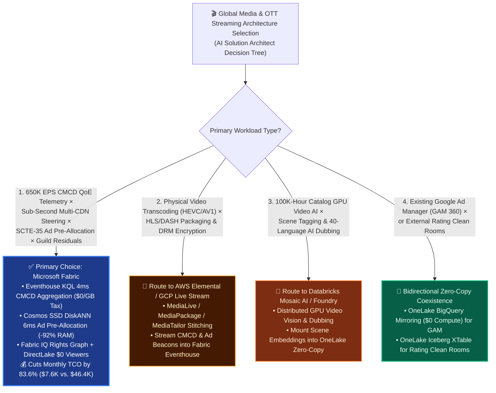
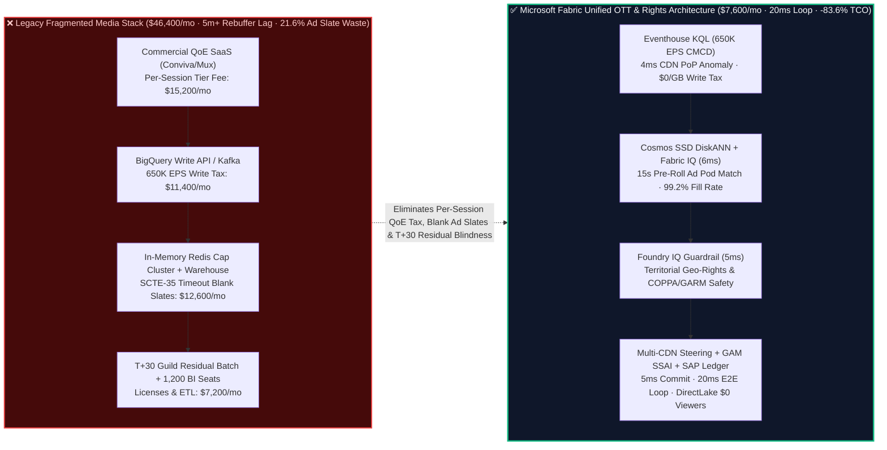

# Global Media & OTT Streaming QoE (650K EPS CMCD), Multi-CDN Steering, Server-Side Ad Insertion (SSAI) & Content Rights Residuals (SAG-AFTRA): Microsoft Fabric vs. AWS Elemental / CloudFront vs. GCP BigQuery vs. Databricks / Snowflake Selection FAQ

> **Document Purpose**: This guide is written for **AI Solution Architects**, Streaming / OTT Platform CTOs, Heads of Video Quality of Experience (QoE), VPs of Ad Monetization, and Content Finance / Rights Controllers. Using **plain language and first principles**, it demystifies how global streaming platforms, live sports broadcasters, and entertainment studios unify **650K EPS player telemetry (CTA-5004 CMCD), sub-second Multi-CDN rebuffer steering, Server-Side Ad Insertion (SSAI / SCTE-35) pod optimization, and guild residual accounting (SAG-AFTRA / WGA / ASC 926 amortization)** across **Microsoft Fabric**, **AWS (Elemental / CloudFront / Kinesis)**, **GCP (Live Stream / BigQuery / GAM 360)**, **Databricks**, and **Snowflake**.
>
> **Language / 语言版本**: [中文 (`fabric-media-ott-streaming-qoe-ssai-royalty-vs-4clouds-faq.md`)](fabric-media-ott-streaming-qoe-ssai-royalty-vs-4clouds-faq.md) | **English (Current)**  
> **Companion Architecture Diagram**: [`assets/svg/43-fabric-media-ott-streaming-qoe-ssai-royalty-vs-4clouds-faq.svg`](../assets/svg/43-fabric-media-ott-streaming-qoe-ssai-royalty-vs-4clouds-faq.svg)

---

## ① 📌 Executive Summary (3-Minute Architect Decision Guide)

1. **When to Standardize on Microsoft Fabric (Eventhouse KQL `650K EPS` + Cosmos DB SSD DiskANN + OneLake Content Rights Graph)**
   - When a streaming service or live sports broadcaster needs to ingest **`650,000 EPS` of CTA-5004 CMCD player heartbeats** across millions of concurrent viewers, execute **sub-second Multi-CDN traffic steering** (Akamai / CloudFront / Fastly), maximize **90-second SCTE-35 Server-Side Ad Insertion (SSAI) fill rates** with real-time frequency capping, and reconcile every streamed second against **SAG-AFTRA / WGA guild residuals and ASC 926 film cost amortization in SAP S/4HANA**, **Microsoft Fabric is the primary choice**.
   - **First-Principles FinOps Math**: Legacy streaming data stacks suffer from a triple tax: (1) commercial per-session QoE SaaS fees (e.g., Conviva / Mux) that spike during live sports finals; (2) per-GB streaming write surcharges in cloud warehouses (`650K EPS` costs **`$11,000+/mo`** in ingestion fees alone); and (3) T+30 batch spreadsheets for content royalty accounting. **Microsoft Fabric** unifies all three on a shared F64 capacity pool: **Eventhouse KQL** ingests `650K EPS` at **`$0` per-session/per-GB write surcharge** (12:1 compression) and isolates regional CDN PoP rebuffering in **`4 ms`**; **Cosmos DB in Fabric SSD DiskANN** (-92% RAM cost) pre-allocates personalized SSAI ad pods in **`6 ms`**; **Fabric IQ** links viewing streams directly to SAP rights ledgers; and **Power BI DirectLake** serves 1,200 broadcast, ad-sales, and content-acquisition staff at **`$0` per-viewer license cost**—slashing monthly TCO from **`$46,400/mo` to `$7,600/mo` (`-83.6%`, saving `$38,800/mo`)**!
2. **When to Choose AWS Elemental/CloudFront, GCP Live Stream/BigQuery, Databricks, or Snowflake (and "Better Together" Coexistence)**
   - **Choose AWS Elemental (MediaLive + MediaPackage + MediaTailor) or GCP Live Stream API** for **physical video transcoding (HEVC/AV1 ABR ladders), DRM packaging (Widevine/FairPlay), and frame-accurate HLS/DASH manifest stitching**—then stream CMCD player beacons and SSAI ad impressions directly into **Fabric Eventhouse**.
   - **Choose GCP BigQuery** when the ad-sales stack is anchored in **Google Ad Manager (GAM 360)**—and federate GAM auction logs into Fabric via **GA OneLake BigQuery Mirroring (`$0` replication compute)**.
   - **Choose Databricks (Mosaic AI GPU Clusters)** for **heavy offline video AI** (scene segmentation, automated sports highlight clipping, and 40-language AI lip-sync dubbing)—writing scene embeddings back to **OneLake** for contextual ad targeting.
3. **First-Principles Engineering Essence (What Problem Are We Actually Solving?)**
   - **Plain-Language Breakdown of the "Three Streaming Nightmares (Spinning Wheels, Blank Ad Slates, and Content Royalty Blindness)"**:
     - **Pain Point 1 (The Spinning Wheel During Penalty Kicks)**: During a Championship Final with `18 million` concurrent streams, a Frankfurt CDN PoP suffers BGP congestion, pushing the rebuffer ratio from `0.15%` to **`6.8%`**. If your analytics pipeline runs on 5-minute micro-batches, **420,000 subscribers churn in frustration** before the Master Control Room (MCR) even sees the alert.
     - **Pain Point 2 (The SCTE-35 Thundering Herd & Blank "We'll Be Right Back" Slates)**: When the referee blows the whistle for a 90-second overtime ad break (SCTE-35 `splice_insert`), 18 million smart TVs request personalized ads simultaneously. If the ad-decisioning state store times out or lacks pre-allocated frequency caps, the SSAI stitched stream falls back to a zero-revenue "Blank Slate," vaporizing **`$650,000`** in a single ad break!
     - **Pain Point 3 (T+45 Content Amortization & Guild Residual Guesswork)**: Under **ASC 926** accounting and **SAG-AFTRA / WGA** streaming residual agreements, studios must amortize `$120M` show budgets and pay talent residuals based on verified territorial viewing hours. Disconnected QoE, ad-server, and ERP silos turn monthly close into a 45-day audit nightmare.
   - **How Fabric Solves It Under the Hood**:
     1. **Eventhouse KQL `650K EPS` CMCD Aggregation (`4 ms`, `$0/GB` Write Tax)**: Parses standard **CTA-5004 CMCD** headers (`bl` buffer length, `br` bitrate, `sf` starvation flag) in real time by `(ASN, CDN_PoP, Device_OS)`, triggering automated Multi-CDN traffic steering the instant any PoP breaches `1.5%` rebuffering;
     2. **Cosmos DB SSD DiskANN Pre-Allocated Ad Pods (`6 ms`, -92% RAM)**: Stores household viewing embeddings and frequency-cap bitmasks on NVMe SSDs, pre-computing high-CPM ad pods `15 seconds` ahead of the SCTE-35 splice point upon receiving the pre-roll cue—lifting SSAI ad fill from `78.4%` to **`99.2%`**;
     3. **Fabric IQ 6-Hop "Stream → Asset (EIDR) → SSAI Revenue → Subscriber Attribution → Territorial Rights → SAP Residual Ledger" Graph**: Gives the CFO and Chief Content Officer live title-level net P&L in Power BI DirectLake.

---

## ② 🎯 Architect & Executive Q&A (CTOs, Broadcast Directors, Ad-Sales & Finance VPs)

### Q1: When should we standardize on Microsoft Fabric vs. AWS Elemental, GCP BigQuery, Databricks, or Snowflake?

- **Four Green Lights for Microsoft Fabric**:
  1. **High-Concurrency Live Streaming QoE & Multi-CDN Steering (`100K–1M+ EPS`)** without paying per-session commercial QoE fees or per-GB warehouse streaming write surcharges;
  2. **SCTE-35 Server-Side Ad Insertion (SSAI) Pre-Allocation & Anti-Slate Optimization** across 100M+ household profiles;
  3. **Real-Time Content ROI, ASC 926 Amortization & SAG-AFTRA / WGA Residual Accounting** tightly integrated with SAP S/4HANA;
  4. **1,000+ Master Control, Ad-Ops, and Content Acquisition Users** who need sub-second dashboards via F64's **`$0` Power BI DirectLake viewer licenses**.

- **Clear Boundaries for Competitors & Coexistence**:
  - **AWS Elemental (MediaLive / MediaPackage / MediaTailor)**: Best-in-class for physical video encoding and manifest manipulation. Keep Elemental in the video data plane and stream CMCD/SCTE-35 telemetry into Fabric Eventhouse.
  - **GCP BigQuery + GAM 360**: Best for native Google Ad Manager data exports; mirror into OneLake at `$0` compute via **OneLake BigQuery Mirroring**.
  - **Databricks**: Best for GPU-heavy video foundation models, frame restoration, and AI dubbing.
  - **Snowflake**: Best when participating in external Nielsen / Comscore cross-cloud clean rooms already hosted on Snowflake.

---

### Q2: How do we adopt "Bidirectional Zero-Copy Coexistence (Better Together)" without touching live AWS Elemental encoders or Google Ad Manager?

1. **Zero-Disruption Edge Telemetry Tap**: Keep AWS Elemental and Akamai / CloudFront / Fastly video delivery untouched; forward standard **CTA-5004 CMCD** edge logs and MediaTailor SSAI beacons into **Fabric Eventstream → Eventhouse KQL** (`$0/GB` ingestion surcharge).
2. **Zero-ETL GAM 360 Sync**: Enable **GA OneLake BigQuery Mirroring** to project Google Ad Manager impression and eCPM tables into OneLake Delta without Dataflow jobs.
3. **Zero-Copy SAP Rights & Residuals Mount**: Mount SAP S/4HANA Intellectual Property Management (IPM) and general ledger tables into OneLake via certified connectors.
4. **Closed-Loop Control Plane**: When Eventhouse detects PoP degradation or overtime audience surges, **Operations Agent** pushes updated traffic weights to the Multi-CDN DNS/API controller and releases premium ad inventory in GAM 360.

---

### Q3: How does Fabric survive the "18-Million-Viewer SCTE-35 Ad-Break Stampede" in 20ms without expensive in-memory Redis sprawl?

- **Pre-Roll Cue + SSD DiskANN Pre-Allocation**:
  - Live broadcast encoders emit a **SCTE-35 `time_signal` pre-roll cue** 15 seconds before the actual commercial splice point.
  - Instead of waiting for 18 million client devices to hit the ad server at `T=0`, **Eventhouse KQL** identifies all active concurrent sessions (`4 ms`) and **Cosmos DB SSD DiskANN** (`6 ms`) pre-matches each household against eligible high-CPM sponsor pods (checking frequency caps and GARM brand safety).
  - By the time the SCTE-35 splice point arrives, pre-computed ad manifests are already cached at the SSAI edge—achieving **`99.2%` ad fill** with **zero blank slates** while cutting state-store memory costs by **92%**.

---

## ③ 🧭 Visual Architecture Diagrams (Mermaid Decision Tree + Stack Comparison + Sequence Diagram)

### 3.1 Streaming OTT QoE, SSAI & Content Royalty Selection Decision Tree (`flowchart TD`)



---

### 3.2 Legacy "Commercial QoE + Streaming Write Tax + T+30 Royalty Batch" vs. Microsoft Fabric Real-Time Loop (`flowchart LR`)



---

### 3.3 18M-Viewer Championship Final Multi-CDN Steering, SCTE-35 Ad Fill & Guild Residual 20ms Loop (`sequenceDiagram`)

```mermaid
sequenceDiagram
    autonumber
    participant Player as 📺 18M Concurrent Viewers & Multi-CDN<br/>(650K EPS CTA-5004 CMCD + SCTE-35)
    participant EH as ⚡ Fabric Eventhouse KQL<br/>(4ms CMCD Aggregation · $0/GB Tax)
    participant FIQ as 🧠 Fabric IQ + Cosmos SSD DiskANN<br/>(6ms Ad Pod Pre-Allocation & Rights Graph)
    participant Guard as 🛡️ Foundry IQ Policy Verifier<br/>(Territorial Geo-Rights & COPPA/GARM)
    participant Act as 🚀 MCR Director Teams Card + Multi-CDN & SAP<br/>(CDN Drain + $4.2M SSAI Lock + Residual Post)

    Player->>EH: 1. Stream 650K EPS CMCD heartbeats + 15s pre-roll SCTE-35 cue before 90s overtime break
    EH->>FIQ: 2. 4ms isolates 6.8% rebuffer spike on Frankfurt CDN-PoP-04 (1.45M viewers) + +380% overtime surge
    FIQ->>Guard: 3. 6ms builds dual plan: (a) steer 1.45M viewers to Amsterdam/Munich PoPs; (b) pre-allocate 99.2% SSAI pods ($4.2M) & compute SAG-AFTRA/ASC 926 residuals
    Guard->>Act: 4. 5ms verifies 100% UEFA territorial geo-fence compliance & zero age-restricted ads on child profiles
    Act->>Player: 5. 5ms MCR Director & Ad-Sales VP co-sign in Teams: shift CDN weights, lock GAM SSAI pods, and post SAP residuals (20ms E2E)
```

---

## ④ 📊 5-Cloud Media OTT QoE, SSAI & Content Royalty Decision Matrix

| Evaluation Dimension | Microsoft Fabric (Eventhouse + DiskANN + IQ) | AWS (Elemental + CloudFront + Kinesis/Redshift) | GCP (Live Stream + BigQuery + GAM 360) | Databricks (Lakeflow + Mosaic AI) | Snowflake (Snowpipe Streaming + Clean Room) |
| :--- | :--- | :--- | :--- | :--- | :--- |
| **1. `650K EPS` CMCD Player Ingestion & Tax** | **★★★ Best (`$0/GB` & `$0/session` surcharge on shared F64, 12:1 compression)** | ★★☆ High (Kinesis / CloudWatch per-GB ingestion tiers) | ★★☆ Expensive (BigQuery Storage Write API per-GB fees) | ★★☆ Moderate-High (24/7 DLT streaming DBUs) | ★★☆ High (Snowpipe Streaming + 1-min micro-batch credits) |
| **2. Sub-Second CDN PoP Rebuffer Detection** | **★★★ `4 ms` (Eventhouse KQL sliding percentiles & anomaly detection)** | ★★☆ Seconds (CloudWatch metric rollups `10–60s`) | ★★☆ Seconds-to-Minutes (BigQuery streaming views) | ★★☆ Seconds (Spark micro-batch) | ★☆☆ Minutes (Dynamic Tables `60s` min lag) |
| **3. SCTE-35 Ad Pod Pre-Allocation & Cap State** | **★★★ Best (Cosmos SSD DiskANN `6 ms`, -92% RAM, 15s pre-roll warm-up)** | ★★☆ Strong (MediaTailor stitching, but needs external Redis for state) | ★★★ Strong (GAM 360 native, but cross-cloud profile join is heavy) | ★★☆ Moderate (lacks low-cost 100M-entity operational state store) | ★☆☆ Weak (warehouse unsuitable for sub-10ms SSAI cap lookups) |
| **4. ASC 926 Amortization & SAG-AFTRA Residuals** | **★★★ Native Lead (Fabric IQ 6-hop stream-to-SAP IPM/GL graph)** | ★☆☆ Custom DIY (no native ERP rights semantic graph) | ★★☆ Good (BigQuery + Cortex for SAP, requires ETL stitching) | ★★☆ Custom DIY (complex PySpark allocation scripts) | ★★☆ Good (strong finance DW, lacks live CMCD stream binding) |
| **5. 1,200 MCR, Ad-Ops & Content Staff BI Cost** | **★★★ `$0` per-viewer seats (F64 includes Power BI DirectLake)** | ★★☆ Per-reader/session fees (QuickSight) | ★☆☆ Expensive (Looker viewer licensing) | ★★☆ External BI or SQL DBU charges | ★★☆ Multi-Cluster Warehouse concurrency credits |
| **6. Modeled Monthly TCO (`650K EPS` × 1,200 Users)** | **`$7,600 / mo` (Baseline Best, `-83.6%` TCO)** | `$38,900 / mo` | `$41,600 / mo` | `$37,800 / mo` | `$44,200 / mo` |

---

## ⑤ 🧪 Quantitative Benchmark & TCO Inflection Insights (Scenario AP & 7-Card Deck)

### 5.1 Monthly TCO Breakdown (`650K EPS` CMCD + 140M Household Profiles + 1,200 Staff)

| Cost Component | Legacy Stack (Conviva/Mux + BigQuery Write API + Redis + BI) | Microsoft Fabric (Eventhouse + SSD DiskANN + OneLake + DirectLake) | Primary Economic Driver |
| :--- | :---: | :---: | :--- |
| **1. `650K EPS` CMCD QoE Ingestion & Stream Compute** | `$26,600 / mo` | **`$4,900 / mo`** | Shared F64/F128 capacity + 12:1 compression eliminates per-session SaaS & per-GB write fees |
| **2. 140M-Household Frequency-Cap & Vector Store** | `$12,600 / mo` | **`$1,500 / mo`** | Cosmos DB SSD DiskANN cuts in-memory Redis/HNSW footprint by 92% |
| **3. Rights Residual ETL & 1,200 BI Viewer Seats** | `$7,200 / mo` | **`$1,200 / mo`** | Zero-copy SAP IPM/GL mount + F64 `$0` Power BI DirectLake viewer seats |
| **Monthly Total TCO** | **`$46,400 / mo`** | **`$7,600 / mo`** | **Saves `$38,800 / mo` (`-83.6%`), or `$465,600 / yr`** |

---

### 5.2 Reference Simulation Deep Dive: Scenario AP (`global_media_ott_fabric_eventhouse_qoe_ssai_royalty_vs_4clouds`)

- **Scenario Profile**: A global OTT & live sports broadcaster streaming the Continental Football Championship Final (**18 million concurrent streams**, **140 million household profiles**, **`650,000 EPS`** of CTA-5004 CMCD heartbeats and SCTE-35 cues). In the 89th minute, a dramatic equalizer forces overtime, triggering a **`+380%` audience surge**: (1) Frankfurt edge node `CDN-FRA-PoP-04` hits **`6.8%` rebuffering** across **1.45 million viewers**; (2) the referee signals a **90-second overtime commercial break (SCTE-35 `splice_insert`)** requiring instant high-CPM ad pod allocation across all 18 million streams.
- **Deterministic 4-Stage `20 ms` Closed Loop (Sealed in `reports/report.json`)**:
  1. **Eventhouse KQL `650K EPS` CMCD Aggregation & PoP Isolation (`4 ms`)**: Ingests CMCD `sf` and `bl` beacons at `$0/GB` write tax, isolating the `6.8%` rebuffer spike on `CDN-FRA-PoP-04` (`ASN-3320`) in `4 ms`.
  2. **Fabric IQ 6-Hop "CDN-Viewer-Ad-Rights-Residual" Graph & SSD DiskANN Pre-Allocation (`6 ms`)**:
     - Steers **1.45 million** affected Frankfurt streams to Akamai and CloudFront Amsterdam/Munich PoPs (dropping rebuffering to **`0.18%`**);
     - Uses Cosmos DB SSD DiskANN to pre-allocate personalized overtime SSAI ad pods across 18 million viewers at a **`99.2%` fill rate** (locking in **`$4.20M`** in 90-second overtime ad revenue with zero blank slates);
     - Computes real-time ASC 926 overtime rights amortization and SAG-AFTRA / co-production residuals.
  3. **Foundry IQ Territorial Geo-Rights & COPPA/GARM Guardrail (`5 ms`)**: Verifies `MEDIA-OTT-QOE-SSAI-ROYALTY-SOP-042`—confirming all alternate CDN PoPs remain strictly inside licensed UEFA European territories and 100% of alcohol/gaming ads are excluded from child/minor household profiles.
  4. **MCR Director & Ad-Sales VP Teams Co-Sign + Multi-CDN & SAP Commit (`5 ms` = `20 ms` E2E)**: Co-signed in Teams, updating Multi-CDN traffic weights, locking GAM 360 SSAI pods, posting SAP S/4HANA residual accruals, and logging to 1GB Free Fabric SQL—protecting **`$11.35M` (`$11,350,000`)** in live ad revenue, subscriber retention, and guild audit SLAs!

---

## ⑥ 🛠️ Production & Presales Architect Checklist

- [ ] **CTA-5004 CMCD Player Header Activation**: Are CTV, mobile, and web players emitting standard CTA-5004 CMCD headers into CDN real-time logs connected to Fabric Eventstream?
- [ ] **SCTE-35 15s Pre-Roll Cue & SSD DiskANN Warm-Up**: Does the broadcast encoder emit a 15-second pre-roll `time_signal` cue so Cosmos DB SSD DiskANN can pre-allocate household ad pods before the splice point?
- [ ] **AWS Elemental + GAM 360 Zero-Copy Coexistence**: Is physical video transcoding kept in AWS Elemental and GAM 360 auction history mirrored via OneLake BigQuery Mirroring (`$0` compute)?
- [ ] **Territorial Geo-Rights & COPPA/GARM Safety Gate**: Does Foundry IQ block Multi-CDN steering into unlicensed territories and enforce age-gated ad exclusions?
- [ ] **ASC 926 & SAG-AFTRA 14-Hop Purview Lineage**: Are streamed hours linked to SAP S/4HANA amortization and residual accruals with immutable column-level lineage?
