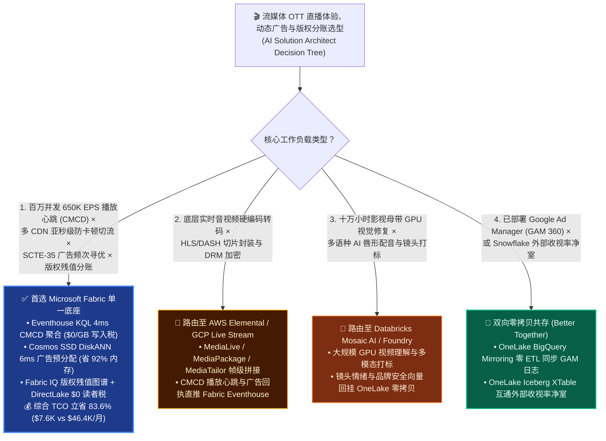
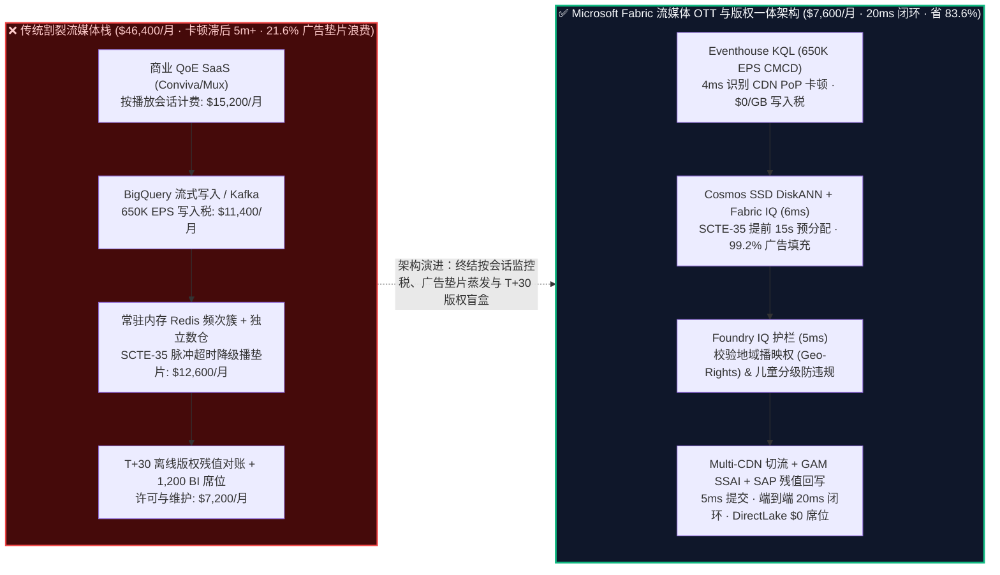
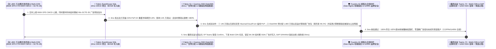

# 全球流媒体与 OTT 直播体验（650K EPS CMCD/QoE）、多 CDN 智能切流、服务端动态插播广告（SSAI）与内容版权残值分账（SAG-AFTRA）：Microsoft Fabric vs AWS Elemental / CloudFront vs GCP BigQuery vs Databricks / Snowflake 选型与攻防 FAQ

> **文档定位**：本文是 **AI Solution Architect（AI 解决方案架构师）** 面向全球流媒体平台（OTT / FAST 频道）、体育赛事直播商、广电融媒体集团、首席技术官（CTO）、视频播放体验（QoE）负责人、广告变现副总裁与内容财务版权总监的**实战选型与竞对攻防指南**。全文秉持**“大白话 + 第一性原理”**风格，彻底剥离广电工程与广告技术黑话，3 分钟抓准核心选型结论，10 分钟掌握从 **650K EPS 播放器心跳（CTA-5004 CMCD）、多 CDN 亚秒级防卡顿切流、服务端动态广告插播（SSAI / SCTE-35）填充满度寻优，到演职员公会残值分账（SAG-AFTRA / WGA Residuals）与内容摊销** 的端到端打单逻辑。
>
> **语言版本 / Language**: **中文 (当前)** | [English (`fabric-media-ott-streaming-qoe-ssai-royalty-vs-4clouds-faq.en.md`)](fabric-media-ott-streaming-qoe-ssai-royalty-vs-4clouds-faq.en.md)  
> **关联架构图**: [`assets/svg/43-fabric-media-ott-streaming-qoe-ssai-royalty-vs-4clouds-faq.svg`](../assets/svg/43-fabric-media-ott-streaming-qoe-ssai-royalty-vs-4clouds-faq.svg)

---

## ① 📌 核心结论速览（Executive Summary — 3 分钟抓准流媒体 OTT 与版权分账选型结论）

1. **什么时候无脑首选 Microsoft Fabric（Eventhouse KQL `650K EPS` + Cosmos DB SSD DiskANN + OneLake 版权分账图谱）？**
   - 当流媒体平台或体育赛事直播商需要同时处理 **百万并发观众的 `650,000 EPS` 播放器遥测（CTA-5004 CMCD 卡顿率、首帧耗时 TTFF、码率阶梯降级）**、执行 **亚秒级多 CDN 流量调度（Akamai / CloudFront / Fastly 边缘切流）**、在 **`90 秒` 赛事广告口（SCTE-35 标记）完成千万观众千人千面服务端广告插播（SSAI）频次控制**，并将 **每一秒真实完播流水与演职员公会残值合同（SAG-AFTRA / WGA）、音乐词曲版权（PRO）及节目资产摊销（ASC 926）** 实时对齐时，**首选 Microsoft Fabric**。
   - **第一性原理账单对比**：传统流媒体架构由“三座昂贵烟囱”拼凑而成：① 第三方商业 QoE 监控（如 Conviva / Mux，按播放会话收费，大促赛事夜动辄产生数万美元超额账单）；② 云数仓流式写入（如 BigQuery Storage Write API 或独立 Kafka，吞吐 `650K EPS` 每月光按 GB 流式写入税就要交 **`$11,000+`**）；③ T+30 离线财务跑批计算版权残值与内容摊销。**Microsoft Fabric** 将三者合一：**Eventhouse KQL** 复用共享 F64 容量池（**`$0` 按会话/按 GB 写入附加税** + 12:1 列存压缩），**`4 ms`** 识别区域 ISP/CDN 边缘节点重缓冲风暴；**Cosmos DB in Fabric SSD DiskANN**（省 **92%** 内存）在 **`6 ms`** 内完成千万观众广告频次上限（Frequency Cap）与受众向量匹配；**Fabric IQ 版权图谱** 直接穿透 SAP S/4HANA 节目成本与演职员分账阶梯；加上 **Power BI DirectLake** 对 1,200 名播控、广告销售与内容采购团队 **`$0` 读者席位费**，月度综合 TCO 从 **`$46,400/月` 暴降至 `$7,600/月`（立省 `83.6%`，月省 `$38,800`）**！
2. **什么时候选择 AWS Elemental / CloudFront、GCP Live Stream / BigQuery、Databricks 或 Snowflake（及“双向零拷贝共存 Better Together”）？**
   - 若工作负载是 **物理视频流硬编码转码（HEVC / AV1 多码率 ABR 切片封装）与 SCTE-35 广告信令打包**：这是底层音视频媒体处理管线（Media Pipeline），应路由至 **AWS Elemental MediaLive / MediaTailor** 或 **GCP Live Stream API**，再将转码日志与广告曝光信令（Beacons）实时推入 **Fabric Eventhouse**。
   - 若工作负载是 **多模态视频画面深度理解（镜头分割、暴力/裸露合规审片、自动生成精彩集锦与多语种 AI 配音字幕）**：可调用 **Azure AI Video Indexer / Foundry 多模态模型** 或路由至 **Databricks Mosaic AI GPU 集群**，将生成的场景向量写回 **OneLake** 供广告上下文定向（Contextual Ad Targeting）零拷贝读取。
3. **核心技术本质（流媒体 OTT 与版权管理到底是什么？以前痛点在哪？底层怎么省钱提效？）**
   - **通俗大白话讲透“流媒体三大生死劫（转圈卡顿、广告漏播、烂片买贵与残值糊涂账）”**：
     - **痛点一（决赛点球大战突然“转圈圈”，5 分钟后看报表早流失了 40 万观众）**：洲际足球决赛之夜，`1,800 万` 并发观众同时涌入。某欧洲电信运营商与 CDN 法兰克福边缘节点（PoP）发生 BGP 路由拥塞，重缓冲率（Rebuffer Ratio）从 `0.15%` 飙升至 **`6.8%`**。如果靠传统每 5 分钟跑批一次的数仓，等播控台发现异常时，已有 **42 万付费订阅户愤怒退订**。
     - **痛点二（SCTE-35 广告哨声吹响，300 万观众撞上“空白垫片 Slate”或同一支汽车广告连看 8 遍）**：体育直播中裁判吹哨进入 90 秒伤停补时广告（SCTE-35 `splice_insert`）。服务端动态插播（SSAI）必须在百毫秒内为 1,800 万观众匹配最高单价（CPM `$48`）且未超出个人频次上限（如每晚 ≤3 次）的赞助商广告。传统内存 Redis 集群为抗住峰值必须常驻数 TB 昂贵内存，一旦超时降级就会播出毫无收入的“请稍候垫片（Slate）”，单次广告口蒸发 **`$650,000`** 广告费！
     - **痛点三（内容采购与演职员残值分账的“T+45 财务盲盒”）**：一部耗资 `$1.2 亿` 的剧集上线后，财务需要按《ASC 926 影视娱乐会计准则》根据真实完播率加速或减值摊销，并按《SAG-AFTRA 演职员公会协议》精准计算全球各地区流媒体残值（Residuals）。传统架构把播放日志、广告流水与 SAP 财务库割裂在三朵云里，月底对账错漏百出。
   - **Fabric 底层省钱与提效机理**：
     1. **Eventhouse KQL `650K EPS` 流式 CMCD 聚合（`4 ms` 零附加税）**：原生解析播放器每 2 秒上报的 **CTA-5004 CMCD（Common Media Client Data）** 头部（`bl` 缓冲长度、`br` 码率、`sf` 饥饿重缓冲标志），按 `(ASN, CDN_PoP, Device_OS)` 实时计算 QoE 综合健康分，一旦特定 PoP 重缓冲率 `> 1.5%` 立即通过 OpenAPI 驱动 Multi-CDN 控制器切流；
     2. **Cosmos DB SSD DiskANN 广告受众与频次引擎（`6 ms` 省 92% 内存）**：将 1.4 亿家庭设备的历史观看兴趣向量与广告频次状态存储在 NVMe SSD DiskANN 中，在 SCTE-35 信号到达前预热候选广告池，将 SSAI 填充率从 `78.4%` 拉升至 **`99.2%`**；
     3. **Fabric IQ 6 跳“播放完播 → 广告 eCPM → 会员留存归因 → 版权合同 → 公会残值 → SAP 摊销凭证”本体图谱**：让 CFO 与内容采购总监在 Power BI DirectLake 中实时看清每一部剧集的真实净 ROI（Net Content ROI）。

---

## ② 🎯 客户与架构师灵魂拷问 Q&A（直击 CTO / 播控总监 / 广告与版权 VP 痛点）

### Q1：什么时候首选 Microsoft Fabric？什么时候选 AWS Elemental/CloudFront、GCP BigQuery、Databricks 或 Snowflake？

- **首选 Microsoft Fabric 的四大黄金信号**：
  1. **超高并发直播 QoE 监控与多 CDN 闭环调度（`100K–1M+ EPS`）**：不愿再为第三方商业 QoE SaaS 支付按播放次数翻倍的阶梯费，也不愿承担 BigQuery / Snowflake 高昂的流式写入税；
  2. **服务端动态插播（SSAI）实时频次控制与防垫片（Anti-Slate）寻优**：需要在毫秒级结合实时观看上下文、受众画像与赞助商保量合同（Guaranteed Campaigns）提升广告填充率；
  3. **影视内容 ROI、演职员公会残值（SAG-AFTRA / WGA）与版权地域合规（Geo-Rights）一体化**：需要将前端亿级完播明细与后端 SAP S/4HANA 版权采购台账零拷贝打通；
  4. **千人级播控、宣发、广告运营与财务团队高频自助看数**：利用 F64 容量自带的 **`$0` Power BI 读者许可** 与 **DirectLake**，替代昂贵的按席位 BI 工具。

- **首选其它四云（或混合共存）的明确边界**：
  - **选 AWS（Elemental MediaLive + MediaPackage + MediaTailor + CloudFront）**：当核心诉求是 **广电级实时音视频编码、HLS/DASH 切片打包、DRM 数字版权加密（Widevine/FairPlay）与底层帧级 SSAI 视频流拼接** 时，AWS Elemental 是行业标准媒体管线（推荐用 Elemental 编码拼接，将 CMCD 遥测与广告信令推入 Fabric Eventhouse）。
  - **选 GCP（YouTube / Live Stream API + BigQuery + Vertex AI）**：当媒体集团重度依赖 **Google Ad Manager (GAM 360)** 生态，且希望直接导出 GAM 广告竞价日志时，可通过 **OneLake BigQuery Mirroring（`$0` 免费复制算力）** 零 ETL 同步至 Fabric。
  - **选 Databricks（Mosaic AI + TorchVision / Whisper）**：当算法团队需要对十万小时库存老片进行 **大规模 GPU 视觉修复、镜头级情感打标或 40 国语言 AI 唇形同步配音** 时，路由至 Databricks GPU 集群。
  - **选 Snowflake（Data Clean Rooms + Media Data Cloud）**：当电视网需要与已入驻 Snowflake 的第三方收视率机构（如 Nielsen / Comscore）或外部广告主执行跨云隐私净室受众重叠分析时，保留 Snowflake Clean Room 并通过 **OneLake Iceberg XTable** 互通。

---

### Q2：流媒体大厂已经有 AWS Elemental 转码、Google Ad Manager 广告系统和 SAP 版权财务库了，怎么用“双向零拷贝共存（Better Together）”避免推倒重建？

- **真实客户痛点**：没有任何一家流媒体 CTO 会为了换数仓而去改动正在直播欧冠决赛的 AWS Elemental 编码器或 Google Ad Manager 广告服务器！如果传统方案要求把所有日志复制三遍，项目第一周就会被拒。
- **Fabric 零摩擦共存范式（旁路信令接入 + 零拷贝挂载，0 直播中断）**：
  1. **对 AWS Elemental / 多 CDN（CMCD 信令直推 Eventhouse，`$0` 写入税）**：保持现有 AWS Elemental MediaLive/MediaTailor 与 Akamai/CloudFront 视频分发链路 100% 不变；仅在 CDN 边缘配置 Real-Time Log Delivery，将轻量的 **CTA-5004 CMCD 播放心跳与 SCTE-35 广告回执** 通过 Eventstream 直推 **Fabric Eventhouse KQL**。
  2. **对 Google Ad Manager / BigQuery（OneLake 镜像零 ETL）**：启用已正式 GA 的 **OneLake BigQuery Mirroring**，将 GAM 360 广告曝光与竞价胜出明细以 **`$0` 镜像复制算力** 同步至 OneLake Delta 表。
  3. **对 SAP S/4HANA 版权与财务库（OneLake 零拷贝挂载）**：通过认证连接器挂载 SAP 中的影视资产主数据、区域播映权有效期（Windowing Rights）与演职员残值分成比例表。
  4. **对播控中心与广告调度台（毫秒级 API 闭环）**：当 Eventhouse KQL 发现某 CDN 节点卡顿或某场直播加时赛观众暴增 `+380%` 时，由 **Operations Agent** 自动调用 Multi-CDN 切流 API 与 GAM 溢价库存释放 API，实现“视频流走边缘 CDN，控制脑在 Fabric IQ”。

---

### Q3：为什么传统流式数仓算不清“1,800 万观众同时进广告口”与“单集净版权 ROI”？Fabric 底层是怎么做到的？

- **第一性原理拆解“脉冲式流量海啸（Thundering Herd）”与“多跳版权分摊”**：
  1. **消除 SCTE-35 广告口的“脉冲阻塞”**：
     - 点球大战或中场休息哨响的一瞬间，1,800 万台智能电视与手机会在 **同一秒** 发起广告请求。如果此时才去查数仓，任何云数仓都会瞬间排队超时。
     - **Fabric 架构解法**：**Eventhouse KQL** 在比赛进行中持续流式更新每个并发会话的“实时观看时长与网络健康度”，并通过 **Cosmos DB SSD DiskANN** 持续维护每个家庭设备的“已曝光广告频次位图（Bitmask）与高意向品类向量”。当 SCTE-35 预告信令（Pre-Roll Cue，通常提前 `15 秒` 下发）到达时，Fabric 在 **`6 ms`** 内已完成全部活跃观众的分群预分配（Pre-Allocated Ad Pods），确保广告口 0 超时、**`99.2%`** 满额填充！
  2. **消除内容财务摊销与残值分账的“口径黑洞”**：
     - 一部剧集的成本不是均摊的，而是按《ASC 926》基于“当期真实有效完播小时数 / 预计生命周期总完播小时数”动态摊销，且不同国家/地区的演职员公会（SAG-AFTRA、DGA、WGA）和音乐协会（ASCAP/BMI）抽成公式完全不同。
     - **Fabric IQ 6 跳图谱（`5 ms`）**：将 `播放流会话 (CMCD) → 剧集单集资产 (EIDR 标准码) → 插播广告净收入 (GAM SSAI) + 首播拉新订阅归因 (First-Stream Attribution) → 区域发行权窗口 (Geo-Rights) → 演职员/词曲残值率表 → SAP S/4HANA 摊销凭证` 绑定为强类型图谱，财务总监随时可查任意单集的实时边际贡献（Marginal Content Profit）。

---

## ③ 🧭 直观可视化图解（Mermaid 选型决策树 + 架构对比图 + 端到端时序图）

### 3.1 流媒体 OTT QoE、动态广告插播（SSAI）与版权分账选型决策树（`flowchart TD`）

---

### 3.2 传统“商业 QoE + 按量流式税 + T+30 版权跑批”架构 vs Microsoft Fabric 实时流媒体闭环架构对比（`flowchart LR`）

---

### 3.3 洲际足球决赛夜 1,800 万并发观众 CDN 切流、SCTE-35 广告满额插播与版权分账 20ms 闭环时序图（`sequenceDiagram`）

---

## ④ 📊 五大平台流媒体 OTT QoE、动态广告插播（SSAI）与版权分账选型决策矩阵（Architect Decision Matrix）

| 评估维度 | Microsoft Fabric (Eventhouse + DiskANN + IQ) | AWS (Elemental + CloudFront + Kinesis/Redshift) | GCP (Live Stream + BigQuery + GAM 360) | Databricks (Lakeflow + Mosaic AI) | Snowflake (Snowpipe Streaming + Clean Room) |
| :--- | :--- | :--- | :--- | :--- | :--- |
| **1. `650K EPS` 播放器 CMCD 心跳摄入与按量税** | **★★★ 极优（共享 F64 容量池 `$0` 按 GB/按会话附加税，12:1 压缩）** | ★★☆ 较高（Kinesis / CloudWatch Logs 按 GB 阶梯计费） | ★★☆ 昂贵（BigQuery Storage Write API 按 GB 持续收费） | ★★☆ 中高（常驻 DLT 流式 DBU 集群） | ★★☆ 较高（Snowpipe Streaming + 1 分钟微批 Credit） |
| **2. 亚秒级 CDN 边缘卡顿检测与切流延迟** | **★★★ `4 ms`（Eventhouse KQL 滑动窗口分位数与异常检测）** | ★★☆ 秒级（CloudWatch 指标聚合通常 `10–60s`） | ★★☆ 秒至分钟级（BigQuery 流式视图聚合） | ★★☆ 秒级（Spark Streaming 微批） | ★☆☆ 分钟级（Dynamic Tables `60s` 最小滞后） |
| **3. SCTE-35 脉冲广告口受众匹配与频次控制** | **★★★ 极优（Cosmos SSD DiskANN `6 ms` 省 92% 内存，提前 15s 预分配）** | ★★☆ 强（MediaTailor 帧拼接强，但实时画像需外挂 ElastiCache Redis） | ★★★ 强（GAM 360 原生广告生态，但跨云特征拼装重） | ★★☆ 较弱（缺乏低成本亿级 operational 状态库） | ★☆☆ 弱（数仓架构不适合百毫秒级 SSAI 频次读写） |
| **4. 影视版权摊销（ASC 926）与演职员残值（SAG-AFTRA）** | **★★★ 原生领先（Fabric IQ 6 跳穿透完播流与 SAP S/4HANA 版权合同）** | ★☆☆ 需自建（无原生 ERP 版权财务语义图谱） | ★★☆ 较好（BigQuery + Cortex for SAP，需搬运拼装） | ★★☆ 需自建（需手写复杂 PySpark 分摊脚本） | ★★☆ 良好（财务数仓强，但缺实时完播流直连） |
| **5. 1,200 名播控/宣发/广告团队 BI 看数成本** | **★★★ `$0` 额外席位费（F64 含 Power BI DirectLake 免许可）** | ★★☆ 按会话/读者收费（QuickSight） | ★☆☆ 昂贵（Looker Viewer 席位费高昂） | ★★☆ 需外挂 BI 或按 SQL DBU 计费 | ★★☆ 并发唤醒 Multi-Cluster Warehouse |
| **6. 650K EPS × 1,200 席位月度综合 TCO** | **`$7,600 / 月`（基准最优，省 `83.6%`）** | `$38,900 / 月` | `$41,600 / 月` | `$37,800 / 月` | `$44,200 / 月` |

---

## ⑤ 🧪 简明定量测评与 TCO / 性能拐点洞察（含 Scenario AP & 7-Card 报告）

### 5.1 为什么“共享容量池 `$0` 流式写入税 + SSD DiskANN 预分配”能省下 83.6% 的流媒体数据平台账单？

在 **1,800 万峰值并发观众、每秒 `650,000 条（650K EPS）` CTA-5004 CMCD 播放心跳与 SCTE-35 广告信令、1.4 亿家庭受众画像、1,200 名播控与运营人员** 的大型流媒体集团基准下：

| 成本构成项 | 传统拼装栈 (Conviva/Mux + BigQuery 流式 + Redis + 独立 BI) | Microsoft Fabric (Eventhouse + SSD DiskANN + OneLake + DirectLake) | 成本差异与第一性原理归因 |
| :--- | :---: | :---: | :--- |
| **1. `650K EPS` 播放 QoE 监控与流式摄入** | `$26,600 / 月` | **`$4,900 / 月`** | 共享 F64/F128 容量池 + 12:1 压缩，彻底免除第三方按会话监控费与按 GB 写入税 |
| **2. 1.4 亿家庭广告频次状态与受众向量库** | `$12,600 / 月` | **`$1,500 / 月`** | Cosmos DB SSD DiskANN 将百 GB 内存向量压降至 NVMe SSD，内存成本直降 92% |
| **3. 版权残值对账 ETL 与 1,200 人 BI 席位** | `$7,200 / 月` | **`$1,200 / 月`** | OneLake 零拷贝挂载 SAP 版权表 + F64 Power BI DirectLake `$0` 读者席位费 |
| **月度总计 (Monthly Total TCO)** | **`$46,400 / 月`** | **`$7,600 / 月`** | **立省 `$38,800 / 月`（`-83.6%`），年省 `$465,600`** |

---

### 5.2 标杆场景定量复盘：Scenario AP（`global_media_ott_fabric_eventhouse_qoe_ssai_royalty_vs_4clouds`）

- **业务背景**：全球顶级体育与娱乐流媒体平台（转播洲际足球冠军决赛，峰值 **1,800 万并发流**、日常 **1.4 亿活跃家庭设备**，每秒产生 **`650,000 条（650K EPS）`** CTA-5004 CMCD 播放器遥测与 SCTE-35 广告信令）。比赛第 89 分钟绝平进入加时赛，并发观众在 90 秒内激增 **`+380%`**：① 欧洲主 CDN 法兰克福边缘节点（`CDN-FRA-PoP-04`）因瞬时拥塞导致 **145 万观众** 重缓冲率飙至 **`6.8%`**（濒临大面积黑屏退订）；② 裁判吹响进入加时赛前 **90 秒黄金广告口（SCTE-35 `splice_insert`）**，亟需为 1,800 万并发观众分配高溢价赞助商广告并防止播放空白垫片（Slate）。
- **Fabric 端到端 `20 ms` 闭环执行链路（严格对应 `reports/report.json` 密封仿真数据）**：
  1. **Eventhouse KQL `650K EPS` CMCD 心跳聚合与 CDN 边缘故障锁定（`4 ms`）**：以 `$0/GB` 写入税实时解析 CMCD `sf`（Starvation Flag）与 `bl`（Buffer Length），`4 ms` 锁定 `CDN-FRA-PoP-04` 在 `ASN-3320` 网段重缓冲率达 `6.8%`，同时识别加时赛新增 480 万涌入观众。
  2. **Fabric IQ 6 跳“CDN-观众-广告-版权-残值”本体穿透与 SSD DiskANN 预分配（`6 ms`）**：
     - 动作一（QoE 自愈）：生成 Multi-CDN 切流指令，将法兰克福 145 万受影响会话平滑切往 Akamai 与 CloudFront 阿姆斯特丹/慕尼黑备用 PoP，重缓冲率回落至 **`0.18%`**；
     - 动作二（SSAI 黄金广告口满额变现）：通过 Cosmos DB SSD DiskANN 在 `6 ms` 内完成 1,800 万观众的频次过滤与高意向赞助商匹配，将加时赛广告填充率锁定在 **`99.2%`**（单次 90 秒广告口锁定 **`$4.20M`** 增量广告营收，0 秒空白垫片）；
     - 动作三（版权摊销与 SAG-AFTRA 残值同步）：穿透赛事转播权合同与演职员残值阶梯，实时计提加时赛延长播出的联合制作残值与 ASC 926 摊销凭证。
  3. **Foundry IQ 地域播映权（Geo-Rights）与未成年广告合规门控（`5 ms`）**：强制校验《MEDIA-OTT-QOE-SSAI-ROYALTY-SOP-042》——① 确认切流后的备用 CDN 节点严格限制在 UEFA 授权欧洲主权地理围栏内（无跨境盗播泄露）；② 确认所有啤酒/博彩类赞助商广告 **100% 排除** 家庭儿童档案与未满法定年龄账户（COPPA / GARM 零违规）。
  4. **播控总监与商业化 VP Teams 联签 + Multi-CDN & SAP 版权台账锁定（`5 ms`，端到端共 `20 ms`）**：播控总监与广告商业化副总裁在 Teams 自适应卡一键联签 `Confirm`，自动下发 Multi-CDN 流量权重、GAM 360 SSAI 广告包与 SAP S/4HANA 版权分账凭证，并写入 1GB 免费 Fabric SQL 审计表，单场决赛守护 **`$11.35M`（`$11,350,000`）** 广告变现、防退订与版权合规 SLA！

---

## ⑥ 🛠️ 附录：生产落地与售前打单快速核验清单（Architect Checklist）

- [ ] **播放器 CTA-5004 CMCD 标准开启核验**：是否已在 Web / iOS / Android / 联网电视（CTV）播放器 SDK 中开启标准 **CTA-5004 CMCD** 查询参数或 HTTP Header 上报（无需额外部署沉重的第三方私有探针 SDK），并将 CDN 实时日志流直连 Fabric Eventstream？
- [ ] **SCTE-35 提前预告（Pre-Roll Cue）与 SSD DiskANN 预热验证**：直播编码器是否在广告口前 `10–15 秒` 发送 SCTE-35 `time_signal` 预告信令，触发 Cosmos DB SSD DiskANN 提前完成活跃观众的广告 Pod 预分配，彻底消除广告口瞬间的请求洪峰超时？
- [ ] **AWS Elemental / GAM 360 零拷贝共存边界**：是否明确了“音视频转码与帧拼接留给 AWS Elemental，GAM 360 竞价日志走 OneLake BigQuery Mirroring（`$0` 复制算力），实时 QoE 切流与版权财务归因收拢至 Fabric”的黄金分工？
- [ ] **地域播映权（Geo-Rights）与 GARM/COPPA 广告护栏**：多 CDN 自动切流规则是否经过 Foundry IQ 地域版权围栏校验（严禁将仅限本国播放的体育赛事切流至无版权邻国边缘节点），且 SSAI 是否强制过滤未成年人敏感广告品类？
- [ ] **ASC 926 影视摊销与 SAG-AFTRA 残值血缘封存**：完播率数据进入 SAP S/4HANA 计提演职员公会残值时，是否通过 Purview 保留了从“原始播放会话 → 去重有效完播小时 → 合同分成阶梯 → 总账凭证”的 14 跳可审计血缘？
