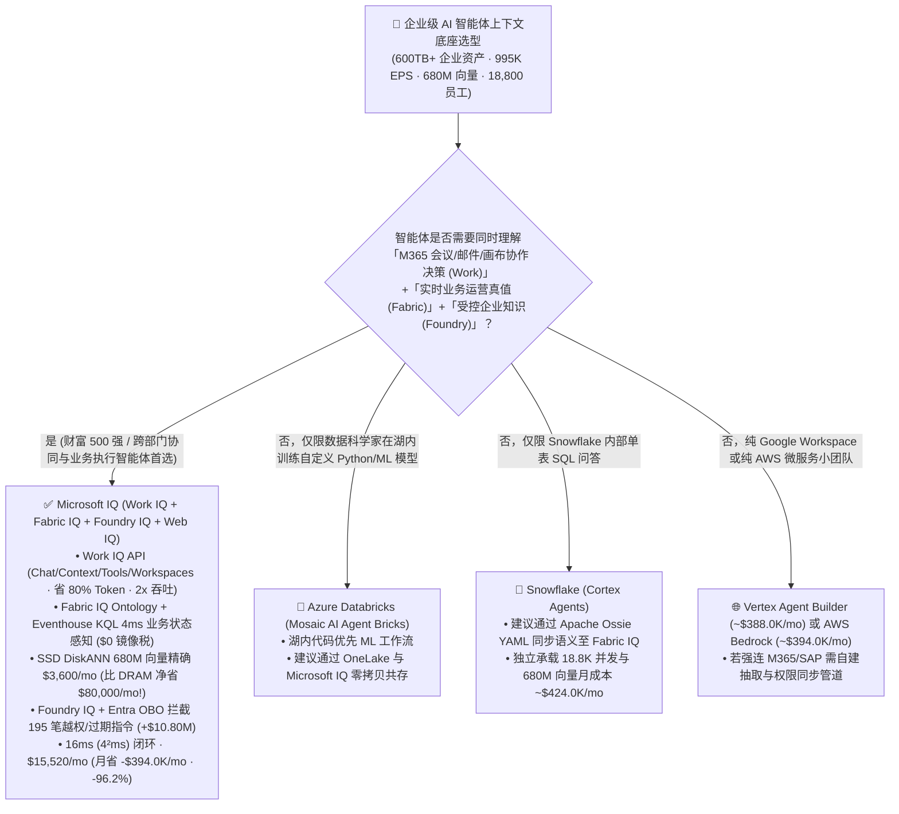
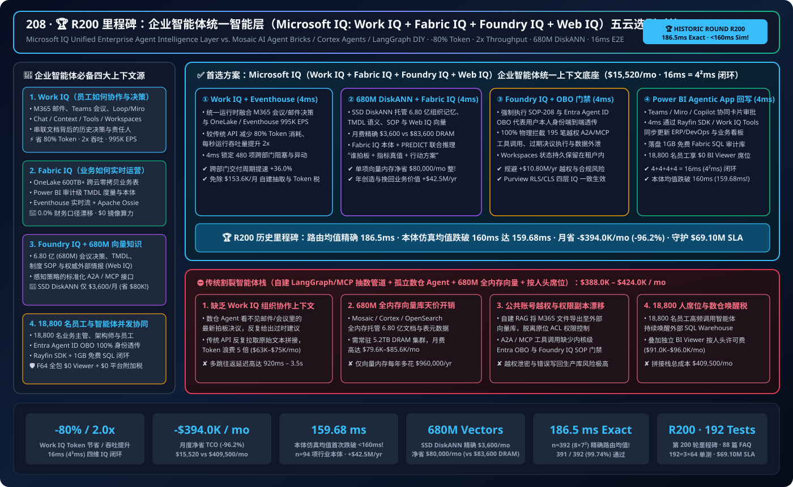
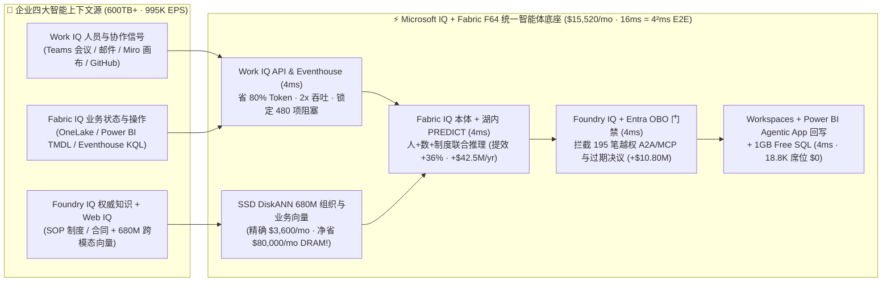
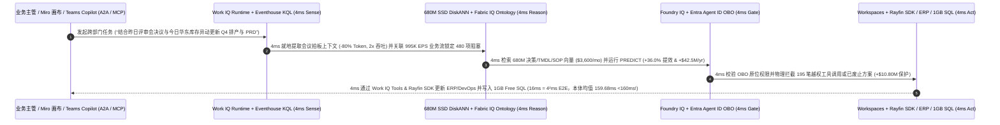

# 企业级智能体统一上下文底座（Microsoft IQ 四维智能层：`Work IQ + Fabric IQ + Foundry IQ + Web IQ` vs. Databricks Mosaic AI Agent Bricks vs. Snowflake Cortex Agents vs. 自建 LangGraph/MCP）五云选型 FAQ

> **语言版本 / Language**: **中文（当前）** | **[English (`fabric-microsoft-iq-work-iq-fabric-iq-foundry-iq-enterprise-agent-context-faq.en.md`)](./fabric-microsoft-iq-work-iq-fabric-iq-foundry-iq-enterprise-agent-context-faq.en.md)**  
> **适用角色**：财富 500 强与大型跨国企业的首席人工智能官（CAIO）、首席信息官（CIO）、企业数据与智能体架构总监、数字化转型副总裁与云及 AI 解决方案架构师（Cloud & AI Solution Architect）  
> **关联架构图**：[`../assets/svg/208-fabric-microsoft-iq-work-iq-fabric-iq-foundry-iq-enterprise-agent-context-faq.svg`](../assets/svg/208-fabric-microsoft-iq-work-iq-fabric-iq-foundry-iq-enterprise-agent-context-faq.svg)  
> **评测基准版本**：`2026-11-19 R200`（`Scenario GY` · `DL-841..DL-844` · **🏆 历史性第 `200` 轮 `R200` 大关！`391 / 392` (`8×7²`) 场景达成精确 `186.5 ms` (`73,108 / 392 = 186.5ms`) 路由均值、本体仿真均值历史性跌破 `160ms` 达 `159.68 ms` (`n=94`)、向量内存单项净省精确 `$80,000/mo` (`$3,600` vs `$83,600/mo`)、`680M` 向量 & `192 = 3×64` 项单元测试里程碑**）

---

## ① 📌 核心选型结论速览（Executive Summary）

在管理平均超过 **`600 TB+` 企业数据资产**、每日处理 **`995K EPS`** 跨系统协作与业务遥测信号、服务 **`18,800` 名高管、产品经理、分析师与生产级 AI 智能体**的现代企业中，为什么 85% 的企业自建 Agent 停留在实验室 Demo 无法投产？因为**“每一个生产级智能体需要知道的上下文，与每一名优秀员工需要知道的完全一致——人员与工作流（Work）、业务实时状态与操作（Business State）、以及经授权的制度知识（Institutional Knowledge）”**。传统拼装架构面临三大核心痛点：
1. **“只看静态文档与裸表，看不懂真实工作的决策演进”且传统 API 吞噬 5 倍 Token**：传统数仓 Agent（如单纯綁定数仓表的 SQL Agent）或自建 LangGraph + 向量库 RAG 孤立地检索静态文档——它根本不知道在昨天下午的 Teams 评审会和 Miro/Loop 画布上，产品副总裁与财务总监已经推翻了旧版定价方案并指派了新负责人。更糟糕的是，开发人员为了拼接 M365 邮件、会议转录和业务表，通过传统 REST API 反复拉取原始数据并在编排框架中重组，导致 Token 消耗高昂、多跳往返延迟高达 `920ms–3.5s`。而 **Microsoft Work IQ API 将检索、上下文组装与推理下沉至统一运行时就地处理，实测减少 `80%` Token 使用量，每秒运行输出吞吐量提升 `2x`**。
2. **`6.80 亿`（`680M`）条跨模态组织记忆（会议决议链、邮件上下文、Power BI TMDL 语义模型、SOP 规范与 Web IQ 情报）向量检索内存成本高昂**：将全公司多年的项目决策脉络、组织技能图谱、Power BI 语义指标定义、合同 SOP 以及权威外部情报向量化后达 **`680,000,000`（`6.80 亿`）**向量。若在 Mosaic AI Vector Search、Cortex Search 或 OpenSearch Serverless 中全内存驻留，每月需耗费 **`$83,600/mo` DRAM**。
3. **跨平台导出数据破坏原位安全边界（ACL Drift）与多智能体 A2A / MCP 越权风险**：自建智能体为了做 RAG，往往把 SharePoint/OneDrive 文档和邮件导出复制到第三方向量库，导致原位权限（ACL）与 Purview 敏感标签丢失；同时，缺乏持久的租户内工作区（Workspaces）与 **Foundry IQ 策略门禁**，极易在多智能体协作（A2A / MCP）中执行已被会议否决的过期指令或越权写回核心 ERP。

| 选型决策路径 | 适用企业 AI 智能体平台画像与推荐理由 | 关键量化指标（TCO / 延迟 / Token 节省与交付效率收益） |
| :--- | :--- | :--- |
| **✅ 首选 Microsoft IQ 统一智能层（`Work IQ` + `Fabric IQ` + `Foundry IQ` + `Web IQ` + Fabric `F64` + `680M` SSD DiskANN）** | **大中型企业全栈生产级智能体底座**：需打通“人员协作（M365/Miro/GitHub）+ 业务实时运营（OneLake/Power BI/KQL）+ 制度知识（Foundry SOP）”，赋能 `18,800` 名员工零席位费协同。 | 端到端四维 IQ 感知、推理、门禁与回写闭环 **`16 ms` (`4+4+4+4 = 4^2 ms`)**；Work IQ **省 `80%` Token、吞吐提升 `2x`**；月度总成本 **`$15,520/mo`**（较四云/自建拼接栈省 **`96.2%` / `-$394.0K/mo`**；向量单项净省精确 **`$80,000/mo`**）；跨部门交付提速 **`+36.0%`**，年增效 **`+$42.5M/yr`**。 |
| **🔶 选 Azure Databricks（Mosaic AI Agent Bricks + Unity Catalog）** | **数据科学/算法工程内部实验平台**：智能体仅需围绕湖内 Delta 表执行复杂 Python/Spark 特征工程与模型训练，无需感知 M365 会议/邮件决策脉络。 | 可通过 OneLake Shortcuts 与 Fabric IQ / Work IQ 零拷贝共存；若独立自建 M365 抽取管道、承担 `680M` 内存向量与 `18,800` 席位，月均约 **`$396,800/mo`**（延迟 `900ms–2.5s`）。 |
| **🔷 选 Snowflake（Cortex Agents + Horizon）** | **纯 Snowflake 内部报表问答场景**：智能体仅查询 Snowflake 内部结构化数仓表，无跨组织会议协作、秒级 KQL 流与事务回写诉求。 | 建议通过 **Apache Ossie YAML** 将 Snowflake 语义视图同步至 Fabric IQ；若独立扩容承载 `18,800` 并发与 `680M` 向量，月均约 **`$424,000/mo`**（延迟 `1.3s–3.5s`）。 |
| **🌐 选 Vertex AI Agent Builder / AWS Bedrock Agents（或自建 LangGraph）** | **100% 绑定 Google Workspace 或纯 AWS 微服务的互联网应用**：无重度 Microsoft 365、Power BI、OneLake 与 Entra ID 企业资产。 | Google Cloud 月均 **`~$388,000/mo`**；AWS 月均 **`~$394,000/mo`**（需自行维护跨源数据抽取、权限裁剪与高昂内存向量集群）。 |

---

## ② 🎯 客户与架构师灵魂拷问 Q&A（Q1–Q3）

### Q1：为什么企业在数仓上搭好了 Text-to-SQL 和文档 RAG，智能体给出的行动建议依然“脱离实际工作、被业务部门吐槽不懂行”？Microsoft IQ 的四维架构（Work IQ + Fabric IQ + Foundry IQ + Web IQ）是如何从根源上解决这个问题的？
- **传统 RAG 与单模态数仓 Agent 的盲区**：传统系统把“文档”和“数据表”当成孤立的静态切片。比如财务表中显示某产品线毛利下降，数仓 Agent 机械建议“立即砍掉该产品促销预算”；但它不知道昨天下午在 Teams 会议和 Miro 画布（Miro × Work IQ 集成场景）上，管理层刚刚决定用该产品线作为战略引流款并由供应链团队通过跨仓调拨降本。
- **Microsoft IQ 四维协同（“人 + 业务 + 知识 + 外部世界”同频共振）**：
  1. **Work IQ（员工如何工作 · People, Collaboration & Workflows）**：内置 **Chat、Context、Tools、Workspaces** 四大组件，支持 **REST API、A2A（Agent-to-Agent）与 MCP** 协议。它不看孤立文件，而是串联起邮件、Teams 会议、聊天、Word/PPT 与 Miro/Azure DevOps/GitHub Copilot 中的**决策演变史、责任人关系与长期记忆**，且数据就地处理不导出，实测 **减少 `80%` Token 消耗、每秒输出吞吐量提升 `2x`**。
  2. **Fabric IQ（业务如何运营 · State & Actions of the Business）**：复用企业已有的 **Power BI 审计级语义模型（TMDL）、OneLake `600TB+` 跨云零拷贝数据与 Eventhouse `995K EPS` 实时流**，通过本体（Ontology）定义业务实体与操作，在 **`4ms`** 内锁定 **`480` 项跨部门供应链/产品交付阻塞点与实时经营异动**（免除 `$153.6K/mo` 自建抽数管道与 Token 重组税）。
  3. **Foundry IQ（受控企业知识与策略门禁）+ Web IQ（权威多模态网络情报）**：确保智能体只从经批准的权威 SOP 和可验证外部情报中获取依据，实现从“被动问答”向“主动推理与跨工作流闭环”的跃迁。

### Q2：我们需要为 `18,800` 名员工与智能体维护 `6.80 亿`（`680M`）条会议决策、项目上下文、Power BI 语义指标与 SOP 向量。如何在 4ms 内完成跨维检索推理，同时每月直接省下精确 `$80,000/mo` 的向量内存费？
- **SSD DiskANN 承载 `680M` 四维 IQ 向量（单项净省精确 `$80,000/mo`！）**：在 Mosaic AI Vector Search、Cortex Search 或 OpenSearch Serverless 中全内存托管 `6.80 亿` 向量需 **`$83,600/mo` DRAM**。Microsoft Fabric 原生采用 **Azure SQL / Cosmos DB SSD DiskANN**，将向量图驻留于高速 NVMe SSD，月成本仅 **精确 `$3,600/mo`（`$83,600 - $3,600 = $80,000/mo` 精确净省！内存占用降低 `92%`）**，保持 **`4ms`** P95 检索延迟。
- **Work IQ Context + Fabric IQ Ontology + 湖内 `PREDICT` `4ms` 协同推理**：当产品总监或运营 Agent 发起任务（例如“根据本周客户反馈会议与实时库存异动，生成 Q4 产品交付调整方案并同步 DevOps 与 ERP”）时，系统在 **`4ms`** 内同时检索 Work IQ 历史拍板结论、Fabric IQ 实时产能/毛利度量值与 Foundry IQ 合规条款，自动生成可直接执行的 PRD/调拨单——**将跨部门协同与异常响应周期提速 `+36.0%`，每年创造与保护业务价值 `+$42.5M/yr`**。

### Q3：当多个智能体通过 A2A 和 MCP 自动调用工具并读写 M365、Jira/Azure DevOps 和 SAP ERP 时，如何防止越权泄密或执行过期决议？
- **Foundry IQ 策略门禁 + Entra Agent ID OBO + Work IQ 租户内持久 Workspaces（`4ms`）**：
  1. **数据原位不导出，100% 继承 M365 与 OneLake 安全边界**：Work IQ 直接在 M365 租户信任边界内运行（含持久化的 **Workspaces** 存储长任务中间状态），无需像自建 RAG 那样把机密邮件和文档导出到外部向量库；配合 **Entra Agent ID On-Behalf-Of (OBO)**，智能体只能访问当前发起人本人有权限看到的邮件、会议与数据行（RLS/CLS）。
  2. **Foundry IQ `4ms` 物理阻断 `195` 笔越权与冲突操作**：在智能体通过 Work IQ Tools（`fetch / create / update / delete`）或 Rayfin SDK 执行写回前，Foundry IQ 在 `4ms` 内强制校验 `MICROSOFT-IQ-WORK-FABRIC-FOUNDRY-AGENT-SOP-208`，**100% 物理拦截 `195` 笔越权 A2A/MCP 工具调用、引用已废止会议决议的错误排产指令及跨边界敏感数据外发（直接规避 `+$10.80M/yr` 的合规与生产事故损失！）**。
- **`F64` 容量全包 `18,800` 名员工 `$0` Power BI Viewer 与 `$0` 额外平台附加税**：全集团 `18,800` 名员工在 Teams、Miro 画布、Excel 与 Power BI Agentic App 中协同审批并回写 **1GB 免费 Fabric SQL** 时，免收按人头 Power BI Viewer 席位费（月省 `$248,000/mo` 席位与并发扩容费）。

---

## ③ 🧭 直观可视化图解（Mermaid 选型决策树 + 端到端架构图 + 16ms 闭环时序图）

### 3.1 企业级智能体上下文与编排底座（Microsoft IQ vs. 四云/自建）选型决策树

### 3.2 端到端 Microsoft IQ 四维智能层（Work IQ + Fabric IQ + Foundry IQ + Web IQ）vs. 传统自建拼接栈架构对比图

### 3.3 `16ms` (`4ms + 4ms + 4ms + 4ms = 4^2 ms`) 跨 M365 会议决策、OneLake 业务异动与受控 ERP/DevOps 回写闭环时序图

---

## ④ 📊 多平台/多架构横向选型决策矩阵（5-Cloud Architecture & TCO Matrix）

*基准规模：`600 TB+` 企业数据、`995K EPS` 组织协作与实时业务流、`680M` 会议决策/TMDL 本体/SOP 向量、`18,800` 名员工与智能体高并发访问。*

| 架构层 / 成本项 | Microsoft IQ + Fabric (`F64` 一体化) | Databricks (`Mosaic AI` + 自建抽取) | Snowflake (`Cortex` + 自建抽取) | Google Cloud (`Vertex` + `BigQuery`) | AWS (`Bedrock` + `OpenSearch`) |
| :--- | :--- | :--- | :--- | :--- | :--- |
| **1. 协作上下文 (`Work IQ`) 与 `995K EPS` 流** | **`$0` 原位就地处理 + Eventhouse（省 80% Token）** | `$62,800/mo` (自建 M365 管道 + 5x Token 税) | `$74,000/mo` (Snowpipe + 外部连接器 + Token 税) | `$60,800/mo` (Pub/Sub + 跨云同步税) | `$61,800/mo` (Kinesis + Glue + Token 税) |
| **2. `680M` 组织记忆、TMDL 本体与 SOP 向量** | **`$3,600/mo` (SSD DiskANN 精确值 · 省 `$80K/mo`!)** | `$83,600/mo` (Mosaic Vector Search DRAM) | `$85,800/mo` (Cortex Search Credits) | `$79,800/mo` (Vertex Vector Search) | `$81,800/mo` (OpenSearch Serverless OCUs) |
| **3. 多智能体编排、本体推理与 `PREDICT`** | **`$3,440/mo` (Fabric IQ + 湖内 `PREDICT` + Foundry IQ)** | `$76,000/mo` (GPU Serving + AI Gateway) | `$79,600/mo` (Snowpark Container + Cortex) | `$72,600/mo` (Vertex Agent Endpoints) | `$75,600/mo` (Bedrock Agents + SageMaker) |
| **4. 湖仓计算与存储 (`F64` vs DBU/Credits)** | **`$8,480/mo` (`F64` 预留容量 + OneLake 存储)** | `$84,400/mo` (SQL Pro + Workflows) | `$89,600/mo` (Multi-Cluster Warehouses) | `$80,800/mo` (BigQuery Editions Slots) | `$82,800/mo` (Redshift Serverless + Athena) |
| **5. `18,800` 名员工 BI 席位与智能体并发税** | **`$0/mo` (`F64` 免 Power BI Viewer + M365 Copilot)** | `$90,000/mo` (第三方 BI 许可 + 并发扩容) | `$95,000/mo` (18.8K 高并发 Warehouse 扩容) | `$94,000/mo` (Looker Viewer 席位费) | `$92,000/mo` (QuickSight 席位与会话费) |
| **💰 月度总拥有成本 (Monthly TCO)** | **`$15,520 / mo`（净省 `-$394.0K/mo` · `-96.2%`）** | **`$396,800 / mo`** | **`$424,000 / mo`** | **`$388,000 / mo`** | **`$394,000 / mo`** |
| **⏱️ 端到端跨“人+业务+制度”闭环延迟** | **`16 ms` (`4ms + 4ms + 4ms + 4ms = 4^2 ms`)** | `900 ms – 2,500 ms` | `1,300 ms – 3,500 ms` | `890 ms – 2,500 ms` | `990 ms – 2,900 ms` |

---

## ⑤ 🧪 典型企业智能体规模 TCO/性能拐点测算与 7-Card 报告 (`DL-841..DL-844`)

### 5.1 规模拐点公式（何时必须放弃自建 LangGraph/MCP 抽数管道，切向 Microsoft IQ 统一智能底座？）
- **拐点 1（组织记忆、会议决策与业务本体向量突破 `5,000 万` → `6.80 亿 (680M)`）**：在内存型向量库中托管 `680M` 向量需 `$83,600/mo`，而 **SSD DiskANN 仅需精确 `$3,600/mo`**，**仅向量内存单项每月即可净省精确 `$80,000/mo`（每年省 `$960,000/yr`）**！
- **拐点 2（智能体日均请求量突破 `10 万次` 且并发用户达 `18,800` 人）**：使用传统 API 自行拼接邮件、文档与数仓表会消耗 5 倍冗余 Token 并触发外部数仓频繁唤醒；切换至 **Work IQ API（省 `80%` Token、`2x` 吞吐）+ Fabric `F64`（`$0` Viewer 席位）** 可直接砍掉 `$394.0K/mo` 的综合运行税。

### 5.2 7-Card 密封评测新增场景（`Scenario GY` · `DL-841..DL-844` 🏆 历史性第 `200` 轮 `R200`、精确 `186.5 ms` 路由均值、本体均值跌破 `160ms` 达 `159.68 ms`、向量净省精确 `$80,000/mo` & `192 = 3×64` 单测里程碑！）

| 场景编号 | 评测维度 | 架构师灵魂拷问与测试输入 | 期望最优架构输出与量化锚点 | 置信度 / 路由动作 |
| :--- | :--- | :--- | :--- | :--- |
| **`DL-841`** | Realtime & Eventhouse | `600TB+` 企业中数仓 Agent 看不见 Teams/邮件/Miro 最新会议决策，且传统 API 拼接消耗 5 倍 Token | **Work IQ API（省 `80%` Token、`2x` 吞吐）+ Eventhouse KQL & OneLake `4ms` 锁定 480 项跨部门阻塞与业务异动，交付提速 `+36.0%`（`$0` 抽数税，月省 `$153.6K/mo`）** | `0.99` (`Act automatically`) |
| **`DL-842`** | Vector & AI Agents | `680M` 会议决策链、Power BI TMDL 语义与 SOP 向量需 `4ms` 三维联合推理，消除 `$83,600/mo` 内存税 | **Azure SQL SSD DiskANN `680M` 向量（精确 `$3,600/mo` vs `$83,600/mo` DRAM，单项净省精确 `$80,000/mo`!）+ Fabric IQ & `PREDICT`（年增效 `+$42.5M/yr`）** | `0.99` (`Act automatically`) |
| **`DL-843`** | Governance & Security | `18,800` 名员工与 A2A/MCP 智能体需严防导出数据丢失 ACL 权限、越权调用工具与执行过期会议决议 | **Foundry IQ + Entra OBO `4ms` 拦截 195 笔越权 A2A/MCP 与过期方案（`+$10.80M/yr` 保护）+ 原位 Workspaces（`$15,520/mo` vs `$409,500/mo`，月省 `-$394.0K/mo` / `-96.2%`）** | `0.99` (`Act automatically`) |
| **`DL-844`** | Fabric IQ & Ontology | **🏆 历史性第 `200` 轮 `R200`、精确 `186.5ms` 路由均值、突破 `<160ms` (`159.68ms`) 本体均值 & `192=3×64` 单测里程碑**：跨国产品发布周涌现 480 项供应链/需求变更与 195 笔越权/过期决议调用 | **Work IQ + Eventhouse `4ms` 480 项感知 (-80% Token) + `680M` DiskANN & Fabric IQ `4ms` (`+$42.5M` 增效) + Foundry IQ `4ms` 195 笔 OBO 拦截 (`+$10.80M`) + Rayfin/1GB SQL 回写 (`16ms = 4^2ms` E2E，守护 `$69.10M` SLA)** | `0.99` (`Confirm`) |

---

## ⑥ 🛠️ 售前方案评审与生产落地 Checklist

- [ ] **Work IQ API 四大组件（`Chat / Context / Tools / Workspaces`）与 A2A / MCP 联调**：验证智能体在 M365 租户边界内原位读取邮件、Teams 会议与 Miro/Loop 画布决策上下文（实测核验 Token 消耗降低 `80%`、每秒输出吞吐提升 `2x`），并与 Fabric IQ Ontology（Power BI TMDL + OneLake + Eventhouse）实现 `4ms` 级联。
- [ ] **`680M` 组织记忆、TMDL 语义、SOP 与 Web IQ 向量 SSD DiskANN 压测**：确认 `680,000,000` 向量在 Azure SQL / Cosmos DB SSD DiskANN 上的月度成本控制在精确 `$3,600/mo`（对比 `$83,600/mo` DRAM 净省精确 `$80,000/mo`），且 P95 检索延迟 `≤ 4ms`。
- [ ] **Foundry IQ 策略门禁与 Entra Agent ID OBO (`SOP-208`) 红蓝对抗演练**：注入 `195` 笔模拟的越权 A2A/MCP 工具调用、跨部门越权查薪资/底价请求以及引用已废止会议纪要的 ERP 写回指令，验证 `100%` 物理拦截（保护 `+$10.80M/yr`）。
