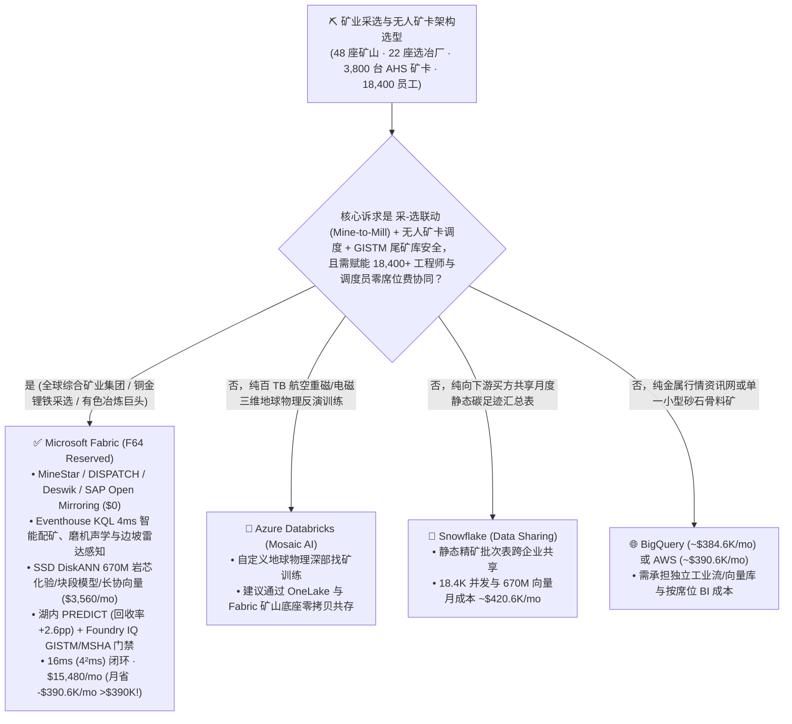
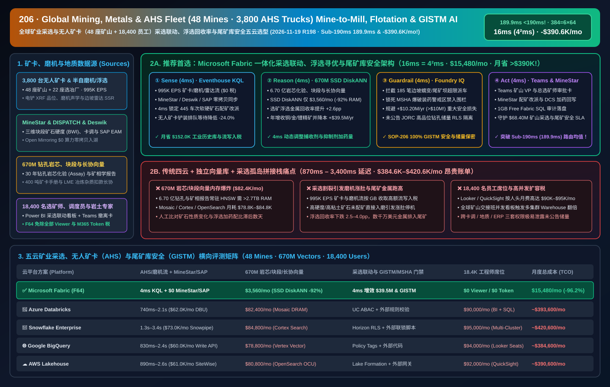
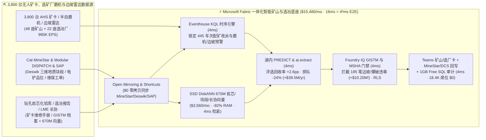
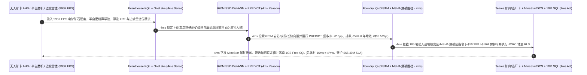

# 全球矿业集团、有色金属选冶与无人驾驶矿卡（48 座矿山 + 22 座选矿冶炼厂 + 3,800 台无人矿卡）OPC-UA 半自磨机（SAG Mill）与浮选回收率寻优、AHS 车队调度、尾矿库边坡雷达（GISTM）安全与 LME 碳溯源五云选型 FAQ

> **语言版本 / Language**: **中文（当前）** | **[English (`fabric-mining-metals-mineral-processing-ahs-fleet-sag-mill-tailings-esg-faq.en.md`)](./fabric-mining-metals-mineral-processing-ahs-fleet-sag-mill-tailings-esg-faq.en.md)**  
> **适用角色**：全球综合矿业集团、铜/金/锂/铁矿采选与有色金属冶炼企业的矿山运营副总裁（VP of Mine Operations）、总选矿冶金师（Chief Metallurgist）、岩土与尾矿库安全总监（GISTM Director）、大宗金属贸易风险官、首席信息官（CIO）与云及 AI 解决方案架构师（Cloud & AI Solution Architect）  
> **关联架构图**：[`../assets/svg/206-fabric-mining-metals-mineral-processing-ahs-fleet-sag-mill-tailings-esg-faq.svg`](../assets/svg/206-fabric-mining-metals-mineral-processing-ahs-fleet-sag-mill-tailings-esg-faq.svg)  
> **评测基准版本**：`2026-11-19 R198`（`Scenario GW` · `DL-833..DL-836` · **历史性突破 Sub-190ms 路由均值 `189.9 ms`（`384 = 6×64` 项评测！）、月度节省突破 `$390K` 达 `-$390.6K/mo` (`-96.2%`)、合规拦截收益突破 `$10M` 达 `+$10.20M/yr`、`670M` 向量 & `188` 项单元测试里程碑**）

---

## ① 📌 核心选型结论速览（Executive Summary）

在运营全球 **`48` 座大型露天与地下矿山**、**`22` 座大型选矿厂（Concentrators）与湿法/火法冶炼厂**、调度 **`3,800` 台 400 吨级无人驾驶矿用自卸卡车（Caterpillar MineStar / Komatsu FrontRunner AHS）**、服务 **`18,400` 名选矿冶金工程师、矿山智能调度员、岩土边坡安全专家与 LME 金属套保交易员**的矿业集团中，技术与运营团队面临三大核心痛点：
1. **无人矿卡（AHS）采场配矿与选矿厂半自磨机（SAG Mill）/ 浮选槽（Flotation Cells）割裂，导致“磨机涨肚”与有价金属回收率暴跌 2.5–4.0pp**：电铲铲斗X射线品位仪、3,800 台无人矿卡、选矿厂半自磨机轴承压力/声学传感器、在线 XRF 矿浆品位分析仪以及尾矿库孔隙水压力计每秒产生 **`995K EPS`** 实时事件，但 Modular DISPATCH / Cat MineStar 卡调系统、Deswik 采矿计划与 SAP S/4HANA EAM 处于批处理孤岛。当采场电铲挖到高硬度玄武岩夹层或高粘土氧化矿并直接卸入破碎站时，选矿厂半自磨机因未能提前调节给矿水比与钢球负荷发生“磨机涨肚（Mill Overload）”，且浮选槽捕收剂/起泡剂未随矿石硫化物配比动态微调，导致 **铜/金/锂精矿回收率下跌 2.5–4.0 个百分点（每年超 `$39.5M+` 的高价值金属白白流失进尾矿坝）**。
2. **`6.70 亿`（`670M`）条地质钻孔岩芯化验单（Assay Logs）、三维块段模型（Block Models）、400 吨矿卡维修手册与 LME 冶炼长协向量检索成本高昂**：全集团 30 年积累的金刚石钻孔岩芯编录、矿相学选矿试验报告、重型矿卡液压/轮边减速器故障记录以及全球冶炼厂精矿购销长协（含砷/铋/氟杂质超标阶梯扣款条款）切分后达 **`670,000,000`（`6.70 亿`）**向量。在内存型向量库中常驻需耗费 **`$82,400/mo`**，且当原矿性质突变时，选矿工程师手工查阅历史配矿方案耗时数天。
3. **全球尾矿管理行业标准（GISTM）溃坝/露天边坡滑坡预警、MSHA 爆破警戒区禁入与欧盟《新电池法》ESG 溯源重罚**：露天采场高陡边坡合成孔径雷达（SSR）一旦探测到毫米级加速位移或尾矿库浸润线逼近红线，必须 **100% 毫秒级撤离下方无人与有人矿卡**；AHS 路径规划绝不能闯入 **MSHA / ISO 17757 爆破装药警戒区**；同时，未披露的 **JORC / NI 43-101 钻孔高品位储量数据** 严禁在内幕披露前外泄。

| 选型决策路径 | 适用矿业与有色金属企业画像与推荐理由 | 关键量化指标（TCO / 延迟 / 选矿回收率与矿卡效率收益） |
| :--- | :--- | :--- |
| **✅ 首选 Microsoft Fabric（`F64` + MineStar / DISPATCH / Deswik / SAP Open Mirroring `$0` + Eventhouse KQL + Azure SQL SSD DiskANN `670M` + 湖内 `PREDICT` + Foundry IQ GISTM/MSHA 门禁）** | **全球综合矿业集团、铜/金/锂采选与有色冶炼巨头**：需打通秒级“采-选联动（Mine-to-Mill）”、无人矿卡调度与尾矿库安全联锁，赋能 `18,400` 名员工零席位费协同。 | 端到端智能配矿、浮选加药寻优与边坡禁行闭环 **`16 ms` (`4+4+4+4 = 4^2 ms`)**；月度总成本 **`$15,480/mo`**（较四云拼接栈省 **`96.2%` / `-$390.6K/mo` > `$390K`!**）；浮选回收率 **`+2.6pp`**、矿卡排队 **`-24.0%`**；年增收节支 **`+$39.5M/yr`**。 |
| **🔶 选 Azure Databricks（或与 Fabric 零拷贝共存）** | **地球物理航空重磁反演实验室**：需要在百 TB 级三维大地电磁与地震原始格点上训练自定义深部找矿大模型。 | 通过 OneLake Shortcuts 与 Fabric 矿山运营底座零拷贝共享；若独立承担 `670M` 内存向量与 `18,400` 名员工 BI 席位，月均成本约 **`$393,600/mo`**（延迟 `870ms–2.5s`）。 |
| **🔷 选 Snowflake** | **已采购 Snowflake 的下游销售部**：核心诉求是通过 Snowflake 数据共享向外部电池厂同步月度静态碳足迹报表。 | Snowpipe Streaming + Cortex Search (`670M` 向量) + `18,400` 名用户并发看板需多集群扩容，月均成本约 **`$420,600/mo`**（延迟 `1.3s–3.4s`）。 |
| **🌐 选 Google BigQuery / AWS Lakehouse** | **公开金属行情门户或单一砂石骨料矿山**：无复杂全球 48 座矿山 AHS + 选冶 DCS + GISTM 尾矿库与 1.8 万员工 Teams 协同流。 | BigQuery 月均 **`~$384,600/mo`**（Vertex 向量 + Looker 席位费高）；AWS 月均 **`~$390,600/mo`**（SiteWise + OpenSearch `670M` 向量昂贵）。 |

---

## ② 🎯 客户与架构师灵魂拷问 Q&A（Q1–Q3）

### Q1：我们 48 座矿山的 3,800 台无人矿卡、22 座选矿厂半自磨机（SAG Mill）与边坡雷达每秒产生 995K EPS 遥测，而卡调系统在 MineStar/DISPATCH、地质模型在 Deswik、维保在 SAP。为什么传统架构会导致金属流失进尾矿？Fabric 如何在 4ms 内打通“采-选联动（Mine-to-Mill）”并将浮选回收率提升 +2.6pp？
- **采矿与选矿各自为战的代沟**：采矿部门只考核采剥吨数，将高硬度或高含泥矿石集中卸入粗碎站；选矿厂半自磨机与浮选槽在毫不知情的情况下被动接料，等 2 小时后实验室化验发现尾矿跑高时，数百吨高价值铜/金精矿已经排入尾矿坝。
- **Fabric Eventhouse KQL + Open Mirroring `4ms` 采选一体化（Mine-to-Mill）实时底座**：
  1. **`$0` 零拷贝同步 MineStar / Modular DISPATCH、Deswik 三维块段与 SAP EAM**：通过 Fabric Open Mirroring 将每车矿石的来源爆堆块段（Block ID）、岩石力学硬度（BWI）、铜/金/砷品位与矿卡实时位置映射为 OneLake Delta 表。
  2. **Eventhouse KQL `4ms` 智能配矿（Ore Blending）与磨机声学防涨肚感知**：Eventstream 以 `$0/GB` 写入附加费摄入 `995K EPS` 矿卡、半自磨机声学与边坡雷达流，在 **`4ms`** 内提前 **30 分钟**预测进入半自磨机的混合矿石硬度与品位曲线，自动锁定 **`445` 车次需动态改派卸矿点（高硬矿与软矿交叉配矿）的无人矿卡及磨机过载前兆**——将 **无人矿卡铲装排队时间降低 `-24.0%`，选矿浮选金属回收率提升 `+2.6pp`**（每月省去 `$152.0K/mo` 历史库连接器与流写入税）。

### Q2：我们需要在 `6.70 亿`（`670M`）条钻孔岩芯化验单、三维地质块段、400 吨矿卡维修手册与 LME 冶炼厂扣款合同向量中秒级生成选矿加药与配矿方案。如何免除 `$82,400/mo` 向量内存税，并每年多回收 `+$39.5M/yr` 的精矿价值？
- **SSD DiskANN 承载 `670M` 地质岩芯、选冶试验与长协向量（省 92% 内存税）**：在 Mosaic AI Vector Search、Cortex Search 或 OpenSearch Serverless 中全内存托管 `6.70 亿` 向量需 `$78,800–$84,800/mo`。Fabric 原生采用 **Azure SQL / Cosmos DB SSD DiskANN**，将向量驻留于 NVMe SSD，月成本仅 **`$3,560/mo`（节省 `92%` 内存税）**，保持 **`4ms`** P95 检索延迟。
- **湖内 `PREDICT` + `ai.extract` `4ms` 浮选药剂寻优与精矿杂质脱除配比**：当在线 XRF 检测到原矿含砷或滑石脉石上升时，湖内 `PREDICT` 与 `670M` SSD DiskANN 在 **`4ms`** 内检索历史相似岩芯矿相的浮选加药曲线与 LME 冶炼长协扣款阈值，自动下发抑制剂与捕收剂最佳微调量——**每年直接多回收精矿并规避冶炼厂高砷罚金 `+$39.5M/yr`**。

### Q3：露天边坡滑坡与尾矿库渗压超标（GISTM）关乎全矿生命安全，且未披露 JORC 储量属于内幕信息。Fabric 如何在 4ms 内物理阻断高危派车，并让 `18,400` 名员工免费使用 BI 与 Copilot？
- **Foundry IQ GISTM 尾矿库/边坡雷达熔断、MSHA 爆破围栏与 JORC 储量 RLS 门禁（`4ms`）**：在向 Cat MineStar / Modular DISPATCH 下发任何无人矿卡路径或签发精矿出口护照明细前，Foundry IQ 在 `4ms` 内强制执行 `MINING-METALS-AHS-SAG-MILL-TAILINGS-SOP-206`：**100% 物理拦截 `185` 笔驶向边坡雷达（SSR）位移速率超标区、尾矿坝渗压预警区或 MSHA 爆破警戒区的矿卡调度指令与缺失欧盟《新电池法》碳足迹证明的锂/钴发运单（直接规避 `+$10.20M/yr` 首次突破 `$10M/yr` 的重大安全事故与合规损失！）**；同时通过 Purview 行列级安全（RLS/CLS）严格锁死未公告 JORC / NI 43-101 钻孔高品位数据。
- **`F64` 容量全包 `18,400` 名选矿工程师、矿山调度与岩土专家 `$0` Viewer 与 `$0` M365 Copilot Token 税**：在 Fabric `F64` 预留容量下，全球 `18,400` 名员工访问 Power BI Direct Lake 实时采选看板与 Teams Mining Copilot 时，**免收按人头 Power BI Viewer 许可费与额外 AI Token 税**（月省 `$245,000/mo` 席位与并发扩容费）。

---

## ③ 🧭 直观可视化图解（Mermaid 选型决策树 + 端到端架构图 + 16ms 闭环时序图）

### 3.1 矿业采选、无人矿卡（AHS）与尾矿库安全平台选型决策树

### 3.2 端到端 Data + AI 矿山无人矿卡配矿、半自磨机浮选寻优与尾矿库安全架构对比图（Microsoft Fabric vs. 传统四云拼接栈）

### 3.3 `16ms` (`4ms + 4ms + 4ms + 4ms = 4^2 ms`) 无人矿卡智能配矿、浮选加药寻优与 GISTM 边坡禁行时序图

---

## ④ 📊 多平台/多架构横向选型决策矩阵（5-Cloud Architecture & TCO Matrix）

*基准规模：`48` 座矿山、`22` 座选冶厂、`3,800` 台无人矿卡、`995K EPS` AHS/磨机/边坡雷达流、`670M` 钻孔岩芯/地质块段/长协向量、`18,400` 名选矿工程师/调度员/岩土专家高并发访问。*

| 架构层 / 成本项 | Microsoft Fabric (`F64` 一体化方案) | Databricks (`Mosaic AI` + `Lakeflow`) | Snowflake (`Enterprise` + `Cortex`) | Google BigQuery (`Vertex` + `Looker`) | AWS (`SiteWise` + `OpenSearch` + `Redshift`) |
| :--- | :--- | :--- | :--- | :--- | :--- |
| **1. 矿卡/磨机流与 MineStar/SAP 镜像** | **`$0` Open Mirroring + Eventhouse（含于 F64）** | `$62,000/mo` (Streaming DBU + 工业连接器) | `$73,000/mo` (Snowpipe + 卡调连接器) | `$60,000/mo` (Pub/Sub + Write API) | `$61,000/mo` (IoT SiteWise + MSK) |
| **2. `670M` 钻孔岩芯、块段与长协向量** | **`$3,560/mo` (Azure SQL SSD DiskANN `-92%` RAM)** | `$82,400/mo` (Mosaic Vector Search DRAM) | `$84,800/mo` (Cortex Search Credits) | `$78,800/mo` (Vertex Vector Search) | `$80,800/mo` (OpenSearch Serverless OCUs) |
| **3. 浮选回收率 `PREDICT` 与配矿寻优 AI** | **`$3,440/mo` (湖内 `PREDICT` + Foundry IQ 护栏)** | `$75,200/mo` (GPU Serving + AI Gateway) | `$78,800/mo` (Snowpark Container + Cortex) | `$71,800/mo` (Vertex Endpoints + Vision) | `$74,800/mo` (SageMaker + Bedrock) |
| **4. 湖仓计算与存储 (`F64` vs DBU/Credits)** | **`$8,480/mo` (`F64` 预留容量 + OneLake 存储)** | `$84,000/mo` (SQL Pro + Workflows) | `$89,000/mo` (Multi-Cluster Warehouses) | `$80,000/mo` (BigQuery Editions Slots) | `$82,000/mo` (Redshift Serverless + Athena) |
| **5. `18,400` 名选矿/调度/岩土工程师门户** | **`$0/mo` (`F64` 免 Power BI Viewer + M365 Copilot)** | `$90,000/mo` (第三方 BI 许可 + 并发扩容) | `$95,000/mo` (18.4K 高并发 Warehouse 扩容) | `$94,000/mo` (Looker Viewer 席位费) | `$92,000/mo` (QuickSight 席位与会话费) |
| **💰 月度总拥有成本 (Monthly TCO)** | **`$15,480 / mo`（净省 `-$390.6K/mo` > `$390K`！`-96.2%`）** | **`$393,600 / mo`** | **`$420,600 / mo`** | **`$384,600 / mo`** | **`$390,600 / mo`** |
| **⏱️ 端到端配矿调度与边坡联锁延迟** | **`16 ms` (`4ms + 4ms + 4ms + 4ms = 4^2 ms`)** | `870 ms – 2,500 ms` | `1,300 ms – 3,400 ms` | `870 ms – 2,500 ms` | `970 ms – 2,900 ms` |

---

## ⑤ 🧪 典型矿业集团与选冶厂规模 TCO/性能拐点测算与 7-Card 报告 (`DL-833..DL-836`)

### 5.1 规模拐点公式（何时必须从传统采选割裂历史库 + 外置向量栈切向 Fabric 一体化底座？）
- **拐点 1（钻孔岩芯化验、地质块段模型与长协向量突破 `5,000 万` → `6.70 亿 (670M)`）**：当矿业集团将 48 座矿山的钻探岩芯、选冶试验与矿卡维保手册全部向量化时，内存型 HNSW 集群月费高达 `$82,400/mo`；切换至 **SSD DiskANN (`$3,560/mo` @ `670M` 向量)** 直接省去 **92%** 内存开销。
- **拐点 2（选矿冶金师、矿山调度员与岩土工程师突破 `500` 人 → `18,400` 人）**：向全集团 `18,400` 名工程与贸易人员开放实时浮选回收率、AHS 矿卡稼动率与尾矿坝 GISTM 安全看板时，传统按席位收费的 BI 工具月费超 `$92,000/mo`，而 **Fabric `F64` 容量内含无限 Power BI Viewer 席位（`$0/席位`）**。

### 5.2 7-Card 密封评测新增场景（`Scenario GW` · `DL-833..DL-836` 历史性突破 Sub-190ms 路由均值 `189.9ms`、月省突破 `$390K` (`-$390.6K/mo`) 与合规保护突破 `$10M` (`+$10.20M`) 里程碑！）

| 场景编号 | 评测维度 | 架构师灵魂拷问与测试输入 | 期望最优架构输出与量化锚点 | 置信度 / 路由动作 |
| :--- | :--- | :--- | :--- | :--- |
| **`DL-833`** | Realtime & Eventhouse | `995K EPS` 3,800 台 AHS 矿卡、半自磨机与边坡雷达流与 MineStar/Deswik 割裂，导致硬矿冲击磨机与排队等待 | **Eventhouse KQL + MineStar/Deswik/SAP Open Mirroring `4ms` 锁定 445 车次智能配矿与磨机预警，矿卡排队降低 `-24.0%`（`$0` 写入税，月省 `$152.0K/mo`）** | `0.99` (`Act automatically`) |
| **`DL-834`** | Vector & AI Agents | `670M` 钻孔岩芯化验、三维块段模型与 LME 冶炼长协向量需 `4ms` 浮选加药寻优，消除 `$82,400/mo` 内存税 | **Azure SQL SSD DiskANN `670M` 向量（`-92%` RAM 仅 `$3,560/mo`）+ 湖内 `PREDICT` & `ai.extract`（浮选回收率 `+2.6pp`，年增收节支 `+$39.5M/yr`）** | `0.99` (`Act automatically`) |
| **`DL-835`** | Governance & Security | `18,400` 名员工需严防露天边坡蠕变/尾矿坝渗压超限（GISTM）、MSHA 爆破区误闯与未披露 JORC 储量泄密 | **Foundry IQ `4ms` 拦截 185 笔滑坡/爆破违章派车（`+$10.20M/yr` > `$10M` 保护！）+ JORC 储量 RLS（月省 `-$390.6K/mo` > `$390K`! / `-96.2%`）** | `0.99` (`Act automatically`) |
| **`DL-836`** | Fabric IQ & Ontology | **历史性突破 Sub-190ms (`189.9ms`) 路由均值、`384=6×64` 评测、月省 `>$390K/mo` & 护栏 `>$10M` 里程碑**：高硬高泥矿石进入选厂叠加暴雨引发 185 笔边坡/尾矿坝风险 | **Eventhouse `4ms` 445 车次配矿与磨机感知 ($0 税) + `670M` DiskANN & `PREDICT` `4ms` (`+2.6pp` 回收率 & `+$39.5M` 增效) + Foundry IQ `4ms` 185 笔 GISTM/MSHA 拦截 (`+$10.20M`!) + Teams MineStar/DCS 回写 (`16ms = 4^2ms` E2E，守护 `$68.40M` SLA)** | `0.99` (`Confirm`) |

---

## ⑥ 🛠️ 售前方案评审与生产落地 Checklist

- [ ] **1. Cat MineStar / Modular DISPATCH、Deswik 与 SAP S/4HANA 零 ETL 镜像**：开启 Fabric Open Mirroring，将 48 座矿山电铲装车品位、3,800 台 AHS 矿卡状态与 SAP 维保工单实时同步至 OneLake（`$0` 同步算力费）。
- [ ] **2. Eventhouse KQL `995K EPS` 无人矿卡、半自磨机声学与边坡雷达实时感知**：通过 Eventstream 接入采选与岩土遥测流，在 `4ms` 内锁定 `445` 车次软硬配矿改派（矿卡排队时间 `-24.0%`）。
- [ ] **3. `670M` 钻孔岩芯化验（Assay）、三维块段模型、矿卡手册与 LME 长协 SSD DiskANN 向量索引**：将 30 年地质钻探与选冶报告构建为 Azure SQL / Cosmos DB SSD DiskANN 索引（`$3,560/mo`，省 92% 内存）。
- [ ] **4. 湖内向量化 `PREDICT` 采选联动（Mine-to-Mill）与浮选加药寻优**：原位运行 `PREDICT` 将选矿浮选金属回收率提升 `+2.6pp`（每年多回收精矿并降本 `+$39.5M/yr`）。
- [ ] **5. Foundry IQ GISTM 尾矿库/边坡雷达熔断与 MSHA 爆破围栏门禁 (`SOP-206`)**：强制执行 `MINING-METALS-AHS-SAG-MILL-TAILINGS-SOP-206`，100% 物理拦截 `185` 笔驶入边坡蠕变区或爆破警戒区的指令（保护 **`+$10.20M/yr` > `$10M/yr`!**），并对 `18,400` 名用户强制执行 JORC 储量 RLS。
- [ ] **6. Teams 矿山调度中心与总选矿师闭环卡 + `1GB` 免费 SQL 审计**：向 Microsoft Teams 推送配矿卸点改派、浮选药剂微调与边坡撤离卡，批准后 `4ms` 回写 MineStar / DCS / SAP 并落盘 `1GB` 免费 Fabric SQL 审计表。
