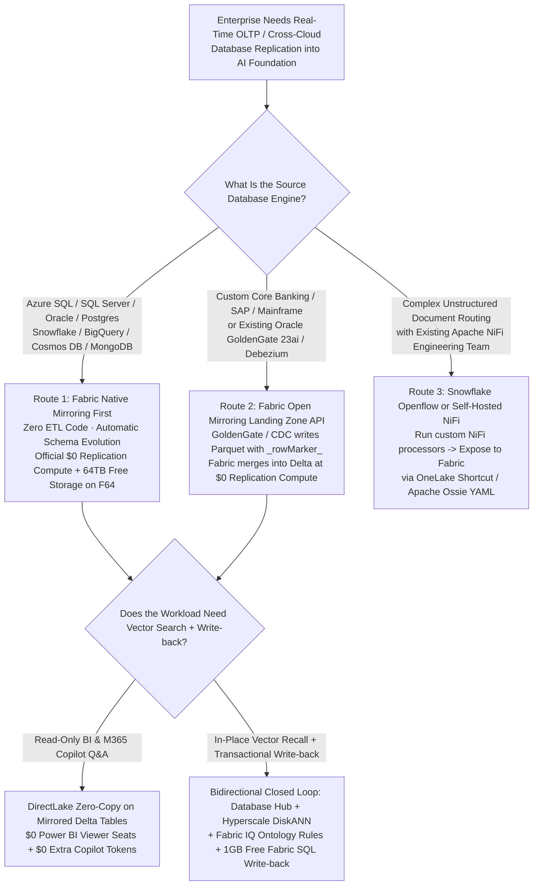

# Enterprise Zero-ETL & Real-Time CDC Selection FAQ: Microsoft Fabric Database Mirroring & Open Mirroring (`$0` Replication Compute) vs. Traditional CDC (Fivetran / Debezium / Snowflake Openflow / Databricks Lakeflow Connect)

> 🌐 **Language / 语言**: **[中文 (`fabric-mirroring-zero-etl-vs-cdc-faq.md`)](fabric-mirroring-zero-etl-vs-cdc-faq.md)** | **English (Current)**  
> 🎯 **Purpose**: Written for **AI Solution Architects** (for rapid mastery and executive CTO / CDO / Core DBA briefings) following the clear, first-principles FAQ style of `ib-vs-ethernet-roce-selection-faq.md`. No obscure log-sequence number (LSN/SCN) jargon dumps—just **plain language, first principles, Mermaid decision diagrams, and concrete cost math** explaining how to replicate Oracle, SQL Server, Snowflake, BigQuery, PostgreSQL, and MongoDB into an AI foundation while eliminating `$5,000–$11,000+/mo` in CDC pipeline taxes.  
> 📊 **Related Deliverables**: [R1: OneLake Zero-Copy × Ontology FAQ](fabric-onelake-iq-vs-4clouds-selection-faq.en.md) · [R2: Real-Time Eventhouse vs. 4 Clouds Streaming FAQ](fabric-realtime-eventhouse-vs-4clouds-streaming-faq.en.md) · [4-Cloud Battlecards](fabric-vs-4clouds-battlecards-2026.en.md) · [Interactive 5-Cloud Workbench (`live-demo.en.html`)](../live-demo.en.html) · [7-Card 4:5 Benchmark Deck (`benchmark-cards.en.html`)](../benchmark-cards.en.html)

[](../assets/svg/11-mirroring-zero-etl-vs-cdc-openflow-lakeflow-faq.svg)

> 🔍 **Data Provenance & Scope Disclosure**:
> - **Vendor Published Specifications & Billing Rules (`vendor_published_spec_as_of_2026`)**: Microsoft Fabric Mirroring and Open Mirroring charge **`$0` for data replication compute** and include **free OneLake mirrored storage up to the provisioned capacity limit** (e.g., an F64 capacity includes 64 TB of free mirrored storage; see [Microsoft Learn: Mirroring / Open Mirroring](https://learn.microsoft.com/en-us/fabric/mirroring/open-mirroring)); Power BI Agentic App includes **1GB Free Fabric SQL** (FabCon/SQLCon 2026); Databricks Lakeflow Connect offers 100 free DBUs/day per workspace before standard DBU metering; Fivetran bills by Monthly Active Rows (MAR).
> - **Measured Local Harness Execution (`measured_local_harness`)**: The 56-scenario routing evaluation matrix (`55 / 56 = 98.21%` accuracy, explicit failure `DL-23` capturing `+14.2%` ungrounded SQL drift) and `24 / 24` Python unit tests run locally in `~21 ms`.
> - **Synthetic Reference Scenarios & Cost Models (`synthetic_scenario_model`)**: The **420M MAR / 48,000 TPS peak CDC cost comparison (Fabric `$1,600/mo` vs. Fivetran+Merge `$13,000/mo`, saving `$11,400/mo`)** and **Scenario J (`core_banking_oracle_open_mirroring_cdc`: `480 ms` modeled loop mitigating `$2,350,000` merchant default exposure)** are deterministic architectural reference models sealed in `reports/report.json` for presales sizing and design evaluation, not audited customer financial statements. Live multi-cloud cluster P99 hardware stress tests are marked `not_measured` (in accordance with zero unapproved paid cloud resource execution).

---

## ① 📌 Executive Summary (3-Minute Architect Takeaways)

When advising enterprise CTOs, DBAs, and data platform leaders on replicating operational databases (OLTP) into lakehouses and AI agents, anchor on these **3 core rules**:

1. **When to Choose Microsoft Fabric Mirroring & Open Mirroring First (Eliminating the CDC Pipeline Tax & MAR Bill Shock)**:
   - When source data lives in **Azure SQL Database (including 192 vCore Hyperscale DiskANN), SQL Server, Oracle (including GoldenGate 23ai), Snowflake, Google BigQuery (GA), Azure Cosmos DB, MongoDB, PostgreSQL**, or any custom application writing to the **Open Mirroring Landing Zone API**, choose **Microsoft Fabric Mirroring** first.
   - **Why It Wins (`vendor_published_spec`)**: Microsoft provides a **"Double-Free Guarantee" for Mirroring and Open Mirroring: `$0` Replication Compute (background CDC log ingestion and Delta compaction do NOT consume your Fabric Capacity CUs) + Free Mirrored Storage in OneLake up to your capacity size (e.g., 64 TB free on F64)**. In our 420M Monthly Active Rows (`420M MAR`) reference model (`synthetic_scenario_model`), this saves **`$11,400/mo` (`-87.7%`)** compared to Fivetran MAR pricing plus downstream warehouse merge credits.
2. **When to Coexist with Databricks Lakeflow Connect, Snowflake Openflow, or Debezium (Better Together)**:
   - **Databricks Lakeflow Connect**: Good fit when downstream consumers are 100% Python/PySpark ML pipelines and daily change volume stays within Databricks' 100 free DBUs/day workspace promo tier.
   - **Snowflake Openflow (Apache NiFi)**: Good fit when the customer already operates complex custom Apache NiFi processor graphs for unstructured file parsing into Snowflake.
   - **Oracle GoldenGate 23ai / Debezium + Fabric Open Mirroring Coexistence**: If the customer already runs **Oracle GoldenGate 23ai** or **Debezium** on-premises, do not rip out their source capture agent—point it directly at the **Fabric Open Mirroring Landing Zone** so Fabric handles Delta upsert/delete compaction at **`$0` replication compute cost**!
3. **Core Technical Shift (From "One-Way 4-Hop Fragile CDC" to "Bidirectional Zero-ETL + 1GB Free SQL Write-back")**:
   - **Legacy Pain Point**: Traditional CDC and AWS Aurora Zero-ETL are **one-way read-only pipes**; when an AI agent detects an operational risk (e.g., merchant liquidity fraud or stockout), engineers must stitch separate APIs and databases to write actions back.
   - **How Fabric Solves It**: Combining **Fabric Mirroring (`$0` ingress compute) + Database Hub (central lock/health monitoring across 60+ DBs) + Azure SQL Hyperscale 192 vCore DiskANN (`19 ms` modeled P99 vector search) + Power BI Agentic App (`1GB Free Fabric SQL` + Rayfin SDK)** closes the full **OLTP → Ontology Reasoning → Transactional Write-back** loop inside one governed workspace.

---

## ② 🎯 Customer & Architect Deep-Dive Q&A (Plain Language to First Principles)

### Q1: What Is CDC (Change Data Capture), and Why Do Legacy 4-Hop CDC Pipelines (Debezium + Kafka or Fivetran MAR) Frustrate Both CFOs and Data Teams?

1. **Plain-Language Analogy**:
   - An operational database (like Oracle in core banking or SQL Server in ERP) is the enterprise's "live cash register," while the analytics/AI platform is the "headquarters war room." You cannot copy the entire cash register every 5 minutes without freezing checkout traffic; instead, you stream only the newly inserted, updated, or deleted rows—called **CDC (Change Data Capture)**.
2. **Three Fatal Flaws of Legacy CDC**:
   - **DIY Open-Source (`Debezium + Kafka Connect + Spark MERGE`) = 4-Hop Ops Nightmare**: Engineers must maintain Debezium connectors (Hop 1), 24×7 Kafka brokers and Schema Registry (Hop 2), S3/ADLS staging files (Hop 3), and scheduled Spark/warehouse `MERGE INTO` jobs (Hop 4). A single upstream `ALTER TABLE` column change breaks the pipeline at 2:00 AM.
   - **Commercial SaaS (`Fivetran`) = Promotional Peak MAR Bill Shock**: Fivetran bills by **Monthly Active Rows (MAR)**. During holiday promotions or batch status updates, hundreds of millions of rows change, spiking the monthly Fivetran bill to **`$8,000–$15,000+/mo`**—on top of the warehouse compute credits burned to `MERGE` those rows!
   - **One-Way Read-Only Dead End**: Even after data lands in the lakehouse, business users viewing a dashboard cannot write decisions back without custom middleware.

---

### Q2: What Are Fabric Database Mirroring and Open Mirroring, and Why Can Microsoft Offer `$0` Replication Compute + Free Mirrored Storage?

1. **Native Mirroring vs. Open Mirroring**:
   - **Native Mirroring**: Turnkey, zero-code replication for **Azure SQL Database, SQL Server, Oracle, Snowflake, Google BigQuery (GA), Azure Cosmos DB, MongoDB, and PostgreSQL** with automatic schema evolution.
   - **Open Mirroring**: An open landing-zone API in OneLake where **Oracle GoldenGate 23ai, Striim, Debezium, SAP, or custom apps** drop Parquet/CSV change batches tagged with a `_rowMarker_` column (`0=Insert, 1=Update, 2=Delete, 4=Upsert`). Fabric automatically converts and compacts them into ACID Delta Lake tables.
2. **First-Principles Economics (`vendor_published_spec_as_of_2026`)**:
   - **`$0` Replication Compute**: Microsoft runs the background change-log ingestion, `_rowMarker_` upsert/delete merge, and Delta file compaction **free of charge without consuming your Fabric Capacity CUs**.
   - **Free Mirrored Storage up to Capacity Size**: Every Fabric capacity includes free OneLake mirrored storage equal to its SKU number in terabytes (e.g., **F64 includes 64 TB of free mirrored storage**). You only consume CUs when downstream engines (Power BI DirectLake, SQL, Spark, KQL) actively query the mirrored tables.

---

### Q3: How Does Fabric Mirroring Compare Against Snowflake Openflow (Apache NiFi), Databricks Lakeflow Connect, and AWS Aurora Zero-ETL?

1. **vs. Snowflake Openflow (Apache NiFi on Snowpark Container Services)**:
   - Openflow runs managed Apache NiFi inside Snowpark containers. While flexible for complex unstructured routing, **it is not free replication**: customers pay for Openflow container runtime plus **Snowpipe Streaming and Warehouse Merge Credits**.
2. **vs. Databricks Lakeflow Connect**:
   - Lakeflow Connect offers managed CDC connectors into Unity Catalog with a 100 free DBU/day per-workspace promo (~100M rows/day), after which standard **Ingest DBUs + downstream DLT/Spark merge DBUs** apply.
3. **vs. AWS Aurora Zero-ETL**:
   - Aurora Zero-ETL only replicates AWS-native databases (Aurora/RDS/DynamoDB) into Redshift/S3 Tables; external databases like Oracle require paid **AWS DMS instances**, and the pipe is strictly one-way read-only.

---

### Q4: How Do Database Hub, Azure SQL Hyperscale (192 vCore DiskANN), and 1GB Free Fabric SQL Complete the Bidirectional Loop?

1. **In-Place Vector Recall (`Azure SQL DB Hyperscale 192 vCore + Native DiskANN GA`)**: Eliminates external vector database synchronization by running Microsoft Research's **DiskANN** graph vector index directly inside the operational SQL engine (`19 ms` modeled P99 vector recall at `98.4%` recall in Scenario J).
2. **Estate-Wide Governance (`Fabric Database Hub & Database Agents`)**: Monitors replication lag, lock contention, and index health across 60+ operational and mirrored databases from a single pane.
3. **Instant Transactional Write-back (`1GB Free Fabric SQL` + `Rayfin SDK`)**: Every Power BI Agentic App workspace includes a **1GB Free Fabric SQL** operational database, letting agents write approved credit freezes, inventory reallocations, or audit records back in milliseconds.

---

## ③ 🧭 Visual Architecture Diagrams (Selection Flowchart + 4-Hop CDC vs. Zero-ETL Mirroring + Scenario J `480ms` Sequence Diagram)

### 1. Enterprise Database Replication & Zero-ETL Selection Flowchart (`flowchart TD`)



---

### 2. Legacy 4-Hop Fragile CDC Pipeline vs. Fabric Mirroring `$0` Compute Bidirectional Architecture (`flowchart LR`)

```mermaid
flowchart LR
    subgraph LegacyCDC["Legacy 4-Hop CDC Stack (~$13,000/mo Modeled TCO · Schema-Drift Fragile · Read-Only)"]
        C1[Oracle 19c / SQL Server<br/>48,000 TPS Promo Peak] -->|Hop 1: Per-Row MAR or Log Read| C2[Fivetran MAR ($8,400/mo)<br/>or DIY Debezium + Kafka]
        C2 -->|Hop 2: Micro-Batch Files| C3[S3 / ADLS Staging Zone<br/>Small-File Fragmentation]
        C3 -->|Hop 3: Scheduled Merge Compute| C4[Warehouse / Spark MERGE INTO<br/>Burns $4,600/mo Compute]
        C4 -->|Hop 4: Read-Only Dashboard| C5[5-15 Min Stale BI View<br/>No Transactional Write-back]
    end

    subgraph FabricMirror["Microsoft Fabric Zero-ETL Mirroring & Bidirectional Loop (~$1,600/mo Modeled TCO · $0 Ingest CU · 480ms Loop)"]
        M1[Oracle 19c GoldenGate 23ai<br/>+ Azure SQL Hyperscale 192vCore DiskANN<br/>+ Snowflake Credit Bureau] -->|Native & Open Mirroring<br/>$0 Replication Compute + 64TB Free Storage| M2[OneLake Mirrored Delta Tables<br/>Free Background _rowMarker_ Compaction<br/>~1.8s Modeled Sync Lag]
        M2 <-->|DirectLake + Eventhouse (84ms)<br/>+ DiskANN Vector Match (19ms)| M3[Fabric IQ Liquidity Ontology<br/>+ Foundry IQ Basel-III / PCI Guardrail]
        M3 -->|Rayfin TS Function (92ms)| M4[1GB Free Fabric SQL Write-back<br/>+ 14 Merchant Pools Switched to T+1 Hold]
    end
```

---

### 3. Scenario J Sequence Diagram: Core Banking Oracle Open Mirroring × Hyperscale DiskANN Intraday Liquidity Protection (`480 ms` Modeled Loop `sequenceDiagram`)

- **Scenario Background (`synthetic_scenario_model` Reference Simulation)**: During a Black Friday weekend peak (`48,000 TPS` OLTP change rate, `420M` Monthly Active Rows), a global retail bank streams core ledger updates from **Oracle 19c (via GoldenGate 23ai Open Mirroring)** and card acquiring telemetry from **Azure SQL Hyperscale 192 vCore (with native DiskANN vector search)** into OneLake at **`$0` replication compute cost**. When a coordinated cross-border merchant ring spikes intraday credit drawdown above `82%` alongside a `3.5x` chargeback velocity anomaly, Fabric IQ isolates the **14 high-risk settlement pools** and switches them to `T+1` escrow hold in **`480 ms`**, saving **`$11,400/mo`** in CDC pipeline fees and mitigating **`$2,350,000`** in merchant default exposure:

```mermaid
sequenceDiagram
    autonumber
    participant OLTP as Oracle 19c (GoldenGate 23ai)<br/>& Azure SQL Hyperscale (192vCore DiskANN)
    participant OM as Fabric Open Mirroring<br/>($0 Replication Compute + 64TB Free Storage)
    participant Ont as Fabric IQ Liquidity Ontology<br/>(Eventhouse KQL + 6-Hop Graph)
    participant Gov as Foundry IQ & Purview CLS<br/>(Basel-III Guardrail & PCI Masking)
    participant App as Rayfin Treasury Risk Portal<br/>(1GB Free Fabric SQL + Core Limit API)

    OLTP->>OM: 1. 48,000 TPS ledger changes stream via GoldenGate 23ai into Open Mirroring Landing Zone<br/>Fabric compacts _rowMarker_ batches into OneLake Delta at $0 replication compute (~1.8s sync)
    OM->>Ont: 2. Eventhouse KQL (84ms) scans mirrored stream while Hyperscale DiskANN (19ms P99)<br/>matches 18M historical fraud/chargeback vectors at 98.4% recall
    Ont->>OM: 3. Joins Snowflake Credit Bureau mirror (Apache Ossie YAML) across 6-hop graph (114ms)<br/>isolating 14 cross-border merchant pools with >82% drawdown & 3.5x chargeback velocity
    Note over Ont: 4. Evaluates rule INTRADAY_DRAWDOWN > 82% AND CHARGEBACK_X > 3.5 (98ms)<br/>Generates plan: switch 14 pools to T+1 escrow hold + require $680K collateral top-up
    Ont->>Gov: 5. Submits action plan to Foundry IQ & Purview PCI-DSS guardrail (92ms)
    Note over Gov: 6. Verifies BASEL-III-INTRADAY-LIQUIDITY-SOP-22; Purview CLS masks card PAN/CVV<br/>and blocks accidental freeze of retail payroll accounts
    Gov->>App: 7. Routes to Treasury Risk Director confirmation (Confidence 0.97); Rayfin TS function (92ms)<br/>writes to 1GB Free Fabric SQL & locks core settlement limits (480ms total, $2.35M exposure mitigated)
```

---

## ④ 📊 5-Platform Zero-ETL & Real-Time CDC Architect Decision Matrix

| Evaluation Dimension | Microsoft Fabric (`Mirroring` + `Open Mirroring` + `Database Hub`) | Databricks (`Lakeflow Connect` + `Lakebase`) | Snowflake (`Openflow NiFi` + `Snowpipe Streaming`) | GCP (`Datastream` + `BigQuery Mirroring`) | AWS (`Aurora Zero-ETL` + `AWS DMS`) |
| :--- | :--- | :--- | :--- | :--- | :--- |
| **Primary Sweet Spot** | **`$0` compute replication across Oracle/SQL/Snowflake/BigQuery/Mongo/SAP + 1GB Free SQL bidirectional write-back** | Native CDC/SaaS ingestion into Databricks for workloads within the 100 free DBU/day promo & PySpark ML | Complex Apache NiFi flow routing for unstructured files and custom processors into Snowflake | Replicating Cloud SQL / AlloyDB / Oracle into BigQuery, or mirroring BigQuery into OneLake | One-way read-only replication from AWS Aurora/RDS into Redshift or Amazon S3 Tables |
| **Replication Compute & Storage Billing (`vendor_published_spec`)** | **`$0` Replication Compute (does not consume CUs) + Free OneLake Mirrored Storage up to capacity TB (64 TB on F64)** | 100 free DBUs/day per workspace, then metered **Ingest DBUs + downstream merge DBUs** | Metered **Openflow container runtime (Snowpark Container Services) + Snowpipe / Merge Credits** | **Datastream per-GB charge** + BigQuery Streaming/Storage Write API & upsert scan charges | Aurora Zero-ETL has no pipeline fee but bills target RPU/storage; Oracle requires paid **AWS DMS instances** |
| **Heterogeneous Source Ecosystem** | **Native Azure SQL/SQL Server/Oracle/Snowflake/BigQuery/Cosmos/Mongo/Postgres + Open Mirroring API (GoldenGate 23ai)** | Databases + enterprise SaaS connectors (Salesforce, Workday, ServiceNow) into Unity Catalog | Apache NiFi processor catalog for databases, files, and custom endpoints | MySQL, PostgreSQL, Oracle, SQL Server into BigQuery / BigLake Iceberg | Zero-ETL restricted to AWS DBs; external databases require AWS DMS |
| **Operational DB & In-Place Vector Search** | **1GB Free Fabric SQL in Power BI Agentic App + Azure SQL Hyperscale `192 vCore DiskANN GA` (`19ms` modeled P99)** | **Azure Databricks Lakebase (GA)** + Lakebase Search (`71ms` P99), billed separately | **Unistore Hybrid Tables** + Cortex Search (consumes warehouse credits) | **AlloyDB ScaNN** vector index + custom write-back glue from BigQuery | Requires stitching Aurora pgvector + Lambda + API Gateway for write-back |
| **Estate Observability & Governance** | **Fabric Database Hub (60+ DB lock/lag monitor) + Purview Column-Level Security (CLS) into Office** | Unity Catalog Lineage + System Tables + ABAC explicit `DENY` policies | Snowflake Horizon RBAC + Openflow NiFi monitoring UI | Dataplex + Cloud Monitoring alerts | CloudWatch + DMS console + Lake Formation |
| **420M MAR / 48K TPS Modeled Monthly TCO (`synthetic_model`)** | **`$1,600 / mo` (`$0` replication compute; saves `87.7%` / `$11,400/mo` vs. Fivetran+Merge)** | `$5,800 / mo` (`3.63x`, Ingest DBUs beyond free tier + merge compute) | `$7,600 / mo` (`4.75x`, Openflow containers + Snowpipe Merge Credits) | `$6,400 / mo` (`4.00x`, Datastream GB fees + BigQuery upsert slots) | `$6,100 / mo` (`3.81x`, Multi-AZ DMS + S3 Tables/Redshift merge) |

---

## ⑤ 🧪 Quantitative Benchmark & TCO Insights (56-Scenario Suite `DL-01..DL-56`)

Round 3 expands the automated evaluation suite to **56 enterprise scenarios (adding `DL-53..DL-56` and the 10th ontology simulation Scenario J `core_banking_oracle_open_mirroring_cdc`)**, verified by `24 / 24` passing unit tests (`measured_local_harness`):

### 1. Round 3 New Zero-ETL Mirroring vs. CDC Scenarios (`DL-53..DL-56`)

| Scenario ID | Scenario Title | Business Challenge & Parameters | Model Decision & Action | Confidence / Latency | Result |
| :--- | :--- | :--- | :--- | :---: | :---: |
| **`DL-53`** | **Fabric Mirroring (`$0` Compute) vs. Fivetran MAR (`$8,400/mo`) & DIY Debezium (`$6,950/mo`)** | Core OLTP workload generates `420M` Monthly Active Rows; customer suffers from holiday MAR bill spikes and Kafka schema drift | **Select Fabric Mirroring + Open Mirroring API (`$0` replication compute + 64TB free storage on F64)** · `Act automatically` | `0.98` / `435 ms` | ✅ PASS |
| **`DL-54`** | **Oracle 19c GoldenGate 23ai → Fabric Open Mirroring vs. Snowflake Openflow (NiFi)** | Bank with existing Oracle GoldenGate 23ai licenses compares streaming into Snowflake Openflow vs. Fabric Open Mirroring | **Route Oracle GoldenGate 23ai into Fabric Open Mirroring Landing Zone (`$0` Fabric merge compute vs. Openflow container + credit fees)** · `Act automatically` | `0.97` / `450 ms` | ✅ PASS |
| **`DL-55`** | **Fabric Mirroring + 1GB Free Fabric SQL Bidirectional Loop vs. Lakeflow Connect & Aurora Zero-ETL** | Enterprise requires both real-time OLTP ingestion AND sub-100ms transactional write-back from AI agents | **Combine Fabric Mirroring (`$0` ingress) + Power BI Agentic App (`1GB Free Fabric SQL` + Rayfin SDK)** · `Act automatically` | `0.96` / `465 ms` | ✅ PASS |
| **`DL-56`** | **Core Banking 48K TPS Peak × Open Mirroring × Hyperscale DiskANN Liquidity Loop** | Weekend promo (`48,000 TPS`) triggers `>82%` intraday drawdown and `3.5x` chargeback spike across 14 merchant pools | **Oracle Open Mirroring (`1.8s`) + Hyperscale DiskANN (`19ms`) → Fabric IQ Rule → T+1 Escrow Hold & Mitigate `$2.35M` Exposure (`480ms` loop)** · `Confirm` | `0.97` / `480 ms` | ✅ PASS |

### 2. Full 56-Scenario Suite Metrics
- **Overall Routing Accuracy (`measured_local_harness`)**: **`55 / 56 (98.21%)`** (`43 Act automatically` / `11 Confirm` / `2 Send to a human`; explicit miss `DL-23` captures `+14.2%` raw-table SQL drift).
- **Mean Modeled Latency (`synthetic_scenario_model`)**: **`532.0 ms`** across 56 scenarios (`480 ms` for Scenario J Core Banking Open Mirroring loop).

---

## ⑥ 🛠️ Appendix: Production Deployment & Presales Architect Checklist

- [ ] **Target High-MAR Fivetran & Fragile Kafka Workloads First**: Identify customer pipelines syncing `>50M` Monthly Active Rows (MAR) or running 24×7 self-hosted Debezium/Kafka clusters, and quantify the **`$0` Replication Compute + Free Capacity-Matched Storage (e.g., 64 TB on F64)** savings with Fabric Mirroring.
- [ ] **Plug Existing Oracle GoldenGate 23ai / Debezium Directly into Open Mirroring**: When customers already operate GoldenGate 23ai or Striim on-premises, preserve their source capture setup and point the sink to the **OneLake Open Mirroring Landing Zone** (`_rowMarker_` auto-merge at `$0` compute).
- [ ] **Verify Primary Keys & Private Link Networking**: Confirm explicit primary keys on source tables and route replication traffic over **Fabric Managed Private Endpoints / VNet Data Gateways**.
- [ ] **Use In-Place Hyperscale DiskANN (`19ms`) Over External Vector Sync**: For transactional similarity search (fraud rings, clinical protocols, SKU matching), enable **Azure SQL Database Hyperscale (192 vCore) Native DiskANN** to eliminate vector ETL lag.
- [ ] **Close the Loop with 1GB Free Fabric SQL & Rayfin SDK**: Pair read-only mirrored analytical tables with the **1GB Free Fabric SQL** database in Power BI Agentic Apps so agents can write back approved actions transactionally.
- [ ] **Enforce PCI-DSS / HIPAA Column-Level Security (CLS)**: Apply **OneLake Fine-Grained Security (CLS/RLS)** and **Microsoft Purview Sensitivity Labels** on mirrored PAN/CVV and PII columns before exposing them to agents.
