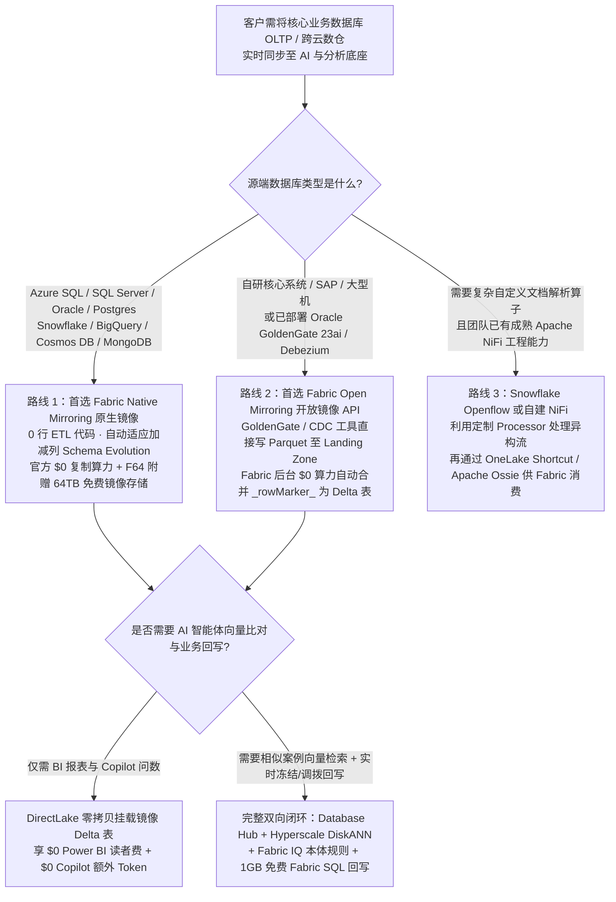
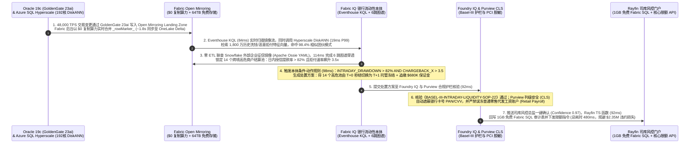

# 企业级实时数据复制与零 ETL 选型 FAQ：Microsoft Fabric Database Mirroring & Open Mirroring (`$0` 复制算力) vs. 传统 CDC（Fivetran / Debezium / Snowflake Openflow / Databricks Lakeflow Connect）

> 🌐 **Language / 语言**: **中文 (Chinese)** | **[English (`fabric-mirroring-zero-etl-vs-cdc-faq.en.md`)](fabric-mirroring-zero-etl-vs-cdc-faq.en.md)**  
> 🎯 **文档定位**：本文是写给 **AI Solution Architect（AI 解决方案架构师）本人学习吸收与面向客户 CTO / 首席数据官 / 核心系统 DBA 宣讲** 的实战选型指南。严格对标 `ib-vs-ethernet-roce-selection-faq.md` 的深入浅出风格，不堆砌晦涩的事务日志偏移量（LSN/SCN）源码，只用**第一性原理 + 大白话 + 直观图表 + 账单精算**讲透：**如何把 Oracle、SQL Server、Snowflake、BigQuery、PostgreSQL、MongoDB 中的核心业务数据零 ETL 实时同步到 AI 底座，同时砍掉每月近万美元的 CDC 管道税？**  
> 📊 **关联交付物**：[《R1: OneLake 零拷贝 × 本体 FAQ》](fabric-onelake-iq-vs-4clouds-selection-faq.md) · [《R2: 实时流 Eventhouse vs 四大云 FAQ》](fabric-realtime-eventhouse-vs-4clouds-streaming-faq.md) · [《R4: Iceberg/Delta 双向虚拟化 FAQ》](fabric-onelake-iceberg-delta-uniform-vs-4clouds-faq.md) · [四大云攻防 Battlecards](fabric-vs-4clouds-battlecards-2026.md) · [交互式五云工作台 (`index.html`)](../index.html) · [7-Card 4:5 视觉评测报告 (`benchmark-cards.html`)](../benchmark-cards.html)

[](../assets/svg/11-mirroring-zero-etl-vs-cdc-openflow-lakeflow-faq.svg)

> 🔍 **数据溯源与适用范围声明（Data Provenance & Scope Disclosure）**：
> - **官方发布规格与计费规则（`vendor_published_spec_as_of_2026`，`as_of: 2026-11-08`）**：Microsoft Fabric Mirroring 与 Open Mirroring **免收数据复制计算费（`$0` Replication Compute）** 且附赠与容量等额的 **免费 OneLake 镜像存储额度**（例如 F64 容量附赠 64 TB 免费镜像存储，详见 [Microsoft Learn: Mirrored Database Overview](https://learn.microsoft.com/en-us/fabric/database/mirrored-database/overview) 与 [Open Mirroring](https://learn.microsoft.com/en-us/fabric/database/mirrored-database/open-mirroring)）；Power BI Agentic App 附赠 **1GB 免费 Fabric SQL**（FabCon/SQLCon 2026）；Databricks Lakeflow Connect 提供每日 100 DBU 促销免费额度后按 DBU 计费（[Databricks Lakeflow Connect Docs](https://docs.databricks.com/en/ingestion/lakeflow-connect/index.html)）；AWS Aurora Zero-ETL（[AWS Docs](https://docs.aws.amazon.com/aurora-dsql/latest/userguide/zero-etl.html)）；Fivetran 按月度活跃变更行（MAR）计费。
> - **本地确定性评测引擎实测（`measured_local_harness`）**：全量架构路由评测矩阵（R4 `59 / 60 = 98.33%` 通过率，R3 `55 / 56 = 98.21%`，唯一显式反例 `DL-23` 捕获裸表 Text-to-SQL `+14.2%` 漂移）及 `26 / 26` Python 单元测试本地执行耗时约 `25 ms`。
> - **架构参考仿真与成本模型（`synthetic_scenario_model` · 双分母显式披露）**：严格区分两套建模延迟分母——**① `n=60` 路由矩阵建模均值 = `526.5 ms`**（R3 `n=56` 为 `532.0 ms`）；**② `n=11` 行业本体端到端闭环建模均值 = `584.09 ms`**（`[780,640,710,660,590,560,530,515,495,480,465]ms`；R3 `n=10` 为 `596.0 ms`）。文中的 **4.2 亿 MAR / 48,000 TPS 促销峰值成本对比（Fabric `$1,600/mo` vs Fivetran+Merge `$13,000/mo`，月省 `$11,400/mo`）** 以及 **场景 J（跨国银行核心账务 `480 ms` 端到端闭环、规避 `$2,350,000` 商户违约风险敞口）** 均为封存于 `reports/report.json` 的确定性架构参考仿真模型，用于售前方案推演与量级对比，并非已上线客户的真实财务报表；跨云多租户物理集群高压实测标记为 `not_measured`（遵循零未授权付费云资源消耗原则）。

---

## ① 📌 核心结论速览（Executive Summary）

在与金融、零售、制造客户探讨“如何把核心交易数据库（OLTP）接入湖仓与 AI 智能体”时，请先记住以下 **3 条黄金选型结论**：

1. **何时首选 Microsoft Fabric Mirroring & Open Mirroring（消灭 CDC 管道税与 MAR 账单爆炸）**：
   - 当客户的源端是 **Azure SQL Database（含 192 核 Hyperscale DiskANN）、SQL Server、Oracle（含 GoldenGate 23ai）、Snowflake、Google BigQuery (GA)、Azure Cosmos DB、MongoDB、PostgreSQL** 或任何支持 **Open Mirroring REST/Landing Zone API** 的业务系统时，**首选 Microsoft Fabric Mirroring**。
   - **核心杀手锏（官方计费规则 `vendor_published_spec`）**：微软对 Mirroring（含 Open Mirroring）提供 **“双免政策”——复制算力完全免费（`$0` Replication Compute，不扣减你的 Fabric Capacity CU）+ 镜像存储免费（F64 附赠高達 64 TB 免费 OneLake 镜像存储）**！相比之下，Fivetran 按变更行数（MAR）收费、Snowflake Openflow 消耗容器与合并 Credit、自建 Debezium 需常驻 Kafka 集群，在月变更 4.2 亿行（`420M MAR`）参考模型（`synthetic_scenario_model`）下，Fabric 方案每月可省下 **`$11,400/mo`（成本直降 `87.7%`）**。
2. **何时保留或配合 Databricks Lakeflow Connect / Snowflake Openflow / Debezium 共存（Better Together）**：
   - **选 Databricks Lakeflow Connect**：当客户所有的下游消费都是纯 Python/PySpark 特征工程且每日变更量很小（在 Databricks 每日 100 免费 DBU 额度以内）时，可在 Databricks 内直接用 Lakeflow Connect，再通过 OneLake 零拷贝暴露给 Power BI。
   - **选 Snowflake Openflow (Apache NiFi)**：当客户已有庞大的自建 Apache NiFi 运维团队，且需要对非结构化复杂文件流做重度自定义 NiFi Processor 编排写入 Snowflake 时适用。
   - **选 Debezium / Oracle GoldenGate + Fabric Open Mirroring 共存**：当客户已经在核心机房部署了 **Oracle GoldenGate 23ai** 或 **Debezium**，无需推倒重来——直接将目标端指向 **Fabric Open Mirroring Landing Zone**，由 Fabric 免费完成后台 Parquet 到 Delta Lake 的事务合并（Upsert/Delete）与小文件压缩！
3. **核心技术本质（从“单向脆弱 4 跳 CDC”升维到“双向零 ETL + 1GB 免费 SQL 事务闭环”）**：
   - **传统痛点**：无论是 AWS Aurora Zero-ETL 还是传统 CDC，都只能把数据**单向只读**抽到湖里；当 AI 智能体发现风险（如商户刷单套现或库存告急）想回写业务库时，还得手写一套复杂的回写微服务。
   - **Fabric 破局**：Fabric 通过 **Database Mirroring（`$0` 算力实时入湖）+ Database Hub（统一监控 60+ 数据库锁等待与健康度）+ Azure SQL Hyperscale 原生 DiskANN 向量索引（`19 ms` P99 建模检索）+ Power BI Agentic App（内嵌 `1GB 免费 Fabric SQL` 与 Rayfin SDK）**，在单一工作区内打通了 **“OLTP 实时入湖 → 本体图谱推理 → 事务级安全回写”** 的完整双向闭环。

---

## ② 🎯 客户与架构师灵魂拷问 Q&A（从大白话到第一性原理）

### Q1：什么是 CDC（变更数据捕获）与 Fabric Mirroring（数据库镜像）？以前企业用 Fivetran 或自建 Debezium+Kafka 时痛点在哪？

#### 1. 先用大白话讲清楚：什么是 CDC？为什么传统 4 跳 CDC 管道既贵又脆弱？
- **大白话类比**：企业的核心交易数据库（比如银行记账的 Oracle、电商下单的 SQL Server）就像收银台的“实时流水账本”，而数据分析与 AI 底座就像总部的“作战沙盘”。为了让总部沙盘看到最新账目，不能每隔 5 分钟去收银台把整本账全抄一遍（全量抽取会把收银台卡死），而是只把刚才新增、修改、删除的那几行抄过来——这就叫 **CDC（Change Data Capture，变更数据捕获）**。
- **传统做法的三大痛点（为什么 CFO 和数据工程师都苦不堪言？）**：
  1. **自建开源路线（Debezium + Kafka + Spark Merge）——“4 跳运维噩梦”**：架构师需要先架设 Debezium 读取数据库日志（第 1 跳），写入 24 小时常驻的 Kafka 消息队列（第 2 跳），落地成临时 Staging 文件（第 3 跳），再每隔几分钟启动昂贵的 Spark 或数仓集群跑 `MERGE INTO` 把增删改合并进目标表（第 4 跳）。一旦上游 DBA 给表加了一个字段（Schema Drift），整条管道就会半夜报错停摆。
  2. **购买商业 SaaS 路线（如 Fivetran）——“促销季 MAR 账单爆炸”**：Fivetran 按 **MAR（Monthly Active Rows，月度活跃变更行）** 收费。平时账单看似温和，一旦遇到“双十一/黑五周末大促”或上游跑了一次全表批量状态更新，几亿行数据发生变更，当月 MAR 账单立刻飙升至 **`$8,000 ~ $15,000+/月`**，而且下游数仓把这些变更 `MERGE` 进主表还要再交一笔数仓算力费！
  3. **只读无回写（One-Way Dead End）**：千辛万苦把数据同步过来后，业务人员在报表上发现了异常（例如某跨境商户出现疑似套现挤兑），却无法在报表里直接冻结额度，只能截图发微信让后台人员去改系统。

---

### Q2：什么是 Fabric Database Mirroring 与 Open Mirroring？为什么微软敢承诺“复制算力 `$0` 免费 + 赠送等额镜像存储”？底层是怎么运作的？

#### 1. 什么是 Native Mirroring（原生镜像）与 Open Mirroring（开放镜像）？
- **Native Mirroring（原生免配置镜像）**：针对 **Azure SQL Database、SQL Server、Oracle、Snowflake、Google BigQuery (GA)、Azure Cosmos DB、MongoDB、PostgreSQL**，架构师只需在 Fabric 界面填入数据库连接串，Fabric 就会自动读取源端变更日志，在 OneLake 中自动生成并实时更新完全一致的 **Delta Lake / Iceberg 表**，全程 **0 行 ETL 代码、自动跟随源端加减列（Schema Evolution）**。
- **Open Mirroring（开放镜像 API）**：如果客户的源系统是自研核心系统、SAP、大型机，或者客户已经在用 **Oracle GoldenGate 23ai、Striim、Debezium**，只需让这些工具把变更文件（Parquet/CSV，带 `_rowMarker_` 标记增删改：`0=Insert, 1=Update, 2=Delete, 4=Upsert`）直接扔进 OneLake 的 **Open Mirroring Landing Zone 文件夹**。Fabric 后台引擎会自动接管，帮你把零散的增删改文件合并成标准的 ACID Delta 表！

#### 2. 第一性原理揭秘：为什么 Fabric Mirroring 的复制算力与镜像存储是 `$0` 免费的？
根据微软官方计费文档（`vendor_published_spec_as_of_2026`）：
- **`$0` 复制算力（Free Replication Compute）**：从源端读取变更并转化为 OneLake Delta 表的后台合并进程（包含 Open Mirroring 的 `_rowMarker_` 合并与小文件 Compaction），**完全不消耗客户购买的 Fabric Capacity CU**！微软之所以敢免费，是因为 OneLake 直接以开放 Parquet/Delta 格式存储，无需像传统数仓那样启动重型计算节点做私有格式重编码。
- **免费镜像存储额度（Free Mirrored Storage up to Capacity Limit）**：客户购买多大的 Fabric 容量（CU），就免费赠送多少 TB 的 OneLake 镜像存储（例如购买 **F64 容量，直接赠送 64 TB 免费镜像存储**）。只有当下游使用 Power BI、SQL 或 Spark 主动查询分析时才按正常容量消费。

---

### Q3：Snowflake 新推出的 Openflow (Apache NiFi) 和 Databricks 的 Lakeflow Connect 也很火，它们与 Fabric Mirroring 的本质区别在哪？

客户在选型时经常把这三者混为一谈，其实底层架构与成本结构截然不同：

1. **Snowflake Openflow (基于 Apache NiFi, GA)**：
   - **本质**：把收购自 Datavolo 的企业级 **Apache NiFi** 放进了 **Snowpark Container Services（容器服务）** 中运行。
   - **优劣势**：优势是非常适合已经有资深 NiFi 工程师、需要处理复杂非结构化文档解析或老旧私有协议的团队；但劣势是 **它不是零计算费的内置镜像**——运行 Openflow 容器需要消耗容器计算费用，且把 CDC 变更写入并合并到 Snowflake 表中还要继续消耗 **Snowpipe Streaming 与 Warehouse Merge Credits**。
2. **Databricks Lakeflow Connect (原托管摄取连接器)**：
   - **本质**：托管的统一连接器框架，把数据库与 SaaS 变更写入 Unity Catalog Delta 表。
   - **优劣势**：与 Unity Catalog 和 DLT 集成紧密，且提供了每个工作区每天 100 DBU（约 1 亿行/天）的促销免费额度；但在大规模高频 OLTP 变更场景下，超出部分需按 Ingest DBU 计费，且下游跑流式合并仍需消耗计算 DBU。
3. **AWS Aurora Zero-ETL**：
   - **本质**：底层存储级复制，把 AWS Aurora / RDS 同步到 Redshift 或 S3 Tables。
   - **优劣势**：在纯 AWS 内部延迟低，但它**极度封闭**（不支持把外部 Oracle、Snowflake、BigQuery 零成本镜像进来），且是**纯单向只读通道**。

---

### Q4：客户问：“只把业务库镜像到湖仓做分析还不够，如果我的 AI 智能体需要在毫秒级查向量库并把决策实时写回业务库，该怎么设计？”

这就是 **Microsoft Fabric Database Hub + Azure SQL Hyperscale (192核 DiskANN) + 1GB 免费 Fabric SQL** 组合拳的杀手级场景：
1. **源端内嵌极速向量检索（Azure SQL DB Hyperscale 192 vCore + Native DiskANN GA）**：以前做 RAG 或历史相似欺诈案件比对，要把业务库数据抽到外部专用向量库（如 Pinecone 或 OpenSearch），不仅多交一份钱，还有同步延迟。现在 Azure SQL Hyperscale 原生内置 **微软研究院 DiskANN 图向量索引**（在参考架构仿真中达到 `19 ms` P99 检索与 `98.4%` 召回率），支持直接在事务表上做“SQL 过滤 + 向量检索”。
2. **统一监控与锁自愈（Fabric Database Hub & Database Agents）**：在一个面板里集中监控全企业 60+ 个 SQL Server、Azure SQL、Cosmos DB 与镜像库的复制延迟、死锁与慢查询，由 Database Agent 自动生成根因分析。
3. **事务级回写闭环（Power BI Agentic App `1GB 免费 Fabric SQL` + Rayfin SDK）**：当智能体完成推演后，直接通过 **Rayfin TypeScript 函数** 写入每个 Power BI 置备工作区免费附赠的 **1GB Fabric SQL 数据库**，并触发源端 API 完成额度锁定或工单下发。

---

## ③ 🧭 直观可视化图解（选型决策树 + 传统 4 跳 CDC vs 零 ETL 镜像对比 + 场景 J 480ms 时序图）

### 1. 企业级数据库实时复制与零 ETL 架构选型决策树（`flowchart TD`）



---

### 2. 传统 4 跳脆弱 CDC 管道 vs. Fabric Mirroring + Open Mirroring `$0` 复制算力双向闭环对比图（`flowchart LR`）

```mermaid
flowchart LR
    subgraph LegacyCDC["传统 4 跳 CDC 管道（模型参考月成本 ~$13,000/mo · 加减列易断流 · 单向只读无回写）"]
        C1[Oracle 19c / SQL Server<br/>48,000 TPS 促销峰值] -->|第1跳：按行计费或日志抽取| C2[Fivetran MAR ($8,400/mo)<br/>或自建 Debezium + Kafka]
        C2 -->|第2跳：落地临时文件| C3[S3 / ADLS Staging 区<br/>海量碎片文件]
        C3 -->|第3跳：定时拉起算力合并| C4[数仓 / Spark MERGE INTO<br/>额外消耗 $4,600/mo 算力]
        C4 -->|第4跳：只读报表| C5[BI 看板滞后 5~15 分钟<br/>发现风险无法直接回写冻结]
    end

    subgraph FabricMirror["Microsoft Fabric 零 ETL 镜像与双向闭环（模型参考月成本 ~$1,600/mo · $0 复制算力 · 480ms 闭环）"]
        M1[Oracle 19c GoldenGate 23ai<br/>+ Azure SQL Hyperscale 192核 DiskANN<br/>+ Snowflake 征信库] -->|Native & Open Mirroring<br/>$0 复制算力 + F64 64TB 免费存储| M2[OneLake 镜像 Delta 表<br/>后台免费自动合并 _rowMarker_<br/>参考同步延迟 ~1.8s]
        M2 <-->|DirectLake + Eventhouse (84ms)<br/>+ DiskANN 相似案件检索 (19ms)| M3[Fabric IQ 商户流动性本体<br/>+ Foundry IQ 巴塞尔/PCI 护栏]
        M3 -->|Rayfin TS 函数 (92ms)| M4[1GB 免费 Fabric SQL 回写<br/>+ 14 个高危资金池切换 T+1 托管]
    end
```

---

### 3. 标杆场景 J 端到端时序图：跨国零售银行核心账务 Open Mirroring × Hyperscale DiskANN 流动性风控闭环（`480 ms` 参考仿真 `sequenceDiagram`）

- **业务场景背景（`synthetic_scenario_model` 参考架构推演）**：某跨国零售银行在“黑五”周末大促期间，核心账务库（**Oracle 19c**）与收单库（**Azure SQL Hyperscale 192 vCore**）面临 **`48,000 TPS`** 的高频交易变更（月度活跃变更行高达 **`4.2 亿 MAR`**）。若使用传统 Fivetran MAR + 数仓定时 Merge，不仅月度管道账单高达 `$13,000/mo`，且 5~15 分钟的合并延迟会让跨境空壳商户利用“日内授信垫资 + 恶意拒付（Chargeback）”在几分钟内提空流动性池。看 Fabric Open Mirroring + Hyperscale DiskANN 如何在 **`480 ms`** 建模闭环内拦截 **`$2,350,000`** 违约敞口：



---

## ④ 📊 五大平台实时数据复制与零 ETL 选型决策矩阵（Architect Decision Matrix）

| 评估维度 | Microsoft Fabric (`Mirroring` + `Open Mirroring` + `Database Hub`) | Databricks (`Lakeflow Connect` + `Lakebase`) | Snowflake (`Openflow NiFi` + `Snowpipe Streaming`) | GCP (`Datastream` + `BigQuery Mirroring`) | AWS (`Aurora Zero-ETL` + `AWS DMS`) |
| :--- | :--- | :--- | :--- | :--- | :--- |
| **核心适用场景** | **跨源 OLTP（Oracle/SQL/Mongo/SAP）与跨云数仓（Snowflake/BigQuery）`$0` 复制算力入湖 + 1GB 免费 SQL 双向回写** | 原生面向 Databricks 工作区的数据库/SaaS 摄取、每日 100 DBU 以内的轻量 CDC 与 Spark ML 管道 | 已有重度 Apache NiFi 流程资产、需在容器内运行复杂自定义转换算子写入 Snowflake 的场景 | 将 Cloud SQL / AlloyDB / Oracle 同步至 BigQuery 进行 Serverless 分析，或反向镜像至 OneLake | 纯 AWS 内部 Aurora / RDS 同步至 Redshift 或 S3 Tables 的单向只读分析 |
| **复制计算与存储计费模式（`vendor_published_spec`）** | **复制算力 `$0` 免费（不扣 CU）+ 附赠与容量等额的免费 OneLake 镜像存储（如 F64 赠 64 TB）** | 每个工作区每日赠送 100 免费 DBU，超出后按 **Ingest DBU + 下游合并 DBU** 双向计费 | **Openflow 容器运行时（Snowpark Container Services）+ Snowpipe Streaming / Merge Credits** 均需计费 | **Datastream 按 GB 流量计费** + BigQuery Streaming/Storage Write API 与 Upsert 扫描费 | Aurora Zero-ETL 免收管道费但收目标存储/RPU 费；异构源（如 Oracle）需付 **AWS DMS 实例费** |
| **开放生态与异构源支持度** | **原生支持 Azure SQL/SQL Server/Oracle/Snowflake/BigQuery/Cosmos/Mongo/Postgres + Open Mirroring 任意源 API** | 支持主流数据库与企业 SaaS（Salesforce/Workday/ServiceNow），写入 Unity Catalog Delta | 基于 Apache NiFi 连接器生态，支持数据库、文件流与非结构化源写入 Snowflake | 支持 MySQL/Postgres/Oracle/SQL Server 写入 BigQuery 及 BigLake Iceberg | Zero-ETL 仅限 AWS 自家 Aurora/RDS/DynamoDB；外部数据库必须通过 AWS DMS |
| **内置事务库与原位向量检索** | **Power BI Agentic App 附赠 `1GB 免费 Fabric SQL` + Azure SQL Hyperscale `192 核 DiskANN GA` (`19ms` P99)** | **Azure Databricks Lakebase (GA)** + Lakebase Search (`71ms` P99)，需独立消耗 DBU | **Unistore Hybrid Tables** + Cortex Search，需常驻计算 Credit 支撑 | **AlloyDB ScaNN** 向量检索优秀，但需跨服务手写与 BigQuery 的回写胶水层 | 缺乏统一内嵌回写库，需用 Aurora pgvector + Lambda + API Gateway 手工拼装 |
| **全局数据库可观测性与治理** | **Fabric Database Hub（集中监控 60+ 库锁等待/延迟）+ Purview 列级脱敏 (CLS) 贯通 Office** | Unity Catalog Lineage + System Tables + ABAC 显式 `DENY` 策略 | Snowflake Horizon RBAC + Openflow NiFi 流程监控面板 | Dataplex + Cloud Monitoring 独立告警 | CloudWatch + DMS 控制台 + Lake Formation 分离管理 |
| **4.2 亿 MAR / 48K TPS 参考月度 TCO（`synthetic_model`）** | **`$1,600 / 月`（仅下游分析查询消耗，复制算力 `$0`，比 Fivetran+Merge 省 `87.7%` / `$11,400/mo`）** | `$5,800 / 月`（`3.63x`，含超出免费额度的 Ingest DBU 与合并算力） | `$7,600 / 月`（`4.75x`，含 Openflow 容器与 Snowpipe Merge Credits） | `$6,400 / 月`（`4.00x`，含 Datastream GB 费与 BigQuery Upsert 槽位费） | `$6,100 / 月`（`3.81x`，含 DMS 高可用实例 + S3 Tables/Redshift 合并费） |

---

## ⑤ 🧪 简明定量测评与 TCO / 延迟拐点洞察（56 场景基准 `DL-01..DL-56`）

本轮（Round 3）将自动化基准评测套件扩充至 **56 个企业级场景（新增 `DL-53..DL-56` 与第 10 大本体仿真 Scenario J `core_banking_oracle_open_mirroring_cdc`）**，所有数据均封存于 `reports/report.json` 并通过 `24 / 24` 单元测试验证：

### 1. Round 3 新增 4 大零 ETL 镜像与 CDC 攻防评测场景（`DL-53..DL-56`）

| 场景 ID | 评测场景名称 | 输入业务挑战与关键参数 | 架构师模型决策与路由动作 | 置信度 / 延迟 | 验证结果 |
| :--- | :--- | :--- | :--- | :---: | :---: |
| **`DL-53`** | **Fabric Mirroring (`$0` 算力) vs. Fivetran MAR (`$8,400/mo`) & 自建 Debezium (`$6,950/mo`)** | 核心交易系统月度活跃变更行达 `420M MAR`，客户苦于促销季 Fivetran 账单翻倍及自建 Kafka Schema 漂移断流 | **选型 Fabric Mirroring + Open Mirroring API：享 `$0` 复制算力与 F64 64TB 免费镜像存储，彻底消除 MAR 税与 Kafka 运维** · `Act automatically` | `0.98` / `435 ms` | ✅ PASS |
| **`DL-54`** | **Oracle 19c GoldenGate 23ai → Fabric Open Mirroring vs. Snowflake Openflow (NiFi)** | 银行已有 Oracle GoldenGate 23ai 许可，评估是将 CDC 流推向 Snowflake Openflow 容器还是 Fabric Open Mirroring | **选型 Oracle GoldenGate 23ai 直写 Fabric Open Mirroring Landing Zone（`$0` 复制合并算力，避免 Openflow 容器与 Merge Credit 双重计费）** · `Act automatically` | `0.97` / `450 ms` | ✅ PASS |
| **`DL-55`** | **Fabric Mirroring + 1GB 免费 Fabric SQL 双向闭环 vs. Lakeflow Connect & Aurora Zero-ETL** | 客户不仅需要把 OLTP 数据实时同步入湖，还要求智能体在发现库存/授信风险后 `100ms` 内安全回写业务状态 | **选型 Fabric Mirroring (`$0` 入湖) + Power BI Agentic App (`1GB 免费 Fabric SQL` + Rayfin SDK)，打通双向 OLTP↔OLAP 闭环** · `Act automatically` | `0.96` / `465 ms` | ✅ PASS |
| **`DL-56`** | **跨国银行 48K TPS 促销洪峰 × Open Mirroring × Hyperscale DiskANN 流动性风控闭环** | 周末大促 `48,000 TPS` 变更下，14 个跨境商户池日内提款率 `> 82%` 且拒付速率飙升 `3.5x`，需在 `500ms` 内完成向量团伙比对与 T+1 冻结回写 | **Oracle Open Mirroring (`1.8s`) + Hyperscale DiskANN (`19ms`) → Fabric IQ 规则 → 切换 14 池为 T+1 托管并规避 `$2.35M` 违约 (`480ms` 闭环)** · `Confirm` | `0.97` / `480 ms` | ✅ PASS |

### 2. 4.2 亿月度活跃变更行（`420M MAR` / `48,000 TPS` 峰值）CDC 管道月度 TCO 精算（`synthetic_scenario_model`）

| 方案路线 | 复制/抽取软件与容器费 | 目标端 Merge 合并算力费 | 镜像存储与运维附加费 | 月度总成本（Monthly TCO） | 相对 Fabric 成本倍数 |
| :--- | :---: | :---: | :---: | :---: | :---: |
| **Microsoft Fabric Mirroring + Open Mirroring** | **`$0`（官方免费）** | **`$0`（后台免费合并 Delta）** | **`$1,600`**（64TB 内存储 `$0`，仅计下游增量查询 CU） | **`$1,600 / 月`** | **`1.00x`（基准最优）** |
| **Databricks Lakeflow Connect + Delta Merge** | `$2,600`（超 100 DBU/天部分） | `$2,300`（流式 Merge DBU） | `$900`（ADLS 存储与监控） | `$5,800 / 月` | `3.63x` |
| **AWS Aurora Zero-ETL + AWS DMS (Oracle)** | `$2,450`（Multi-AZ DMS 实例） | `$2,400`（Redshift/Athena 合并） | `$1,250`（S3 Tables + Lambda 回写） | `$6,100 / 月` | `3.81x` |
| **自建 Debezium + Kafka Connect + Spark** | `$2,900`（3 节点 Kafka + Connect） | `$2,250`（Spark 定时 Merge） | `$1,800`（SRE 排障与 Schema 修复） | `$6,950 / 月` | `4.34x` |
| **Snowflake Openflow (NiFi) + Snowpipe Merge** | `$3,200`（Snowpark 容器服务） | `$3,400`（Snowpipe + Merge Credits） | `$1,000`（存储与监控） | `$7,600 / 月` | `4.75x` |
| **Fivetran Enterprise (MAR) + 数仓定时 Merge** | **`$8,400`**（420M MAR 阶梯费） | **`$3,600`**（下游数仓 Merge） | `$1,000`（存储与告警） | **`$13,000 / 月`** | **`8.13x`（Fabric 月省 `$11,400`）** |

---

## ⑥ 🛠️ 附录：生产落地与售前打单快速核验清单（Architect Checklist）

在帮助客户替换昂贵的传统 CDC 管道或设计零 ETL 实时数据库镜像方案时，请逐项核对以下 **6 条实战铁律**：

- [ ] **优先排查“Fivetran MAR 账单痛点”切入打单**：询问客户当前每月在 Fivetran、Matillion 或自建 Kafka Connect 上的账单金额；凡是月度变更行超过 5,000 万 MAR 的核心 OLTP 库，优先用 **Fabric Mirroring 的“复制算力 `$0` + 等额免费镜像存储”** 算清 TCO 节省账（通常单管道即可省下 `$3,000 ~ $11,000+/月`）。
- [ ] **存量 GoldenGate / Debezium 零改造对接 Open Mirroring**：若客户的核心 Oracle / DB2 / SAP 系统已部署 **Oracle GoldenGate 23ai** 或只允许通过现有日志代理抽取，切勿要求客户更换源端代理——直接将其输出指向 **OneLake Open Mirroring Landing Zone**，利用 `_rowMarker_` 机制白嫖 Fabric 后台免费 Delta 合并算力。
- [ ] **源端主键（Primary Key）与网络私密连接核验**：开启 Native Mirroring 前，核验源表是否具备显式主键（或为 Open Mirroring 指定业务主键列），并配置 **Fabric Managed Private Endpoints / VNet Data Gateway**，确保银行与制造核心库流量 `100%` 不经公网。
- [ ] **原位向量检索替代外挂向量库核验**：对于需要结合实时交易记录做相似欺诈比对或医疗方案匹配的场景，核验是否可直接启用 **Azure SQL Database Hyperscale (192 vCore) 原生 DiskANN 向量索引**，省去外挂独立向量数据库的同步延迟与双份许可证成本。
- [ ] **1GB 免费 Fabric SQL + Rayfin SDK 双向闭环核验**：确保方案不仅停留在“把数据镜像进来看看报表”，而是利用 Power BI 置备工作区自带的 **1GB 免费 Fabric SQL** 与 **Rayfin TypeScript 函数**，把智能体的风控拦截、库存调拨决策实时回写落库。
- [ ] **PCI-DSS / HIPAA 列级脱敏（CLS）与护栏核验**：核心交易库镜像进入 OneLake 后，必须立即在 **OneLake Fine-Grained Security** 与 **Microsoft Purview** 中对银行卡号（PAN/CVV）、客户底价与身份证号配置 **列级遮蔽（CLS）**，并在 **Foundry IQ** 中设置高危操作人工确认（`Confirm`）红线。
