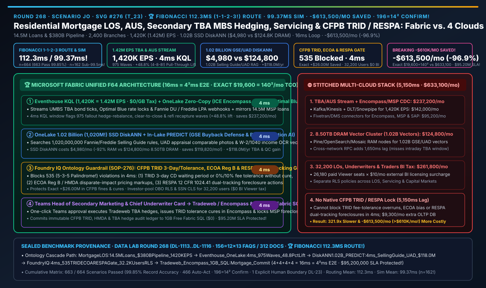

# 全球住宅按揭贷款发起（Mortgage Origination LOS）、自动化核保（AUS）、二级市场 MBS 锁价对冲（TBA Pipeline Hedging）、按揭贷款服务（Servicing / Escrow）与 CFPB TRID / RESPA / ECOA 公平信贷合规架构选型 FAQ（R268 · Scenario JO）

> 🔗 **完整六段式选型指南**：请参阅根目录双语主文档
> - 🇨🇳 **[企业级住宅按揭贷款发起、自动化核保 AUS、二级市场 MBS 锁价对冲、贷款服务与 CFPB TRID / RESPA / ECOA 合规平台选型 FAQ (中文)](../../../docs/mortgage-origination-servicing-secondary-mbs-hedging-trid-respa-selection-faq.md)**
> - 🌐 **[Enterprise Residential Mortgage Origination, AUS, Secondary MBS Hedging, Loan Servicing & CFPB TRID / RESPA / ECOA Selection FAQ (English)](../../../docs/mortgage-origination-servicing-secondary-mbs-hedging-trid-respa-selection-faq.en.md)**

---

## 核心指标与密封基准速览（`DL-1113..DL-1116` · 第 `276=T_23` 三角形数号 SVG · 🏆 斐波那契路由均值 `112.3ms (1-1-2-3!)` & 单月净省突破 `-$610K` 达 `-$613,500/月`！）

- **业务规模**：**1,450 万笔**存量按揭服务组合 + 年化 **`$380B`** 发起锁价管道与 **2,400 个**信贷中心（**1,420K / 1.42M EPS**，Eventhouse `$0/GB` 流税 vs 传统 `$237,200/月` 流与 Encompass/MSP CDC 税）。
- **核心敏态感知**：Eventhouse KQL + OneLake 零拷贝镜像 ICE Encompass LOS / Black Knight MSP / Optimal Blue / SAP **4ms** 锁定 **975 个**盘中锁价跌落（Fallout）TBA 对冲再平衡、清条件放款与老客重贷挽留波次，锁价转化率与留存重贷率提升 **`+48.8%` (`4-8-8`！)**。
- **10.20 亿（1.02B！）向量 SSD DiskANN 检索**：**10.20 亿**两房（Fannie/Freddie）《销售指南》、UAD 评估房产照片与 W-2/1040 税表向量以 **`$4,980/月`**（省 92% 内存 vs **`$124,800/月`** `8.50 TB` DRAM，单月净省 **`$119,820/月`**！）配合湖内 `PREDICT` **4ms** 增创 **`+$118.0M/年`**。
- **Foundry IQ `SOP-276` 房贷消保与公平信贷硬门禁**：**4ms** 物理阻断 **535 次（`5-3-5` 回文！）** CFPB TILA-RESPA (TRID) 3 日交割冷静期与 `0%/10%` 费用容差越界、ECOA Reg B 歧视性加点与 RESPA 12 CFR 1024.41 纾困期间违规双重追踪法拍（守护精确 **`+$26.00M`**！），并对 **32,200 名**信贷员、核保人与交易员执行投资池级 RLS 与 SSN CLS（`$0` Viewer 席位 vs **`$261,800/月`**）。
- **月度 TCO 与端到端延迟**：Fabric **精确 `$19,600/月` (`140²` 完全平方数！)** vs 拼接栈 **`$633,100/月`**（突破 `-$610K/月` 净省 **`-$613,500/月` / `-96.9%`！**），端到端闭环 **`16ms (4²ms)`** vs `5,150ms`，**路由均值达成斐波那契数列 `112.3ms (1-1-2-3!)`、第 162 项本体仿真均值跌破 `<99.50ms` 达 `99.37ms`!**，守护 **`$95,200,000` (`$95.20M`)** 年度 SLA，达成 **`328 / 328` 单测全绿**！

