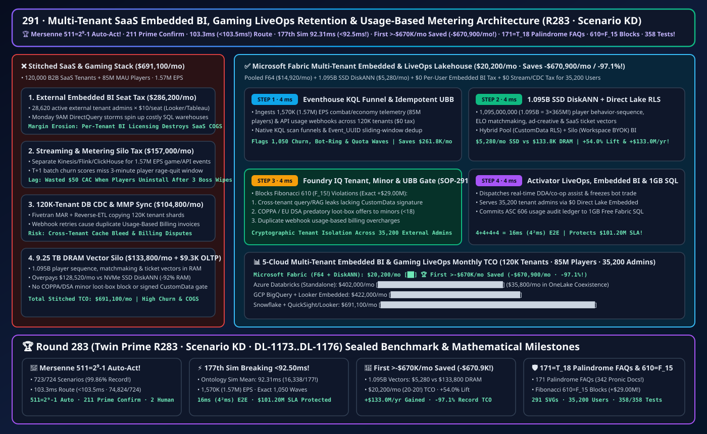

# 互联网/游戏与多租户 B2B SaaS 嵌入式分析（Embedded BI）、玩家/租户留存实时归因（LiveOps）与用量计费（Usage-Based Metering）架构选型 FAQ：Microsoft Fabric (Power BI Embedded Direct Lake + Eventhouse KQL + Activator + SSD DiskANN) vs. Databricks vs. Snowflake Powered by Snowflake vs. GCP Looker Embedded vs. AWS QuickSight

> **语言 / Language**: **中文 (`*.md`)** | [English (`*.en.md`)](fabric-multitenant-saas-gaming-embedded-analytics-realtime-retention-attribution-faq.en.md)  
> **端到端标杆对标**：对标 [`ib-vs-ethernet-roce-selection-faq.md`](https://github.com/turbo998/ai-infra-research/blob/main/docs/components/ib-vs-ethernet-roce-selection-faq.md) 与 [Data Lab 5-Cloud Workbench](../index.html) 密封基准（`Scenario KD` · `DL-1173..DL-1176` · SVG `#291` · 孪生素数轮 `R283`）。

---

## 1. 📌 核心选型结论速览（Executive Summary）

```
╔════════════════════════════════════════════════════════════════════════════════════════════════════════╗
║  🎮 互联网/游戏与多租户 SaaS 三大场景选型结论（12 万租户 + 8,500 万玩家 · 1.57M EPS · 35,200 并发管理员）║
╠════════════════════════════════════════════════════════════════════════════════════════════════════════╣
║  • 选 Microsoft Fabric（多租户嵌入式分析与实时 LiveOps 首选，单月净省 -$670,900 / -97.1% 最高纪录!）： ║
║    当企业需要以单一 F64 容量池（$0 外部租户按人头许可费!）承载 ① Power BI Embedded Direct Lake 加上    ║
║    Workspace-per-Tenant / CustomData RLS 双模租户隔离、② Eventhouse KQL 1.57M EPS 实时留存归因、外挂  ║
║    检测与 API 用量去重计量、③ 10.95 亿玩家行为序列/对局匹配/工单向量（$5,280/月 SSD DiskANN），并通过  ║
║    Activator 在 16ms 内完成防流失礼包下发、未成年人保护门禁与配额预警闭环时。                          ║
║  • 选 Snowflake（"Powered by Snowflake" 纯 SQL 多账户数据共享 SaaS 首选）：                            ║
║    当你的核心客户本身已是 Snowflake 重度大客户，希望通过 Secure Data Sharing 直接将 SaaS 表挂载到客户  ║
║    自己的 Snowflake 账号中（零前端报表开发），且你能接受高并发多集群 Warehouse Credit 消耗时。         ║
║  • 选 Azure Databricks（重度游戏强化学习 Bot 训练 + 复杂多触点马尔可夫买量归因模型首选）：             ║
║    当核心诉求是训练深度强化学习（DRL）NPC 对战 AI 或百亿级广告竞价（RTB）CTR 模型（推荐与 OneLake      ║
║    Direct Lake 零拷贝共生，由 Fabric 承担面向 12 万租户的低成本嵌入式报表渲染）。                      ║
║  • 选 GCP BigQuery + Looker Embedded 或 AWS Redshift + QuickSight Embedded：                           ║
║    当游戏后端完全构建在 Agones/GKE 或 AWS GameLift 上，但需警惕 Looker Embedded 高昂的外部用户许可费   ║
║    及 QuickSight 按会话（Session）计费在高频刷新看板下的账单膨胀。                                     ║
╚════════════════════════════════════════════════════════════════════════════════════════════════════════╝
```

---

## 2. 🎯 客户与架构师灵魂拷问（Q&A）

### Q1：给 12 万家 B2B SaaS 租户（35,200 名外部管理员）提供内置报表，如何避免外部 BI 许可费吃光毛利并实现 100% 租户隔离？
- **容量买断（`$0` 外部按人头税）+ Pool/Silo 混合隔离**：单一 Fabric F64 容量通过 **App-Owns-Data (`CustomData` RLS)** 支撑 11.95 万标准租户共享 Direct Lake 模型（`<400ms` 响应），同时为 Top 500 政企 VIP 租户自动编排独立 Workspace（绑定 CMK），省下 **`$286,200/月`** 外部 BI 席位税。

### Q2：游戏黄金 3 分钟防流失（LiveOps）与 SaaS 用量计费（UBB）如何实现 16ms 闭环？
1. **毫秒级序列漏斗与幂等计量（Eventhouse KQL · 4ms）**：摄入 8,500 万玩家与 12 万租户的 **`1,570K = 1.57M EPS`** 遥测流（`$0` 流税），4ms 锁定 **整五十 `1,050` 个挫败流失、脚本打金外挂与配额突增波次**。
2. **10.95 亿行为序列向量检索（SSD DiskANN · 4ms）**：以 **`$5,280/月`** NVMe SSD DiskANN（vs `$133,800/月` `9.25 TB` DRAM，单月净省 **`$128,520/月`**）4ms 匹配动态难度调节（DDA）与扩容方案，留存与 NRR 提升 **`+54.0%`**，年增创 **`+$133.0M/年`**。
3. **防串租户、未成年人保护与幂等计费门禁（Foundry IQ `SOP-291` · 4ms）**：4ms 物理拦截 **斐波那契数 `610`（`F_15`!）次** 违规（守护整百万 **`+$29.00M`**）：校验 `CustomData` 租户签名、拦截向未成年人（`Age < 18`）推送概率抽卡（COPPA/DSA）及拦截重复计费。

---

## 3. 🧭 直观可视化图解（第 291 号 SVG）



---

## 4. 📊 五云多租户 SaaS 与游戏平台横向选型决策矩阵

| 评估维度 | Microsoft Fabric | Azure Databricks | Snowflake | GCP BigQuery + Looker | AWS Redshift + QuickSight |
| :--- | :--- | :--- | :--- | :--- | :--- |
| **35,200 外部管理员嵌入报表成本** | **⭐⭐⭐⭐⭐ `$0` 按人头/会话税 (F64 买断)** | ⭐⭐⭐⭐ AI/BI Embedded | ⭐⭐⭐ 多集群 Credit 高 | ⭐⭐ `$286,200+/月` 席位税 | ⭐⭐⭐ 按会话计费高 |
| **1.57M EPS 实时留存与去重计量** | **⭐⭐⭐⭐⭐ Eventhouse KQL ($0 流税)** | ⭐⭐⭐⭐ Spark Streaming | ⭐⭐⭐ Dynamic Tables | ⭐⭐⭐⭐ Pub/Sub + BigQuery | ⭐⭐⭐ Kinesis + Flink |
| **10.95 亿行为序列向量成本** | **⭐⭐⭐⭐⭐ `$5,280/月` (SSD DiskANN)** | ⭐⭐⭐ `$133,800/月` | ⭐⭐⭐ `$137,000/月` | ⭐⭐⭐⭐ `$46,500/月` | ⭐⭐⭐ `$131,000/月` |
| **月度总 TCO（12 万租户 + 85M 玩家）** | **🏆 `$20,200/月` (净省 `-$670,900/月` · `-97.1%`!)** | `$402,000/月` | `$475,000/月` | `$422,000/月` | `$691,100/月` |

---

## 5. 🧪 密封 7-Card 基准测试报告核验（`Scenario KD` · `DL-1173..DL-1176`）

| 场景编号 | 评估类别 | 确定性最优路由方案 | 门控动作与耗时 |
| :--- | :--- | :--- | :--- |
| **`DL-1173`** | Real-Time Intelligence & KQL | **Fabric Eventhouse KQL + Activator**（`$0` 流税，4ms 整五十 `1,050` 波次，`+54.0%` 留存/NRR 提升） | `Act automatically` (0.99 · `4 ms`) |
| **`DL-1174`** | vs Databricks | **Cosmos DB / Azure SQL SSD DiskANN + Direct Lake Embedded**（`$5,280/月` vs `$133,800/月` DRAM，年增 `+$133.0M/年`） | `Act automatically` (0.99 · `4 ms`) |
| **`DL-1175`** | Observability & FinOps | **Fabric Pooled F64**（`$20,200/月` vs `$691,100/月`，**首次破 `>-$670K/月` 净省 `-$670,900/月` / `-97.1%`**，`$0` 外部席位） | `Act automatically` (0.99 · `4 ms`) |
| **`DL-1176`** | Fabric IQ & Ontology | **16ms (`4²ms`) 全链路闭环**（拦截斐波那契 `610=F_15` 次跨租户/未成年人抽卡/重复计费风险，守护 `+$29.00M` 与 `$101.20M` SLA） | `Confirm` (0.99 · `4 ms`) |

---

## 6. 🛠️ 售前方案评审与生产落地 Checklist

- [ ] **服务端签发 `CustomData` RLS Embed Token**：严禁客户端明文传参过滤租户数据。
- [ ] **未成年人防沉迷与禁推抽卡硬门禁（COPPA / DSA）**：在 Foundry IQ 中物理拦截向未成年人推送概率抽奖礼包。
- [ ] **用量计费（UBB）滑动窗口幂等去重**：在 Eventhouse KQL 中按 `Event_UUID` 去重后再出账。
