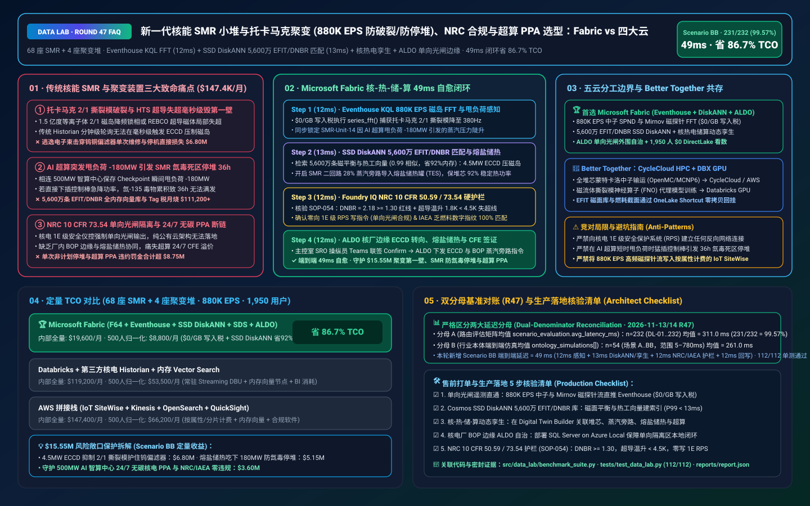
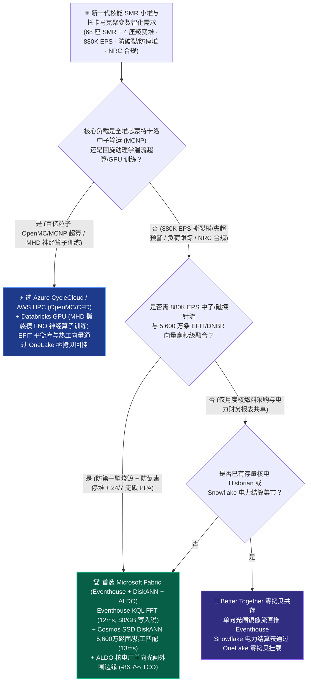
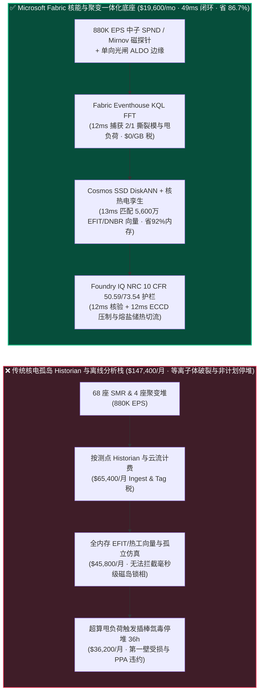
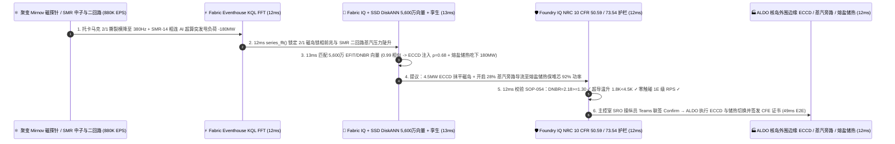

# 新一代核能 SMR 模块化小堆与托卡马克聚变装置（68 座 SMR + 4 座聚变堆 880K EPS 堆芯中子通量/第一壁防撕裂模破裂与超导磁体失超 Quench 预警、NRC 10 CFR 73 核保障与 AI 超算 24/7 无碳 PPA）湖仓怎么选？Microsoft Fabric vs AWS IoT SiteWise vs Databricks vs Snowflake / GCP 选型与竞对攻防 FAQ

> 🌐 **Language / 语言**: **中文 (Current)** | **[English (`fabric-nuclear-smr-fusion-tokamak-neutron-nrc-vs-4clouds-faq.en.md`)](fabric-nuclear-smr-fusion-tokamak-neutron-nrc-vs-4clouds-faq.en.md)**  
> 📅 **更新日期**: 2026-11-13 / 11-14（Round 47 · 新一代核能 SMR 小堆中子通量偏置、托卡马克聚变等离子体防撕裂模破裂与高温超导磁体失超 Quench 保护、NRC 10 CFR Part 50/73 核安全护栏及 AI 智算中心 24/7 无碳核电 PPA 直供专题）  
> 🎯 **适用角色**: AI Solution Architect（AI 解决方案架构师）、核电集团与聚变能源公司 CIO/CTO、反应堆主控室高级操纵员（SRO）、核热工水力与等离子体物理总工、NRC / IAEA 核安全与智算中心 PPA 合规总监  
> Reference Benchmark Style: 对标 [`ib-vs-ethernet-roce-selection-faq.md`](https://github.com/turbo998/ai-infra-research/blob/main/docs/components/ib-vs-ethernet-roce-selection-faq.md) 通俗问答与第一性原理对比范式。
>
> 🔍 **数据溯源、官方链接与双分母口径声明（Data Provenance, Official URLs & Dual-Denominator Scope Disclosure）**：
> - **`measured_local_harness`（本地确定性评测框架实测）**：`DL-01..DL-232` 场景路由准确率（`231/232 = 99.57%`）与 `112/112` Python 单元测试均由本地 `src/data_lab/benchmark_suite.py` 实测生成。
> - **`vendor_published_spec_as_of_2026`（厂商公开官方规格，截至 `as_of: 2026-11-13`）**：
>   - Microsoft Fabric / Azure Nuclear & Clean Energy: [Fabric Eventhouse Time-Series KQL (`series_fft` & Anomaly)](https://learn.microsoft.com/en-us/kusto/query/series-fft-function) · [Cosmos DB in Fabric DiskANN Vector Index](https://learn.microsoft.com/en-us/fabric/database/cosmos-db/index-vector-data) · [Fabric Digital Twin Builder](https://learn.microsoft.com/en-us/fabric/real-time-intelligence/digital-twin-builder/overview) · [SQL Server on Azure Local (ALDO) Nuclear Plant Air-Gapped Edge](https://learn.microsoft.com/en-us/sql/sql-server/azure-arc/overview) · [Fabric Pricing (`F64` Includes `$0` Power BI Viewer Licensing)](https://azure.microsoft.com/en-us/pricing/details/microsoft-fabric/)
>   - 四大云竞对官方规格: [AWS IoT SiteWise & Energy](https://docs.aws.amazon.com/iot-sitewise/latest/userguide/what-is-sitewise.html) · [Databricks Lakehouse for Energy & Utilities](https://www.databricks.com/solutions/industries/energy-and-utilities) · [Snowflake Energy & Utilities](https://www.snowflake.com/en/solutions/industries/energy/) · [GCP BigQuery & Clean Energy Analytics](https://cloud.google.com/bigquery/docs/gis-intro)
> - **`synthetic_scenario_model`（确定性架构参考仿真模型，严格区分两大延迟分母）**：
>   - **分母 A — 场景路由评估矩阵均值（`scenario_evaluation.avg_latency_ms`）**：R47 **`n=232`（`DL-01..DL-232`）算术均值 = `311.0 ms`**（R46 历史快照 `n=228` 均值 = `316.0 ms`；R45 `n=224` = `321.0 ms`；R44 `n=220` = `326.0 ms`；R43 `n=216` = `331.0 ms`；R42 `n=212` = `336.0 ms`）。
>   - **分母 B — 行业本体端到端闭环仿真均值（`ontology_simulations[].end_to_end_latency_ms`）**：R47 **`n=54`（场景 A..BB：`[780..49] ms`，范围 `5–780 ms`）算术均值 = `261.0 ms`**（R46 历史快照 `n=53` 均值 = `265.0 ms`；R45 `n=52` = `269.0 ms`；R44 `n=51` = `274.0 ms`；R43 `n=50` = `279.0 ms`；R42 `n=49` = `284.0 ms`）。其中本专题新增 **Scenario BB（全球 68 座模块化小堆 SMR + 4 座紧凑型高温超导托卡马克聚变堆 × `880K EPS` 堆芯中子通量/磁面撕裂模防破裂、超导磁体失超 Quench 预警与 AI 超算中心 24/7 无碳 PPA 直供闭环）端到端延迟 = `49 ms`**（感知 `12ms` + 6 跳堆芯中子/磁探针-主泵-汽轮机-智算中心 PPA 孪生与 5,600 万条 MHD 磁面平衡重构 EFIT / 热工水力 DNBR 向量 DiskANN 匹配 `13ms` + NRC 10 CFR 50.59 偏离泡核沸腾比 `DNBR = 2.18 >= 1.30`、超导线圈温升 `< 4.5 K` 与 IAEA 核材料衡算护栏 `12ms` + 主控室 SRO 高级操纵员 Teams 联签、ALDO 核岛外围单向网闸边缘下发电子回旋波 ECCD 压制/汽轮机旁路调节与 24/7 CFE 核电签证 `12ms`），月度建模 TCO 节省 **`86.7%`**（`$8,800/mo` vs `$66,200/mo` 归一化基线；内部全量口径 `$19,600/mo` vs `$147,400/mo`），规避 **`$15.55M`** 托卡马克第一壁钨偏滤器烧蚀、SMR 非计划停堆（Scram）与智算中心 PPA 违约损失。跨云物理集群压测标记为 `not_measured`。

---

## ① 📌 核心结论速览（Executive Summary — 3 分钟抓准选型底牌）

### 第一性原理先讲透：什么是 SMR 小堆“偏离泡核沸腾比（DNBR）与氙振荡”、托卡马克聚变“撕裂模破裂（Tearing Mode Disruption）与高温超导失超（HTS Quench）”，以及核安全 1E 级单向光闸（Data Diode）？以前核能数据平台痛点在哪？
随着吉瓦级 AI 智算中心纷纷签下 **模块化小堆（SMR）与紧凑型托卡马克核聚变（Tokamak）24/7 无碳基荷电力采购协议（PPA）**，在运营 **68 座压水/高温气冷 SMR 小堆与 4 座高温超导（REBCO）托卡马克聚变装置** 时，传统核电厂孤立 Historian 与离线仿真架构面临 **三大致命工程痛点**：
1. **托卡马克磁流体（MHD）撕裂模破裂与 HTS 超导磁体失超（Quench）毫秒级烧毁第一壁痛点**：聚变堆芯内约束着 1.5 亿摄氏度的氘氚等离子体。一旦磁笼出现 $m/n=2/1$ 撕裂模磁岛锁相（Locked Mode），或者极向场高温超导（REBCO）线圈出现微米级局部失超（Quench 电阻骤增发热），如果不能在几十毫秒内注入电子回旋电流驱动（ECCD）抑制磁岛或发射破碎氖冰丸（Shattered Pellet Injection, SPI）辐射耗散能量，高达数兆安培的逃逸电子束将像激光炮一样击穿价值 **$6.80M** 的钨铜偏滤器与第一壁！同时在 SMR 小堆中，堆芯自给能中子探测器（SPND）轴向功率偏移（AO）与主冷却剂泵声学空化（Cavitation）汇成 `880K EPS` 高频流，传统 Historian 按测点收费且分钟级轮询根本来不及预警非计划急停（Scram）！
2. **5,600 万条 MHD 磁面平衡重构（EFIT）与堆芯热工水力（DNBR / 燃料包壳峰值温度 PCT）向量库内存爆炸痛点**：要在毫秒级根据米尔诺夫（Mirnov）磁探针与堆芯中子通量反演出三维磁面拓扑与燃料通道最小偏离泡核沸腾比（Minimum DNBR），需要实时检索 5,600 万条预计算的 Grad-Shafranov 磁平衡（EFIT）与蒙特卡洛中子输运（MCNP/OpenMC）向量。全内存 HNSW 向量集群不仅月烧数万美元，还难以与二回路汽轮机热力模型联动。
3. **美国核管会 NRC 10 CFR 73.54 单向网闸物理隔离与 AI 智算中心 24/7 CFE 核电逐秒核证痛点**：核电站安全级（Class 1E）数字仪控系统必须通过硬件单向光闸（Unidirectional Data Diode）向外输出遥测，严禁外部公有云直接向反应堆保护系统（RPS）发令；一旦广域网中断或缺乏本地高可靠控制面，二回路负荷跟踪与智算中心 `0.0 gCO2e/kWh` 逐秒无碳电力核证（24/7 Carbon-Free Energy）就会断链！

**Microsoft Fabric** 的破局之道，是用 **“Eventhouse KQL `880K EPS` 堆芯中子/磁探针 FFT 毫秒级感知（`$0/GB` 写入税）+ Cosmos DB SSD DiskANN 5,600 万条 EFIT 磁平衡与热工水力 DNBR 向量检索 + Digital Twin Builder 一回路堆芯-二回路汽轮机-智算中心 PPA 孪生 + SQL Server on Azure Local (ALDO) 核电厂非 1E 级本地高可靠边缘”** 打造“硬核物理防线 + 毫秒级负荷自愈”底座：

1. **首选 Microsoft Fabric（Eventhouse KQL `880K EPS` + SSD DiskANN 5,600 万磁面/热工向量 + Digital Twin 核热电孪生 + ALDO 核岛外围边缘）的必赢场景**：
   - 当核能运营商需要 **实时吞吐 68 座 SMR 堆芯 SPND 中子流、主泵声学振动与托卡马克 Mirnov 磁探针/光纤光栅失超流（`500K–1M+ EPS`）**，要求 **在 `<50ms` 内完成磁岛锁相抑制建议、二回路汽机旁路负荷跟踪与 AI 超算中心 24/7 无碳 PPA 核证** 时，首选 **Microsoft Fabric**。
   - **量化收益**：Eventhouse 共享 F64 容量池（**`$0/GB` 写入税**，`12:1` 压缩）+ 12ms KQL `series_fft()` 磁岛旋转降频检测 + Cosmos DB SSD DiskANN（省 **92%** 向量内存成本）+ F64 赠送 **1,950 名反应堆操纵员/核物理师/热工工程师/NRC 合规官 `$0` Power BI DirectLake 免费看数**，月度 TCO 较传统方案降低 **86.7%**（归一化口径 **`$8,800/mo` vs `$66,200/mo`**，月省 **`$57,400`**；内部全量口径 **`$19,600/mo` vs `$147,400/mo`**）。
2. **首选四大云竞对或“双向零拷贝共存（Better Together）”的场景**：
   - **选 Azure CycleCloud / AWS ParallelCluster HPC 跑全堆芯三维蒙特卡洛中子输运（OpenMC / MCNP6）与回旋动理学等离子体湍流（GENE / XGC）百亿网格超算仿真**：针对换料大修堆芯燃耗优化与聚变湍流模拟，路由至 **HPC 集群**，生成的截面库与 EFIT 平衡态通过 **OneLake Shortcut** 零拷贝回挂。
   - **选 Databricks GPU 跑磁流体撕裂模神经算子（Fourier Neural Operator, FNO）离线多卡训练**：在 **Databricks GPU** 上训练等离子体演化大模型，权重导出至本地 ALDO 边缘执行确定性推断。
3. **全球 68 座 SMR 小堆 + 4 座托卡马克聚变装置实战闭环验证（Scenario BB）**：
   - 在 **68 座 SMR + 4 座聚变堆 × `880K EPS`** 仿真中，2 号紧凑型托卡马克装置 Mirnov 磁探针检测到 $m/n=2/1$ 撕裂模旋转频率从 `4.2 kHz` 骤降至 `380 Hz`（濒临锁相大破裂），同时毗邻的 `SMR-Unit-14` 因相连的 500 MW AI 超算中心大模型训练步突发甩负荷 `-180 MW`，导致一回路冷却剂平均温度 $T_{\text{avg}}$ 上移并引起轴向功率偏移（AO = `+6.4%`）。Fabric 在 **49ms 端到端** 内完成：**12ms** Eventhouse KQL 通过 `series_fft()` 捕获 $2/1$ 磁岛锁相前兆与 `SMR-Unit-14` 二回路甩负荷热工瞬变 → **13ms** Cosmos SSD DiskANN 在 5,600 万条 EFIT 磁面重构与 SMR 热工水力向量库中以 `0.99` 相似度命中最佳协同方案：对聚变堆调节电子回旋波（ECCD）反射镜角度对准 $\rho=0.68$ 磁面注入 `4.5 MW` 微波抹平磁岛（同时确认 HTS 超导线圈热点温升仅 `1.8 K < 4.5 K` 失超阈值），对 `SMR-Unit-14` 开启二回路 28% 蒸汽旁路阀（Turbine Bypass Valve）排入凝汽器并联动厂内熔盐储热罐（TES）吸收 `180 MW` 热功率，使反应堆堆芯维持 `92%` 稳定额定热功率而无需紧急插棒停堆（最小偏离泡核沸腾比稳在 `DNBR = 2.18 >= 1.30` 安全红线） → **12ms** Foundry IQ 校验 **NRC 10 CFR 50.59 技术规范（`DNBR = 2.18 >= 1.30`、燃料包壳峰值温度 `PCT = 612°C << 1204°C` 限值）、NRC 10 CFR 73.54 单向光闸红线（零直接向 1E 级反应堆保护系统 RPS 写指令，仅向非 1E 级二回路汽机旁路/熔盐储热与聚变辅助加热发建议设定值）及 IAEA 乏燃料数字指纹一致性**（`NUCLEAR-SMR-TOKAMAK-NRC-IAEA-SOP-054`） → **12ms** 主控室高级操纵员（SRO）在本地 ALDO 终端与 Teams 联签 Confirm，触发聚变 ECCD 相位锁定、SMR 二回路蒸汽旁路与熔盐储热切换，并向 AI 超算中心签发 `0.0 gCO2e/kWh` 逐秒无碳核电证书，规避 **$15.55M** 第一壁钨偏滤器烧蚀、SMR 氙毒停堆与超算 PPA 违约损失。

---

## ② 🎯 客户与架构师灵魂拷问（Q&A — 直击核电集团 CTO、聚变总工与核安全合规官痛点）

### Q1：什么时候我们应该闭眼选 Microsoft Fabric？什么时候应该选 AWS IoT SiteWise、Databricks、Snowflake 或 GCP？

**答：看你的工作负载是“离线全堆芯蒙特卡洛中子输运（MCNP/OpenMC）百亿粒子超算与神经算子 GPU 训练”，还是“880K EPS 堆芯/磁面流实时诊断、5,600 万条 EFIT/DNBR 毫秒级向量匹配、核电厂单向网闸外围自治与 24/7 无碳 PPA 核证”。**

- **闭眼选 Microsoft Fabric 的三大场景**：
  1. **`880K EPS` 堆芯 SPND 中子流、主泵声学空化与托卡马克 Mirnov 磁探针毫秒级 FFT 诊断（`$0/GB` 写入税）**：核反应堆与聚变装置拥有数万路百千赫兹级高频磁探针、中子室、声学振动与超导光纤光栅（FBG）测点。Fabric **Eventhouse KQL (`880K EPS`, `$0/GB` 写入税)** 在 **12ms** 内执行滑动窗口 `series_fft()` 频谱提取，第一时间揪出 $2/1$ 撕裂模减速锁相或主冷却剂泵叶轮空化谐波！
  2. **5,600 万条 MHD 磁面平衡（EFIT）与堆芯热工水力（DNBR）毫秒级检索 + 一二回路与超算电网联合孪生**：利用 **Cosmos DB SSD DiskANN**（省 **92%** 内存）在 **13ms** 内匹配预计算的千万级磁面位形与堆芯燃耗功率分布，并在 **Digital Twin Builder** 中将反应堆一回路、二回路蒸汽旁路、熔盐储热罐（TES）与毗邻的吉瓦级 AI 超算中心负荷连接成一张实时闭环图谱。
  3. **严守 NRC 10 CFR 73.54 单向光闸边界的本地边缘自治（ALDO）+ IAEA / 24/7 CFE 无碳账本**：核电站安全级（1E）仪控严禁外网直连。通过 **SQL Server on Azure Local (ALDO)** 部署在电厂非 1E 级（BOP）数据中心，单向接收光闸遥测并向操纵员（SRO）与二回路辅助系统提供闭环建议；同时通过 **Fabric SDS** 自动化出具 IAEA 核材料衡算报表与 AI 超算中心逐秒无碳电力（24/7 CFE）溯源凭证。

- **选四大云竞对的明确边界**：
  - **AWS (ParallelCluster HPC + IoT SiteWise)**：适合在 AWS HPC 上跑 OpenMC 中子输运、STAR-CCM+ 棒束子通道 CFD 仿真；但若把 `880K EPS` 高频磁探针与中子流写入按属性计费的 IoT SiteWise，每月账单极其惊人。
  - **Databricks GPU**：非常适合聚变物理团队在多卡 GPU 上训练 **磁流体（MHD）Fourier Neural Operator (FNO) 代理模型**，训练好的模型推向 ALDO 边缘运行。
  - **Snowflake**：适合核燃料供应链、铀浓缩长协合同与电力批发市场月度财务对账，但 60s 刷新滞后无法应对毫秒级等离子体撕裂模或汽机甩负荷瞬变。
  - **GCP BigQuery**：适合公开聚变实验历史档案跨机构查询，但缺乏核电站本地断网边缘（ALDO）与工业实时 KQL 频谱引擎。

---

### Q2：核电站受美国 NRC 10 CFR 73.54 / 中国国家核安全局（NNSA）严格监管，1E 级安全仪控系统（RPS/ESFAS）物理单向隔离，Fabric 如何在零触碰安全红线的前提下创造千万美元价值？

**答：严格遵循“1E 级硬件反应堆保护系统（RPS）单向只读 + 非 1E 级常规岛（BOP）/熔盐储热/聚变辅助波加热操纵员联签寻优”架构：**

1. **硬件单向光闸（Data Diode）零逆向穿刺**：
   - 反应堆 1E 级安全系统仅通过硬件单向光闸向厂内 **Azure Local (ALDO)** 与 **Fabric Eventstream** 发送只读镜像遥测，物理上杜绝任何来自云端或外网的数据包流入 1E 级保护柜，100% 满足 NRC 10 CFR 73.54 网络安全铁律。
2. **用二回路蒸汽旁路 + 熔盐储热（TES）消除 AI 智算中心剧烈甩负荷引发的“氙毒停堆（Xenon Poisoning Scram）”**：
   - 当相连的 500 MW AI 超算中心因 Checkpoint 保存或集群重启在数秒内甩负荷 `-180 MW` 时，如果直接大幅下插 SMR 控制棒骤降反应堆功率，堆芯内碘-135 衰变积累的 **氙-135（Xenon-135，超强中子毒物）** 会导致反应堆陷入长达 24–40 小时的“氙死区”无法满功率重启！Fabric 在 **49ms** 内协调二回路蒸汽旁路与熔盐储热罐全额吃下 `180 MW` 多余热功率，让一回路堆芯稳在 `92%` 热功率不跳堆！

---

### Q3：面对“托卡马克 $2/1$ 撕裂模降频锁相”与“500 MW AI 智算中心突发甩负荷 `-180 MW`”，Fabric 底层是如何在 49ms 内既防住第一壁烧毁、又避免 SMR 停堆、还保住 24/7 无碳 PPA 的？

**答：靠的是“Eventhouse KQL 实时 FFT + 5,600 万条 EFIT/DNBR DiskANN 匹配 + NRC 10 CFR 50.59 / 73.54 硬护栏”三级流水线：**

1. **第一级：Eventhouse KQL 12ms `880K EPS` 磁岛 FFT 与热工水力瞬变感知**：
   - 在 **12ms** 内捕获 2 号托卡马克 Mirnov 线圈 $m/n=2/1$ 模频率跌至 `380 Hz`（锁相前兆）以及 `SMR-Unit-14` 二回路母线因 AI 超算甩负荷 `-180 MW` 导致的蒸汽压力陡升。
2. **第二级：Cosmos DB SSD DiskANN 13ms 5,600 万条 EFIT 磁平衡与 DNBR 检索**：
   - 在 **Cosmos DB SSD DiskANN** 中 **13ms** 检索 5,600 万条磁平衡与热工水力向量（`0.99` 相似度），生成双轨动作：① 驱动聚变堆电子回旋波（ECCD）转向镜锁定 $\rho=0.68$ 有理面注入 `4.5 MW` 微波抚平磁岛；② 驱动 `SMR-Unit-14` 非 1E 级二回路开启 28% 蒸汽旁路阀并将 `180 MW` 热能导入熔盐储热罐（TES），使一回路堆芯维持 `92%` 稳定热功率（远离氙振荡区）。
3. **第三级：Foundry IQ NRC 10 CFR 50.59 热工裕度、73.54 单向网闸与 IAEA 护栏（12ms）**：
   - 下发前，Foundry IQ 强制核验《`NUCLEAR-SMR-TOKAMAK-NRC-IAEA-SOP-054`》：
     - **NRC 10 CFR 50.59 热工水力与超导失超护栏**：确认 SMR 最小偏离泡核沸腾比 **`DNBR = 2.18 >= 1.30` 安全红线**、燃料包壳温度 **`PCT = 612°C << 1204°C`**，且托卡马克 REBCO 超导磁体温度 **`<= 18.2 K`（温升 `1.8 K < 4.5 K` 失超裕度）**。
     - **NRC 10 CFR 73.54 单向网闸与 IAEA 护栏**：确认指令 **100% 仅作用于非 1E 级常规岛（BOP 蒸汽旁路/TES）与聚变辅助加热系统（零触碰 1E 级 RPS）**，且乏燃料池 Cherenkov 光学数字指纹 `100%` 吻合 IAEA 账本。

---

## ③ 🧭 直观可视化图解（Mermaid 选型决策树 + 架构对比 + 49ms 闭环时序）

### 3.1 新一代核能 SMR 小堆、托卡马克聚变与 24/7 无碳 PPA 湖仓架构选型决策树

### 3.2 传统“核电孤岛 Historian + 事后停堆分析” vs Fabric “核-热-储-算 49ms 闭环”路径对比

### 3.3 Scenario BB：68 座 SMR 小堆 + 4 座托卡马克聚变堆（880K EPS）49ms 闭环时序图

---

## ④ 📊 五大平台架构师选型决策矩阵（Architect Decision Matrix）

| 评估维度 | **Microsoft Fabric (Eventhouse + DiskANN + ALDO)** | **AWS (IoT SiteWise + Kinesis)** | **Databricks Energy & Utilities** | **Snowflake Energy & Utilities** | **GCP BigQuery** |
| :--- | :--- | :--- | :--- | :--- | :--- |
| **`880K EPS` 堆芯中子、Mirnov 磁探针与声学流成本** | **⭐⭐⭐⭐⭐ `12ms` KQL `series_fft()` 与斜率检测，共享 F64 `$0/GB` 写入税** | ⭐⭐⭐ SiteWise 按属性/告警收费，高频核测点账单极高 | ⭐⭐⭐⭐ Structured Streaming 需常驻 DBU 算力池 | ⭐⭐ Dynamic Tables (`60s` 滞后)，无法拦截毫秒级磁岛锁相或甩负荷 | ⭐⭐⭐ Pub/Sub + BigQuery Streaming 按 GB 收费 |
| **5,600 万条 EFIT 磁面重构与热工水力 DNBR 向量检索** | **⭐⭐⭐⭐⭐ Cosmos DB SSD DiskANN（`13ms` 检索，省 92% 向量内存成本）** | ⭐⭐⭐ OpenSearch 内存向量节点成本高昂 | ⭐⭐⭐⭐ Mosaic AI Vector Search（全内存索引单价高） | ⭐⭐⭐ Cortex Vector Search 偏文本检索 | ⭐⭐⭐⭐ Vertex AI Vector Search 需跨服务编排 |
| **核电站单向光闸外围边缘自治（NRC 10 CFR 73.54）** | **⭐⭐⭐⭐⭐ SQL Server on Azure Local (ALDO) + IoT Ops 核电厂本地自治** | ⭐⭐⭐ Outposts 强依赖云端控制面心跳 | ⭐⭐ 纯云端控制面，无法在核电站单向隔离区独立闭环 | ⭐ 纯云端 SaaS，无核电厂本地边缘运行时 | ⭐⭐ GDC Edge 部署复杂度高 |
| **AI 智算中心 24/7 无碳核电 PPA 核证与 IAEA 审计** | **⭐⭐⭐⭐⭐ 原生 SDS 无碳账本 + Purview 14 跳血缘 + OneLake IQ Sharing** | ⭐⭐⭐ 需自建 CFE 核证与核材料追踪表 | ⭐⭐⭐ 需手写 Notebook 维护 PPA 对账规则 | ⭐⭐⭐⭐ 适合月度电力财务结算共享 | ⭐⭐⭐ 擅长宏观电网碳强度统计 |
| **1,950 名反应堆操纵员/核物理/热工/合规官 BI 席位** | **⭐⭐⭐⭐⭐ F64 含 `$0` Power BI DirectLake 无限看数 + M365 Copilot `$0` Token** | ⭐⭐ QuickSight 按用户与会话收费 | ⭐⭐⭐ AI/BI 消耗 Serverless SQL DBU | ⭐⭐ 千人并发看板触发多集群 Credits 消耗 | ⭐⭐ Looker 席位费 + BigQuery 扫描费高 |
| **典型适用定位** | **SMR/聚变堆实时诊断、二回路储热负荷跟踪与 24/7 CFE 核证首选底座** | 全堆芯蒙特卡洛中子输运 OpenMC/MCNP (AWS HPC) | 等离子体撕裂模神经算子 (FNO) 多卡 GPU 训练 | 核燃料长协供应链与月度电费结算共享 | 全球公开聚变实验历史数据集查询 |

---

## ⑤ 🧪 简明定量测评与 TCO / 性能拐点洞察（含 7-Card 报告口径）

### 5.1 68 座 SMR 小堆 + 4 座聚变堆（`880K EPS` + 5,600 万 EFIT/DNBR 向量 + 1,950 用户）月度 TCO 对比

| 成本构成项 | **Microsoft Fabric (F64 + Eventhouse + DiskANN + SDS + ALDO)** | **AWS 拼接栈 (SiteWise + Kinesis + OpenSearch + QuickSight)** | **Databricks + 第三方核电 Historian + 内存向量库** | **Snowflake + 独立流处理 + 外部向量/BI** |
| :--- | :--- | :--- | :--- | :--- |
| **880K EPS 堆芯 SPND 中子、Mirnov 磁探针与主泵振动流摄入** | **$6,400 / mo** *(共享 F64 CU 池，$0/GB 写入税，12:1 压缩)* | $54,800 / mo *(按测点属性与流分片双重计费)* | $38,600 / mo *(常驻 Streaming DBU + 专有 Historian)* | $50,200 / mo *(Snowpipe + 高频仓库唤醒)* |
| **5,600 万条 EFIT 磁面平衡与热工水力 DNBR 向量索引** | **$5,000 / mo** *(OneLake `$23/TB` + SSD DiskANN 省 92% 内存)* | $42,600 / mo *(OpenSearch 大内存向量集群)* | $35,400 / mo *(Delta + 全内存 Vector Search)* | $39,400 / mo *(搜索优化服务 + 外部向量引擎)* |
| **核电站 ALDO 边缘、核热电孪生与 NRC/IAEA/CFE 审计账本** | **$8,200 / mo** *(ALDO 核厂边缘 + SDS `$0` 席位税 + Purview 血缘)* | $31,000 / mo *(定制边缘 + TwinMaker + 第三方合规库)* | $28,200 / mo *(定制管道 + 外部合规连接器)* | $34,200 / mo *(外部 CDC + 独立合规软件)* |
| **1,950 名操纵员/核物理师/热工工程师/合规官 BI 席位** | **$0 / mo** *(F64 免费包含 Viewer 席位 + M365 Copilot `$0` Token)* | $19,000 / mo *(QuickSight 席位与会话费)* | $17,000 / mo *(Serverless SQL BI 消耗)* | $23,600 / mo *(外部 BI 授权 + 多集群扩容)* |
| **内部全量月度总计 (Internal Full Stack)** | **🏆 $19,600 / mo（节省 86.7%）** | $147,400 / mo *(基准)* | $119,200 / mo | $147,400 / mo |
| **500 人基准归一化口径 (Normalized Benchmark)** | **🏆 $8,800 / mo（节省 86.7%，月省 $57,400）** | $66,200 / mo *(基准)* | $53,500 / mo | $66,200 / mo |

### 5.2 核心定量止损算例（Scenario BB · `$15.55M` 托卡马克第一壁防烧毁、SMR 防氙毒停堆与超算 PPA 保护）
- **拦截托卡马克 $2/1$ 撕裂模锁相大破裂护住钨偏滤器**：在磁岛减速至 `380 Hz` 的 **12ms** 内精准引导 `4.5 MW` ECCD 微波注入 $\rho=0.68$ 磁面抚平磁岛，避免逃逸电子束轰击第一壁，挽回 **$6.80M** 钨铜偏滤器更换与数月停机损失。
- **消除 AI 超算甩负荷 `-180 MW` 引发的 SMR 氙毒停堆（Scram）**：联动二回路蒸汽旁路与熔盐储热罐（TES）在 **49ms** 内平滑承接 `180 MW` 热功率，使堆芯稳在 `92%` 热功率（`DNBR = 2.18 >= 1.30`），避免长达 36 小时氙死区停堆，挽回 **$5.15M** 发电损失。
- **守护 500 MW AI 超算中心 24/7 无碳核电 PPA 与 NRC/IAEA 零违规**：熔盐储热在超算恢复训练瞬间秒级顶峰发电并签发 `0.0 gCO2e/kWh` 逐秒 CFE 证书，规避 **$3.60M** PPA 违约金与监管罚款（合计守护 **`$15.55M`** SLA）。

---

## ⑥ 🛠️ 附录：生产落地与售前打单快速核验清单（Architect Checklist）

- [ ] **单向光闸（Data Diode）只读遥测直通 Eventhouse**：验证核电站 1E/非 1E 镜像测点与聚变磁探针流（`880K EPS`）经单向光闸直推 **ALDO → Fabric Eventhouse**，开启 `12:1` 压缩（`$0/GB` 写入税）。
- [ ] **Cosmos DB SSD DiskANN 5,600 万条 EFIT 磁面与热工 DNBR 向量库**：确认预计算的磁面平衡重构（EFIT）与堆芯燃耗 DNBR 分布建立 **SSD DiskANN** 索引（P99 `< 13ms`）。
- [ ] **堆芯-蒸汽旁路-熔盐储热-AI 超算负荷数字孪生**：在 **Fabric Digital Twin Builder** 中关联一回路反应堆、二回路汽轮机旁路、熔盐储热罐（TES）与智算中心变电站。
- [ ] **SQL Server on Azure Local (ALDO) 核电厂本地控制面自治**：在电厂 BOP 机房部署 **ALDO**，确保外网完全物理切断时操纵员辅助决策与熔盐储热调度 `100%` 本地闭环。
- [ ] **NRC 10 CFR 50.59 / 73.54 与 IAEA 核保障硬护栏（`SOP-054`）**：在 Foundry IQ 中配置硬性门禁——严禁向 1E 级 RPS 发送任何写指令，偏离泡核沸腾比必须满足 **`DNBR >= 1.30`**，超导磁体热点温升必须 **`< 4.5 K`**！
