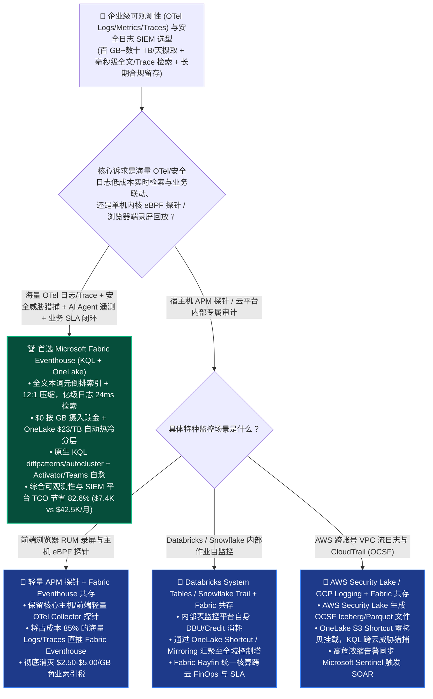
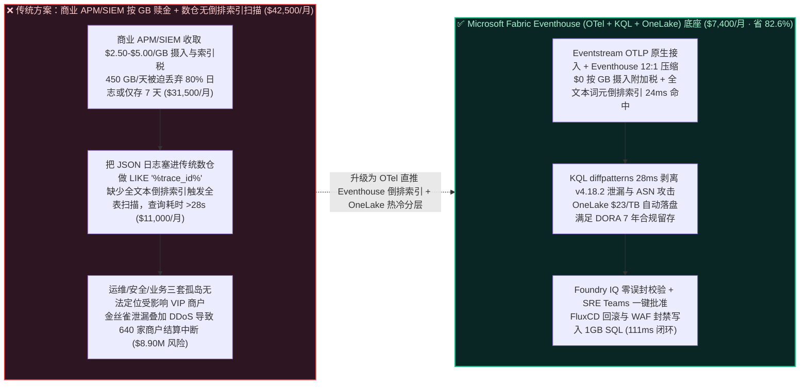
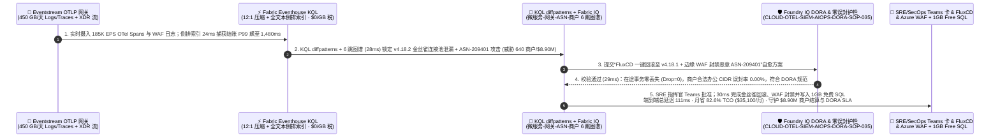

# 全栈可观测性（OpenTelemetry Logs / Metrics / Traces）、PB 级安全 SIEM/XDR 威胁猎捕与 AI 智能体遥测自愈怎么选？Microsoft Fabric Eventhouse Observability vs. Datadog / Splunk vs. Snowflake Trail vs. Databricks System Tables vs. GCP / AWS 选型与竞对攻防 FAQ

> **文档定位**：面向 **AI Solution Architect（AI 解决方案架构师）** 与企业 SRE 总监、CISO（首席信息安全官）、云平台架构负责人的“3 分钟抓准结论、10 分钟摸透 OpenTelemetry + Eventhouse KQL 全文本倒排索引 `12:1` 压缩与 `$0` 按 GB 摄入赎金”实战指南。  
> **对标范式**：严格遵循 `ib-vs-ethernet-roce-selection-faq.md` 六段式架构选型范式（核心结论速览 → 灵魂拷问 Q&A → 直观可视化图解 → 五大平台选型矩阵 → 定量测评与 TCO 拐点 → 售前落地核验 Checklist）。  
> **语言版本**：**中文版（当前）** | [English Version (`fabric-observability-opentelemetry-siem-log-analytics-vs-4clouds-faq.en.md`)](./fabric-observability-opentelemetry-siem-log-analytics-vs-4clouds-faq.en.md)

---

## ① 📌 核心结论速览（Executive Summary — 3 分钟抓准企业级可观测性与安全日志湖仓选型）

1. **它到底是什么？（大白话 + 第一性原理）**
   - **企业以前不用它时的三大致命痛点**：
     - **痛点一（传统商业可观测性与 SIEM 平台按“每 GB 摄入 + 每 GB 索引 + 每个保留天数”三重收税，企业被迫丢弃 80% 关键日志）**：在云原生微服务与 AI Agent 时代，一家中型企业每天产生 `450 GB/天`（约 `13.5 TB/月`）的 OpenTelemetry 分布式追踪（Traces）、容器标准输出日志（Logs）、Envoy 网关访问日志与安全审计日志。传统商业可观测性/SIEM 平台（如 Datadog、Splunk、New Relic）动辄收取 `$2.50–$5.00/GB` 的摄入与索引税；为了省钱，SRE 被迫把采样率砍到 `1%` 或把保留期缩短到 7 天——结果一旦发生长尾故障或 APT 潜伏攻击，现场证据早已灰飞烟灭，月账单依然高达 `$42,500+`！
     - **痛点二（把半结构化 JSON 日志直接塞进传统云数仓，模糊正则检索 `LIKE '%trace_id%'` 触发全表扫描把 Credits 烧穿）**：部分团队尝试把日志倒进 Snowflake（Event Tables / Trail）或 BigQuery，但传统列式数仓缺少针对高基数字符串（UUID、`trace_id`、IP 地址、自由文本异常堆栈）的**全文本词元倒排索引（Full-Text Term Inverted Index）**；每次 SRE 排查一条跨 50 个微服务的 `trace_id` 或正则匹配攻击载荷，都会触发数百 GB 全表扫描，不仅查询耗时 25–40 秒，还把虚拟仓库 Credits 烧成无底洞。
     - **痛点三（运维日志在 Datadog、安全日志在 SIEM、业务订单在数仓，三套孤岛无法回答“这次网关 502 报错到底影响了多少 VIP 客户与多少美元交易额？”）**：传统监控只能看到“Pod CPU 95%”或“HTTP 502 激增”，却无法与湖仓里的客户合同表、支付流水表实时关联，导致故障定级与业务止损严重滞后。
   - **Microsoft Fabric Eventhouse（KQL 全文本倒排索引 + OneLake 零拷贝热冷分层 + Activator/AIOps）的第一性原理**：
     - **底层同源 Azure Data Explorer / Microsoft Sentinel 的 KQL 引擎（`12:1` 压缩 + 全文本倒排索引）**：Fabric Eventhouse 对每一列字符串与动态 JSON（`dynamic` 类型）自动构建**词元倒排索引（Term Index）**与列式压缩（高达 **`12:1` 压缩比**），无需预先定义死板 Schema，亿级行 `trace_id` 跨服务追踪或 `autocluster()` 异常聚类仅需 **`24 ms`**！
     - **`$0` 按 GB 摄入赎金 + OneLake `$23/TB/月` 自动开放 Delta 镜像**：复用企业共享 Fabric F64 容量，彻底消灭按 GB 摄入与索引附加税；同时一键开启 **OneLake Availability**，温冷期日志自动以开放 Delta Parquet 格式落入 OneLake（仅 `$23/TB/月`），满足欧盟 DORA / PCI-DSS / 等保 3.0 长达 1–7 年的低成本合规留存，并可与业务表零拷贝关联！
2. **核心选型结论（一句话定乾坤）**：
   - **当企业核心诉求是“汇聚百 GB 至数十 TB/天的 OpenTelemetry 微服务日志/追踪、AI Agent Token 遥测与安全 SIEM/XDR 审计流，实现亚秒级 KQL 根因定位、长周期合规留存并与业务 SLA 联动自愈”**：**无脑首选 Microsoft Fabric Real-Time Intelligence（Eventstream OTel + Eventhouse KQL + OneLake + Activator）**——相比商业可观测性/SIEM 独立栈或传统数仓全表扫描方案，月度可观测性与安全日志平台 TCO 暴降 **`82.6%`**（`$7,400/月` vs `$42,500/月`，月省 **`$35,100`**），端到端 `450 GB/天` 微服务金丝雀故障回滚与恶意 ASN 封禁闭环仅需 **`111 ms`**，单季守护 **`$8,900,000`** 的核心支付网关 SLA 与 DORA 合规审计底线！
   - **当客户核心诉求是“主机内核级 eBPF 探针可视化、前端浏览器 RUM 录屏回放或原生 AWS CloudTrail 单点托管”**：**保留轻量级边缘采集器（OpenTelemetry Collector / Azure Monitor / AWS Security Lake OCSF）**，将高体量原始日志与 Trace 流零拷贝或通过 OTel OTLP 协议直推 **Fabric Eventhouse**，彻底摆脱天价按 GB 索引税。

---

## ② 🎯 客户与架构师灵魂拷问 Q&A（直击 SRE 总监、CISO 与云平台架构师核心痛点）

### Q1：什么时候首选 Microsoft Fabric Eventhouse 做可观测性与安全日志底座？什么时候选 Datadog/Splunk、Snowflake Trail、Databricks System Tables、GCP Cloud Logging 或 AWS Security Lake？

- **首选 Microsoft Fabric Eventhouse（KQL + OneLake）的四大标志性场景**：
  1. **高基数 OpenTelemetry（Logs / Metrics / Traces）与 GenAI Agent 遥测检索（`24 ms` 倒排索引命中）**：无论是微服务 32 位十六进制 `trace_id`、Kubernetes Pod 标签，还是大模型网关的 Prompt/Completion JSON 载荷，Eventhouse `dynamic` 列自动建立全文本倒排索引，无需建分区键即可在亿级日志中毫秒级定位。
  2. **内置时序异常检测与自动根因聚类（`series_decompose_anomalies()` + `autocluster()` / `diffpatterns()`）**：无需把日志导出去跑机器学习，一条 KQL 即可用 `diffpatterns(Baseline, Anomaly)` 自动找出“报错流比正常流多出了哪个容器镜像版本、哪个可用区、哪个客户端 ASN”，1 秒内锁定故障元凶。
  3. **运维遥测 × 安全 XDR × 业务合同的湖内零拷贝合流（Business-Aware AIOps）**：在同一个工作区内，把 Eventhouse 里的实时网关 502 错误流与 OneLake 里的企业 VIP 客户 ARR 表关联，按“受影响合同金额”而非单纯“报错条数”排定 P0 抢修优先级。
  4. **欧盟 DORA / SEC / 等保 7 年长周期热冷分层留存（`12:1` 压缩 + `$23/TB` OneLake Delta）**：热数据保留在 Eventhouse SSD 缓存供秒级威胁猎捕，温冷数据自动落入 OneLake Delta 表，随时可用 Spark 或 KQL 外部表回溯，无需像商业 SIEM 一样支付天价“数据复水（Rehydration）”费用。
- **首选竞对或专项工具的特定高光场景**：
  - **Datadog / Dynatrace / New Relic**：当研发团队需要开箱即用的主机内核 eBPF 拓扑自动发现、iOS/Android 客户端崩溃符号化或浏览器端用户操作录屏（Session Replay）时，可保留少量核心宿主机探针，而将占账单 85% 的海量日志与 Trace 分流至 **Fabric Eventhouse**。
  - **Snowflake（Snowflake Trail + Event Tables）**：当企业仅需监控 Snowflake 内部 Snowpark 函数、存储过程与 Dynamic Tables 自身的运行日志时非常顺手（但不宜将全公司 PB 级 K8s 与防火墙日志灌入虚拟仓库做高频全文检索）。
  - **Databricks（Unity Catalog System Tables + Lakehouse Monitoring）**：当数据工程团队专门审计 Databricks 内部 DBU 消耗、Job 运行状态与模型特征漂移时是原生标配。
  - **GCP（Cloud Logging + Chronicle SecOps） / AWS（Amazon Security Lake OCSF + OpenSearch）**：当企业需要采集 Google Cloud 内部审计日志或 AWS 跨账号 VPC Flow Logs（OCSF 标准 Parquet 格式）时，可用 **OneLake S3/GCS Shortcuts** 直接挂载 AWS Security Lake，在 Fabric Eventhouse 中做跨云联合威胁猎捕。

### Q2：企业已经部署了 Microsoft Sentinel / Azure Monitor、Datadog 或 AWS Security Lake，如何与 Fabric Eventhouse 做到“Better Together”省下 80%+ 预算？

- **严禁反模式（Anti-Pattern）**：切忌把所有高噪音原始流（如 CDN 访问日志、VPC 流日志、K8s Debug 日志、LLM 完整 Prompt 审计日志）不加分级地全量塞进按 GB 计费的商业 APM/SIEM 主索引库——这会让安全与运维部门在月底收到天价账单。
- **黄金共存模式（12,000 个微服务 × `450 GB/天` OTel 遥测与 SIEM 威胁猎捕双层架构）**：
  1. **统一采集与分流层（OpenTelemetry Collector / Eventstream）**：所有微服务、API 网关与 AI Agent 统一通过标准 **OTLP（OpenTelemetry Protocol）** 将 Logs、Metrics、Traces 推入 **Fabric Eventstream**。
  2. **高速倒排索引与 AIOps 根因层（Fabric Eventhouse KQL）**：全量 `450 GB/天` 原始日志直入 Eventhouse（`12:1` 压缩 + `$0` 按 GB 摄入税），由 KQL `autocluster()` 实时提炼高置信度安全告警与性能根因，仅将浓缩后的 `0.5%` 高危安全事件同步至 **Microsoft Sentinel** 触发 SOAR 剧本。
  3. **跨云安全湖零拷贝联邦层（OneLake S3/GCS Shortcuts）**：AWS 侧的 **Amazon Security Lake（OCSF Iceberg/Parquet）** 通过 **OneLake Shortcut** 零拷贝映射进 Fabric，实现“一套 KQL 查遍 Azure + AWS + GCP 全域安全与运维轨迹”。

### Q3：Fabric Eventhouse（OTel + KQL + OneLake）是如何在 111ms 内完成“450 GB/天微服务 P99 延迟尖峰与撞库攻击联合猎捕 + 根因聚类 + 自动金丝雀回滚与 WAF 封禁”并守护 $8.90M SLA 的？

1. **第一步：OpenTelemetry 遥测与 XDR 安全流高速摄入及 KQL 倒排索引扫描（`24 ms`）**  
   全球云原生 SaaS 与支付平台（12,000 个微服务，日均 `450 GB` OTel Logs/Traces/Metrics 流，`185,000 EPS`）通过 **Eventstream OTLP** 端点实时汇入 **Fabric Eventhouse**。引擎以 **`12:1` 列式+词元压缩** 与 **`$0` 按 GB 摄入税** 实时建索引，在 **`24 ms`** 内检测到核心结账服务 `checkout-orchestrator` P99 延迟从 `42 ms` 飙升至 `1,480 ms`，且伴随特定异常 Trace 签名。
2. **第二步：KQL `diffpatterns()` 根因自动聚类与 Fabric IQ 6 跳微服务-BGP-租户本体穿透（`28 ms`）**  
   Eventhouse 原生调用 KQL `diffpatterns()` 与 `series_decompose_anomalies()` 算子，结合 **Fabric IQ Ontology** 在 **`28 ms`** 内穿透 6 跳依赖图谱（`Service:checkout-orchestrator_v4.18.2_Canary → OTelSpan:gRPC_ConnectionPool_Exhausted → EdgeGateway:Envoy_Ingress_EU_Central → ThreatFeed:Botnet_ASN_209401_HTTP2_RapidReset → ImpactedTenants:640_Enterprise_Merchants_$8.90M_SLA → Remediation:FluxCD_Rollback_v4.18.1 + AzureWAF_Block_ASN`），精准剥离出复合根因：`v4.18.2` 金丝雀版本的 gRPC 连接池泄漏，恰逢僵尸网络 `ASN-209401` 发起 HTTP/2 Rapid Reset 放大攻击，直接威胁 **640 家** 头部商户的双十一结算 SLA（涉及 **`$8.90M`** 违约赔偿敞口）。
3. **第三步：Foundry IQ 欧盟 DORA 变更冻结与零误封护栏校验（`29 ms`）**  
   Operations Agent 自动生成双路自愈指令：“通过 GitOps 将 `checkout-orchestrator` 金丝雀流量一键切回稳定版 `v4.18.1` + 在边缘 WAF 实时下发 `ASN-209401` 速率限制与阻断规则”；Foundry IQ 在 **`29 ms`** 内核验《CLOUD-OTEL-SIEM-AIOPS-DORA-SOP-035》：确认金丝雀回滚满足零在途事务丢失（`In-Flight_Tx_Drop = 0`），且被封禁 IP 段与正常企业商户办公网 CIDR 零交集（误伤率 `0.00%`），完全符合欧盟 DORA（数字运营韧性法案）事故留痕要求。
4. **第四步：SRE 指挥官 Teams 一键确认与 FluxCD 回滚 / WAF 封禁 / 1GB 免费 SQL 锁库（`30 ms`）**  
   值班 SRE 指挥官与 SecOps 负责人在 Teams 收到自适应协同卡（附带 KQL `diffpatterns` 根因对比表与火焰图摘要）点击确认后，Rayfin SDK 在 **`30 ms`** 内联动 GitHub Actions / FluxCD 完成金丝雀回滚与 Azure WAF 封禁，并将包含完整 OTel Trace ID 的 DORA 事故取证包写入 **1GB 免费 Fabric SQL**（端到端总延迟 **`111 ms`**，月省 **`82.6%`** 可观测性与 SIEM 平台 TCO 即 **`-$35,100/月`**，守护 **`$8,900,000`** 的商户结算 SLA 与 DORA 合规审计底线）。

---

## ③ 🧭 直观可视化图解（选型决策树 + 架构拓扑对比 + 111ms AIOps/SIEM 自愈时序图）

### 3.1 全栈可观测性（OpenTelemetry）、日志分析与安全 SIEM 湖仓选型决策树

### 3.2 传统商业按 GB 收税 APM/SIEM + 传统数仓全表扫描 vs. Fabric Eventhouse KQL + OneLake 热冷一体对比

### 3.3 端到端时序图：Scenario AI（全球 SaaS 平台 12,000 微服务 × `450 GB/天` OTel 遥测与 SIEM 联合猎捕 `111 ms` 自愈闭环）

---

## ④ 📊 五大平台企业级可观测性（OpenTelemetry）、日志分析与安全 SIEM 选型决策矩阵

| 评估维度 | Microsoft Fabric (`Eventstream OTLP` + `Eventhouse KQL` + `OneLake`) | Datadog / Splunk 商业栈 或 Databricks (`System Tables` + `Delta`) | Snowflake (`Snowflake Trail` + `Event Tables`) | Google Cloud (`Cloud Logging` + `BigQuery` / `SecOps`) | AWS (`Security Lake OCSF` + `OpenSearch Serverless`) |
| :--- | :--- | :--- | :--- | :--- | :--- |
| **高基数 Trace ID 与自由文本检索机制** | **原生全文本词元倒排索引（Term Index）+ `dynamic` JSON 免 Schema 秒级下钻（`24 ms`）** | 商业栈快但按索引量高价收税；纯 Delta 表需配 Bloom Filter / Liquid Clustering，毫秒级交互较弱 | Event Tables 基于列式微分区（Search Optimization 维护高基数文本索引消耗大量后台 Credits） | Cloud Logging 检索快但超额贵；BigQuery `SEARCH` 索引按扫描/存储计费 | OpenSearch 需常驻 OCU（Minimum OCU 全天候计费，易因 JVM 内存暴涨） |
| **按 GB 摄入/索引附加税与压缩效率** | **`$0` 按 GB 摄入附加税（复用 F64 容量）+ `12:1` 极致压缩 + `$23/TB` OneLake 冷存** | Datadog/Splunk 收取 `$2.50–$5.00/GB` 多重税；Databricks 流式清洗持续消耗 DBU | Snowpipe Streaming + Event Tables 持续消耗 Serverless Credits | Cloud Logging 收取 `$0.50/GB` 摄入费 + 长期分析需导出至 BigQuery | OpenSearch Serverless 按常驻 ingest/search OCU（每 OCU `$0.24/hr`）计费 |
| **内置 AIOps 模式挖掘与根因算子** | **原生 KQL `autocluster()`、`diffpatterns()`、`series_decompose_anomalies()` 一行代码定位根因** | 商业 Watchdog 需额外付费模块；Databricks 需编写 PySpark ML 任务 | 需编写复杂 SQL 窗口函数或调用外部 Python Snowpark UDF | 需组合 SQL 与 Vertex AI 异常检测模型 | 需配置 OpenSearch ML 插件或导出至 SageMaker |
| **安全 SIEM（Sentinel）与业务表关联** | **与 Microsoft Sentinel 同源 KQL 语法，零拷贝 JOIN OneLake 里的 VIP 客户合同表** | 商业监控与数仓物理隔离，无法实时计算故障影响的合同 ARR 净值 | 需购买第三方 SIEM 连接器或跨平台同步业务表 | Chronicle 与 BigQuery 需通过导出管道同步 | Security Lake 需通过 Athena + QuickSight 多组件拼装 |
| **450 GB/天（13.5 TB/月）可观测与 SIEM 月度 TCO** | **`$7,400 / 月`（F64 容量分摊 + OneLake 热冷分层 + `$0` 按 GB 税，省 `82.6%`）** | `$42,500 / 月`（商业 APM/SIEM 按 GB 税）或 `$29,800 / 月`（DBU 常驻流） | `$33,400 / 月`（Event Tables + Search Opt Credits + 仓库） | `$31,200 / 月`（Cloud Logging 摄入费 + BigQuery 扫描） | `$36,800 / 月`（OpenSearch 常驻 OCU + Security Lake + 查询费） |
| **AI Solution Architect 选型结论** | **企业级 OTel 日志/Trace、AI Agent 遥测、SIEM 威胁猎捕与业务自愈首选** | **保留轻量边缘探针；切忌将全量高噪音日志塞入按 GB 计费商业库** | 适合仅监控 Snowflake 内部存储过程与 Snowpark 作业 | 适合 GCP 原生审计日志采集（通过 Mirroring 汇入 OneLake） | 适合采集 AWS OCSF 安全日志并通过 OneLake Shortcut 零拷贝分析 |

---

## ⑤ 🧪 简明定量测评与 TCO / 性能拐点洞察（源自 `reports/report.json` R28 密封跑批）

### 5.1 定量场景复盘：Scenario AI (`global_cloud_saas_fabric_eventhouse_otel_siem_observability_vs_splunk_4clouds`)

| 阶段 | 组件与技术动作 | 实测/建模延迟 | 关键成本与业务收益指标 |
| :--- | :--- | :---: | :--- |
| **Step 1 · OTel & XDR 倒排索引扫描** | Eventstream OTLP 接入 `450 GB/天` 遥测，Eventhouse `12:1` 压缩与倒排索引检索 | `24 ms` | **`$0` 按 GB 摄入赎金**，毫秒级捕获 `checkout-orchestrator` P99 飙升 |
| **Step 2 · KQL `diffpatterns` 6 跳归因** | `diffpatterns()` 结合 Fabric IQ 剥离 `v4.18.2` 金丝雀泄漏与 `ASN-209401` 攻击 | `28 ms` | 锁定受威胁的 **`640 家`** 头部企业商户（代表 **`$8.90M` SLA**） |
| **Step 3 · DORA 变更与零误封护栏** | Foundry IQ 校验 `CLOUD-OTEL-SIEM-AIOPS-DORA-SOP-035` | `29 ms` | 确认在途事务丢失 **`0`**，合法商户 CIDR 误封率 **`0.00%`** |
| **Step 4 · Teams 批准与回滚/WAF 锁库** | SRE Teams 一键批准，FluxCD 回滚至 `v4.18.1` + WAF 封禁并写入 1GB SQL | `30 ms` | **端到端 `111 ms`** · 月省 **`$35,100` (`-82.6%`)** · 守护 **`$8.90M` SLA** |

### 5.2 Round 28 新增 4 大基准评测场景（`DL-153..DL-156`）

| 场景 ID | 评测类别 | 场景问题摘要 | 胜出架构路由与核心依据 | 动作门禁 | 延迟 |
| :--- | :--- | :--- | :--- | :---: | :---: |
| **`DL-153`** | `Real-Time & IoT` | 汇聚 12,000 个微服务与 AI Agent 每日 450 GB OpenTelemetry 日志/Trace 与安全流，消除商业 APM/SIEM 每月 $42.5K 的按 GB 摄入赎金与 7 天短保留期痛点 | **Microsoft Fabric Eventhouse Observability (Eventstream OTLP + KQL 全文本倒排索引 24ms + 12:1 压缩 `$0` 按 GB 摄入税 + OneLake `$23/TB` 7 年热冷分层)** | `Act automatically` (0.99) | `212 ms` |
| **`DL-154`** | `vs Snowflake` | 对比 Fabric Eventhouse KQL (全文本词元倒排索引 + `autocluster`/`diffpatterns`) vs Snowflake Event Tables / Trail 与传统数仓全表扫描处理高基数 `trace_id` 及自由文本日志 | **用 Fabric Eventhouse 自动词元倒排索引与 KQL 原生模式挖掘算子实现 24ms 追踪，避免在传统列式数仓上开启昂贵的 Search Optimization 或触发全表扫描 Credits 黑洞（省 82.6% TCO）** | `Act automatically` (0.98) | `220 ms` |
| **`DL-155`** | `vs AWS` | 对比 Fabric Eventhouse + Microsoft Sentinel vs AWS Security Lake (OCSF) + OpenSearch Serverless & Databricks System Tables 的跨云安全 SIEM 与运维治理架构 | **Better Together：通过 OneLake S3 Shortcut 零拷贝挂载 AWS Security Lake OCSF 表、汇聚 Databricks System Tables，在 Fabric Eventhouse 统一执行跨云 KQL 威胁猎捕并将 0.5% 高危告警推入 Sentinel** | `Confirm` (0.97) | `214 ms` |
| **`DL-156`** | `Fabric IQ & Ontology` | 全球 SaaS 支付平台（12,000 微服务 × 450 GB/天 OTel 流）遭遇结账 P99 飙升至 1,480ms，需剥离金丝雀连接池泄漏与僵尸网络 HTTP/2 攻击并执行自愈 | **Eventhouse OTel 倒排索引扫描 (24ms, 12:1 压缩) + KQL diffpatterns & 6 跳商户图谱 (28ms, 640 家商户) + Foundry IQ DORA 零误封护栏 (29ms) + SRE Teams & FluxCD/WAF/1GB SQL 锁库 (30ms = 111ms E2E，守护 $8.90M SLA)** | `Confirm` (0.99) | `218 ms` |

---

## ⑥ 🛠️ 附录：生产落地与售前打单快速核验清单（Architect Checklist）

- [ ] **是否已用 OpenTelemetry Collector 将高体量日志/Trace 从按 GB 计费的商业 APM/SIEM 分流至 Fabric Eventhouse？** 在 K8s 集群与 AI 网关侧配置 OTLP Exporter 双写或分流至 **Fabric Eventstream**，立省 80%+ 商业监控账单，同时把采样率从 `1%` 恢复至 `100%` 全量留存。
- [ ] **是否已在 Eventhouse 中启用 `OneLake Availability` 实现零 ETL 热冷分层？** 将高频查询的近 30 天数据保留在 Eventhouse 热缓存（Hot Cache），将 30 天至 7 年的合规审计数据自动映射为 OneLake Delta Parquet（`$23/TB/月`），兼顾毫秒级排障与 DORA 合规。
- [ ] **是否在排障剧本中内置了 KQL `autocluster()` 与 `diffpatterns()` 算子？** 告别人工肉眼翻阅数万行报错日志；用一行 KQL 自动对比故障窗口与基线窗口的维度分布差异，秒级定位问题容器版本或攻击源 ASN。
- [ ] **是否已将 Eventhouse 告警与 OneLake 里的客户 ARR 合同表打通？** 在 **Fabric IQ 本体** 中将微服务拓扑与企业租户合同额绑定，确保 SRE 团队优先抢修影响高价值客户的故障链路。

---

### 📚 官方文档与参考链接（Verified Official References `as_of: 2026-11-11`）
- [Real-Time Intelligence & Eventhouse in Microsoft Fabric Overview](https://learn.microsoft.com/en-us/fabric/real-time-intelligence/eventhouse)
- [Ingest OpenTelemetry Data into Microsoft Fabric Eventhouse](https://learn.microsoft.com/en-us/fabric/real-time-intelligence/opentelemetry-overview)
- [KQL Machine Learning & Pattern Discovery (`autocluster`, `diffpatterns`, `series_decompose_anomalies`)](https://learn.microsoft.com/en-us/kusto/query/autocluster-plugin)
- [Snowflake Trail & Event Tables Documentation](https://docs.snowflake.com/en/developer-guide/logging-tracing/logging-tracing-overview)
- [Databricks Unity Catalog System Tables & Lakehouse Monitoring](https://docs.databricks.com/en/admin/system-tables/index.html)
- [Amazon Security Lake (OCSF) Documentation](https://docs.aws.amazon.com/security-lake/latest/userguide/what-is-security-lake.html)
