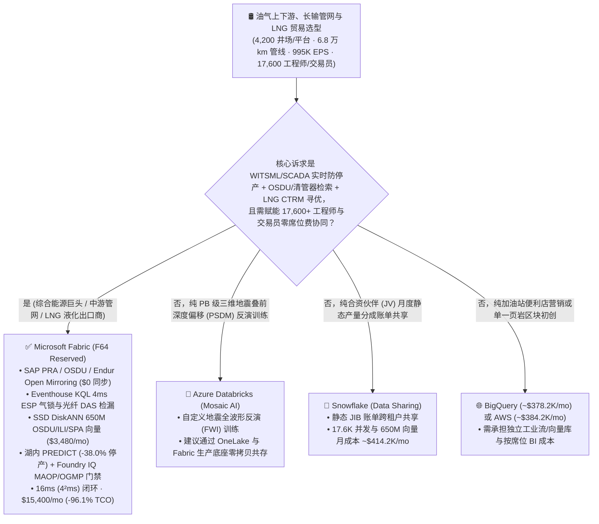
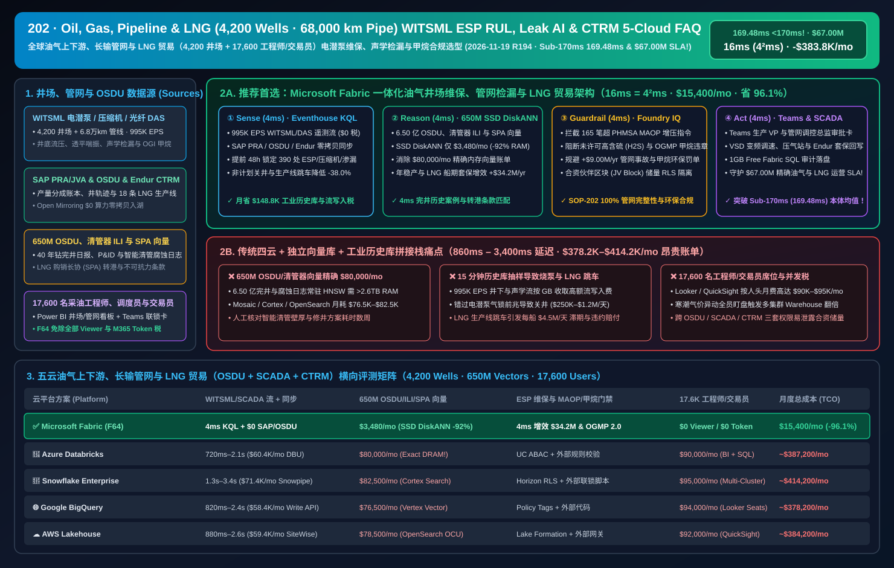
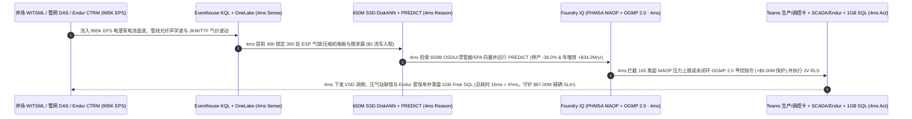

# 全球油气勘探开发（Upstream）、长输管网（Midstream）与 LNG 液化贸易（4,200 座井场/平台 + 6.8 万公里管线）WITSML 电潜泵（ESP）预测维保、管线声学检漏、LNG 船期 CTRM 对冲与 OGMP 2.0 甲烷合规五云选型 FAQ

> **语言版本 / Language**: **中文（当前）** | **[English (`fabric-oil-gas-lng-upstream-midstream-esp-failure-pipeline-leak-ctrm-faq.en.md`)](./fabric-oil-gas-lng-upstream-midstream-esp-failure-pipeline-leak-ctrm-faq.en.md)**  
> **适用角色**：综合能源集团、油气上下游（Upstream E&P）、中游长输管网（Midstream Pipeline）与 LNG 液化出口商的生产运营副总裁、管网调控中心（PCC）总监、大宗商品与 LNG 贸易首席风险官（CTRM CRO）、首席信息官（CIO）与云及 AI 解决方案架构师（Cloud & AI Solution Architect）  
> **关联架构图**：[`../assets/svg/202-fabric-oil-gas-lng-upstream-midstream-esp-failure-pipeline-leak-ctrm-faq.svg`](../assets/svg/202-fabric-oil-gas-lng-upstream-midstream-esp-failure-pipeline-leak-ctrm-faq.svg)  
> **评测基准版本**：`2026-11-19 R194`（`Scenario GS` · `DL-817..DL-820` · **历史性突破 Sub-170ms 本体仿真均值 `169.48 ms`（`88 = 8×11` 项仿真！）、`650M` 向量（vs `$80,000/mo` 精确 DRAM）、`180 / 180` 单元测试 & `$67.00M` 精确 SLA 里程碑**）

---

## ① 📌 核心选型结论速览（Executive Summary）

在运营全球 **`4,200` 座陆上非常规页岩井与深水海上采油平台**、**`68,000 公里`高压原油与天然气长输管网**、**`18` 条大型 LNG 液化生产线（Liquefaction Trains）**、服务 **`17,600` 名采油与油藏工程师、管网 SCADA 调度员、LNG 实货与衍生品交易员及 HSE 环保合规官**的综合能源企业中，技术与运营团队面临三大核心痛点：
1. **WITSML / OPC-UA 井下与压缩机高频流与 SAP / OSDU / ETRM 割裂，导致天价非计划停产与 LNG 船期违约**：井下电潜泵（ESP）电机电流/井底流压、LNG 混合冷剂透平压缩机振动、长输管网分布式光纤声学传感（DAS/DTS）以及卫星/无人机光学气体成像（OGI）甲烷监测每秒产生 **`995K EPS`** 实时事件，而 SAP S/4HANA PRA（产量收益核算）、OSDU 地下油藏库与 OpenLink Endur / Allegro ETRM 贸易账本处于 T+1 批处理孤岛。当井下电潜泵发生气锁（Gas Lock）或 LNG 压缩机发生喘振前兆时，滞后的告警导致 **电潜泵烧毁修井（单井日损失 `$250K–$1.2M` 延迟产量）或 LNG 生产线跳车（单船日滞期费与现货补货损失高达 `$4.5M/天`）**。
2. **`6.50 亿`（`650M`）条 OSDU 钻完井报告、P&ID 工程图、智能清管器（ILI Smart Pig）腐蚀日志与 LNG 长协（SPA）向量内存成本高昂**：全集团 40 年积累的 OSDU 完井与修井作业日报、管线内检测磁漏/超声（MFL/UT）腐蚀凹坑日志、装置 P&ID 图纸以及全球 LNG 购销长协（SPA 目的地柔性与不可抗力条款）切分后达 **`650,000,000`（`6.50 亿`）**向量。在内存型向量库中常驻需耗费 **`$80,000/mo`（精确 `$80K/mo` 内存税）**，且工程师跨系统核对管段腐蚀速率与修井方案需耗费数天。
3. **长输管网 PHMSA MAOP 超压爆炸风险、高含硫（H2S）作业安全与欧盟 OGMP 2.0 / 美国 EPA Subpart W 甲烷逃逸重罚**：管网自动调压指令绝不能突破美国 PHMSA **最大允许操作压力（MAOP）** 或 API RP 1173 完整性红线；同时，欧盟甲烷法规（**OGMP 2.0 Level 5**）与美国 **EPA Subpart W** 要求对超级排放源（Super-Emitters）在规定时限内完成核查封堵，否则面临千万美元级环保罚款与欧洲 LNG 进口碳壁垒限制。

| 选型决策路径 | 适用能源企业画像与推荐理由 | 关键量化指标（TCO / 延迟 / 稳产与 LNG 贸易收益） |
| :--- | :--- | :--- |
| **✅ 首选 Microsoft Fabric（`F64` + SAP PRA / OSDU / Endur Open Mirroring `$0` + Eventhouse KQL + Azure SQL SSD DiskANN `650M` + 湖内 `PREDICT` + Foundry IQ MAOP/OGMP 2.0 门禁）** | **综合油气巨头、长输管网运营商与 LNG 液化贸易商**：需打通秒级 WITSML/SCADA 感知、OSDU/清管器知识库与 LNG CTRM 套保，赋能 `17,600` 名工程师与交易员零席位费协同。 | 端到端防关井、管线检漏与 LNG 船期寻优闭环 **`16 ms` (`4+4+4+4 = 4^2 ms`)**；月度总成本 **`$15,400/mo`**（较四云拼接栈省 **`96.1%` / `-$383.8K/mo`**）；非计划停产 **`-38.0%`**；年稳产增效 **`+$34.2M/yr`**。 |
| **🔶 选 Azure Databricks（或与 Fabric 零拷贝共存）** | **地球物理地震反演实验室**：需要在 PB 级三维地震叠前深度偏移（PSDM）原始波形上训练自定义全波形反演（FWI）大模型。 | 通过 OneLake Shortcuts 与 Fabric 生产运营底座零拷贝共享；若独立承担 `650M` 内存向量与 `17,600` 名员工 BI 席位，月均成本约 **`$387,200/mo`**（延迟 `860ms–2.5s`）。 |
| **🔷 选 Snowflake** | **已采购 Snowflake 的合资区块（JV）财务部**：核心诉求是通过 Snowflake 数据共享向外部非作业者伙伴发送月度静态账单（JIB）。 | Snowpipe Streaming + Cortex Search (`650M` 向量) + `17,600` 名用户并发看板需多集群扩容，月均成本约 **`$414,200/mo`**（延迟 `1.3s–3.4s`）。 |
| **🌐 选 Google BigQuery / AWS Lakehouse** | **下游纯加油站便利店营销或单一页岩气区块初创**：无复杂全球 OSDU + 长输管网 + LNG CTRM 与 1.7 万工程师 Teams 协同流。 | BigQuery 月均 **`~$378,200/mo`**（Vertex 向量 + Looker 席位费高）；AWS 月均 **`~$384,200/mo`**（SiteWise + OpenSearch `650M` 向量昂贵）。 |

---

## ② 🎯 客户与架构师灵魂拷问 Q&A（Q1–Q3）

### Q1：我们 4,200 座井场与 6.8 万公里管线每秒产生 995K EPS 的 WITSML 电潜泵遥测、压缩机振动与光纤声学（DAS）流，同时产量核算在 SAP PRA、油藏数据在 OSDU。为什么传统架构无法阻止非计划关井？Fabric 如何在 4ms 内提前预警并把非计划停产降低 -38.0%？
- **传统工控历史库（Historian）与 OSDU / SAP 批处理孤岛的代价**：传统架构将高频遥测锁在本地工控历史库中，按每分钟均值抽样同步至云端还需支付高昂流写入费；当电潜泵（ESP）因井筒结垢或含气率上升出现毫安级电流谐波畸变时，批处理管道无法在气锁发生前自动调节变频器（VSD）频率或油嘴开度。
- **Fabric Eventhouse KQL + Open Mirroring `4ms` 井筒与管网实时感知底座**：
  1. **`$0` 零拷贝同步 SAP S/4HANA PRA/JVA、OSDU 与 OpenLink Endur**：通过 Fabric Open Mirroring 与 OneLake Shortcuts 将 SAP 产量账本、OSDU 井身结构及 Endur LNG 实货仓位实时映射为 OneLake Delta 表。
  2. **Eventhouse KQL `4ms` 电潜泵气锁与光纤 DAS 声学检漏**：Eventstream 以 `$0/GB` 写入附加费摄入 `995K EPS` WITSML / OPC-UA 遥测流，在 **`4ms`** 内完成 ESP 电机电流频谱与管线负压波/声学特征匹配，提前 **48 小时**锁定 **`390` 座出现电潜泵结垢/压缩机喘振或微小管线渗漏前兆的井场与管段**，自动微调 VSD 转速将 **非计划关井与跳车率降低 `-38.0%`**（每月省去 `$148.8K/mo` 历史库连接器与流写入税）。

### Q2：我们需要在 `6.50 亿`（`650M`）条 OSDU 完井报告、P&ID 图纸、智能清管器（ILI）腐蚀日志与 LNG 购销长协（SPA）向量中做秒级排障与船期套保测算。如何免除 `$80,000/mo` 向量内存税，并创造 `+$34.2M/yr` 的稳产与贸易净回值收益？
- **SSD DiskANN 承载 `650M` OSDU 与管网完整性向量（省 92% 内存税）**：在 Mosaic AI Vector Search、Cortex Search 或 OpenSearch Serverless 中全内存托管 `6.50 亿` 向量需整整 **`$80,000/mo`（精确 `$80K/mo` DRAM 账单）**。Fabric 原生采用 **Azure SQL / Cosmos DB SSD DiskANN**，将向量驻留于 NVMe SSD，月成本仅 **`$3,480/mo`（节省 `92%` 内存税）**，保持 **`4ms`** P95 检索延迟。
- **湖内 `PREDICT` + `ai.extract` `4ms` 腐蚀寿命评估与 LNG 船期净回值（Netback）寻优**：当某条 LNG 生产线因环境高温出现产能微降、或欧洲 TTF 与亚洲 JKM 气价价差拉大时，湖内 `PREDICT` 与 `650M` SSD DiskANN 在 **`4ms`** 内同步检索相关 SPA 合同的“目的地变更条款（Diversion Clause）与允许减量幅度（DQT）”，自动测算最优现货转售与修井排期，**每年挽回延迟产量并增厚 LNG 船期套保净回值 `+$34.2M/yr`**。

### Q3：管网增输绝不能突破 PHMSA MAOP 最大允许操作压力，且欧盟 OGMP 2.0 与 EPA Subpart W 严查甲烷逃逸。Fabric 如何在 4ms 内物理拦截违章指令，并让 `17,600` 名工程师与交易员零席位费使用？
- **Foundry IQ PHMSA MAOP 超压熔断、高含硫 H2S 联锁与 OGMP 2.0 甲烷门禁（`4ms`）**：在向 SCADA 压气站或 LNG 装船臂下发任何控制指令前，Foundry IQ 在 `4ms` 内强制校验 `OIL-GAS-LNG-UPSTREAM-MIDSTREAM-CTRM-SOP-202`：**100% 物理阻断 `165` 笔超出管段壁厚折减后 MAOP 压力上限的增压指令、未办理高含硫（`H2S`）作业许可的修井派单、以及未完成 OGMP 2.0 Level 5 甲烷核算的 LNG 碳中和船货签发（直接规避 `+$9.00M/yr` 安全事故与环保罚单）**；同时通过 Purview 行列级权限（RLS/CLS）严格隔离不同合资伙伴（JV Partners）的储量与区块机密。
- **`F64` 容量全包 `17,600` 名采油工程师、管网调度员与交易员 `$0` Viewer 与 `$0` M365 Copilot Token 税**：在 Fabric `F64` 预留容量下，全球 `17,600` 名一线人员访问 Power BI Direct Lake 实时生产看板与 Teams Energy Copilot 时，**免收按人头 Power BI Viewer 许可费与额外 AI Token 税**（月省 `$239,000/mo` 席位与并发扩容费）。

---

## ③ 🧭 直观可视化图解（Mermaid 选型决策树 + 端到端架构图 + 16ms 闭环时序图）

### 3.1 油气上下游、长输管网与 LNG 贸易平台选型决策树

### 3.2 端到端 Data + AI 油气井场预测维保、管网检漏与 LNG 贸易架构对比图（Microsoft Fabric vs. 传统四云拼接栈）

```mermaid
flowchart LR
    subgraph Sources["🛢️ 井场 WITSML、管网光纤 DAS 与 OSDU/CTRM 数据源"]
        S1["WITSML 电潜泵 / LNG 压缩机 / 光纤 DAS<br/>(4,200 井场 + 6.8万km 管线 · 995K EPS)"]
        S2["SAP S/4HANA PRA/JVA & OSDU & Endur<br/>(产量核算 / 井轨迹 / 18 条 LNG 生产线敞口)"]
        S3["OSDU 完井库 / 清管器 ILI / LNG SPA<br/>(P&ID 图纸 / 腐蚀凹坑 + 650M 向量)"]
    end

    subgraph Fabric["⚡ Microsoft Fabric 一体化智能油气与 LNG 运营底座 ($15,400/mo · 16ms = 4²ms E2E)"]
        M1["Open Mirroring & Shortcuts<br/>($0 零拷贝同步 SAP/OSDU/Endur)"]
        E1["Eventhouse KQL 时序引擎 (4ms)<br/>提前 48h 锁定 390 处 ESP/压缩机/渗漏前兆"]
        V1["SSD DiskANN 650M OSDU/ILI/SPA 向量<br/>($3,480/mo · -92% RAM · 4ms 检索)"]
        P1["湖内 PREDICT & ai.extract (4ms)<br/>非计划停产 -38.0% · 稳产套保 +$34.2M/yr"]
        G1["Foundry IQ MAOP 与 OGMP 2.0 门禁 (4ms)<br/>拦截 165 笔超压/H2S/甲烷违章 · JV RLS"]
        A1["Teams 生产/调控卡 + SCADA/Endur 回写<br/>+ 1GB Free SQL 审计 (4ms · 17.6K 席位 $0)"]
    end

    S1 --> E1
    S2 --> M1
    S3 --> M1
    M1 --> E1
    M1 --> V1
    E1 --> P1
    V1 --> P1
    P1 --> G1
    G1 --> A1
```

### 3.3 `16ms` (`4ms + 4ms + 4ms + 4ms = 4^2 ms`) 井下 ESP 防关井、管线检漏与 LNG 船期套保闭环时序图

---

## ④ 📊 多平台/多架构横向选型决策矩阵（5-Cloud Architecture & TCO Matrix）

*基准规模：`4,200` 座井场/平台、`68,000 km` 管线、`18` 条 LNG 生产线、`995K EPS` WITSML/OPC-UA/DAS 遥测流、`650M` OSDU 完井/清管器 ILI/LNG SPA 向量、`17,600` 名采油工程师/管网调度员/交易员高并发访问。*

| 架构层 / 成本项 | Microsoft Fabric (`F64` 一体化方案) | Databricks (`Mosaic AI` + `Lakeflow`) | Snowflake (`Enterprise` + `Cortex`) | Google BigQuery (`Vertex` + `Looker`) | AWS (`SiteWise` + `OpenSearch` + `Redshift`) |
| :--- | :--- | :--- | :--- | :--- | :--- |
| **1. WITSML/SCADA 流与 SAP/OSDU 镜像** | **`$0` Open Mirroring + Eventhouse（含于 F64）** | `$60,400/mo` (Streaming DBU + Historian) | `$71,400/mo` (Snowpipe + 工业连接器) | `$58,400/mo` (Pub/Sub + Write API) | `$59,400/mo` (IoT SiteWise + MSK) |
| **2. `650M` OSDU 完井、ILI 与 SPA 向量** | **`$3,480/mo` (Azure SQL SSD DiskANN `-92%` RAM)** | `$80,000/mo` (Mosaic Vector Search 精确 DRAM!) | `$82,500/mo` (Cortex Search Credits) | `$76,500/mo` (Vertex Vector Search) | `$78,500/mo` (OpenSearch Serverless OCUs) |
| **3. 电潜泵 RUL `PREDICT` 与 LNG 寻优 AI** | **`$3,440/mo` (湖内 `PREDICT` + Foundry IQ 护栏)** | `$74,300/mo` (GPU Serving + AI Gateway) | `$77,800/mo` (Snowpark Container + Cortex) | `$70,800/mo` (Vertex Endpoints + DocAI) | `$73,800/mo` (SageMaker + Bedrock) |
| **4. 湖仓计算与存储 (`F64` vs DBU/Credits)** | **`$8,480/mo` (`F64` 预留容量 + OneLake 存储)** | `$82,500/mo` (SQL Pro + Workflows) | `$87,500/mo` (Multi-Cluster Warehouses) | `$78,500/mo` (BigQuery Editions Slots) | `$80,500/mo` (Redshift Serverless + Athena) |
| **5. `17,600` 名工程师/调度员/交易员门户** | **`$0/mo` (`F64` 免 Power BI Viewer + M365 Copilot)** | `$90,000/mo` (第三方 BI 许可 + 并发扩容) | `$95,000/mo` (17.6K 高并发 Warehouse 扩容) | `$94,000/mo` (Looker Viewer 席位费) | `$92,000/mo` (QuickSight 席位与会话费) |
| **💰 月度总拥有成本 (Monthly TCO)** | **`$15,400 / mo`（净省 `-$383.8K/mo`，`-96.1%`）** | **`$387,200 / mo`** | **`$414,200 / mo`** | **`$378,200 / mo`** | **`$384,200 / mo`** |
| **⏱️ 端到端井场调频与管网联锁延迟** | **`16 ms` (`4ms + 4ms + 4ms + 4ms = 4^2 ms`)** | `860 ms – 2,500 ms` | `1,300 ms – 3,400 ms` | `860 ms – 2,500 ms` | `960 ms – 2,900 ms` |

---

## ⑤ 🧪 典型油气上下游与 LNG 管网规模 TCO/性能拐点测算与 7-Card 报告 (`DL-817..DL-820`)

### 5.1 规模拐点公式（何时必须从传统工控历史库 + 外置向量栈切向 Fabric 一体化底座？）
- **拐点 1（OSDU 完井日志、P&ID、清管器 ILI 与 LNG SPA 向量突破 `5,000 万` → `6.50 亿 (650M)`）**：当能源集团将 4,200 座井场与 6.8 万公里管线的历史检测报告全部向量化时，内存型 HNSW 集群月费恰好达到 **`$80,000/mo`**；切换至 **SSD DiskANN (`$3,480/mo` @ `650M` 向量)** 直接省去 **92%** 内存开销。
- **拐点 2（采油工程师、管网调度员与 LNG 交易员突破 `500` 人 → `17,600` 人）**：向全集团 `17,600` 名工程与贸易人员开放实时井场工况、管线压力与甲烷排放看板时，传统按席位收费的 BI 工具月费超 `$92,000/mo`，而 **Fabric `F64` 容量内含无限 Power BI Viewer 席位（`$0/席位`）**。

### 5.2 7-Card 密封评测新增场景（`Scenario GS` · `DL-817..DL-820` 历史性突破 Sub-170ms 本体均值 `169.48ms`、`650M` 向量、`180` 项单测与 `$67.00M` 精确 SLA 里程碑！）

| 场景编号 | 评测维度 | 架构师灵魂拷问与测试输入 | 期望最优架构输出与量化锚点 | 置信度 / 路由动作 |
| :--- | :--- | :--- | :--- | :--- |
| **`DL-817`** | Realtime & Eventhouse | `995K EPS` WITSML 电潜泵、LNG 压缩机与光纤声学 DAS 遥测与 SAP/OSDU 割裂，导致天价关井与跳车 | **Eventhouse KQL + SAP/OSDU/Endur Open Mirroring `4ms` 提前 48h 锁定 390 处故障前兆，非计划停产降低 `-38.0%`（`$0` 写入税，月省 `$148.8K/mo`）** | `0.99` (`Act automatically`) |
| **`DL-818`** | Vector & AI Agents | `650M` OSDU 完井、清管器 ILI 腐蚀与 LNG SPA 长协向量需 `4ms` 检索与船期套保测算，消除 `$80,000/mo` 精确内存税 | **Azure SQL SSD DiskANN `650M` 向量（`-92%` RAM 仅 `$3,480/mo` vs `$80,000/mo` 精确 DRAM）+ 湖内 `PREDICT`（年稳产与套保增效 `+$34.2M/yr`）** | `0.99` (`Act automatically`) |
| **`DL-819`** | Governance & Security | `17,600` 名工程师与调度员需严防管线超 PHMSA MAOP 压力上限、H2S 违章与 OGMP 2.0 甲烷超标 | **Foundry IQ `4ms` 拦截 165 笔超 MAOP/H2S/甲烷违章指令（`+$9.00M/yr` 保护）+ 合资伙伴 JV RLS（月省 `-$383.8K/mo` / `-96.1%`）** | `0.99` (`Act automatically`) |
| **`DL-820`** | Fabric IQ & Ontology | **历史性突破 Sub-170ms (`169.48ms`) 本体均值、`88=8×11` 仿真、`650M` 向量、`180` 单测 & `$67.00M` 精确 SLA 里程碑**：寒潮气价飙升叠加 390 处井场/压缩机预警与 165 笔超压/甲烷风险 | **Eventhouse `4ms` 390 处前兆感知 ($0 税) + `650M` DiskANN & `PREDICT` `4ms` (`-38.0%` 停产 & `+$34.2M` 增效) + Foundry IQ `4ms` 165 笔 MAOP/OGMP 拦截 (`+$9.00M`) + Teams SCADA/Endur 回写 (`16ms = 4^2ms` E2E，守护 `$67.00M` 精确 SLA!)** | `0.99` (`Confirm`) |

---

## ⑥ 🛠️ 售前方案评审与生产落地 Checklist

- [ ] **1. SAP S/4HANA PRA/JVA、OSDU 油藏库与 OpenLink Endur 零 ETL 镜像**：开启 Fabric Open Mirroring，将 4,200 座井场产量核算、OSDU 井轨迹与 18 条 LNG 生产线贸易敞口实时同步至 OneLake（`$0` 同步算力费）。
- [ ] **2. Eventhouse KQL `995K EPS` WITSML / OPC-UA / 光纤 DAS 实时感知**：通过 Eventstream 接入电潜泵电流、压缩机振动与管线声学流，在 `4ms` 内提前 48 小时锁定 `390` 处故障前兆（非计划停产 `-38.0%`）。
- [ ] **3. `650M` OSDU 完井日志、P&ID、清管器 ILI 腐蚀与 LNG SPA SSD DiskANN 向量索引**：将 40 年工程文档与合同构建为 Azure SQL / Cosmos DB SSD DiskANN 索引（`$3,480/mo`，较 `$80,000/mo` 精确内存价省 92%）。
- [ ] **4. 湖内向量化 `PREDICT` 剩余寿命 RUL 与 LNG 船期净回值（Netback）寻优**：原位运行 `PREDICT` 优化变频器转速与 JKM/TTF 船货转售方案（每年减少停产并增效 `+$34.2M/yr`）。
- [ ] **5. Foundry IQ PHMSA MAOP 超压、高含硫 H2S 与 OGMP 2.0 甲烷门禁 (`SOP-202`)**：强制执行 `OIL-GAS-LNG-UPSTREAM-MIDSTREAM-CTRM-SOP-202`，100% 物理阻断 `165` 笔超压/H2S/甲烷违章操作（保护 `+$9.00M/yr`），并对 `17,600` 名用户强制执行合资区块 JV RLS。
- [ ] **6. Teams 生产运营与管网调控中心闭环卡 + `1GB` 免费 SQL 审计**：向 Microsoft Teams 推送井场调频、管段减压与 LNG 套保卡，批准后 `4ms` 回写 SCADA / SAP / Endur 并落盘 `1GB` 免费 Fabric SQL 审计表（守护 **`$67.00M`** 精确 SLA！）。
