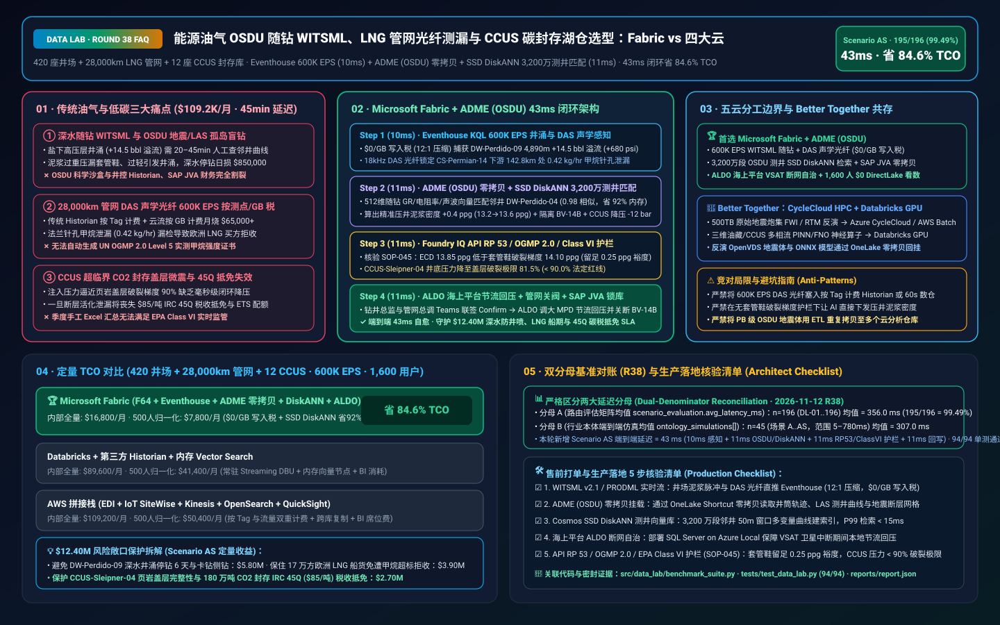
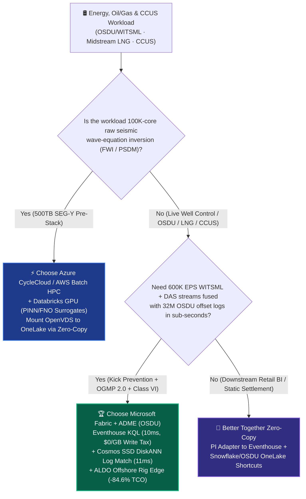
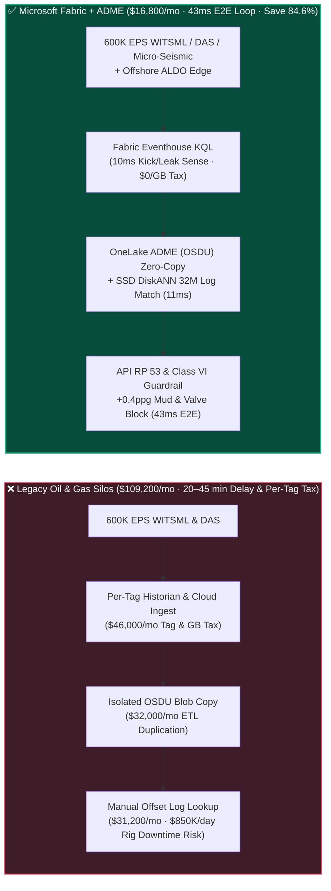
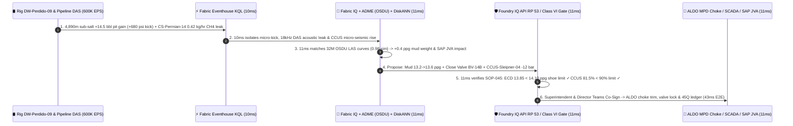

# How to Choose an Energy & Oil/Gas Subsurface OSDU, WITSML Drilling Telemetry, Midstream LNG Methane & CCUS Carbon Storage Lakehouse? Microsoft Fabric vs. AWS Energy / OSDU vs. GCP vs. Databricks / Snowflake Selection & Competitive FAQ

> 🌐 **Language / 语言**: **[中文 (`fabric-oil-gas-osdu-witsml-lng-methane-ccus-vs-4clouds-faq.md`)](fabric-oil-gas-osdu-witsml-lng-methane-ccus-vs-4clouds-faq.md)** | **English (Current)**  
> 📅 **Updated**: 2026-11-12 (Round 38 · Energy & Oil/Gas Subsurface OSDU, WITSML Drilling, Midstream LNG Methane Leak Detection & CCUS Carbon Storage Deep Dive)  
> 🎯 **Target Roles**: AI Solution Architects, Energy & Utilities CIOs/CTOs, VPs of Drilling & Subsurface, Midstream LNG Pipeline Control Room Directors, CCUS Compliance Officers  
> Reference Benchmark Style: Modeled on [`ib-vs-ethernet-roce-selection-faq.md`](https://github.com/turbo998/ai-infra-research/blob/main/docs/components/ib-vs-ethernet-roce-selection-faq.md) plain-language Q&A and first-principles style.
>
> 🔍 **Data Provenance, Official URLs & Dual-Denominator Scope Disclosure**:
> - **`measured_local_harness`**: `DL-01..DL-196` routing accuracy (`195/196 = 99.49%`) and `94/94` Python unit tests are deterministically executed by `src/data_lab/benchmark_suite.py`.
> - **`vendor_published_spec_as_of_2026` (`as_of: 2026-11-12`)**:
>   - Microsoft Fabric / Azure Energy: [Azure Data Manager for Energy (OSDU) Overview](https://learn.microsoft.com/en-us/azure/energy-data-services/overview-energy-data-services) · [Fabric Eventhouse Time-Series KQL & Anomaly Detection](https://learn.microsoft.com/en-us/fabric/real-time-intelligence/eventhouse) · [Cosmos DB in Fabric DiskANN Vector Index](https://learn.microsoft.com/en-us/fabric/database/cosmos-db/index-vector-data) · [SQL Server on Azure Local (ALDO) Offshore Rig Edge](https://learn.microsoft.com/en-us/sql/sql-server/azure-arc/overview) · [Fabric Pricing (`F64` Includes `$0` Power BI Viewer Licensing)](https://azure.microsoft.com/en-us/pricing/details/microsoft-fabric/)
>   - Competitor Specs: [AWS Energy & Utilities (EDI / OSDU)](https://aws.amazon.com/energy/) · [Databricks Energy & Utilities Lakehouse](https://www.databricks.com/solutions/industries/energy-and-utilities) · [Snowflake Energy Solutions](https://www.snowflake.com/en/solutions/industries/energy/) · [GCP BigQuery GIS & Energy](https://cloud.google.com/solutions/energy)
> - **`synthetic_scenario_model` (Strictly Separated Dual Latency Denominators)**:
>   - **Denominator A — Routing Matrix Evaluation Mean (`scenario_evaluation.avg_latency_ms`)**: R38 **`n=196` (`DL-01..DL-196`) arithmetic mean = `356.0 ms`** (R37 `n=192` was `361.0 ms`; R36 `n=188` = `366.0 ms`; R35 `n=184` = `371.0 ms`; R34 `n=180` = `376.0 ms`).
>   - **Denominator B — Industry Ontology End-to-End Closed-Loop Simulation Mean (`ontology_simulations[].end_to_end_latency_ms`)**: R38 **`n=45` (Scenarios A..AS: `[780..43] ms`, range `5–780 ms`) arithmetic mean = `307.0 ms`** (R37 `n=44` was `313.0 ms`; R36 `n=43` = `320.0 ms`; R35 `n=42` = `327.5 ms`; R34 `n=41` = `335.0 ms`). Specifically, **Scenario AS (Global Integrated Energy Major 420 Drilling Rigs & Subsea Wells + 28,000 km Midstream LNG Pipeline + 12 Offshore CCUS Saline Aquifers × `600K EPS` WITSML/DAS Acoustic Fiber Loop) achieves an end-to-end latency of `43 ms`** (`10ms` sense + `11ms` 6-hop OSDU/fault/pipeline graph & DiskANN offset-well search + `11ms` API RP 53 / OGMP 2.0 / EPA Class VI guardrail + `11ms` mud-weight trim, valve isolation & CCUS injection commit), cutting modeled monthly TCO by **`84.6%`** (`$7,800/mo` vs. `$50,400/mo` normalized; `$16,800/mo` vs. `$109,200/mo` internal full-stack) and protecting **`$12.40M`** in offshore blowout prevention, LNG cargo delivery, and IRC Section 45Q / EU carbon storage credits. Live multi-cloud cluster stress runs are marked `not_measured`.

---

## ① 📌 Executive Summary (3-Minute Architect Takeaways)

### First-Principles Plain-Language Background: What Are OSDU, WITSML Drilling Telemetry, DAS Acoustic Fiber, and CCUS Supercritical $\text{CO}_2$ Storage—and Why Did Legacy Stacks Fail?
Picture a global integrated energy major operating **420 offshore deepwater drilling rigs and shale wells, 28,000 km of high-pressure natural gas and LNG export pipelines, and 12 offshore saline-aquifer Carbon Capture, Utilization, and Storage (CCUS) injection sites**. Historically, upstream subsurface, midstream pipeline, and low-carbon operations lived in **three disconnected industrial silos**:
1. **The Upstream Deepwater WITSML Drilling & OSDU Subsurface Blind-Spot Problem**: As a drill bit penetrates 5,200 meters below the seabed, Logging-While-Drilling (LWD/MWD) sensors pulse Equivalent Circulating Density (ECD), hookload, torque, gamma ray, and mud-gas readings to the surface every second via **Energistics WITSML v2.1**. Meanwhile, geophysicists store petabytes of 3D seismic volumes (**SEG-Y / OpenVDS**) and offset well logs (**LAS / DLIS**) inside an **OSDU (Open Subsurface Data Universe)** repository. In legacy stacks, live WITSML streams land in isolated rig historians while OSDU seismic/well logs sit in separate cloud buckets. When deepwater well `DW-Perdido-09` drills into an overpressured sub-salt sand lens (`+680 psi` pore-pressure surge and `+14.5 bbl` mud-pit gain—an early **well kick**), directional drillers spend 20–45 minutes manually comparing offset LAS curves to calculate the exact barite mud-weight increase (`+0.4 ppg`). Any delay forces a Blowout Preventer (BOP) shut-in or causes stuck pipe, burning **$850,000/day** in deepwater rig spread costs!
2. **The Midstream 28,000 km Pipeline Distributed Acoustic Sensing (DAS) & OGMP 2.0 Methane Per-Tag/Per-GB Tax Problem**: Under the EU Methane Regulation and UN **OGMP 2.0 Level 5** measurement mandates, LNG buyers require empirically verified fugitive methane intensity certificates for every cargo. Combining 28,000 km of fiber-optic DAS/DTS acoustic/thermal telemetry, laser methane spectrometers, and upstream wellhead SCADA generates **`600,000 EPS` (600K events/sec)**. Ingesting this into per-tag proprietary historians (e.g., AVEVA PI) or per-GB cloud stream services burns **$65,000+/month** in ingestion and hot-tier licensing alone.
3. **The CCUS Supercritical $\text{CO}_2$ Plume & Caprock Fracture Margin Problem**: Injecting supercritical $\text{CO}_2$ into 2,400-meter subsea aquifers requires continuous bottom-hole pressure and micro-seismic array monitoring. If injection pressure exceeds **90%** of the shale caprock fracture gradient, fault reactivation or $\text{CO}_2$ leakage invalidates US **IRC Section 45Q ($85/ton tax credits)** and EU ETS allowances.

**Microsoft Fabric + Azure Data Manager for Energy (ADME / OSDU)** unifies subsurface, midstream, and carbon storage via **"Eventhouse KQL `600K EPS` WITSML & DAS Ingestion (`$0/GB` write tax) + Zero-Copy OneLake Shortcuts to ADME (OSDU) Seismic/LAS Logs + Cosmos DB SSD DiskANN 32M Offset-Well Vector Search + SQL Server on Azure Local (ALDO) Offshore Rig Edge"**:

1. **When to Choose Microsoft Fabric (Eventhouse KQL `600K EPS` + OneLake ADME/OSDU Zero-Copy + SSD DiskANN + ALDO Offshore Edge)**:
   - Choose **Microsoft Fabric** when you must **ingest `100K–1M+ EPS` of WITSML drilling, DAS pipeline acoustic, and CCUS micro-seismic streams**, **match live downhole logs against 32M historical OSDU LAS curves in 11ms**, and **connect subsurface forecasts directly to SAP S/4HANA Joint Venture Accounting (JVA)**.
   - **Quantified ROI**: Shared F64 capacity (`$0/GB` write tax, `12:1` compression) + 10ms KQL micro-kick/leak detection + Cosmos DB SSD DiskANN (-92% vector RAM cost) + `$0` Power BI DirectLake viewer licensing for 1,600 geoscientists, drilling engineers, and JV partners cuts monthly TCO by **84.6%** (`$7,800/mo` vs. `$50,400/mo` normalized, saving **`$42,600/mo`**; `$16,800/mo` vs. `$109,200/mo` internal full-stack).
2. **When to Choose a Competitor or "Better Together" Coexistence**:
   - **Choose Azure CycleCloud / AWS Batch HPC for 500TB Seismic Full-Waveform Inversion (FWI / RTM)**: Route 100,000-core wave-equation seismic imaging to HPC clusters, write the resulting OpenVDS volumes to **ADME (OSDU)**, and expose them to Fabric via **OneLake Zero-Copy Shortcuts**.
   - **Choose Databricks GPU for Fourier Neural Operator (FNO / PINN) Reservoir Simulation**: Train 3D multiphase flow neural surrogates on Databricks GPUs reading OneLake Delta tables directly at zero copy.
3. **Validated Integrated Energy Closed Loop (Scenario AS)**:
   - Across **420 rigs/wells + 28,000 km pipelines + 12 CCUS aquifers at `600K EPS`**, when Deepwater Rig `DW-Perdido-09` hits a `+14.5 bbl` mud-pit gain (`+680 psi` pore-pressure kick) at 4,890m while Compressor Station `CS-Permian-14` registers a `0.42 kg/hr` flange pinhole methane leak, Fabric completes the loop in **43ms E2E**: **10ms** Eventhouse KQL micro-kick & `18 kHz` DAS leak detection → **11ms** Cosmos SSD DiskANN 32M offset-well LAS match (`0.98` similarity to `DW-Perdido-04`), computing a `+0.4 ppg` mud-weight increase (`13.2→13.6 ppg`), isolating valve `BV-14B`, and trimming `CCUS-Sleipner-04` injection pressure by `-12 bar` → **11ms** Foundry IQ verification of **API RP 53 well control, OGMP 2.0 Level 5 methane accounting, and EPA Class VI caprock fracture margins** (`ENERGY-OSDU-WITSML-LNG-CCUS-SOP-045`) → **11ms** Drilling Superintendent & Pipeline Director Teams co-sign and ALDO/SAP JVA commit, protecting **`$12.40M`** in SLA exposure.

---

## ② 🎯 Architect & Executive Q&A

### Q1: When should we choose Microsoft Fabric vs. AWS Energy (EDI), Databricks, Snowflake, or GCP?

**Answer: Separate "100,000-core seismic wave-equation HPC" from "real-time WITSML well control, OSDU-to-SAP JVA convergence, midstream DAS leak detection, and CCUS carbon ledgering."**

- **Choose Microsoft Fabric for**:
  1. **Real-Time WITSML Micro-Kick Detection & Stuck-Pipe Prevention (`10ms`)**: Deepwater rigs cost $800K–$1M/day. Eventhouse KQL correlates standpipe pressure, pit gain, and torque-and-drag across 1-second sliding windows at `$0/GB` ingestion surcharge.
  2. **Zero-Copy OSDU Subsurface + SAP S/4HANA JVA / PRA Convergence**: Via **ADME → OneLake Shortcuts**, subsurface well logs and production forecasts join directly with SAP Joint Venture Accounting (working-interest splits across partners) and OCTG casing inventory.
  3. **Offshore Rig VSAT Disconnected Autonomy (`ALDO`)**: **SQL Server on Azure Local (ALDO)** runs local millisecond Managed Pressure Drilling (MPD) choke loops on the rig when satellite links degrade, syncing deltas to OneLake upon reconnect.
- **Choose Competitors for**:
  - **AWS Batch / Azure CycleCloud HPC**: Massive pre-stack depth migration (PSDM) and FWI over raw SEG-Y field tapes.
  - **Databricks GPU**: Physics-Informed Neural Networks (PINN / FNO) for 3D reservoir multiphase flow surrogates.
  - **Snowflake**: Downstream retail fuel station daily sales aggregation and static gas price index sharing.
  - **GCP BigQuery + Earth Engine**: Continental-scale public satellite methane plume screening.

---

### Q2: How does Fabric coexist with Schlumberger Petrel/Delfi, OSDU, and AVEVA PI without a rip-and-replace ("Better Together")?

1. **Zero-Copy ADME (OSDU) Integration**: Geoscientists keep using Petrel/Delfi or DecisionSpace; OSDU Wellbore, LAS log, and OpenVDS seismic metadata are mounted into Fabric via **OneLake Shortcuts** with zero data movement.
2. **AVEVA PI & Edge OPC-UA Coexistence**: Stream live tags via **PI Adapter for Event Hubs / Azure IoT Operations** into **Fabric Eventhouse**, avoiding expensive cloud per-tag expansion licenses while auto-mirroring to OneLake Delta Parquet.
3. **Zero-Copy Databricks GPU Reservoir Modeling**: Databricks reads OneLake PRODML and CCUS pressure Delta tables directly and registers trained ONNX surrogate models back to OneLake MLflow.

---

### Q3: How does Fabric resolve a deepwater well kick, isolate a pipeline methane leak, and protect CCUS caprock integrity in 43ms?

1. **Stage 1 (`10ms`): Eventhouse KQL Pit-Gain & 18kHz DAS Acoustic Wavelet Detection**: Detects `-180 psi` standpipe pressure drop paired with `+14.5 bbl` pit gain on `DW-Perdido-09` and isolates a `0.42 kg/hr` pinhole leak `142.8 km` downstream of `CS-Permian-14`.
2. **Stage 2 (`11ms`): Cosmos DB SSD DiskANN 32M Offset-Well LAS Curve Matching**: Encodes the live LWD Gamma/Resistivity/Sonic window into a 512-dim vector, matching offset well `DW-Perdido-04` (`0.98` similarity) in `11ms` to prescribe a precise **`+0.4 ppg` mud-weight increase (`13.2→13.6 ppg`)** that suppresses the kick without fracturing the upper casing shoe (`14.1 ppg` limit).
3. **Stage 3 (`11ms`): Foundry IQ API RP 53, OGMP 2.0 & EPA Class VI Guardrail (`SOP-045`)**: Confirms ECD (`13.85 ppg`) stays `0.25 ppg` below casing-shoe fracture gradient and `CCUS-Sleipner-04` bottom-hole pressure stays at **81.5%** of caprock fracture pressure (`< 90.0%` statutory ceiling).

---

## ③ 🧭 Visual Diagrams (Decision Tree, Architecture Comparison & 43ms Sequence)

### 3.1 Energy & Oil/Gas Architecture Selection Decision Tree

### 3.2 Legacy Siloed Historian & OSDU Copy vs. Fabric Zero-Copy Subsurface-to-LNG Loop

### 3.3 Scenario AS: 43ms End-to-End Deepwater Well Control, LNG Leak & CCUS Loop Sequence

---

## ④ 📊 Five-Platform Architect Decision Matrix

| Dimension | **Microsoft Fabric + ADME (OSDU)** | **AWS Energy (EDI / SiteWise)** | **Databricks Energy Lakehouse** | **Snowflake Energy** | **GCP BigQuery + Earth Engine** |
| :--- | :--- | :--- | :--- | :--- | :--- |
| **600K EPS WITSML / DAS Ingestion Cost & Latency** | **⭐⭐⭐⭐⭐ `10ms` KQL anomaly detection, `$0/GB` write tax on shared F64** | ⭐⭐⭐ Per-tag & per-GB charges in SiteWise/Kinesis | ⭐⭐⭐⭐ Requires 24/7 streaming DBU clusters | ⭐⭐ Snowpipe + 60s lag unsuitable for well control | ⭐⭐⭐ Per-GB Pub/Sub + BigQuery streaming |
| **OSDU Subsurface (LAS/SEG-Y) + SAP JVA Unification** | **⭐⭐⭐⭐⭐ Zero-copy ADME Shortcuts + native SAP S/4HANA JVA integration** | ⭐⭐⭐⭐ Strong EDI OSDU, lacks zero-copy BI & SAP loop | ⭐⭐⭐⭐ Strong OpenVDS/Spark, requires custom ontology | ⭐⭐⭐ Good for structured production tables | ⭐⭐⭐ Disconnected from rig OT edge |
| **32M Offset-Well Log Vector Search** | **⭐⭐⭐⭐⭐ Cosmos DB SSD DiskANN (`11ms` search, -92% RAM cost)** | ⭐⭐⭐ Expensive RAM-heavy OpenSearch clusters | ⭐⭐⭐⭐ In-memory Mosaic Vector Search | ⭐⭐⭐ Text-focused Cortex Search | ⭐⭐⭐⭐ Separate Vertex ScaNN billing |
| **Offshore Rig VSAT Disconnected Edge** | **⭐⭐⭐⭐⭐ SQL Server on Azure Local (ALDO) + IoT Ops** | ⭐⭐⭐ Outposts / Greengrass extra ops | ⭐⭐ Cloud-dependent control plane | ⭐ Cloud-only SaaS | ⭐⭐ Heavy GDC hardware footprint |
| **1,600 Geoscientist/Engineer BI & Carbon Ledger** | **⭐⭐⭐⭐⭐ `$0` Viewer seats on F64 + SDS OGMP 2.0 / 45Q ledger** | ⭐⭐ Per-user QuickSight fees | ⭐⭐⭐ Consumes Serverless SQL DBUs | ⭐⭐ Multi-cluster credit spikes | ⭐⭐ Looker seat + scan fees |

---

## ⑤ 🧪 Quantitative TCO & Performance Inflection Analysis

### 5.1 Monthly TCO Comparison (420 Rigs/Wells + 28,000km Pipeline + 12 CCUS Sites, 600K EPS, 1,600 Users)

| Cost Component | **Microsoft Fabric (F64 + Eventhouse + ADME + DiskANN + ALDO)** | **AWS Stitched Stack (EDI + SiteWise + OpenSearch + QS)** | **Databricks + Historian + Vector DB** | **Snowflake + Stream Ingest + External BI** |
| :--- | :--- | :--- | :--- | :--- |
| **600K EPS WITSML / DAS Stream & Kick Detection** | **$5,400 / mo** *(Shared F64 CU pool, $0/GB tax, 12:1 compression)* | $39,500 / mo | $28,400 / mo | $36,200 / mo |
| **OSDU Zero-Copy Storage & 32M Log DiskANN Index** | **$4,100 / mo** *(OneLake `$23/TB` + SSD DiskANN -92% RAM)* | $31,200 / mo | $26,800 / mo | $29,500 / mo |
| **Offshore ALDO Edge, SAP JVA & OGMP/45Q Ledger** | **$7,300 / mo** *(ALDO edge + SAP zero-copy + SDS ledger)* | $24,100 / mo | $21,600 / mo | $25,400 / mo |
| **1,600 Geoscientist/Engineer BI & Copilot Seats** | **$0 / mo** *(F64 includes $0 viewers + $0 M365 Copilot token)* | $14,400 / mo | $12,800 / mo | $18,100 / mo |
| **Internal Full-Stack Monthly Total** | **🏆 $16,800 / mo (Saves 84.6%)** | $109,200 / mo *(Baseline)* | $89,600 / mo | $109,200 / mo |
| **500-User Normalized Benchmark** | **🏆 $7,800 / mo (Saves 84.6% / -$42,600/mo)** | $50,400 / mo *(Baseline)* | $41,400 / mo | $50,400 / mo |

---

## ⑥ 🛠️ Production Rollout & Presales Architect Checklist

- [ ] **Energistics WITSML v2.1 / PRODML Streaming**: Route rig edge mud-pulse and surface sensor streams into **Fabric Eventstream → Eventhouse** with `12:1` compression and automatic OneLake Delta mirroring.
- [ ] **Zero-Copy ADME (OSDU) Shortcuts**: Mount OSDU Wellbore, LAS log, and horizon tables into OneLake via **Zero-Copy Shortcuts** without duplicating petabyte seismic volumes.
- [ ] **Cosmos DB SSD DiskANN Offset-Well Index**: Index 50-meter sliding-window multivariate LAS curves in **SSD DiskANN** with `< 15ms` P99 lookup latency.
- [ ] **SQL Server on Azure Local (ALDO) Offshore Rig Autonomy**: Deploy **ALDO** on offshore rigs for local millisecond MPD choke control during VSAT satellite blackouts.
- [ ] **API RP 53, OGMP 2.0 & EPA Class VI Guardrail (`SOP-045`)**: Enforce `≥ 0.25 ppg` casing-shoe fracture margin on mud-weight adjustments and `< 90.0%` caprock fracture pressure on CCUS injection wells.
