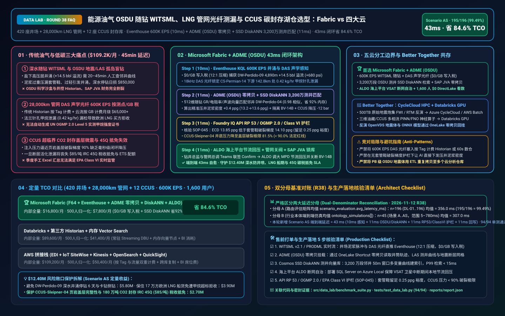
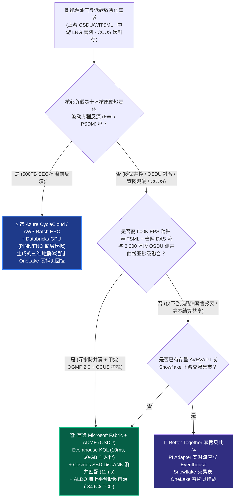
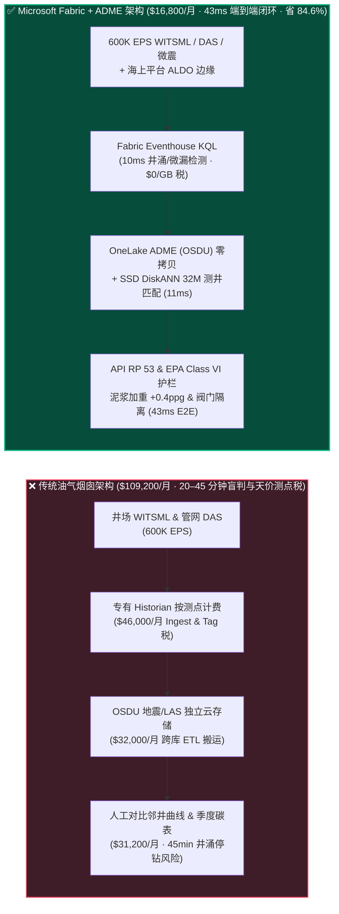
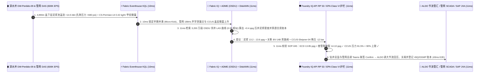

# 能源油气上游 OSDU 地震测井（WITSML/PRODML）、中游 LNG 管网光纤测漏与 CCUS 碳封存湖仓怎么选？Microsoft Fabric vs AWS Energy / OSDU vs GCP vs Databricks / Snowflake 选型与竞对攻防 FAQ

> 🌐 **Language / 语言**: **中文 (Current)** | **[English (`fabric-oil-gas-osdu-witsml-lng-methane-ccus-vs-4clouds-faq.en.md`)](fabric-oil-gas-osdu-witsml-lng-methane-ccus-vs-4clouds-faq.en.md)**  
> 📅 **更新日期**: 2026-11-12（Round 38 · 能源油气上游 OSDU 地震/测井 WITSML、中游 LNG 管网甲烷测漏与 CCUS 碳封存监测专题）  
> 🎯 **适用角色**: AI Solution Architect（AI 解决方案架构师）、油气与新能源 CIO/CTO、总地质师/钻井总监、LNG 管网调度中心主任、CCUS 碳封存合规官  
> Reference Benchmark Style: 对标 [`ib-vs-ethernet-roce-selection-faq.md`](https://github.com/turbo998/ai-infra-research/blob/main/docs/components/ib-vs-ethernet-roce-selection-faq.md) 通俗问答与第一性原理对比范式。
>
> 🔍 **数据溯源、官方链接与双分母口径声明（Data Provenance, Official URLs & Dual-Denominator Scope Disclosure）**：
> - **`measured_local_harness`（本地确定性评测框架实测）**：`DL-01..DL-196` 场景路由准确率（`195/196 = 99.49%`）与 `94/94` Python 单元测试均由本地 `src/data_lab/benchmark_suite.py` 实测生成。
> - **`vendor_published_spec_as_of_2026`（厂商公开官方规格，截至 `as_of: 2026-11-12`）**：
>   - Microsoft Fabric / Azure Energy: [Azure Data Manager for Energy (OSDU) Overview](https://learn.microsoft.com/en-us/azure/energy-data-services/overview-energy-data-services) · [Fabric Eventhouse Time-Series KQL & Anomaly Detection](https://learn.microsoft.com/en-us/fabric/real-time-intelligence/eventhouse) · [Cosmos DB in Fabric DiskANN Vector Index](https://learn.microsoft.com/en-us/fabric/database/cosmos-db/index-vector-data) · [SQL Server on Azure Local (ALDO) Offshore Rig Edge](https://learn.microsoft.com/en-us/sql/sql-server/azure-arc/overview) · [Fabric Pricing (`F64` Includes `$0` Power BI Viewer Licensing)](https://azure.microsoft.com/en-us/pricing/details/microsoft-fabric/)
>   - 四大云竞对官方规格: [AWS Energy & Utilities (EDI / OSDU)](https://aws.amazon.com/energy/) · [Databricks Energy & Utilities Lakehouse](https://www.databricks.com/solutions/industries/energy-and-utilities) · [Snowflake Energy Solutions](https://www.snowflake.com/en/solutions/industries/energy/) · [GCP BigQuery GIS & Energy](https://cloud.google.com/solutions/energy)
> - **`synthetic_scenario_model`（确定性架构参考仿真模型，严格区分两大延迟分母）**：
>   - **分母 A — 场景路由评估矩阵均值（`scenario_evaluation.avg_latency_ms`）**：R38 **`n=196`（`DL-01..DL-196`）算术均值 = `356.0 ms`**（R37 历史快照 `n=192` 均值 = `361.0 ms`；R36 `n=188` = `366.0 ms`；R35 `n=184` = `371.0 ms`；R34 `n=180` = `376.0 ms`）。
>   - **分母 B — 行业本体端到端闭环仿真均值（`ontology_simulations[].end_to_end_latency_ms`）**：R38 **`n=45`（场景 A..AS：`[780..43] ms`，范围 `5–780 ms`）算术均值 = `307.0 ms`**（R37 历史快照 `n=44` 均值 = `313.0 ms`；R36 `n=43` = `320.0 ms`；R35 `n=42` = `327.5 ms`；R34 `n=41` = `335.0 ms`）。其中本专题新增 **Scenario AS（全球综合能源巨头 420 座钻井平台与海底井口 + 28,000 公里 LNG 管网 + 12 座深海咸水层 CCUS 碳封存库 × `600K EPS` WITSML/DAS 声学光纤遥测闭环）端到端延迟 = `43 ms`**（感知 `10ms` + 6 跳 OSDU/断层/管网图谱与 DiskANN 匹配 `11ms` + API RP 53/OGMP 2.0/EPA Class VI 护栏 `11ms` + 泥浆加重、阀门隔离与 CO2 注入降压回写 `11ms`），月度建模 TCO 节省 **`84.6%`**（`$7,800/mo` vs `$50,400/mo` 归一化基线；内部全量口径 `$16,800/mo` vs `$109,200/mo`），规避 **`$12.40M`** 深水井涌停钻、LNG 船期违约与美国 IRC 45Q / 欧盟碳封存抵扣失效风险。跨云物理集群压测标记为 `not_measured`。

---

## ① 📌 核心结论速览（Executive Summary — 3 分钟抓准选型底牌）

### 第一性原理先讲透：什么是 OSDU、WITSML 随钻遥测、DAS 管网声学光纤与 CCUS 超临界碳封存？以前油气公司痛点在哪？
想象一家跨国综合能源巨头同时运营着 **420 座深水钻井平台与陆地页岩气井、28,000 公里高压天然气与 LNG 液化外输管网、以及 12 座海底咸水层碳捕集与封存（CCUS）注气井**。以前，上游勘探、中游管网与低碳业务的数据被切碎在 **三座互不相通的“工业孤岛”** 里：
1. **上游深水随钻录井（WITSML / PRODML）与 OSDU 地下断层“盲钻”痛点**：钻头在海底 5,200 米地层高速旋转时，随钻测量（LWD/MWD）每秒通过泥浆脉冲向地面回传井底环空压力（ECD）、大钩载荷、扭矩、伽马射线与气测烃类（遵循 **Energistics WITSML v2.1** 标准）。与此同时，勘探地球物理学家在 **OSDU（Open Subsurface Data Universe）** 平台存有 PB 级的三维地震体（**SEG-Y / OpenVDS**）与历史测井曲线（**LAS / DLIS**）。传统架构中，WITSML 实时流进专有井场数据库（如康菲/斯伦贝谢孤立 Historian），而 OSDU 地震断层数据锁在另一套云对象存储里。当深水井 `DW-Perdido-09` 钻遇异常高压盐下砂岩包（井底孔隙压力突增 `+680 psi`，泥浆返出流量大于泵入流量，即 **井涌 Kick 前兆**）时，现场司钻要花 20–45 分钟手动比对邻井 LAS 曲线才能决定泥浆加重多少（`+0.4 ppg` 重晶石粉），一旦迟疑就会触发防喷器（BOP）关井停钻甚至卡钻，单口深水井停工一天损失高达 **$850,000**！
2. **中游 28,000 公里管网分布式声学光纤（DAS）与卫星甲烷（OGMP 2.0 / EPA Subpart W）“按测点/按 GB 天价税”痛点**：伴随欧盟甲烷法规（EU Methane Regulation）与联合国 **OGMP 2.0 Level 5** 强制要求，LNG 买方要求每一船液化天然气必须附带全链路实测甲烷逃逸强度证明。企业沿 28,000 公里管道铺设了分布式声学/温度光纤（DAS/DTS）与激光甲烷遥测仪，加上上游井口 SCADA，汇聚成 **`600,000 EPS`（每秒 60 万条事件）**。若塞进按测点（Per-Tag）收费的传统工业 Historian（如 AVEVA PI）或按写入流量计费的云端流服务，光流式写入与热存每月就要烧掉 **$65,000+**。
3. **CCUS 超临界 $\text{CO}_2$ 封存羽流（Plume）迁移与盖层（Caprock）微震失控痛点**：在海底 2,400 米咸水层注入超临界 $\text{CO}_2$ 时，必须实时监控井底注入压力与微地震检波器阵列。一旦注入压力逼近页岩盖层破裂压力（Fracture Gradient）的 **90%**，就会诱发断层活化与 $\text{CO}_2$ 逃逸，不仅直接丧失美国 **IRC Section 45Q（每吨 $85 税收抵免）** 或欧盟 ETS 减排额度，还会引发重大环境合规停产。

**Microsoft Fabric + Azure Data Manager for Energy (ADME / OSDU)** 的破局之道，是用 **“Eventhouse KQL `600K EPS` 随钻 WITSML 与管网 DAS 毫秒级感知（`$0/GB` 写入税）+ OneLake 零拷贝挂载 ADME (OSDU) 三维地震/LAS 测井库 + Cosmos DB SSD DiskANN 3,200 万历史井筒/断层特征向量检索 + SQL Server on Azure Local (ALDO) 海上钻井平台卫星断网自治”** 将地下油藏、地面管网与碳封存合二为一：

1. **首选 Microsoft Fabric（Eventhouse KQL `600K EPS` + OneLake ADME/OSDU 零拷贝 + SSD DiskANN 测井匹配 + ALDO 海上平台边缘）的必赢场景**：
   - 当能源企业需要 **同时吞吐 `100K–1M+ EPS` 井场 WITSML 随钻流、管网 DAS 声学测漏流与 CCUS 微震流**，并希望 **在 11ms 内将实时井底压力波动与 OSDU 中的 3,200 万段历史邻井 LAS 测井曲线及断层切片做向量匹配** 时，首选 **Microsoft Fabric**。
   - **量化收益**：Eventhouse 共享 F64 容量池（**`$0/GB` 写入税**，`12:1` 时序压缩）+ 10ms KQL 井涌/微漏检测 + Cosmos DB SSD DiskANN（省 **92%** 向量内存成本）+ F64 赠送 **1,600 名地质师/钻井工程师/管网调度员/合资伙伴 `$0` Power BI DirectLake 免费看数**，月度 TCO 较传统方案降低 **84.6%**（归一化口径 **`$7,800/mo` vs `$50,400/mo`**，月省 **`$42,600`**；内部全量口径 **`$16,800/mo` vs `$109,200/mo`**）。
2. **首选四大云竞对或“双向零拷贝共存（Better Together）”的场景**：
   - **选 AWS HPC / Azure CycleCloud 跑全波形反演（FWI）与逆时偏移（RTM）地震成像**：针对原始 500TB 海底节点（OBN）地震炮集数据的十万核 CPU / 千卡 GPU 波动方程反演（FWI / RTM），应路由至 **Azure CycleCloud / AWS Batch HPC 集群**，反演生成的 OpenVDS 三维地震体写回 **Azure Data Manager for Energy (OSDU)** 并通过 **OneLake Shortcut 零拷贝** 挂载至 Fabric。
   - **选 Databricks GPU 跑傅里叶神经算子（FNO）三维油藏/CCUS 数值模拟**：利用物理信息神经网络（PINN / FNO）替代传统 Eclipse/Intersect 网格模拟器预测未来 30 年 $\text{CO}_2$ 羽流扩散，路由至 **Databricks GPU**，直接通过 OneLake Delta 零拷贝读取 Fabric 中的井筒压力历史。
3. **跨国综合能源巨头实战闭环验证（Scenario AS）**：
   - 在 **420 座井场 + 28,000 公里管网 + 12 座 CCUS 封存库 × `600K EPS`** 仿真中，深水钻井平台 `DW-Perdido-09` 在钻进至 4,890 米盐下层时突发返出泥浆流量异常（`+14.5 bbl` 溢流、立管压力下降 `-180 psi`、地层孔隙压力跃升 `+680 psi`），同时二叠纪盆地 `CS-Permian-14` 增压站光纤检出 `0.42 kg/hr` 法兰针孔甲烷泄漏，北海 `CCUS-Sleipner-04` 注入井盖层微震能量上升。Fabric 在 **43ms 端到端** 内完成：**10ms** Eventhouse KQL 捕获井涌前兆与管网声学峰值 → **11ms** Cosmos SSD DiskANN 在 3,200 万段 OSDU 邻井 LAS 曲线中以 `0.98` 相似度锁定盐下超压透镜体、计算泥浆密度上调 `+0.4 ppg`（避免压裂上部脆弱套管鞋）、隔离 `BV-14B` 阀门并将 CCUS 注入压力下调 `-12 bar` → **11ms** Foundry IQ 校验 **API RP 53 防喷器安全规程、EPA Subpart W / OGMP 2.0 实测核算与 EPA Class VI 盖层安全裕度**（`ENERGY-OSDU-WITSML-LNG-CCUS-SOP-045`） → **11ms** 钻井总监与管网总调在 Teams 联签 Confirm，通过 ALDO 海上边缘下发自动节流管汇回压指令并更新 SAP JVA 合资账本，规避 **$12.40M** 井喷停钻、LNG 违约与 45Q 碳税抵免损失。

---

## ② 🎯 客户与架构师灵魂拷问（Q&A — 直击能源 CIO 与总地质师痛点）

### Q1：什么时候我们应该闭眼选 Microsoft Fabric？什么时候应该选 AWS Energy (EDI)、Databricks、Snowflake 或 GCP？

**答：看你的工作负载是“十万核地震波动方程超算（HPC）”，还是“随钻 WITSML + 管网 DAS 实时感知 + OSDU 地下断层与地面财务（SAP JVA）一体化运营闭环”。**

- **闭眼选 Microsoft Fabric 的三大场景**：
  1. **随钻 WITSML 井涌防喷（Well Control）与卡钻（Stuck Pipe）亚秒级预警**：深水钻井日费高达 $80 万–$100 万美元。Eventhouse KQL 直接摄取 WITSML v2.1 实时流，利用 `series_outliers()` 与滑动窗口扭矩-摩阻（Torque & Drag）模型，在 **10ms** 内识别井眼清洁不良或盐下高压气侵，比传统 15 分钟人工录井报表快 90,000 倍。
  2. **OSDU 地下测井/地震数据与地面 ERP（SAP S/4HANA JVA / PRA）零拷贝贯通**：以前 OSDU 是纯粹的勘探科学沙盒，财务和供应链根本读不到。通过 **Azure Data Manager for Energy (ADME) → OneLake 零拷贝 Shortcut**，地下油藏采收率预测可以直接与 SAP 联合经营账务（JVA，计算埃克森、壳牌等合资方权益分成）、油田管材库存（OCTGs）及 LNG 船期合约在同一语义本体中实时联动。
  3. **海上平台/荒漠井场 VSAT 卫星断网自治 + 全厂千人免席位看数**：海上半潜式钻井平台经常因极端海况导致 Starlink/VSAT 卫星链路抖动。**SQL Server on Azure Local (ALDO)** 部署在钻井平台防爆机柜内，本地运行毫秒级井控与防喷器（BOP）联锁；网络恢复后自动通过 OneLake 增量同步回云端，且 1,600 名工程师享受 `$0` Power BI DirectLake 免席位看数。

- **选四大云竞对的明确边界**：
  - **AWS Energy (EDI on OSDU) + AWS Batch HPC**：若任务是纯粹的 **海量原始地震炮集（SEG-Y）并行叠前深度偏移（PSDM / FWI）**，需要瞬间拉起 2,000 台 EC2 计算节点，应使用 AWS Batch 或 Azure CycleCloud。
  - **Databricks Lakehouse for Energy**：若油藏模拟团队需要用 **PyTorch / Modulus 训练三维多孔介质多相流物理信息神经网络（PINN / FNO）**，应路由至 Databricks GPU 集群。
  - **Snowflake Energy**：若业务仅限于下游成品油加油站零售日结报表或跨交易商共享静态天然气日均结算价，Snowflake Data Sharing 足够轻便；但 Snowflake 缺乏毫秒级 WITSML/DAS 声学流引擎与原生 SSD 向量库。
  - **GCP BigQuery + Earth Engine**：若重点是通过公开卫星多光谱影像做宏观大洲级甲烷羽流普查（如 MethaneSAT 宏观筛查），GCP Earth Engine 生态完善。

---

### Q2：油气行业最怕“推翻现有 OSDU、Petrel/Techlog 地质软件与 AVEVA PI 实时库”。Fabric 如何实现双向零拷贝共存（Better Together）？

**答：坚持“专业地质软件（Petrel/ Delfi）与 HPC 归仿真、OSDU 与实时井控/管网/碳核算归 Fabric OneLake”的黄金分工！**

1. **与 Azure Data Manager for Energy (ADME / OSDU) 零拷贝互通**：
   - 勘探团队继续在 Schlumberger Delfi / Petrel 或 Halliburton DecisionSpace 中解释三维地震断层与层位（Horizon），数据按 OSDU 标准落入 ADME 底层的 ADLS Gen2。
   - Fabric 通过 **OneLake Shortcut** 零拷贝挂载 OSDU 井筒轨迹（Wellbore Trajectory）、测井曲线（Well Log LAS）与断层网格，**0 字节复制、$0 搬运算力税**。
2. **与 AVEVA PI / 边缘 OPC-UA 的平滑共存**：
   - 无需拆除井口或增压站现有的 PLC 与本地 PI 接口，直接通过 **Azure IoT Operations / PI Adapter for Event Hubs** 将增量流双写至 **Fabric Eventstream → Eventhouse**，从而卸掉昂贵的云端按测点扩容许可费，并在 Eventhouse 中开启自动 OneLake Delta 镜像。
3. **与 Databricks / GPU 储层模拟集群零拷贝共享**：
   - 油藏工程师在 Databricks GPU 集群直接通过 `abfss://` 零拷贝读取 OneLake 中的生产测井（PRODML）与 CCUS 注入压力 Delta 表，训练好的储层压力代理模型（Surrogate Model ONNX）直接注册回 OneLake MLflow，供 Fabric 在毫秒级闭环中调用。

---

### Q3：面对“每秒 60 万条随钻/光纤脉冲”与“3,200 万段历史测井曲线”，Fabric 底层是怎么在 43ms 内完成井涌压井、甲烷隔离与 CCUS 护栏锁定的？

**答：靠的是“井底-井口双传感器压差 KQL 算子 + 测井曲线多变量形态 DiskANN 向量检索 + 盖层破裂压力与 OGMP 2.0 确定性护栏”三级流水线：**

1. **第一级：Eventhouse KQL 10ms 泥浆池溢流与 DAS 声学小波特征识别**：
   - 深水井控的生死线在于发现 **早期微量气侵（Micro-Kick）**。Eventhouse 在内存中对立管压力（Standpipe Pressure）、泥浆池体积增量（Pit Gain）与环空当量循环密度（ECD）做 1 秒滑动窗口回归；当发现“泵速未变但立管压力下降 `-180 psi` 且泥浆池净增 `+14.5 bbl`”时，**10ms** 判定为盐下高压气侵。同时对中游管道 DAS 光纤的 `18 kHz` 超声频段做峰值检测，精准定位 `CS-Permian-14` 下游 `142.8 km` 处的法兰微漏。
2. **第二级：Cosmos DB SSD DiskANN 11ms 3,200 万段邻井测井（Gamma / Resistivity / Sonic）形态匹配**：
   - 司钻最怕的是：**泥浆加得太重会压漏上部套管鞋导致井漏（Lost Circulation），加得太轻又压不住井涌**（即狭窄的“安全泥浆密度窗口 Mud Weight Window”）。
   - 系统将当前钻头前方的随钻伽马（GR）、电阻率（Resistivity）与声波时差（Sonic Δt）曲线编码为 512 维形态向量，在 **Cosmos DB in Fabric (SSD DiskANN)** 的 3,200 万段全球盆地历史测井切片中做 **11ms** 近邻搜索，以 `0.98` 相似度命中同盆地邻井 `DW-Perdido-04` 在 `4,885m` 遭遇的异常高压透镜体，立即推算出精准压井泥浆密度上调值 **`+0.4 ppg`（从 `13.2 ppg` 调至 `13.6 ppg`，严格低于上部套管鞋漏失压力 `14.1 ppg`）**！
3. **第三级：Foundry IQ API RP 53 井控、OGMP 2.0 甲烷与 EPA Class VI 碳封存护栏（11ms）**：
   - 自动下发指令前，Foundry IQ 强制校验《`ENERGY-OSDU-WITSML-LNG-CCUS-SOP-045`》：
     - **井控安全泥浆窗口护栏（API RP 53）**：确认调整后的井底 ECD（`13.85 ppg`）高于地层孔隙压力（`13.45 ppg`）且留有 `0.25 ppg` 压差裕度低于套管鞋破裂压力（`14.10 ppg`）。
     - **CCUS 盖层破裂护栏（EPA Class VI / ISO 27914）**：确认 `CCUS-Sleipner-04` 注入井降压 `-12 bar` 后，井底压力控制在页岩盖层破裂压力的 **81.5%**（严格低于 `90.0%` 法定上限），并自动生成符合 **OGMP 2.0 Level 5** 与 **IRC Section 45Q** 的不可篡改审计账本。

---

## ③ 🧭 直观可视化图解（Mermaid 选型决策树 + 架构对比 + 43ms 闭环时序）

### 3.1 能源油气 OSDU、随钻 WITSML、管网甲烷与 CCUS 架构选型决策树

### 3.2 传统“孤岛录井 + 按测点 Historian + 事后碳表” vs Fabric “OSDU-WITSML-CCUS 一体化闭环”路径对比

### 3.3 Scenario AS：420 座井场 + 28,000km 管网 + 12 座 CCUS 封存库 43ms 自愈闭环时序图

---

## ④ 📊 五大平台架构师选型决策矩阵（Architect Decision Matrix）

| 评估维度 | **Microsoft Fabric + ADME (OSDU)** | **AWS Energy (EDI / SiteWise)** | **Databricks Energy Lakehouse** | **Snowflake Energy** | **GCP BigQuery + Earth Engine** |
| :--- | :--- | :--- | :--- | :--- | :--- |
| **随钻 WITSML / 管网 DAS (`600K EPS`) 流成本与延迟** | **⭐⭐⭐⭐⭐ `10ms` KQL 时序/异常检测，共享 F64 容量 `$0/GB` 写入税** | ⭐⭐⭐ IoT SiteWise / Kinesis 按测点与分片双重计费 | ⭐⭐⭐⭐ Spark Structured Streaming 需常驻 DBU | ⭐⭐ Snowpipe Streaming + 60s 刷新，不适合秒级井控 | ⭐⭐⭐ Pub/Sub + BigQuery Streaming 按 GB 收费 |
| **OSDU 地下地震/测井（LAS/SEG-Y）与地面 ERP 融合** | **⭐⭐⭐⭐⭐ ADME (OSDU) OneLake 零拷贝 Shortcut + SAP S/4HANA JVA 原生打通** | ⭐⭐⭐⭐ AWS EDI 支持 OSDU，但缺乏免搬运内存 BI 与 SAP 闭环 | ⭐⭐⭐⭐ OpenVDS / Spark 处理强，需自建业务语义层 | ⭐⭐⭐ 擅长结构化产量表，难以原生处理二进制地震/测井 | ⭐⭐⭐ OSDU 支持较好，但与工业 OT 边缘割裂 |
| **千万级邻井测井曲线与断层特征向量检索** | **⭐⭐⭐⭐⭐ Cosmos DB SSD DiskANN（`11ms` 3,200 万测井切片检索，省 92% 内存）** | ⭐⭐⭐ OpenSearch 全内存向量集群成本高昂 | ⭐⭐⭐⭐ Mosaic AI Vector Search（全内存索引单价高） | ⭐⭐⭐ Cortex Vector Search 适合文本，缺乏低延迟工业边缘闭环 | ⭐⭐⭐⭐ Vertex AI Vector Search（ScaNN）跨服务调用 |
| **海上钻井平台 / 荒漠井场断网边缘自治** | **⭐⭐⭐⭐⭐ SQL Server on Azure Local (ALDO) + IoT Ops 平台级毫秒自治** | ⭐⭐⭐ Outposts / Greengrass 需额外维护 | ⭐⭐ 纯云端控制面，VSAT 卫星中断即失联 | ⭐ 纯云端 SaaS，无井场断网边缘运行时 | ⭐⭐ GDC Edge 重度硬件绑定 |
| **1,600 名地质/钻井/管网/合资伙伴 BI 与合规审计** | **⭐⭐⭐⭐⭐ F64 含 `$0` Power BI DirectLake 无限看数 + SDS OGMP 2.0 / 45Q 账本** | ⭐⭐ QuickSight 按人头/会话计费 | ⭐⭐⭐ AI/BI 需消耗 Serverless SQL DBU | ⭐⭐ 1,600 并发查询易触发多集群 Credits 激增 | ⭐⭐ Looker 席位费 + BigQuery 扫描费高 |
| **典型能效定位** | **上游 WITSML 井控、OSDU 零拷贝、LNG 管网测漏与 CCUS 碳封存首选底座** | 原始地震炮集 AWS Batch HPC 算力池 | 储层 PINN/FNO 深度学习与多相流模拟首选 | 下游能源大宗贸易结算表共享 | 全球卫星甲烷宏观遥感普查 |

---

## ⑤ 🧪 简明定量测评与 TCO / 性能拐点洞察（含 7-Card 报告口径）

### 5.1 420 座井场 + 28,000km 管网 + 12 座 CCUS 库（`600K EPS` + 3,200 万测井切片 + 1,600 用户）月度 TCO 对比

| 成本构成项 | **Microsoft Fabric (F64 + Eventhouse + ADME 零拷贝 + DiskANN + ALDO)** | **AWS 拼接栈 (EDI + SiteWise + Kinesis + OpenSearch + QuickSight)** | **Databricks + 第三方 Historian + 独立向量库** | **Snowflake + 独立实时流 + 外部 BI** |
| :--- | :--- | :--- | :--- | :--- |
| **600K EPS WITSML / DAS 实时流摄入与井控检测** | **$5,400 / mo** *(共享 F64 CU 池，$0/GB 写入税，12:1 压缩)* | $39,500 / mo *(按测点与流量双重计费)* | $28,400 / mo *(常驻 Streaming DBU + Historian)* | $36,200 / mo *(Snowpipe + 高频仓库唤醒)* |
| **OSDU 地震/测井存储与 3,200 万曲线向量索引** | **$4,100 / mo** *(OneLake `$23/TB` 零拷贝 + SSD DiskANN 省 92% 内存)* | $31,200 / mo *(S3 跨库复制 + OpenSearch 内存节点)* | $26,800 / mo *(Delta + 内存 Vector Search)* | $29,500 / mo *(双份存储 + 搜索优化服务)* |
| **海上钻井平台断网边缘、SAP JVA 与 OGMP/45Q 合规** | **$7,300 / mo** *(ALDO 边缘 + SAP 零拷贝 + SDS 碳账本)* | $24,100 / mo *(跨系统 ETL + 独立碳软件)* | $21,600 / mo *(外部连接器 + 定制脚本)* | $25,400 / mo *(外部 CDC + 独立合规模块)* |
| **1,600 名地质/钻井/管网/合资伙伴 BI 与 Copilot 席位** | **$0 / mo** *(F64 免费包含 Viewer 席位 + M365 Copilot $0 Token)* | $14,400 / mo *(QuickSight 席位与会话费)* | $12,800 / mo *(Serverless SQL BI 消耗)* | $18,100 / mo *(外部 BI 授权 + 仓库并发扩容)* |
| **内部全量月度总计 (Internal Full Stack)** | **🏆 $16,800 / mo（节省 84.6%）** | $109,200 / mo *(基准)* | $89,600 / mo | $109,200 / mo |
| **500 人基准归一化口径 (Normalized Benchmark)** | **🏆 $7,800 / mo（节省 84.6%，月省 $42,600）** | $50,400 / mo *(基准)* | $41,400 / mo | $50,400 / mo |

### 5.2 核心定量止损算例（Scenario AS · `$12.40M` 井控、LNG 船期与 45Q 碳税 SLA 保护）
- **43ms 深水井涌防喷（Well Control）**：在 `DW-Perdido-09` 钻遇盐下高压层初期（溢流仅 `14.5 bbl`），**10ms** 告警并 **11ms** 匹配邻井 `DW-Perdido-04` 曲线给出 `+0.4 ppg` 精准压井密度，避免关井停钻 6 天与卡钻侧钻事故，单次挽回 **$5.80M** 深水日费与钻具损失。
- **LNG 管网微漏秒级隔离与 OGMP 2.0 黄金认证**：在 `CS-Permian-14` 法兰针孔泄漏初期切换旁路阀 `BV-14B`，保住发往欧洲的 17 万方 LNG 船货免遭买方因甲烷强度超标拒收，挽回 **$3.90M** 现货违约金。
- **CCUS 盖层保护与 IRC 45Q 税收抵免锁定**：动态下调 `CCUS-Sleipner-04` 注入压力 `-12 bar`（维持在破裂压力的 `81.5%`），保住全年 180 万吨 $\text{CO}_2$ 封存量对应的 **$2.70M** 月度 45Q 税收抵免与 EU ETS 减排收益（合计守护 **`$12.40M`** SLA）。

---

## ⑥ 🛠️ 附录：生产落地与售前打单快速核验清单（Architect Checklist）

- [ ] **Energistics WITSML / PRODML 实时流直通**：验证井场边缘网关通过 Kafka / Event Hubs 将 WITSML v2.1 随钻测量流（泥浆池体积、立管压力、大钩载荷、扭矩、LWD 伽马/电阻率）直推 **Fabric Eventstream → Eventhouse**，开启 `12:1` 压缩与自动 OneLake Delta 镜像。
- [ ] **Azure Data Manager for Energy (ADME / OSDU) 零拷贝 Shortcut**：确认 ADME 中的井筒主数据（Wellbore）、测井曲线（LAS/DLIS）与地震解释层位通过 **OneLake Shortcut** 零拷贝挂载，严禁编写批处理脚本二次搬运 PB 级地震体。
- [ ] **Cosmos DB SSD DiskANN 测井形态向量索引**：确认历史邻井测井切片（50 米滑动窗口多变量编码）建立 **SSD DiskANN** 索引，实测 P99 检索延迟 `< 15ms`。
- [ ] **SQL Server on Azure Local (ALDO) 海上钻井平台断网自治**：针对 VSAT 卫星链路易中断的深水钻井船与沙漠井场，部署 **ALDO** 承载本地毫秒级井控回压联锁，恢复连接后增量同步 OneLake。
- [ ] **API RP 53 井控、OGMP 2.0 甲烷与 EPA Class VI 碳封存护栏（`SOP-045`）**：在 Foundry IQ 中配置硬性物理门禁——自动压井泥浆密度调整必须留有 `≥ 0.25 ppg` 套管鞋破裂安全裕度，且 CCUS 井底注入压力严禁超过盖层破裂压力的 **90.0%**！
