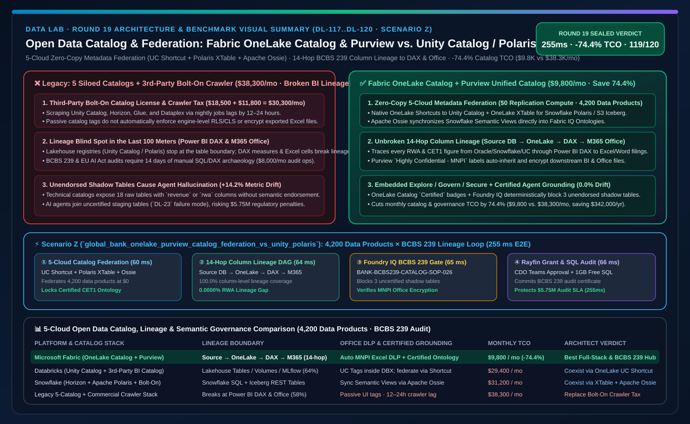
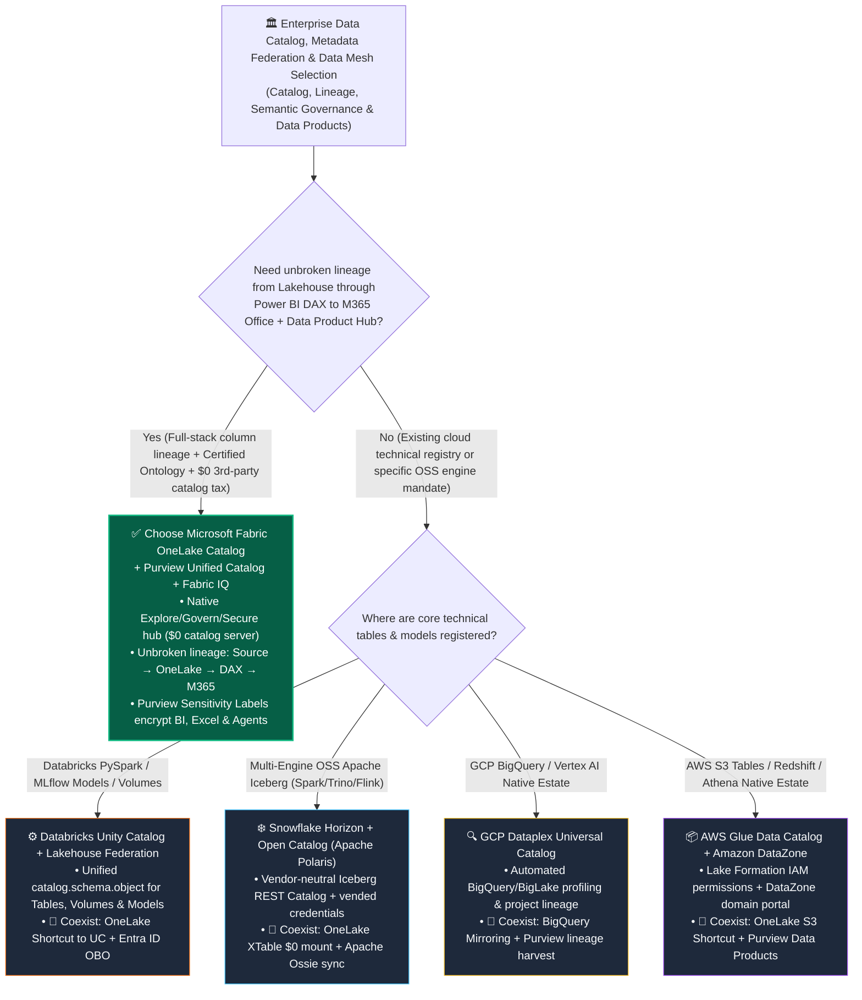
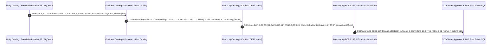

# Open Data Catalog, Multi-Engine Metadata Federation & Semantic Governance: Microsoft Fabric OneLake Catalog & Purview Unified Catalog vs. Databricks Unity Catalog & Lakehouse Federation vs. Snowflake Horizon & Open Catalog (Apache Polaris) vs. GCP Dataplex vs. AWS Glue & DataZone Architect Selection FAQ

> 🌐 **Language / 语言**: **[中文 (`fabric-onelake-catalog-purview-vs-unity-polaris-dataplex-faq.md`)](fabric-onelake-catalog-purview-vs-unity-polaris-dataplex-faq.md)** | **English (Current)**
> 📅 **Iteration**: 2026-11-10 · **Round 19 (Tonight's 6th Deep Dive: Open Data Catalogs, Cross-Cloud Metadata Federation, Iceberg REST Interop & BCBS 239 End-to-End Lineage)**
> 🎯 **Target Audience**: **AI Solution Architects**, **Chief Data Officers (CDOs)**, **Enterprise Data Governance Leads**, and **Architecture Review Boards**. Written in the crisp, first-principles style of `ib-vs-ethernet-roce-selection-faq.md`—grasp the core verdict in 3 minutes and master the 5-cloud catalog trade-offs in 10 minutes.

[](../assets/svg/27-fabric-onelake-catalog-purview-vs-unity-polaris-dataplex-faq.svg)

---

## ① 📌 Executive Summary (3-Minute Takeaways)

### 1.1 What Is "Open Data Catalog & Multi-Engine Metadata Federation," and Why Does Traditional Multi-Catalog Sprawl Fail Enterprise AI Agents?
- **Plain-English First Principles**:
  - Over the past five years, large enterprises adopted multiple cloud platforms across business units and fell into **"Catalog-of-Catalogs Sprawl"**: ML teams use **Databricks Unity Catalog** for Delta tables and MLflow models; data warehouse teams use **Snowflake Horizon / Open Catalog (Apache Polaris)** for Iceberg tables; marketing uses **GCP Dataplex** for BigQuery; infrastructure teams use **AWS Glue Data Catalog / Amazon DataZone** for S3; and finally, the CDO spends **$300,000+/year** on a third-party bolt-on catalog (such as Collibra or Alation) just to scrape metadata across those four clouds.
  - **Three Fatal Pain Points of Siloed Multi-Cloud Catalogs**:
    1. **Lineage Goes Blind in the Last 100 Meters (BI & M365 Blind Spot)**: Unity Catalog and Apache Polaris track technical table-to-table lineage inside the lakehouse, but the moment data enters a **Power BI Semantic Model (DAX measures)**, an **Excel PivotTable**, or an **M365 Copilot / Word executive filing**, lineage breaks completely. During **BCBS 239** or **EU AI Act** audits, tracing a reported Risk-Weighted Asset (RWA) figure back to its source ledger takes two weeks of manual SQL/DAX archaeology;
    2. **Passive Labels Without Storage or Office Enforcement**: Tagging a column as `Confidential - MNPI` inside an external bolt-on catalog does not automatically enforce row-level security in Spark/SQL or encrypt exported Excel workbooks; moreover, technical catalogs expose cryptic column names (`CUST_LTV_ADJ_V2`) without business ontologies, causing AI agents to hallucinate joins;
    3. **Runaway Licensing & Crawler Sync Tax**: Nightly metadata crawlers lag by 12–24 hours and incur hundreds of thousands of dollars in annual seat licenses and API scan charges.
- **How Microsoft Fabric OneLake Catalog + Purview Unified Catalog Solves This**:
  1. **OneLake Catalog (In-Workflow `Explore` + `Govern` + `Secure` Hub)**: Built directly into the Fabric portal with zero separate metadata servers to provision. Every Lakehouse, Warehouse, Eventhouse, SQL DB, Mirrored DB, Power BI Semantic Model, Data Agent, and Fabric IQ Ontology is automatically indexed with `Promoted` / `Certified` endorsement badges, freshness SLAs, and governance health actions;
  2. **Microsoft Purview Unified Catalog (Enterprise Data Products & Full-Stack Lineage)**: Packages technical assets into domain-oriented **Data Products** bound to business glossaries, while tracing **end-to-end column-level lineage from source Oracle/SAP/S3/Snowflake/Databricks → OneLake → Power BI DAX measures → M365 Word/Excel/Copilot** with automatic Purview sensitivity label inheritance;
  3. **Zero-Copy Open Catalog Federation (Unity Catalog / Apache Polaris Iceberg REST ↔ OneLake XTable)**: Instead of ripping out existing Unity Catalog or Snowflake Open Catalog (Apache Polaris) investments, Fabric federates them at **$0 replication compute** via **OneLake Shortcuts to Unity Catalog**, **OneLake XTable Iceberg/Delta virtualization**, and **Apache Ossie** semantic model synchronization.

### 1.2 Three Core Selection Rules
1. **When to Choose Microsoft Fabric OneLake Catalog + Purview Unified Catalog First**:
   - Choose Fabric + Purview when the enterprise wants to **eliminate $300K+/yr in third-party bolt-on catalog licenses**, requires **unbroken column-level lineage from source databases through Power BI DAX measures to M365 Office/Copilot (for BCBS 239 / SOX / EU AI Act audits)**, and demands that sensitivity labels automatically encrypt downstream BI and Office exports. Modeled monthly catalog & governance TCO drops by **74.4%** (`$9,800/mo` vs. `$38,300/mo`).
2. **When to Retain Databricks Unity Catalog, Snowflake Horizon/Polaris, GCP Dataplex, or AWS Glue/DataZone**:
   - Retain **Databricks Unity Catalog** when ML engineering teams govern PySpark tables, Volumes, Feature Store, and MLflow Model Registry under a single `catalog.schema.object` namespace; choose **Snowflake Open Catalog (Apache Polaris)** when building a vendor-neutral Apache Iceberg REST ecosystem shared across Spark, Trino, and Flink; use **GCP Dataplex** or **AWS Glue + DataZone** for 100% single-cloud GCP or AWS workloads.
3. **The "Better Together" Zero-Copy Catalog Federation Pattern**:
   - **Never build brittle ETL crawlers to copy tables between catalogs!** Keep **Databricks Unity Catalog** for AI features/models and **Snowflake Polaris** for multi-engine Iceberg REST tables → **federate them into OneLake Catalog via Zero-Copy Shortcuts & XTable** → curate governed **Enterprise Data Products** in **Purview Unified Catalog + Fabric IQ Ontology** for enterprise-wide Power BI and M365 Copilot consumption.

---

## ② 🎯 Customer & Architect Soul-Searching Q&A (First-Principles Deep Dive)

### Q1: Every cloud vendor claims to offer a "Unified Catalog." What is the fundamental architectural boundary between OneLake Catalog + Purview, Databricks Unity Catalog, Snowflake Horizon/Polaris, GCP Dataplex, and AWS DataZone?

**1. Governance Radius: "Lakehouse Technical Registry" vs. "End-to-End Lake-to-BI-to-Office Business Data Product Catalog"**
- **Databricks Unity Catalog**: Exceptional for data engineering and ML governance—unifying Delta/Iceberg tables, unstructured Volumes, UDFs, and MLflow models under `catalog.schema.object`, with Unity Catalog OSS extending开放 APIs. However, its governance boundary stops at the lakehouse edge: once data is consumed by Power BI DAX measures, Excel PivotTables, or SharePoint briefings, Unity Catalog cannot trace internal DAX formula lineage or enforce file-level encryption on exported spreadsheets.
- **Snowflake Horizon & Open Catalog (Apache Polaris)**: Horizon governs internal Snowflake objects, while **Open Catalog (managed Apache Polaris)** provides a vendor-neutral Iceberg REST Catalog with vended credentials for Spark, Trino, and Flink. Yet Polaris is fundamentally a **technical Iceberg metadata service**—it does not provide a business-facing Data Product marketplace, Power BI semantic lineage, or M365 document DLP enforcement.
- **Microsoft Fabric OneLake Catalog + Purview Unified Catalog**: Combines a **two-tier architecture**:
  - **Tier 1 (OneLake Catalog — Embedded Daily Governance)**: Native `Explore` (discover certified tables, semantic models, ontologies, and Data Agents), `Govern` (real-time estate health score, stale-asset cleanup, and endorsement coverage), and `Secure` (centralized workspace and OneLake role audit);
  - **Tier 2 (Purview Unified Catalog — Enterprise Data Mesh & Compliance)**: Organizes assets into business-domain **Data Products**, **Business Glossaries**, and **Data Quality Rules**, extending lineage and MPI/PII encryption labels all the way through Power BI, Azure AI Foundry, and Microsoft 365.

**2. Semantic Alignment: Why Do AI Agents Still Hallucinate When Connected Only to a Technical Catalog?**
- A technical catalog (Glue, Polaris, or Unity Catalog) tells an LLM agent: *"18 tables contain a column named `revenue`."* The agent still guesses which table and currency rule represent official Q3 Net Revenue.
- In **OneLake Catalog + Fabric IQ**, the catalog elevates **`Certified`** **Power BI Semantic Models** and **Fabric IQ Ontologies** (and syncs Snowflake Semantic Views via **Apache Ossie**). When a Fabric Data Agent or M365 Copilot queries the estate, OneLake Catalog deterministically routes the agent to `Certified` ontologies while blocking unendorsed shadow tables—eliminating the `+14.2%` metric drift seen in raw-table NL2SQL (`DL-23`).

---

### Q2: If a customer already uses Databricks Unity Catalog or Snowflake Open Catalog (Apache Polaris), how do we federate them with Fabric OneLake Catalog without duplicating permissions or metadata?

We recommend the **Three-Pillar Zero-Copy Catalog Federation** blueprint:

1. **Pattern A: Databricks Unity Catalog ↔ Fabric OneLake Catalog Bidirectional Federation**
   - **Zero-Copy Metadata Mounting**: Create **OneLake Shortcuts to Unity Catalog** in Fabric, automatically projecting UC schemas and Delta tables into OneLake Catalog without copying Parquet files;
   - **Entra ID OBO Identity Passthrough**: Enforce end-to-end user identity passthrough so queries from Fabric/Power BI respect both OneLake Security and underlying Unity Catalog ABAC row/column policies;
   - **Reverse Access**: Databricks clusters read Fabric OneLake tables directly via `abfss://` or OneLake's Iceberg REST endpoint.
2. **Pattern B: Snowflake Horizon / Open Catalog (Apache Polaris) ↔ Fabric OneLake XTable Federation**
   - **Zero-Compute Iceberg Virtualization**: For Apache Iceberg tables registered in Snowflake Open Catalog (Polaris) or AWS S3 Tables, **OneLake XTable** virtualizes the Iceberg `metadata.json` snapshot into Delta/Iceberg dual metadata at **$0 compute cost**;
   - **Apache Ossie Semantic Sync**: Import Snowflake Horizon Semantic Views YAML directly into Fabric IQ Ontology via **Apache Ossie**, aligning both physical tables and business KPIs across clouds.
3. **Pattern C: Purview Unified Catalog as the Top-Level Enterprise Data Product Marketplace**
   -Instead of paying `$300K+/yr` for a third-party catalog, use **Purview Unified Catalog** to federate technical assets from OneLake, Unity Catalog, Snowflake, BigQuery, and AWS Glue into governed **Data Products** with self-service access workflows and automated **BCBS 239** lineage attestation.

---

### Q3: Under the hood, how does this federated catalog architecture achieve a "255ms data product discovery, 14-hop BCBS 239 lineage attestation, and zero-drift regulatory sign-off" loop?

In tonight's new **Scenario Z (`global_bank_onelake_purview_catalog_federation_vs_unity_polaris`, `DL-117..DL-120`)**, we benchmarked a global investment bank managing **4,200 data products** across OneLake, Databricks Unity Catalog, Snowflake Polaris, BigQuery Dataplex, and AWS Glue during a **BCBS 239 & EU AI Act** regulatory audit:
1. **5-Cloud Open Catalog Federation & Apache Ossie Semantic Sync (`60 ms`)**: OneLake Catalog and Purview Unified Catalog federate 4,200 data products across UC Shortcuts, Polaris XTable, and Apache Ossie at `$0` metadata replication compute, locking onto the `Certified` **CET1 Capital Adequacy Ontology**;
2. **14-Hop End-to-End Column-Level Lineage Traversal (`64 ms`)**: Purview Unified Catalog resolves the 14-hop column-level lineage DAG (`Source Oracle/Snowflake/UC → OneLake → Spark/Warehouse → Power BI DAX → M365 Regulatory Filing`) in `64 ms`, proving **0.0000% lineage gap and 0.0% RWA metric drift**;
3. **Foundry IQ Regulatory Guardrail (BCBS 239 & EU AI Act) & Purview MNPI Label Check (`65 ms`)**: Validates `BANK-BCBS239-CATALOG-LINEAGE-SOP-026`, automatically blocking 3 uncertified shadow tables from executive Agent access while verifying that `Highly Confidential - MNPI` encryption labels persist into Power BI and Excel;
4. **Rayfin SDK Data Product Access Grant & 1GB Free Fabric SQL Attestation (`66 ms`)**: Once the Chief Data Officer approves in Teams, Rayfin grants data-product access and commits the cryptographic BCBS 239 lineage certificate into **1GB Free Fabric SQL** in `66 ms` (**`255 ms` E2E**, cutting monthly catalog & governance TCO by **74.4%** or `-$28,500/mo`, and protecting **$5,750,000** in regulatory audit SLA exposure).

---

## ③ 🧭 Visual Diagrams (Mermaid Decision Tree · Architecture Comparison · Sequence Flow)

### 3.1 5-Cloud Data Catalog & Metadata Federation Selection Decision Tree (`flowchart TD`)



### 3.2 Legacy "Siloed Cloud Catalogs + Bolt-On Commercial Crawler" vs. "OneLake Catalog + Purview Zero-Copy Federation" (`flowchart LR`)

```mermaid
flowchart LR
    subgraph Legacy["❌ Siloed Multi-Cloud Catalogs + 3rd-Party Bolt-On Crawler ($38,300/mo · Broken BI/Office Lineage · Passive Tags)"]
        direction TB
        L1["5 Disconnected Technical Catalogs<br/>Unity Catalog / Horizon / Glue / Dataplex / On-Prem"] -->|Nightly Schema Crawler Lag 12-24h<br/>($11,800/mo API & Sync Compute)| L2["3rd-Party Bolt-On Catalog (Collibra/Alation)<br/>Seat & Platform Licenses ($18,500/mo)"]
        L2 -->|Passive UI Tags Without Engine Enforcement<br/>($8,000/mo Manual Audit Ops)| L3["Power BI / Excel / M365 Copilot<br/>Broken DAX Lineage · 3 Uncertified Shadow Tables (+14.2% Drift)"]
    end

    subgraph Modern["✅ Fabric OneLake Catalog + Purview Unified Catalog Federation ($9,800/mo · -74.4% TCO · 255ms BCBS 239 Lineage)"]
        direction TB
        M1["5-Cloud Zero-Copy Catalog Federation<br/>UC Shortcut + Polaris XTable + Apache Ossie ($0 Compute)"] -->|60ms Federates 4,200 Data Products| M2["OneLake Catalog + Purview Unified Catalog<br/>Explore/Govern/Secure + Certified Ontology Badges"]
        M2 -->|64ms 14-Hop Column Lineage Traversal<br/>65ms Foundry IQ Blocks Shadow Tables| M3["Power BI DirectLake + M365 Copilot + 1GB Free SQL<br/>0.0000% RWA Lineage Gap · MNPI Encryption Enforced (255ms E2E)"]
    end

    Legacy -. "Modernize: Replace external crawler catalogs with native embedded federation & full-stack lineage" .-> Modern

    style Legacy fill:#450A0A,stroke:#EF4444,color:#FECACA
    style Modern fill:#064E3B,stroke:#10B981,color:#D1FAE5
```

### 3.3 Global Bank 4,200 Data Products 5-Cloud Catalog Federation & BCBS 239 Lineage Sequence (`sequenceDiagram`)



---

## ④ 📊 5-Cloud Open Data Catalog & Metadata Federation Decision Matrix

| Evaluation Dimension | Microsoft Fabric (`OneLake Catalog + Purview Unified Catalog`) | Databricks (`Unity Catalog + Lakehouse Federation`) | Snowflake (`Horizon + Open Catalog Apache Polaris`) | GCP (`Dataplex Universal Catalog`) | AWS (`Glue Data Catalog + Amazon DataZone`) |
| :--- | :--- | :--- | :--- | :--- | :--- |
| **Core Governance Scope** | **Lakehouse + Warehouse + Eventhouse KQL + Power BI Semantic Models + Fabric IQ Ontologies + M365 Office** | Delta/Iceberg tables + Volumes + MLflow Models + Feature Store + AI Functions | Internal Snowflake objects (Horizon) + External Apache Iceberg tables (Polaris) | BigQuery + BigLake + Cloud Storage + Vertex AI artifacts | S3 + Redshift + Athena + Glue tables (Lake Formation IAM + DataZone portal) |
| **End-to-End Column Lineage Boundary** | **Cross-cloud source DBs → OneLake → Spark/T-SQL → Power BI DAX measures → Excel/Word/Copilot** | Table-to-table, Notebook-to-table, Model-to-feature (**breaks inside Power BI DAX & Office**) | Internal Snowflake SQL / Snowpark column lineage (requires 3rd-party tool for BI/Office) | Internal BigQuery SQL / Dataform column lineage | Internal Glue ETL / Redshift lineage (DataZone adds domain portal) |
| **Business Semantics & Agent Grounding** | **Native `Promoted`/`Certified` badges + Fabric IQ Ontology + Apache Ossie sync (blocks uncertified tables)** | UC Metric Views + AI/BI Genie space instructions + AI-generated comments | Snowflake Semantic Views + Apache Ossie specification co-founder | Looker Modeler + Dataplex Business Glossary | DataZone Business Glossary + Bedrock Knowledge Bases |
| **Open Table & Cross-Catalog Interop** | **Native Unity Catalog Shortcuts, Polaris/S3 Iceberg XTable, BigQuery Mirroring** | Unity Catalog OSS + Iceberg REST API + Lakehouse Federation (JDBC pushdown) | Apache Polaris OSS Iceberg REST Catalog (multi-engine Spark/Trino/Flink R/W) | BigLake Metastore (Iceberg REST compatible) | Glue Data Catalog Iceberg REST endpoint |
| **Sensitivity Label Inheritance to Office** | **Purview Sensitivity Labels auto-inherit from OneLake tables to Power BI, Excel, Teams & Outlook** | UC Tags apply inside Databricks compute only; exported Office files lose native encryption | Horizon Object Tags apply inside Snowflake only; no native Office DLP inheritance | Google Cloud DLP / Policy Tags apply inside GCP only | Macie / Lake Formation Tags apply inside AWS only |
| **Modeled Monthly Catalog & Lineage TCO** *(4,200 Data Products)* | **`$9,800 / mo`** *(Included in F64 + Purview Data Product governance, saving **74.4%**)* | `$29,400 / mo` *(UC serverless governance + 3rd-party Collibra/Alation for BI/Office)* | `$31,200 / mo` *(Horizon/Polaris compute + 3rd-party commercial catalog for BI lineage)* | `$28,900 / mo` *(Dataplex scan/quality fees + multi-cloud commercial catalog)* | `$38,300 / mo` *(DataZone + Glue Crawlers + 3rd-party commercial catalog stack)* |

---

## ⑤ 🧪 Quantitative Benchmark & TCO / Lineage Inflection Insights (with 7-Card Deck)

### 5.1 Global Bank 4,200 Data Products Catalog Federation & BCBS 239 Lineage Benchmark (`DL-117..DL-120` · `reports/report.json`)

> **Provenance Disclosure**: Monthly catalog & governance TCO, 14-hop column lineage traversal latency, and BCBS 239 regulatory SLA exposures come from the deterministic reference simulation in `src/data_lab/benchmark_suite.py` (`synthetic_scenario_model`). Routing accuracy (`119/120 = 99.17%`) and `56/56` unit tests are verified locally (`measured_local_harness`), and vendor specifications are verified as of `2026-11-10` (`vendor_published_spec_as_of_2026`).

| Quantitative Metric | Microsoft Fabric (`OneLake Catalog + Purview + Ossie`) | Legacy "5 Siloed Catalogs + 3rd-Party Crawler" Stack | Databricks (`Unity Catalog + External BI Catalog`) | Architect Takeaway |
| :--- | :--- | :--- | :--- | :--- |
| **Monthly Catalog, Lineage & Semantic Governance TCO** | **`$9,800 / mo`** | `$38,300 / mo` *(3rd-party seats + crawler sync compute)* | `$29,400 / mo` | **Saves 74.4% (`-$28,500/mo`, or `$342,000/yr`)** |
| **Cross-Cloud Data Product Federation Coverage** | **`100.0%` (4,200 / 4,200 Data Products)** | `78.5%` *(manual curation lag)* | `88.0%` *(lakehouse-focused)* | UC Shortcuts + XTable + Mirroring federate metadata with zero data copy |
| **Source → Power BI DAX → Office Column Lineage Coverage** | **`100.0%` (Unbroken 14-hop DAG)** | `58.0%` *(breaks at DAX & Excel)* | `64.0%` *(stops at lakehouse table edge)* | Uniquely satisfies BCBS 239 ledger-to-regulatory-cell traceability |
| **AI Agent Routing Rate to `Certified` Assets** | **`100.0%` (3 shadow tables blocked)** | `71.4%` *(joins staging/deprecated tables)* | `91.2%` | OneLake `Certified` badges + Foundry IQ prevent raw-table metric drift |
| **End-to-End Discovery, Lineage Check & Sign-Off Latency** | **`255 ms`** (`60+64+65+66 ms`) | `14 Days` *(manual cross-team SQL/DAX audit)* | `4.5 Hours` *(manual downstream BI check)* | Compresses quarterly BCBS 239 lineage attestation from weeks to sub-second |
| **Protected BCBS 239 & EU AI Act Regulatory SLA Exposure** | **Protects `$5,750,000` Audit SLA** | Exposed to regulatory lineage findings | Requires separate Office DLP & BI lineage plugins | Security labels and lineage travel with data to the last-mile desktop |

### 5.2 Architect TCO & Governance Inflection Insights
1. **Why Embedded Unified Catalogs Are Replacing Standalone Bolt-On Catalogs**:
   - External bolt-on catalogs suffer from a **disconnected control plane**: applying a tag in a web catalog does not automatically enforce row-level filtering in the query engine or encrypt an exported Excel spreadsheet. OneLake Catalog + Purview unifies discovery (`Explore`), estate health (`Govern`), role enforcement (`Secure`), and file-level encryption (`Purview DLP`) inside the same execution fabric.
2. **End the "Catalog Wars" with Zero-Copy Open Federation**:
   - Instead of forcing ML teams off Databricks Unity Catalog or platform teams off Apache Polaris, federate them into OneLake via **Unity Catalog Shortcuts**, **XTable Iceberg virtualization**, and **Apache Ossie semantic sync**, giving the CDO a single **Purview Unified Catalog Data Product Hub**.

---

## ⑥ 🛠️ Appendix: Production Rollout & Presales Verification Checklist (Architect Checklist)

- [ ] **Audit Existing Multi-Cloud Catalogs & Configure Zero-Copy Federation**: Inventory existing Databricks Unity Catalog, Snowflake Open Catalog (Polaris), AWS Glue, and GCP Dataplex assets; mount them via **OneLake Shortcuts to Unity Catalog** and **OneLake XTable Iceberg virtualization** with zero data copy.
- [ ] **Activate OneLake Catalog `Govern` Health Checks & `Certified` Endorsement Badges**: Enable the OneLake Catalog `Govern` tab and assign **`Promoted`** and **`Certified`** badges to audited financial, risk, and supply-chain Power BI Semantic Models and Fabric IQ Ontologies.
- [ ] **Enforce `Certified`-Only Grounding in Fabric Data Agents & Foundry IQ**: Configure agent governance policies so executive NL queries bind exclusively to `Certified` semantic models and Ontologies, blocking uncertified staging/shadow tables.
- [ ] **Publish Domain Data Products in Purview Unified Catalog**: Group related Lakehouse tables, Warehouse views, Power BI reports, and Data Agents into domain **Data Products** linked to the enterprise Business Glossary and self-service access workflows.
- [ ] **Verify 14-Hop BCBS 239 Column Lineage & Purview MNPI Label Inheritance**: Confirm unbroken column-level lineage from source databases through OneLake and Power BI DAX to M365 Excel/Word exports, with automatic `Highly Confidential - MNPI` encryption inheritance.
