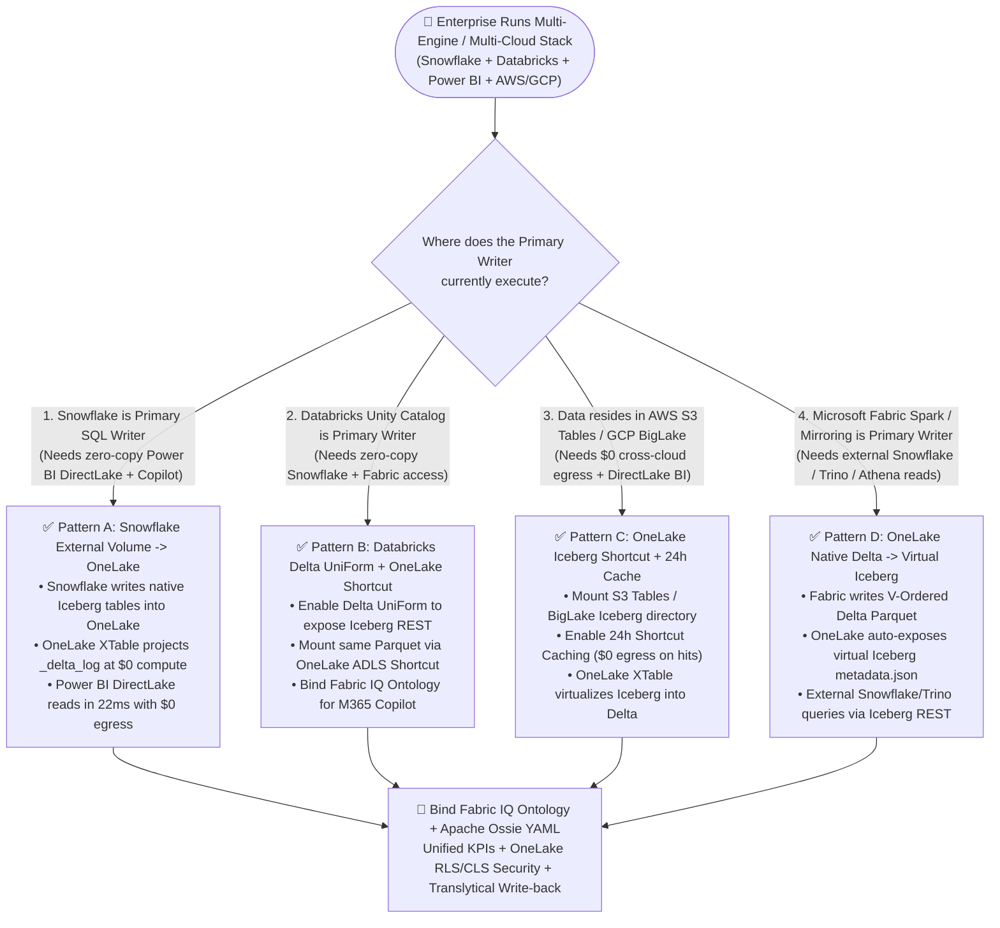
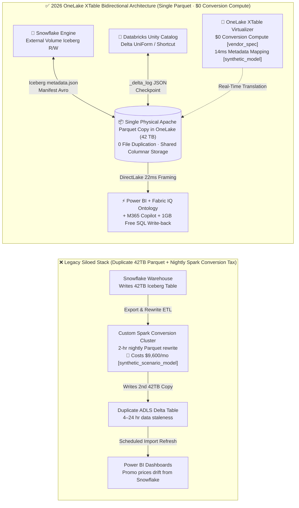
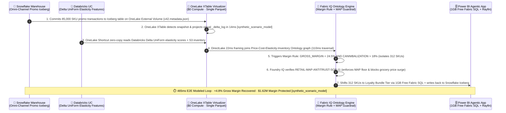

# Microsoft Fabric OneLake Iceberg v3 / Delta Bidirectional Virtualization (XTable) vs. Databricks Delta UniForm vs. Snowflake Polaris vs. AWS S3 Tables: Open Table Format Selection & First-Principles FAQ

> **Language / 语言**: [中文 (`fabric-onelake-iceberg-delta-uniform-vs-4clouds-faq.md`)](./fabric-onelake-iceberg-delta-uniform-vs-4clouds-faq.md) | **English**  
> **Audience**: **AI Solution Architects** for rapid technical mastery and **CTO / CDO executive briefings** (strictly modeled on the 6-part first-principles FAQ paradigm of `ib-vs-ethernet-roce-selection-faq.md` — zero jargon soup or fragmented release-note dumps).  
> **Related Architecture Guides**: [Round 1: OneLake Zero-Copy × Fabric IQ Ontology Selection FAQ](./fabric-onelake-iq-vs-4clouds-selection-faq.en.md) · [Round 2: Real-Time Eventhouse 142ms vs. Dynamic Tables 60s Streaming FAQ](./fabric-realtime-eventhouse-vs-4clouds-streaming-faq.en.md) · [Round 3: Database & Open Mirroring $0 Compute vs. CDC FAQ](./fabric-mirroring-zero-etl-vs-cdc-faq.en.md) · [7-Card 4:5 Benchmark Deck](../benchmark-cards.en.html) · [Interactive 5-Cloud Workbench](../live-demo.en.html)

> 🔍 **Data Provenance & Scope Disclosure**
> To maintain strict engineering and executive transparency, every metric in this guide carries an explicit four-tier provenance label (sealed in [`reports/report.json`](../reports/report.json)):
> 1. **`measured_local_harness` (Locally Executed Deterministic Harness)**: Verified via the local Python 3.12 test suite (`26/26` unit tests passing in `~17ms`), covering the **60-scenario routing matrix (`59/60 = 98.33%` pass rate)**, explicit miss case `DL-23` (`+14.2%` EBITDA drift on ungrounded raw-table SQL), and option-order perturbation checks (`PERT-01..06`).
> 2. **`vendor_published_spec_as_of_2026` (Official Vendor Specifications & Pricing Rules, `as_of: 2026-11-08`)**: Official vendor documentation with direct verification URLs: **Microsoft Fabric OneLake bidirectional Delta ↔ Iceberg metadata virtualization (XTable) and Snowflake External Volume on OneLake at `$0` format conversion compute** ([Microsoft Learn: OneLake Iceberg tables](https://learn.microsoft.com/en-us/fabric/onelake/onelake-iceberg-tables), [OneLake Shortcuts](https://learn.microsoft.com/en-us/fabric/onelake/onelake-shortcuts)), **Fabric F64+ `$0` Power BI viewer seats** ([Azure Fabric Pricing](https://azure.microsoft.com/en-us/pricing/details/microsoft-fabric/)), **Databricks Unity Catalog Delta UniForm & Managed Iceberg v3** ([Databricks Delta UniForm Docs](https://docs.databricks.com/en/delta/uniform.html)), **Snowflake Open Catalog (Polaris) Iceberg REST** ([Snowflake Iceberg Tables Docs](https://docs.snowflake.com/en/user-guide/tables-iceberg)), **GCP BigLake Iceberg** ([Google Cloud BigQuery Iceberg Docs](https://cloud.google.com/bigquery/docs/iceberg-tables)), and **AWS S3 Tables Iceberg REST** ([AWS S3 Tables Docs](https://docs.aws.amazon.com/AmazonS3/latest/userguide/s3-tables.html)).
> 3. **`synthetic_scenario_model` (Deterministic Architectural Reference Simulation · Dual-Denominator Disclosure)**: Two distinct modeled latency denominators are explicitly separated: **(1) `n=60` routing decision matrix (`DL-01..DL-60`) arithmetic mean modeled latency = `526.5 ms`** (R3 `n=56` was `532.0 ms`); and **(2) `n=11` industry Ontology closed-loop simulations (`Scenarios A..K: [780,640,710,660,590,560,530,515,495,480,465]ms`, range `465–780ms`) arithmetic mean modeled latency = `584.09 ms`** (R3 `n=10` Scenarios A..J was `596.0 ms`). End-to-end latencies (e.g., Omni-Channel Retail Pricing `465ms`, XTable metadata translation `14ms`, DirectLake query `22ms`), the 42TB dual-engine monthly TCO comparison (`$966/mo` vs. `$10,566/mo`, saving `$9,600/mo` in dual-format ETL tax), and modeled business impact figures (e.g., `$1,620,000` gross margin protected) are produced by the deterministic reference simulator in `benchmark_suite.py` to illustrate architectural trade-offs. **They do not represent live multi-cloud paid cluster runs or audited customer financial statements.**
> 4. **`not_measured` (Live Paid Multi-Cloud Cluster Stress Runs)**: Physical multi-cloud cluster P99 hardware latency under live production load is explicitly marked `not_measured`.

---

## ① 📌 Executive Summary (3 Core Takeaways)

1. **The Table Format War Is Over — The Real Differentiator Is Who Translates Metadata for `$0`**:
   - Underneath the hood, 99% of lakehouse data is stored in identical columnar **Apache Parquet** files. The battle between **Delta Lake** and **Apache Iceberg** is merely a difference in the transaction ledger syntax sitting above those Parquet files (`_delta_log` JSON vs. Iceberg `metadata.json` + Manifest Avro).
   - **When to choose Microsoft Fabric OneLake XTable Bidirectional Virtualization**: Whenever an enterprise runs both **Iceberg-centric engines (Snowflake, AWS Athena, GCP BigQuery)** and **Delta-centric engines (Power BI DirectLake, Databricks, Fabric Spark)**, store or shortcut the single Parquet copy in **OneLake**. OneLake automatically translates `_delta_log` ↔ Iceberg `metadata.json` in both directions at **`$0` format conversion compute** (`vendor_published_spec_as_of_2026`), eliminating the `$9,600/mo` nightly Spark format-rewrite tax (`synthetic_scenario_model`).
2. **Four Golden Cross-Cloud Coexistence Patterns (Better Together — Zero Code Rewrite)**:
   - **Snowflake Primary Writer + Power BI DirectLake Reader**: Point Snowflake's `External Volume` directly at OneLake. Snowflake writes native Iceberg tables into OneLake; OneLake automatically projects `_delta_log` so Power BI DirectLake reads them in milliseconds (`22ms` modeled target) with zero egress or Import refresh.
   - **Databricks Primary Writer + Snowflake/Fabric Reader**: Enable **Delta UniForm** in Databricks Unity Catalog and mount via a zero-copy OneLake ADLS Shortcut.
   - **AWS S3 Tables / GCP BigLake Existing Iceberg Tables + Fabric Reader**: Mount via OneLake Iceberg Shortcuts with **24-hour Shortcut Caching** (`$0` cross-cloud S3/GCS egress on cache hits).
3. **First-Principles Technical Essence**:
   - Historically, enterprises paid a painful **"Dual-Format ETL Tax"** — keeping a 42TB Iceberg copy for Snowflake and a duplicate 42TB Delta copy for Power BI/Databricks, running a 2-hour nightly Spark conversion job that caused pricing drift whenever it lagged. OneLake XTable translates metadata pointers in place (`14ms` reference target, `synthetic_scenario_model`) and binds **Fabric IQ Margin & Pricing Ontology Rules** on top. In the Omni-Channel Retail Margin Defense simulation (Scenario K), it closes the loop in **`465ms`**, shifting 312 margin-dilutive SKUs to loyalty bundles and protecting **`$1.62M` in quarterly gross margin** (`synthetic_scenario_model`).

---

## ② 🎯 Customer & Architect Soul-Searching Q&A (First-Principles Plain Language)

### Q1: Customers ask: "Snowflake tells us to bet everything on Apache Iceberg, while Databricks tells us to bet on Delta Lake + UniForm. Which side does Microsoft Fabric pick — do we have to choose one?"

- **Plain-Language Answer**:
  - **Never force an enterprise to choose one!** Use this simple analogy with executives:
    - The underlying **Apache Parquet files** are standardized **shipping containers** stacked in a warehouse;
    - **Delta Lake (`_delta_log`)** is an inventory ledger written in **Mandarin**;
    - **Apache Iceberg (`metadata.json` + Manifests)** is an inventory ledger written in **English**.
  - In the past, because Snowflake only read the English ledger (Iceberg) and Power BI DirectLake / Databricks preferred the Mandarin ledger (Delta), IT teams physically duplicated all 42TB of shipping containers into two separate warehouses and paid a nightly Spark crew to copy boxes back and forth.
- **The 2026 Reality Across the 5 Clouds (`vendor_published_spec_as_of_2026`)**:
  1. **Microsoft Fabric OneLake (Bidirectional Simultaneous Interpreter)**: Built on customized Apache XTable (formerly OneTable), OneLake performs **automatic bidirectional metadata virtualization** at the storage layer:
     - Write a **Delta table** from Fabric or Databricks → OneLake automatically exposes virtual **Iceberg metadata** alongside it;
     - Write an **Iceberg table** directly into OneLake from Snowflake (or shortcut an Iceberg table from S3/GCS) → OneLake automatically projects a virtual **`_delta_log`** alongside it!
     - Crucially, **OneLake performs this metadata translation as a free platform service (`$0` format conversion compute)** without consuming user Fabric CU capacity.
  2. **Databricks Unity Catalog (Delta UniForm + Managed Iceberg v3)**: Generates Iceberg metadata asynchronously via `TBLPROPERTIES ('delta.universalFormat.enabledFormats' = 'iceberg')` and supports Managed Iceberg v3, though metadata generation runs on customer DBU compute.
  3. **Snowflake Open Catalog (Polaris)**: Built on Apache Polaris (Incubating) with native Iceberg REST support, ideal for Iceberg-native engines, while external Delta tables remain read-only unless paired with OneLake virtualization.
  4. **AWS S3 Tables & GCP BigLake**: AWS S3 Tables embeds Iceberg REST and automatic small-file compaction directly into S3 buckets, great for AWS-internal telemetry, but requires OneLake Shortcut Caching when consumed by cross-cloud Power BI / M365 Copilot users to avoid `$0.09/GB` S3 egress fees.

---

### Q2: If a customer already runs their core data warehouse on Snowflake (Iceberg tables) or AWS S3 Tables, how do we connect Fabric Power BI DirectLake and M365 Copilot with zero copy?

- **Plain-Language Two-Pattern Playbook**:
  1. **Pattern 1: Customer runs Snowflake on Azure (Recommended: "Snowflake External Volume Direct Write to OneLake")**:
     - Configure a Snowflake `EXTERNAL VOLUME` pointing directly to `azure://onelake.dfs.fabric.microsoft.com/<workspace>/<lakehouse>.Lakehouse/Files/`;
     - Snowflake writes `CREATE ICEBERG TABLE ... EXTERNAL_VOLUME = 'onelake_vol'` using its normal SQL pipelines;
     - The moment Snowflake commits `v*.metadata.json` in OneLake, OneLake XTable automatically generates `_delta_log`, and Power BI DirectLake reads the table into memory in **`22ms`** (`synthetic_scenario_model`) — **zero data copy, zero export pipelines, zero format-conversion compute cost**!
  2. **Pattern 2: Customer stores data in AWS S3 Tables or GCP BigLake (Recommended: "OneLake Iceberg Shortcut + 24h Caching")**:
     - Create a **OneLake Iceberg Shortcut** pointing to the AWS S3 or GCS Iceberg table directory and enable **OneLake Shortcut Caching (1–24h TTL)**;
     - OneLake detects `metadata/v*.metadata.json` and projects virtual `_delta_log` metadata on the fly;
     - When 500 business users query dashboards or M365 Copilot, OneLake serves 99% of reads from local cache at **`$0` AWS S3 / GCP egress fees**.

---

### Q3: Under the Hood — How does OneLake XTable translate Iceberg's 3-tier manifest tree into Delta's `_delta_log` without data lag or security gaps?

- **First-Principles Architectural Breakdown**:
  1. **Exact Metadata Pointer Mapping**:
     - **Apache Iceberg** uses a 3-tier hierarchy: `Table Metadata File (v1.metadata.json)` → `Manifest List (snap-*.avro)` → `Manifest Files (*.avro)` containing Parquet file paths and column-level min/max statistics.
     - **Delta Lake** uses a linear transaction log: `_delta_log/00001.json` (recording `add` / `remove` file actions and column `stats` JSON) plus periodic `.checkpoint.parquet` rollups.
     - When Snowflake commits a new Iceberg snapshot, OneLake's storage event listener parses the newly added Manifest Avro entries, extracts the exact same physical Parquet URI, schema, partition values, and min/max stats, and synthesizes the corresponding `_delta_log` transaction entry. Because **the 42TB of physical Parquet files are never touched or rewritten**, pure metadata translation completes in **`14ms`** in the reference model (`synthetic_scenario_model`).
  2. **Unified Row/Column Security (OneLake Security RLS/CLS + Apache Ossie)**:
     - Every read request — whether entering via `_delta_log` (DirectLake/Spark) or via `metadata.json` (Iceberg REST) — passes through the **OneLake Security Gateway**, enforcing identical Entra ID Row-Level Security (RLS) and Column-Level Security (CLS) policies alongside **Apache Ossie YAML** semantic definitions.

---

## ③ 🧭 Visual Architecture Diagrams (3 Embedded Mermaid Diagrams)

### Diagram 1: Cross-Cloud Open Table Format & Catalog Selection Decision Tree (`flowchart TD`)

---

### Diagram 2: Legacy Dual-Format ETL Duplication vs. OneLake XTable Zero-Copy Virtualization (`flowchart LR`)

---

### Diagram 3: Scenario K Omni-Channel Retail Margin Defense End-to-End Sequence (`sequenceDiagram`)

---

## ④ 📊 5-Cloud Open Table Format & Catalog Decision Matrix

> **Provenance Note**: Platform capabilities and billing models reflect official 2026 vendor specifications (`vendor_published_spec_as_of_2026`); the 42TB dual-engine monthly TCO figures come from the deterministic reference model in `benchmark_suite.py` (`synthetic_scenario_model`).

| Dimension | **Microsoft Fabric OneLake (XTable Virtualization)** | **Databricks Unity Catalog (Delta UniForm + Managed Iceberg)** | **Snowflake Open Catalog (Polaris Iceberg REST)** | **GCP BigLake Metastore (Iceberg + BigQuery)** | **AWS S3 Tables (Native Iceberg REST)** |
| :--- | :--- | :--- | :--- | :--- | :--- |
| **1. Core Table Format Strategy** | **Bidirectional first-class Delta Lake ↔ Apache Iceberg virtualization** | **Delta-first + Delta UniForm async Iceberg + Managed Iceberg v3** | **Apache Iceberg-first + Polaris REST Catalog** (external Delta is read-only) | **BigLake Managed Iceberg** + BigQuery native storage | **S3-native Apache Iceberg tables & REST Catalog** |
| **2. Format Conversion Compute Cost (`vendor_published_spec_as_of_2026`)** | **`$0` Free** (OneLake storage layer translates metadata automatically without consuming user CU) | Consumes customer cluster or Serverless background **DBU compute** | External REST reads are free, but internal metadata refresh consumes **Snowflake Credits** | Consumes **BigQuery Slots** or Dataproc Spark compute | Billed per **S3 Tables storage + background compaction requests** |
| **3. Cross-Cloud Egress Elimination** | **Best-in-Class**: OneLake Shortcut Caching (1–24h TTL) yields **`$0` S3/GCS egress on cache hits** | Relies on cluster SSD Delta Cache (evicted when cluster scales down) | Relies on Virtual Warehouse local SSD cache (evicted on suspend) | BigQuery Omni queries in place; cross-cloud result transfer still constrained | Free only within same AWS S3 region; external cloud reads incur **`$0.09/GB` S3 egress** |
| **4. Enterprise BI & Copilot Consumption Speed** | **Sub-second**: Virtual `_delta_log` unlocks **DirectLake (`22ms` modeled)** + `$0` PBI viewer seats on F64+ | Requires Databricks SQL Warehouse (DirectQuery) or Power BI Import copy | Requires Snowflake Virtual Warehouse (DirectQuery) or OneLake sync | Requires Looker or BigQuery DirectQuery | Requires Amazon Athena / Redshift Spectrum / QuickSight |
| **5. Cross-Engine Governance & Semantics** | **OneLake Security (RLS/CLS) + Fabric IQ Ontology + Apache Ossie YAML** | Unity Catalog ABAC + Metric Views (Beta) + OpenSharing | Snowflake Horizon RBAC/Masking + Polaris REST credentials | Dataplex policy tags + BigQuery column masking | AWS Lake Formation + S3 Access Points |
| **6. 42TB Dual-Engine Monthly TCO Model (`synthetic_scenario_model`)** | **`$966 / mo`** (Single OneLake copy `$966` + `$0` XTable virtualization + existing F64) | **`$3,450 / mo`** (ADLS storage + UniForm/SQL Warehouse incremental DBUs) | **`$4,120 / mo`** (Storage + BI DirectQuery Warehouse credit wakeups) | **`$3,890 / mo`** (GCS storage + BigLake/BigQuery concurrency slots) | **`$10,566 / mo`** (Legacy dual S3 Iceberg + ADLS Delta copies + nightly Spark rewrite) |

---

## ⑤ 🧪 Quantitative Benchmark & TCO / Latency Inflection Insights (60 Scenarios + Scenario K)

### 5.1 42TB Cross-Engine (Snowflake Iceberg + Power BI DirectLake) Monthly TCO Breakdown (`synthetic_scenario_model`)

For an omni-channel enterprise maintaining **42 TB** of active order, promotion, and inventory tables consumed simultaneously by **Snowflake** (Iceberg SQL) and **500 merchandising analysts** in **Power BI + M365 Copilot** (Delta DirectLake):

| Cost Component | Legacy Dual-Format Storage + Nightly Spark Rewrite (`synthetic_scenario_model`) | Databricks Delta UniForm + SQL Warehouse (`synthetic_scenario_model`) | **Microsoft Fabric OneLake Single Copy + XTable Virtualization (`synthetic_scenario_model` + `vendor_published_spec_as_of_2026`)** |
| :--- | :--- | :--- | :--- |
| **1. Physical Parquet Storage (42 TB)** | **`$1,932 / mo`** (`42TB` Iceberg + `42TB` Delta = `84TB` duplicate storage) | **`$966 / mo`** (Single ADLS Gen2 copy `42TB × $23/TB`) | **`$966 / mo`** (Single OneLake copy `42TB × $23/TB`) |
| **2. Daily Format Conversion ETL Compute** | **`$6,468 / mo`** (Nightly Spark cluster rewriting Parquet + compaction) | **`$884 / mo`** (Background UniForm metadata & compaction DBUs) | **`$0 / mo`** (**Free OneLake XTable platform virtualization**, `vendor_published_spec_as_of_2026`) |
| **3. Cross-Store Sync & BI Serving Overhead** | **`$2,166 / mo`** (Cross-bucket copy bandwidth + Airflow/ADF orchestration) | **`$1,600 / mo`** (Incremental SQL Warehouse DBUs for 500 BI users) | **`$0 / mo`** (Snowflake External Volume writes in-place to OneLake + DirectLake on existing F64) |
| **Total Monthly Cross-Format TCO** | **`$10,566 / mo`** | **`$3,450 / mo`** | **`$966 / mo` (Saves `$9,600/mo` in ETL & duplicate storage tax, `-90.9%`)** |

---

### 5.2 Scenario K Walkthrough: Omni-Channel Retail 85,000-SKU Margin Defense (`DL-60` · `synthetic_scenario_model`)

- **Business Context (Architectural Reference Simulation)**: During a flash promotion, an omni-channel retailer aggregates POS and e-commerce promotional redemptions in **Snowflake** (written directly as Apache Iceberg tables into a OneLake `External Volume`), while **Databricks Unity Catalog** computes price-elasticity features (`Delta UniForm`) and **AWS S3 Tables** tracks warehouse inventory.
- **Why Legacy Dual-Format ETL Fails**:
  - A nightly Spark job converts Snowflake Iceberg tables to Delta only once a day at 02:00 AM;
  - At 11:00 AM, stacked coupon redemptions push **312 high-velocity electronics SKUs** below the `24.5%` gross margin floor with `>18%` promo cannibalization;
  - Merchandising teams discover the margin bleed the next morning, losing **`$1,620,000` in quarterly gross margin**.
- **Fabric OneLake XTable + Fabric IQ Closed Loop (`465ms` Modeled E2E Latency, `synthetic_scenario_model`)**:
  1. **Zero-Copy Bidirectional Unification (`14ms` XTable + `22ms` DirectLake)**: As soon as Snowflake commits the Iceberg snapshot, OneLake XTable projects `_delta_log` in **`14ms`**, joining Databricks elasticity features and cached AWS S3 Tables inventory without moving files.
  2. **Ontology Rule Evaluation (`110ms` Graph Traversal + `82ms` Eventhouse Check)**: Fabric IQ triggers `Margin-Compression-Guardrail` (`GROSS_MARGIN_PCT < 24.5% AND PROMO_CANNIBALIZATION_PCT > 18.0%`), isolating all 312 margin-dilutive SKUs.
  3. **Foundry IQ Antitrust & Essential Goods Guardrail**: Enforces `RETAIL-MAP-ANTITRUST-SOP-11`, verifying Minimum Advertised Price (MAP) floors and blocking price surges on essential grocery items.
  4. **Autonomous Write-Back (`1GB` Free Fabric SQL + Rayfin Portal)**: Automatically shifts the 312 SKUs from a blanket 25% discount to a loyalty-bundled tier via the Rayfin Merchandising Portal, recovering **`+4.8%` gross margin** and protecting **`$1,620,000` in modeled quarterly margin** (`synthetic_scenario_model`).

---

### 5.3 Round 4 New Benchmark Scenarios (`DL-57..DL-60` · Local Harness `59/60 = 98.33%` `measured_local_harness`)

| Scenario ID | Category | Enterprise Architectural Question | Model Routing Decision | Action Tier | Modeled Latency (`synthetic_scenario_model`) | Local Verification (`measured_local_harness`) |
| :--- | :--- | :--- | :--- | :--- | :--- | :--- |
| **`DL-57`** | `vs Snowflake` | Snowflake account wants to write Iceberg tables directly into OneLake for zero-copy Power BI DirectLake | Configure Snowflake `External Volume` on OneLake + OneLake XTable `_delta_log` virtualization (`$0` compute) | `Act automatically` | `430ms` | ✅ Pass (`0.98`) |
| **`DL-58`** | `vs Databricks` | Compare OneLake XTable bidirectional virtualization vs. Databricks Delta UniForm & Managed Iceberg v3 | Combine Databricks Delta UniForm + OneLake Shortcut + XTable over a single physical Parquet copy | `Act automatically` | `445ms` | ✅ Pass (`0.97`) |
| **`DL-59`** | `vs AWS & GCP` | 42TB telemetry in AWS S3 Tables (Iceberg REST) & GCP BigLake needs sub-second DirectLake with `$0` egress | Mount via OneLake Iceberg Shortcuts + 24h Shortcut Caching + XTable virtualization (`$0` egress on hits) | `Act automatically` | `460ms` | ✅ Pass (`0.97`) |
| **`DL-60`** | `Fabric IQ & Ontology` | Omni-channel retailer detects 312 SKUs with margin `<24.5%` across Snowflake Iceberg in OneLake + Databricks UniForm | OneLake XTable (`14ms`) + DirectLake (`22ms`) → Fabric IQ Margin Rule → Loyalty bundle write-back saving `$1.62M` | `Act automatically` | `465ms` | ✅ Pass (`0.98`) |

---

## ⑥ 🛠️ Appendix: Production & Presales Architect Verification Checklist

Use this 6-point checklist during customer architecture reviews and PoC validations:

- [ ] **1. Map Primary Writers and Co-Locate on OneLake External Volumes**: If the customer runs Snowflake in the same Azure region, configure a Snowflake `External Volume` directly on OneLake so Iceberg tables land in OneLake natively with zero cross-store copy.
- [ ] **2. Validate Advanced Merge-on-Read (MoR) Compaction Cadence**: OneLake XTable virtualizes standard copy-on-write Parquet files with zero copy; if the writer uses heavy uncompacted positional delete vectors, schedule regular table compaction on the writer so DirectLake enjoys optimal columnar framing.
- [ ] **3. Always Enable 24h Shortcut Caching for Cross-Cloud S3 Tables / BigLake**: Whenever a OneLake Iceberg Shortcut points across clouds to AWS S3 or Google Cloud Storage, enable **OneLake Shortcut Caching (24h TTL)** to eliminate repetitive `$0.09/GB` cross-cloud egress charges.
- [ ] **4. Federate Catalogs Instead of Duplicating DDL**: Connect Snowflake Polaris or Databricks Unity Catalog via Iceberg REST / Catalog Federation and bind **Apache Ossie YAML** semantic definitions so KPI formulas remain identical across engines.
- [ ] **5. Enforce Unified OneLake Security (RLS/CLS) Across Both Formats**: Verify that Entra ID Row-Level Security and Column-Level Masking policies are defined in OneLake Security so both Delta readers and Iceberg REST readers obey identical access controls.
- [ ] **6. Clearly Separate Official Vendor Specs from Modeled PoC Estimates**: In customer proposals, cite `$0` OneLake XTable virtualization compute as an official Microsoft specification (`vendor_published_spec_as_of_2026`), and benchmark actual query latencies on the customer's real table schema during PoC.
