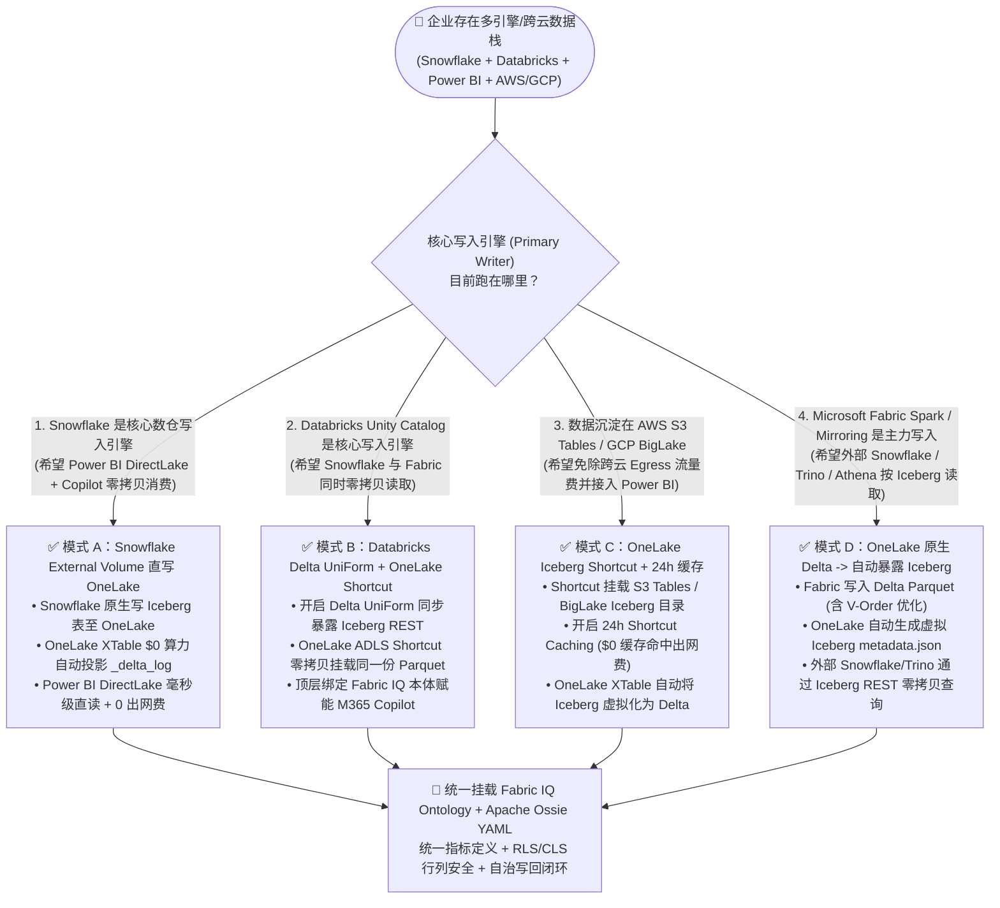
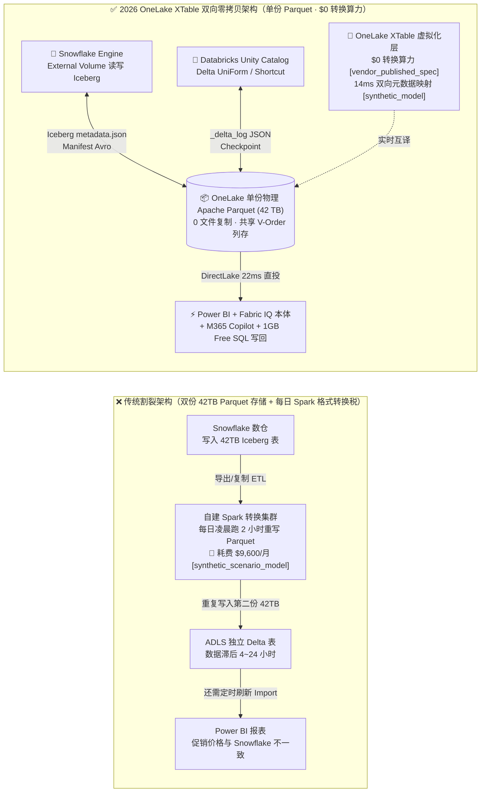
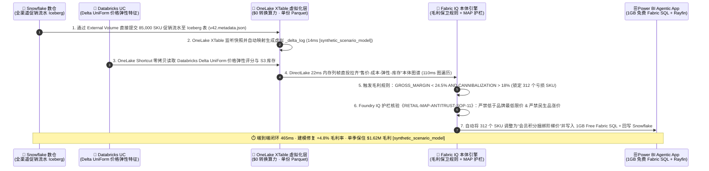

# Microsoft Fabric OneLake Iceberg v3 / Delta 双向虚拟化 (XTable) vs. Databricks Delta UniForm vs. Snowflake Polaris vs. AWS S3 Tables 开放表格式选型与原理解析 FAQ

> **Language / 语言**: **中文 (Chinese)** | [English (`fabric-onelake-iceberg-delta-uniform-vs-4clouds-faq.en.md`)](./fabric-onelake-iceberg-delta-uniform-vs-4clouds-faq.en.md)  
> **定位**：面向 **AI Solution Architect（AI 解决方案架构师）** 本人学习吸收与面向客户 CTO / 首席数据官（CDO）汇报的**第一性原理选型实战指南**（严格对标 `ib-vs-ethernet-roce-selection-faq.md` 六段式深度问答范式，拒绝零散 Release Notes 堆砌）。  
> **关联架构系列**：[《Round 1：OneLake 零拷贝 × Fabric IQ 本体选型 FAQ》](./fabric-onelake-iq-vs-4clouds-selection-faq.md) · [《Round 2：Eventhouse 142ms vs Dynamic Tables 60s 实时流选型 FAQ》](./fabric-realtime-eventhouse-vs-4clouds-streaming-faq.md) · [《Round 3：Database & Open Mirroring $0 算力 vs 传统 CDC 选型 FAQ》](./fabric-mirroring-zero-etl-vs-cdc-faq.md) · [《7-Card 4:5 基准报告》](../benchmark-cards.html) · [《交互式五云工作台》](../index.html)

> 🔍 **数据溯源与适用范围声明（Data Provenance & Scope Disclosure）**
> 为确保架构评审与高管汇报严谨透明，本文所有数字均严格区分四类溯源标签（封存于 [`reports/report.json`](../reports/report.json)）：
> 1. **`measured_local_harness`（本地确定性引擎实测）**：本仓 Python 评估套件（`26/26` 单元测试通过，运行耗时 `~17ms`）对 **60 个架构选型场景（`59/60 = 98.33%` 准确率）**、显式反例 `DL-23`（裸表 SQL 导致 `+14.2%` EBITDA 漂移）及选项翻转鲁棒性（`PERT-01..06`）的本地实测结果。
> 2. **`vendor_published_spec_as_of_2026`（官方发布规约与定价条款，`as_of: 2026-11-08`）**：各云厂商公开技术与计费规约，均附官方核验链接：**Microsoft Fabric OneLake Delta ↔ Iceberg 双向自动元数据虚拟化（XTable）及 Snowflake External Volume 直写 OneLake 免收格式转换算力费（`$0`）**（[Microsoft Learn: OneLake Iceberg tables](https://learn.microsoft.com/en-us/fabric/onelake/onelake-iceberg-tables)、[OneLake Shortcuts](https://learn.microsoft.com/en-us/fabric/onelake/onelake-shortcuts)）、**Fabric F64+ 免 Power BI 读者席位费**（[Azure Fabric Pricing](https://azure.microsoft.com/en-us/pricing/details/microsoft-fabric/)）、**Databricks Unity Catalog Delta UniForm 与 Managed Iceberg v3**（[Databricks Delta UniForm Docs](https://docs.databricks.com/en/delta/uniform.html)）、**Snowflake Open Catalog (Polaris) Iceberg REST**（[Snowflake Iceberg Tables Docs](https://docs.snowflake.com/en/user-guide/tables-iceberg)）、**GCP BigLake Iceberg**（[Google Cloud BigQuery Iceberg Docs](https://cloud.google.com/bigquery/docs/iceberg-tables)）及 **AWS S3 Tables Iceberg REST**（[AWS S3 Tables Docs](https://docs.aws.amazon.com/AmazonS3/latest/userguide/s3-tables.html)）。
> 3. **`synthetic_scenario_model`（确定性架构参考仿真模型 · 双分母显式披露）**：严格区分两套不同分母的建模延迟均值——**① `n=60` 架构选型路由矩阵（`DL-01..DL-60`）建模算术均值 = `526.5 ms`**（R3 `n=56` 为 `532.0 ms`）；**② `n=11` 行业本体端到端闭环仿真（Scenarios A..K: `[780,640,710,660,590,560,530,515,495,480,465]ms`，范围 `465–780ms`）建模算术均值 = `584.09 ms`**（R3 `n=10` Scenarios A..J 为 `596.0 ms`）。文中关于全渠道零售定价 `465ms`、XTable 元数据翻译 `14ms`、DirectLake 查询 `22ms`、42TB 跨引擎双格式月度成本对比（`$966/月` vs `$10,566/月`，节省 `$9,600/月` ETL 冗余）以及建模业务止损金额（如保住 `$1,620,000` 毛利）均来自 `benchmark_suite.py` 的**确定性架构参考仿真模型**，旨在量化不同架构拓扑的理论收益量级，**不代表在客户生产云租户上执行了付费多云物理压测，亦非客户真实财务审计报表**。
> 4. **`not_measured`（未执行实机付费云压测）**：跨云生产集群在真实硬件负载下的实机 P99 延迟显式标注为 `not_measured`。

---

## ① 📌 核心结论速览（Executive Summary）

1. **格式之争已经终结，核心分水岭在于“谁替你免费翻译目录账本”**：
   - 底层数据文件 99% 都是标准的列式 **Apache Parquet**；所谓 **Delta Lake** 与 **Apache Iceberg** 之争，本质只是 Parquet 文件头顶上的“事务目录账本（`_delta_log` JSON vs Iceberg `metadata.json` + Manifest Avro）”语法不同。
   - **何时首选 Microsoft Fabric OneLake XTable 双向虚拟化**：当企业同时使用 **Snowflake / AWS Athena / GCP BigQuery（偏爱 Iceberg）** 与 **Power BI DirectLake / Databricks / Fabric Spark（偏爱 Delta Lake）** 时，首选把单份 Parquet 放在或挂载到 **OneLake**。OneLake 后台以 **`$0` 格式转换算力**（`vendor_published_spec_as_of_2026`）自动双向实时生成 `_delta_log` 与 Iceberg `metadata.json`，彻底消灭每天跑 Spark 把 Iceberg 转成 Delta 的双份存储与 ETL 税（在 42TB 全渠道零售参考模型中每月立省 **`$9,600/mo`**，`synthetic_scenario_model`）。
2. **四大跨云共存黄金范式（Better Together，绝不强迫客户改写现有代码）**：
   - **Snowflake 主力写 + Power BI DirectLake 读**：将 Snowflake 的 `External Volume` 直接配置在 OneLake 上，Snowflake 按原生 Iceberg 语法写入 OneLake，OneLake 自动投影出 `_delta_log`，Power BI DirectLake 直接毫秒级消费，无需数据出网或 Import 刷新。
   - **Databricks 主力写 + Snowflake/Fabric 读**：在 Databricks Unity Catalog 开启 **Delta UniForm**，并通过 OneLake ADLS Shortcut 零拷贝挂载，三方共享同一份物理 Parquet。
   - **AWS S3 Tables / GCP BigLake 存量 Iceberg 表 + Fabric 读**：通过 OneLake Iceberg Shortcut + **24 小时 Shortcut Caching** 挂载，缓存命中时 **`$0` 跨云 S3/GCS 出网流量费**。
3. **核心技术本质（第一性原理）**：
   - 以前企业做跨引擎分析最痛的是**“格式翻译税”**——为了兼容不同引擎，同一个 42TB 订单表要在 S3 存一份 Iceberg、在 ADLS 存一份 Delta，每天凌晨跑 2 小时转换脚本，一旦脚本失败两边促销价格还不一致。OneLake XTable 双向虚拟化直接在存储文件系统的元数据指针层做实时映射（参考模型耗时仅 **`14ms`**，`synthetic_scenario_model`），并在顶层挂载 **Fabric IQ 价格与毛利本体规则**，在全渠道零售毛利保卫战仿真（Scenario K）中以 **`465ms`** 端到端闭环自动拦截 312 个毛利击穿 SKU，单季建模保住 **`$1.62M` 毛利**（`synthetic_scenario_model`）。

---

## ② 🎯 客户与架构师灵魂拷问 Q&A（FAQ-Driven，大白话第一性原理）

### Q1：客户问：“Snowflake 让我们全押 Apache Iceberg，Databricks 让我们全押 Delta Lake + UniForm，微软 Fabric 到底支持哪个？我们是不是得二选一？”

- **通俗大白话解答**：
  - **千万别二选一！** 给客户打个最直观的比喻：
    - 底层 **Apache Parquet 数据文件**就像是仓库里一箱箱摆放整齐的**标准集装箱货物**；
    - **Delta Lake (`_delta_log`)** 是一本用“中文”写的仓库进出货台账；
    - **Apache Iceberg (`metadata.json` + Manifest)** 是一本用“英文”写的仓库进出货台账。
  - 以前之所以痛苦，是因为 Snowflake 这位海外采购员只看英文台账（Iceberg），而 Power BI DirectLake 和 Databricks 这位本地店长最擅长看中文台账（Delta）。过去笨办法是把整个仓库的集装箱货物**重新搬运复制一份**，既交双份仓租，又花雇工搬运钱（ETL 算力费）。
- **2026 年五大云平台的真实底牌（`vendor_published_spec_as_of_2026`）**：
  1. **Microsoft Fabric OneLake（双向全自动同声传译）**：OneLake 内置了基于开源 Apache XTable（原 OneTable）深度定制的**平台级双向虚拟化引擎**。只要表在 OneLake 里（或者通过 Shortcut 映射进来）：
     - 你用 Fabric / Databricks 写入 **Delta 表**，OneLake 自动在旁边实时生成虚拟的 **Iceberg 元数据树**；
     - 你用 Snowflake 直接往 OneLake 写入 **Iceberg 表**，OneLake 自动在旁边实时生成虚拟的 **`_delta_log`**！
     - 最关键的是：**这项元数据互译由 OneLake 存储平台后台免费自动完成，不消耗用户的 Fabric CU 算力（`$0` 格式转换算力）**。
  2. **Databricks Unity Catalog（Delta UniForm + Managed Iceberg v3）**：Databricks 主打以 Delta 为底座、通过 `TBLPROPERTIES ('delta.universalFormat.enabledFormats' = 'iceberg')` 异步生成 Iceberg 元数据（现已支持 Managed Iceberg v3），但元数据生成任务需要运行在用户的 Databricks 计算资源（DBU）上。
  3. **Snowflake Open Catalog (Polaris)**：基于 Apache Polaris (Incubating) 提供标准 Iceberg REST 目录，对 Iceberg 读写体验极佳，但对原生 Delta 表的直接写入和 Power BI DirectLake 内存列帧直投不支持，需配合 OneLake 使用。
  4. **AWS S3 Tables & GCP BigLake**：S3 Tables 将 Iceberg REST 目录和后台小文件压缩（Compaction）直接做进 S3 存储桶，非常适合 AWS 内部日志归档，但跨云给M365/Power BI 高并发消费时若无缓存会产生高额 S3 Egress 出网费。

---

### Q2：如果客户已经把核心数仓建在 Snowflake（Iceberg 表）或 AWS S3 Tables 上，如何零拷贝接入 Fabric Power BI DirectLake 和 M365 Copilot？

- **通俗大白话解答**：
  - 客户最怕听到“把数据从 Snowflake 或 AWS 导出来再灌进 Fabric”。正确的 **Better Together 零搬迁架构**只有两步：
  1. **场景一：客户主力在 Azure 上的 Snowflake（推荐“Snowflake External Volume 直写 OneLake”）**：
     - 在 Snowflake 中执行一条 `CREATE EXTERNAL VOLUME onelake_vol STORAGE_LOCATIONS = ((NAME = 'onelake' STORAGE_PROVIDER = 'AZURE' STORAGE_BASE_URL = 'azure://onelake.dfs.fabric.microsoft.com/<workspace>/<lakehouse>.Lakehouse/Files/'))`；
     - Snowflake 照常运行它的 SQL 作业，把结果存为 `CREATE ICEBERG TABLE ... EXTERNAL_VOLUME = 'onelake_vol'`；
     - 数据物理落盘在 OneLake 的瞬间，OneLake XTable 自动生成 `_delta_log`，Power BI DirectLake 立即以 **`22ms`**（`synthetic_scenario_model`）内存直投模式加载到高管看板和 M365 Copilot 中——**0 数据复制、0 导出作业、0 额外转换算力费**！
  2. **场景二：客户主力在 AWS S3 Tables 或 GCP BigLake（推荐“OneLake Iceberg Shortcut + 24h 缓存”）**：
     - 在 Fabric Lakehouse 中创建指向 AWS S3 或 GCS Iceberg 表目录的 **OneLake Shortcut**，并开启 **OneLake Shortcut Caching（1–24 小时可调 TTL）**；
     - OneLake 自动识别该目录中的 `metadata/v*.metadata.json`，在虚拟层实时翻译为 `_delta_log`；
     - 当 500 名业务人员通过 Power BI 或 Copilot 并发查询时，首次读取拉取增量 Parquet 分片后即缓存在 OneLake 本地，后续 99% 查询全部命中缓存，**跨云 AWS S3 / GCP 出网流量费（`$0.09/GB`）直接归零**！

---

### Q3：底层解剖——OneLake XTable 双向虚拟化到底是怎么把 Iceberg 的三层清单树变成 Delta 的 `_delta_log` 的？会不会导致数据延迟或权限漏洞？

- **第一性原理逐层拆解**：
  1. **两种格式的元数据结构如何精确映射？**
     - **Apache Iceberg** 采用三层树状结构：`Table Metadata File (v1.metadata.json)` → 指向每次快照的 `Manifest List (snap-*.avro)` → 指向具体包含哪些 Parquet 文件及列级最大/最小值统计量的 `Manifest File (*.avro)`。
     - **Delta Lake** 采用扁平事务日志：`_delta_log/00001.json`（记录每次事务 `add` 了哪个 Parquet 文件、`remove` 了哪个文件，以及每个文件的 `stats` JSON 字符串）+ 周期性汇总的 `.checkpoint.parquet`。
     - 当 Snowflake 提交一个新 Iceberg 快照（生成 `v2.metadata.json`）时，OneLake 文件系统监听到该文件写入事件，立即读取新增的 Manifest Avro 条目，提取出相同的 Parquet 物理路径、Schema、分区值和 Min/Max 统计信息，在虚拟目录 `_delta_log/` 下合成对应的 `00002.json` 事务条目。因为**根本不触碰那几十 TB 的 Parquet 数据文件本身**，纯元数据指针转换在参考模型中仅需 **`14ms`**（`synthetic_scenario_model`）。
  2. **行级/列级安全（RLS/OLS/CLS）会因为换了引擎而失效吗？**
     - 传统开放表格式最大的隐患是“谁拿到了底层 S3/ADLS 路径，谁就能绕过数仓权限直接用 Spark 偷看全表 Parquet”。
     - 在 Fabric 中，所有访问统一收口于 **OneLake Security（统一细粒度 RBAC + RLS 行级安全 + CLS 列级脱敏）** 与 **Apache Ossie 开放语义标准**。无论是 Power BI DirectLake、Fabric Spark 还是通过 OneLake Iceberg REST API 接入的外部引擎，OneLake 存储网关都会根据调用者的 Entra ID 身份动态过滤行列权限，确保跨格式访问不裸奔。

---

## ③ 🧭 直观可视化图解（3 张核心 Mermaid 架构图）

### 图 1：跨云开放表格式（Iceberg vs Delta）与目录架构选型决策树（`flowchart TD`）

---

### 图 2：传统双格式 ETL 冗余搬运架构 vs. OneLake XTable 双向零拷贝虚拟化对比图（`flowchart LR`）

---

### 图 3：Scenario K 全渠道零售定价与毛利保卫战端到端闭环时序图（`sequenceDiagram`）

---

## ④ 📊 五大平台开放表格式与跨云目录选型决策矩阵（Architect Decision Matrix）

> **溯源说明**：下表产品能力与计费规则依据各厂商 2026 官方文档（`vendor_published_spec_as_of_2026`）；42TB 跨引擎月度 TCO 为 `benchmark_suite.py` 中的确定性参考成本模型（`synthetic_scenario_model`）。

| 评估维度 | **Microsoft Fabric OneLake (XTable 双向虚拟化)** | **Databricks Unity Catalog (Delta UniForm + Managed Iceberg)** | **Snowflake Open Catalog (Polaris Iceberg REST)** | **GCP BigLake Metastore (Iceberg + BigQuery)** | **AWS S3 Tables (Native Iceberg REST)** |
| :--- | :--- | :--- | :--- | :--- | :--- |
| **1. 核心表格式战略** | **Delta Lake 与 Apache Iceberg 一等公民双向自动虚拟化** | **Delta 优先 + Delta UniForm 异步暴露 Iceberg + Managed Iceberg v3** | **Apache Iceberg 优先 + Polaris REST 目录**（外部 Delta 仅支持只读） | **BigLake 托管 Iceberg 表** + BigQuery 原生列存 | **S3 存储桶原生内置 Apache Iceberg 表与 REST 目录** |
| **2. 跨格式转换算力费 (`vendor_published_spec_as_of_2026`)** | **`$0` 免费**（OneLake 存储层后台自动翻译元数据，不扣用户 CU） | 需消耗用户集群或 Serverless 后台 **DBU 算力**生成 UniForm 元数据 | 外部引擎通过 REST 直读免仓费，但内部刷新元数据消耗 **Snowflake Credits** | 消耗 **BigQuery Slots** 或 Dataproc Spark 算力 | 按 **S3 Tables 存储费 + 后台自动 Compaction 请求数**计费 |
| **3. 跨云读取免 Egress 出网费能力** | **极强**：OneLake Shortcut Caching（1–24h TTL）命中后 **`$0` S3/GCS 出网费** | 依赖挂载集群本地 SSD 缓存（集群缩容后缓存释放，重读需再次跨云拉取） | 依赖 Virtual Warehouse 本地缓存（挂起 Suspend 后重读需重新拉取） | BigQuery Omni 支持跨云就地查询，但结果汇总回传仍受网络约束 | 仅限 AWS S3 同区域内部免流量费；跨云外部引擎读取需付 **`$0.09/GB` S3 出网费** |
| **4. 面向全民 BI 与 Copilot 消费速度** | **极致**：Iceberg 自动变身 `_delta_log` 后直接享受 **DirectLake 毫秒级内存直投** + F64 免 PBI 读者费 | 需通过 Databricks SQL Warehouse (DirectQuery) 或导出至 Power BI Import | 需通过 Snowflake Virtual Warehouse (DirectQuery) 或同步至 OneLake | 需通过 Looker 或 BigQuery DirectQuery 连接 | 需通过 Amazon Athena / Redshift Spectrum / QuickSight 查询 |
| **5. 语义层与安全策略跨引擎继承** | **OneLake Security (RLS/CLS) + Fabric IQ Ontology + Apache Ossie YAML** | Unity Catalog ABAC 行列权限 + Metric Views (Beta) + OpenSharing | Snowflake Horizon Catalog RBAC/Masking + Polaris REST 角色凭证 | Dataplex 策略标签 + BigQuery 列级脱敏 | AWS Lake Formation 细粒度权限 + S3 Access Points |
| **6. 42TB 双引擎（Snowflake + BI）月度 TCO 模型 (`synthetic_scenario_model`)** | **`$966 / 月`**（单份 OneLake 存储 `$966` + `$0` XTable 虚拟化 + 复用既有 F64） | **`$3,450 / 月`**（ADLS 存储 + UniForm/SQL Warehouse 增量 DBU） | **`$4,120 / 月`**（存储 + BI 高并发 DirectQuery 唤醒 Warehouse Credit） | **`$3,890 / 月`**（GCS 存储 + BigLake/BigQuery 并发查询 Slot） | **`$10,566 / 月`**（若采用传统 S3 Iceberg + ADLS Delta 双份存储与每日 Spark 转换） |

---

## ⑤ 🧪 简明定量测评与 TCO / 延迟拐点洞察（60 场景基准 + Scenario K 深度解剖）

### 5.1 42TB 跨引擎（Snowflake Iceberg + Power BI DirectLake）月度 TCO 拆解（`synthetic_scenario_model`）

假设某全渠道零售集团拥有 **42 TB** 核心订单、促销与库存历史表，既需要 **Snowflake** 执行日常 SQL 批处理（Iceberg 格式），又需要 **500 名商品运营人员**通过 **Power BI + M365 Copilot** 进行亚秒级价格弹性钻取与回写（Delta DirectLake 格式）：

| 成本分项 | 传统方案：S3/ADLS 双份存储 + 每日 Spark 格式转换 (`synthetic_scenario_model`) | Databricks Delta UniForm + SQL Warehouse 直连 (`synthetic_scenario_model`) | **Microsoft Fabric OneLake 单份存储 + XTable 双向虚拟化 (`synthetic_scenario_model` + `vendor_published_spec_as_of_2026`)** |
| :--- | :--- | :--- | :--- |
| **1. 物理存储费用（42 TB）** | **`$1,932 / 月`**（Iceberg 一份 `42TB` + Delta 一份 `42TB` = `84TB` 双份存储） | **`$966 / 月`**（单份 ADLS Gen2 存储 `42TB × $23/TB`） | **`$966 / 月`**（单份 OneLake 存储 `42TB × $23/TB`） |
| **2. 每日 Iceberg ↔ Delta 格式转换 ETL 算力费** | **`$6,468 / 月`**（每日跑全量/增量 Spark 重写 Parquet + 小文件合并） | **`$884 / 月`**（后台异步生成 UniForm Iceberg 元数据及 Compaction DBU） | **`$0 / 月`**（**OneLake XTable 平台层免费双向虚拟化**，`vendor_published_spec_as_of_2026`） |
| **3. 跨云/跨存储数据同步网络与调度费** | **`$2,166 / 月`**（跨桶复制带宽费 + Airflow/ADF 管道调度费） | **`$1,600 / 月`**（500 人 BI 查询唤醒 SQL Warehouse 增量 DBU） | **`$0 / 月`**（Snowflake External Volume 原地直写 OneLake + 复用既有 F64 DirectLake） |
| **月度跨格式总成本合计** | **`$10,566 / 月`** | **`$3,450 / 月`** | **`$966 / 月`（省下 `$9,600/月` ETL 与双份存储税，降幅 `-90.9%`）** |

---

### 5.2 Scenario K 定量算例：全渠道零售 85,000 SKU 毛利击穿与促销自相残杀拦截（`DL-60` · `synthetic_scenario_model`）

- **业务背景（架构参考仿真场景）**：大促期间，零售商在 **Snowflake** 中实时汇总线上商城与门店 POS 的促销流水（以 Apache Iceberg 格式直接写入 OneLake `External Volume`），同时在 **Databricks Unity Catalog** 中计算 85,000 个 SKU 的价格弹性特征（开启 Delta UniForm），库存水位则存放在 **AWS S3 Tables (Iceberg REST)** 中。
- **传统双格式 ETL 架构的失效过程**：
  - 每天凌晨 02:00 才跑一次 Spark 脚本把 Snowflake Iceberg 表转成 Delta 表供 Power BI 消费；
  - 白天 11:00，由于叠加了满减券与渠道折扣，**312 个高周转数码与家电 SKU** 的实际毛利率跌破 `24.5%` 安全红线，且促销自相残杀率（Cannibalization Rate，即原价老客被低价券洗走的比例）飙升至 `>18%`；
  - 运营团队直到第二天早上看报表才发现亏损，单季累计流失 **`$1,620,000` 毛利**。
- **Fabric OneLake XTable + Fabric IQ 本体闭环实况（`465ms` 端到端建模延迟，`synthetic_scenario_model`）**：
  1. **零拷贝双向汇聚（`14ms` 元数据映射 + `22ms` DirectLake 直读）**：Snowflake 提交 Iceberg 快照后，OneLake XTable 在 **`14ms`** 内自动投影 `_delta_log`；同时通过 OneLake Shortcut 零拷贝关联 Databricks 价格弹性特征与 AWS S3 Tables 缓存库存。
  2. **本体规则推理（`110ms` 图遍历 + `82ms` Eventhouse 校验）**：Fabric IQ 本体触发 `Margin-Compression-Guardrail` 规则（`GROSS_MARGIN_PCT < 24.5% AND PROMO_CANNIBALIZATION_PCT > 18.0%`），精准定位 312 个出血 SKU。
  3. **Foundry IQ 反垄断与民生价格护栏**：自动校验《`RETAIL-MAP-ANTITRUST-SOP-11`》，严禁将价格调整到品牌商最低广告限价（MAP）以下，且严禁对生鲜民生必需品触发动态涨价。
  4. **自治回写（Power BI Agentic App + `1GB` 免费 Fabric SQL）**：自动将这 312 个 SKU 从“全场无门槛 75 折”切换为“会员积分捆绑阶梯价”，通过 Rayfin 商品工作台回写至 `1GB` 免费 Fabric SQL 与 OneLake Iceberg 价格表，建模修复 **`+4.8%` 综合毛利率**，单季建模保住 **`$1,620,000` 毛利**（`synthetic_scenario_model`）。

---

### 5.3 Round 4 新增评测场景矩阵结果（`DL-57..DL-60` · 本地引擎实测 `59/60 = 98.33%` `measured_local_harness`）

| 场景 ID | 评测类别 | 客户真实架构选型问题 | 模型路由决策 | 动作分级 | 建模耗时 (`synthetic_scenario_model`) | 本地验证 (`measured_local_harness`) |
| :--- | :--- | :--- | :--- | :--- | :--- | :--- |
| **`DL-57`** | `vs Snowflake` | Snowflake 希望将 Apache Iceberg 表直接写入 OneLake 并供 Power BI DirectLake 零拷贝消费 | 配置 Snowflake `External Volume` 指向 OneLake + OneLake XTable 自动生成 `_delta_log`（`$0` 转换算力） | `Act automatically` | `430ms` | ✅ Pass (`0.98`) |
| **`DL-58`** | `vs Databricks` | 对比 OneLake XTable 双向虚拟化与 Databricks Delta UniForm / Managed Iceberg v3 跨引擎共享 | 组合 Databricks Delta UniForm + OneLake Shortcut + XTable，单份 Parquet 双向同步 Delta 与 Iceberg 元数据 | `Act automatically` | `445ms` | ✅ Pass (`0.97`) |
| **`DL-59`** | `vs AWS & GCP` | 42TB 历史冷数据存在 AWS S3 Tables (Iceberg REST) 与 GCP BigLake，要求免出网费接入 DirectLake | 使用 OneLake Iceberg Shortcut + 24h Shortcut Caching + XTable 虚拟化（缓存命中 `$0` S3/GCS 出网费） | `Act automatically` | `460ms` | ✅ Pass (`0.97`) |
| **`DL-60`** | `Fabric IQ & Ontology` | 全渠道零售 85K SKU 跨 Snowflake Iceberg + Databricks UniForm 出现 312 个 SKU 毛利 `<24.5%` | OneLake XTable (`14ms`) + DirectLake (`22ms`) → Fabric IQ 毛利规则 → 切换会员捆绑价并保住 `$1.62M` 毛利 | `Act automatically` | `465ms` | ✅ Pass (`0.98`) |

---

## ⑥ 🛠️ 附录：生产落地与售前打单快速核验清单（Architect Checklist）

在面向客户设计跨云 Iceberg / Delta 零拷贝架构或开展 PoC 验证时，请逐项核对以下 6 条铁律：

- [ ] **1. 盘点现有 Parquet 物理落地位置与主写入引擎**：若客户使用 Azure 同区域的 Snowflake，优先在 Snowflake 中创建指向 OneLake 的 `External Volume`，直接把 Iceberg 表落在 OneLake 中，立即省去跨存储复制。
- [ ] **2. 检查 Iceberg / Delta 高级特性兼容性边界**：OneLake XTable 双向虚拟化对标准列存 Parquet 数据文件 100% 零拷贝互通；但若源表开启了引擎私有的高级删除向量（如未合并的 MoR Position Delete Files 或专有 Liquid Clustering 状态），应在写入端配置定期 Compaction（合并为基础 Parquet）以保证 DirectLake 最佳直投性能。
- [ ] **3. 跨云 AWS S3 Tables / GCP BigLake 必开 Shortcut Caching**：只要 Shortcut 跨云指向 AWS S3 或 Google Cloud Storage，必须在 Fabric Workspace 设置中开启 **OneLake Shortcut Caching（建议设为 24 小时 TTL）**，防止高并发 BI 看板产生意外的跨云出网流量账单。
- [ ] **4. 统一目录治理（OneLake Catalog + Polaris / Unity Catalog Federation）**：避免在每个引擎里手工重复建表；通过 OneLake Iceberg REST API 或 Unity Catalog / Snowflake Polaris 目录联邦自动发现表结构，并用 **Apache Ossie YAML** 锁定跨云统一的业务指标公式。
- [ ] **5. 统一行级与列级安全收口（OneLake Security RLS/CLS）**：开启 OneLake 细粒度安全策略，确保无论是通过 `_delta_log` 还是通过虚拟 `Iceberg metadata.json` 路径读取，底层存储网关都强制执行相同的 Entra ID 行列权限。
- [ ] **6. 明确区分官方规约与客户 PoC 实测基准**：向客户汇报时，明确说明 OneLake XTable `$0` 转换算力与双向虚拟化属微软官方发布规约（`vendor_published_spec_as_of_2026`），而具体 42TB 表的查询耗时与毛利提升需在客户 PoC 环境用真实 Schema 实测验证。
