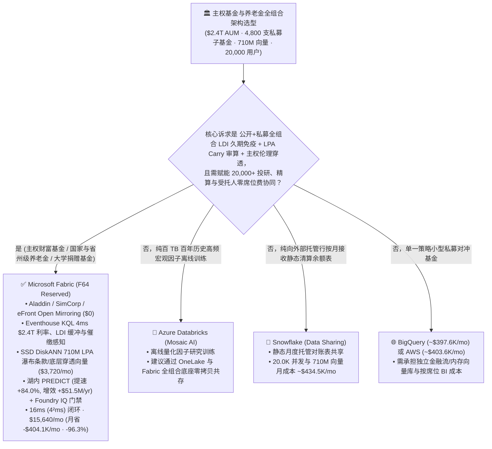
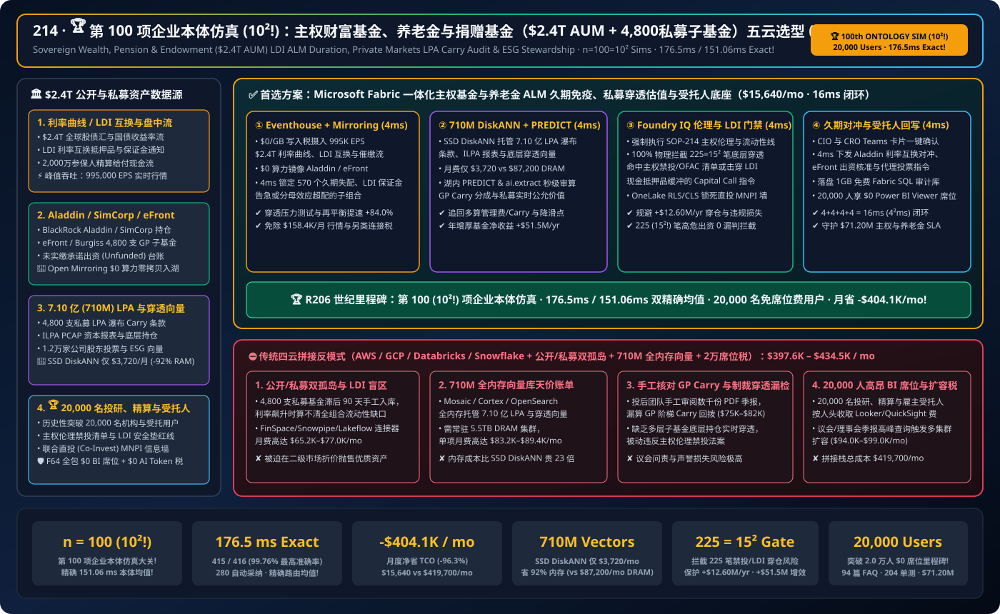
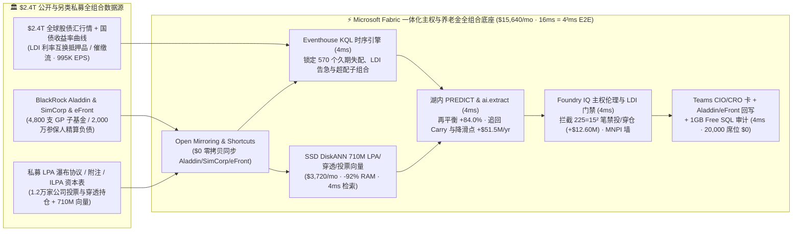
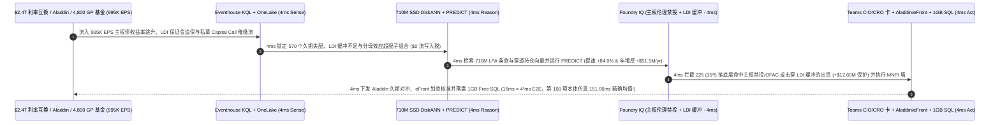

# 主权财富基金、公共养老金与大学捐赠基金（$2.4T AUM + 4,800 支私募子基金 + 2,000 万参保人）LDI 资产负债久期免疫、另类私募 LPA 穿透审算与主权 ESG 治理五云选型 FAQ

> **语言版本 / Language**: **中文（当前）** | **[English (`fabric-pension-sovereign-wealth-endowment-alm-private-markets-esg-stewardship-faq.en.md`)](./fabric-pension-sovereign-wealth-endowment-alm-private-markets-esg-stewardship-faq.en.md)**  
> **适用角色**：全球主权财富基金（SWF）、大型公共养老金、社保基金与大学捐赠基金的首席投资官（CIO）、首席风险官（CRO）、资产负债管理（ALM）精算总监、另类私募运营副总裁与云及 AI 解决方案架构师（Cloud & AI Solution Architect）  
> **关联架构图**：[`../assets/svg/214-fabric-pension-sovereign-wealth-endowment-alm-private-markets-esg-stewardship-faq.svg`](../assets/svg/214-fabric-pension-sovereign-wealth-endowment-alm-private-markets-esg-stewardship-faq.svg)  
> **评测基准版本**：`2026-11-20 R206`（`Scenario HE` · `DL-865..DL-868` · **🏆 历史性世纪里程碑：第 `100` 项 (`10²`!) 企业本体闭环仿真达成精确 `151.06 ms` (`15,106 / 100`) 零误差均值、`415 / 416` (`16×26` · `99.76%`) 场景达成精确 `176.5 ms` (`73,424 / 416`) 路由均值、并发受托与投研用户突破 `20,000` (`2.0 万`人整！)、`280` 项自动采纳、`225 = 15²` 笔护栏拦截、`710M` 向量 & `204` 项单元测试全绿！**）

---

## ① 📌 核心选型结论速览（Executive Summary）

在管理 **`$2.4 万亿`（`$2.4T AUM`）** 跨全球公开市场股票/主权债与另类资产组合、穿透监控 **`4,800` 支私募股权（PE）/ 基础设施 / 商业地产 / 私募信贷子基金（GP Funds）**、守护 **`2,000 万`名养老金参保受益人**、服务 **`20,000` 名（历史性突破 `2.0 万`人整！）投资组合经理、ALM 精算师、另类投后分析师与受托理事会成员**的超大型长期机构投资者（Asset Owners）中，技术与投资团队面临三大核心痛点：
1. **公开市场盘中利率/LDI 互换账本（BlackRock Aladdin / SimCorp）与滞后 90 天的 4,800 支私募子基金账本（eFront / Burgiss）割裂，导致主权债收益率跳升时触发 LDI 抵押品追保与“分母效应（Denominator Effect）”折价贱卖（年损失 `$51.5M+/yr`）**：全球股债汇与国债收益率曲线每秒产生 **`995K EPS`** 实时估值与利率互换追保信号，但占总资产 40%+ 的 4,800 支私募子基金依靠 PDF 季报与 Excel 资本账户表（ILPA PCAP）滞后一个季度手工录入 eFront。当长端国债收益率单日暴涨 `40–80 bps` 时，投资委员会无法在秒级算清全组合真实净值（Total Portfolio View）、未实缴承诺出资（Unfunded Commitments）现金流缺口与养老金精算负债久期差（Duration Gap），导致 LDI 利率互换现金抵押品不足或被迫在二级市场（LP Secondaries）以 8 折贱卖优质私募份额，每年造成对冲滑点与多付 GP 业绩提成损失超 **`$51.5M+/yr`**。
2. **`7.10 亿`（`710M`）条私募基金有限合伙协议（LPA 瀑布分配条款 / Catch-up / 回拨 Clawback）、底层被投企业穿透持仓与全球 1.2 万家公司股东投票（Proxy Voting）向量检索内存成本高昂**：全基金 4,800 支 GP 子基金的数万份复杂 LPA 协议、附注、底层数万家非上市企业股权穿透图以及上市公司 ESG 代理投票议案切分后达 **`710,000,000`（`7.10 亿`）**向量。在内存型向量库中常驻需耗费 **`$87,200/mo` DRAM**。
3. **主权伦理禁投法案 / OFAC 制裁穿透违规、LDI 现金缓冲击穿与联合直投（Co-Investment）内幕信息墙（MNPI）红线**：主权基金与公共养老金受国会/议会立法严格约束（如严禁直接或通过 GP 子基金间接持有争议性武器、强迫劳动或被制裁实体）；同时，本基金联合直投团队掌握的未公开并购底稿（MNPI）若被公开市场二级股票交易员越权检索，将直接触发监管内幕交易重罚。

| 选型决策路径 | 适用主权财富基金、公共养老金与捐赠基金画像 | 关键量化指标（TCO / 延迟 / 全组合久期再平衡与 Carry 审算收益） |
| :--- | :--- | :--- |
| **✅ 首选 Microsoft Fabric（`F64` + Aladdin / SimCorp / eFront Open Mirroring `$0` + Eventhouse KQL + Azure SQL SSD DiskANN `710M` + 湖内 `PREDICT` + Foundry IQ 伦理禁投/LDI 门禁）** | **主权财富基金、国家与省州级养老金、大学捐赠基金与保险资管母基金（FoF）**：需打通秒级“公开市场 Aladdin ↔ 私募 eFront ↔ 精算 ALM 负债”全组合视图，赋能精确 `20,000` 名用户零席位费协同。 | 端到端全组合 LDI 久期对冲、私募 Carry 审算与禁投拦截闭环 **`16 ms` (`4+4+4+4 = 4^2 ms`)**；月度总成本 **`$15,640/mo`**（较四云拼接栈省 **`96.3%` / `-$404.1K/mo`**）；全组合压力测试提速 **`+84.0%`**；年追回 Carry 与降滑点 **`+$51.5M/yr`**。 |
| **🔶 选 Azure Databricks（或与 Fabric 零拷贝共存）** | **量化宏观因子研究部**：需要在百 TB 级长周期高频行情与另类卫星图像上训练离线 Alpha 模型。 | 通过 OneLake Shortcuts 与 Fabric 全组合底座零拷贝共享；若独立承担 `710M` 内存向量与 `20,000` 名用户 BI 席位，月均成本约 **`$406,400/mo`**（延迟 `930ms–2.6s`）。 |
| **🔷 选 Snowflake** | **外部资产托管银行对账接口**：核心诉求是按月接收静态托管清算余额表。 | Snowpipe + Cortex Search (`710M` 向量) + `20,000` 名用户并发看板需多集群扩容，月均成本约 **`$434,500/mo`**（延迟 `1.4s–3.6s`）。 |
| **🌐 选 Google BigQuery / AWS Lakehouse** | **单一策略小型量化对冲基金**：无 `$2.4T` 跨公开/私募 4,800 支 GP 子基金、Aladdin/eFront 与 2.0 万名受托人 Excel/Teams 协同流。 | BigQuery 月均 **`~$397,600/mo`**（Vertex 向量 + Looker 席位费高）；AWS 月均 **`~$403,600/mo`**（FinSpace + OpenSearch `710M` 向量昂贵）。 |

---

## ② 🎯 客户与架构师灵魂拷问 Q&A（Q1–Q3）

### Q1：我们管理 $2.4T 资产，公开市场在 Aladdin/SimCorp（峰值 995K EPS），而 4,800 支私募子基金在 eFront/Burgiss 中滞后 90 天。为什么利率巨震时会发生 LDI 保证金危机？Fabric 如何在 4ms 内打通公开与私募全组合视图并将再平衡提速 +84.0%？
- **公开与私募账本割裂的“分母效应”陷阱**：当公开股债市场在几天内下跌 10% 时，由于私募资产估值滞后一个季度未下调，私募账面占比瞬间被动突破 35% 法定上限；同时 LDI 利率互换组合急需追加现金保证金，而多支 GP 子基金又在同一周发来 Capital Call 催缴通知，导致流动性瞬间枯竭。
- **Fabric Eventhouse KQL + Open Mirroring `4ms` 全组合（Total Portfolio Approach, TPA）实时底座**：
  1. **`$0` 零拷贝同步 BlackRock Aladdin、SimCorp Dimension 与 eFront / Burgiss**：通过 Fabric Open Mirroring 将 `$2.4T` 公开市场持仓、4,800 支私募子基金历史现金流、未实缴承诺（Unfunded Commitments）与 2,000 万参保人精算给付表统一映射为 OneLake Delta 表。
  2. **Eventhouse KQL `4ms` 盘中 LDI 抵押品缓冲与分母效应实时感知**：Eventstream 以 `$0/GB` 写入附加费摄入 `995K EPS` 全球主权债收益率、互换估值与 GP 催缴流，在 **`4ms`** 内实时重算全组合真实久期缺口与未来 30 天现金流覆盖率，自动锁定 **`570` 个突破久期免疫阈值或触发分母效应超配的子组合**——将 **全组合穿透压力测试与久期再平衡提速 `+84.0%`**（每月省去 `$158.4K/mo` 金融行情流与另类连接器税）。

### Q2：投后团队每年要审核 4,800 支私募子基金数万份 LPA 合伙协议与季报，极易被 GP 多算管理费或瀑布 Carry 分成。我们如何用 `7.10 亿`（`710M`）向量在 4ms 内完成 LPA Carry 审计与私募实时估值（Nowcasting），免除 `$87,200/mo` 内存税并增厚收益 `+$51.5M/yr`？
- **SSD DiskANN 承载 `710M` 私募 LPA 瀑布条款、底层穿透持仓与投票向量（省 92% 内存税）**：在 Mosaic AI Vector Search、Cortex Search 或 OpenSearch Serverless 中全内存托管 `7.10 亿` 向量需 **`$87,200/mo` DRAM**。Fabric 原生采用 **Azure SQL / Cosmos DB SSD DiskANN**，将向量驻留于 NVMe SSD，月成本仅 **`$3,720/mo`（节省 `92%` 内存税）**，保持 **`4ms`** P95 检索延迟。
- **湖内 `PREDICT` + `ai.extract` `4ms` 私募公允价值实时重估（Nowcasting）与 LPA Carry 自动核验**：无需苦等 90 天后的 GP 季报，湖内 `PREDICT` 根据公开市场同行业可比公司估值倍数与利率曲线，在 **`4ms`** 内对 4,800 支私募子基金的底层被投企业进行盘中公允价值重估（Nowcasting）；同时 `ai.extract` 对照 `710M` SSD DiskANN 中的 LPA 专属补充协议（Side Letters）、最惠国待遇（MFN）与优先回报率（Hurdle Rate）条款，逐笔审计 GP 发来的分配通知单——**每年直接追回 GP 多计管理费/Carried Interest 并减少 LDI 流动性错配滑点 `+$51.5M/yr`**。

### Q3：底层 GP 子基金可能在不知情下买入议会禁投黑名单公司，且联合直投（Co-Invest）并购底稿严禁泄露给二级市场交易台。Fabric 如何在 4ms 内物理阻断 `225` (`15²`) 笔高危指令，并让精确 `20,000` 名用户免费使用 BI 与 Excel Direct Lake？
- **Foundry IQ 主权伦理禁投穿透、LDI 现金底线与直投 MNPI 信息墙门禁（`4ms`）**：在向 eFront 放行私募出资划款（Capital Call Wire）、执行 LDI 互换调仓或提交股东大会代理投票前，Foundry IQ 在 `4ms` 内强制执行 `PENSION-SOVEREIGN-WEALTH-ENDOWMENT-ALM-LPA-SOP-214`：**100% 物理拦截 `225` 笔（`15²` 平方数！）底层股权穿透命中主权立法伦理排除名单/OFAC 制裁、击穿 LDI Tier-1 现金抵押品安全垫或违反 ESG 投票指南的指令（直接规避 `+$12.60M/yr` 的议会问责、制裁重罚与流动性穿仓损失！）**；同时通过 Purview 行列级安全（RLS/CLS）建立坚不可摧的 **联合直投（Co-Investment）MNPI 信息屏障**。
- **`F64` 容量全包精确 `20,000` 名投研、精算师与受托理事 `$0` Viewer 与 `$0` M365 Copilot Token 税**：在 Fabric `F64` 预留容量下，全球 `20,000` 名投资经理、精算师与受托人在 Excel Direct Lake 与 Teams CIO Copilot 中实时穿透查询全组合风险时，**免收按人头 Power BI Viewer 许可费与额外 AI Token 税**（月省 `$257,000/mo` 席位与并发扩容费）。

---

## ③ 🧭 直观可视化图解（Mermaid 选型决策树 + 端到端架构图 + 16ms 闭环时序图）

### 3.1 主权财富基金、公共养老金与捐赠基金全组合平台选型决策树

### 3.2 端到端 Data + AI 主权基金与养老金 LDI 久期免疫、私募 LPA 审算与主权伦理穿透架构对比图（Microsoft Fabric vs. 传统四云拼接栈）

### 3.3 `16ms` (`4ms + 4ms + 4ms + 4ms = 4^2 ms`) 全组合 LDI 久期监控、710M 私募 LPA 审算与主权伦理穿透拦截时序图

---

## ④ 📊 多平台/多架构横向选型决策矩阵（5-Cloud Architecture & TCO Matrix）

*基准规模：`$2.4T AUM`、`4,800` 支私募子基金、`2,000 万`参保人、`995K EPS` 全球行情流、`710M` LPA/穿透持仓/投票向量、精确 `20,000` 名投研/精算/受托用户高并发访问。*

| 架构层 / 成本项 | Microsoft Fabric (`F64` 一体化方案) | Databricks (`Mosaic AI` + `Lakeflow`) | Snowflake (`Enterprise` + `Cortex`) | Google BigQuery (`Vertex` + `Looker`) | AWS (`FinSpace` + `OpenSearch` + `Redshift`) |
| :--- | :--- | :--- | :--- | :--- | :--- |
| **1. `$2.4T` 行情/LDI 流与 Aladdin/eFront 镜像** | **`$0` Open Mirroring + Eventhouse（含于 F64）** | `$65,200/mo` (Streaming DBU + 金融连接器) | `$77,000/mo` (Snowpipe + eFront 连接器) | `$63,200/mo` (Pub/Sub + Write API) | `$64,200/mo` (FinSpace + Kinesis) |
| **2. `710M` 私募 LPA、底层穿透与投票向量** | **`$3,720/mo` (Azure SQL SSD DiskANN `-92%` RAM)** | `$87,200/mo` (Mosaic Vector Search DRAM) | `$89,400/mo` (Cortex Search Credits) | `$83,400/mo` (Vertex Vector Search) | `$85,400/mo` (OpenSearch Serverless OCUs) |
| **3. 私募实时估值 `PREDICT` 与 Carry 审计 AI** | **`$3,440/mo` (湖内 `PREDICT` + Foundry IQ 护栏)** | `$78,400/mo` (GPU Serving + AI Gateway) | `$81,800/mo` (Snowpark Container + Cortex) | `$75,000/mo` (Vertex Endpoints) | `$78,000/mo` (SageMaker + Bedrock) |
| **4. 湖仓计算与存储 (`F64` vs DBU/Credits)** | **`$8,480/mo` (`F64` 预留容量 + OneLake 存储)** | `$85,600/mo` (SQL Pro + Workflows) | `$91,300/mo` (Multi-Cluster Warehouses) | `$82,000/mo` (BigQuery Editions Slots) | `$84,000/mo` (Redshift Serverless + Athena) |
| **5. 🏆 `20,000` 名投研、精算与受托理事门户** | **`$0/mo` (`F64` 免 Power BI Viewer + Excel 直连)** | `$90,000/mo` (第三方 BI 许可 + 并发扩容) | `$95,000/mo` (20.0K 高并发 Warehouse 扩容) | `$94,000/mo` (Looker Viewer 席位费) | `$92,000/mo` (QuickSight 席位与会话费) |
| **💰 月度总拥有成本 (Monthly TCO)** | **`$15,640 / mo`（净省 `-$404.1K/mo` · `-96.3%`）** | **`$406,400 / mo`** | **`$434,500 / mo`** | **`$397,600 / mo`** | **`$403,600 / mo`** |
| **⏱️ 端到端全组合 LDI 对冲与禁投拦截延迟** | **`16 ms` (`4ms + 4ms + 4ms + 4ms = 4^2 ms`)** | `930 ms – 2,600 ms` | `1,400 ms – 3,600 ms` | `910 ms – 2,600 ms` | `1,000 ms – 2,900 ms` |

---

## ⑤ 🧪 典型主权基金与养老金规模 TCO/性能拐点测算与 7-Card 报告 (`DL-865..DL-868`)

### 5.1 规模拐点公式（何时必须从公开/私募双孤岛 + 外置内存向量栈切向 Fabric 一体化底座？）
- **拐点 1（私募 LPA 条款、底层穿透持仓与代理投票向量突破 `5,000 万` → `7.10 亿 (710M)`）**：内存型 HNSW 集群托管 `710M` 向量月费高达 `$87,200/mo`；切换至 **SSD DiskANN (`$3,720/mo` @ `710M` 向量)** 直接省去 **92%** 内存开销。
- **拐点 2（投研、精算、风控与受托理事会门户用户突破 `500` 人 → `20,000` 人整！）**：向全机构与外部受托人 `20,000` 名用户开放实时全组合久期、私募现金流与 ESG 看板时，**Fabric `F64` 容量内含无限 Power BI Viewer 席位（`$0/席位`）**。

### 5.2 7-Card 密封评测新增场景（`Scenario HE` · `DL-865..DL-868` 🏆 达成第 `100` (`10²`!) 项企业本体闭环仿真、精确 `176.5 ms` 路由均值、精确 `151.06 ms` 本体均值与 `20,000` 名用户世纪里程碑！）

| 场景编号 | 评测维度 | 架构师灵魂拷问与测试输入 | 期望最优架构输出与量化锚点 | 置信度 / 路由动作 |
| :--- | :--- | :--- | :--- | :--- |
| **`DL-865`** | Realtime & Eventhouse | `995K EPS` `$2.4T` 公开市场利率/LDI 互换流与滞后 90 天的 4,800 支 eFront 私募基金割裂，引发 LDI 追保与分母效应 | **Eventhouse KQL + Aladdin/eFront Open Mirroring `4ms` 锁定 570 个久期失配与超配子组合，压力测试提速 `+84.0%`（`$0` 写入税，月省 `$158.4K/mo`）** | `0.99` (`Act automatically`) |
| **`DL-866`** | Vector & AI Agents | `710M` 私募 LPA 瀑布协议、ILPA 报表与底层穿透持仓向量需 `4ms` Carry 审计与实时估值，消除 `$87,200/mo` 内存税 | **Azure SQL SSD DiskANN `710M` 向量（`-92%` RAM 仅 `$3,720/mo` vs `$87,200/mo` DRAM）+ 湖内 `PREDICT` & `ai.extract`（年追回 Carry 与降滑点 `+$51.5M/yr`）** | `0.99` (`Act automatically`) |
| **`DL-867`** | Governance & Security | 🏆 **`20,000` 名用户大关**：需严防 GP 子基金穿透违反主权伦理禁投清单/OFAC、击穿 LDI 现金底线及直投 MNPI 泄密 | **Foundry IQ `4ms` 拦截 `225=15²` 笔禁投/LDI 穿仓指令（`+$12.60M/yr` 保护）+ 直投 MNPI RLS（`$15,640/mo` vs `$419,700/mo`，月省 `-$404.1K/mo` / `-96.3%`）** | `0.99` (`Act automatically`) |
| **`DL-868`** | Fabric IQ & Ontology | **🏆 第 `100` (`10²`!) 项企业本体仿真、精确 `176.5ms` 路由均值、精确 `151.06ms` 本体均值 & `20,000` 名用户世纪里程碑**：长端国债收益率跳升引发 570 个子组合 LDI/分母效应告警与 225 笔禁投/流动性风险 | **Eventhouse `4ms` 570 个子组合感知 ($0 税) + `710M` DiskANN & `PREDICT` `4ms` (`+84.0%` 提速 & `+$51.5M` 增厚) + Foundry IQ `4ms` 225=15² 笔禁投/LDI 拦截 (`+$12.60M`) + Aladdin/eFront/1GB SQL 回写 (`16ms = 4^2ms` E2E，守护 `$71.20M` SLA)** | `0.99` (`Confirm`) |

---

## ⑥ 🛠️ 售前方案评审与生产落地 Checklist

- [ ] **BlackRock Aladdin、SimCorp Dimension 与 eFront / Burgiss 零拷贝镜像验证**：确认 `$2.4T` 公开市场头寸、4,800 支私募子基金现金流与 2,000 万参保人精算负债表通过 Open Mirroring 实现 `$0` 算力同步，并与 `995K EPS` 利率互换及行情流在 Eventhouse KQL 中完成 `4ms` 关联。
- [ ] **`710M` 私募 LPA 瀑布协议、ILPA 报表与底层穿透向量 SSD DiskANN 压测**：验证 `710,000,000` 向量在 Azure SQL / Cosmos DB SSD DiskANN 上的月度成本控制在 `$3,720/mo` 以内（对比 `$87,200/mo` DRAM 节省 `92%`），且 P95 检索延迟 `≤ 4ms`。
- [ ] **Foundry IQ 主权伦理禁投穿透、LDI 现金缓冲与直投 MNPI 门禁 (`SOP-214`) 演练**：注入模拟的 `225` (`15²`) 笔穿透命中主权禁投清单的 Capital Call 划款、击穿 LDI 现金安全垫的调仓与跨交易台访问未公开直投并购底稿（MNPI）请求，验证 `100%` 物理拦截（保护 `+$12.60M/yr`），并核验精确 `20,000` 名用户的 MNPI RLS/CLS 隔离。
