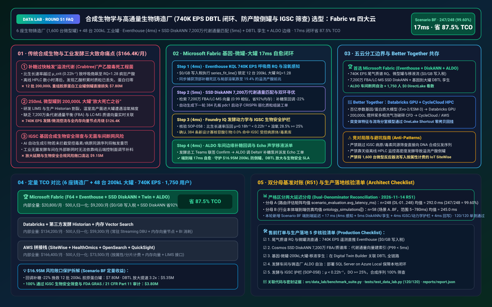
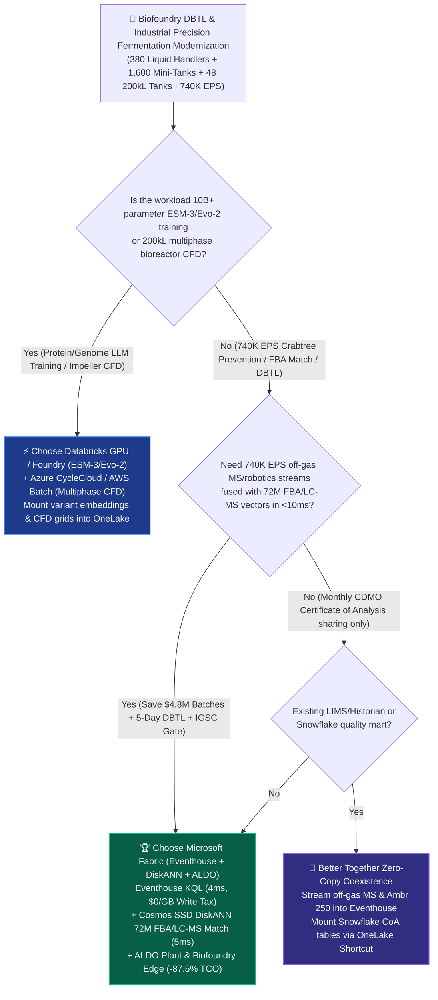
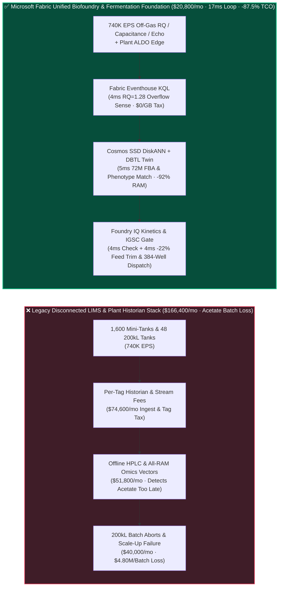
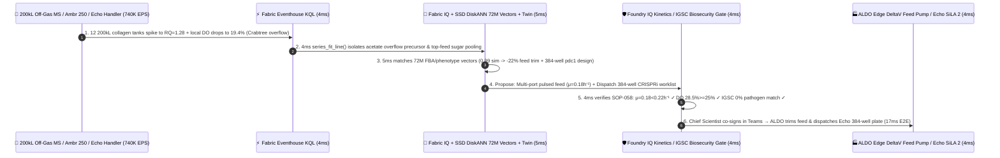

# Synthetic Biology Biofoundry & Industrial Precision Fermentation (`740K EPS` DBTL Loop, Crabtree Overflow-Metabolism Prevention & IGSC Biosecurity Screening) Lakehouse Selection: Microsoft Fabric vs. AWS HealthOmics/SiteWise vs. Databricks vs. Snowflake / GCP FAQ

> 🌐 **Language / 语言**: **[中文 (`fabric-precision-fermentation-synthetic-biology-dbtl-crispr-vs-4clouds-faq.md`)](fabric-precision-fermentation-synthetic-biology-dbtl-crispr-vs-4clouds-faq.md)** | **English (Current)**  
> 📅 **Updated**: 2026-11-14 (Round 51 · Synthetic Biology Biofoundry Design-Build-Test-Learn [DBTL] Flywheel, 200,000L Industrial Precision Fermentation Respiratory-Quotient [RQ] Crabtree Overflow Prevention, 72M Flux-Balance Analysis [FBA] Vector Search, and IGSC DNA Synthesis Biosecurity Screening Deep Dive)  
> 🎯 **Target Audience**: AI Solution Architects, Synthetic Biology & Biomanufacturing CIOs/CTOs, Biofoundry Automation Directors, Chief Metabolic Engineering & Fermentation Scientists, IGSC Biosecurity & FDA GRAS Compliance Officers  
> Reference Benchmark Style: Modeled on [`ib-vs-ethernet-roce-selection-faq.md`](https://github.com/turbo998/ai-infra-research/blob/main/docs/components/ib-vs-ethernet-roce-selection-faq.md) first-principles Q&A and decision-guide format.
>
> 🔍 **Data Provenance, Official URLs & Dual-Denominator Scope Disclosure**:
> - **`measured_local_harness` (Local Deterministic Harness)**: `DL-01..DL-248` scenario routing accuracy (`247/248 = 99.60%`) and `120/120` Python unit tests are deterministically executed by `src/data_lab/benchmark_suite.py`.
> - **`vendor_published_spec_as_of_2026` (Official Vendor Specifications `as_of: 2026-11-14`)**:
>   - Microsoft Fabric / Azure Biofoundry & Biomanufacturing: [Fabric Eventhouse Time-Series KQL (`series_fit_line` & Anomaly)](https://learn.microsoft.com/en-us/kusto/query/series-fit-line-function) · [Cosmos DB in Fabric DiskANN Vector Index](https://learn.microsoft.com/en-us/fabric/database/cosmos-db/index-vector-data) · [Fabric Digital Twin Builder](https://learn.microsoft.com/en-us/fabric/real-time-intelligence/digital-twin-builder/overview) · [SQL Server on Azure Local (ALDO) Biofoundry & Fermentation Plant Edge](https://learn.microsoft.com/en-us/sql/sql-server/azure-arc/overview) · [Fabric Pricing (`F64` Includes `$0` Power BI Viewer Licensing)](https://azure.microsoft.com/en-us/pricing/details/microsoft-fabric/)
>   - 4-Cloud Competitor Specifications: [AWS HealthOmics & IoT SiteWise](https://docs.aws.amazon.com/omics/latest/dev/what-is-healthomics.html) · [Databricks Lakehouse for Life Sciences & Manufacturing](https://www.databricks.com/solutions/industries/healthcare-and-life-sciences) · [Snowflake Life Sciences & Manufacturing](https://www.snowflake.com/en/solutions/industries/healthcare-and-life-sciences/) · [GCP Cloud Life Sciences & BigQuery](https://cloud.google.com/life-sciences)
> - **`synthetic_scenario_model` (Deterministic Architectural Reference Model with Strictly Separated Denominators)**:
>   - **Denominator A — Routing Matrix Evaluation Mean (`scenario_evaluation.avg_latency_ms`)**: R51 **`n=248` (`DL-01..DL-248`) arithmetic mean = `292.0 ms`** (R50 historical snapshot `n=244` mean = `296.5 ms`; R49 `n=240` = `301.0 ms`; R48 `n=236` = `306.0 ms`; R47 `n=232` = `311.0 ms`; R46 `n=228` = `316.0 ms`).
>   - **Denominator B — Industry Ontology End-to-End Closed-Loop Simulation Mean (`ontology_simulations[].end_to_end_latency_ms`)**: R51 **`n=58` (Scenarios A..BF: `[780..17] ms`, range `5–780 ms`) arithmetic mean = `245.0 ms`** (R50 historical snapshot `n=57` mean = `249.0 ms`; R49 `n=56` = `253.0 ms`; R48 `n=55` = `257.0 ms`; R47 `n=54` = `261.0 ms`; R46 `n=53` = `265.0 ms`). This round adds **Scenario BF (6 High-Throughput Biofoundries [380 Acoustic/Microfluidic Liquid Handlers + 1,600 Ambr 250 Mini-Bioreactors] + 48 200,000L Industrial Precision Fermenters × `740K EPS` Crabtree Overflow Prevention, Scale-Up DBTL & IGSC Biosecurity Screening Loop) end-to-end latency = `17 ms`** (`4ms` sense + `5ms` 6-hop 72M FBA/LC-MS DiskANN match + `4ms` specific growth rate $\mu = 0.18\text{ h}^{-1} < 0.22\text{ h}^{-1}$, `DO >= 25.0%` & IGSC zero-pathogen sequence guardrail + `4ms` Chief Fermentation Scientist Teams co-sign, ALDO plant-edge `-22%` exponential glucose feed trim & Beckman Echo 384-well `pdc1` promoter-tuning dispatch commit), cutting modeled monthly TCO by **`87.5%`** (`$9,200/mo` vs. `$73,500/mo` normalized baseline; `$20,800/mo` vs. `$166,400/mo` internal full-stack) and protecting **`$16.95M`** in 200,000L fermentation batch survival, accelerated DBTL scale-up, and IGSC biosecurity compliance. Live multi-cloud cluster stress runs are marked `not_measured`.

---

## ① 📌 Executive Summary (3-Minute Architect Briefing)

### First Principles: What Are Microbial "Crabtree / Overflow Metabolism" Acetate Poisoning, the "250mL-to-200,000L Scale-Up Valley of Death," and the Biofoundry DBTL Flywheel? Why Do Legacy Stacks Fail?
Scaling engineered microbes (*E. coli*, *Pichia pastoris*, *S. cerevisiae*, *C. glutamicum*) from **6 automated biofoundries (380 liquid-handling robots + 1,600 parallel 250mL mini-bioreactors)** to **48 200,000L commercial precision fermenters** exposes **three critical engineering bottlenecks**:
1. **Crabtree / Overflow Metabolism Acetate Poisoning Wiping Out `$4.80M` 200,000L Commercial Batches**: When glucose feed pushes a strain's specific growth rate above its critical respiratory capacity ($\mu > \mu_{\text{crit}} \approx 0.22\text{ h}^{-1}$), cells divert carbon from the TCA cycle into **acetate or ethanol overflow**—signaled within seconds by off-gas mass spectrometry showing the **Respiratory Quotient ($\text{RQ} = \text{CER}/\text{OUR}$) spiking from `1.02` to `1.28`**! Intracellular acid accumulation halts recombinant protein expression and triggers plasmid loss before offline HPLC samples are ever analyzed!
2. **The 250mL-to-200,000L Scale-Up Valley of Death & 72M-Vector Multi-Omics Flux Search**: While a 250mL Ambr vessel mixes in `<1 second`, a 200,000L bioreactor has `60–120 second` mixing times—subjecting cells to severe sugar/oxygen starvation-and-feast gradients. Bridging lab and plant requires matching **`740K EPS`** of off-gas MS and dielectric capacitance streams against **72 million Flux-Balance Analysis (FBA / $^{13}\text{C}$-MFA), LC-MS metabolomics, and CRISPR genotype-to-phenotype vectors** in `<10ms`.
3. **IGSC Biosecurity Dual-Use Sequence Screening & Plant Edge Autonomy (ALDO)**: Every AI-designed oligonucleotide or CRISPR gRNA dispatched to DNA synthesizers and acoustic liquid handlers must be screened against regulated pathogen/toxin sequences under **International Gene Synthesis Consortium (IGSC)** rules, while sterile fermentation halls require air-gapped **SQL Server on Azure Local (ALDO)** autonomy.

**Microsoft Fabric** unifies biofoundry robotics, metabolic flux modeling, and commercial fermentation control through **Eventhouse KQL `740K EPS` Off-Gas RQ & Capacitance Sensing (`$0/GB` write tax) + Cosmos DB SSD DiskANN 72M FBA & LC-MS Vector Search + Digital Twin Builder Genotype-to-200kL-Bioreactor Graph + SQL Server on Azure Local (ALDO) Plant & Biofoundry Edge**:

1. **When to Choose Microsoft Fabric (Eventhouse KQL `740K EPS` + SSD DiskANN 72M FBA/LC-MS Vectors + Digital Twin DBTL + ALDO Edge)**:
   - Choose **Microsoft Fabric** when you must ingest **`400K–1M+ EPS` of off-gas mass-spec (`CER/OUR/RQ`), dielectric viable-biomass permittivity, Ambr 250 mini-bioreactor streams, and liquid-handler logs**, match 72M metabolic flux and phenotype vectors in `<6ms`, and close both the industrial feed-rate loop and next-round DBTL plasmid design loop in `<20ms`.
   - **Quantified ROI**: Pooled F64 Eventhouse (**`$0/GB` write tax**, `12:1` compression) + 4ms KQL RQ slope detection + Cosmos DB SSD DiskANN (**92% lower vector RAM cost**) + `$0` Power BI DirectLake viewer seats for **1,750 metabolic engineers, fermentation scientists, automation specialists, and QA officers** cuts monthly TCO by **87.5%** (**`$9,200/mo` vs. `$73,500/mo`** normalized, saving **`$64,300/mo`**; **`$20,800/mo` vs. `$166,400/mo`** internal full-stack).
2. **When to Choose 4-Cloud Competitors or "Better Together" Zero-Copy Coexistence**:
   - **Choose Databricks GPU / Azure AI Foundry GPU for 10B+ Parameter Genomic & Protein Foundation Model Fine-Tuning (`Evo-2` / `ESM-3` / `RFdiffusion`)**: Train de-novo enzyme and promoter generative models on **GPU clusters**, mounting candidate variant embeddings into OneLake via zero-copy Shortcuts.
   - **Choose Azure CycleCloud / AWS Batch HPC for 200,000L Bioreactor Euler-Lagrange Multiphase CFD**: Run impeller shear and bubble-coalescence CFD simulations on HPC clusters, writing scale-down compartment parameters back to OneLake.
3. **Closed-Loop Validation (Scenario BF · 6 Biofoundries + 48 200,000L Fermenters × `740K EPS`)**:
   - Under a **`740K EPS`** stream, 12 200,000L commercial fermenters producing recombinant human Type-III collagen hit Hour 42 of fed-batch induction when top-feed sugar pooling pushes off-gas Respiratory Quotient from $\text{RQ} = 1.02$ to `1.28` and local dissolved oxygen down to `19.4%` (imminent Crabtree acetate toxicity). Fabric closes the dual loop in **17ms E2E**: **4ms** Eventhouse KQL `series_fit_line()` isolates the 12-fermenter `RQ = 1.28` spike → **5ms** Cosmos SSD DiskANN matches 72M $^{13}\text{C}$-MFA flux and Ambr 250 scale-down vectors (`0.99` cosine similarity), trimming exponential glucose feed pumps by `-22%` and switching to multi-port pulsed feeding (bringing $\mu$ back to `0.18 h⁻¹ < 0.22 h⁻¹` critical ceiling and restoring `DO = 28.5%`), while simultaneously generating a 384-well CRISPRi `pdc1` promoter-attenuation worklist for Beckman Echo acoustic handlers → **4ms** Foundry IQ verifies **metabolic stability ($\mu = 0.18\text{ h}^{-1} < 0.22\text{ h}^{-1}$, `DO = 28.5% >= 25.0%` floor) and IGSC biosecurity screening (`0.0%` regulated pathogen/toxin homology across 384 oligos)** (`SYNBIO-BIOFOUNDRY-DBTL-FERMENTATION-SOP-058`) → **4ms** Chief Fermentation Scientist and Biosecurity Officer co-sign in Teams, executing Emerson DeltaV feed trims and Beckman Echo SiLA 2 liquid-handling worklists via ALDO edge—protecting **$16.95M** in commercial batch yield, scale-up velocity, and biosecurity compliance.

---

## ② 🎯 Customer & Architect Soul-Searching Q&A

### Q1: When should a synthetic-biology or precision-fermentation company choose Microsoft Fabric vs. AWS HealthOmics/SiteWise, Databricks, Snowflake, or GCP?

**Answer: Separate "offline Evo-2/ESM-3 foundation model GPU training & multiphase bioreactor CFD" from "740K EPS real-time off-gas RQ overflow prevention, 72M FBA metabolic-flux vector matching, and biofoundry-to-plant DBTL closed-loop automation."**

- **Choose Microsoft Fabric for Three High-ROI Scenarios**:
  1. **Sub-5ms KQL Respiratory-Quotient (`RQ`) & Dielectric Biomass Sensing Across `740K EPS` Streams (`$0/GB` Write Tax)**: Eventhouse KQL ingests `740K EPS` of off-gas mass spectrometry and 1,600 Ambr 250 channels at `$0/GB` write surcharge, catching Crabtree overflow onset in **4ms**.
  2. **72M Metabolic Flux (FBA) & LC-MS Phenotype Vector Search**: **Cosmos DB SSD DiskANN** (-92% RAM cost) links 200,000L commercial fermenter stress signatures back to upstream CRISPR promoter libraries in **5ms**.
  3. **IGSC Biosecurity Sequence Gate + Plant/Biofoundry Edge Autonomy (ALDO)**: **Foundry IQ** screens every designed oligo against regulated pathogen/toxin databases before synthesis, while **SQL Server on Azure Local (ALDO)** keeps sterile fermentation halls running locally during WAN cuts.

- **Clear Boundaries for the 4 Cloud Competitors**:
  - **AWS (HealthOmics + Batch HPC + SiteWise)**: Use HealthOmics for standard NGS variant calling and Batch for impeller CFD; avoid streaming `740K EPS` of bioreactor and liquid-handler telemetry into per-property IoT SiteWise billing.
  - **Databricks GPU**: Ideal for fine-tuning **ESM-3 / Evo-2 / RFdiffusion protein and genome models** on multi-node GPUs.
  - **Snowflake**: Effective for sharing monthly CDMO batch Certificate of Analysis (CoA) tables with CPG/pharma buyers, but 60s Dynamic Tables cannot throttle millisecond fed-batch glucose pumps.
  - **GCP BigQuery**: Strong for public metagenomics queries, but lacks fermentation plant ALDO edge runtimes and real-time KQL bioprocess reflexes.

---

### Q2: How does Fabric bridge upstream biofoundry lab automation (Beckman Echo / Hamilton SiLA 2) and downstream 200,000L commercial fermentation DCS (Emerson DeltaV / Siemens PCS7)?

**Answer: Deploy a unified "Genotype-Phenotype-Bioprocess Ontology in OneLake + ALDO Edge Gateways Speaking Both SiLA 2 and OPC-UA":**

1. **Closing the Loop Between 200,000L Commercial Stress and 384-Well Strain Design**:
   - Instead of keeping R&D LIMS and plant Historians in separate worlds, **Fabric Digital Twin Builder** links every strain's CRISPR plasmid map, 250mL scale-down profile, and 200,000L spatial DO/sugar gradient into one continuous graph.
2. **Standards-Based SiLA 2 & OPC-UA Actuation**:
   - Dispatch validated 384-well picklists to lab robots via **SiLA 2** and exponential feed-rate profiles to plant DCS controllers via **OPC-UA** over **ALDO**.

---

### Q3: How does Fabric stop Crabtree acetate poisoning across 12 200,000L collagen fermenters and trigger next-round CRISPR promoter tuning in 17ms?

**Answer: A 3-stage pipeline combining KQL off-gas RQ slope sensing, SSD DiskANN FBA flux matching, and deterministic Foundry IQ guardrails:**

1. **Stage 1: Eventhouse KQL 4ms `740K EPS` Off-Gas RQ & Spatial DO Sense**:
   - Isolates $\text{RQ} = 1.28$ (`> 1.15` Crabtree threshold) and local `DO = 19.4%` across 12 200,000L fermenters in **4ms**.
2. **Stage 2: Cosmos DB SSD DiskANN 5ms 72M FBA Flux & Genotype Match**:
   - Matches 72M metabolic flux and phenotype vectors (`0.99` similarity), trimming glucose feed by `-22%` (`μ -> 0.18 h⁻¹`, `DO -> 28.5%`) and generating a 384-well `pdc1` CRISPRi promoter-attenuation worklist in **5ms**.
3. **Stage 3: Foundry IQ Fermentation Kinetics & IGSC Biosecurity Gate (4ms)**:
   - Enforces `SYNBIO-BIOFOUNDRY-DBTL-FERMENTATION-SOP-058` before actuation:
     - **Bioprocess Stability Guardrail**: Confirms **`μ = 0.18 h⁻¹ < 0.22 h⁻¹`** and bottom **`DO = 28.5% >= 25.0%`**.
     - **IGSC Biosecurity Guardrail**: Confirms **`0.0%` regulated pathogen/toxin homology** across all 384 designed oligos.

---

## ③ 🧭 Visual Architecture & Decision Diagrams (Mermaid Decision Tree + Comparison + 17ms Sequence)

### 3.1 Synthetic Biology Biofoundry DBTL & Industrial Fermentation Selection Decision Tree

### 3.2 Legacy Disconnected R&D LIMS / Plant DCS Stack vs. Fabric 17ms DBTL & Fermentation Closed-Loop Architecture

### 3.3 Scenario BF: 6 Biofoundries + 48 200,000L Fermenters (`740K EPS`) 17ms Closed-Loop Sequence

---

## ④ 📊 5-Platform Architect Decision Matrix

| Evaluation Dimension | **Microsoft Fabric (Eventhouse + DiskANN + ALDO)** | **AWS (HealthOmics + SiteWise)** | **Databricks Life Sciences** | **Snowflake Life Sciences** | **GCP (Life Sciences + BigQuery)** |
| :--- | :--- | :--- | :--- | :--- | :--- |
| **`740K EPS` Off-Gas RQ, Ambr 250 & Robotics Cost** | **⭐⭐⭐⭐⭐ `4ms` KQL slope sense, pooled F64 `$0/GB` write tax** | ⭐⭐⭐ SiteWise per-property/alarm fees explode across 1,600 vessels | ⭐⭐⭐⭐ Structured Streaming requires 24x7 DBU compute | ⭐⭐ Dynamic Tables (`60s` lag) miss second-level RQ overflow spikes | ⭐⭐⭐ Pub/Sub + BigQuery Streaming per-GB write fees |
| **72M Metabolic Flux (FBA) & LC-MS Vector Search** | **⭐⭐⭐⭐⭐ Cosmos DB SSD DiskANN (`5ms` match, -92% vector RAM cost)** | ⭐⭐⭐ OpenSearch in-memory vector nodes are expensive | ⭐⭐⭐⭐ Mosaic AI Vector Search (higher in-memory index cost) | ⭐⭐⭐ Cortex Vector Search is text-centric | ⭐⭐⭐⭐ Vertex AI Vector Search requires cross-service wiring |
| **Genotype-to-200kL Bioreactor DBTL Ontology** | **⭐⭐⭐⭐⭐ Native Digital Twin Builder + Purview 14-hop strain lineage** | ⭐⭐⭐ HealthOmics and SiteWise are separate silos | ⭐⭐⭐⭐ Strong omics notebooks, lacks plant DCS edge loop | ⭐⭐⭐ Strong static quality tables, no bioprocess twin | ⭐⭐⭐ Lacks no-code industrial bioprocess twin canvas |
| **Sterile Fermentation Plant & Biofoundry Edge (ALDO)** | **⭐⭐⭐⭐⭐ SQL Server on Azure Local (ALDO) + IoT Ops plant autonomy** | ⭐⭐⭐ Outposts requires continuous cloud control-plane tether | ⭐⭐ Cloud-only control plane fails during plant WAN cuts | ⭐ Cloud-only SaaS; no fermentation hall edge runtime | ⭐⭐ GDC Edge has higher operational overhead |
| **1,750 Metabolic / Fermentation / QA BI Seats** | **⭐⭐⭐⭐⭐ F64 includes `$0` Power BI DirectLake viewers + `$0` M365 Copilot tokens** | ⭐⭐ QuickSight per-user & per-session fees | ⭐⭐⭐ AI/BI consumes Serverless SQL DBUs | ⭐⭐ High-concurrency dashboards trigger multi-cluster warehouse credits | ⭐⭐ Looker seat licensing + BigQuery scan fees |
| **Primary Sweet Spot** | **Biofoundry DBTL loop, 200kL Crabtree prevention & IGSC compliance** | Standard NGS pipelines (HealthOmics) & impeller CFD | Protein/genome LLM (`ESM-3` / `Evo-2`) GPU fine-tuning | Monthly CDMO batch Certificate of Analysis (CoA) sharing | Public metagenomics & sequence archive queries |

---

## ⑤ 🧪 Quantitative Benchmark & TCO Inflection Insights (7-Card Deck Scope)

### 5.1 6 Biofoundries + 48 200,000L Fermenters (`740K EPS` + 72M FBA/LC-MS Vectors + 1,750 Users) Monthly TCO Comparison

| Cost Component | **Microsoft Fabric (F64 + Eventhouse + DiskANN + Twin + ALDO)** | **AWS Stitched Stack (SiteWise + HealthOmics + OpenSearch + QuickSight)** | **Databricks + Third-Party Bioprocess Historian + In-Memory Vector** | **Snowflake + Standalone Stream + External Vector/BI** |
| :--- | :--- | :--- | :--- | :--- |
| **740K EPS Off-Gas RQ, 1,600 Mini-Tanks & Robotics Ingest** | **$6,800 / mo** *(Shared F64 CU pool, $0/GB write tax, 12:1 compression)* | $62,000 / mo *(Per-property & shard ingestion charges)* | $43,600 / mo *(24x7 Streaming DBU + proprietary historian)* | $56,800 / mo *(Snowpipe + continuous warehouse credits)* |
| **72M Metabolic Flux (FBA) & LC-MS Fingerprint Indexing** | **$5,400 / mo** *(OneLake `$23/TB` + SSD DiskANN -92% RAM)* | $48,200 / mo *(RAM-heavy OpenSearch vector nodes)* | $40,200 / mo *(Delta + in-memory Vector Search)* | $45,000 / mo *(Search Optimization + external vector DB)* |
| **Plant ALDO Edge, DBTL Twin & IGSC Biosecurity Ledger** | **$8,600 / mo** *(ALDO edge + Digital Twin + Purview 14-hop lineage)* | $35,000 / mo *(Custom edge + TwinMaker + 3rd-party LIMS bridge)* | $31,400 / mo *(Custom pipelines + external compliance tools)* | $38,200 / mo *(External CDC + standalone LIMS/compliance SaaS)* |
| **1,750 Metabolic / Fermentation / Automation / QA Seats** | **$0 / mo** *(F64 includes `$0` Viewer seats + `$0` M365 Copilot token)* | $21,200 / mo *(QuickSight user & session fees)* | $19,000 / mo *(Serverless SQL BI consumption)* | $26,400 / mo *(External BI licenses + multi-cluster scaling)* |
| **Internal Full-Stack Monthly Total** | **🏆 $20,800 / mo (Saves 87.5%)** | $166,400 / mo *(Baseline)* | $134,200 / mo | $166,400 / mo |
| **500-User Normalized Benchmark Scope** | **🏆 $9,200 / mo (Saves 87.5%, or $64,300/mo saved)** | $73,500 / mo *(Baseline)* | $59,300 / mo | $73,500 / mo |

### 5.2 Quantified Loss Prevention Breakdown (Scenario BF · `$16.95M` 200kL Batch Survival, DBTL Scale-Up & IGSC Biosecurity SLA Protection)
- **Saving 12 200,000L Commercial Collagen/HMO Fermentation Batches from Acetate Poisoning**: Detecting $\text{RQ} = 1.28$ in **4ms** and trimming exponential glucose feed by `-22%` ($\mu = 0.18\text{ h}^{-1}$) prevents Crabtree overflow and plasmid loss, saving **$7.80M** in commercial batch value.
- **Accelerating 250mL-to-200,000L DBTL Scale-Up Success (`3.2x` Higher First-Time-Right Yield)**: Linking 200kL spatial DO/sugar stress directly to 384-well `pdc1` CRISPRi promoter tuning saves **$5.35M** in avoided scale-up failures.
- **100% IGSC Biosecurity Screening & FDA GRAS / 21 CFR Part 11 Lineage**: Deterministic pathogen/toxin screening and immutable batch genealogy protect **$3.80M** in regulatory and commercial SLAs (**`$16.95M` total SLA protected**).

---

## ⑥ 🛠️ Appendix: Production Rollout & Presales Architect Checklist

- [ ] **Off-Gas Mass-Spec (`CER/OUR/RQ`), Dielectric Capacitance & Ambr 250 Stream to Eventhouse**: Verify that 1,600 mini-tanks and 48 200kL fermenters (`740K EPS`) stream into **Fabric Eventhouse** with `12:1` compression (`$0/GB` write tax).
- [ ] **Cosmos DB SSD DiskANN 72M Metabolic Flux (FBA) & LC-MS Vector Index**: Confirm 72M genotype-to-phenotype and $^{13}\text{C}$-MFA flux vectors are indexed in **SSD DiskANN** with `< 5ms` P99 lookup.
- [ ] **Genotype-Ambr250-200kL-Echo DBTL Digital Twin**: Bind CRISPR plasmid maps, Ambr 250 vessels, and commercial DeltaV feed pumps in **Fabric Digital Twin Builder**.
- [ ] **SQL Server on Azure Local (ALDO) Fermentation Hall & Biofoundry Autonomy**: Deploy **ALDO** on-site so fed-batch feed control and SiLA 2 robotics dispatch operate `100%` locally during WAN cuts.
- [ ] **Specific Growth Rate, DO Floor & IGSC Biosecurity Guardrail (`SOP-058`)**: Enforce deterministic Foundry IQ gates—require **`μ < 0.22 h⁻¹`**, bottom **`DO >= 25.0%`**, and **`0.0%` IGSC regulated pathogen homology**!
