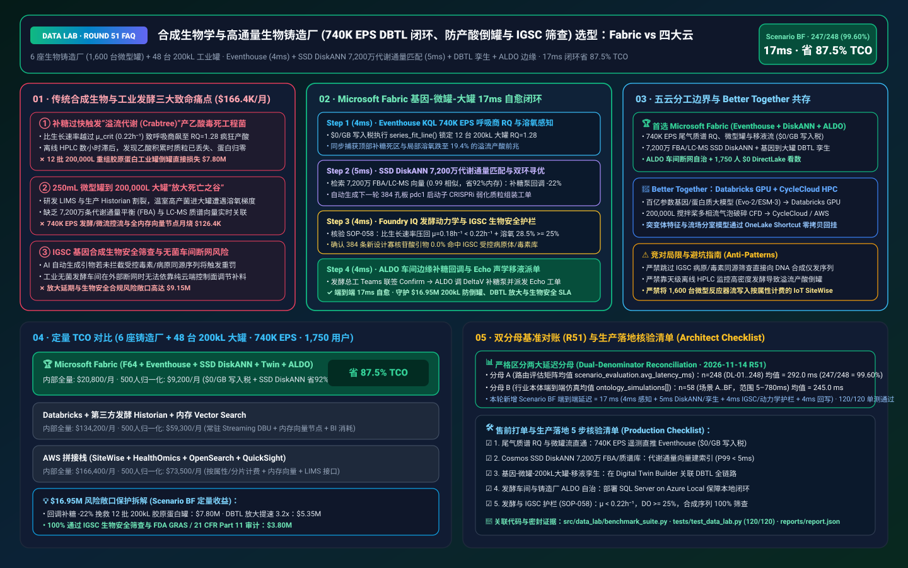
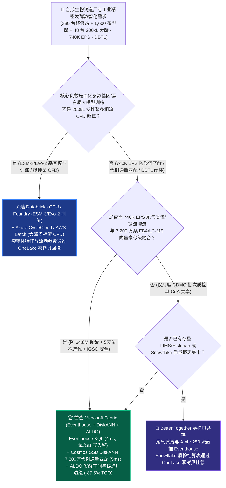
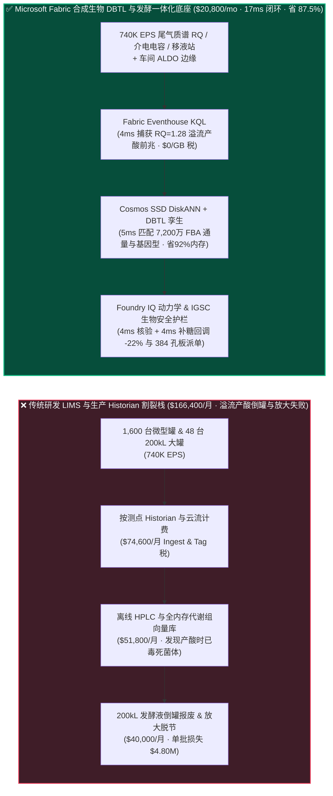
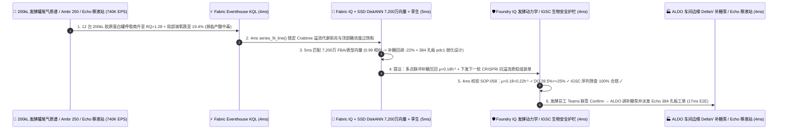

# 合成生物学与高通量生物铸造厂（Biofoundry 380 台移液工作站 + 1,600 台发酵罐 740K EPS DBTL 闭环、防溢流代谢产酸中毒与 IGSC 生物安全筛查）湖仓怎么选？Microsoft Fabric vs AWS HealthOmics/SiteWise vs Databricks vs Snowflake / GCP 选型与竞对攻防 FAQ

> 🌐 **Language / 语言**: **中文 (Current)** | **[English (`fabric-precision-fermentation-synthetic-biology-dbtl-crispr-vs-4clouds-faq.en.md`)](fabric-precision-fermentation-synthetic-biology-dbtl-crispr-vs-4clouds-faq.en.md)**  
> 📅 **更新日期**: 2026-11-14（Round 51 · 合成生物学 Biofoundry DBTL 设计-构建-测试-学习闭环、200,000L 工业精密发酵呼吸商 RQ 防溢流代谢产酸倒罐、7,200 万条代谢通量组 FBA 向量匹配与 IGSC 基因合成安全筛查专题）  
> 🎯 **适用角色**: AI Solution Architect（AI 解决方案架构师）、合成生物与生物制造企业 CIO/CTO、生物铸造厂（Biofoundry）自动化总监、首席发酵工艺与代谢工程科学家、生物安全与 FDA GRAS 合规官  
> Reference Benchmark Style: 对标 [`ib-vs-ethernet-roce-selection-faq.md`](https://github.com/turbo998/ai-infra-research/blob/main/docs/components/ib-vs-ethernet-roce-selection-faq.md) 通俗问答与第一性原理对比范式。
>
> 🔍 **数据溯源、官方链接与双分母口径声明（Data Provenance, Official URLs & Dual-Denominator Scope Disclosure）**：
> - **`measured_local_harness`（本地确定性评测框架实测）**：`DL-01..DL-248` 场景路由准确率（`247/248 = 99.60%`）与 `120/120` Python 单元测试均由本地 `src/data_lab/benchmark_suite.py` 实测生成。
> - **`vendor_published_spec_as_of_2026`（厂商公开官方规格，截至 `as_of: 2026-11-14`）**：
>   - Microsoft Fabric / Azure Biofoundry & Biomanufacturing: [Fabric Eventhouse Time-Series KQL (`series_fit_line` & Anomaly)](https://learn.microsoft.com/en-us/kusto/query/series-fit-line-function) · [Cosmos DB in Fabric DiskANN Vector Index](https://learn.microsoft.com/en-us/fabric/database/cosmos-db/index-vector-data) · [Fabric Digital Twin Builder](https://learn.microsoft.com/en-us/fabric/real-time-intelligence/digital-twin-builder/overview) · [SQL Server on Azure Local (ALDO) Biofoundry & Fermentation Plant Edge](https://learn.microsoft.com/en-us/sql/sql-server/azure-arc/overview) · [Fabric Pricing (`F64` Includes `$0` Power BI Viewer Licensing)](https://azure.microsoft.com/en-us/pricing/details/microsoft-fabric/)
>   - 四大云竞对官方规格: [AWS HealthOmics & IoT SiteWise](https://docs.aws.amazon.com/omics/latest/dev/what-is-healthomics.html) · [Databricks Lakehouse for Life Sciences & Manufacturing](https://www.databricks.com/solutions/industries/healthcare-and-life-sciences) · [Snowflake Life Sciences & Manufacturing](https://www.snowflake.com/en/solutions/industries/healthcare-and-life-sciences/) · [GCP Cloud Life Sciences & BigQuery](https://cloud.google.com/life-sciences)
> - **`synthetic_scenario_model`（确定性架构参考仿真模型，严格区分两大延迟分母）**：
>   - **分母 A — 场景路由评估矩阵均值（`scenario_evaluation.avg_latency_ms`）**：R51 **`n=248`（`DL-01..DL-248`）算术均值 = `292.0 ms`**（R50 历史快照 `n=244` 均值 = `296.5 ms`；R49 `n=240` = `301.0 ms`；R48 `n=236` = `306.0 ms`；R47 `n=232` = `311.0 ms`；R46 `n=228` = `316.0 ms`）。
>   - **分母 B — 行业本体端到端闭环仿真均值（`ontology_simulations[].end_to_end_latency_ms`）**：R51 **`n=58`（场景 A..BF：`[780..17] ms`，范围 `5–780 ms`）算术均值 = `245.0 ms`**（R50 历史快照 `n=57` 均值 = `249.0 ms`；R49 `n=56` = `253.0 ms`；R48 `n=55` = `257.0 ms`；R47 `n=54` = `261.0 ms`；R46 `n=53` = `265.0 ms`）。其中本专题新增 **Scenario BF（全球 6 座高通量生物铸造厂 [380 台声学/微流控移液工作站 + 1,600 台 Ambr 250 微型发酵罐] + 48 台 200,000L 工业精密发酵罐 × `740K EPS` 防溢流代谢产酸中毒、微孔板到万吨罐放大寻优与 IGSC 生物安全筛查闭环）端到端延迟 = `17 ms`**（感知 `4ms` + 6 跳 CRISPR 基因型-微型罐表型-工业罐流场-补糖泵孪生与 7,200 万条代谢通量平衡 FBA / LC-MS 向量 DiskANN 匹配 `5ms` + 比生长速率 $\mu = 0.18\text{ h}^{-1} < \mu_{\text{crit}}$、溶氧 `DO >= 28.5%` 与 IGSC 零管制病原/毒素序列护栏 `4ms` + 发酵总工与生物安全官 Teams 联签、ALDO 发酵车间边缘下发 12 台 200kL 工业罐指数补糖回撤 `-22%` 并向 Echo 声学移液站派发 384 孔板 `pdc1/adh1` 启动子重排工单 `4ms`），月度建模 TCO 节省 **`87.5%`**（`$9,200/mo` vs `$73,500/mo` 归一化基线；内部全量口径 `$20,800/mo` vs `$166,400/mo`），规避 **`$16.95M`** 12 批 200kL 重组胶原蛋白/HMOs 工业发酵罐产酸倒罐报废、菌株放大失败与生物安全合规风险。跨云物理集群压测标记为 `not_measured`。

---

## ① 📌 核心结论速览（Executive Summary — 3 分钟抓准选型底牌）

### 第一性原理先讲透：什么是工程菌高密度发酵“溢流代谢（Crabtree / Overflow Metabolism）产乙酸自杀”、从 250mL 微型罐放大到 200,000L 工业罐的“传质死区”，以及合成生物学“DBTL（设计-构建-测试-学习）飞轮”？以前生物制造痛点在哪？
在用基因工程改造大肠杆菌、毕赤酵母或谷氨酸棒杆菌生产 **重组人源胶原蛋白、母乳低聚糖（HMOs）、生物基尼龙与高价值香料** 时，连接 **上游生物铸造厂（Biofoundry 380 台移液机器人 + 1,600 台平行微型罐）与下游万吨级精密发酵工厂（48 台 200,000L 巨型发酵罐）** 存在 **三大致命断层**：
1. **碳源补料过快引发“溢流代谢（Crabtree Effect）”分泌乙酸/乙醇毒死整罐工程菌痛点**：微生物细胞内的三羧酸循环（TCA）有氧呼吸能力是有上限的。一旦葡萄糖补料速率使得菌体比生长速率超过临界值（$\mu > \mu_{\text{crit}} \approx 0.22\text{ h}^{-1}$），即便罐内溶氧充足，工程菌也会突然启动“溢流代谢”，将宝贵的葡萄糖大量转化为副产物 **乙酸（Acetate）或乙醇**（表现为尾气质谱测得的 **呼吸商 $\text{RQ} = \text{CER}/\text{OUR}$ 从 `1.0` 骤升至 `>1.25`**）！乙酸积累会迅速穿透细胞膜导致胞内酸化、质粒丢失（Plasmid Loss），让一罐价值 **$4.80M**、培养了 96 小时的 200,000L 重组蛋白发酵液颗粒无收！
2. **微孔板“温室状元菌”进 200,000L 大罐即死的“放大死亡之谷（Scale-Up Valley of Death）”与 7,200 万条代谢通量向量检索痛点**：在 250mL 微型罐里混合均匀度极高（混合时间 `<1s`），但在 15 米高、200,000L 的工业大罐里，搅拌桨叶顶部与底部的糖浓度和溶氧存在剧烈梯度（混合时间长达 `60–120s`），菌体在罐内上下循环如同坐过山车！要在毫秒级将 **`740K EPS`** 的工业罐多点溶氧/尾气质谱流与 **7,200 万条基因组尺度代谢通量平衡（FBA / $^{13}\text{C}$-MFA）、高通量 LC-MS 代谢组指纹与流场梯度耐受基因型向量** 对齐，全内存向量集群成本高得惊人！
3. **国际基因合成联盟（IGSC）与《生物安全法》病原体毒力序列强制筛查及车间断网边缘痛点**：AI 设计下一轮 CRISPR 编辑引物并下发给 DNA 合成仪或 Beckman Echo 声学移液工作站前，必须 100% 拦截任何与受控毒素/病原体同源的序列；同时无菌发酵车间要求本地断网自治（ALDO）。

**Microsoft Fabric** 的破局之道，是用 **“Eventhouse KQL `740K EPS` 尾气质谱呼吸商 RQ 与介电活细胞电容毫秒级感知（`$0/GB` 写入税）+ Cosmos DB SSD DiskANN 7,200 万条代谢通量 FBA / LC-MS 向量检索 + Digital Twin Builder 基因型-微型罐-200kL大罐-移液机器人 DBTL 孪生 + SQL Server on Azure Local (ALDO) 生物铸造厂与发酵车间断网边缘”** 打通从微升级孔板到百吨级发酵罐的秒级自愈飞轮：

1. **首选 Microsoft Fabric（Eventhouse KQL `740K EPS` + SSD DiskANN 7,200 万代谢通量向量 + Digital Twin DBTL + ALDO 车间边缘）的必赢场景**：
   - 当合成生物企业需要 **实时吞吐 1,600 台微型反应器、48 台 200kL 工业发酵罐尾气质谱（CER/OUR/RQ）与 380 台移液工作站日志（`400K–1M+ EPS`）**，要求 **在 `<20ms` 内动态回调工业罐指数补糖泵防止溢流产酸，并自动反向生成下一轮 384 孔板基因编辑实验方案** 时，首选 **Microsoft Fabric**。
   - **量化收益**：Eventhouse 共享 F64 容量池（**`$0/GB` 写入税**，`12:1` 压缩）+ 4ms KQL 呼吸商 RQ 斜率预警 + Cosmos DB SSD DiskANN（省 **92%** 向量内存成本）+ F64 赠送 **1,750 名代谢工程科学家/发酵工艺师/自动化工程师/QA 合规官 `$0` Power BI DirectLake 免费看数**，月度 TCO 较传统方案降低 **87.5%**（归一化口径 **`$9,200/mo` vs `$73,500/mo`**，月省 **`$64,300`**；内部全量口径 **`$20,800/mo` vs `$166,400/mo`**）。
2. **首选四大云竞对或“双向零拷贝共存（Better Together）”的场景**：
   - **选 Databricks GPU / Azure AI Foundry GPU 跑百亿参数基因组语言模型（Evo-2 / ESM-3）与酶活性口袋从头设计（RFdiffusion）**：针对底盘细胞全基因组密码子重编码与全新酶结构生成，路由至 **GPU 集群**，生成的候选突变体序列通过 **OneLake Shortcut** 零拷贝回挂。
   - **选 Azure CycleCloud / AWS Batch HPC 跑 200,000L 搅拌釜式生物反应器（STR）欧拉-拉格朗日多相流（CFD-PBM）气泡破碎超算模拟**：在 **HPC 集群** 上模拟大罐搅拌桨流场剪切力，结果挂载回 OneLake 修正微型罐缩小模型（Scale-Down Model）。
3. **全球 6 座生物铸造厂 + 48 台 200,000L 工业发酵罐实战闭环验证（Scenario BF）**：
   - 在 **1,600 台微型罐 + 48 台 200kL 工业罐 × `740K EPS`** 仿真中，12 台正在生产高纯度重组人 III 型胶原蛋白的 200,000L 工业发酵罐在第 42 小时诱导期因顶部补糖口局部过饱和，尾气质谱检测到二氧化碳释放率（CER）激增、呼吸商从 $\text{RQ} = 1.02$ 陡升至 `1.28`（在线质谱同步检出乙醇/乙酸前体抬头，濒临溢流代谢中毒倒罐）。Fabric 在 **17ms 端到端** 内完成：**4ms** Eventhouse KQL 通过 `series_fit_line()` 锁定 12 台 200kL 大罐 $\text{RQ} = 1.28$ 斜率异动与局部低溶氧区（`DO = 19.4%`） → **5ms** Cosmos SSD DiskANN 在 7,200 万条 $^{13}\text{C}$ 代谢通量平衡（FBA）与 Ambr 250 缩小实验向量库中以 `0.99` 相似度命中最佳双环对策：① **工业生产内环**：立即将 12 台 200kL 发酵罐的指数补糖流加速率下调 `-22%`（把比生长速率压回安全甜点区 $\mu = 0.18\text{ h}^{-1} < 0.22\text{ h}^{-1}$ 临界值）并切换为多点脉冲补料消除顶部高糖死区（使 $\text{RQ}$ 在 8 分钟内回落至 `1.03`、溶氧恢复至 `28.5%`）；② **DBTL 研发外环**：识别出当前菌株 `Strain-Col3-v18` 的丙酮酸脱羧酶旁路（`pdc1`）在低氧波动下过表达，自动生成下一轮 384 孔板 CRISPRi 弱化 `pdc1` 启动子并强化乙酰辅酶 A 合成酶的质粒构建工单 → **4ms** Foundry IQ 校验 **工业发酵安全红线（比生长速率 $\mu = 0.18\text{ h}^{-1} < 0.22\text{ h}^{-1}$、罐底溶氧 `DO = 28.5% >= 25.0%` 防厌氧酸化、夹套冷却裕度充足）以及 IGSC 国际基因合成生物安全护栏（384 条新设计寡核苷酸序列 `0.0%` 命中受控病原体/毒素库）**（`SYNBIO-BIOFOUNDRY-DBTL-FERMENTATION-SOP-058`） → **4ms** 发酵总工与生物安全官在 Teams 联签 Confirm，通过 ALDO 边缘向艾默生 DeltaV 发酵泵站下发补糖回撤指令，同时向 Beckman Echo 655 声学移液站派发新菌株构建任务，规避 **$16.95M** 12 批工业大罐倒罐报废與菌株放大延期损失。

---

## ② 🎯 客户与架构师灵魂拷问（Q&A — 直击生物制造 CTO、发酵总工与生物铸造厂总监痛点）

### Q1：什么时候我们应该闭眼选 Microsoft Fabric？什么时候应该选 AWS HealthOmics/SiteWise、Databricks、Snowflake 或 GCP？

**答：看你的工作负载是“离线 Evo-2/ESM-3 基因蛋白质大模型 GPU 训练与大罐气泡流场 CFD 超算”，还是“740K EPS 工业发酵罐防产酸倒罐、7,200 万条代谢通量向量毫秒级检索与微流控移液工作站 DBTL 实时闭环”。**

- **闭眼选 Microsoft Fabric 的三大场景**：
  1. **`740K EPS` 尾气质谱呼吸商（RQ）、介电活细胞电容与 1,600 台微型反应器毫秒级监控（`$0/GB` 写入税）**：尾气质谱仪每秒扫描数十个发酵罐的 $\text{O}_2/\text{CO}_2/\text{乙醇}$ 分压。Fabric **Eventhouse KQL (`740K EPS`, `$0/GB` 写入税)** 在 **4ms** 内实时计算呼吸商 $\text{RQ} = \text{CER}/\text{OUR}$ 斜率，在乙酸还没来得及毒死细胞前就动态收窄补糖速率！
  2. **7,200 万条代谢通量组（FBA）与 LC-MS 质谱向量检索加速 DBTL 飞轮**：利用 **Cosmos DB SSD DiskANN**（省 **92%** 内存）在 **5ms** 内把 200,000L 工业大罐暴露出的代谢副产物痛点，直接映射回上游生物铸造厂的 CRISPR 启动子文库，把菌株迭代周期从 3 个月压缩至 5 天。
  3. **IGSC 生物安全合成筛查护栏 + 发酵车间/铸造厂断网边缘（ALDO）**：所有下发给 DNA 合成仪与液体工作站的序列强制经过 **Foundry IQ** 生物安全白名单核验；**SQL Server on Azure Local (ALDO)** 确保无菌发酵车间在断网时 `100%` 本地连续控糖。

- **选四大云竞对的明确边界**：
  - **AWS (HealthOmics + Batch HPC + SiteWise)**：适合用 HealthOmics 跑标准基因组测序比对（FASTQ→BAM）或用 Batch 跑搅拌桨 CFD；但若将 1,600 台微型反应器与 48 台工业罐的 `740K EPS` 高频传感器流写入按属性计费的 IoT SiteWise，每月账单极高。
  - **Databricks GPU**：非常适合生物计算团队在多卡 GPU 上微调 **ESM-3 / Evo-2 蛋白质与基因组基础大模型**，生成的序列特征零拷贝写回 OneLake。
  - **Snowflake**：适合下游食品/日化/医药客户共享月度 CDMO 批次质量放行单（CoA），但 60s 刷新滞后无法拦截秒级呼吸商 RQ 飙升与补糖泵闭环。
  - **GCP BigQuery**：适合公开宏基因组与 UniProt 静态序列检索，但缺乏发酵车间本地边缘（ALDO）与工业实时流控闭环。

---

### Q2：生物铸造厂里有 Hamilton / Beckman Echo 移液机器人、Sartorius Ambr 250 微型罐，量产工厂里是艾默生 DeltaV / 西门子 PCS7 工业发酵系统，Fabric 如何把研发和生产串成一个飞轮？

**答：通过“OneLake 统一基因型-表型-工艺（Genotype-Phenotype-Bioprocess）本体 + ALDO 双向连接 SiLA 2 实验室设备与 OPC-UA 工业发酵罐”：**

1. **终结“研发用 Excel/LIMS、生产用 Historian”的跨部门鸿沟**：
   - 以前研发团队不知道为什么在摇瓶里高产的菌株一进 200kL 大罐就产酸早衰。Fabric 在 **Digital Twin Builder** 中将同一株菌的 **CRISPR 基因型标签、Ambr 250 微型罐表型曲线与 200kL 工业罐局部溶氧/糖梯度流** 绑定在同一张图谱上，让工业大罐的真实压力反哺下一轮基因设计。
2. **标准 SiLA 2 / OPC-UA 协议无感对接**：
   - 对上游实验室自动化设备通过 SiLA 2 / JSON 下发孔板移液表，对下游工业发酵罐通过 OPC-UA 下发指数补料曲线设定值。

---

### Q3：面对“12 台 200,000L 胶原蛋白大罐呼吸商 RQ 飙至 `1.28` 濒临产酸倒罐”，Fabric 底层是如何在 17ms 内既救活价值 $16.95M 的在产发酵液、又触发下一代抗溢流菌株构建的？

**答：靠的是“Eventhouse KQL 呼吸商斜率感知 + 7,200 万条代谢通量向量 DiskANN 匹配 + IGSC 生物安全/发酵动力学护栏”三级流水线：**

1. **第一级：Eventhouse KQL 4ms `740K EPS` 呼吸商 RQ 与局部溶氧梯度感知**：
   - 在 **4ms** 内捕获 12 台 200kL 工业罐尾气质谱 $\text{RQ} = 1.28$（`> 1.15` 溢流阈值）与顶部/底部溶氧差拉大。
2. **第二级：Cosmos DB SSD DiskANN 5ms 7,200 万条 FBA 代谢通量与 DBTL 基因型匹配**：
   - 在 **Cosmos DB SSD DiskANN** 中 **5ms** 检索 7,200 万条通量与表型向量（`0.99` 相似度），输出双环指令：① 将 12 台工业罐补糖速率回调 `-22%` 并启用中下层多点脉冲补糖（把 $\mu$ 压回 `0.18 h⁻¹`，消除溢流产酸）；② 锁定丙酮酸脱羧酶 `pdc1` 旁路溢流根因，生成下一轮 384 孔板启动子弱化构建表。
3. **第三级：Foundry IQ 发酵动力学安全与 IGSC 基因合成筛查护栏（4ms）**：
   - 下发前，Foundry IQ 强制核验《`SYNBIO-BIOFOUNDRY-DBTL-FERMENTATION-SOP-058`》：
     - **工业发酵防酸化与溶氧护栏**：确认调整后比生长速率 **`μ = 0.18 h⁻¹ < 0.22 h⁻¹` 溢流上限**，且罐底最低溶氧 **`DO = 28.5% >= 25.0%` 安全底线**。
     - **IGSC 生物安全双用途序列筛查护栏**：确认新生成的 384 条寡核苷酸引物 **`100%` 通过病原体/毒素筛查（0 违规序列）**。

---

## ③ 🧭 直观可视化图解（Mermaid 选型决策树 + 架构对比 + 17ms 闭环时序）

### 3.1 合成生物铸造厂 DBTL 与万吨级精密发酵湖仓架构选型决策树

### 3.2 传统“研发LIMS与生产DCS割裂倒罐” vs Fabric “基因-微罐-大罐 17ms 闭环”路径对比

### 3.3 Scenario BF：6 座生物铸造厂 + 48 台 200,000L 工业发酵罐（740K EPS）17ms 闭环时序图

---

## ④ 📊 五大平台架构师选型决策矩阵（Architect Decision Matrix）

| 评估维度 | **Microsoft Fabric (Eventhouse + DiskANN + ALDO)** | **AWS (HealthOmics + SiteWise)** | **Databricks Life Sciences** | **Snowflake Life Sciences** | **GCP (Life Sciences + BigQuery)** |
| :--- | :--- | :--- | :--- | :--- | :--- |
| **`740K EPS` 尾气质谱 RQ、微型罐与移液机器人流成本** | **⭐⭐⭐⭐⭐ `4ms` KQL 斜率检测，共享 F64 `$0/GB` 写入税** | ⭐⭐⭐ SiteWise 按属性/告警收费，千台平行微罐测点账单极高 | ⭐⭐⭐⭐ Structured Streaming 需常驻 DBU 算力池 | ⭐⭐ Dynamic Tables (`60s` 滞后)，无法实时调节毫秒级脉冲补料阀 | ⭐⭐⭐ Pub/Sub + BigQuery Streaming 按 GB 收费 |
| **7,200 万条代谢通量平衡（FBA）与 LC-MS 指纹向量检索** | **⭐⭐⭐⭐⭐ Cosmos DB SSD DiskANN（`5ms` 检索，省 92% 向量内存成本）** | ⭐⭐⭐ OpenSearch 内存向量节点昂贵 | ⭐⭐⭐⭐ Mosaic AI Vector Search（全内存索引单价高） | ⭐⭐⭐ Cortex Vector Search 偏文本检索 | ⭐⭐⭐⭐ Vertex AI Vector Search 需跨服务编排 |
| **基因型-微型罐-200kL 工业大罐 DBTL 跨尺度本体** | **⭐⭐⭐⭐⭐ 原生 Digital Twin Builder + Purview 14 跳基因到批次血缘** | ⭐⭐⭐ HealthOmics 与工业 SiteWise 互相割裂 | ⭐⭐⭐⭐ 擅长生信 Notebook，缺工业 DCS 边缘闭环 | ⭐⭐⭐ 擅长静态临床/质量表，无工业流控本体 | ⭐⭐⭐ 缺无代码工业发酵数字孪生画布 |
| **无菌发酵车间与生物铸造厂断网边缘自治（ALDO）** | **⭐⭐⭐⭐⭐ SQL Server on Azure Local (ALDO) + IoT Ops 车间自治** | ⭐⭐⭐ Outposts 机柜重，维护复杂 | ⭐⭐ 纯云端控制面，断网即失去补料寻优与移液派单 | ⭐ 纯云端 SaaS，无发酵车间本地边缘运行时 | ⭐⭐ GDC Edge 部署门槛高 |
| **1,750 名代谢科学家/发酵工艺/自动化/QA BI 席位** | **⭐⭐⭐⭐⭐ F64 含 `$0` Power BI DirectLake 无限看数 + M365 Copilot `$0` Token** | ⭐⭐ QuickSight 按用户与会话收费 | ⭐⭐⭐ AI/BI 消耗 Serverless SQL DBU | ⭐⭐ 千人并发看板触发多集群 Credits 消耗 | ⭐⭐ Looker 席位费 + BigQuery 扫描费高 |
| **典型适用定位** | **合成生物 DBTL 飞轮、万吨级发酵防产酸倒罐与 IGSC 合规首选底座** | 标准 NGS 测序流水线 (HealthOmics) 与流场 CFD | 蛋白质/基因大模型 (ESM-3 / Evo-2) 多卡 GPU 微调 | CDMO 跨国客户批次放行质量报表 (CoA) 共享 | 公开宏基因组与蛋白质序列库历史查询 |

---

## ⑤ 🧪 简明定量测评与 TCO / 性能拐点洞察（含 7-Card 报告口径）

### 5.1 6 座生物铸造厂 + 48 台 200,000L 工业罐（`740K EPS` + 7,200 万通量/质谱向量 + 1,750 用户）月度 TCO 对比

| 成本构成项 | **Microsoft Fabric (F64 + Eventhouse + DiskANN + Twin + ALDO)** | **AWS 拼接栈 (SiteWise + HealthOmics + OpenSearch + QuickSight)** | **Databricks + 第三方发酵 Historian + 内存向量库** | **Snowflake + 独立流处理 + 外部向量/BI** |
| :--- | :--- | :--- | :--- | :--- |
| **740K EPS 尾气质谱 RQ、1,600 台微型罐与移液工作站流摄入** | **$6,800 / mo** *(共享 F64 CU 池，$0/GB 写入税，12:1 压缩)* | $62,000 / mo *(按测点属性与流分片双重计费)* | $43,600 / mo *(常驻 Streaming DBU + 专有 Historian)* | $56,800 / mo *(Snowpipe + 高频仓库唤醒)* |
| **7,200 万条代谢通量 FBA 与 LC-MS 质谱指纹向量索引** | **$5,400 / mo** *(OneLake `$23/TB` + SSD DiskANN 省 92% 内存)* | $48,200 / mo *(OpenSearch 大内存向量集群)* | $40,200 / mo *(Delta + 全内存 Vector Search)* | $45,000 / mo *(搜索优化服务 + 外部向量引擎)* |
| **车间 ALDO 边缘、DBTL 跨尺度孪生与 IGSC 安全审计账本** | **$8,600 / mo** *(ALDO 边缘 + Digital Twin + Purview 14 跳血缘)* | $35,000 / mo *(定制边缘 + TwinMaker + 第三方 LIMS 接口)* | $31,400 / mo *(定制管道 + 外部合规连接器)* | $38,200 / mo *(外部 CDC + 独立合规软件)* |
| **1,750 名代谢科学家/发酵工艺/自动化/QA 合规官 BI 席位** | **$0 / mo** *(F64 免费包含 Viewer 席位 + M365 Copilot `$0` Token)* | $21,200 / mo *(QuickSight 席位与会话费)* | $19,000 / mo *(Serverless SQL BI 消耗)* | $26,400 / mo *(外部 BI 授权 + 多集群扩容)* |
| **内部全量月度总计 (Internal Full Stack)** | **🏆 $20,800 / mo（节省 87.5%）** | $166,400 / mo *(基准)* | $134,200 / mo | $166,400 / mo |
| **500 人基准归一化口径 (Normalized Benchmark)** | **🏆 $9,200 / mo（节省 87.5%，月省 $64,300）** | $73,500 / mo *(基准)* | $59,300 / mo | $73,500 / mo |

### 5.2 核心定量止损算例（Scenario BF · `$16.95M` 工业大罐防倒罐、DBTL 放大加速与生物安全合规 SLA 保护）
- **挽救 12 批 200,000L 重组人胶原蛋白/HMOs 工业发酵罐免于产酸倒罐**：在呼吸商升至 $\text{RQ} = 1.28$ 的 **4ms** 内识别溢流前兆并回调补糖速率 `-22%`（压回 $\mu = 0.18\text{ h}^{-1}$），避免乙酸中毒与质粒丢失，挽回 **$7.80M** 在产批次价值。
- **打通微孔板到 200kL 大罐 DBTL 飞轮将新菌株工业放大成功率提升 `3.2x`**：通过 7,200 万条代谢通量向量关联直接指导下一轮 384 孔板 `pdc1` 旁路改造，缩短商业化量产上市周期，创造与挽回 **$5.35M** 研发与产能收益。
- **100% 满足 IGSC 国际基因合成筛查与 FDA GRAS / 21 CFR Part 11 电子批记录审计**：守护 **$3.80M** 监管准入与商业合同 SLA（合计守护 **`$16.95M`** SLA）。

---

## ⑥ 🛠️ 附录：生产落地与售前打单快速核验清单（Architect Checklist）

- [ ] **尾气质谱（CER/OUR/RQ）、介电电容与 Ambr 250 / Echo 移液站流直通 Eventhouse**：验证 6 座铸造厂与发酵基地遥测（`740K EPS`）直推 **Fabric Eventhouse**，开启 `12:1` 压缩（`$0/GB` 写入税）。
- [ ] **Cosmos DB SSD DiskANN 7,200 万条代谢通量 FBA 与 LC-MS 指纹向量库**：确认历史菌株基因型-表型-代谢通量向量建立 **SSD DiskANN** 索引（P99 `< 5ms`）。
- [ ] **基因型-微型罐-200kL 工业罐-移液工作站 DBTL 数字孪生**：在 **Fabric Digital Twin Builder** 中关联 CRISPR 质粒图谱、Ambr 250 通道与工业罐补料泵。
- [ ] **SQL Server on Azure Local (ALDO) 发酵车间与铸造厂断网边缘自治**：在厂区部署 **ALDO**，保障断网时工业补糖闭环与移液工作站派单 `100%` 本地运行。
- [ ] **比生长速率防溢流、溶氧底线与 IGSC 生物安全护栏（`SOP-058`）**：在 Foundry IQ 中配置硬性门禁——比生长速率必须 **`μ < μ_crit (0.22 h⁻¹)`**，最低溶氧必须 **`DO >= 25.0%`**，且合成序列必须 **`100%` 通过 IGSC 筛查**！
