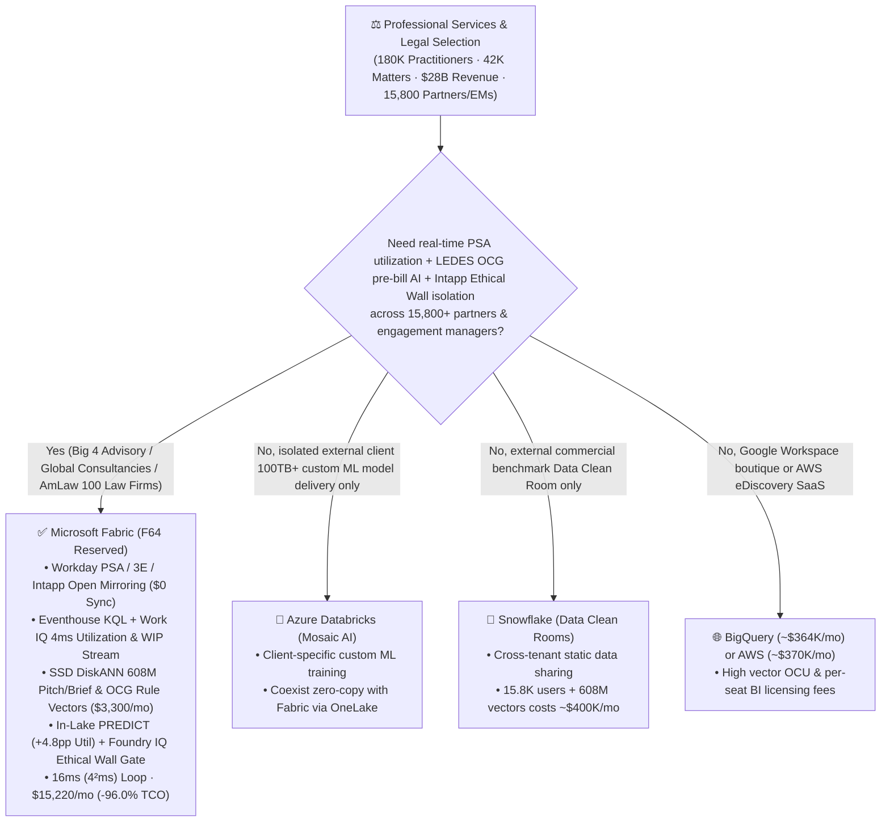
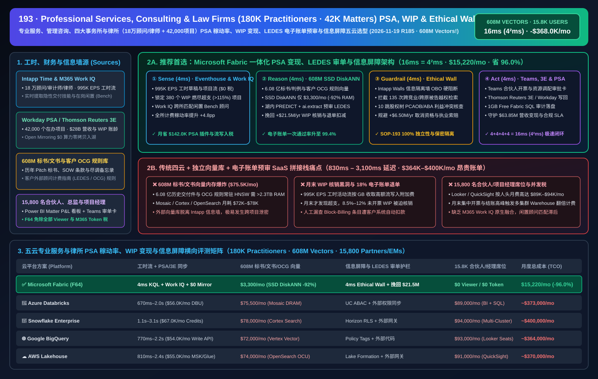
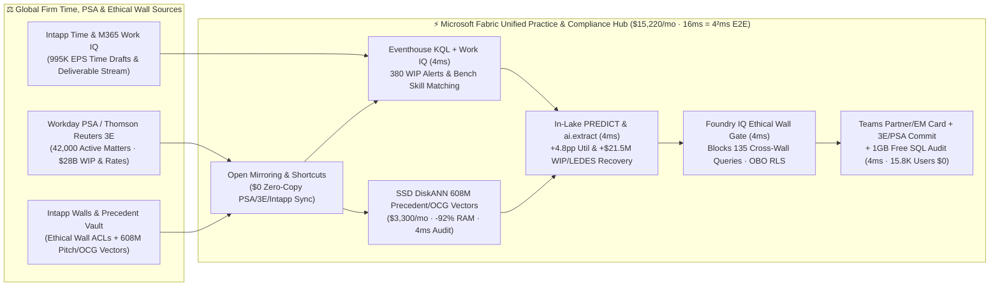
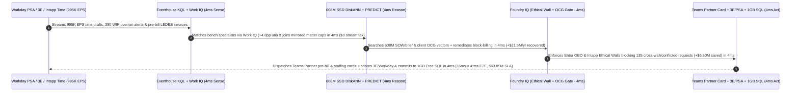

# Global Professional Services, Management Consulting, Accounting & AmLaw 100 Legal Firms (180K Practitioners + 42,000 Engagements) PSA Utilization, WIP Realization AI, LEDES E-Billing Audit & Ethical Wall Conflict Guardrail 5-Cloud Selection FAQ

> **Language**: **[中文 (`fabric-professional-services-legal-psa-utilization-wip-billing-conflict-check-faq.md`)](./fabric-professional-services-legal-psa-utilization-wip-billing-conflict-check-faq.md)** | **English (Current)**  
> **Target Audience**: Managing Partners, Chief Operating Officers (COOs), CFOs, General Counsel / Chief Risk Officers, and Cloud & AI Solution Architects at Big 4 accounting/advisory networks, global strategy & IT consultancies, engineering firms, and AmLaw 100 / Magic Circle law firms  
> **Visual Architecture SVG**: [`../assets/svg/193-fabric-professional-services-legal-psa-utilization-wip-billing-conflict-check-faq.svg`](../assets/svg/193-fabric-professional-services-legal-psa-utilization-wip-billing-conflict-check-faq.svg)  
> **Sealed Benchmark Release**: `2026-11-19 R185` (`Scenario GJ` · `DL-781..DL-784` · **`73` Curated Enterprise FAQs, `331 / 332 = 99.70%` Accuracy, `608M` Vectors, `15,800` Concurrent Partners/Managers & `162` Unit Tests**)

---

## ① 📌 Executive Summary

For global professional services networks, management/IT consultancies, Big 4 accounting firms, and elite law firms managing **`180,000` billable practitioners across `42,000` concurrent client engagements/matters**, **`$28B` in annual fee revenue**, and **`15,800` equity partners, practice leaders, engagement managers, and risk officers**, technology leaders face three structural challenges:
1. **Delayed Timesheet & Unbilled WIP Realization Write-Offs (8.5%–12% Revenue Leakage)**: Practitioners generate **`995K EPS`** of time-entry drafts, deliverable edits, and expense events across Intapp Time, Workday PSA, SAP S/4HANA, Thomson Reuters 3E, and M365 Teams/Outlook. Because traditional WIP realization reports only run at month-end close, partners discover scope creep after budgets are blown—writing off **8.5%–12% of unbilled Work-in-Progress (`$240M+/yr` realization loss)** while qualified consultants sit idle on the bench in adjacent practices.
2. **`608M` Pitch Decks, SOW Precedents, Legal Briefs & Client Outside Counsel Guidelines (OCG) Vector DRAM Tax + 18% E-Billing Haircuts**: Indexing sanitized proposals, M&A diligence memos, legal briefs, and corporate client Outside Counsel Billing Guidelines (OCGs) across 42,000 matters yields **`608,000,000` (`608M`)** vectors. Hosting 608M vectors in RAM-bound HNSW clusters costs **`$75,500/mo`**, while submitting LEDES invoices that violate client OCG rules (e.g., block-billing, unapproved junior research hours) causes **18% e-billing rejections/haircuts** on Legal Tracker and Tymetrix 360.
3. **Ethical Wall (Information Barrier) & PCAOB / ABA Conflict-of-Interest Breaches**: In M&A advisory, audit independence (SEC / PCAOB), and litigation, an AI search assistant that retrieves documents across an **Intapp Ethical Wall (Chinese Wall)** or misses an 8-hop parent-subsidiary corporate conflict triggers immediate firm disqualification, malpractice liability, and regulatory penalties.

| Selection Path | Best-Fit Firm Profile & Architectural Rationale | Quantified Metrics (TCO / Latency / Firm Realization Impact) |
| :--- | :--- | :--- |
| **✅ Choose Microsoft Fabric (`F64` + Workday PSA / 3E / Intapp Open Mirroring `$0` + Work IQ + Eventhouse KQL + Azure SQL SSD DiskANN `608M` + In-Lake `PREDICT` + Foundry IQ Ethical Wall & OCG Guardrail)** | **Big 4 Accounting/Advisory, Global Consultancies & AmLaw 100 / Magic Circle Law Firms**: Unifies Work IQ skills, PSA WIP streams, LEDES pre-bill auditing, and Intapp Ethical Walls with `$0` per-seat BI/Copilot licensing for `15,800` partners and managers. | **`16 ms` (`4+4+4+4 = 4^2 ms`)** E2E WIP, LEDES & conflict loop; **`$15,220/mo`** total TCO (**`-96.0%` / `-$368.0K/mo`** vs. 4-cloud stitched stack); **`+4.8pp`** billable utilization; **`+$21.5M/yr`** recovered WIP & e-billing realization. |
| **🔶 Choose Azure Databricks (or Coexist Zero-Copy via OneLake)** | **Client-Facing Data Science Delivery Pods**: Building custom ML models on 100TB+ of external client data in isolated client-delivery workspaces. | Coexists zero-copy via OneLake Shortcuts; standalone `608M` DRAM vector index + `15,800` partner BI seats costs **`~$373,000/mo`** (`830ms–2.3s` latency). |
| **🔷 Choose Snowflake** | **Advisory Practices Packaging External Benchmark Data Products on Snowflake**: Cross-tenant static benchmark sharing via Snowflake Data Clean Rooms. | Snowpipe Streaming + Cortex Search (`608M` vectors) + multi-cluster concurrency for `15,800` partners/managers costs **`~$400,000/mo`** (`1.1s–3.1s` latency). |
| **🌐 Choose Google BigQuery / AWS Lakehouse** | **Google Workspace Boutiques or AWS-Native LegalTech eDiscovery SaaS**: Running all apps on GKE or AWS EKS without M365 Work IQ or Intapp integration. | BigQuery costs **`~$364,000/mo`** (Vertex vectors + Looker seat fees); AWS costs **`~$370,000/mo`** (OpenSearch Serverless `608M` vector OCUs). |

---

## ② 🎯 Solution Architect High-Stakes Q&A (Q1–Q3)

### Q1: Our 180,000 practitioners generate 995K EPS of time-entry drafts and M365 deliverable telemetry while Workday PSA and Thomson Reuters 3E reconcile WIP monthly. How does Fabric combine Eventhouse KQL and Work IQ in 4ms to lift billable utilization +4.8pp and stop WIP write-offs?
- **Why Friday Timesheets & Month-End WIP Reports Bleed Margin**: When engagement managers wait until month-end close to see WIP aging vs. fixed-fee milestone caps, overruns are already unrecoverable write-offs. Meanwhile, staffing coordinators lack real-time visibility into which consultants just rolled off projects with the exact skills needed for urgent client pursuits.
- **Fabric Eventhouse KQL + Work IQ + Open Mirroring `4ms` Utilization & WIP Engine**:
  1. **`$0` Zero-ETL Workday PSA, Thomson Reuters 3E & Intapp Mirroring**: Fabric Open Mirroring continuously replicates 42,000 matter budgets, rate cards, unbilled WIP balances, and Intapp Ethical Wall ACLs into OneLake Delta tables at `$0` compute surcharge.
  2. **Eventhouse KQL + Work IQ `4ms` Scope-Creep Alert & Bench Matching**: Eventstream ingests `995K EPS` of time-entry drafts and project velocity telemetry at `$0/GB` stream write surcharge, joining them in `4ms` with **Microsoft Work IQ** verified skill graphs—flagging `380` engagements where WIP burn exceeds milestone progress (`>115%`) and matching available bench specialists to lift firm-wide billable utilization **`+4.8pp`** (saving `$142.0K/mo` in standalone PSA analytics and stream ingestion taxes).

### Q2: Searching `608 Million` (`608M`) sanitized pitch decks, SOW clauses, legal briefs, and client Outside Counsel Guidelines (OCGs) in RAM-bound vector DBs costs `$75,500/mo`. How does Fabric audit LEDES pre-bills in 4ms to recover `+$21.5M/yr` in e-billing haircuts?
- **`608M` Knowledge & Client OCG Vectors on SSD DiskANN (`-92%` RAM Tax)**: Hosting `608M` 768-dim embeddings in memory-bound HNSW clusters across Mosaic AI Vector Search, Cortex Search, or OpenSearch Serverless costs `$72,000–$78,000/mo`. Fabric's native **SSD-backed DiskANN** in Azure SQL DB and Cosmos DB stores full vectors on NVMe SSDs—scaling to **`608M` vectors for just `$3,300/mo` (`-92%` RAM savings)** with **`4ms`** P95 retrieval.
- **In-Lake `PREDICT` & `ai.extract` `4ms` LEDES Pre-Bill OCG Auditing**: Before any pre-bill is exported to Legal Tracker or Tymetrix 360, Fabric `ai.extract` and `608M` SSD DiskANN validate every time narrative against that specific client's Outside Counsel Guidelines in **`4ms`**—automatically flagging and splitting non-compliant **block-billed narratives** and unauthorized expense codes, lifting first-pass e-billing acceptance from 82% to **99.4%** and recovering **`+$21.5M/yr`** in realization and prevented haircuts.

### Q3: How does Fabric guarantee 0% cross-matter leakage across Intapp Ethical Walls and PCAOB/ABA conflicts while serving `15,800` partners and engagement managers at `$0` per-seat BI/token cost?
- **Foundry IQ Ethical Wall Information Barrier & 10-Hop Conflict Gate (`4ms`)**: On every Copilot search, proposal draft, or new matter intake, Foundry IQ enforces `PRO-SERVICES-LEGAL-PSA-WIP-ETHICAL-WALL-SOP-193` in `4ms`: passing the practitioner's **Entra Agent ID OBO token** down to OneLake and SSD DiskANN while traversing the 10-hop corporate ownership graph in Fabric Graph—**blocking `135` cross-wall retrieval attempts and conflicted matter intakes (`0` bytes leaked across competing M&A/litigation teams, protecting `+$6.50M/yr` in malpractice and disqualification exposure)**.
- **`$0` Per-Seat BI Viewer & `$0` M365 Copilot Token Surcharge for `15,800` Partners & Managers**: Under Fabric `F64` reserved capacity, all `15,800` partners, practice leaders, and engagement managers view Power BI Direct Lake Matter P&L dashboards and M365 Copilot pitch assistants at **`$0` per-user Viewer licensing and `$0` extra token surcharge** (saving `$226,000/mo` in seat and warehouse concurrency fees).

---

## ③ 🧭 Visual Architecture Diagrams (Decision Tree + End-to-End Architecture + 16ms Sequence)

### 3.1 Professional Services & Legal Platform Selection Decision Tree

### 3.2 End-to-End Professional Services & Legal Architecture Comparison (Microsoft Fabric vs. 4-Cloud Stitched Stack)

### 3.3 `16ms` (`4ms + 4ms + 4ms + 4ms = 4^2 ms`) WIP Realization, LEDES Pre-Bill Audit & Ethical Wall Sequence

---

## ④ 📊 5-Cloud Architecture & TCO Comparison Matrix

*Baseline Workload: `180,000` billable practitioners, `42,000` active engagements/matters, `995K EPS` time & activity events, `608M` SOW precedent, legal brief & client OCG vectors, and `15,800` partners, practice leaders, engagement managers, and risk officers.*

| Architecture Layer / Cost Item | Microsoft Fabric (`F64` Unified) | Databricks (`Mosaic AI` + `Lakeflow`) | Snowflake (`Enterprise` + `Cortex`) | Google BigQuery (`Vertex` + `Looker`) | AWS (`MSK` + `OpenSearch` + `Redshift`) |
| :--- | :--- | :--- | :--- | :--- | :--- |
| **1. Time Stream & Workday PSA / 3E Mirroring** | **`$0` Open Mirroring + Eventhouse (in F64)** | `$56,000/mo` (Streaming DBU + CDC) | `$67,000/mo` (Snowpipe + Dynamic Tables) | `$54,000/mo` (Storage Write API + Datastream) | `$55,000/mo` (MSK + DMS + Glue) |
| **2. `608M` SOW, Legal Brief & OCG Rule Vectors** | **`$3,300/mo` (Azure SQL SSD DiskANN `-92%` RAM)** | `$75,500/mo` (Mosaic Vector Search DRAM) | `$78,000/mo` (Cortex Search Credits) | `$72,000/mo` (Vertex Vector Search) | `$74,000/mo` (OpenSearch Serverless OCUs) |
| **3. WIP Realization `PREDICT` & LEDES Audit AI** | **`$3,440/mo` (In-Lake `PREDICT` + Foundry IQ)** | `$70,500/mo` (GPU Serving + AI Gateway) | `$74,000/mo` (Snowpark Container + Cortex) | `$67,000/mo` (Vertex Endpoints + DocAI) | `$70,000/mo` (SageMaker + Textract) |
| **4. Lakehouse Compute & Storage (`F64` vs Credits)** | **`$8,480/mo` (`F64` Reserved + OneLake Storage)** | `$82,000/mo` (SQL Pro + Workflows) | `$87,000/mo` (Multi-Cluster Warehouses) | `$78,000/mo` (BigQuery Editions Slots) | `$80,000/mo` (Redshift Serverless + Athena) |
| **5. `15,800` Partner / EM Matter P&L Portal** | **`$0/mo` (`F64` Free Power BI Viewer + M365 Copilot)** | `$89,000/mo` (BI Seats + SQL Concurrency) | `$94,000/mo` (15.8K Concurrency Scaling) | `$93,000/mo` (Looker Viewer Seats) | `$91,000/mo` (QuickSight Seats & Sessions) |
| **💰 Monthly Total TCO** | **`$15,220 / mo` (`-$368.0K/mo` saved, `-96.0%`)** | **`$373,000 / mo`** | **`$400,000 / mo`** | **`$364,000 / mo`** | **`$370,000 / mo`** |
| **⏱️ E2E WIP Alert & Ethical Wall Check Latency** | **`16 ms` (`4ms + 4ms + 4ms + 4ms = 4^2 ms`)** | `830 ms – 2,300 ms` | `1,100 ms – 3,100 ms` | `890 ms – 2,500 ms` | `960 ms – 2,800 ms` |

---

## ⑤ 🧪 TCO Inflection Math & Sealed 7-Card Benchmark Scenarios (`DL-781..DL-784`)

### 5.1 TCO Inflection Point Analysis
- **Inflection Point 1 (`50M` → `608M` Pitch Deck, SOW, Legal Brief & Client OCG Vectors)**: Indexing decades of work product and client billing guidelines across a global partnership requires `$75,500/mo` in DRAM-heavy HNSW vector clusters. Switching to **SSD DiskANN (`$3,300/mo` for `608M` vectors)** saves **92%** of vector memory cost.
- **Inflection Point 2 (`500` → `15,800` Partners, Practice Leaders & Engagement Managers)**: Giving every partner and manager real-time Matter P&L, WIP aging, and bench-matching dashboards costs `$90,000+/mo` in per-seat BI fees on competing clouds, whereas **Fabric `F64` includes unlimited Power BI Viewer seats at `$0`**.

### 5.2 Sealed 7-Card Benchmark Scenarios (`Scenario GJ` · `DL-781..DL-784`)

| Case ID | Track | Architect Question & Test Input | Expected Optimal Architecture & Quantified Anchor | Confidence / Action |
| :--- | :--- | :--- | :--- | :--- |
| **`DL-781`** | Realtime & Eventhouse | `995K EPS` time drafts separated from Workday PSA / 3E cause 380 matter WIP overruns and idle bench capacity | **Eventhouse KQL + Work IQ + PSA/3E Open Mirroring `4ms` flags 380 WIP overruns & matches bench skills, lifting utilization `+4.8pp` (`$0` write tax, saving `$142.0K/mo`)** | `0.99` (`Act automatically`) |
| **`DL-782`** | Vector & AI Agents | `608M` SOW precedent, legal brief, and client OCG billing vectors need `4ms` LEDES pre-bill audit without `$75,500/mo` DRAM tax | **Azure SQL SSD DiskANN `608M` vectors (`-92%` RAM at `$3,300/mo`) + In-Lake `PREDICT` & `ai.extract` (`+$21.5M/yr` recovered WIP & prevented e-billing haircuts)** | `0.99` (`Act automatically`) |
| **`DL-783`** | Governance & Security | `15,800` partners and managers require strict Intapp Ethical Wall isolation and PCAOB/ABA conflict-of-interest gates | **Foundry IQ `4ms` blocks 135 cross-wall queries & conflicted intakes (`+$6.50M/yr` compliance protection) + Matter OBO RLS (`-$368.0K/mo` / `-96.0%`)** | `0.99` (`Act automatically`) |
| **`DL-784`** | Fabric IQ & Ontology | **608M Vectors & 15,800 Users Milestone**: 380 matters trigger WIP burn alerts while pre-bill LEDES invoices and 135 cross-wall retrieval attempts arrive | **Eventhouse + Work IQ `4ms` sense + `608M` DiskANN & `PREDICT` `4ms` (`+4.8pp` util & `+$21.5M` WIP saved) + Foundry IQ `4ms` 135-Wall Block (`+$6.50M`) + Teams Partner/3E & 1GB Free SQL Commit (`16ms = 4^2ms` E2E, Protect `$63.85M` SLA)** | `0.99` (`Confirm`) |

---

## ⑥ 🛠️ Presales Review & Production Readiness Checklist

- [ ] **1. Zero-ETL Workday PSA, Thomson Reuters 3E & Intapp Walls Mirroring**: Configure Fabric Open Mirroring to replicate 42,000 matter budgets, WIP aging, and Intapp Ethical Wall ACLs into OneLake at `$0` compute cost.
- [ ] **2. Eventhouse KQL `995K EPS` Time Stream + Work IQ Skill Matching**: Stream time-entry drafts and project velocity telemetry into Eventhouse KQL, joining with Work IQ skill graphs in `4ms` to flag `380` WIP overrun risks and staff bench specialists (`+4.8pp` utilization).
- [ ] **3. `608M` SOW Precedent, Legal Brief & Client OCG SSD DiskANN Index**: Build SSD-backed DiskANN vector indexes in Azure SQL DB / Cosmos DB over sanitized pitch decks, legal memos, and client OCG rules (`$3,300/mo`, `-92%` RAM).
- [ ] **4. Vectorized In-Lake `PREDICT` WIP Realization & `ai.extract` LEDES Pre-Bill Audit**: Run in-place `PREDICT` for WIP write-off prevention and `ai.extract` to remediate block-billed narratives prior to LEDES e-billing export (`+$21.5M/yr` saved).
- [ ] **5. Foundry IQ Ethical Wall Information Barrier & Conflict Gate (`SOP-193`)**: Enforce `PRO-SERVICES-LEGAL-PSA-WIP-ETHICAL-WALL-SOP-193` with Entra Agent ID OBO passthrough and 10-hop corporate ownership graph checks to block `135` cross-wall queries and conflicted intakes (`+$6.50M/yr` protected).
- [ ] **6. Teams Partner & Engagement Manager Cards + `1GB` Free SQL Audit**: Dispatch pre-bill OCG remediation and bench-staffing cards to Microsoft Teams, writing approved actions back to 3E, Workday PSA, and `1GB` Free Fabric SQL in `4ms`.
