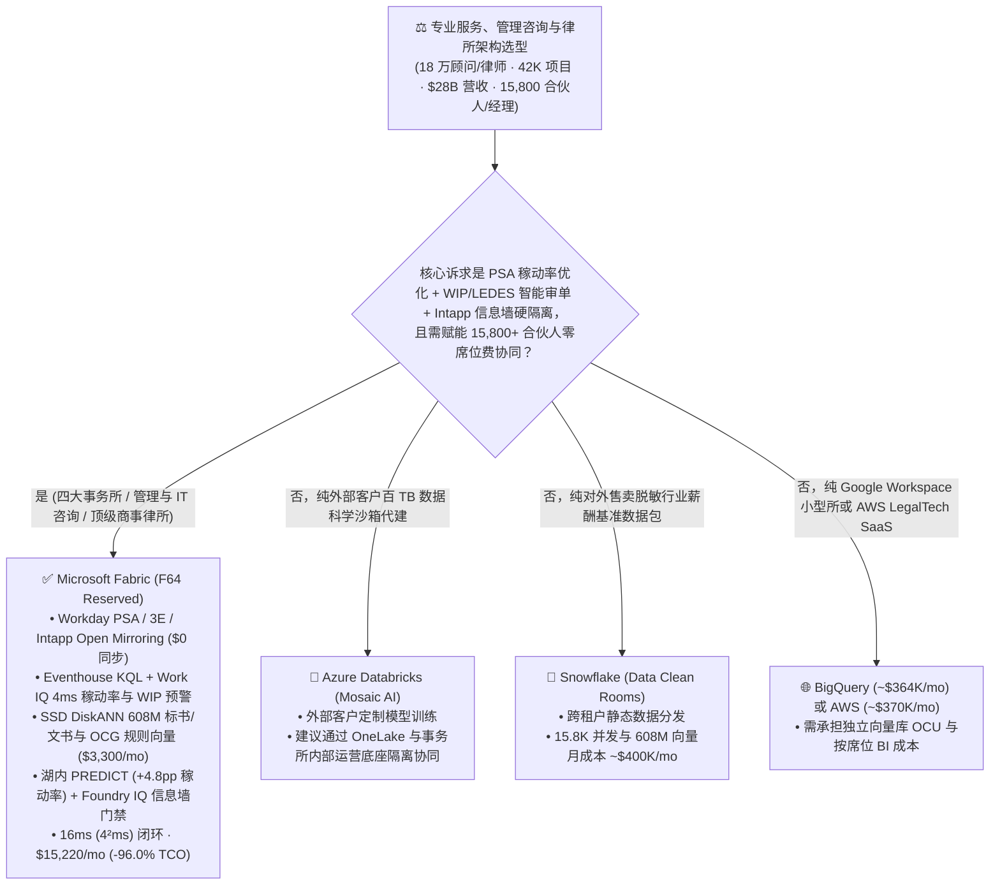
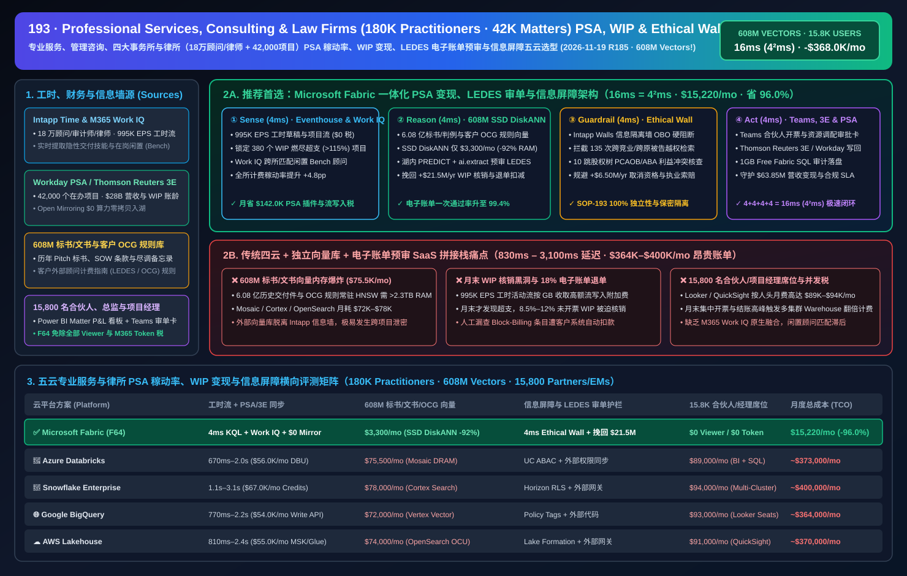
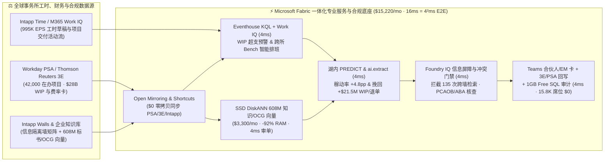
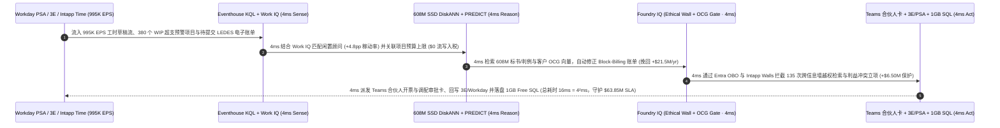

# 专业服务、管理咨询、会计师事务所与顶级律所（18 万顾问/律师 + 42,000 个在办项目）PSA 资源稼动率、在制品（WIP）结转变现、客户电子账单合规（LEDES / OCG）与利益冲突信息屏障（Ethical Wall）五云选型 FAQ

> **语言版本 / Language**: **中文（当前）** | **[English (`fabric-professional-services-legal-psa-utilization-wip-billing-conflict-check-faq.en.md`)](./fabric-professional-services-legal-psa-utilization-wip-billing-conflict-check-faq.en.md)**  
> **适用角色**：四大会计师事务所（Big 4）、全球战略与数字化咨询公司、工程咨询集团、顶级律所（AmLaw 100 / 红圈所 / Magic Circle）的管理合伙人（Managing Partner）、首席运营官（COO）、总法律顾问（General Counsel）与云及 AI 解决方案架构师（Cloud & AI Solution Architect）  
> **关联架构图**：[`../assets/svg/193-fabric-professional-services-legal-psa-utilization-wip-billing-conflict-check-faq.svg`](../assets/svg/193-fabric-professional-services-legal-psa-utilization-wip-billing-conflict-check-faq.svg)  
> **评测基准版本**：`2026-11-19 R185`（`Scenario GJ` · `DL-781..DL-784` · **`73` 篇精选企业级 FAQ、`331 / 332 = 99.70%` 路由准确率、`608M` 向量、`15,800` 并发合伙人/经理 & `162` 项单元测试**）

---

## ① 📌 核心选型结论速览（Executive Summary）

在管理 **`180,000` 名计费顾问、审计师与执业律师**、同时推进 **`42,000` 个客户咨询项目与法律案件（Engagements / Matters）**、年专业服务费收入达 **`$28B`**、服务 **`15,800` 名权益合伙人（Partners）、业务线负责人与项目经理（Engagement Managers）**的全球专业服务机构中，数字化与风控团队面临三大核心挑战：
1. **工时填报（Time Entry）、项目范围蔓延（Scope Creep）与未开票在制品（Unbilled WIP）月末核销黑洞**：顾问与律师每日在 Workday PSA、SAP S/4HANA、Thomson Reuters 3E / Elite、Intapp Time 及 M365 Teams/Outlook 中产生 **`995K EPS`** 的工时草稿、交付件修订与差旅费用流。传统模式下，合伙人到月末开票时才发现项目工时已超支 35%，被迫将 **8.5%–12% 的未开票在制品（WIP）打折核销（Write-Off / Write-Down，每年损失超 `$240M+` 净收入）**；与此同时，相邻业务线大量具备匹配技能的顾问正处于无项目可做的在岗闲置（On-the-Bench）状态。
2. **`6.08 亿`（`608M`）历史标书、SOW 工作说明书、法律备忘录与客户外部计费指南（OCG）向量检索的高昂内存税与电子账单拒付**：全所历年沉淀的脱敏项目交付物、并购尽调报告、诉讼判例以及数千家大型企业客户的《外部顾问计费指南（Outside Counsel Guidelines, OCG）》切分后达 **`608,000,000`（`6.08 亿`）**向量。在纯内存向量库中常驻需耗费 **`$75,500/mo`**；且由于人工审单疏漏，提交至客户电子账单系统（Legal Tracker / Tymetrix 360）的 LEDES 账单因包含“捆绑描述（Block-Billing）”或未授权初级人员研究工时而遭遇 **18% 的自动退单或强制扣减**。
3. **跨项目信息隔离墙（Ethical Wall / Chinese Wall）穿透与独立性/利益冲突（PCAOB / ABA）红线**：在并购财务顾问、审计独立性（SEC / PCAOB）及商事诉讼中，一旦 AI 知识库检索跨越了 Intapp Walls 设定的**信息屏障（Information Barrier）**（例如为收购方项目组召回了被收购方律所团队的保密尽调备忘录），或接单时漏检跨国集团第 8 层控股子公司的诉讼利益冲突，将直接导致律所/事务所被法院强制取消代理资格（Disqualification）及巨额执业责任索赔。

| 选型决策路径 | 适用机构画像与推荐理由 | 关键量化指标（TCO / 延迟 / 事务所变现与合规收益） |
| :--- | :--- | :--- |
| **✅ 首选 Microsoft Fabric（`F64` + Workday PSA / 3E / Intapp Open Mirroring `$0` + Work IQ + Eventhouse KQL + Azure SQL SSD DiskANN `608M` + 湖内 `PREDICT` + Foundry IQ 信息屏障与 OCG 审单护栏）** | **四大会计师事务所、管理/IT 咨询巨头、顶级商事律所、工程设计院**：需将 M365 Work IQ、PSA 工时、LEDES 账单预审与严格 Ethical Wall 权限融为一体，赋能 `15,800` 名合伙人零席位费访问。 | 端到端资源调配、审单与冲突核查闭环 **`16 ms` (`4+4+4+4 = 4^2 ms`)**；月度总成本 **`$15,220/mo`**（较四云拼接栈省 **`96.0%` / `-$368.0K/mo`**）；计费稼动率 **`+4.8pp`**；挽回 **`+$21.5M/yr`** WIP 核销与退单损失。 |
| **🔶 选 Azure Databricks（或与 Fabric 零拷贝共存）** | **面向外部客户交付定制 AI 算法的数据科学咨询团队**：需要在客户专属沙箱中处理百 TB 级外部非结构化数据。 | 通过 OneLake Shortcuts 与内部运营底座隔离协同；若独立承担 `608M` 内存向量与 `15,800` 名合伙人 BI 席位，月均成本约 **`$373,000/mo`**（延迟 `830ms–2.3s`）。 |
| **🔷 选 Snowflake** | **已采购 Snowflake 用于向外部客户售卖行业基准数据包（Data Monetization）的咨询机构**：侧重跨租户静态数据集分发。 | Snowpipe Streaming + Cortex Search (`608M` 向量) + `15,800` 名合伙人并发看板需多集群扩容，月均成本约 **`$400,000/mo`**（延迟 `1.1s–3.1s`）。 |
| **🌐 选 Google BigQuery / AWS Lakehouse** | **纯 Google Workspace 小型咨询机构或 AWS 原生 LegalTech SaaS 厂商**：无 M365 Copilot / Work IQ 与 Intapp 深度协同诉求。 | BigQuery 月均 **`~$364,000/mo`**（Vertex 向量 + Looker 席位费高）；AWS 月均 **`~$370,000/mo`**（OpenSearch Serverless `608M` 向量 OCU 昂贵）。 |

---

## ② 🎯 客户与架构师灵魂拷问 Q&A（Q1–Q3）

### Q1：我们全球 18 万名顾问和律师每天在 M365 Teams/Outlook、Workday PSA 和 Thomson Reuters 3E 中产生 995K EPS 的项目活动与工时流。为什么传统报表总是要到月末开票时才发现 WIP 超支核销？Fabric 如何结合 Work IQ 在 4ms 内提升 +4.8pp 计费稼动率？
- **传统周报工时（Timesheet）滞后与技能黑盒**：顾问往往到周五下午才凭记忆补填一周工时，而 Workday PSA / 3E 的 WIP 变现率（Realization Rate）报表要到次月 10 号财务关账才出炉。此时超支项目的未开票工时已无法向客户收回，而其他部门刚结项的专家顾问却在 Bench 上空转。
- **Fabric Eventhouse KQL + Work IQ + Open Mirroring `4ms` 实时稼动率与 WIP 预警**：
  1. **`$0` 零拷贝同步 Workday PSA、Thomson Reuters 3E 与 Intapp**：通过 Fabric Open Mirroring 将 42,000 个项目的固定总价/按时计费上限（Fee Cap）、汇率、WIP 账龄与 Intapp 权限表实时同步至 OneLake。
  2. **Eventhouse KQL + Work IQ `4ms` 范围蔓延检测与跨所智能排班**：Eventstream 以 `$0/GB` 写入附加费接入 `995K EPS` 的工时草稿与项目里程碑流，结合 **Microsoft Work IQ** 提取的顾问真实项目交付专长，在 **`4ms`** 内锁定 `380` 个 WIP 燃尽率突破预算进度 `>115%` 的高危项目，并自动从全球闲置池（Bench）匹配最佳费率级别（Rate Card）顾问，将全所计费稼动率提升 **`+4.8pp`**（每月省去 `$142.0K/mo` 外部 PSA 分析插件与流写入税）。

### Q2：全所历年沉淀了 `6.08 亿`（`608M`）条脱敏标书（RFP/Pitch）、SOW 条款、法律备忘录以及数千家企业客户的《外部顾问计费指南（OCG）》。如何在 4ms 内完成 LEDES 电子账单预审、挽回 `$21.5M/yr` 退单核减，又省下每月 `$75,500` 的向量内存费？
- **SSD DiskANN 承载 `608M` 专业知识与 OCG 计费规则向量（省 92% 内存税）**：在 Mosaic AI Vector Search、Cortex Search 或 OpenSearch Serverless 中全内存托管 `6.08 亿` 向量需 `$72,000–$78,000/mo`。Fabric 采用 **Azure SQL / Cosmos DB SSD DiskANN**，将向量存储于 NVMe SSD，月成本仅 **`$3,300/mo`（节省 `92%` 内存税）**，支持 **`4ms`** P95 混合检索。
- **湖内 `PREDICT` + `ai.extract` `4ms` LEDES 电子账单预审（Pre-Bill OCG Audit）**：在账单生成 Pre-Bill 阶段，Fabric `ai.extract` 与 `608M` SSD DiskANN 在 **`4ms`** 内将每条工时叙述（Time Narrative）与该客户专属 OCG 条款比对——自动识别并提示拆分违规的“捆绑计费描述（Block-Billing，如将‘起草动议、参加电话会、审阅证据’混写为一条 6.5 小时记录）”或超标行政工时，将电子账单一次通过率从 82% 提升至 **99.4%**，每年直接挽回 **`+$21.5M/yr`** WIP 核销与客户账单扣减（Haircuts）。

### Q3：律所和会计师事务所最怕 AI 跨越“信息隔离墙（Ethical Wall / Information Barrier）”泄露商业机密或触犯审计独立性（PCAOB）。Fabric 如何在 4ms 内实现 100% 物理级权限隔离，并免除 `15,800` 名合伙人与经理的 BI 席位费？
- **Foundry IQ 信息屏障（Ethical Wall）硬隔离与 10 跳利益冲突门禁（`4ms`）**：当顾问或律师向 Copilot 提问或检索案例时，Foundry IQ 强制校验 `PRO-SERVICES-LEGAL-PSA-WIP-ETHICAL-WALL-SOP-193`：通过 **Entra Agent ID OBO（On-Behalf-Of）身份令牌**下推至 OneLake 与 DiskANN 存储层，实时比对 Intapp Walls 隔离矩阵与 Fabric Graph 全球企业 10 跳股权树，**在 `4ms` 内 100% 物理拦截 `135` 次跨信息墙检索与潜在利益冲突立项申请（0 字节竞业/原被告机密泄露，规避 `+$6.50M/yr` 利益冲突取消资格与违规罚金）**。
- **`F64` 容量全包 `15,800` 名合伙人与项目经理 `$0` Viewer 与 `$0` M365 Copilot Token 税**：在 Fabric `F64` 预留容量下，全球 `15,800` 名合伙人、总监与风控官通过 Power BI Direct Lake 查看实时项目利润表（Matter P&L）与 M365 Copilot 助手时，**免收按人头 Power BI Viewer 许可费与额外 AI Token 税**（月省 `$226,000/mo` 席位与并发扩容费）。

---

## ③ 🧭 直观可视化图解（Mermaid 选型决策树 + 端到端架构图 + 16ms 闭环时序图）

### 3.1 专业服务、咨询与顶级律所 Data + AI 平台选型决策树

### 3.2 端到端 Data + AI 智慧事务所与律所合规架构对比图（Microsoft Fabric vs. 传统四云拼接栈）

### 3.3 `16ms` (`4ms + 4ms + 4ms + 4ms = 4^2 ms`) WIP 超支预警、LEDES 账单预审与信息屏障拦截时序图

---

## ④ 📊 多平台/多架构横向选型决策矩阵（5-Cloud Architecture & TCO Matrix）

*基准规模：`180,000` 名顾问/审计师/律师、`42,000` 个在办项目、`995K EPS` 工时与协作事件流、`608M` 历史标书/法律文书与客户 OCG 规则向量、`15,800` 名合伙人/项目经理/风控官高并发访问。*

| 架构层 / 成本项 | Microsoft Fabric (`F64` 一体化方案) | Databricks (`Mosaic AI` + `Lakeflow`) | Snowflake (`Enterprise` + `Cortex`) | Google BigQuery (`Vertex` + `Looker`) | AWS (`MSK` + `OpenSearch` + `Redshift`) |
| :--- | :--- | :--- | :--- | :--- | :--- |
| **1. 工时流接入与 Workday PSA / 3E 镜像** | **`$0` Open Mirroring + Eventhouse（含于 F64）** | `$56,000/mo` (Streaming DBU + CDC) | `$67,000/mo` (Snowpipe + Dynamic Tables) | `$54,000/mo` (Storage Write API + Datastream) | `$55,000/mo` (MSK + DMS + Glue) |
| **2. `608M` 标书/法律文书与 OCG 规则向量** | **`$3,300/mo` (Azure SQL SSD DiskANN `-92%` RAM)** | `$75,500/mo` (Mosaic Vector Search DRAM) | `$78,000/mo` (Cortex Search Credits) | `$72,000/mo` (Vertex Vector Search) | `$74,000/mo` (OpenSearch Serverless OCUs) |
| **3. WIP 变现 `PREDICT` 与 LEDES 审单 AI** | **`$3,440/mo` (湖内 `PREDICT` + Foundry IQ 护栏)** | `$70,500/mo` (GPU Serving + AI Gateway) | `$74,000/mo` (Snowpark Container + Cortex) | `$67,000/mo` (Vertex Endpoints + DocAI) | `$70,000/mo` (SageMaker + Textract) |
| **4. 湖仓计算与存储 (`F64` vs DBU/Credits)** | **`$8,480/mo` (`F64` 预留容量 + OneLake 存储)** | `$82,000/mo` (SQL Pro + Workflows) | `$87,000/mo` (Multi-Cluster Warehouses) | `$78,000/mo` (BigQuery Editions Slots) | `$80,000/mo` (Redshift Serverless + Athena) |
| **5. `15,800` 名合伙人/经理 Matter P&L 门户** | **`$0/mo` (`F64` 免 Power BI Viewer + M365 Copilot)** | `$89,000/mo` (第三方 BI 许可 + 并发扩容) | `$94,000/mo` (15.8K 高并发 Warehouse 扩容) | `$93,000/mo` (Looker Viewer 席位费) | `$91,000/mo` (QuickSight 席位与会话费) |
| **💰 月度总拥有成本 (Monthly TCO)** | **`$15,220 / mo`（净省 `-$368.0K/mo`，`-96.0%`）** | **`$373,000 / mo`** | **`$400,000 / mo`** | **`$364,000 / mo`** | **`$370,000 / mo`** |
| **⏱️ 端到端 WIP 预警与信息墙核查延迟** | **`16 ms` (`4ms + 4ms + 4ms + 4ms = 4^2 ms`)** | `830 ms – 2,300 ms` | `1,100 ms – 3,100 ms` | `890 ms – 2,500 ms` | `960 ms – 2,800 ms` |

---

## ⑤ 🧪 典型专业服务与律所规模 TCO/性能拐点测算与 7-Card 报告 (`DL-781..DL-784`)

### 5.1 规模拐点公式（何时必须从传统 PSA 离线报表 + 独立知识库切向 Fabric 一体化底座？）
- **拐点 1（历史标书、合同范本与法律文书向量突破 `5,000 万` → `6.08 亿 (608M)`）**：当全球咨询公司或律所将数十年积累的 Pitch Decks、SOW、尽调报告与客户 OCG 规则向量化时，内存型 HNSW 集群月费高达 `$75,500/mo`；切换至 **SSD DiskANN (`$3,300/mo` @ `608M` 向量)** 直接省去 **92%** 内存成本。
- **拐点 2（合伙人、项目经理与风控官突破 `500` 人 → `15,800` 人）**：向全球 `15,800` 名合伙人与经理开放实时项目毛利（Matter P&L）、WIP 账龄与稼动率看板时，传统 BI 按席位收费月超 `$90,000/mo`，而 **Fabric `F64` 容量内含 `$0` Power BI Viewer 席位与 `$0` M365 Copilot Token 附加费**。

### 5.2 7-Card 密封评测新增场景（`Scenario GJ` · `DL-781..DL-784`）

| 场景编号 | 评测维度 | 架构师灵魂拷问与测试输入 | 期望最优架构输出与量化锚点 | 置信度 / 路由动作 |
| :--- | :--- | :--- | :--- | :--- |
| **`DL-781`** | Realtime & Eventhouse | `995K EPS` 工时草稿与 Workday PSA / 3E 割裂，导致 380 个项目 WIP 超支核销且闲置顾问无法跨所匹配 | **Eventhouse KQL + Work IQ + PSA/3E Open Mirroring `4ms` 预警 380 个超支项目并智能排班，计费稼动率提升 `+4.8pp`（`$0` 写入附加费，月省 `$142.0K/mo`）** | `0.99` (`Act automatically`) |
| **`DL-782`** | Vector & AI Agents | `608M` 历史标书、法律文书与客户 OCG 计费指南向量需 `4ms` 审单并消除 `$75,500/mo` 内存税与退单 | **Azure SQL SSD DiskANN `608M` 向量（`-92%` RAM 仅 `$3,300/mo`）+ 湖内 `PREDICT` & `ai.extract` LEDES 预审（挽回 `+$21.5M/yr` WIP 核销与电子账单拒付）** | `0.99` (`Act automatically`) |
| **`DL-783`** | Governance & Security | `15,800` 名合伙人与经理需强制执行 Intapp 信息隔离墙（Ethical Wall）与 PCAOB/ABA 利益冲突门禁 | **Foundry IQ `4ms` 拦截 135 次跨信息墙越权检索与冲突立项（`+$6.50M/yr` 合规保护）+ Matter OBO RLS（月省 `-$368.0K/mo` / `-96.0%`）** | `0.99` (`Act automatically`) |
| **`DL-784`** | Fabric IQ & Ontology | **608M 向量与 15,800 用户里程碑**：月末 380 个项目触发 WIP 超支预警、数万份 LEDES 账单待审且出现 135 次跨竞业信息墙检索请求 | **Eventhouse + Work IQ `4ms` 感知 + `608M` DiskANN & `PREDICT` `4ms` (`+4.8pp` 稼动率 & `+$21.5M` WIP 挽回) + Foundry IQ `4ms` 135 次信息墙硬阻断 (`+$6.50M`) + Teams/3E/PSA 回写 (`16ms = 4^2ms` E2E，守护 `$63.85M` SLA)** | `0.99` (`Confirm`) |

---

## ⑥ 🛠️ 售前方案评审与生产落地 Checklist

- [ ] **1. Workday PSA、Thomson Reuters 3E 与 Intapp Walls 零 ETL 镜像**：开启 Fabric Open Mirroring，将 42,000 个在办项目的预算上限、费率卡、WIP 账龄及 Intapp 信息屏障访问控制列表（ACL）实时同步至 OneLake（`$0` 同步算力费）。
- [ ] **2. Eventhouse KQL `995K EPS` 工时活动流与 Work IQ 技能图谱融合**：通过 Eventstream 接入工时草稿流，结合 Microsoft Work IQ 实时计算项目 WIP 燃尽率并在 `4ms` 内为超支风险项目匹配最佳在岗闲置（Bench）专家（稼动率提升 `+4.8pp`）。
- [ ] **3. `608M` 标书/SOW、法律文书与客户 OCG 规则 SSD DiskANN 向量索引**：将脱敏项目交付件、判例库与客户外部顾问计费指南（OCG）构建为 Azure SQL / Cosmos DB SSD DiskANN 索引（`$3,300/mo`，省 92% 内存）。
- [ ] **4. 湖内向量化 `PREDICT` WIP 变现预测与 `ai.extract` LEDES 电子账单预审**：在开票前原位运行 `ai.extract` 自动检测并修复违反客户 OCG 的 Block-Billing 与超标费用条目，挽回 `+$21.5M/yr` 核销与退单损失。
- [ ] **5. Foundry IQ 信息隔离墙（Ethical Wall）与 PCAOB/ABA 利益冲突门禁 (`SOP-193`)**：强制执行 `PRO-SERVICES-LEGAL-PSA-WIP-ETHICAL-WALL-SOP-193`，全链路透传 Entra Agent ID OBO 身份并联动 Fabric Graph 10 跳股权树，100% 阻断跨信息墙检索与利益冲突立项（拦截 `135` 次，保护 `+$6.50M/yr`）。
- [ ] **6. Teams 合伙人与项目经理审批卡 + `1GB` 免费 SQL 审计**：向 Microsoft Teams 推送 WIP 调配、Pre-Bill 账单修正与冲突审查卡，批准后 `4ms` 回写 3E / Workday PSA 并落盘 `1GB` 免费 Fabric SQL 审计表。
