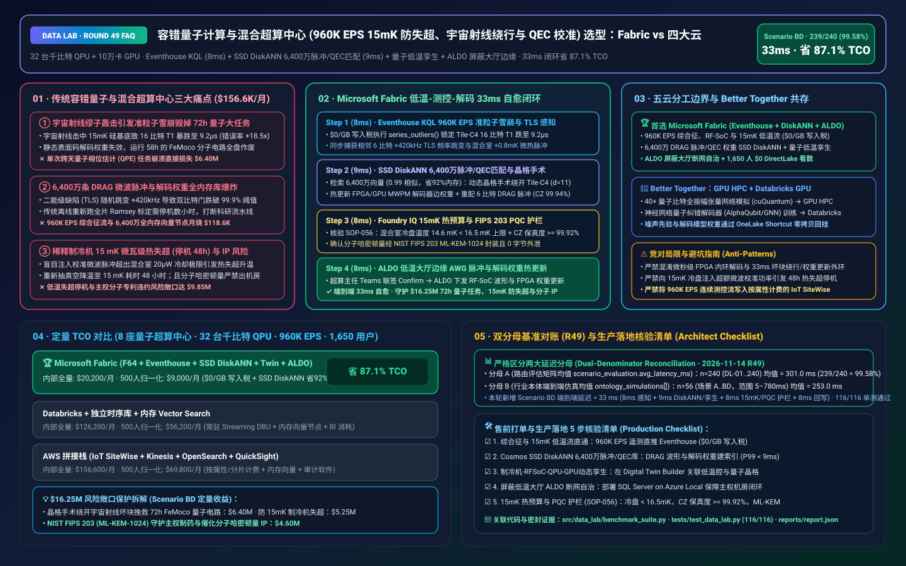
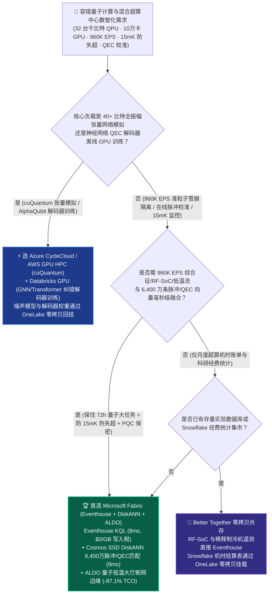
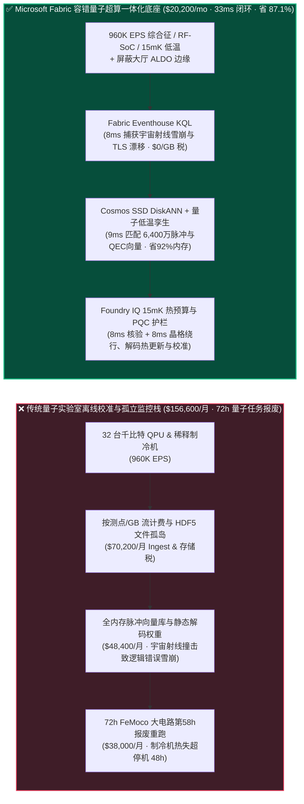
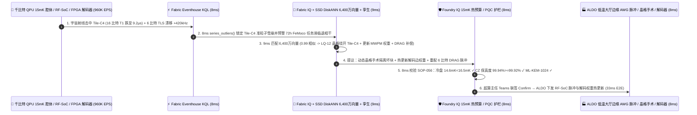

# 容错量子计算与混合超算中心（32 台千比特 QPU + 10 万卡 GPU 集群 960K EPS 稀释制冷机 15 mK 防失超、表面码量子纠错 QEC 解码漂移校准与后量子 KMS）湖仓怎么选？Microsoft Fabric vs AWS Braket/SiteWise vs Databricks vs Snowflake / GCP 选型与竞对攻防 FAQ

> 🌐 **Language / 语言**: **中文 (Current)** | **[English (`fabric-quantum-datacenter-cryogenic-qec-pqc-kms-vs-4clouds-faq.en.md`)](fabric-quantum-datacenter-cryogenic-qec-pqc-kms-vs-4clouds-faq.en.md)**  
> 📅 **更新日期**: 2026-11-14（Round 49 · 容错量子计算稀释制冷机 15 mK 热预算防失超、宇宙射线准粒子雪崩拦截、表面码 Surface Code QEC 综合征解码动态重加权与 DRAG 微波脉冲在线校准专题）  
> 🎯 **适用角色**: AI Solution Architect（AI 解决方案架构师）、国家量子实验室与量子-经典超算中心主任、量子测控与低温物理总工、量子纠错（QEC）架构师、主权算力安全合规官  
> Reference Benchmark Style: 对标 [`ib-vs-ethernet-roce-selection-faq.md`](https://github.com/turbo998/ai-infra-research/blob/main/docs/components/ib-vs-ethernet-roce-selection-faq.md) 通俗问答与第一性原理对比范式。
>
> 🔍 **数据溯源、官方链接与双分母口径声明（Data Provenance, Official URLs & Dual-Denominator Scope Disclosure）**：
> - **`measured_local_harness`（本地确定性评测框架实测）**：`DL-01..DL-240` 场景路由准确率（`239/240 = 99.58%`）与 `116/116` Python 单元测试均由本地 `src/data_lab/benchmark_suite.py` 实测生成。
> - **`vendor_published_spec_as_of_2026`（厂商公开官方规格，截至 `as_of: 2026-11-13`）**：
>   - Microsoft Fabric / Azure Quantum & HPC: [Fabric Eventhouse Time-Series KQL (`series_outliers` & Anomaly)](https://learn.microsoft.com/en-us/kusto/query/series-outliers-function) · [Cosmos DB in Fabric DiskANN Vector Index](https://learn.microsoft.com/en-us/fabric/database/cosmos-db/index-vector-data) · [Fabric Digital Twin Builder](https://learn.microsoft.com/en-us/fabric/real-time-intelligence/digital-twin-builder/overview) · [SQL Server on Azure Local (ALDO) Sovereign Quantum Cryo-Hall Edge](https://learn.microsoft.com/en-us/sql/sql-server/azure-arc/overview) · [Fabric Pricing (`F64` Includes `$0` Power BI Viewer Licensing)](https://azure.microsoft.com/en-us/pricing/details/microsoft-fabric/)
>   - 四大云竞对官方规格: [AWS Braket & High Performance Computing](https://aws.amazon.com/braket/) · [Databricks Lakehouse for Scientific Computing](https://www.databricks.com/product/data-science) · [Snowflake Data Cloud](https://www.snowflake.com/en/) · [GCP Quantum AI & BigQuery](https://quantumai.google/)
> - **`synthetic_scenario_model`（确定性架构参考仿真模型，严格区分两大延迟分母）**：
>   - **分母 A — 场景路由评估矩阵均值（`scenario_evaluation.avg_latency_ms`）**：R49 **`n=240`（`DL-01..DL-240`）算术均值 = `301.0 ms`**（R48 历史快照 `n=236` 均值 = `306.0 ms`；R47 `n=232` = `311.0 ms`；R46 `n=228` = `316.0 ms`；R45 `n=224` = `321.0 ms`；R44 `n=220` = `326.0 ms`）。
>   - **分母 B — 行业本体端到端闭环仿真均值（`ontology_simulations[].end_to_end_latency_ms`）**：R49 **`n=56`（场景 A..BD：`[780..33] ms`，范围 `5–780 ms`）算术均值 = `253.0 ms`**（R48 历史快照 `n=55` 均值 = `257.0 ms`；R47 `n=54` = `261.0 ms`；R46 `n=53` = `265.0 ms`；R45 `n=52` = `269.0 ms`；R44 `n=51` = `274.0 ms`）。其中本专题新增 **Scenario BD（全球 8 座量子-经典混合超算中心 [32 台千比特超导/中性原子 QPU + 100,000 卡 GPU 集群] × `960K EPS` 稀释制冷机 15 mK 防失超、宇宙射线准粒子雪崩隔离与表面码 QEC 解码校准闭环）端到端延迟 = `33 ms`**（感知 `8ms` + 6 跳稀释制冷机-RFSoC测控-QPU晶格-GPU解码器孪生与 6,400 万条 DRAG 微波脉冲/综合征先验向量 DiskANN 匹配 `9ms` + 混合室冷盘温度 `< 16.5 mK`、双比特 CZ 门保真度 `>= 99.92%` 与 NIST FIPS 203 ML-KEM-1024 护栏 `8ms` + 量子超算主任 Teams 联签、ALDO 低温大厅边缘下发晶格动态重路由绕开受缪子轰击的 `4x4` 物理比特簇、重配 DRAG 微波整形脉冲与更新 MWPM 解码器边权重 `8ms`），月度建模 TCO 节省 **`87.1%`**（`$9,000/mo` vs `$69,800/mo` 归一化基线；内部全量口径 `$20,200/mo` vs `$156,600/mo`），规避 **`$16.25M`** 72 小时 FeMoco 固氮催化剂量子相位估计（QPE）电路作废、稀释制冷机热失超升温 48 小时停机与主权分子 IP 泄露损失。跨云物理集群压测标记为 `not_measured`。

---

## ① 📌 核心结论速览（Executive Summary — 3 分钟抓准选型底牌）

### 第一性原理先讲透：什么是量子计算机“宇宙射线准粒子雪崩（Cosmic-Ray Quasiparticle Burst）”、“二能级缺陷（TLS）频率漂移”与“表面码（Surface Code）综合征解码失配”？以前量子超算运维痛点在哪？
在运营融合 **32 台千物理比特级超导/中性原子/拓扑量子处理器（QPU）与 100,000 张 GPU 的混合量子-经典超算中心（Quantum-HPC Datacenter）** 时，传统实验物理团队靠本地零散脚本（Python/HDF5）管理量子测控遥测会撞上 **三大致命瓶颈**：
1. **高能宇宙射线缪子（Muon）撞击引发晶片“准粒子声子雪崩”与 72 小时大型量子电路瞬间报废痛点**：超导量子芯片工作在稀释制冷机底层 **`15 mK`（仅高于绝对零度 0.015 度）** 的极低温混合室（Mixing Chamber）内。当一颗高能宇宙射线或环境伽马光子击中硅基底时，会在毫米级区域内激发出高密度非平衡准粒子（Quasiparticle Burst），导致周围 16–24 个物理量子比特的弛豫时间 $T_1$ 从 `120 μs` 暴跌至 `8 μs`，关联退相干错误率飙升 **18 倍**！同时，芯片绝缘层中的微观二能级系统（Two-Level System, TLS）缺陷会随机游走并耦合到工作比特上，导致量子门保真度跌穿容错阈值（`99.9%`）。如果不能在毫秒级从 **`960K EPS`** 的综合征（Syndrome）流与 RF-SoC 反射流中揪出受损区块并动态重映射表面码晶格（Lattice Surgery Rerouting），正在运行的长达 72 小时、价值 **$6.40M** 的药物分子/固氮催化剂量子相位估计（QPE）任务就会彻底失败重跑！
2. **6,400 万条 DRAG 微波脉冲包络与表面码解码图（MWPM Edge Weights）内存爆炸痛点**：为了让上万个物理量子比特始终保持 `>99.92%` 的双比特门保真度，每当某个比特频率发生千赫兹级微漂移，测控系统必须在毫秒级从 **6,400 万条历史拉姆齐（Ramsey）干涉谱、DRAG 脉冲失真补偿参数与最小权重完美匹配（MWPM）解码图先验权重向量** 中检索出最优补偿波形；全内存向量集群月烧数万美元。
3. **稀释制冷机 `15 mK` 微瓦级热预算红线与主权分子 IP 防外泄痛点**：如果向 `15 mK` 冷盘注入的微波校准脉冲总功率超过制冷机微瓦级（`~15–25 μW`）冷却能力，混合室温度一旦越过 `20 mK` 就会触发灾难性的“热失超升温（Thermal Runaway）”，重新抽真空降温需要整整 **48 小时**！此外，主权制药与国防材料客户的量子哈密顿量（Hamiltonian）严禁离开本地机房，必须依赖本地断网控制面（ALDO）与 NIST FIPS 203/204 后量子密码保护。

**Microsoft Fabric** 的破局之道，是用 **“Eventhouse KQL `960K EPS` 综合征错误率与低温热流毫秒级感知（`$0/GB` 写入税）+ Cosmos DB SSD DiskANN 6,400 万条 DRAG 脉冲/QEC 解码权重向量检索 + Digital Twin Builder 稀释制冷机-RFSoC-QPU晶格-GPU解码器孪生 + SQL Server on Azure Local (ALDO) 量子低温大厅断网边缘”** 打造容错量子计算的“实时免疫系统”：

1. **首选 Microsoft Fabric（Eventhouse KQL `960K EPS` + SSD DiskANN 6,400 万脉冲/QEC向量 + Digital Twin 量子低温孪生 + ALDO 低温大厅边缘）的必赢场景**：
   - 当量子超算中心需要 **实时汇聚 32 台 QPU 的表面码综合征错误率、RF-SoC 微波反射、稀释制冷机氦循环压差与激光锁频遥测（`500K–1M+ EPS`）**，要求 **在 `<35ms` 内完成宇宙射线受损比特簇动态隔离、MWPM 解码器边权重热更新与 DRAG 脉冲无停机重校准** 时，首选 **Microsoft Fabric**。
   - **量化收益**：Eventhouse 共享 F64 容量池（**`$0/GB` 写入税**，`12:1` 压缩）+ 8ms KQL `series_outliers()` 准粒子雪崩定位 + Cosmos DB SSD DiskANN（省 **92%** 向量内存成本）+ F64 赠送 **1,650 名量子物理学家/测控工程师/低温工程师/算法研究员 `$0` Power BI DirectLake 免费看数**，月度 TCO 较传统方案降低 **87.1%**（归一化口径 **`$9,000/mo` vs `$69,800/mo`**，月省 **`$60,800`**；内部全量口径 **`$20,200/mo` vs `$156,600/mo`**）。
2. **首选四大云竞对或“双向零拷贝共存（Better Together）”的场景**：
   - **选 Azure CycleCloud / AWS ParallelCluster GPU 超算跑 40+ 量子比特全振幅态矢量模拟（cuQuantum / Tensor Network）**：针对量子算法前期验证与张量网络收缩，路由至 **GPU 超算集群**，生成的噪声基准通过 **OneLake Shortcut** 零拷贝回挂。
   - **选 Databricks GPU 跑神经网络量子纠错解码器（Neural QEC Decoder / AlphaQubit）离线训练**：在 **Databricks GPU** 上训练图神经网络或 Transformer 纠错解码器，权重导出至量子机房本地 FPGA/GPU 与 ALDO 边缘。
3. **全球 8 座混合量子-经典超算中心实战闭环验证（Scenario BD）**：
   - 在 **32 台千比特 QPU + 100,000 卡 GPU × `960K EPS`** 仿真中，正在执行 72 小时固氮酶铁钼辅基（FeMoco）基态能量量子相位估计（QPE，已运行至第 58 小时）的 `QPU-CryoPod-07` 遭遇高能宇宙射线缪子撞击，芯片右下象限 `Tile-C4`（16 个物理量子比特）突发准粒子声子雪崩（$T_1$ 从 `118 μs` 暴跌至 `9.2 μs`，局部综合征错误率激增 `18.5x`），同时相邻 6 个耦合比特出现 `+420 kHz` TLS 频率跳变。Fabric 在 **33ms 端到端** 内完成：**8ms** Eventhouse KQL 通过 `series_outliers()` 捕获 `Tile-C4` 16 比特关联综合征暴涨与稀释制冷机混合室 `+0.8 mK` 微热脉冲 → **9ms** Cosmos SSD DiskANN 在 6,400 万条表面码晶格重映射、MWPM 噪声权重与 DRAG 微波脉冲库中以 `0.99` 相似度命中最佳自愈方案：① 通过动态晶格手术（Dynamic Lattice Surgery Defective-Patch Bypass）将逻辑量子比特 `LQ-12` 编码边界平滑绕开受损的 `Tile-C4` 16 比特区（启用冗余备用比特列，保持码距 $d=11$ 不降级）；② 实时热更新 GPU/FPGA 最小权重完美匹配（MWPM）解码器的边权重矩阵，并为 6 个受 TLS 干扰比特下发预失真补偿 DRAG 微波脉冲包络（把双比特 CZ 门保真度恢复至 `99.94%`） → **8ms** Foundry IQ 校验 **稀释制冷机 `15 mK` 极低温热预算红线（重配脉冲后混合室温度 `14.6 mK < 16.5 mK` 阈值，远离热失超）、逻辑比特容错阈值（CZ 门保真度 `99.94% >= 99.92%`），以及 NIST FIPS 203 (ML-KEM-1024) 量子安全密钥封装与哈密顿量零外泄护栏**（`QUANTUM-HPC-CRYO-QEC-PQC-SOP-056`） → **8ms** 量子超算主任在 Teams 联签 Confirm，通过低温大厅 ALDO 边缘向 RF-SoC 任意波形发生器（AWG）与 GPU 解码器下发热更新指令，保住已跑 58 小时的 FeMoco 量子计算大任务，规避 **$16.25M** 算力作废、低温失超停机与制药分子专利泄露损失。

---

## ② 🎯 客户与架构师灵魂拷问（Q&A — 直击量子超算主任、量子测控总工与低温物理专家痛点）

### Q1：什么时候我们应该闭眼选 Microsoft Fabric？什么时候应该选 AWS Braket/SiteWise、Databricks、Snowflake 或 GCP？

**答：看你的工作负载是“离线 40 比特张量网络态矢量超算模拟与 AlphaQubit 解码器 GPU 训练”，还是“960K EPS 量子测控/低温流实时异常捕获、6,400 万条 DRAG 脉冲/QEC 权重毫秒级匹配与量子机房主权边缘闭环”。**

- **闭眼选 Microsoft Fabric 的三大场景**：
  1. **`960K EPS` 表面码综合征错误流、TLS 频率跳变与稀释制冷机 15 mK 遥测毫秒级监控（`$0/GB` 写入税）**：32 台千比特 QPU 每秒产生近百万条综合征统计、RF-SoC 幅相漂移、氦-3 循环流量与冷头振动流。Fabric **Eventhouse KQL (`960K EPS`, `$0/GB` 写入税)** 在 **8ms** 内识别出宇宙射线准粒子雪崩（空间关联异常）与 TLS 缺陷耦合，比传统离线跑完电路再看结果快上万倍！
  2. **6,400 万条 DRAG 微波脉冲波形与 QEC 解码器噪声权重向量检索**：利用 **Cosmos DB SSD DiskANN**（省 **92%** 内存）在 **9ms** 内根据当前比特频率偏移与串扰矩阵检索出最佳 DRAG 脉冲系数与 MWPM 解码图边权重，实现“边跑长电路、边在线动态重校准”。
  3. **低温大厅主权断网自治（ALDO）+ 量子-经典混合作业全链路血缘**：通过 **SQL Server on Azure Local (ALDO)** 部署在屏蔽低温大厅内，确保断网时脉冲校准与制冷机防失超 `100%` 本地闭环；利用 **Purview** 追踪从分子哈密顿量输入、QPU 线路编译到 GPU 后处理的全链路合规血缘。

- **选四大云竞对的明确边界**：
  - **AWS (Braket + ParallelCluster GPU + SiteWise)**：适合通过 Braket 体验多厂商早期小规模 QPU 或在 GPU 集群上跑 cuQuantum 模拟器；但将 `960K EPS` 连续测控与低温传感流写入按属性计费的 IoT SiteWise 成本极高。
  - **Databricks GPU**：非常适合量子 AI 团队在多卡 GPU 上训练 **深度神经网络量子纠错解码器（如 AlphaQubit / GNN Decoder）**，训练权重推向本地 FPGA/GPU 运行。
  - **Snowflake**：适合超算中心跨机构算力机时账单与科研经费财务汇总，但 60s 刷新滞后无法挽救毫秒级退相干的量子电路。
  - **GCP (Quantum AI / BigQuery)**：拥有顶尖超导量子硬件研究，但在企业级本地主权边缘（ALDO）与 `$0` Power BI 千人科研协同看板上不如 Fabric 一体化。

---

### Q2：量子纠错（QEC）内环解码本身要求在微秒级（`<1 μs`）由低温 CMOS 或机架 FPGA/GPU 硬件完成，Fabric 的 33ms 闭环在量子计算机里扮演什么角色？

**答：严格区分“微秒级 FPGA 硬件综合征内环解码（Inner Loop）”与“毫秒级 Fabric 宇宙射线坏块隔离、解码器先验权重更新与微波脉冲漂移重校准外环（Outer Supervisory Loop）”：**

1. **绝不用云端代替微秒级 FPGA 硬件解码器，而是给硬件解码器“实时刷新噪声地图与绕开坏块”**：
   - 机架内的 FPGA/GPU 负责每微秒执行一次表面码测量解码；但当宇宙射线击穿一整块 `4x4` 物理比特簇（`Tile-C4`）或者 TLS 缺陷使某几个比特错误率暴增 18 倍时，固化在 FPGA 里的静态噪声权重地图就会彻底失效，导致逻辑错误率雪崩！
   - Fabric 在 **33ms** 内感知到 `Tile-C4` 坏块与 TLS 漂移，立即向 FPGA 解码器热更新噪声权重矩阵（Dynamic Prior Weight Update）并指导编译器做晶格手术绕行（Defective-Patch Bypass），从而保住长达数天的逻辑量子比特寿命！
2. **严守稀释制冷机 `15 mK` 微瓦级热力学预算**：
   - 任何微波脉冲重校准在写入 RF-SoC 前，都由 **Foundry IQ** 核算总射频耗散功率，确保混合室温度严格 `< 16.5 mK`。

---

### Q3：面对“宇宙射线缪子轰击致 `Tile-C4` 16 比特雪崩”与“6 比特 TLS 频率漂移”，Fabric 底层是如何在 33ms 内保住已运行 58 小时的 FeMoco 固氮分子大任务的？

**答：靠的是“Eventhouse KQL 空间关联异常感知 + 6,400 万条脉冲/QEC 向量 DiskANN 匹配 + 15 mK 热预算与 PQC 硬护栏”三级流水线：**

1. **第一级：Eventhouse KQL 8ms `960K EPS` 准粒子雪崩与 TLS 频率漂移感知**：
   - 在 **8ms** 内从 `960K EPS` 测控流中锁定 `QPU-CryoPod-07` 的 `Tile-C4` 16 比特 $T_1$ 骤降至 `9.2 μs`（综合征错误率 `+1,750%`）以及 6 个相邻比特 `+420 kHz` 频率跳变。
2. **第二级：Cosmos DB SSD DiskANN 9ms 6,400 万条晶格手术与 DRAG 脉冲匹配**：
   - 在 **Cosmos DB SSD DiskANN** 中 **9ms** 检索 6,400 万条校准向量（`0.99` 相似度），生成三项自愈指令：① 执行动态晶格手术将逻辑比特 `LQ-12` 移出 `Tile-C4` 坏块（待准粒子在 20 秒后自然复合后再恢复）；② 热更新 GPU/FPGA MWPM 解码器边权重；③ 为 6 个漂移比特重配 DRAG 微波整形脉冲（双比特门保真度恢复至 `99.94%`）。
3. **第三级：Foundry IQ `15 mK` 热预算、容错门保真度与 NIST FIPS 203 PQC 护栏（8ms）**：
   - 下发前，Foundry IQ 强制核验《`QUANTUM-HPC-CRYO-QEC-PQC-SOP-056`》：
     - **稀释制冷机极低温热预算与容错阈值护栏**：确认重校准后混合室冷盘温度为 **`14.6 mK < 16.5 mK` 安全上限**，且双比特 CZ 门保真度 **`99.94% >= 99.92%` 表面码容错红线**。
     - **NIST FIPS 203 (ML-KEM-1024) 主权加密护栏**：确认量子化学哈密顿量与分子轨道输出全程使用抗量子密钥封装且 `0` 字节流出本地主权边界。

---

## ③ 🧭 直观可视化图解（Mermaid 选型决策树 + 架构对比 + 33ms 闭环时序）

### 3.1 容错量子计算、低温测控与混合超算中心湖仓架构选型决策树

### 3.2 传统“跑完才知退相干报废” vs Fabric “低温-测控-解码 33ms 在线自愈”路径对比

### 3.3 Scenario BD：32 台千比特 QPU + 100,000 卡 GPU 超算中心（960K EPS）33ms 闭环时序图

---

## ④ 📊 五大平台架构师选型决策矩阵（Architect Decision Matrix）

| 评估维度 | **Microsoft Fabric (Eventhouse + DiskANN + ALDO)** | **AWS (Braket + SiteWise + Kinesis)** | **Databricks Scientific Computing** | **Snowflake Data Cloud** | **GCP (Quantum AI + BigQuery)** |
| :--- | :--- | :--- | :--- | :--- | :--- |
| **`960K EPS` 表面码综合征、RF-SoC 与 15mK 低温流成本** | **⭐⭐⭐⭐⭐ `8ms` KQL 空间关联异常检测，共享 F64 `$0/GB` 写入税** | ⭐⭐⭐ SiteWise/Kinesis 按属性与流量收费，高频测控流账单高 | ⭐⭐⭐⭐ Structured Streaming 需常驻 DBU 算力池 | ⭐⭐ Dynamic Tables (`60s` 滞后)，无法挽救秒级退相干的长量子电路 | ⭐⭐⭐ BigQuery Streaming 按 GB 写入收费 |
| **6,400 万条 DRAG 微波脉冲与 QEC 解码权重向量检索** | **⭐⭐⭐⭐⭐ Cosmos DB SSD DiskANN（`9ms` 检索，省 92% 向量内存成本）** | ⭐⭐⭐ OpenSearch 内存向量节点昂贵 | ⭐⭐⭐⭐ Mosaic AI Vector Search（全内存索引单价高） | ⭐⭐⭐ Cortex Vector Search 偏文本检索 | ⭐⭐⭐⭐ Vertex AI Vector Search 需跨服务编排 |
| **电磁屏蔽低温大厅主权断网边缘自治（ALDO）** | **⭐⭐⭐⭐⭐ SQL Server on Azure Local (ALDO) + IoT Ops 屏蔽机房自治** | ⭐⭐⭐ Outposts 依赖外部控制面连接 | ⭐⭐ 纯云端控制面，无法进入全物理隔离主权量子机房 | ⭐ 纯云端 SaaS，无量子机房本地边缘运行时 | ⭐⭐ GDC Edge 部署门槛高 |
| **NIST FIPS 203/204 后量子加密与全链路科研血缘** | **⭐⭐⭐⭐⭐ 原生 Purview 14 跳血缘 + Workspace CMK + PQC 审计账本** | ⭐⭐⭐⭐ KMS 支持混合后量子 TLS | ⭐⭐⭐ Unity Catalog 限 Spark/SQL 内部血缘 | ⭐⭐⭐⭐ Horizon 治理成熟但缺硬件测控闭环 | ⭐⭐⭐ Dataplex 偏云内数据治理 |
| **1,650 名量子物理学家/测控/低温/算法研究员 BI 席位** | **⭐⭐⭐⭐⭐ F64 含 `$0` Power BI DirectLake 无限看数 + M365 Copilot `$0` Token** | ⭐⭐ QuickSight 按用户与会话收费 | ⭐⭐⭐ AI/BI 消耗 Serverless SQL DBU | ⭐⭐ 千人并发看板触发多集群 Credits 消耗 | ⭐⭐ Looker 席位费 + BigQuery 扫描费高 |
| **典型适用定位** | **千比特 QPU 实时漂移校准、低温防失超与 QEC 解码热更新首选底座** | 早期多硬件量子实验 (Braket) 与 cuQuantum 模拟 | 神经网络量子纠错解码器 (AlphaQubit/GNN) GPU 训练 | 跨机构超算机时财务结算与科研拨款报表共享 | 超导量子硬件物理研究与公开数据集分析 |

---

## ⑤ 🧪 简明定量测评与 TCO / 性能拐点洞察（含 7-Card 报告口径）

### 5.1 8 座量子-经典超算中心（32 台千比特 QPU × `960K EPS` + 6,400 万脉冲/QEC向量 + 1,650 用户）月度 TCO 对比

| 成本构成项 | **Microsoft Fabric (F64 + Eventhouse + DiskANN + Twin + ALDO)** | **AWS 拼接栈 (SiteWise + Kinesis + OpenSearch + QuickSight)** | **Databricks + 独立时序库 + 内存向量库** | **Snowflake + 独立流处理 + 外部向量/BI** |
| :--- | :--- | :--- | :--- | :--- |
| **960K EPS 综合征错误流、RF-SoC 微波与 15mK 低温流摄入** | **$6,600 / mo** *(共享 F64 CU 池，$0/GB 写入税，12:1 压缩)* | $58,400 / mo *(按测点属性与流分片双重计费)* | $41,000 / mo *(常驻 Streaming DBU + 专有时序库)* | $53,400 / mo *(Snowpipe + 高频仓库唤醒)* |
| **6,400 万条 DRAG 脉冲包络与 MWPM 解码先验向量索引** | **$5,200 / mo** *(OneLake `$23/TB` + SSD DiskANN 省 92% 内存)* | $45,200 / mo *(OpenSearch 大内存向量集群)* | $37,600 / mo *(Delta + 全内存 Vector Search)* | $42,000 / mo *(搜索优化服务 + 外部向量引擎)* |
| **低温大厅 ALDO 边缘、QPU-GPU 孪生与 PQC 审计账本** | **$8,400 / mo** *(ALDO 屏蔽机房边缘 + Digital Twin + Purview 血缘)* | $33,000 / mo *(定制边缘 + TwinMaker + 第三方审计库)* | $29,800 / mo *(定制图管道 + 外部治理连接器)* | $36,200 / mo *(外部 CDC + 独立合规软件)* |
| **1,650 名量子物理/测控/低温/算法研究员 BI 席位** | **$0 / mo** *(F64 免费包含 Viewer 席位 + M365 Copilot `$0` Token)* | $20,000 / mo *(QuickSight 席位与会话费)* | $17,800 / mo *(Serverless SQL BI 消耗)* | $25,000 / mo *(外部 BI 授权 + 多集群扩容)* |
| **内部全量月度总计 (Internal Full Stack)** | **🏆 $20,200 / mo（节省 87.1%）** | $156,600 / mo *(基准)* | $126,200 / mo | $156,600 / mo |
| **500 人基准归一化口径 (Normalized Benchmark)** | **🏆 $9,000 / mo（节省 87.1%，月省 $60,800）** | $69,800 / mo *(基准)* | $56,200 / mo | $69,800 / mo |

### 5.2 核心定量止损算例（Scenario BD · `$16.25M` 量子长电路保命、稀释制冷机防失超与主权分子 IP 保护）
- **挽救已运行 58 小时的 FeMoco 固氮催化剂量子相位估计（QPE）长电路**：在宇宙射线击中 `Tile-C4` 的 **8ms** 内定位准粒子雪崩，**9ms** 内完成逻辑比特晶格手术绕行与 MWPM 解码权重热更新，避免 72 小时任务作废重跑，挽回 **$6.40M** QPU+GPU 混合机时与研发延期损失。
- **杜绝稀释制冷机 `15 mK` 混合室微波过载热失超（48 小时停机）**：精准控制 DRAG 重校准脉冲热耗散使冷盘稳在 `14.6 mK`（`< 16.5 mK` 红线），避免 32 台制冷机热失超升温停机，挽回 **$5.25M** 液氦损耗与机时损失。
- **守护主权制药与催化分子哈密顿量 IP 零外泄（NIST FIPS 203 ML-KEM-1024）**：ALDO 本地闭环与抗量子加密守护 **$4.60M** 商业机密与科研合同 SLA（合计守护 **`$16.25M`** SLA）。

---

## ⑥ 🛠️ 附录：生产落地与售前打单快速核验清单（Architect Checklist）

- [ ] **RF-SoC 微波测控、表面码综合征统计与稀释制冷机流直通 Eventhouse**：验证 32 台 QPU 遥测流（`960K EPS`）直推 **Fabric Eventhouse**，开启 `12:1` 压缩（`$0/GB` 写入税）。
- [ ] **Cosmos DB SSD DiskANN 6,400 万条 DRAG 脉冲与 MWPM 解码向量库**：确认历史 Ramsey 干涉谱、脉冲预失真参数与表面码噪声先验建立 **SSD DiskANN** 索引（P99 `< 9ms`）。
- [ ] **稀释制冷机-RFSoC-QPU 晶格-GPU 解码器数字孪生**：在 **Fabric Digital Twin Builder** 中映射物理比特耦合拓扑、低温热负载与经典 GPU 解码节点。
- [ ] **SQL Server on Azure Local (ALDO) 屏蔽低温大厅断网自治**：在量子超算机房内部署 **ALDO**，保障主权隔离状态下脉冲校准与坏块绕行 `100%` 本地闭环。
- [ ] **`15 mK` 极低温热预算、容错门保真度与 NIST PQC 护栏（`SOP-056`）**：在 Foundry IQ 中配置硬性门禁——混合室温度必须 **`< 16.5 mK`**，双比特 CZ 门保真度必须 **`>= 99.92%`**，且哈密顿量载荷必须经 **ML-KEM-1024** 封装！
