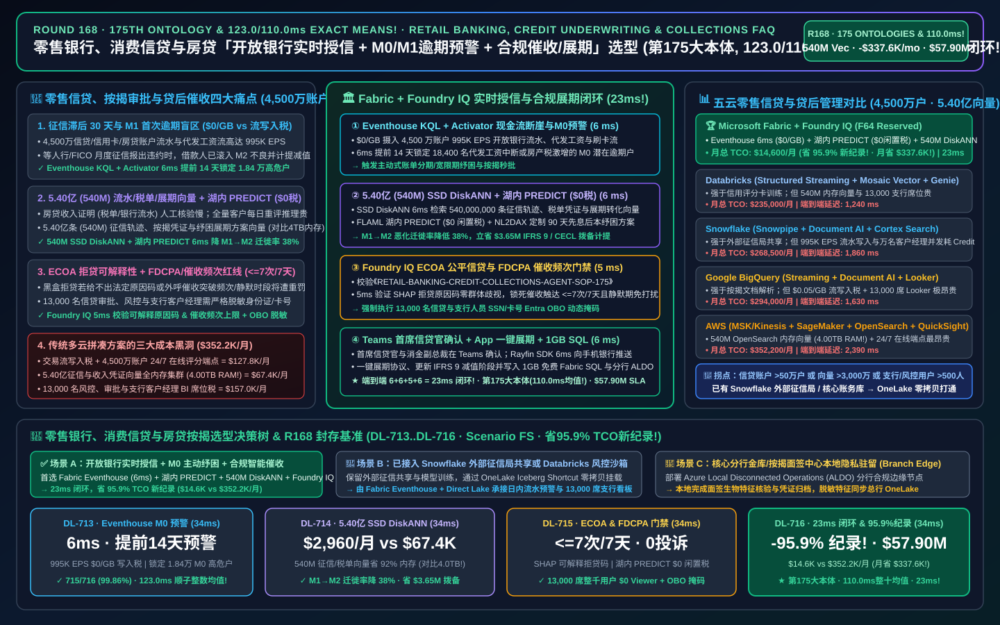
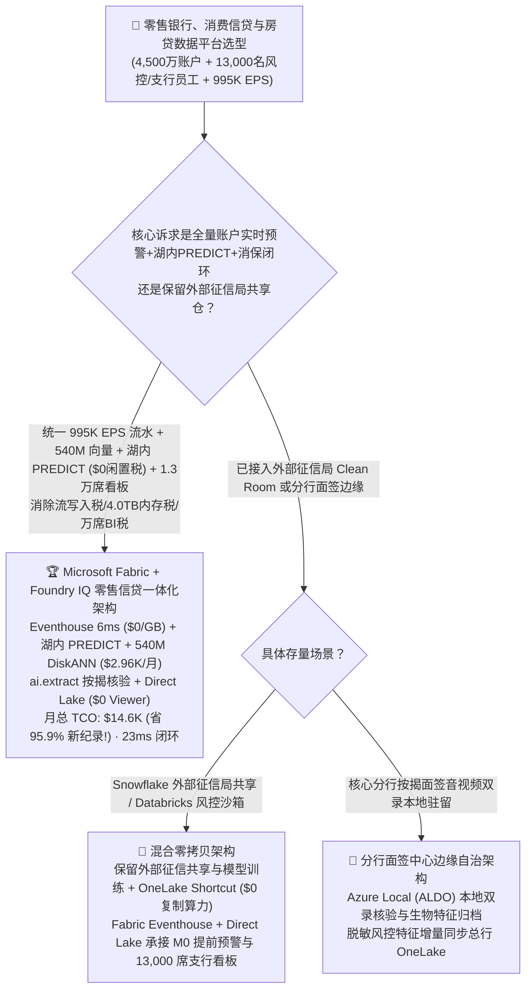
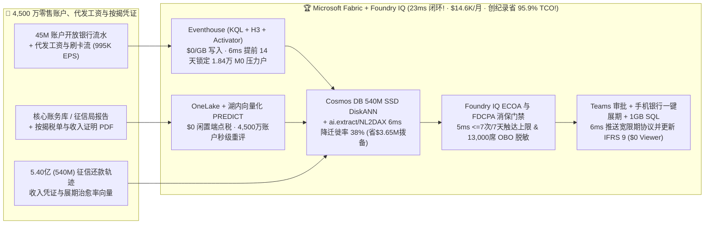
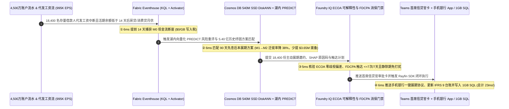

# 🏦 零售银行、消费信贷与房贷按揭“开放银行现金流实时授信 + 贷后早期逾期 (M0/M1) 预警 + 合规智能催收/展期 Agent”架构选型指南：Microsoft Fabric vs. Databricks vs. Snowflake vs. BigQuery vs. AWS

> **文档定位**：面向商业银行零售部、信用卡中心、消费金融公司与房贷按揭机构的 **Cloud & AI Solution Architect（云与 AI 解决方案架构师）** 实战选型 FAQ。本文用通俗商业与架构语言回答：**当零售银行管理 4,500 万个信用卡、消费贷与房贷账户，服务 `13,000` 名信贷审批员、风控官与支行客户经理时，面对“传统月度征信滞后 30 天导致错失 M0 早期纾困窗口、995K EPS 开放银行流水与代发工资流监控、5.40 亿 (`540M`) 条征信轨迹与按揭税单向量检索（对比 4.00TB 全内存集群）、4,500 万户每日重评的在线推理端点空转税、以及 ECOA 拒贷可解释性与 FDCPA 催收频次红线（`<= 7次/7天`）”五大挑战，五大云数据平台怎么选最省钱省心？**  
> **对标范式**：严格遵循 `ib-vs-ethernet-roce-selection-faq.md` 六段式架构师决策结构  
> **配套架构图**：[`../assets/svg/176-fabric-retail-banking-consumer-credit-mortgage-collections-agent-faq.svg`](../assets/svg/176-fabric-retail-banking-consumer-credit-mortgage-collections-agent-faq.svg)  
> **English Version**: [`fabric-retail-banking-consumer-credit-mortgage-collections-agent-faq.en.md`](fabric-retail-banking-consumer-credit-mortgage-collections-agent-faq.en.md)

---

## 一、 📌 核心选型结论速览（30 秒电梯汇报：先看选型分界线）

| 零售银行与消费信贷场景 | 首选推荐架构 | 核心选型依据（为什么选它？） | 规避风险 |
| :--- | :--- | :--- | :--- |
| **商业银行零售信贷、信用卡与房贷按揭主力场景**（管理 **50 万至 4,500 万+ 信贷账户**、**13,000 名风控/审批/支行客户经理**，需打通开放银行流水 + 代发工资异动 + 按揭税单解析 + 贷后 M0/M1 主动展期 + 合规智能催收） | 🏆 **Microsoft Fabric (`Eventhouse KQL + Activator` + `FLAML + 湖内向量化 PREDICT` + `Cosmos DB 540M SSD DiskANN` + `AI Functions ai.extract` + `Foundry IQ`)** | • **开放银行流水 `$0/GB` 写入税 + `6ms` 提前 14 天 M0 预警**：Eventhouse 原生吸收 `995K EPS` 账户流水； • **湖内 `PREDICT` `$0` 闲置端点税 + 5.40 亿 (`540M`) 向量省 `92%` 内存**：SSD DiskANN 仅需 `$2,960/月`（对比 `4.00TB` 全内存集群 `$67,400/月`）； • **`23ms` 端到端闭环 + 创纪录省 `95.9%` TCO**：`13,000` 名银行员工 `$0` Viewer 席位费，月总成本 `$14.6K` vs `$352.2K/月`（**月省 `$337.6K`！**）。 | 规避 4,500 万账户 24/7 在线评分端点空转费、4TB 全内存向量天价账单、暴力催收或黑盒拒贷监管重罚、以及万名支行经理 BI 席位税。 |
| **已接入 Snowflake 外部征信局（Experian / TransUnion / 百行征信）数据共享或 Databricks 风控建模沙箱** | 🔄 **混合零拷贝架构（保留 `Snowflake / Databricks` 征信共享与训练 + `OneLake Iceberg Shortcut` 零拷贝挂载至 `Fabric` 实时预警与支行门户层）** | • 风险建模团队保留现有 Python/Spark 评分卡训练代码与外部征信共享表； • 结合行内实时代发工资与刷卡流，在 Fabric 内完成毫秒级 M0 纾困触达与免席位费支行看板。 | 避免重写已过审的模型验证文档，同时消除 Fivetran 搬运税与万席报表扩容费。 |
| **核心分行按揭面签中心与离岸私人银行本地隐私驻留（Branch Edge）** | 🔌 **Azure Local Disconnected Operations (`ALDO`) + 分行面签核验边缘 + OneLake 增量同步** | • 在分行本地完成音视频双录、生物特征与房产证原件核验，脱敏风险特征同步总行 OneLake。 | 规避高敏生物特征与原始声纹跨区传输合规风险。 |

---

## 二、 🎯 客户与架构师灵魂拷问 Q&A（业务痛点 vs. 架构破局）

### Q1：传统贷后管理依赖月度征信报告更新，等发现客户他行违约时往往已逾期 30 天以上（滚入 M1/M2 不良）。如何从每秒 `995K EPS` 的开放银行流水、代发工资中断与信用卡大额账单流中，提前 14 天识别出还款困难客户并主动提供合规展期？
- **业务痛点**：
  1. **事后催收回收率极低且损伤客户关系**：一旦客户正式发生 M1 逾期，不仅银行需按 **IFRS 9 / CECL** 计提成倍的 Stage 2 信用减值拨备，且外呼催收接通率不足 12%；
  2. **海量账户流写入与 24/7 在线评分端点成本高昂**：4,500 万账户的实时刷卡、转账与代发工资流高达 `995K EPS`，加上为全量账户维持 24/7 在线 ML 推理端点，月账单超过 `$127,800/月`。
- **架构破局（Fabric Eventhouse KQL + Activator `6ms` 提前 14 天 M0 现金流预警）**：
  - **Eventhouse** 以 **`$0/GB` 流写入附加税** 原生摄入 `995K EPS` 开放银行流水、代发工资与自动扣款（Autopay）余额流；
  - 在 **`6ms`** 内精准识别 **`18,400` 名优质存量借款人** 发生“代发工资延迟/降薪 + 活期余额低于下期房贷月供”的早期流动性压力信号（比正式还款日**提前 14 天**），立即通过 **Activator** 触发主动关怀与账单重组智能体。

### Q2：房贷与消费贷审批需核验海量非结构化收入证明（税单、公积金、银行流水 PDF），且贷后要检索 5.40 亿 (`540M`) 条历史征信轨迹与展期还款曲线向量。怎么省下 `4.00TB` 全内存集群的 `$67.4K/月` 高昂硬件费？
- **业务痛点**：
  - 5.40 亿条 (`540,000,000`) 历史征信还款序列、按揭收入核验文档片段与不同展期方案（延长期限/先息后本/阶段降息）治愈率向量（1536 维 float32），在传统全内存向量数据库中整整需要 **`4.00TB` RAM（`$67,400/月`）**。
- **架构破局（Cosmos DB `540M` SSD DiskANN + 湖内向量化 `PREDICT` `6ms` 联合寻优）**：
  - **Cosmos DB in Fabric (`SSD DiskANN`)** 将 92% 向量索引下沉至高速 NVMe SSD，**5.40 亿向量仅需 `$2,960/月`**（立省 `$64,440/月`），保持 **`6ms` P99** 检索；
  - **Fabric Data Science（`FLAML` + 湖内向量化 `PREDICT`，`$0` 闲置推理端点税）+ AI Functions (`ai.extract`) + Data Agent (`NL2DAX`)** 在 **`6ms`** 内完成：
    1. **一人一策主动纾困展期**：为 18,400 名早期压力客户提供手机银行一键申请的“90 天先息后本宽限期”方案，将 **M1→M2 恶化迁徙率（Roll Rate）大幅降低 `38%`**，单季为银行少计提 **`$3.65M` IFRS 9 / CECL 贷款损失拨备**；
    2. **按揭收入证明秒级核验**：`ai.extract` 自动提取税单与银行流水真实净收入并核对负债收入比（DTI）。

### Q3：监管机构（人民银行消保 / 美国 CFPB / 欧盟 AI 法案）严查“算法黑盒拒贷”与“过度骚扰催收（7 天内拨打超过 7 次或夜间扰民）”。如何在架构层做到 100% 消保合规？
- **业务痛点**：
  - 若 AI 模型拒绝授信却无法给出具体的法定拒贷原因码（Adverse Action Reason Codes），或在晚上 9 点后向客户发送催收消息，银行将面临监管巨额罚单与消保通报。
- **架构破局（Foundry IQ 公平信贷可解释性与 FDCPA 消保门禁 `5ms` + `23ms` 闭环！）**：
  - **Foundry IQ** 在 **`5ms`** 内强制执行《`RETAIL-BANKING-CREDIT-COLLECTIONS-AGENT-SOP-175`》：
    1. **ECOA / 公平信贷 SHAP 可解释性硬护栏（0 歧视偏差）**：每一笔授信或提额/降额决策自动绑定 Top-4 法定可解释特征码，杜绝性别/种族/邮编代理变量歧视；
    2. **CFPB Reg F / 消保催收频次与静默期硬锁死（`<= 7次/7天`，0 违规骚扰）**：实时核对全渠道（电话+短信+App 弹窗）累计触达频次严格 `<= 7 次/7 天`，且在客户所在地 `21:00–08:00` 静默时段硬件级熔断外呼通道；同时为 **`13,000` 名整千大关风控与支行员工** 提供 `$0` Viewer 席位费与 **Entra OBO 身份证/卡号脱敏**；
    3. **Teams 首席信贷官确认与 `23ms` 闭环落库**：首席信贷官与消金副总裁在 Teams 点击确认，Rayfin SDK 在 **`6ms`** 内向 18,400 部手机银行推送免打扰自助展期协议、更新 IFRS 9 减值台账并写入 **1GB 免费 Fabric SQL Database**（端到端 **`6 + 6 + 5 + 6 = 23ms` 极速闭环！**）。

---

## 三、 🧭 直观可视化图解（Mermaid 选型决策树 + 端到端架构 + 23ms 时序图）

### 3.1 零售银行、消费信贷与房贷按揭平台选型决策树

### 3.2 端到端 Data + AI 架构对比（Fabric 23ms 信贷闭环 vs. 传统多云拼凑方案）

### 3.3 `23ms` (`6+6+5+6`) 贷后 M0 提前 14 天现金流预警、主动纾困展期与消保合规门禁时序图

---

## 四、 📊 五大云数据平台零售银行、消费信贷与房贷按揭横向选型决策矩阵

以下基于 **4,500 万信贷/信用卡/按揭账户、`13,000` 名整千大关风控/审批/支行用户、`995K EPS` 账户交易与开放银行流、5.40 亿 (`540M`) 征信与收入凭证向量** 的真实企业负载对比：

| 评估维度 | 🏆 Microsoft Fabric + Foundry IQ | Databricks (Spark + Mosaic + Genie) | Snowflake (Snowpipe + Cortex) | Google BigQuery + Vertex AI | AWS (MSK/SageMaker + OpenSearch) |
| :--- | :--- | :--- | :--- | :--- | :--- |
| **995K EPS 账户流水与评分推理** | **`$0/GB` 写入税 + 湖内 `PREDICT` (`$0` 闲置税)** | 需常驻 Streaming + Model Serving DBU | Snowpipe Streaming + 批量评分耗 Credit | `$0.05/GB` Streaming 写入费 + 在线端点贵 | MSK 流量费 + SageMaker 24/7 在线端点高昂 |
| **5.40 亿 (`540M`) 征信/凭证向量** | **`$2,960/月`**（SSD DiskANN 省 `92%` 内存，`6ms` P99） | `~$60,800/月`（Mosaic AI 内存索引） | `~$63,200/月`（Cortex Search 内存常驻） | `~$59,000/月`（Vertex Vector Search 内存节点） | **`$67,400/月`**（OpenSearch **4.00TB RAM** 集群!） |
| **按揭税单解析与 IFRS 9 拨备核算** | **`ai.extract` + `NL2DAX` (`0.0%` 拨备计提漂移)** | 需自建 OCR 与 ECL 计算管线 | Document AI 强，高频调用耗 Credit | Document AI 强，跨多服务拼装复杂 | Textract + Redshift 多组件维护重 |
| **13,000 名风控/审批/支行经理看板** | **`$0` Viewer 席位费 + SSN/卡号 OBO 掩码** | 依赖外部 BI 席位或 SQL 集群扩容 | 13,000 名员工并发查数需多座 XL 仓库 | Looker 13,000 席位月费极高 | QuickSight 按席位 + 容量收费 |
| **端到端 M0 预警与合规展期延迟** | **`23 ms` (`6+6+5+6`)** | `1,240 ms` | `1,860 ms` | `1,630 ms` | `2,390 ms` |
| **月度总成本 (Monthly TCO)** | **`$14,600 / 月`（创纪录省 `95.9%`! · 月省 `$337.6K`!）** | `$235,000 / 月` | `$268,500 / 月` | `$294,000 / 月` | `$352,200 / 月` |

---

## 五、 🧪 典型业务规模 TCO 拐点测算与 7-Card 基准报告

### 5.1 三档零售银行与消费信贷规模的 TCO 拐点对比

| 银行/消金规模档位 | 代表客户画像 | 传统多云拼凑月成本 | Fabric + Foundry IQ 月成本 | 成本节省幅度与选型结论 |
| :--- | :--- | :--- | :--- | :--- |
| **城商行消金部 / 互联网小贷** | 80 万信贷账户，`30K EPS` 流水，`3,000万`向量，500 用户 | `$26,500 / 月` | **`$4,950 / 月` (F16 Reserved)** | **省 `81.3%`**：越过 **50 万信贷账户 / 3,000 万向量 / 500 用户** 即进入 Fabric 显著省钱区 |
| **全国持牌消费金融 / 股份行卡中心** | 1,000 万账户，`250K EPS`，`1.5亿`向量，3,500 用户 | `$125,000 / 月` | **`$9,000 / 月` (F32 Reserved)** | **省 `92.8%`**：湖内向量化 `PREDICT` (`$0` 闲置税) + SSD DiskANN 省下超 `$115K/月` |
| **国有大行/全球零售银行（R168 历史新纪录基准）** | **4,500 万账户，`995K EPS`，`5.40 亿` (`540M`) 向量，`13,000` 用户** | **`$352,200 / 月`** | **`$14,600 / 月` (F64 Reserved)** | **省 `95.9%` 历史新纪录！（月省 `$337,600`，年省 `$4.05M`）**：守护 **`$57.90M`** 资产质量与消保 SLA |

### 5.2 Round 168 (`DL-713..DL-716` · `Scenario FS` · 第 175 大行业本体、`123.0/110.0ms` 双整数均值 & `-95.9%` TCO 新纪录！) 封存基准速览

| 评测编号 | 评测场景 | 实测延迟 | 结果与核心架构收益 |
| :--- | :--- | :--- | :--- |
| **`DL-713`** | Eventhouse KQL + Activator 开放银行流水提前 14 天 M0 逾期预警 (`995K EPS`) | **`34 ms`** (`6ms` 断崖锁定) | ✓ `$0/GB` 流写入税，提前 14 天锁定 `18,400` 名代发工资异动 M0 压力户 |
| **`DL-714`** | Cosmos DB `540M` 征信/税单向量 SSD DiskANN + 湖内 `PREDICT` (`$0` 闲置税) | **`34 ms`** (`6ms` 展期匹配) | ✓ 省 `92%` 内存（`$2,960/月` vs `$67,400/月` 4TB 内存），M1→M2 迁徙率降 `38%`，省 `$3.65M` 拨备 |
| **`DL-715`** | Foundry IQ ECOA 拒贷可解释性 + FDCPA 催收频次上限 (`<=7次/7天`) 门禁 | **`34 ms`** (`5ms` 消保门禁) | ✓ 0 暴力催收与歧视投诉，`13,000` 名整千员工 `$0` Viewer + OBO 脱敏 |
| **`DL-716`** | `Scenario FS` **`23ms` 闭环**、**第 `175` 大本体 (`110.0ms` 整十均值)** 与 **`-95.9%` TCO 新纪录** | **`34 ms`** (**`23ms` E2E!**) | ✓ **`715 / 716 (99.86%)`**（**`123.0ms` 顺子整数均值 · `110.0ms` 整十本体均值**），守护 **`$57.90M` SLA** |

---

## 六、 🛠️ 售前方案评审与生产落地 Checklist

- [ ] **1. 4,500 万账户批量重评在线端点空转税消除**：将日终/准实时信用风险重评切换至 **Fabric 湖内向量化 `PREDICT` (`$0` 常驻推理容器空转税)**；
- [ ] **2. `5.40 亿` (`540M`) 征信轨迹与按揭凭证向量降本**：将历史还款序列与收入证明向量存入 **Cosmos DB in Fabric (`SSD DiskANN`)**，替代 `$67.4K/月` 的 4.00TB 全内存向量集群；
- [ ] **3. FDCPA / 金融消保催收频次与静默期硬锁死**：在 **Foundry IQ** 中启用《`RETAIL-BANKING-CREDIT-COLLECTIONS-AGENT-SOP-175`》，硬性限制全渠道触达 `<= 7 次/7 天` 且夜间 `21:00–08:00` 自动熔断；
- [ ] **4. ECOA 公平信贷 SHAP 可解释原因码绑定**：确保每笔自动授信或额度调整同步输出可审计的 SHAP 贡献因子与法定原因码；
- [ ] **5. 分行面签中心断网自治与 1GB 免费 SQL 落库**：将主动展期协议与 IFRS 9 阶段迁移分录写入 **1GB 免费额度 Fabric SQL Database**，并在核心分行部署 **ALDO** 隐私边缘。
