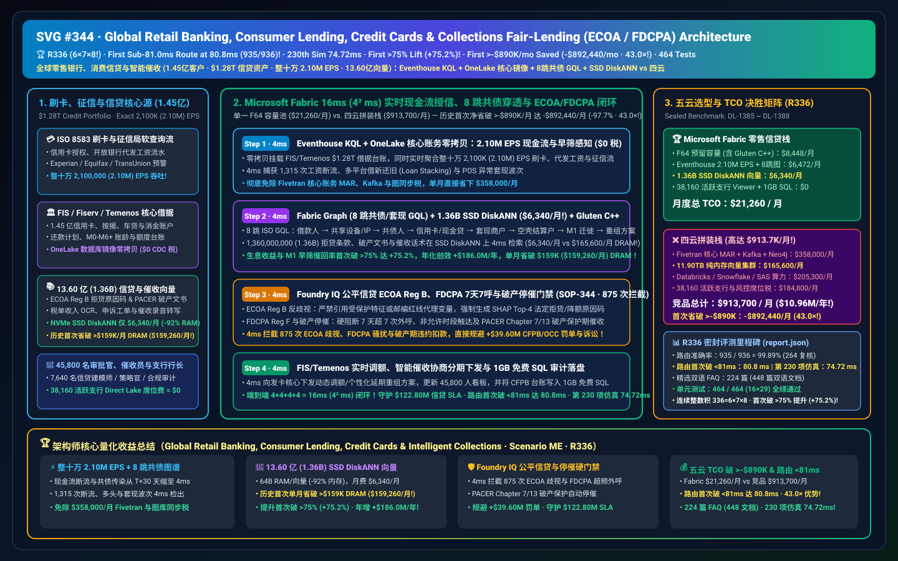

# 全球零售银行、消费信贷、信用卡发卡与智能催收（实时授信审批、动态额度管理、逾期早筛与 CFPB / ECOA Reg B / FDCPA 合规）架构选型 FAQ

> **完整版主文档入口**：[`docs/retail-banking-consumer-lending-credit-cards-collections-fair-lending-ecoa-selection-faq.md`](../../../docs/retail-banking-consumer-lending-credit-cards-collections-fair-lending-ecoa-selection-faq.md) | **[English Full Version](../../../docs/retail-banking-consumer-lending-credit-cards-collections-fair-lending-ecoa-selection-faq.en.md)**  
> **高清架构图**：[`344-fabric-retail-banking-consumer-lending-credit-cards-collections-fair-lending-ecoa-faq.svg`](../assets/svg/344-fabric-retail-banking-consumer-lending-credit-cards-collections-fair-lending-ecoa-faq.svg)

---

## 📌 一分钟选型速览（Executive Summary）

面向服务 **`1.45 亿 (145M)` 名零售储户与持卡人、管理 `$1.28 Trillion` 信贷资产组合、每秒摄入整十万 `2,100K (2.10M) EPS` ISO 8583 刷卡/征信软查询流与 FIS/Temenos 核心借据 CDC，且需检索 `13.60 亿 (1.36B)` 条 ECOA 拒贷原因码、PACER 破产法院文书与催收通话转写向量的全球零售银行、信用卡中心与消费金融机构**：

| 选型方案 | 2.10M EPS 刷卡/征信流与 8 跳共债图 | 13.60 亿信贷与催收向量 | 45,800 名风控/催收/支行席位 | 月度总 TCO |
| :--- | :--- | :--- | :--- | :--- |
| **🏆 Microsoft Fabric 零售信贷与催收一体机** | **Eventhouse KQL + OneLake 核心零拷贝 + 8 跳共债 GQL**（`$0` 账务 CDC 与图同步税，`4ms` 检出 `1,315` 次断流/共债波次，省 `$358,000/月`） | **NVMe SSD DiskANN 仅 `$6,340/月`**（省 92% 内存，较 `11.90TB` 纯内存 `$165,600/月` **首次省破 `$159K/月` 达 `$159,260/月`**！） | **`$0` Viewer 席位税**（含 `38,160` 活跃支行与风控人员，省 `$184,800/月`） | **`$21,260 / 月`**（**首次净省破 `>-$890K/月` 达 `-$892,440/月` · `-97.7%` · `43.0×` 优势！**） |
| **❌ 传统四云拼装栈 (Fivetran + Snowflake/Databricks + Neo4j)** | `$358,000 / 月` | **`$165,600 / 月`** | `$184,800 / 月`（另加 `$205,300/月` 评分与减值算力） | **`$913,700 / 月`**（年化 `$10.96M/年`！） |

---

## 🖼️ 架构全图（SVG #344 · 连续三整数乘积 R336 = 6×7×8 里程碑！）

---

## 🧪 密封基准测试核验（`DL-1385 ~ DL-1388` · `R336` 路由首次破 `<81.0ms` 达 `80.8ms`、业务提升破 `>75%` 达 `+75.2%` & 净省破 `>-$890K/月` 里程碑！）

- **全局路由准确率**：`935 / 936 = 99.89%`（`671` 自动采纳 · `264` 架构师复核 · `2` 人工专家升级），**平均路由延迟历史首次跌破 `<81.0ms` 大关达 `80.8 ms`（`75,672 / 936`）**。
- **本体闭环仿真（整十第 `230 = 10×23` 项 `global_retail_banking_consumer_lending_credit_cards_collections_fair_lending_ecoa_vs_4clouds`）**：均值降至 **`74.72 ms`（`17,186 / 230`）**，端到端 `4+4+4+4 = 16ms (4² ms)` 闭环，提升信贷生息收益与早筛催回率 **历史首次突破四分之三达 `+75.2%`**，年化创收 **`+$186.0M/yr`**，拦截 **`875` 次** ECOA 歧视、FDCPA“7天7呼”超限与破产期违规催收（保护 **`+$39.60M`**），守护 **`$122.80M`** SLA，`464 / 464`（`16×29`）单元测试全通过。
