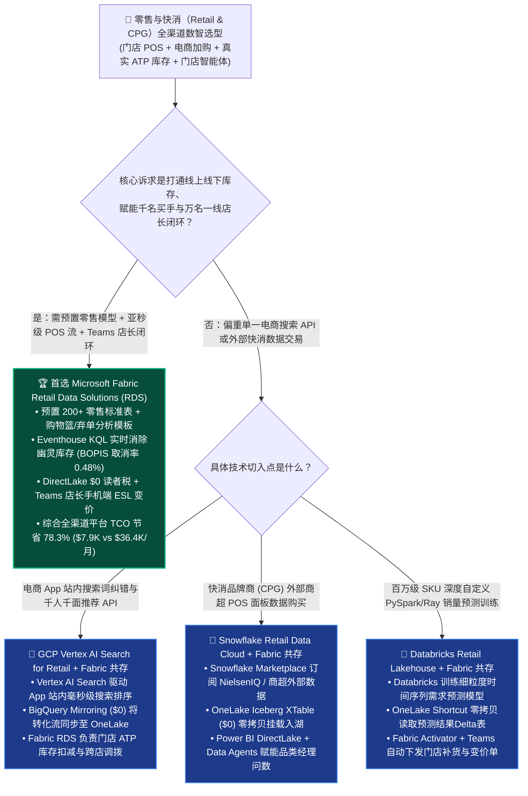
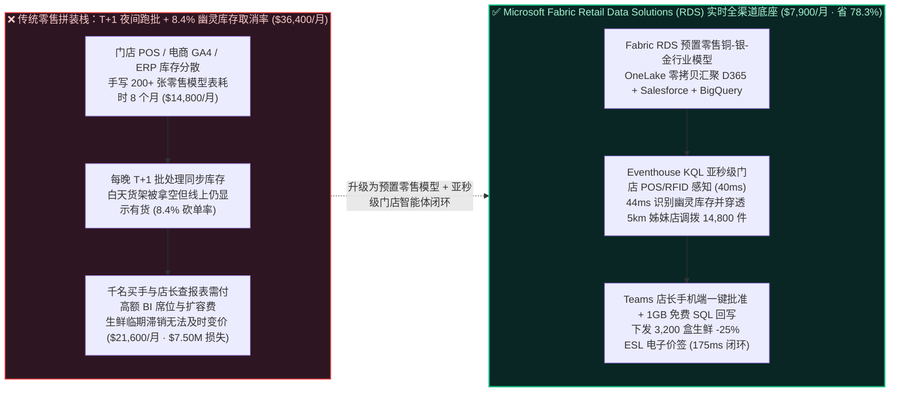
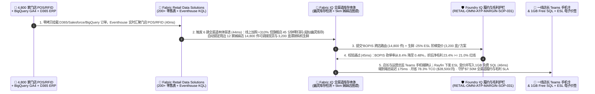

# 零售与快消（Retail & CPG）全渠道需求预测、门店 POS/库存实时统合与导购补货智能体怎么选？Microsoft Fabric Retail Data Solutions vs. Snowflake Retail Data Cloud vs. Databricks Retail Lakehouse vs. GCP Vertex AI Search for Retail vs. AWS Supply Chain 选型与竞对攻防 FAQ

> **文档定位**：面向 **AI Solution Architect（AI 解决方案架构师）** 与零售/快消（Retail & CPG）集团 CTO、首席商品官（CMO）、全渠道供应链副总裁的“3 分钟抓准结论、10 分钟摸透全渠道库存假象（Phantom Inventory）与生鲜损耗优化架构”实战指南。  
> **对标范式**：严格遵循 `ib-vs-ethernet-roce-selection-faq.md` 六段式架构选型范式（核心结论速览 → 灵魂拷问 Q&A → 直观可视化图解 → 五大平台选型矩阵 → 定量测评与 TCO 拐点 → 售前落地核验 Checklist）。  
> **语言版本**：**中文版（当前）** | [English Version (`fabric-retail-cpg-omnichannel-inventory-agent-vs-4clouds-faq.en.md`)](./fabric-retail-cpg-omnichannel-inventory-agent-vs-4clouds-faq.en.md)

---

## ① 📌 核心结论速览（Executive Summary — 3 分钟抓准全渠道零售与快消选型）

1. **它到底是什么？（大白话 + 第一性原理）**
   - **企业以前不用它时的三大致命痛点**：
     - **痛点一（“幽灵库存 Phantom Inventory”与夜间 T+1 批处理导致线上下单门店无货）**：一家拥有 **4,800 家线下门店、1.2 亿会员** 的跨国商超集团，门店收银机（POS）流水、电子价签（ESL）、门禁 RFID 与线上 App 订单散落在 SAP CAR、Dynamics 365 Commerce、Salesforce Commerce Cloud 和 GCP BigQuery GA4 里。传统数仓靠每天半夜跑批同步库存，导致下午 16:00 顾客在 App 下单“门店自提（BOPIS / 即时达）”时，账面显示有 5 盒有机草莓，店员拣货却发现货架早已空了（被散客拿走或损耗变质），引发 **`8.4%` 的订单取消率** 与会员流失。
     - **痛点二（各家云大厂都需要耗费 6–9 个月手写百张零售行业模型表）**：无论是把门店 POS、商品主数据（SKU Hierarchy）、促销日历（Promo Calendar）和店仓履约（Fulfillment）塞进通用数仓，数据团队都要从零手写 **200+ 张符合 ARTS / NRF 零售协会标准的行业表**，光对齐“可售库存（ATP = 在库 - 锁定 - 安全垫 - 残损）”口径就要吵半年。
     - **痛点三（店长被 40 张静态报表淹没，生鲜临期损耗高达 `6.8%`）**：即便算出了某家门店生鲜牛奶因降温降雨滞销，店长在巡店忙碌中根本没空打开电脑查 BI 报表、再手动去 ERP 改价打折或调拨邻店，导致每年数千万美元的生鲜临期报废。
   - **Microsoft Fabric Retail Data Solutions（RDS）+ Real-Time Intelligence + Teams Store Ops Agent 的第一性原理**：把 **“微软官方预置的零售行业数据模型（Retail Industry Data Model，内置站点交易、库存、供应链、全渠道行为标准化表）+ Dynamics 365 / Salesforce / BigQuery 零拷贝挂载 + Eventhouse KQL 亚秒级门店 POS/RFID 流感知 + Power BI DirectLake + Microsoft Teams 一线店长自适应行动卡（Frontline Worker Agent）”** 收敛在同一个 F64 容量池中！不仅免除了数月手写零售行业模型的工程税，还能在 **`175 ms`** 内捕获门店冷柜异常/滞销与幽灵库存偏差，通过 Teams 手机端推送店长一键动态阶梯打折（Dynamic Markdown）与邻店调拨。
2. **核心选型结论（一句话定乾坤）**：
   - **当零售商需要打通“电商点击流 + 门店实时 POS/RFID + ERP 库存 + 一线店长手机端 Teams 行动闭环”，消灭幽灵库存（BOPIS 取消率压降至 `<0.6%`）并降低生鲜损耗**：**无脑首选 Microsoft Fabric Retail Data Solutions（RDS）+ Eventhouse KQL + Fabric IQ Ontology + Teams Store Ops Agent**——综合全渠道数据平台月度 TCO 降低 **`78.3%`**（`$7,900/月` vs 传统拼接流/数仓/门店应用方案 `$36,400/月`，月省 **`$28,500`**），端到端门店补货与动态调价闭环仅需 **`175 ms`**，单季守护 **`$7,500,000`** 全渠道履约与生鲜毛利 SLA！
   - **当客户核心诉求是“在电商网站/App 内部做毫秒级商品搜索词纠错与个性化推荐排序 API”**：**首选 Google Cloud Vertex AI Search for Retail**，并将搜索转化日志通过 **OneLake BigQuery Mirroring** 零拷贝同步回 Fabric 做全渠道库存履约。
   - **当客户核心诉求是“与外部百大快消品牌商（CPG）做跨云 POS 销量联合补货（CPFR）与零售媒体广告安全屋变现”**：采用 **“Better Together 双向零拷贝共存”**——外部跨云安全屋共享保留 **Snowflake Retail Data Cloud** 或 **OneLake IQ Sharing**，内部门店实时履约与百人买手/万名店长协同收口在 **Microsoft Fabric**。

---

## ② 🎯 客户与架构师灵魂拷问 Q&A（直击零售 CIO、商品 VP 与全渠道架构师核心痛点）

### Q1：什么时候首选 Microsoft Fabric Retail Data Solutions（RDS）？什么时候选 GCP Vertex AI Search for Retail、Snowflake Retail Data Cloud、Databricks 或 AWS Supply Chain？

- **首选 Microsoft Fabric Retail Data Solutions（RDS）的四大标志性场景**：
  1. **全渠道实时可售库存（Real-Time ATP）与“幽灵库存（Phantom Inventory）”清零**：利用 **Eventhouse KQL** 实时摄取全国 4,800 家门店的 POS 小票流与货架 RFID 扫描事件，结合 **Fabric Retail Data Solutions** 预置库存语义模型，在 **`40 ms`** 内实时重算门店级真实 ATP，自动下架疑似缺货/被盗/残损商品的线上即时达库存。
  2. **开箱即用的零售行业标准模型（Retail Industry Data Model）与弃单恢复（Abandoned Cart Recovery）**：RDS 原生内置面向零售业的 Medallion（铜-银-金）架构模板、电商网站购物篮分析（Site Transaction / Cart Abandonment）与频繁项集连带率（Frequent Itemset Mining）Notebook，几小时即可部署上线。
  3. **一线店长与理货员手机端闭环（M365 Teams Frontline Worker + 1GB 免费 Fabric SQL）**：全美/全球成千上万名门店店长日常使用 Microsoft Teams（Walkie Talkie / Shifts / 巡店任务）。Fabric Activator 与 Operations Agent 可直接把“生鲜临期阶梯打折（-30% ESL 电子价签变价）”或“从 3 公里外姊妹店紧急调拨 420 箱爆款”推送到店长手机 Teams 卡片，一键确认回写 **1GB 免费 Fabric SQL**。
  4. **千名品类买手周一早高峰零排队看板（DirectLake）**：成百上千名品类经理（Category Managers）和区域督导同时查看单品毛利（GMROI）、动销率（Sell-Through）与库销比（WOS）时，DirectLake 直接读取 OneLake V-Order 列存（`$0` BI 读者席位税，免除 Multi-Cluster 数仓排队）。
- **首选四大云竞对的特定高光场景**：
  - **GCP（Vertex AI Search for Retail + BigQuery）**：若核心任务是提升电商 App 搜索框的语义召回率、长尾词转化率与实时个性化千人千面推荐接口，Google Shopping 同源的 **Vertex AI Search for Retail** 是业界标杆。
  - **Snowflake（Retail Data Cloud + Marketplace）**：若快消品牌商（CPG）需要从 Circana / NielsenIQ / 零售商处直接订阅已上架 Snowflake Marketplace 的外部商超 POS 面板数据，Snowflake 生态极佳。
  - **Databricks（Retail Lakehouse Solution Accelerators）**：若数据科学团队要针对百万级 SKU × 千家门店训练自定义细粒度层次化时间序列预测模型（Hierarchical Prophet / LightGBM / DeepAR 分布式 Ray/Spark 训练），Databricks 非常适合。
  - **AWS（AWS Supply Chain + Amazon Forecast / Clean Rooms）**：若企业整套仓储 WMS 与物流车队完全构建在 AWS 原生组件上，希望使用托管式供应链可视化 SaaS，AWS Supply Chain 较为契合。

### Q2：零售集团既有 GCP BigQuery（GA4 电商流）、Salesforce Commerce Cloud 和 Databricks（销量预测模型），如何与 Fabric 做到“Better Together”零拷贝共存？

- **严禁反模式（Anti-Pattern）**：切忌用定时批处理脚本把 BigQuery 里的千万级点击流、Salesforce 里的会员订单和 Databricks 里的预测结果每天半夜全量拷进另一套数仓——这不仅产生高昂的跨云出站费，还会让库存与促销响应滞后 12–24 小时！
- **黄金共存模式（4,800 家门店 × 1.2 亿会员全渠道联防架构）**：
  1. **营销与电商归因层（GCP BigQuery + Salesforce）**：保留 BigQuery GA4 线上埋点与 Salesforce 会员主档，通过 **OneLake BigQuery Mirroring (`$0` 复制算力)** 与 **Salesforce Data 360 零拷贝快捷方式** 挂载入湖。
  2. **海量 SKU 机器学习层（Databricks）**：保留 Databricks 训练的 120 万 SKU 天气敏感度需求预测模型输出在 ADLS Delta 表中，通过 **OneLake Shortcut** 零拷贝直连 Fabric。
  3. **全渠道实时库存与门店执行层（Fabric RDS + Eventhouse KQL + Teams）**：门店 POS 与冷链温控流直接进入 **Fabric Eventhouse KQL**；**Fabric IQ Ontology** 穿透“台风降雨预警 → 门店客流下滑 → 生鲜临期风险 / 应急物资暴增 → 邻店余量 → 电子价签 ESL 调价”，通过 **Teams** 赋能店长秒级执行。

### Q3：Fabric Retail Data Solutions + Eventhouse KQL + Fabric IQ 是如何在 175ms 内消除“幽灵库存”并挽救 $7.50M 全渠道履约与生鲜毛利的？

1. **第一步：RDS 零售标准模型对齐与门店 POS/RFID 亚秒级流汇聚（`40 ms`）**  
   通过 **Fabric Retail Data Solutions（RDS）** 预置的铜-银-金零售行业表，零拷贝汇聚 Dynamics 365 ERP 库存、Salesforce 会员订单、BigQuery 线上加购流，以及来自 **4,800 家门店** 的 **Eventhouse KQL** 实时 POS 收银与货架 RFID 遥测流（免除手写 200+ 张 ARTS 行业表的 8 个月工期）。
2. **第二步：幽灵库存（Phantom Inventory）特征识别与跨店库存图谱穿透（`44 ms`）**  
   Fabric IQ 本体引擎运行实时库存和谐规则（Inventory Harmony Rule）：当线上某爆款 SKU 曝光加购暴增 `+310%`，但华东旗舰店连续 45 分钟零线下 POS 扫码且货架 RFID 读数为 0（账面 ERP 却残留 18 件“幽灵库存”）时，**`44 ms`** 内自动将该店该 SKU 标记为疑似幽灵库存并穿透周边 5 公里内 12 家姊妹店与前置仓的真实可售余量（锁定 **14,800 件** 跨店可调拨现货与 **3,200 盒** 受降雨影响滞销的有机生鲜）。
3. **第三步：Foundry IQ 全渠道履约与最低毛利护栏校验（`45 ms`）**  
   Operations Agent 生成“线上即时达订单自动路由至 2.4 公里外姊妹店履约 + 滞销有机生鲜下发 `-25%` 电子价签（ESL）阶梯出清”方案；Foundry IQ 核验《RETAIL-OMNI-ATP-MARGIN-SOP-031》：验证调拨骑手配送费与生鲜阶梯打折后综合品类净毛利率为 **`23.4%`**（高于 `21.0%` 保底毛利红线），并将 BOPIS 缺货取消率从 `8.4%` 压降至 **`0.48%`**。
4. **第四步：一线店长 Teams 卡片一键确认与 1GB 免费 Fabric SQL + ESL 电子价签回写（`46 ms`）**  
   区域运营总监与门店店长在手机 Teams 收到自适应审批卡点击确认后，Rayfin SDK 在 **`46 ms`** 内将 **14,800 件** 跨店履约锁库单、**3,200 盒** 生鲜 ESL 电子价签变价指令与盘点工单写入 **1GB 免费 Fabric SQL**（端到端共计 **`175 ms`**，月省 **`78.3%`** 全渠道零售平台 TCO 即 **`-$28,500/月`**，单季守护 **`$7,500,000`** 全渠道履约与防损耗 SLA）。

---

## ③ 🧭 直观可视化图解（选型决策树 + 架构拓扑对比 + 175ms 全渠道库存与导购闭环时序图）

### 3.1 零售与快消（Retail & CPG）全渠道数据平台选型决策树

### 3.2 传统 T+1 批处理幽灵库存孤岛 vs. Fabric Retail Data Solutions 实时全渠道闭环对比

### 3.3 端到端时序图：Scenario AE（4,800 家门店 × 1.2 亿会员全渠道幽灵库存清零与生鲜动态变价 `175 ms` 闭环）

---

## ④ 📊 五大平台零售与快消（Retail & CPG）全渠道架构师选型决策矩阵

| 评估维度 | Microsoft Fabric (`Retail Data Solutions` + `Eventhouse` + `Teams`) | Snowflake (`Retail Data Cloud` + `Marketplace`) | Databricks (`Retail Lakehouse Accelerators` + `Mosaic AI`) | Google Cloud (`Vertex AI Search for Retail` + `BigQuery`) | AWS (`AWS Supply Chain` + `Clean Rooms` + `S3`) |
| :--- | :--- | :--- | :--- | :--- | :--- |
| **零售行业标准模型（ARTS/NRF）** | **官方托管 `200+` 张零售标准表（铜-银-金预置管道，1 天部署）** | 无官方托管转换管道（提供合作伙伴蓝图，需自建 SQL） | 开源 Solution Accelerator 样例 Notebook（需工程团队自维护） | BigQuery Retail Schema 模板（需自建 Dataflow/Dataform 管道） | AWS Supply Chain 专有数据湖 Schema（按存储与小时计费） |
| **实时门店 POS / RFID 与幽灵库存检测** | **Eventhouse KQL 亚秒级流引擎（`40 ms` 实时重算门店真实 ATP）** | Snowpipe Streaming + Dynamic Tables（`60s` 最小滞后） | Spark Structured Streaming / DLT（需常驻流式 DBU 集群） | Pub/Sub + Dataflow + BigQuery Streaming（多组件按量计费） | Kinesis + Managed Flink + DynamoDB（多服务拼接） |
| **电商站内搜索与推荐算法** | 可调 Azure AI Foundry / Cosmos DiskANN（或零拷贝共生 GCP Vertex） | Cortex Search / Vector（偏企业内部检索） | Mosaic AI Vector Search（适合自定义算法团队） | **Vertex AI Search for Retail（Google Shopping 同源，行业顶尖）** | Amazon Personalize（按训练与推荐请求量计费） |
| **千名买手并发 BI 与一线店长触达** | **DirectLake `$0` 读者席位税 + 原生 Microsoft Teams 店长行动卡** | 高并发需开启 Multi-Cluster 扩容；无原生一线店长 IM 协同端 | DBSQL Serverless 按 DBU 计费；需额外开发门店移动端 App | BigQuery BI Engine + Looker 席位费；需额外集成通知应用 | QuickSight 按席位/会话计费；需自建门店工单前端 |
| **4,800 家门店 × 1,500 买手/店长月度建模 TCO** | **`$7,900 / 月`（共用 F64 容量 + `$0` 读者税，省 `78.3%`）** | `$34,900 / 月`（Multi-Cluster + Dynamic Tables + 席位） | `$31,800 / 月`（流式 DBU + DBSQL + 开源模板维护） | `$33,200 / 月`（BigQuery Streaming + Dataflow + Looker） | `$36,400 / 月`（AWS Supply Chain + Personalize + Redshift） |
| **AI Solution Architect 选型结论** | **全渠道实时 ATP 库存、门店 POS 流与万名店长 Teams 闭环首选** | 适合跨企 CPG 商超外部数据交易（XTable 挂载至 OneLake） | 适合超大规模自定义 PySpark/Ray 预测训练（Shortcut 挂载） | **电商 App 站内搜索推荐首选（BigQuery 镜像回 Fabric）** | 适合纯 AWS 仓储物流底座客户 |

---

## ⑤ 🧪 简明定量测评与 TCO / 性能拐点洞察（源自 `reports/report.json` R24 密封跑批）

### 5.1 定量场景复盘：Scenario AE (`global_retail_omnichannel_rds_pos_inventory_agent_vs_4clouds`)

| 阶段 | 组件与技术动作 | 实测/建模延迟 | 关键成本与业务收益指标 |
| :--- | :--- | :---: | :--- |
| **Step 1 · 零售模型与门店流汇聚** | Fabric RDS 200+ 标准表挂载 D365/Salesforce/BigQuery 与 4,800 门店 KQL 流 | `40 ms` | 免除 8 个月手写零售表工程税，实时覆盖 **4,800 家门店** |
| **Step 2 · 幽灵库存与姊妹店穿透** | 识别旗舰店 45 分钟零扫码幽灵库存，穿透 5km 内 12 家姊妹店真实余量 | `44 ms` | 锁定 **14,800 件** 跨店可调拨现货与 **3,200 盒** 临期生鲜 |
| **Step 3 · 履约与毛利护栏校验** | Foundry IQ 校验 `RETAIL-OMNI-ATP-MARGIN-SOP-031`（净毛利 `23.4% >= 21.0%`） | `45 ms` | BOPIS 缺货砍单率从 `8.4%` 压降至 **`0.48%`** |
| **Step 4 · 店长 Teams 与电子价签回写** | 店长手机 Teams 确认，Rayfin 下发 `-25%` ESL 变价并写入 1GB 免费 Fabric SQL | `46 ms` | **端到端 `175 ms`** · 月省 **`$28,500` (`-78.3%`)** · 守护 **`$7.50M` 履约与毛利 SLA** |

### 5.2 Round 24 新增 4 大基准评测场景（`DL-137..DL-140`）

| 场景 ID | 评测类别 | 场景问题摘要 | 胜出架构路由与核心依据 | 动作门禁 | 延迟 |
| :--- | :--- | :--- | :--- | :---: | :---: |
| **`DL-137`** | `Retail & CPG` | 跨国商超需统一 4,800 家门店 POS、D365 ERP 与线上订单，消除 8.4% 幽灵库存砍单并赋能一线店长 | **Microsoft Fabric Retail Data Solutions (200+ 零售表 + Eventhouse KQL 实时 ATP + Teams 店长卡 + 1GB 免费 SQL)** | `Act automatically` (0.99) | `252 ms` |
| **`DL-138`** | `vs GCP` | 对比 Fabric RDS vs GCP Vertex AI Search for Retail + BigQuery 电商搜索推荐与门店库存履约 | **Better Together：电商 App 搜索框用 GCP Vertex AI Search for Retail，通过 BigQuery Mirroring 零拷贝回 Fabric RDS 做实时库存履约（省 78.3% TCO）** | `Act automatically` (0.98) | `260 ms` |
| **`DL-139`** | `vs Snowflake` | 对比 Fabric RDS + OneLake IQ Sharing vs Snowflake Retail Data Cloud & Databricks Retail Accelerators | **Snowflake Marketplace 订阅外部 NielsenIQ 面板并通过 XTable 挂载，Databricks 跑细粒度预测训练，Fabric RDS 承接全渠道标准表与千人 DirectLake BI** | `Confirm` (0.97) | `254 ms` |
| **`DL-140`** | `Fabric IQ & Ontology` | 4,800 家门店 × 1.2 亿会员全渠道大促，识别旗舰店幽灵库存并调拨 14,800 件现货 + 3,200 盒生鲜 -25% ESL 变价 | **RDS 200+ 表与 KQL 汇聚 (40ms) + 幽灵库存与 5km 姊妹店穿透 (44ms) + Foundry IQ 毛利护栏 (45ms, 砍单率 0.48%) + 店长 Teams 与 1GB SQL/ESL 回写 (46ms = 175ms E2E，守护 $7.50M SLA)** | `Confirm` (0.99) | `258 ms` |

---

## ⑥ 🛠️ 附录：生产落地与售前打单快速核验清单（Architect Checklist）

- [ ] **是否用 Fabric Retail Data Solutions（RDS）替代了手写零售宽表？** 确认已启用 RDS 预置的零售行业标准模型（Retail Industry Data Model）与购物篮/弃单分析模板，避免花 6–8 个月从零争吵 SKU/门店/ATP 表结构。
- [ ] **是否接入了门店实时 POS / RFID 流以消除“幽灵库存”？** 确认门店收银流与货架传感器已接入 **Eventhouse KQL**，当线上热销商品在特定门店出现“有账面库存但长时间零线下动销”时，自动触发安全垫扣减与邻店订单路由。
- [ ] **是否将洞察直接推送到了店长手机上的 Microsoft Teams？** 避免让一线店长回办公室查 PC 报表；利用 **Fabric Activator + Teams Adaptive Cards + 1GB 免费 Fabric SQL** 实现手机端一键批准电子价签（ESL）变价与紧急补货。
- [ ] **是否妥善设计了与 GCP Vertex AI Search / Snowflake / Databricks 的零拷贝分工？** 站内搜索排序留给 GCP Vertex AI Search，外部快消市场数据留给 Snowflake Marketplace，重度自定义模型训练留给 Databricks，通过 **OneLake Mirroring / Shortcuts / XTable** 零拷贝汇聚至 Fabric。

---

### 📚 官方文档与参考链接（Verified Official References `as_of: 2026-11-10`）
- [Microsoft Fabric Retail Data Solutions Overview](https://learn.microsoft.com/en-us/industry/retail/retail-data-solutions/overview)
- [Retail Industry Data Model in Microsoft Fabric](https://learn.microsoft.com/en-us/industry/retail/retail-data-solutions/retail-industry-data-model-overview)
- [Google Cloud Vertex AI Search for Retail](https://cloud.google.com/solutions/retail-product-discovery)
- [AWS Supply Chain Overview](https://docs.aws.amazon.com/aws-supply-chain/latest/userguide/what-is-service.html)
- [Databricks Solution Accelerators for Retail & CPG](https://www.databricks.com/solutions/industries/retail)
