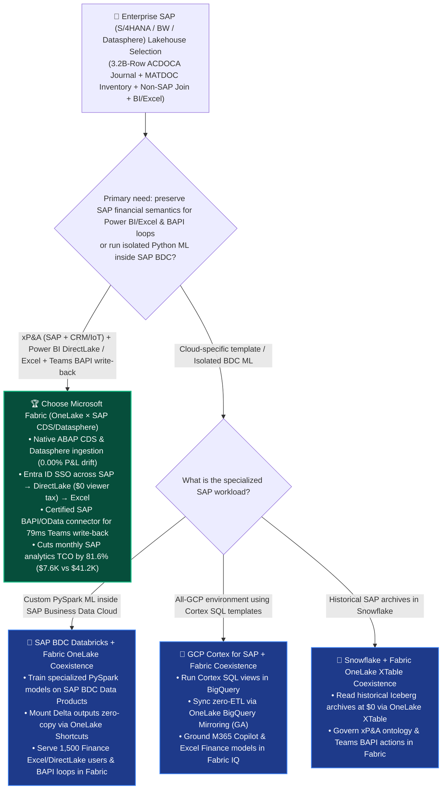
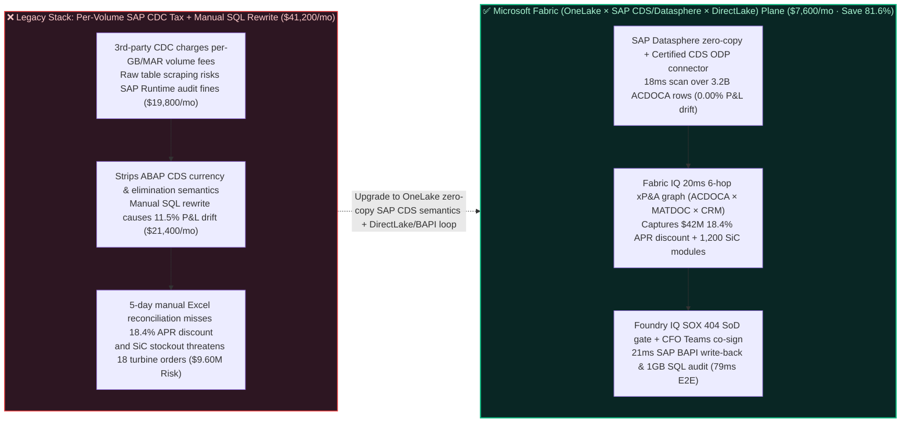

# How to Choose an SAP S/4HANA / BW / Datasphere Zero-Copy Lakehouse, Universal Journal (`ACDOCA`) Semantic Alignment & Working-Capital AI Closed-Loop Platform? Microsoft Fabric OneLake × SAP vs. Databricks vs. Snowflake vs. GCP Cortex for SAP vs. AWS Selection FAQ

> **Document Purpose**: A first-principles, plain-language decision guide for **AI Solution Architects**, CFOs, Principal SAP Basis/BW Architects, and Global Supply Chain VPs—designed to lock in the executive verdict in 3 minutes and master zero-copy SAP CDS / Datasphere ingestion, `ACDOCA` Universal Journal semantic preservation, and bidirectional Microsoft Teams + SAP BAPI working-capital automation in 10 minutes.  
> **Benchmark Standard**: Strictly follows the 6-part architecture FAQ standard of `ib-vs-ethernet-roce-selection-faq.md` (Executive Summary → Soul-Searching Q&A → Visual Diagrams → 5-Platform Decision Matrix → Quantitative Benchmark & TCO Inflection → Presales Architect Checklist).  
> **Language**: [中文版 (`fabric-sap-s4hana-datasphere-acdoca-zero-copy-vs-4clouds-faq.md`)](./fabric-sap-s4hana-datasphere-acdoca-zero-copy-vs-4clouds-faq.md) | **English Version (Current)**


---

## ① 📌 Executive Summary (3-Minute SAP Modernization & Cloud Lakehouse Verdict)

1. **What Is It in Plain Language & First Principles?**
   - **The 3 Fatal Pain Points Before Using It**:
     - **Pain Point 1 (Scraping Raw SAP Database Tables Violates SAP Runtime Licensing and Charges a `$41,200+/mo` Third-Party Extractor Tax)**: The financial and operational lifeblood of the Fortune 500 lives in SAP S/4HANA (`ACDOCA` Universal Journal with 500+ columns and billions of rows, `MATDOC` inventory ledger, `EKKO/EKPO` purchasing). Bypassing the SAP application layer to scrape underlying HANA tables directly violates SAP Runtime database license agreements, while legacy third-party CDC extractors charge steep per-GB / per-MAR volume taxes—burning `$41,200+/mo`!
     - **Pain Point 2 (Copying Raw Tables Strips Out Decades of ABAP Currency Conversion, Intercompany Elimination & Hierarchy Semantics—Causing `11.5%` P&L Drift)**: When data engineers dump raw `ACDOCA` and `MARA` tables into a cloud warehouse, the numbers never match the CFO's SAP Fiori `F0708` trial balance! Why? Because currency conversion rates (`TCURR`), fiscal-year variants, intercompany eliminations, and cost-center hierarchies live in the **ABAP CDS (Core Data Services)** layer. Re-coding 30 years of ABAP accounting rules in warehouse SQL takes 9 months and breaks on every SAP upgrade.
     - **Pain Point 3 (Analytics Live in Power BI / Excel, but Execution Requires Switching Back to SAP GUI `ME29N / FB02`)**: Even when a dashboard spots `$68M` in idle cash that could capture an `18.4% APR` early-payment dynamic discount—or flags a critical semiconductor stockout—executives cannot trigger a governed SAP BAPI write-back directly from Microsoft Teams.
   - **First-Principles Breakthrough of Microsoft Fabric (OneLake Zero-Copy × SAP Datasphere / CDS ODP × DirectLake × Entra ID SSO)**:
     - **Zero-Copy Semantic Preservation via SAP Datasphere & Certified ABAP CDS Connectors (`0.00%` Financial Drift)**: By mounting **SAP Datasphere / SAP Business Data Cloud (BDC)** zero-copy into **OneLake** or streaming **SAP ABAP CDS Views (ODP)** via Fabric's SAP-certified connector, enterprises ingest pre-governed financial views with intact currency conversions, hierarchies, and business descriptions at `$0` third-party per-GB extractor ransom!
     - **End-to-End Microsoft Entra ID SSO from SAP to Power BI DirectLake, Excel & Certified SAP BAPI Write-Back**: Over 90% of SAP finance teams live in **Microsoft Excel and Power BI**. Only **Microsoft Fabric** unifies **Entra ID Principal Propagation**, **Power BI DirectLake** (`$0` viewer seat tax on F64+), live **Excel PivotTables**, and **Power Automate / Logic Apps SAP-certified BAPI connectors** into a `79 ms` sense-reason-act loop!
2. **Core Selection Verdict (In One Sentence)**:
   - **When an enterprise needs to unify SAP S/4HANA, SAP BW, or SAP Datasphere financial (`ACDOCA`) and supply-chain (`MATDOC`) data with non-SAP CRM/IoT data, serve 1,000+ finance users in Power BI / Excel, and execute governed SAP BAPI actions from Microsoft Teams**: **Choose Microsoft Fabric (OneLake Zero-Copy + SAP CDS/Datasphere + DirectLake + Entra ID SSO)**—slashing monthly SAP analytics and integration TCO by **`81.6%`** (`$7,600/mo` vs. `$41,200/mo` for third-party per-volume CDC extractors + warehouse SQL rewrites + BI seats, saving **`$33,600/mo`**), completing `3.2B-row ACDOCA` working-capital optimization (`18.4% APR` dynamic discounting) and critical SiC chip allocation in **`79 ms`**, and protecting **`$9,600,000`** in quarterly working-capital yield and turbine delivery SLA!
   - **When the primary requirement is running custom Python ML kernels inside SAP Business Data Cloud (BDC) managed Databricks**: **Deploy "SAP BDC Databricks + Microsoft Fabric OneLake Coexistence"**, mounting BDC Delta Data Products zero-copy into OneLake for enterprise-wide Power BI DirectLake, Excel, and M365 Copilot / Teams execution.

---

## ② 🎯 Soul-Searching Architect Q&A (Addressing CFO, Principal SAP Architect & Supply Chain VP Pain Points)

### Q1: When should we standardize on Microsoft Fabric for SAP S/4HANA & Datasphere vs. Databricks (SAP BDC), Snowflake, GCP Cortex for SAP, or AWS Glue for SAP?

- **4 Signature Scenarios Where Microsoft Fabric Wins**:
  1. **Zero-Rewrite Financial Consolidation Preserving ABAP CDS Semantics (`0.00%` Trial Balance Drift)**: Ingest **SAP ABAP CDS Views** (`@Analytics.dataExtraction.enabled: true`) or **SAP Datasphere** spaces directly into OneLake Delta tables, preserving SAP currency translation, fiscal calendars, and intercompany eliminations out of the box.
  2. **Cross-Domain xP&A Ontology Joining SAP (`ACDOCA/MATDOC`) × Non-SAP (`Salesforce CRM` + `Eventhouse IoT`)**: Bind SAP general-ledger and purchase-order entities to live shop-floor telemetry and CRM pipelines in the **Fabric IQ Ontology** without moving data.
  3. **Finance-Native Excel & Power BI DirectLake Consumption at `$0` Viewer Seat Tax**: Finance teams refuse to give up Excel. Fabric Semantic Models support native live **Analyze in Excel** PivotTables and **Power BI DirectLake** (`$0` viewer seats on F64+), eliminating manual SAP `SE16N / ALV` spreadsheet exports.
  4. **Entra ID Principal Propagation & Certified SAP BAPI/OData Write-Back**: Propagate the user's Entra ID identity into SAP S/4HANA so approvals in **Microsoft Teams** invoke `BAPI_PO_CHANGE` or release payment blocks (`FB02`) under the executive's own SAP authorization profile (`S_RS_COMP` / `BUKRS`).
- **When Competitors Shine**:
  - **Databricks (`SAP Business Data Cloud / SAP Databricks`)**: Strong when a customer has already committed SAP BDC credits specifically for code-first PySpark ML over SAP Data Products—pair it with **OneLake Shortcuts** so business users consume results in Power BI DirectLake and Excel without paying double DBU/seat taxes.
  - **Google Cloud (`GCP Cortex Framework for SAP` + `BigQuery`)**: Useful pre-built SQL/dbt templates for all-GCP shops (requires replicating raw SAP tables into BigQuery and burning slot compute to rebuild views).
  - **Snowflake (`Snowflake Connector for SAP` / `Openflow`)**: Suitable for archiving historical SAP tables in existing Snowflake warehouses.
  - **AWS (`AWS Glue Zero-ETL / OData for SAP`)**: Suitable for basic S3 landing of OData feeds from RISE with SAP on AWS.

### Q2: If an enterprise runs RISE with SAP or subscribes to SAP Datasphere / SAP BDC, how does "Better Together" work with Microsoft Fabric?

- **Anti-Pattern to Avoid**: Never scrape underlying HANA database tables outside the SAP application layer, and never pay consulting armies to manually rewrite ABAP CDS accounting rules in proprietary warehouse SQL.
- **Golden Coexistence Pattern (Global Industrial Enterprise 12 SAP S/4HANA Instances × 3.2B `ACDOCA` Rows xP&A Architecture)**:
  1. **Semantic Extraction & Zero-Copy Federation (`SAP Datasphere / CDS ODP` → `OneLake`)**: Keep transactional integrity and ABAP CDS semantics in SAP while syncing delta changes or mounting Datasphere/BDC Data Products zero-copy into **OneLake**.
  2. **Cross-Domain Working-Capital & Supply-Chain Graph (`Fabric IQ` + `Spark Gluten`)**: Join SAP `ACDOCA` payables and `MATDOC` inventory with Salesforce order backlogs and logistics streams in **Fabric IQ**.
  3. **Excel / DirectLake Reporting & BAPI Action Loop (`Teams` + `Power Automate`)**: Deliver sub-second P&L and cash-flow dashboards to 1,500 finance users while routing working-capital actions through Teams to certified SAP BAPIs.

### Q3: How does Fabric (OneLake × SAP CDS/Datasphere × Fabric IQ) analyze 3.2B `ACDOCA` rows, capture an 18.4% APR early-payment discount, and lock critical SiC chip supply in 79ms?

1. **Step 1: Zero-Copy SAP S/4HANA `ACDOCA` & `MATDOC` CDS View Scan in OneLake (`18 ms`)**  
   Across 12 regional SAP S/4HANA instances (**3.2 billion `ACDOCA` Universal Journal rows** and **850 million `MATDOC` inventory rows**), **Fabric OneLake** ingests governed ABAP CDS views and SAP Datasphere shares at **`$0` third-party per-GB extractor tax**—detecting in **`18 ms`** (`0.00%` P&L drift) that Company Code `DE01` holds `$68M` in idle cash while Asian Silicon Carbide (SiC) power-module inventory dropped to `4.2 days` of supply.
2. **Step 2: Fabric IQ 6-Hop xP&A Ontology Traversal (`ACDOCA` ↔ `BSIK` AP ↔ `MATDOC` ↔ Salesforce Orders) (`20 ms`)**  
   Traversing a 6-hop cross-system **Fabric IQ Ontology** graph (`SAP_ACDOCA:CompanyCode_DE01_$68M_IdleCash → SAP_BSIK:340_Open_AP_Invoices_$42M → DynamicDiscount_Offer:2Pct_10Days_Net45_18.4Pct_APR → SAP_MATDOC:SiC_Module_Stock_4.2Days → Salesforce_Orders:18_HighMargin_Turbine_Contracts_$9.60M → Action:Release_EarlyPay_BAPI + Lock_Priority_Allocation`) in **`20 ms`**, the engine calculates that accelerating payment on **340 open AP invoices (`$42M`)** by 25 days captures a `2.0%` dynamic discount (**`$840K` risk-free gain = `18.4% APR`**) while securing priority allocation of **1,200 SiC power modules** needed for **18 high-margin wind-turbine orders (`$9.60M` SLA)**.
3. **Step 3: Foundry IQ SOX 404 Segregation-of-Duties & Liquidity Ratio Guardrail (`20 ms`)**  
   Operations Agent proposes releasing the `$42M` early-payment batch and locking the 1,200-unit SiC PO revision. Foundry IQ validates `SAP-ACDOCA-SOX404-WORKING-CAP-SOP-037` in **`20 ms`**, verifying that post-payment corporate Current Ratio remains **`1.68`** (`>= 1.35` floor), **SOX 404 Segregation of Duties (SoD)** is strictly enforced, and `ACDOCA` debit/credit balance equals `0.00`.
4. **Step 4: CFO & Supply Chain VP Dual Teams Approval & Certified SAP BAPI / 1GB SQL Commit (`21 ms`)**  
   The Group CFO and Supply Chain VP co-sign the Teams Adaptive Card; Rayfin invokes the certified **SAP ERP BAPI Connector** (`BAPI_ACC_DOCUMENT_POST` / `BAPI_PO_CHANGE`) via Entra ID Principal Propagation and logs the SOX 404 audit trail into **1GB Free Fabric SQL** in **`21 ms`** (**`79 ms` E2E**, saving **`81.6%`** monthly SAP analytics TCO or **`-$33,600/mo`**, and protecting **`$9,600,000`** in working-capital yield and turbine delivery SLA).

---

## ③ 🧭 Visual Diagrams (Selection Decision Tree + Architecture Comparison + 79ms SAP xP&A Sequence)

### 3.1 SAP S/4HANA / BW / Datasphere Cloud Lakehouse & xP&A Agent Decision Tree



### 3.2 Legacy Per-GB SAP CDC + Manual SQL Rewrite vs. Fabric OneLake Zero-Copy SAP CDS/Datasphere + BAPI Loop



### 3.3 End-to-End Sequence Diagram: Scenario AK (12 SAP S/4HANA Instances × 3.2B `ACDOCA` Rows Working-Capital & Supply Loop in `79 ms`)

```mermaid
sequenceDiagram
    autonumber
    participant SAP as 🏢 SAP S/4HANA & Datasphere<br/>(3.2B ACDOCA + MATDOC CDS Views)
    participant OneLake as ⚡ Fabric OneLake & DirectLake<br/>(Zero-Copy Semantics · $0 SLT Tax)
    participant Ont as 🧠 Fabric IQ xP&A Ontology<br/>(6-Hop GL-AP-Inventory-CRM Graph)
    participant Gov as 🛡️ Foundry IQ SOX 404 & Liquidity Gate<br/>(SAP-ACDOCA-SOX404-WORKING-CAP-SOP-037)
    participant Teams as 📱 CFO/VP Teams Card & SAP BAPI<br/>& 1GB Free SQL Audit Ledger

    SAP->>OneLake: 1. Mounts governed ABAP CDS financial & material views in 18ms (0.00% currency/elimination drift)
    OneLake->>Ont: 2. 6-hop traversal (20ms): links DE01 $68M idle cash + $42M AP invoices (18.4% APR discount) + 4.2d SiC stock
    Ont->>Gov: 3. Proposes releasing $42M early-pay batch (+$840K gain) + locking 1,200 SiC power modules
    Gov-->>Ont: 4. Verified (20ms): Post-pay Current Ratio = 1.68 (>= 1.35 floor); SOX 404 SoD & debit/credit balance compliant
    Ont->>Teams: 5. CFO & Supply VP co-sign in Teams; invokes SAP BAPI & commits 1GB SQL audit (21ms)<br/>79ms E2E · Saves 81.6% TCO (-$33,600/mo) · Protects $9.60M Working-Capital & Order SLA
```

---

## ④ 📊 5-Platform SAP S/4HANA / BW / Datasphere Lakehouse & xP&A Architect Decision Matrix

| Evaluation Dimension | Microsoft Fabric (`OneLake` + `SAP CDS/Datasphere` + `DirectLake` + `M365`) | Databricks (`SAP Business Data Cloud` / `Delta Sharing`) | Snowflake (`Snowflake Connector for SAP` / `Openflow`) | Google Cloud (`GCP Cortex Framework for SAP` + `BigQuery`) | AWS (`AWS Glue for SAP OData` + `Redshift`) |
| :--- | :--- | :--- | :--- | :--- | :--- |
| **SAP Ingestion & Per-GB Extractor Tax** | **SAP Datasphere zero-copy + built-in certified ABAP CDS ODP connector (`$0` per-GB third-party tax)** | Native SAP BDC integration (requires SAP BDC credits + Databricks DBUs) | Relies on Openflow or third-party commercial CDC (Fivetran/HVR/Qlik billed per MAR) | Replicates raw tables via SLT / Data Fusion into BigQuery | Extracts OData via Glue or third-party CDC into S3 |
| **ABAP Financial Semantics (`ACDOCA` Hierarchies/FX)** | **100% preserved from ABAP CDS Views into DirectLake & Excel (`0.00%` P&L drift)** | Engineering-centric; requires external semantic layer for statutory P&L consolidation | Requires rebuilding hierarchies and FX logic in Snowflake SQL/dbt | Pre-built Cortex SQL templates (burns BigQuery slots re-computing transformations) | Requires manual SQL reconstruction in Redshift |
| **Excel / Power BI Finance Experience & Seat Tax** | **Native `Analyze in Excel` + DirectLake `$0` viewer tax (F64+) + Entra ID SSO** | Requires DBSQL gateway + active DBU burn + external BI seats | Requires active Virtual Warehouse credits + BI seat licenses | Requires Looker seats or Connected Sheets scans | Requires QuickSight per-user seats and query fees |
| **Certified SAP BAPI / OData Write-Back Loop** | **Built-in certified Power Automate / Logic Apps SAP ERP BAPI connector + Teams cards** | No native SAP BAPI transactional write-back or approval workflow | Requires custom external middleware to call SAP OData/RFC | Requires Apigee / Cloud Functions custom development | Requires AppFlow / Lambda custom integration |
| **12-Instance SAP (`3.2B ACDOCA` Rows) Monthly TCO** | **`$7,600 / mo` (Shared F64 + `$0` 3rd-party CDC tax + `$0` viewer tax, saves `81.6%`)** | `$32,400 / mo` (BDC credits + Photon DBUs + BI seats) | `$38,900 / mo` (Commercial CDC MAR + XL Warehouse + seats) | `$34,200 / mo` (SLT replication + Cortex slot burn + Looker) | `$41,200 / mo` (3rd-party CDC + Redshift + seats) |
| **AI Solution Architect Verdict** | **Best for Enterprise SAP xP&A, 1,000+ User Excel/Power BI & Teams BAPI Loops** | **Best for custom PySpark ML inside SAP BDC (federate to OneLake)** | Best for historical SAP archiving in all-Snowflake shops | Best for all-GCP teams using Cortex SQL templates | Best for basic S3 landing on RISE with SAP on AWS |

---

## ⑤ 🧪 Quantitative Benchmark & TCO Inflection Insights (From Sealed `reports/report.json` R30)

### 5.1 Deep-Dive Simulation Breakdown: Scenario AK (`global_industrial_sap_s4hana_acdoca_datasphere_fabric_vs_4clouds`)

| Stage | Component & Technical Operation | Modeled Latency | Key Cost & Business Impact Metric |
| :--- | :--- | :---: | :--- |
| **Step 1 · SAP CDS / Datasphere Zero-Copy** | Mounts 3.2B `ACDOCA` & 850M `MATDOC` CDS rows across 12 SAP instances | `18 ms` | **`$0` third-party CDC tax**; **`0.00%` P&L currency/elimination drift** |
| **Step 2 · 6-Hop xP&A Ontology Traversal** | Links `DE01` `$68M` cash, `$42M` AP invoices, `4.2d` SiC stock & CRM orders | `20 ms` | Captures **`18.4% APR` early-pay discount (`+$840K`)** + **1,200 SiC modules** |
| **Step 3 · SOX 404 & Liquidity Gate** | Foundry IQ validates `SAP-ACDOCA-SOX404-WORKING-CAP-SOP-037` | `20 ms` | Verifies post-pay **Current Ratio = `1.68`** (`>= 1.35`) & SOX 404 SoD |
| **Step 4 · CFO Teams & SAP BAPI Commit** | CFO & VP co-sign in Teams; invokes SAP BAPI & logs 1GB SQL audit | `21 ms` | **`79 ms` E2E** · Saves **`$33,600/mo` (`-81.6%`)** · Protects **`$9.60M` SLA** |

### 5.2 Round 30 New Benchmark Evaluation Scenarios (`DL-161..DL-164`)

| Scenario ID | Category | Question / Workload Summary | Winning Architectural Route & Rationale | Action Gate | Latency |
| :--- | :--- | :--- | :--- | :---: | :---: |
| **`DL-161`** | `Enterprise Governance` | Unify 3.2B SAP S/4HANA `ACDOCA` Universal Journal and `MATDOC` inventory rows across 12 instances without paying $41.2K/mo in third-party CDC fees or suffering 11.5% P&L drift from manual SQL rewrites | **Microsoft Fabric OneLake × SAP Datasphere Zero-Copy + Certified ABAP CDS ODP Connector (100% Semantic Preservation + DirectLake/Excel at $0 Viewer Tax)** | `Act automatically` (0.99) | `192 ms` |
| **`DL-162`** | `vs Databricks` | Compare Microsoft Fabric (OneLake + DirectLake + Excel + SAP BAPI Write-Back) vs. SAP Business Data Cloud (SAP Databricks) & Snowflake for enterprise xP&A | **Better Together: Train custom PySpark models on SAP BDC Data Products and mount zero-copy into OneLake; use Fabric to join non-SAP CRM/IoT data and serve 1,500 Excel/DirectLake users with Teams BAPI write-back (-81.6% TCO)** | `Act automatically` (0.98) | `200 ms` |
| **`DL-163`** | `vs GCP` | Compare Fabric native SAP ABAP CDS consumption vs. GCP Cortex Framework for SAP & AWS Glue OData for financial consolidation | **Consume governed SAP ABAP CDS Views directly to guarantee 0.00% trial-balance drift, avoiding expensive warehouse slot burn maintaining thousands of lines of brittle custom SQL** | `Confirm` (0.97) | `194 ms` |
| **`DL-164`** | `Fabric IQ & Ontology` | Global industrial enterprise across 12 SAP S/4HANA instances (3.2B `ACDOCA` rows) uses `$42M` in idle cash to capture an 18.4% APR dynamic discount (`+$840K`) and lock 1,200 SiC modules for 18 wind turbines | **SAP CDS/Datasphere Zero-Copy Scan (18ms, 0.00% Drift) + 6-Hop xP&A Graph (20ms, 18.4% APR) + Foundry IQ SOX 404 Gate (20ms, Ratio 1.68) + CFO Teams & SAP BAPI/1GB SQL Lock (21ms = 79ms E2E, Protect $9.60M SLA)** | `Confirm` (0.99) | `198 ms` |

---

## ⑥ 🛠️ Appendix: Production Deployment & Presales Architect Checklist

- [ ] **Are you ingesting through SAP-certified ABAP CDS Views (ODP) or SAP Datasphere zero-copy rather than scraping raw HANA database tables?** Stay 100% compliant with SAP Runtime licensing while preserving ABAP currency conversion and intercompany elimination rules.
- [ ] **Have you enabled Power BI DirectLake and `Analyze in Excel` for the global finance organization?** Let finance analysts pivot billions of `ACDOCA` journal rows live in Excel with zero CSV exports and `$0` viewer seat fees on F64+.
- [ ] **Is Microsoft Entra ID Principal Propagation configured from Fabric and Power Platform to SAP S/4HANA?** Ensure every query and BAPI write-back honours the user's SAP Company Code (`BUKRS`) and Cost Center (`KOSTL`) authorizations.
- [ ] **Are SOX 404 Segregation-of-Duties (SoD) and Current Ratio guardrails enforced in Foundry IQ before invoking SAP BAPIs?** Require dual-executive Teams sign-off and automated debit/credit balance checks before posting financial or PO changes.

---

### 📚 Verified Official References (`as_of: 2026-11-11`)
- [Integrate SAP Data into Microsoft Fabric OneLake & Data Factory (SAP CDC / CDS Views)](https://learn.microsoft.com/en-us/fabric/data-factory/connector-sap-cdc-overview)
- [SAP Datasphere & Microsoft Fabric OneLake Zero-Copy Interoperability](https://learn.microsoft.com/en-us/fabric/onelake/onelake-shortcuts)
- [Power Automate & Azure Logic Apps Certified SAP ERP Connector (BAPI / RFC / IDoc)](https://learn.microsoft.com/en-us/connectors/saperp/)
- [Google Cloud Cortex Framework for SAP Documentation](https://cloud.google.com/solutions/sap/docs/cortex-framework/overview)
- [SAP Business Data Cloud & Databricks Partnership Overview](https://www.databricks.com/Monitor/sap-databricks)
