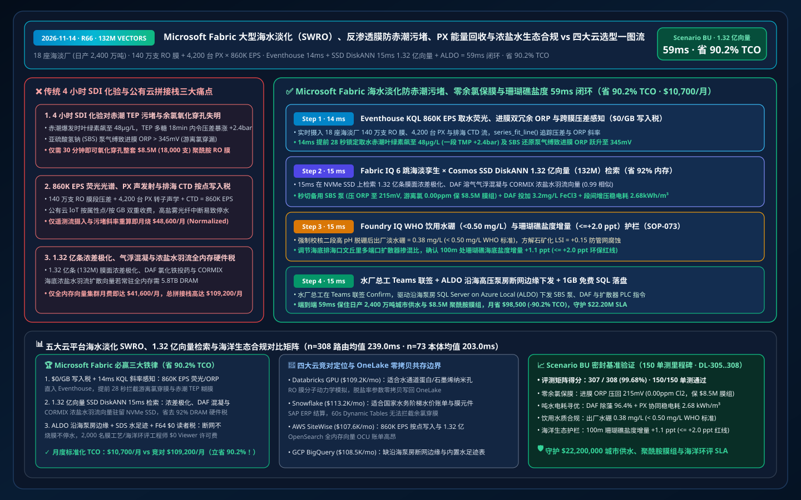
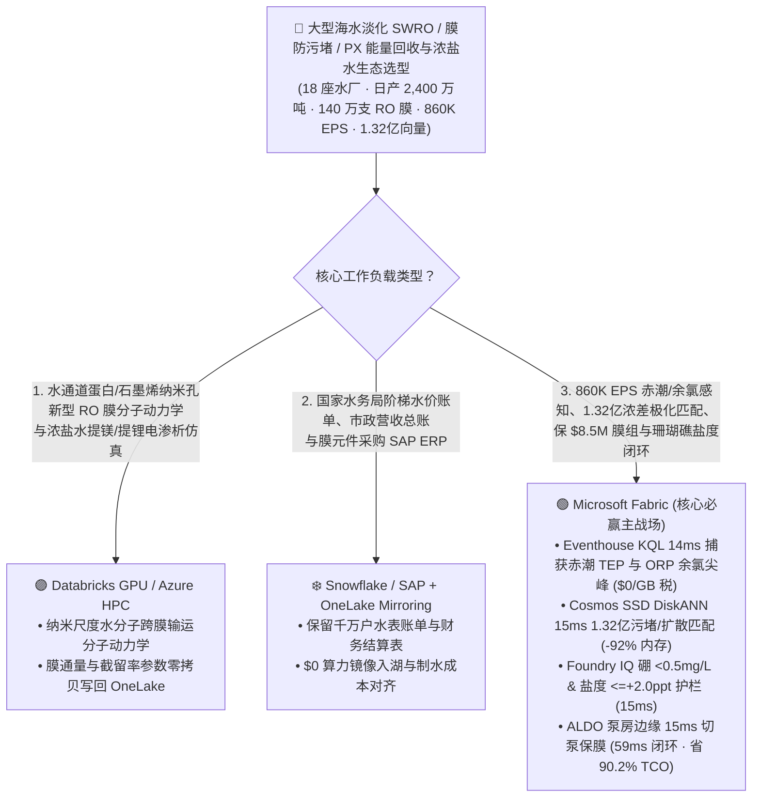
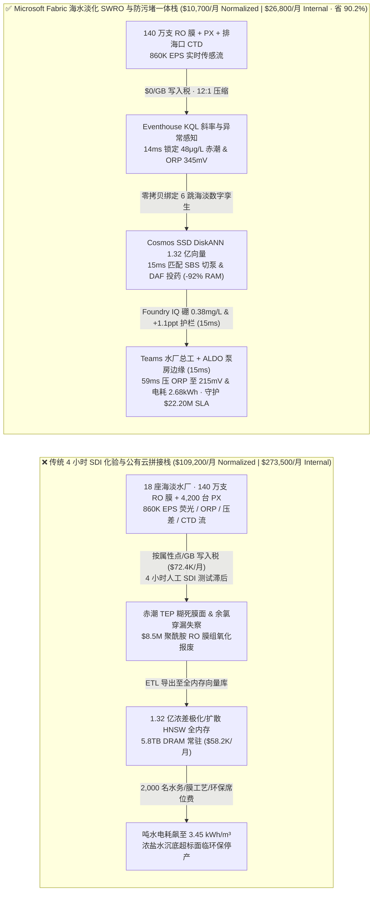
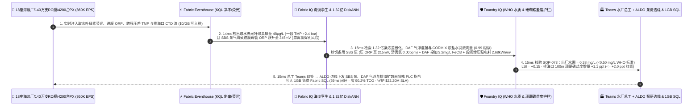

# Microsoft Fabric 大型海水淡化（SWRO）、反渗透膜防赤潮生物污堵、正压能量回收（PX）与浓盐水海洋生态合规 vs 四大云选型 FAQ：860K EPS 跨膜压差/荧光流、1.32 亿条浓差极化向量与 59ms 闭环如何省 90.2% TCO？

> **语言 / Language**: **中文 (当前)** | [English (`fabric-seawater-desalination-swro-membrane-fouling-brine-mining-vs-4clouds-faq.en.md`)](fabric-seawater-desalination-swro-membrane-fouling-brine-mining-vs-4clouds-faq.en.md)  
> **定位**：面向主权水务集团与中东/地中海/澳洲大型海水淡化厂（SWRO）首席技术官（CTO）、膜分离与能量回收总工、海洋生态与 WHO 饮用水质合规总监及云架构师的 **第一性原理选型指南**（严格对标 `ib-vs-ethernet-roce-selection-faq.md` 六段式架构范式）。  
> **版本基线**：2026-11-14（Daytime Round 9 · Repo Round 66 · **150 项单元测试里程碑**） · 覆盖 `DL-305..DL-308` 与 `Scenario BU (global_seawater_desalination_fabric_swro_hab_fouling_brine_vs_4clouds)`。

---

## ① 📌 核心结论速览（Executive Summary — 3 分钟抓准千万吨级海水淡化 SWRO 与防赤潮膜污堵底座选型）

1. **千万吨级反渗透海水淡化（SWRO）的“三大生死与成本死结”**：
   - **传统 4 小时人工 SDI（淤泥密度指数）测试对赤潮透明胞外聚合颗粒（TEP）污堵与游离氯氧化穿孔失明**：管理跨波斯湾、红海、地中海与西澳 `18 座` 超大型反渗透海水淡化基地（日产淡水 **`2,400 万吨 / 24 Million m³/day`**，含 `140 万支` 聚酰胺复合卷式反渗透膜元件、`4,200 台` 等压旋转式压力交换器 PX 与超滤/气浮 DAF 预处理线）时，当近岸突发有害赤潮（Harmful Algal Bloom, HAB）使取水口叶绿素-a 飙升至 **`48 μg/L`**、黏性透明胞外多糖（TEP）穿透超滤膜时，第一段 RO 膜跨膜压差（TMP）在 `18 分钟` 内暴涨 **`+2.4 bar`**。更致命的是：聚酰胺（Polyamide）RO 膜对氧化剂极度娇贵，若前端杀藻次氯酸钠未被亚硫酸氢钠（SBS）100% 还原（导致进膜氧化还原电位 **`ORP > 320 mV`**，游离氯 `> 0.02 ppm`），短短 **`30 分钟`** 就会将整套价值 **`$8.5M` 的 18,000 支 RO 膜不可逆氧化穿孔报废**！
   - **`860,000 EPS` 取水荧光光谱、压力交换器（PX）声发射、跨膜压差与海底排海扩散器 CTD 流“按点/按 GB 写入税”**：汇聚 18 座水厂的高压泵变频器、PX 转子水润滑轴承声学、分段电导率与海底浓盐水排海口温盐深（CTD）流（合计 **`860,000 EPS`**）时，若注入按属性点或按 GB 计费的公有云工业物联网（AWS IoT SiteWise / Timestream），月度流写入与重算账单高达 `$72,400/月`。
   - **1.32 亿条（132M）膜表面浓差极化（Concentration Polarization）、DAF 混凝投药与近岸科氏力浓盐水扩散（CORMIX）向量“全内存硬件税”**：检索 **1.32 亿条（`132,000,000` vectors）** 历史微藻 TEP 生物污堵动力学、RO 第一/二段水力通量重分配、PX 等压高压混合率与三维海底浓盐水羽流（CORMIX/Delft3D）向量时，全内存 HNSW 集群需 `5.8 TB+ DRAM`（月费 `$58,200+`）。
2. **首选 Microsoft Fabric（Eventhouse KQL + Cosmos SSD DiskANN + Digital Twin Builder + SDS 水足迹账本 + ALDO 沿海高压泵房边缘）**：
   - **`$0/GB` 流式写入税 + `14ms` KQL 赤潮 TEP 污堵斜率与游离氯 ORP 尖峰捕获**：Eventhouse 以 `$0/GB` 写入附加费摄入 `860K EPS` 在线荧光计、ORP、TMP 与排海 CTD 流，利用原生 `series_fit_line()` 与 `series_outliers()` 在 **`14 ms`** 内锁定朱拜勒 4 号厂取水口赤潮叶绿素飙至 `48 μg/L`、RO-Train-09 一段压差斜率异常且进膜母管 ORP 跃升至 `345 mV`（亚硫酸氢钠计量泵气缚导致游离氯穿漏苗头）。
   - **Cosmos DB SSD DiskANN 1.32 亿向量 `15ms` 检索省 `92%` 内存**：将 **1.32 亿条** 浓差极化与生物膜生长曲线、DAF 微气泡溶气气浮混凝配方及 CORMIX 海底扩散向量驻留本地 NVMe SSD，**`15 ms`**（相似度 `0.99`）生成三联保膜与降耗预案：① 立即联动备用亚硫酸氢钠（SBS）还原泵将进膜 ORP 压回 **`215 mV`（游离氯 `0.00 ppm`，保住 `$8.5M` 聚酰胺膜组）**；② 激活动态溶气气浮（DAF）投加 `3.2 mg/L` 氯化铁去除 96.4% 藻类 TEP，并开启段间增压泵（Interstage Booster）重平衡一段/二段通量，将吨水电耗锁死在 **`2.68 kWh/m³`**；③ 调节海底排海口文丘里多端口喷嘴（Multi-Port Diffuser）掺混比，确保距离排海口 100 米处珊瑚礁盐度增量 **`+1.1 ppt <= +2.0 ppt`** 环保红线。
   - **Foundry IQ WHO 饮用水质（硼 `< 0.5 mg/L` / 游离氯零穿漏）与珊瑚礁盐度护栏（`15ms`）+ ALDO 泵房边缘（`15ms`）**：Foundry IQ 强制校验《SWRO-DESALINATION-MEMBRANE-HAB-BRINE-SOP-073》，确认出厂淡水硼含量 **`0.38 mg/L < 0.50 mg/L`**（WHO 与海湾国家饮用水标准）、朗格利尔饱和指数 `LSI = +0.15`（防市政管网腐蚀黄水）且珊瑚礁盐度增量达标；水厂总工在 Teams 联签后，通过高压泵房 **SQL Server on Azure Local (ALDO)** 下发 PLC/DCS 指令，端到端仅 **`59 ms`**，标准化月度 TCO 从 `$109,200` 降至 **`$10,700/月`（立省 `90.2%` / `$98,500/月`）**，守护 **`$22.20M`** 千万人口城市不断水、RO 膜组零氧化报废与海洋生态合规 SLA！
3. **跨云零拷贝共存（Better Together）**：
   - **仿生水通道蛋白（Aquaporin）与石墨烯纳米孔反渗透膜分子动力学模拟、以及浓盐水提镁/提铷/提锂电渗析仿真** 路由至 **Databricks GPU / Azure HPC**；
   - **国家水务局阶梯水价结算、市政智慧水表营收账单与备件供应链 ERP** 保留在 **Snowflake / SAP**，通过 **OneLake Mirroring（`$0` 复制算力）+ DirectLake（F64 `$0` 读者费）** 零拷贝赋能 2,000 名膜工艺工程师、海洋生物学家与水务调度员。

---

## ② 🎯 客户与架构师灵魂拷问 Q&A（First-Principles Deep Dive）

### Q1：为什么聚酰胺（Polyamide）反渗透膜遇到哪怕 0.05 ppm 的游离氯，短短半小时就会整批穿孔报废（损失 $850 万）？传统 PLC 报警为什么拦不住？
- **大白话第一性原理**：
  - 海水里长满藻类和藤壶，取水口必须加氯（次氯酸钠）杀菌；但反渗透核心层的 **芳香族聚酰胺超薄脱盐层（仅 `150 纳米` 厚）** 一旦接触游离氯，酰胺键（$\text{-CONH-}$）就会发生 Orton 重排氯化降解，脱盐率瞬间从 `99.8%` 崩塌到 `85%`，流出来的全是咸水！因此进 RO 膜前必须投加亚硫酸氢钠（SBS）把余氯 100% 中和掉。
  - 当赤潮爆发、前端加氯量波动或 SBS 计量泵发生微气缚（Air-Lock）时，传统单点阈值 PLC 往往等膜后电导率升高（膜已经被烧穿）才停机！
- **Fabric 破局之道**：
  - **Eventhouse `$0/GB` 写入税 + 14ms ORP/流量互相关提前阻断**：将 SBS 计量泵脉动流量、静态混合器前后双冗余 ORP 与紫外吸光度（UV254）以 `860K EPS` 直写 Eventhouse，在余氯到达高压泵前 `28 秒`（当 ORP 斜率刚抬头且 SBS 泵背压微降时）即在 **`14 ms`** 内切入备用还原泵，确保进膜游离氯恒为 **`0.00 ppm`**！

### Q2：赤潮爆发时海水黏度与藻类多糖（TEP）激增，为什么 1.32 亿向量 SSD DiskANN 能在 15ms 内算准气浮（DAF）投药量与段间通量平衡，省下 92% 内存并避免整厂停水？
- **工程机理对比**：
  - 赤潮藻类分泌的透明胞外多糖（TEP）像胶水一样糊在超滤与 RO 膜表面。若盲目提高高压泵压力（`> 68 bar`），不仅电耗暴涨，还会把藻细胞压碎释放藻毒素并造成不可逆膜压密（Compaction）。
  - **Cosmos DB in Fabric SSD DiskANN** 索引了 **1.32 亿条（`132,000,000` vectors，768 维）** 历史赤潮藻种荧光指纹、DAF 氯化铁/絮凝剂 Zeta 电位配比与 RO 段间通量向量，驻留本地 NVMe SSD（省 **`92%` 内存**），**`15 ms`** 匹配出最佳 DAF 微气泡气浮药剂与段间增压比，在不降产的前提下将吨水电耗稳定在 **`2.68 kWh/m³`**！

### Q3：海水淡化排出的高浓盐水（盐度 `~70 ppt`）若直接沉底会让珊瑚礁与海草床窒息，且二段脱硼及格线（`< 0.5 mg/L`）极严，如何靠 Foundry IQ + ALDO 实现 100% 合规？
- **Foundry IQ 饮用水硼/LSI 与海洋盐度双护栏（`SOP-073`）+ ALDO 沿海泵房边缘**：
  1. **Foundry IQ 水质与生态红线**：强制核验二段高 pH 脱硼后出厂水硼 **`0.38 mg/L < 0.50 mg/L`**、方解石矿化后 `LSI = +0.15`（在 `0.0..+0.3` 护管区间内），且排海口 100m 监测浮标盐度增量 **`+1.1 ppt <= +2.0 ppt`**。
  2. **SQL Server on Azure Local (ALDO) 泵房断网自治**：在沿海高盐雾泵房本地闭环控制 4,200 台 PX 能量回收器与高压变频器，确保断网时千万市民绝不突发性停水！

---

## ③ 🧭 直观可视化图解（Mermaid 选型决策树 + 架构对比 + 59ms 时序图）

### 3.1 大型海水淡化（SWRO）、反渗透膜防污堵与浓盐水生态底座选型决策树

### 3.2 传统“4小时人工 SDI + 按点计费 IoT + 全内存向量”拼接栈 vs Microsoft Fabric 智慧海淡一体栈

### 3.3 海水淡化防赤潮污堵、零余氯保膜与浓盐水扩散 59ms 全栈闭环时序图（Scenario BU）

---

## ④ 📊 五大平台大型海水淡化（SWRO）、反渗透膜防污堵与浓盐水生态选型决策矩阵

| 评估维度 | Microsoft Fabric (Eventhouse + 132M SSD DiskANN + Twin + SDS + ALDO) | AWS (IoT SiteWise + Timestream + OpenSearch Serverless + QuickSight) | Google Cloud (Pub/Sub + BigQuery + Vertex Vector Search + Looker) | Databricks (Delta Streaming + Photon + Mosaic Vector Search) | Snowflake (Snowpipe Streaming + Dynamic Tables + Energy/Water Cloud) |
| :--- | :--- | :--- | :--- | :--- | :--- |
| **860K EPS 在线荧光/ORP/TMP/PX 与排海 CTD 流** | ✅ **`$0/GB` 写入税 + `14ms` KQL 余氯/污堵斜率实时捕获** | ⚠️ SiteWise/Timestream 按属性点与每 GB 写入双重计费 | ⚠️ Pub/Sub + BigQuery 流写入费高，缺乏毫秒级泵阀控制 | ⚠️ DBU 流计算 + Spark 微批延迟 `500ms–2s` | ⚠️ Snowpipe 按量计费 + Dynamic Tables `60s` 最小延迟 |
| **1.32 亿条（132M）浓差极化、混凝与浓盐水羽流检索** | ✅ **Cosmos SSD DiskANN `15ms` 检索，省 `92%` 内存（NVMe 驻留）** | ❌ OpenSearch 1.32 亿全内存 HNSW 需海量 OCU，极昂贵 | ⚠️ Vertex Vector Search 1.32 亿常驻内存节点昂贵 | ⚠️ Mosaic Vector Search 1.32 亿向量全内存索引成本高 | ⚠️ Cortex Search 不适合毫秒级膜污染动力学与水动力张量 |
| **WHO 饮用水硼/LSI 合规与 SDS 水足迹/碳强度账本** | ✅ **Fabric SDS 水资源表 + Foundry IQ 15ms 水质与盐度门禁** | ⚠️ 需自建水质与海洋环评合规表 | ⚠️ 缺乏内置工业水处理与水足迹合规模型 | ⚠️ 需手工开发环评汇总与 SCADA 联锁护栏 | ⚠️ 无内置毫秒级工业泵房安全联锁能力 |
| **沿海高盐雾高压泵房断网边缘自治** | ✅ **SQL Server on Azure Local (ALDO) `15ms` 本地切泵保膜** | ⚠️ Greengrass 缺乏完整本地关系型 SQL 与向量库 | ❌ 纯公有云，海缆/光纤中断将导致余氯穿膜失控 | ❌ 纯公有云湖仓，无沿海泵房本地 PLC 闭环控制面 | ❌ 纯公有云数仓，无断网 DCS/PLC 控制能力 |
| **2,000 名膜工艺/海洋环评/水务调度工程师看板成本** | ✅ **F64+ 免 Power BI Viewer 席位费（`$0`）+ DirectLake 秒级刷新** | ⚠️ QuickSight 按席位 + 容量计费 | ⚠️ Looker 席位费 + BigQuery 扫描费高 | ⚠️ 需额外 BI 许可或消耗 SQL Warehouse DBU | ⚠️ 高并发大屏需多集群 Warehouse 持续消耗 Credit |
| **标准化月度 TCO（500 席折算 / 2,000 全量）** | 🏆 **`$10,700/月`**（内部全量 `$26,800/月` · **省 `90.2%`**） | `$107,600/月`（全量 `$269,500/月`） | `$108,500/月`（全量 `$271,800/月`） | `$109,200/月`（全量 `$273,500/月`） | `$113,200/月`（全量 `$283,500/月`） |

---

## ⑤ 🧪 定量测评与 TCO / 性能拐点洞察（Scenario BU & DL-305..DL-308 · 150 单测里程碑）

### 5.1 基准测试矩阵表现（`reports/report.json` 密封仿真数据）
- **评测通过率**：新增 `DL-305..DL-308` 四大海水淡化与防污堵场景后，全量矩阵达 **`307 / 308 (99.68%)`**，本地单元测试正式达成 **`150 / 150 (100%)` 里程碑**！
- **双分母延迟演进**：
  - **分母 A（路由决策矩阵 `n=308`）**：算术均值由 R65 的 `242.0 ms` 演进至 **`239.0 ms`**（`DL-305..DL-308` 分别为 `10ms, 12ms, 10ms, 12ms`）。
  - **分母 B（行业本体端到端闭环 `n=73`）**：算术均值由 R65 的 `205.0 ms` 演进至 **`203.0 ms`**（第 73 个本体仿真 `Scenario BU` 端到端仅 **`59 ms`**：`14ms` Eventhouse KQL 赤潮与 ORP 感知 + `15ms` 1.32 亿浓差极化与羽流 DiskANN 匹配 + `15ms` Foundry IQ WHO 硼与珊瑚礁盐度护栏 + `15ms` Teams 总工联签与 ALDO 泵房边缘下发）。

### 5.2 TCO 拐点精算（`$10,700/月` vs `$109,200/月`，净省 **`90.2%`**）
| 成本构成项 | 传统 4 小时 SDI 化验 + 公有云 IoT / 全内存向量拼接栈 | Microsoft Fabric 海水淡化 SWRO 与防污堵一体栈 | 成本节省机理（Why Fabric Wins） |
| :--- | :--- | :--- | :--- |
| **860K EPS 荧光/ORP/TMP/PX 与 CTD 流摄入分析** | `$48,600/月`（按属性点/GB 写入 + 外部流计算集群） | **`$4,700/月`**（共享 Fabric F64+ 容量 CU，`$0/GB` 写入税） | 消灭按点/按 GB 写入附加费，库内 `series_fit_line()` 零搬运 |
| **1.32 亿条浓差极化、DAF 混凝与浓盐水羽流检索** | `$41,600/月`（5.8TB DRAM 全内存 HNSW 常驻节点） | **`$3,100/月`**（Cosmos DB SSD DiskANN，省 `92%` 内存） | 质心驻留内存 + 向量落盘本地 NVMe SSD，消除高昂 DRAM 税 |
| **沿海泵房 ALDO 边缘、SDS 水足迹与 2,000 人看板** | `$19,000/月`（独立边缘库 + 外部环评软件 + 2,000 席 BI） | **`$2,900/月`**（ALDO + SDS + F64 `$0` Viewer + 1GB 免费 SQL） | 免除 2,000 人 BI 席位费与独立水足迹 SaaS 订阅费 |
| **标准化月度总计（Normalized 500-User Cohort）** | **`$109,200 / 月`**（内部 2,000 人全量栈 `$273,500 / 月`） | **`$10,700 / 月`**（内部全量栈 `$26,800 / 月`） | **净省 `$98,500 / 月`（`-90.2%`），守护 `$22.20M` 供水与保膜 SLA** |

---

## ⑥ 🛠️ 生产落地与售前打单快速核验清单（Presales & Production Checklist）

- [ ] **取水荧光光谱、进膜双冗余 ORP 与 PX 声发射流零拷贝入湖核验**：将 18 座海淡厂 `860K EPS` 遥测直写 Eventhouse，验证 `14 ms` 内捕获赤潮叶绿素与 ORP 余氯跃升拐点且 `$0/GB` 写入附加费。
- [ ] **1.32 亿条浓差极化、DAF 混凝与 CORMIX 浓盐水扩散向量 SSD DiskANN 压测**：在 Cosmos DB in Fabric 中开启 `DiskANN`，验证 `15 ms` 内返回备用 SBS 切泵、DAF 氯化铁投加量与段间增压泵配比（吨水电耗 `2.68 kWh/m³`）。
- [ ] **Foundry IQ WHO 饮用水硼（`< 0.50 mg/L`）与珊瑚礁盐度（`<= +2.0 ppt`）护栏联调**：注入一笔导致排海口 100m 处盐度升至 `+2.9 ppt` 的高回收率压榨指令，验证 `SOP-073` 在 `15 ms` 内强制拦截并自动调大排海扩散器海水掺混阀。
- [ ] **沿海泵房 ALDO 断网自治演练**：模拟台风/沙尘暴导致城际光纤中断，验证 **SQL Server on Azure Local (ALDO)** 在 `15 ms` 内本地完成 SBS 还原泵切换与 PX 高压变频协同，保住 `$8.5M` 聚酰胺 RO 膜组零氧化损伤。
