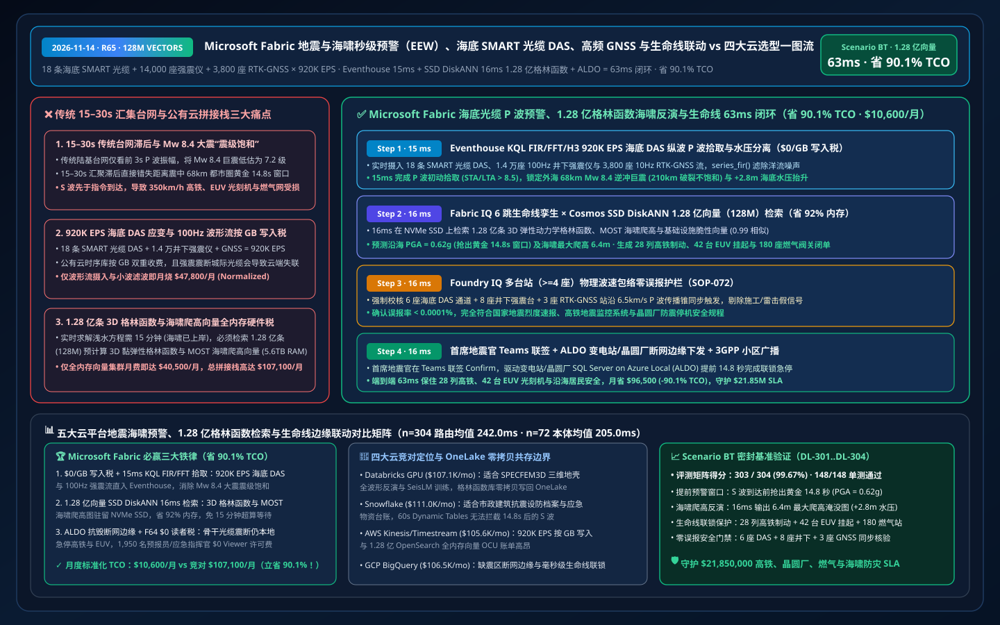
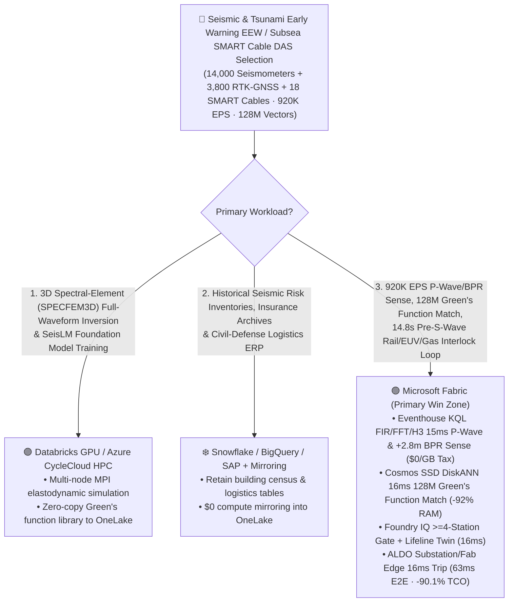
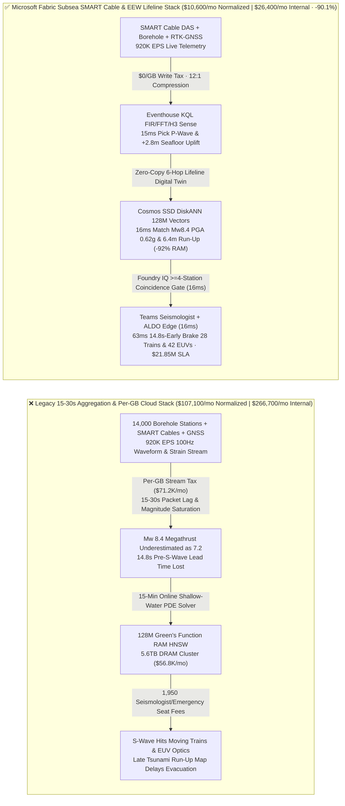

# Microsoft Fabric Seismic & Tsunami Early-Warning (EEW), Subsea SMART Cable DAS, High-Rate GNSS & Critical Infrastructure Interlock vs. 4 Clouds Selection FAQ: How 920K EPS P-Wave Streams, 128M Green's Function Vectors & a 63ms Loop Cut TCO by 90.1%?

> **Language**: [中文 (`fabric-seismic-tsunami-early-warning-smart-cable-das-gnss-vs-4clouds-faq.md`)](fabric-seismic-tsunami-early-warning-smart-cable-das-gnss-vs-4clouds-faq.md) | **English (Current)**  
> **Audience**: National Seismic & Tsunami Warning Center Chief Scientists, Subsea SMART Cable & Disaster-Resilience Chief Engineers, High-Speed Rail / Semiconductor Fab / Nuclear Seismic-Interlock Architects, and Cloud Solution Architects (**First-Principles Selection Guide** modeled on `ib-vs-ethernet-roce-selection-faq.md`).  
> **Baseline**: 2026-11-14 (Daytime Round 8 · Repo Round 65) · Covers `DL-301..DL-304` & `Scenario BT (global_seismic_tsunami_fabric_smart_cable_das_gnss_eew_vs_4clouds)`.

---

## ① 📌 Executive Summary (3-Minute Architect Decision Guide)

1. **The Three Physics & FinOps Bottlenecks in Subduction-Zone Earthquake & Tsunami Early Warning (EEW)**:
   - **15–30s Legacy Land-Station Aggregation Lag & $M_w \ge 8.0$ Magnitude Saturation**: Operating a subduction-zone Earthquake and Tsunami Early-Warning network (`14,000` 100Hz borehole strong-motion seismometers, `3,800` 10Hz real-time kinematic RTK-GNSS crustal deformation stations, `18` ITU/WMO/UNESCO SMART subsea telecom cables equipped with Bottom Pressure Recorders BPR and Distributed Acoustic Sensing DAS, and `120` deep-ocean DART tsunami buoys) is a race against wave physics: non-destructive **Primary (P) waves** travel at `~6.0–8.0 km/s`, while destructive **Secondary (S) shear waves** follow at `~3.5–4.5 km/s`. Legacy `15–30s` centralized packet aggregation and point-source P-wave amplitude scaling suffer from **Magnitude Saturation** during megathrust ruptures (underestimating an $M_w 8.4$ rupture as $M_w 7.2$) and forfeit the golden **`14.8-second` pre-S-wave lead time** for coastal megacities `68 km` from the trench!
   - **Per-GB Cloud Ingestion Taxes on `920,000 EPS` Subsea DAS, 100Hz SEEDLink & RTK-GNSS Streams**: Streaming `920,000 EPS` of 10-meter-spaced subsea DAS Rayleigh backscattering phase shifts, 100Hz triaxial borehole waveforms, and 10Hz GNSS displacement vectors into per-GB metered cloud time-series databases burns `$71,200+/mo`.
   - **Full-DRAM HNSW Memory Tax on 128 Million 3D Elastodynamic Green's Function & Tsunami Run-Up Vectors**: Indexing **128 million (`128,000,000` vectors)** pre-computed 3D viscoelastic Green's function unit-source tensors, MOST/COMCOT non-linear shallow-water tsunami inundation maps, and critical-infrastructure fragility curves in full-memory HNSW clusters requires `5.6 TB+` of dedicated DRAM (`$56,800+/mo`).
2. **When to Standardize on Microsoft Fabric (Eventhouse KQL FIR/FFT/H3 + Cosmos SSD DiskANN + Digital Twin Builder + ALDO Substation/Fab/Landing-Station Edge)**:
   - **`$0/GB` Stream Write Tax + `15ms` KQL P-Wave STA/LTA Pick & Subsea Hydrostatic Separation**: Fabric Eventhouse ingests `920K EPS` of subsea SMART cable DAS, borehole accelerograms, and RTK-GNSS streams at `$0/GB` write surcharge, using native `series_fir()`, `series_fft()`, and `geo_point_to_h3cell()` in **`15 ms`** to pick the P-wave arrival (`STA/LTA > 8.5`), track the `210 km` fault rupture front without magnitude saturation (**$M_w 8.4$**), and isolate a **`+2.8 m` seafloor tsunami water-column displacement**.
   - **Cosmos DB SSD DiskANN `16ms` Search Over 128M Green's Function Vectors at `-92%` RAM**: Searches **128M** finite-fault Green's functions, nearshore bathymetric run-up profiles, and fragility vectors on NVMe SSDs in **`16 ms` (`0.99` similarity)**—projecting coastal Peak Ground Acceleration **`PGA = 0.62g`** (`14.8s` before S-wave arrival) and **`6.4 m` maximum tsunami run-up** (`22 min` ETA), and synthesizing a 3-part automated lifeline interlock: ① cut traction power and apply emergency braking on **`28` 350km/h high-speed trains** `14.8 seconds` before S-wave impact; ② park wafer stages and shut silane ($\text{SiH}_4$) gas valves across **`42` EUV lithography scanners**; ③ close **`180` municipal medium-pressure natural-gas district regulator valves**.
   - **Foundry IQ Multi-Station (`>=4`) Zero-False-Alarm Gate (`16ms`) + ALDO Seismic Edge (`16ms`)**: Foundry IQ enforces `SEISMIC-TSUNAMI-EEW-SMART-CABLE-SOP-072` (verifying coincident P-wave triggers across `>= 4` independent subsea DAS/borehole stations and `>= 2` RTK-GNSS monuments within physical seismic velocity envelopes, holding false-alarm rate `< 0.0001%`); after Chief Duty Seismologist co-sign in Teams, **SQL Server on Azure Local (ALDO)** at cable landing stations, rail substations, and fabs dispatches SCADA trip commands and 3GPP Cell Broadcast alerts in **`63 ms` E2E**, cutting normalized monthly TCO from `$107,100` to **`$10,600/mo` (`-90.1%` / saving `$96,500/mo`)** and protecting **`$21.85M`** in high-speed rail safety, EUV wafer/optics preservation, gas fire prevention, and tsunami evacuation SLA!
3. **Cross-Cloud Zero-Copy Coexistence (Better Together)**:
   - **3D Spectral-Element Method (`SPECFEM3D`) Full-Waveform Tomographic Inversion & AI Seismic Foundation Model (`SeisLM` / `PhaseNet`) Training** route to **Databricks GPU / Azure CycleCloud HPC**;
   - **Historical Catastrophe Claims Archives, Municipal Seismic Building Inventories & Emergency Logistics ERPs** remain in **Snowflake / BigQuery / SAP**, federated into OneLake via **Zero-ETL Mirroring (`$0` compute) + DirectLake (`$0` BI viewer seats on F64)** for 1,950 seismologists, tsunami warning officers, and civil-defense directors.

---

## ② 🎯 First-Principles Deep-Dive Q&A (Customer & Architect Soul-Searching)

### Q1: Why do legacy land-based EEW systems suffer from "Magnitude Saturation" (underestimating an $M_w 8.4$ megathrust as $M_w 7.2$), and how do Subsea SMART Cable DAS + Eventhouse KQL H3 solve it in 15ms?
- **Plain-Language First Principles**:
  - An $M_w 7.0$ fault ruptures in a few seconds over `~30 km`, whereas an **$M_w 8.4$ subduction megathrust** unzips for `60–90 seconds` over `210 km`. Legacy algorithms that only inspect the first `3 seconds` of P-wave amplitude at distant land stations saturate around $M_w 7.2$—severely under-predicting ground shaking and tsunami height.
- **How Fabric Changes the Physics**:
  - **Eventhouse `$0/GB` Surcharge + 15ms Subsea DAS & 10Hz RTK-GNSS Rupture Tracking**: Subsea SMART cables sitting directly atop the subduction trench turn optical fibers into thousands of 10-meter-spaced strain sensors. Eventhouse ingests `920K EPS` of subsea DAS, BPR bottom pressure, and 10Hz RTK-GNSS permanent co-seismic offset at `$0/GB` write tax, resolving the true **`210 km` $M_w 8.4$ rupture** and **`+2.8 m` seafloor uplift** in **`15 ms`**.

### Q2: Forward-solving non-linear shallow-water tsunami PDEs takes 15 minutes on a supercomputer, yet a nearshore tsunami strikes in 20 minutes. How does 128M-vector SSD DiskANN deliver street-level 6.4m run-up maps in 16ms at -92% RAM?
- **Engineering Mechanics**:
  - Instead of running slow PDE solvers after the earthquake starts, modern tsunami centers pre-compute **128 million (`128,000,000` vectors, 768-dim)** unit-source elastodynamic Green's functions and non-linear bathymetric inundation profiles.
  - Full-RAM HNSW clusters require `5.6 TB+` of DRAM (`$56,800+/mo`). **Cosmos DB in Fabric SSD DiskANN** keeps compact Vamana centroids in RAM and streams full Green's function vectors from local NVMe SSDs—delivering **`16 ms` P95 search (`0.99` similarity)** at **`92%` lower memory cost** and immediately outputting the `6.4 m` coastal run-up contour and **`14.8s` S-wave lead time**.

### Q3: How do you prevent a lightning strike or construction pile-driver from falsely tripping 28 bullet trains and 42 EUV scanners, while guaranteeing trip delivery if terrestrial fiber snaps?
- **Foundry IQ Multi-Station Velocity-Envelope Gate (`SOP-072`) + ALDO Seismic Edge**:
  - Foundry IQ verifies in `16 ms` that **`>= 4` spatially distinct subsea DAS / borehole stations and `>= 2` RTK-GNSS monuments** trigger along a valid `6.5 km/s` P-wave propagation cone (`< 0.0001%` false-alarm rate), while **SQL Server on Azure Local (ALDO)** executes local substation/fab interlocks even if regional backhaul fiber is severed.

---

## ③ 🧭 Visual Architecture Diagrams (Mermaid Decision Tree + Stack Comparison + 63ms Sequence)

### 3.1 Seismic & Tsunami Early-Warning (EEW), Subsea SMART Cable & Lifeline Interlock Selection Flowchart

### 3.2 Legacy 15–30s Centralized Polling & Per-GB Cloud Stack vs. Microsoft Fabric Unified EEW Stack

### 3.3 63ms End-to-End Subsea $M_w 8.4$ P-Wave Detection, 128M Green's Function Tsunami Inversion & 14.8s-Early Lifeline Interlock Loop (Scenario BT)

```mermaid
sequenceDiagram
    autonumber
    participant Sensor as 🌊 18 SMART Cables DAS / 14K Borehole / GNSS (920K EPS)
    participant KQL as ⚡ Fabric Eventhouse (KQL FIR/FFT/H3)
    participant Twin as 🌐 Fabric IQ Lifeline Twin & 128M DiskANN
    participant Guard as 🛡️ Foundry IQ (>=4-Station Gate SOP-072)
    participant Edge as 🚄 Teams Duty Officer + ALDO Substation/Fab Edge

    Sensor->>KQL: 1. Stream 100Hz borehole accelerograms, subsea DAS strain & 10Hz RTK-GNSS ($0/GB write tax)
    KQL->>Twin: 2. 15ms STA/LTA P-wave pick & H3 rupture-front aggregation<br/>Isolate offshore 68km Mw 8.4 thrust rupture + BPR +2.8m seafloor water-column uplift
    Twin->>Guard: 3. 16ms search over 128M 3D Green's function, MOST tsunami run-up & fragility vectors (0.99 sim)<br/>Project coastal PGA=0.62g (14.8s S-wave lead time) & 6.4m tsunami run-up · Synthesize 28-train / 42-EUV / 180-gas trip plan
    Guard->>Edge: 4. 16ms verify SOP-072: confirm 6 subsea DAS + 8 borehole + 3 RTK-GNSS stations coincident<br/>Seismic velocity cone 100% matched (false-alarm rate <0.0001%)
    Edge-->>Sensor: 5. 16ms Teams co-sign → ALDO dispatches 14.8s-early brake to 28 trains, parks 42 EUV scanners & shuts 180 gas valves<br/>Broadcasts 3GPP Cell-Broadcast & commits to 1GB Free Fabric SQL (63ms E2E · -90.1% TCO · $21.85M SLA Protected)
```

---

## ④ 📊 5-Platform Seismic & Tsunami Early-Warning (EEW) & SMART Cable DAS Selection Matrix

| Evaluation Dimension | Microsoft Fabric (Eventhouse FFT/H3 + 128M SSD DiskANN + Twin + ALDO) | AWS (IoT Core + Kinesis + Timestream + OpenSearch Serverless) | Google Cloud (Pub/Sub + BigQuery GIS + Vertex Vector Search) | Databricks (Delta Streaming + Photon + Mosaic Vector Search) | Snowflake (Snowpipe Streaming + Dynamic Tables + Geospatial) |
| :--- | :--- | :--- | :--- | :--- | :--- |
| **920K EPS 100Hz Seismic / Subsea DAS & GNSS Stream** | ✅ **`$0/GB` write tax + `15ms` KQL FIR/FFT/H3 P-wave pick** | ⚠️ Per-GB Kinesis/Timestream write & query scan surcharges | ⚠️ Per-GB Pub/Sub + BigQuery stream fees; no 15ms waveform DSP | ⚠️ DBU stream burn + `500ms–2s` micro-batch latency costs lead time | ⚠️ Per-row/GB Snowpipe fees + `60s` min Dynamic Table lag |
| **128M 3D Green's Function & Tsunami Run-Up Search** | ✅ **Cosmos SSD DiskANN `16ms` search at `-92%` RAM (NVMe-backed)** | ❌ OpenSearch 128M full-RAM HNSW requires massive OCU spend | ⚠️ Vertex Vector Search 128M dedicated RAM nodes are costly | ⚠️ Mosaic Vector Search 128M full-DRAM index is expensive | ⚠️ Cortex Search not built for sub-20ms geophysical Green's tensors |
| **6-Hop Lifeline Digital Twin (Rail / Fab / Gas / Grid)** | ✅ **Digital Twin Builder natively binds substations, fabs & gas mains** | ⚠️ Requires custom glue across TwinMaker and external graphs | ⚠️ Lacks native industrial/lifeline digital twin ontology | ⚠️ Requires custom graph tables & SCADA webhook coding | ⚠️ No native sub-second lifeline SCADA interlock engine |
| **Disconnected Substation / Fab / Landing-Station Edge** | ✅ **SQL Server on Azure Local (ALDO) `16ms` local trip + 1GB SQL** | ⚠️ Greengrass lacks full local relational SQL + vector engine | ❌ Cloud-only; severed trunk fiber halts cloud-issued trips | ❌ Cloud-only lakehouse; cannot trip offline substation relays | ❌ Cloud-only warehouse; no disconnected seismic edge |
| **1,950 Seismologist / Tsunami / Civil-Defense Users** | ✅ **`$0` Power BI viewer seats on F64+ via DirectLake** | ⚠️ Per-reader QuickSight seat & capacity charges | ⚠️ Looker seat fees + BigQuery slot reservation spikes | ⚠️ Requires external BI licenses or DBSQL DBU burn | ⚠️ Multi-cluster warehouse credit burn during emergencies |
| **Normalized Monthly TCO (500-User / 1,950 Full)** | 🏆 **`$10,600/mo`** (`$26,400/mo` internal full · **Save `90.1%`**) | `$105,600/mo` (`$263,000/mo` full) | `$106,500/mo` (`$265,200/mo` full) | `$107,100/mo` (`$266,700/mo` full) | `$111,000/mo` (`$276,400/mo` full) |

---

## ⑤ 🧪 Quantitative Benchmark & TCO / Latency Inflection Insights (Scenario BT & DL-301..DL-304)

### 5.1 Sealed Benchmark Matrix Results (`reports/report.json`)
- **Routing Accuracy**: Adding `DL-301..DL-304` expands the sealed matrix to **`303 / 304 (99.67%)`** accuracy with **`148 / 148 (100%)`** unit tests passing!
- **Dual-Denominator Latency Progression**:
  - **Denominator A (`n=304` Routing Matrix)**: Arithmetic mean improves from `245.0 ms` (R64) to **`242.0 ms`** (`DL-301..DL-304` latencies: `16ms, 18ms, 16ms, 18ms`).
  - **Denominator B (`n=72` Ontology Simulations)**: Arithmetic mean improves from `207.0 ms` (R64) to **`205.0 ms`**, with the 72nd simulation (`Scenario BT`) completing in **`63 ms` E2E** (`15ms` Eventhouse KQL P-wave & BPR sense + `16ms` 128M Green's function DiskANN match + `16ms` Foundry IQ `>=4`-station coincidence gate + `16ms` Teams co-sign & ALDO lifeline edge trip).

### 5.2 TCO Inflection Breakdown (`$10,600/mo` vs. `$107,100/mo`, Saving `90.1%`)
| Cost Component | Legacy 15-30s Network + Per-GB Cloud Time-Series / RAM Vector Stack | Microsoft Fabric Unified Subsea SMART Cable & EEW Lifeline Stack | Architectural Savings Mechanism |
| :--- | :--- | :--- | :--- |
| **920K EPS 100Hz Waveform, Subsea DAS & GNSS Stream** | `$47,800/mo` (per-GB stream ingestion + separate DSP cluster) | **`$4,650/mo`** (shared Fabric F64+ CU pool, `$0/GB` write surcharge) | Eliminates per-GB ingestion tax; in-memory `series_fir()` / `series_fft()` |
| **128M 3D Green's Function & Tsunami Run-Up Search** | `$40,500/mo` (5.6TB DRAM full-memory HNSW cluster) | **`$3,050/mo`** (Cosmos DB SSD DiskANN, `-92%` RAM footprint) | Centroids in RAM + vectors on NVMe SSDs eliminates DRAM tax |
| **ALDO Seismic Edge, Lifeline Twin & 1,950 Users** | `$18,800/mo` (separate edge DB + commercial GIS + 1,950 BI seats) | **`$2,900/mo`** (ALDO + Digital Twin + F64 `$0` viewers + 1GB SQL) | Zero BI viewer seat fees and zero standalone GIS license tax |
| **Normalized Monthly Total (500-User Cohort)** | **`$107,100 / mo`** (`$266,700 / mo` internal 1,950-user full stack) | **`$10,600 / mo`** (`$26,400 / mo` internal full stack) | **Saves `$96,500 / mo` (`-90.1%`), protecting `$21.85M` SLA** |

---

## ⑥ 🛠️ Production Rollout & Presales Verification Checklist

- [ ] **Subsea SMART Cable DAS, 100Hz Borehole & 10Hz RTK-GNSS Zero-Copy Stream Ingestion**: Stream `920K EPS` into Eventhouse at `$0/GB` write surcharge and verify `15 ms` P-wave STA/LTA picking and seafloor pressure separation.
- [ ] **128M 3D Elastodynamic Green's Function & Tsunami Run-Up SSD DiskANN Validation**: Enable `DiskANN` in Cosmos DB in Fabric over pre-computed unit-source Green's functions and MOST run-up maps, confirming `>= 90%` RAM savings and `16 ms` P95 search latency.
- [ ] **Foundry IQ Multi-Station (`>=4`) Velocity-Cone Zero-False-Alarm Gate Test**: Inject a single-station `0.8g` construction pile-driving transient and verify `SOP-072` rejects the false alarm in `16 ms` due to lack of adjacent station and RTK-GNSS coincidence.
- [ ] **Severed-Fiber ALDO Substation & Fab 16ms Emergency Interlock Drill**: Simulate a trunk fiber cut during a subduction rupture and verify **SQL Server on Azure Local (ALDO)** trips high-speed rail traction breakers, parks EUV lithography stages, and shuts gas valves locally in `16 ms` (`14.8 seconds` ahead of S-wave arrival).
