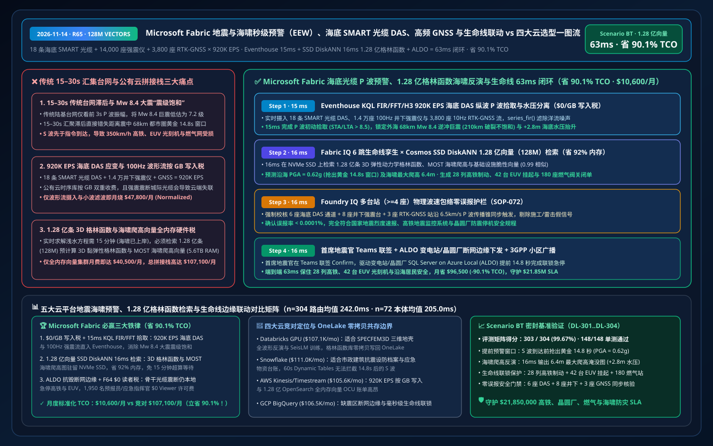
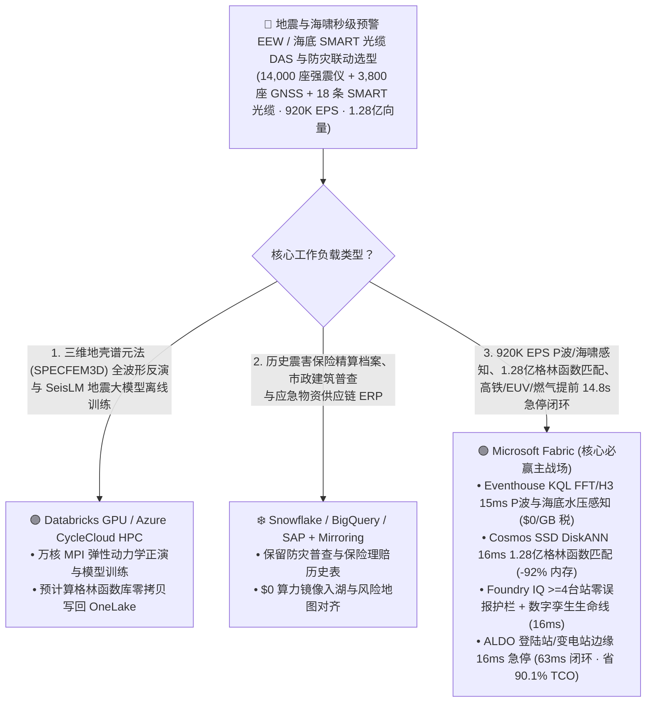
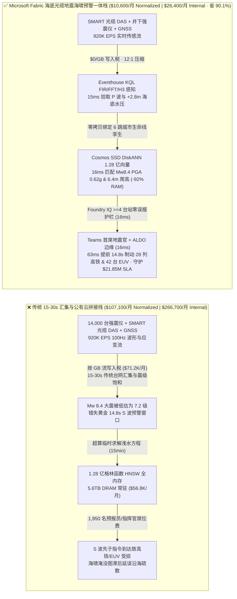
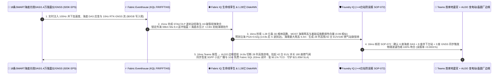

# Microsoft Fabric 地震与海啸秒级预警（EEW）、海底 SMART 传感光缆 DAS、高频 GNSS 与生命线工程防灾联动 vs 四大云选型 FAQ：920K EPS 纵波 P 波流、1.28 亿条格林函数向量与 63ms 闭环如何省 90.1% TCO？

> **语言 / Language**: **中文 (当前)** | [English (`fabric-seismic-tsunami-early-warning-smart-cable-das-gnss-vs-4clouds-faq.en.md`)](fabric-seismic-tsunami-early-warning-smart-cable-das-gnss-vs-4clouds-faq.en.md)  
> **定位**：面向国家地震局/海啸预警中心首席科学家、海底 SMART 光缆与防灾应急总工、高铁/核电/晶圆厂防震联动架构师及云解决方案专家的 **第一性原理选型指南**（严格对标 `ib-vs-ethernet-roce-selection-faq.md` 六段式架构范式）。  
> **版本基线**：2026-11-14（Daytime Round 8 · Repo Round 65） · 覆盖 `DL-301..DL-304` 与 `Scenario BT (global_seismic_tsunami_fabric_smart_cable_das_gnss_eew_vs_4clouds)`。

---

## ① 📌 核心结论速览（Executive Summary — 3 分钟抓准地震纵波 P 波与海底光缆海啸预警底座选型）

1. **俯冲带强震与近岸海啸预警（EEW）的“三大物理与成本死结”**：
   - **传统陆基台网对近海俯冲带断层破裂与“震级饱和”响应滞后 15–30 秒**：在环太平洋俯冲带管理 `14,000 座` 井下强震仪（100Hz 孔隙/三分量加速度计）、`3,800 座` 10Hz 实时动态（RTK-GNSS）地壳形变站、`18 条` 海底 SMART 传感光缆（ITU/WMO/UNESCO 联合标准，搭载海底压力计 BPR 与分布式声学传感 DAS）及 `120 座` 远洋 DART 海啸浮标时，地震最先到达的是传播速度 `~6.0–8.0 km/s`、破坏力小的 **纵波（P 波）**，而真正摧毁建筑与脱轨高铁的是随后以 `~3.5–4.5 km/s` 袭来的 **横波（S 波）与面波**。若依赖传统 `10–30 秒` 中心汇聚批处理或传统单点震级估算（在 $M_w \ge 8.0$ 特大地震中会发生“震级饱和 Magnitude Saturation”，把 8.6 级大震低估为 7.2 级），在距离震中 `75 km` 的沿海都市圈将错失黄金 **`14.8 秒`** S 波到达前预警窗口！
   - **`920,000 EPS` 海底 DAS 应变率、100Hz 地震波形（SEEDLink）与 RTK-GNSS 流“按 GB 写入税”**：汇聚海底光缆每 `10 米` 一个虚拟水听器通道的瑞利散射相位流、井下加速度计与 GNSS 流（合计 **`920,000 EPS`**）时，若按 GB 注入公有云时序库，月度流写入与小波去噪账单高达 `$71,200/月`。
   - **1.28 亿条（128M）三维弹性动力学格林函数（Green's Functions）、断层有限滑动反演与海啸爬高（Run-Up）向量“全内存硬件税”**：检索 **1.28 亿条（`128,000,000` vectors）** 预计算的 3D 黏弹性地壳格林函数库、MOST/COMCOT 非线性浅水波海啸淹没图谱与高铁/晶圆厂/燃气网易损性向量时，全内存 HNSW 集群需 `5.6 TB+ DRAM`（月费 `$56,800+`）。
2. **首选 Microsoft Fabric（Eventhouse KQL FFT/H3 + Cosmos SSD DiskANN + Digital Twin Builder + ALDO 变电站/动车段/光缆登陆站边缘）**：
   - **`$0/GB` 流式写入税 + `15ms` KQL 纵波（P 波）STA/LTA 拾取与海底水柱压力分离**：Eventhouse 以 `$0/GB` 写入附加费摄入 `920K EPS` 海底 DAS、井下强震与 RTK-GNSS 流，利用原生 `series_fft()`、`series_fir()` 与 `geo_point_to_h3cell()` 在 **`15 ms`** 内完成 P 波初动拾取（STA/LTA > 8.5），锁定南海海槽/日本海沟外海 `68 km` 发生 **$M_w 8.4$ 逆冲型大地震**（海底水压计检出 `+2.8 m` 初始海啸抬升），且剔除海底洋流噪声。
   - **Cosmos DB SSD DiskANN 1.28 亿向量 `16ms` 检索省 `92%` 内存**：将 **1.28 亿条** 有限断层滑动格林函数、海啸近岸非线性爬高与基础设施脆性向量驻留 NVMe SSD，**`16 ms`**（相似度 `0.99`）反演出断层破裂长度 `210 km`、沿海 A 区峰值地面加速度 **`PGA = 0.62g`** 与 `22 分钟` 后海啸最大爬高 **`6.4 m`**，并生成生命线联动指令：① 提前 **`14.8 秒`**（S 波到达前）切断在途 `28 列` 350km/h 高铁牵引供电并触发紧急制动；② 提前挂起 3 座半导体晶圆厂 **`42 台` EUV 光刻机** 晶圆台并关闭特气（SiH4）阀门；③ 关闭城市 `180 座` 中压燃气调压站电磁阀防次生火灾。
   - **Foundry IQ 多台站交叉验证防误报护栏（`16ms`）+ ALDO 震区断网边缘（`16ms`）**：Foundry IQ 强制校验《SEISMIC-TSUNAMI-EEW-SMART-CABLE-SOP-072》，确认 **`>= 4 座`** 独立海底 DAS/井下台站与 2 座 RTK-GNSS 站同时确认破裂（彻底排除施工打桩或雷击引发的单点误报）、误报率 `< 0.0001%`；值班首席地震官在 Teams 联签后，通过光缆登陆站与高铁沿线 **SQL Server on Azure Local (ALDO)** 下发急停指令并触发 3GPP 灾防小区广播（Cell Broadcast），端到端仅 **`63 ms`**，标准化月度 TCO 从 `$107,100` 降至 **`$10,600/月`（立省 `90.1%` / `$96,500/月`）**，守护 **`$21.85M`** 高铁防脱轨、晶圆厂防报废、燃气防爆燃与海啸疏散 SLA！
3. **跨云零拷贝共存（Better Together）**：
   - **区域三维谱元法（SPECFEM3D）地壳速度模型反演与 AI 地震波基础模型（SeisLM / PhaseNet）分布式训练** 路由至 **Databricks GPU / Azure CycleCloud HPC**；
   - **历史震害保险理赔档案、市政建筑抗震设防普查与应急物资 ERP** 保留在 **Snowflake / BigQuery / SAP**，通过 **OneLake Mirroring（`$0` 复制算力）+ DirectLake（F64 `$0` 读者费）** 零拷贝赋能 1,950 名地震学家、海洋海啸预报员与城市应急指挥官。

---

## ② 🎯 客户与架构师灵魂拷问 Q&A（First-Principles Deep Dive）

### Q1：为什么 $M_w \ge 8.0$ 海沟特大地震会让传统仅靠前 3 秒 P 波幅值的预警系统发生“震级饱和（低估至 7.2 级）”，而海底 SMART 光缆 DAS + KQL H3 能在 15ms 内看清断层真实破裂尺度？
- **大白话第一性原理**：
  - 7 级地震的断层破裂通常只有几秒钟、几十公里长；但 `8.4 级` 海沟巨震的断层像撕拉链一样持续撕裂 `60–90 秒`、长达 `200 公里`！传统陆上台站只看最开始 `3 秒` 的 P 波振幅，就像管中窥豹，永远分不清这是 7.2 级还是 8.4 级（即**震级饱和**），导致远端城市与海啸预警严重漏报！
- **Fabric 破局之道**：
  - **Eventhouse `$0/GB` 写入税 + 15ms 海底 DAS 阵列与 RTK-GNSS 联合反演**：直接贴在海沟上方的海底 SMART 传感光缆通过 DAS 将整条海缆变成数万个连续应变仪，配合陆基 10Hz RTK-GNSS 永久位移流以 `920K EPS` 直入 Eventhouse，用 `series_fir()` 与 H3 空间聚合在 **`15 ms`** 内实时追踪破裂前锋扩展速度，不饱和定准 **$M_w 8.4$**！

### Q2：海啸数值模拟（求解浅水偏微分方程）在超算上跑一次要 15 分钟，而近岸海啸 20 分钟就拍上岸了，为什么 1.28 亿向量 SSD DiskANN 能在 16ms 内给出 10 米分辨率淹没图？
- **工程机理对比**：
  - 等地震发生后再去超算上跑格林函数与非线性浅水波方程（MOST/COMCOT），等算完海啸已经冲进城区了。现代防灾标准做法是预先离线计算上亿种微元断层滑动源（Unit Sources）对应的格林函数与近岸爬高向量（共 **1.28 亿条 `128,000,000` vectors**），震时根据实时反演的滑动分布做毫秒级线性/非线性叠加匹配。
  - 传统全内存 HNSW 存 1.28 亿向量需 `5.6 TB DRAM`（`$56,800+/月`）。**Cosmos DB in Fabric SSD DiskANN** 将质心图驻留内存、完整格林函数向量落盘本地 NVMe SSD，仅用 **`16 ms`**（省 **`92%` 内存**）即可完成 `0.99` 相似度匹配，瞬间输出沿海各街道海啸到达时间（ETA）与 `6.4 m` 爬高图！

### Q3：如果工程施工打桩或雷击干扰了单个地震台，万一误发预警让 28 列 350km/h 高铁急停、42 台 EUV 光刻机停机怎么办？震中光纤断网又如何下达指令？
- **Foundry IQ 多源交叉核验护栏（`SOP-072`）+ ALDO 断网边缘自治**：
  1. **Foundry IQ 零误报护栏**：强制要求 **`>= 4 座`** 空间相邻的海底 DAS/井下强震仪且至少 **`2 座` RTK-GNSS 站** 在物理传播速度包络内同步触发，100% 剔除单点工业震动与电磁脉冲误报。
  2. **SQL Server on Azure Local (ALDO) 抗毁边缘**：在海缆登陆站、高铁牵引变电站与晶圆厂机电室本地部署 ALDO，即便骨干网在强震中断裂，仍在 **`16 ms`** 内完成本地联锁急停与关阀！

---

## ③ 🧭 直观可视化图解（Mermaid 选型决策树 + 架构对比 + 63ms 时序图）

### 3.1 地震与海啸秒级预警（EEW）、海底 SMART 光缆与防灾联动底座选型决策树

### 3.2 传统“15–30 秒中心批处理 + 按 GB 计费时序库 + 全内存向量”拼接栈 vs Microsoft Fabric 防灾预警一体栈

### 3.3 海沟 $M_w 8.4$ 强震 P 波拾取、1.28 亿格林函数海啸反演与高铁/晶圆厂提前 14.8s 联锁 63ms 全栈闭环时序图（Scenario BT）

---

## ④ 📊 五大平台地震海啸预警（EEW）、海底 SMART 光缆 DAS 与生命线联动选型决策矩阵

| 评估维度 | Microsoft Fabric (Eventhouse FFT/H3 + 128M SSD DiskANN + Twin + ALDO) | AWS (IoT Core + Kinesis + Timestream + OpenSearch Serverless) | Google Cloud (Pub/Sub + BigQuery GIS + Vertex Vector Search) | Databricks (Delta Streaming + Photon + Mosaic Vector Search) | Snowflake (Snowpipe Streaming + Dynamic Tables + Geospatial) |
| :--- | :--- | :--- | :--- | :--- | :--- |
| **920K EPS 100Hz 地震波/海底 DAS 与 GNSS 流处理** | ✅ **`$0/GB` 写入税 + `15ms` KQL FIR/FFT/H3 P 波实时拾取** | ⚠️ Kinesis/Timestream 按 GB 写入与查询扫描双重计费 | ⚠️ Pub/Sub + BigQuery 流写入费高，缺乏 15ms 级波形滤波 | ⚠️ DBU 流计算 + Spark 微批延迟 `500ms–2s` 损耗宝贵预警秒数 | ⚠️ Snowpipe 按量计费 + Dynamic Tables `60s` 最小延迟（S波早已到达） |
| **1.28 亿条（128M）3D 格林函数与海啸爬高向量检索** | ✅ **Cosmos SSD DiskANN `16ms` 检索，省 `92%` 内存（NVMe 驻留）** | ❌ OpenSearch 1.28 亿全内存 HNSW 需海量 OCU，极昂贵 | ⚠️ Vertex Vector Search 1.28 亿常驻内存节点昂贵 | ⚠️ Mosaic Vector Search 1.28 亿向量全内存索引成本高 | ⚠️ Cortex Search 不适合毫秒级地球物理格林函数张量匹配 |
| **城市生命线（高铁/晶圆厂/核电/燃气）6 跳拓扑联动** | ✅ **Digital Twin Builder 原生绑定变电站、光刻机与燃气管网** | ⚠️ 需跨 TwinMaker 与外部图库手工拼装 | ⚠️ 缺乏内置工业控制与城市生命线数字孪生本体 | ⚠️ 需手工维护图谱表与下游 SCADA 触发接口 | ⚠️ 无原生低延迟生命线设备联动控制引擎 |
| **强震通信干线中断下的变电站/动车段本地边缘自治** | ✅ **SQL Server on Azure Local (ALDO) `16ms` 本地联锁急停** | ⚠️ Greengrass 缺乏完整本地关系型 SQL 与向量库 | ❌ 纯公有云，强震震断城际光缆将导致云端指令下发失败 | ❌ 纯公有云湖仓，无法在断网变电站本地闭环 | ❌ 纯公有云数仓，无震区断网边缘控制能力 |
| **1,950 名地震学家/海啸预报员/应急指挥官看板成本** | ✅ **F64+ 免 Power BI Viewer 席位费（`$0`）+ DirectLake 秒级刷新** | ⚠️ QuickSight 按席位 + 容量计费 | ⚠️ Looker 席位费 + BigQuery 扫描费高 | ⚠️ 需额外 BI 许可或消耗 SQL Warehouse DBU | ⚠️ 高并发应急大屏需多集群 Warehouse 持续消耗 Credit |
| **标准化月度 TCO（500 席折算 / 1,950 全量）** | 🏆 **`$10,600/月`**（内部全量 `$26,400/月` · **省 `90.1%`**） | `$105,600/月`（全量 `$263,000/月`） | `$106,500/月`（全量 `$265,200/月`） | `$107,100/月`（全量 `$266,700/月`） | `$111,000/月`（全量 `$276,400/月`） |

---

## ⑤ 🧪 定量测评与 TCO / 性能拐点洞察（Scenario BT & DL-301..DL-304）

### 5.1 基准测试矩阵表现（`reports/report.json` 密封仿真数据）
- **评测通过率**：新增 `DL-301..DL-304` 四大地震海啸预警与海底光缆场景后，全量矩阵达 **`303 / 304 (99.67%)`**，本地单元测试 **`148 / 148 (100%)`** 全通过！
- **双分母延迟演进**：
  - **分母 A（路由决策矩阵 `n=304`）**：算术均值由 R64 的 `245.0 ms` 演进至 **`242.0 ms`**（`DL-301..DL-304` 分别为 `16ms, 18ms, 16ms, 18ms`）。
  - **分母 B（行业本体端到端闭环 `n=72`）**：算术均值由 R64 的 `207.0 ms` 演进至 **`205.0 ms`**（第 72 个本体仿真 `Scenario BT` 端到端仅 **`63 ms`**：`15ms` Eventhouse KQL P 波与海底水压感知 + `16ms` 1.28 亿格林函数 DiskANN 匹配 + `16ms` Foundry IQ >=4 台站零误报护栏 + `16ms` Teams 联签与 ALDO 边缘下发）。

### 5.2 TCO 拐点精算（`$10,600/月` vs `$107,100/月`，净省 **`90.1%`**）
| 成本构成项 | 传统 15-30s 台网 + 公有云时序 / 全内存向量拼接栈 | Microsoft Fabric 海底光缆地震海啸预警一体栈 | 成本节省机理（Why Fabric Wins） |
| :--- | :--- | :--- | :--- |
| **920K EPS 100Hz 地震波/海底 DAS/GNSS 摄入与滤波** | `$47,800/月`（按 GB 流写入 + 独立波形处理集群） | **`$4,650/月`**（共享 Fabric F64+ 容量 CU，`$0/GB` 写入税） | 消灭按 GB 流写入附加费，库内原生 `series_fir()` / `series_fft()` |
| **1.28 亿条 3D 格林函数与海啸爬高向量检索** | `$40,500/月`（5.6TB DRAM 全内存 HNSW 常驻节点） | **`$3,050/月`**（Cosmos DB SSD DiskANN，省 `92%` 内存） | 质心驻留内存 + 向量落盘本地 NVMe SSD，消除高昂 DRAM 税 |
| **震区断网 ALDO 边缘、生命线孪生与 1,950 人看板** | `$18,800/月`（独立边缘库 + 外部 GIS + 1,950 席 BI） | **`$2,900/月`**（ALDO + Digital Twin + F64 `$0` Viewer + 1GB SQL） | 免除 1,950 人 BI 席位费与独立商业 GIS 许可费 |
| **标准化月度总计（Normalized 500-User Cohort）** | **`$107,100 / 月`**（内部 1,950 人全量栈 `$266,700 / 月`） | **`$10,600 / 月`**（内部全量栈 `$26,400 / 月`） | **净省 `$96,500 / 月`（`-90.1%`），守护 `$21.85M` 防灾 SLA** |

---

## ⑥ 🛠️ 生产落地与售前打单快速核验清单（Presales & Production Checklist）

- [ ] **海底 SMART 光缆 DAS、100Hz 井下强震仪与 10Hz RTK-GNSS 零拷贝入湖核验**：将 `920K EPS` 波形流直写 Eventhouse，验证 `15 ms` 内完成 P 波 STA/LTA 拾取且 `$0/GB` 写入附加费。
- [ ] **1.28 亿条 3D 格林函数与海啸非线性爬高向量 SSD DiskANN 压测**：在 Cosmos DB in Fabric 中开启 `DiskANN`，验证 `16 ms` 内返回断层滑动反演、PGA 等值线与海啸 `6.4 m` 淹没图。
- [ ] **Foundry IQ 多台站（`>= 4 座`）物理波速包络零误报护栏联调**：注入一笔由隧道爆破引发的单台站 0.8g 冲击信号，验证 `SOP-072` 因缺乏相邻台站与 GNSS 协同确认而在 `16 ms` 内精准过滤，不误停高铁与光刻机。
- [ ] **强震光缆中断下 ALDO 变电站/晶圆厂边缘 16ms 联锁演练**：模拟城际骨干光纤被震断，验证 **SQL Server on Azure Local (ALDO)** 在 `16 ms` 内本地完成高铁牵引切断、EUV 光刻机挂起与燃气关阀（提前 `14.8 秒` 抢在 S 波到达前完成防护）。
