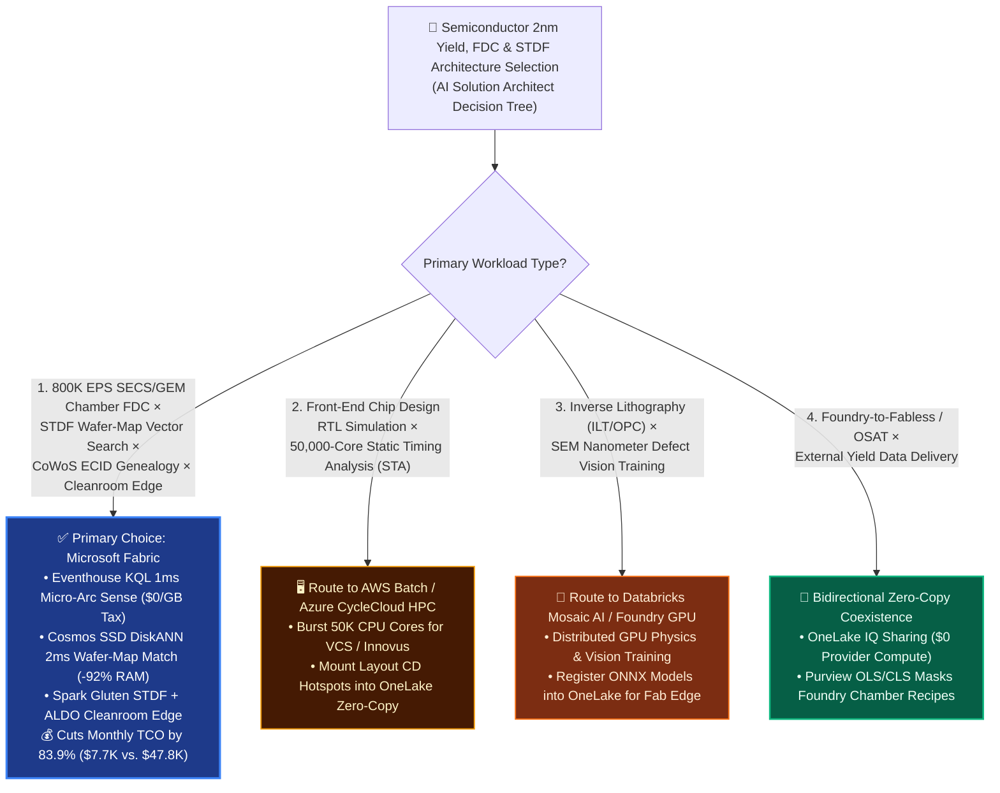
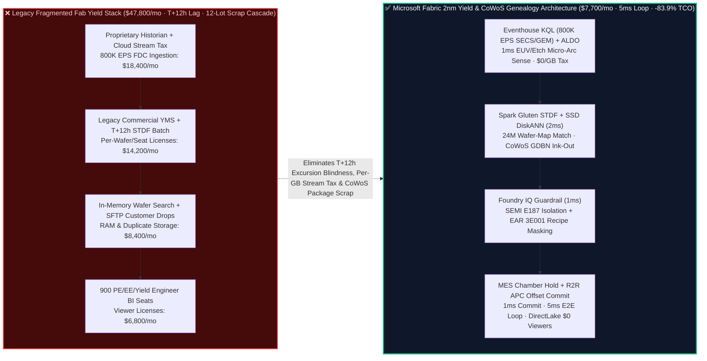

# Semiconductor Fab 2nm EUV Lithography Yield, 800K EPS SECS/GEM FDC Telemetry, STDF Wafer-Map Spatial Defect Clustering & CoWoS Packaging Traceability: Microsoft Fabric vs. AWS EDA / SiteWise vs. Databricks vs. Snowflake / GCP Selection FAQ

> **Document Purpose**: This guide is written for **AI Solution Architects**, Semiconductor Foundry VPs of Fab Operations, Yield Engineering Directors, Fabless Silicon Engineering Leads, and OSAT Advanced Packaging CTOs. Using **plain language and first principles**, it explains how 300mm leading-edge fabs and fabless chipmakers unify **800K EPS SECS/GEM & Interface A equipment telemetry, STDF v4 wafer-sort binary analytics, rotation-invariant wafer-map vector search, CoWoS / Chiplet die-to-package genealogy, and SEMI E187 air-gapped cleanroom autonomy** across **Microsoft Fabric**, **AWS (Batch EDA / IoT SiteWise)**, **Databricks (Mosaic AI)**, **Snowflake**, and **GCP**.
>
> **Language / 语言版本**: [中文 (`fabric-semiconductor-2nm-euv-stdf-wafer-yield-vs-4clouds-faq.md`)](fabric-semiconductor-2nm-euv-stdf-wafer-yield-vs-4clouds-faq.md) | **English (Current)**  
> **Companion Architecture Diagram**: [`assets/svg/44-fabric-semiconductor-2nm-euv-stdf-wafer-yield-vs-4clouds-faq.svg`](../assets/svg/44-fabric-semiconductor-2nm-euv-stdf-wafer-yield-vs-4clouds-faq.svg)

---

## ① 📌 Executive Summary (3-Minute Architect Decision Guide)

1. **When to Standardize on Microsoft Fabric (Eventhouse KQL `800K EPS` + Cosmos SSD DiskANN Wafer-Map Search + SQL on Azure Local Cleanroom Edge)**
   - When a 300mm semiconductor fab (2nm GAA / 3nm FinFET) or fabless-OSAT ecosystem needs to ingest **`800,000 EPS` of SECS/GEM (SEMI E5/E30/E37) and EDA (Interface A / E134) chamber sensor streams**, parse billions of die records from **STDF v4 binary wafer-sort files**, perform **millisecond spatial wafer-map defect similarity search** (ring, scratch, center-edge signatures), and trigger **automated MES lot holds and Run-to-Run (R2R) APC recipe offsets** under **SEMI E187 cleanroom isolation and EAR 3E001 / Foundry OIP confidentiality**, **Microsoft Fabric is the primary choice**.
   - **First-Principles FinOps Math**: Legacy semiconductor yield stacks are crushed by three costs: (1) proprietary commercial Yield Management Systems (YMS) and per-tag industrial historians; (2) per-GB cloud streaming write surcharges (`800K EPS` of 100Hz chamber RF/vacuum traces costs **`$14,000+/mo`** in ingestion fees alone); and (3) T+12h batch STDF parsing—meaning when an etch chamber micro-arcs, **12 subsequent lots (300 wafers at `$26,000` each) are scrapped** before yield engineers see the morning report! **Microsoft Fabric** unifies the stack on a shared F64 capacity pool: **Eventhouse KQL** ingests `800K EPS` at **`$0/GB` write tax** (12:1 compression) and catches chamber micro-arcing in **`1 ms`**; **Spark Gluten/Velox C++ (`$0` surcharge)** unpacks binary STDF records into OneLake Delta; **Cosmos DB in Fabric SSD DiskANN** (-92% RAM) matches 2D wafer defect maps across 24 million historical wafers in **`2 ms`**; and **Power BI DirectLake** serves 900 yield, process (PE), and equipment (EE) engineers at **`$0` viewer license cost**—cutting monthly TCO from **`$47,800/mo` to `$7,700/mo` (`-83.9%`, saving `$40,100/mo`)**!
2. **When to Choose AWS EDA, Databricks, Snowflake, or GCP (and "Better Together" Coexistence)**
   - **Choose AWS Batch / Azure CycleCloud HPC** for **front-end chip design RTL simulation, Place & Route, and 50,000-core Static Timing Analysis (STA)** (Synopsys VCS / Cadence Innovus)—then mount GDSII/OASIS critical-dimension (CD) hotspot maps into **OneLake** to correlate design layout with physical silicon yield.
   - **Choose Databricks (Mosaic AI GPU Clusters)** for **Inverse Lithography Technology (ILT) / Optical Proximity Correction (OPC) physics training and e-beam SEM defect image CNN/ViT training**—registering trained ONNX models back into OneLake for edge inference.
3. **First-Principles Engineering Essence (What Problem Are We Actually Solving?)**
   - **Plain-Language Breakdown of the "Three Multi-Million-Dollar Silicon Traps"**:
     - **Pain Point 1 (The `$26,000` 2nm Wafer & the T+12h Excursion Blindspot)**: A 300mm 2nm wafer undergoes 1,000+ process steps over 90 days. If an electrostatic chuck (ESC) helium leak or RF micro-arc occurs inside an etch chamber, it leaves a crescent defect ring. Waiting 12 hours for wafer sort and batch YMS ETL means **350 wafers in the queue behind it are ruined** before anyone halts the chamber.
     - **Pain Point 2 (CoWoS Packaging — One Marginal Die Ruins a `$42,000` AI Module)**: Modern AI accelerators stitch 2 compute dies and 8 HBM3e stacks onto a CoWoS silicon interposer. If a die passes static spec limits (`IDDQ = 42 mA < 50 mA max`) but sits in a "bad neighborhood" where surrounding dies average `12 mA` (**GDBN — Good Die in Bad Neighborhood**), it will fail after packaging—destroying `$42,000` of CoWoS + HBM3e!
     - **Pain Point 3 (SEMI E187 Air-Gapped Cleanrooms & EAR 3E001 Foundry Recipe Secrecy)**: Sub-fab equipment networks cannot depend on public internet connectivity, and fabless customers must see their STDF die yield without ever seeing the foundry's proprietary EUV dose or chamber gas recipes.
   - **How Fabric Solves It Under the Hood**:
     1. **SQL Server on Azure Local (ALDO) Cleanroom Edge + Eventhouse KQL `800K EPS` FDC (`1 ms`)**: Processes high-frequency SECS/GEM traces locally and flags chamber RF/overlay anomalies in `1 ms`;
     2. **Cosmos DB SSD DiskANN 24M-Wafer Spatial Pattern Search (`2 ms`, -92% RAM)**: Encodes 2D STDF bin maps into rotation-invariant Zernike/vision embeddings on NVMe SSDs, matching root-cause chamber signatures in `2 ms` and running Dynamic PAT / GDBN spatial outlier screening;
     3. **Purview + OneLake OLS/CLS Double-Blind Guardrail (`1 ms`)**: Shares live STDF yield with fabless customers via **OneLake IQ Sharing** while enforcing hard column-level `DENY` on foundry chamber recipes (EAR 3E001 / OIP compliant).

---

## ② 🎯 Architect & Executive Q&A (Fab VPs, Yield Directors, Fabless CTOs)

### Q1: When should we standardize on Microsoft Fabric vs. AWS EDA, Databricks, Snowflake, or GCP?

- **Four Green Lights for Microsoft Fabric**:
  1. **High-Frequency SECS/GEM & Interface A FDC (`100K–1M+ EPS`)** with `$0/GB` streaming write tax and sub-millisecond excursion detection;
  2. **Petabyte STDF v4 Binary Ingestion & 24M-Wafer Spatial Similarity Search (SSD DiskANN)** replacing expensive proprietary YMS seat licenses and in-memory vector clusters;
  3. **Cross-Foundry-OSAT-Fabless CoWoS / Chiplet ECID Genealogy** via zero-copy **OneLake IQ Sharing**;
  4. **SEMI E187 Disconnected Cleanroom Edge (ALDO) + 900+ Engineers on `$0` Power BI DirectLake Seats**.

- **Clear Boundaries for Competitors & Coexistence**:
  - **AWS Batch / CycleCloud HPC**: Best for bursty 50K-core RTL/STA chip design verification.
  - **Databricks GPU**: Best for ILT/OPC computational lithography and SEM defect vision model training.
  - **Snowflake**: Best when external OSAT partners already publish daily summaries via Snowflake Shares (federated via OneLake XTable).

---

### Q2: How do we adopt "Bidirectional Zero-Copy Coexistence (Better Together)" alongside existing Siemens Opcenter / IBM SiView MES and Exensio YMS?

1. **Non-Intrusive EAP / SECS-GEM Tap**: Keep cleanroom MES and Automated Material Handling Systems (AMHS) untouched; mirror SECS/GEM and Interface A streams from the fab Kafka bus into **Fabric Eventhouse** (`$0/GB` write tax).
2. **Vectorized STDF Lakehouse Unpacking**: Land raw `.stdf.gz` files from Teradyne / Advantest testers into OneLake Files; unpack them with **Fabric Spark Gluten C++** into open Delta tables (`wafer_summary`, `die_ptr`, `bin_map`) accessible to both legacy YMS tools and Fabric AI agents.
3. **Zero-Copy Fabless Customer Delivery**: Replace nightly SFTP archives with **OneLake IQ Sharing** (`$0` provider compute), giving fabless customers instant DirectLake access to their governed die-yield tables.

---

### Q3: How does Fabric catch a "2nm Crescent Ring Excursion" and "CoWoS Marginal Die" in 5ms?

- **Rotation-Invariant SSD DiskANN + Spatial MAD Z-Score (GDBN)**:
  - Even if a wafer's overall yield is `91%`, a crescent cluster of fail bins near the wafer notch signals an electrostatic chuck (ESC) helium leak.
  - **Cosmos DB SSD DiskANN** compares the wafer's 512-d rotation-invariant spatial embedding against 24 million historical wafers in **`2 ms`**, pinpointing the exact chamber root cause (`0.98` cosine similarity).
  - Simultaneously, **Eventhouse KQL** computes spatial neighborhood median absolute deviation (Dynamic PAT / GDBN), downgrading **68 marginal dies** before they can contaminate `$42,000` CoWoS multi-die packages.

---

## ③ 🧭 Visual Architecture Diagrams (Mermaid Decision Tree + Stack Comparison + Sequence Diagram)

### 3.1 Semiconductor 2nm Yield, FDC & STDF Lakehouse Selection Decision Tree (`flowchart TD`)

---

### 3.2 Legacy "Proprietary YMS + Per-Tag Historian + T+12h STDF Batch" vs. Microsoft Fabric 5ms Yield Loop (`flowchart LR`)

---

### 3.3 2nm GAA EUV Overlay Drift, STDF Wafer-Map Match & CoWoS GDBN Ink-Out 5ms Loop (`sequenceDiagram`)

```mermaid
sequenceDiagram
    autonumber
    participant Tool as ⚙️ 1,800 Cleanroom Tools & ATE Testers<br/>(800K EPS SECS/GEM + STDF v4 Stream)
    participant EH as ⚡ Fabric Eventhouse + ALDO Edge<br/>(1ms FDC Arc & Overlay Sense · $0/GB Tax)
    participant FIQ as 🧠 Fabric IQ + Cosmos SSD DiskANN<br/>(2ms 24M Wafer-Map Match & CoWoS Graph)
    participant Guard as 🛡️ Foundry IQ Policy Verifier<br/>(SEMI E187 & EAR 3E001 / OIP Double-Blind)
    participant Act as 🚀 Yield Director Teams Card + MES & APC<br/>(1ms Chamber Hold + R2R Offset + KGD Ink-Out)

    Tool->>EH: 1. Stream 800K EPS SECS/GEM chamber traces + wafer-sort STDF bin records
    EH->>FIQ: 2. 1ms flags +1.4nm overlay drift on High-NA EUV-Scanner-09 & micro-arcing in Etch-Chamber-B3
    FIQ->>Guard: 3. 2ms SSD DiskANN matches ESC helium-leak crescent ring (0.98 sim), reroutes 14 WIP lots (350 wafers), & flags 68 CoWoS GDBN marginal dies
    Guard->>Act: 4. 1ms verifies -1.3nm R2R offset is within ±2.0nm APC window & strips foundry EUV recipe columns from fabless alert (EAR 3E001)
    Act->>Tool: 5. 1ms Yield Director & Fab VP co-sign in Teams: hold Etch-B3, apply EUV R2R offset, and ink out 68 dies (5ms E2E)
```

---

## ④ 📊 5-Cloud Semiconductor 2nm Yield, FDC & STDF Decision Matrix

| Evaluation Dimension | Microsoft Fabric (Eventhouse + DiskANN + ALDO) | AWS (IoT SiteWise + Batch EDA + Redshift) | Databricks (Lakeflow + Mosaic AI GPU) | Snowflake (Snowpipe + Snowpark) | GCP (BigQuery + Cloud Manufacturing) |
| :--- | :--- | :--- | :--- | :--- | :--- |
| **1. `800K EPS` SECS/GEM Chamber FDC Ingestion** | **★★★ Best (`$0/GB` write tax on shared F64, 12:1 compression, `1 ms` KQL outlier sense)** | ★★☆ Expensive (IoT SiteWise per-datapoint tier fees) | ★★☆ Moderate-High (24/7 DLT streaming DBUs) | ★☆☆ Weak (micro-batch lag unsuitable for kHz chamber arcs) | ★★☆ Expensive (BigQuery Storage Write API per-GB fees) |
| **2. STDF Unpacking & 24M Wafer-Map Vector Search** | **★★★ Best (Gluten C++ `$0` surcharge + SSD DiskANN `2 ms`, -92% RAM)** | ★★☆ Stitched (EMR + in-memory OpenSearch cluster) | ★★★ Strong (Spark + GPU vision, higher online vector DBU cost) | ★★☆ Moderate (Snowpark Python STDF parsing burns credits) | ★★☆ Moderate (Dataflow + Vertex Vector Search cost) |
| **3. CoWoS ECID Genealogy & Fabless Sharing** | **★★★ Native Lead (Fabric IQ 6-hop ECID graph + OneLake IQ Sharing `$0` provider compute)** | ★☆☆ Custom DIY (Neptune graph requires separate ETL) | ★★☆ Good (Delta Sharing, lacks built-in MES action rules) | ★★★ Strong (Data Sharing, lacks live FDC chamber binding) | ★★☆ Good (Analytics Hub, lacks semiconductor ontology) |
| **4. SEMI E187 Air-Gapped Cleanroom & EAR 3E001** | **★★★ Unique Full-Stack (SQL on Azure Local ALDO GA + Purview OLS/CLS recipe masking)** | ★★☆ Heavy (Outposts hardware + split governance) | ★☆☆ Cloud Control Plane (no air-gapped cleanroom autonomy) | ★☆☆ Cloud-Only SaaS (no disconnected fab edge) | ★☆☆ Weak (GDC edge decoupled from BigQuery) |
| **5. 900 PE / EE / Yield Engineer BI Cost** | **★★★ `$0` per-viewer seats (F64 includes Power BI DirectLake)** | ★★☆ Per-reader/session fees (QuickSight) | ★★☆ External BI or SQL DBU charges | ★★☆ Multi-Cluster Warehouse concurrency credits | ★☆☆ Expensive (Looker viewer licensing) |
| **6. Modeled Monthly TCO (`800K EPS` × 900 Users)** | **`$7,700 / mo` (Baseline Best, `-83.9%` TCO)** | `$41,200 / mo` | `$39,400 / mo` | `$45,100 / mo` | `$42,600 / mo` |

---

## ⑤ 🧪 Quantitative Benchmark & TCO Inflection Insights (Scenario AQ & 7-Card Deck)

### 5.1 Monthly TCO Breakdown (`800K EPS` SECS/GEM + 24M STDF Wafer Maps + 900 Engineers)

| Cost Component | Legacy Stack (Historian + Commercial YMS + In-Memory Vector + BI) | Microsoft Fabric (Eventhouse + Gluten STDF + SSD DiskANN + DirectLake) | Primary Economic Driver |
| :--- | :---: | :---: | :--- |
| **1. `800K EPS` Chamber FDC Ingestion & Stream Compute** | `$18,400 / mo` | **`$5,000 / mo`** | Shared F64/F128 capacity + 12:1 compression eliminates per-tag historian & per-GB write fees |
| **2. STDF Unpacking & 24M Wafer-Map Vector Store** | `$22,600 / mo` | **`$1,500 / mo`** | Spark Gluten C++ `$0` surcharge + Cosmos SSD DiskANN (-92% RAM) |
| **3. Fabless Sharing & 900 Engineer BI Seats** | `$6,800 / mo` | **`$1,200 / mo`** | OneLake IQ Sharing `$0` provider compute + F64 `$0` DirectLake viewer seats |
| **Monthly Total TCO** | **`$47,800 / mo`** | **`$7,700 / mo`** | **Saves `$40,100 / mo` (`-83.9%`), or `$481,200 / yr`** |

---

### 5.2 Reference Simulation Deep Dive: Scenario AQ (`global_semiconductor_2nm_euv_stdf_wafer_yield_aldo_vs_4clouds`)

- **Scenario Profile**: A 300mm 2nm Gate-All-Around (GAA) foundry and CoWoS advanced packaging line (**1,800 process tools**, **`800,000 EPS`** of SECS/GEM & Interface A sensor streams, **24 million historical STDF wafer maps**). During production of flagship AI accelerator wafers (`$26,000/wafer`, `$42,000/CoWoS module`), `High-NA EUV-Scanner-09` develops a **`+1.4 nm` overlay drift** while `Etch-Chamber-B3` experiences RF micro-arcing—causing a **`-16.4%` edge-ring yield drop** on the first sampled wafer and threatening **14 queued WIP lots (350 2nm wafers)** plus downstream CoWoS assembly.
- **Deterministic 4-Stage `5 ms` Closed Loop (Sealed in `reports/report.json`)**:
  1. **Eventhouse KQL `800K EPS` Chamber FDC & Overlay Drift Sense (`1 ms`)**: Ingests `800K EPS` SECS/GEM traces at `$0/GB` write tax, isolating `Etch-Chamber-B3` RF reflected-power spikes and `EUV-Scanner-09` `+1.4 nm` overlay drift in `1 ms`.
  2. **Fabric IQ 6-Hop "Chamber-Wafer-STDF-Die-CoWoS" Graph & SSD DiskANN Match (`2 ms`)**:
     - Matches the crescent edge-ring STDF defect pattern against 24M historical wafers in **Cosmos DB SSD DiskANN** (`0.98` similarity to ESC chuck helium backside leak);
     - Reroutes **14 queued WIP lots (350 2nm wafers)** away from `Etch-Chamber-B3` and computes a `-1.3 nm` R2R APC overlay offset for `EUV-Scanner-09`;
     - Flags **68 marginal Known Good Dies (GDBN spatial IDDQ outliers)** via ECID genealogy before CoWoS interposer bonding.
  3. **Foundry IQ APC Window & EAR 3E001 / OIP Double-Blind Gate (`1 ms`)**: Verifies `SEMICON-2NM-EUV-STDF-COWOS-SOP-043`—confirming the `-1.3 nm` R2R offset is within the `±2.0 nm` safe APC window and 100% of proprietary foundry EUV/etch recipe parameters are masked from the fabless customer notification.
  4. **Yield Director & Fab VP Teams Co-Sign + MES Auto-Hold & E-Map Commit (`1 ms` = `5 ms` E2E)**: Co-signed in Teams, placing `Etch-Chamber-B3` on MES hold, applying the EUV R2R offset, inking out 68 marginal dies in the OSAT electronic wafer map, and logging to SQL on Azure Local (ALDO) & 1GB Free Fabric SQL—protecting **`$11.70M` (`$11,700,000`)** in 2nm wafer yield, CoWoS HBM3e modules, and EAR 3E001 IP compliance!

---

## ⑥ 🛠️ Production & Presales Architect Checklist

- [ ] **SECS/GEM & Interface A `$0/GB` Ingestion**: Are tool FDC streams routed into Fabric Eventhouse to eliminate per-tag historian and per-GB cloud streaming surcharges?
- [ ] **Gluten C++ STDF Unpacking & Rotation-Invariant SSD DiskANN**: Are `.stdf.gz` files unpacked via vectorized Spark Gluten and indexed into Cosmos DB SSD DiskANN (-92% RAM)?
- [ ] **CoWoS ECID Genealogy & Dynamic PAT (GDBN)**: Does Eventhouse KQL screen spatial neighborhood IDDQ outliers before CoWoS + HBM3e interposer bonding?
- [ ] **SEMI E187 Disconnected Cleanroom Edge (ALDO)**: Is SQL Server on Azure Local (ALDO) deployed to sustain cleanroom WIP tracking and e-map dispatch during WAN isolation?
- [ ] **EAR 3E001 & Foundry OIP Recipe Masking**: Do Purview + OneLake CLS/OLS policies block fabless customers from viewing proprietary foundry chamber recipes?
