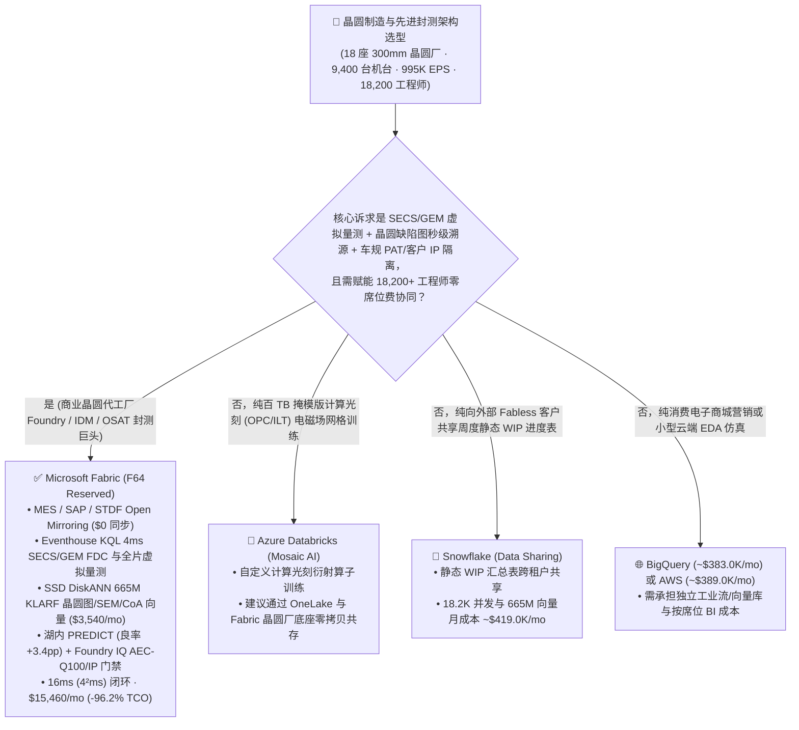
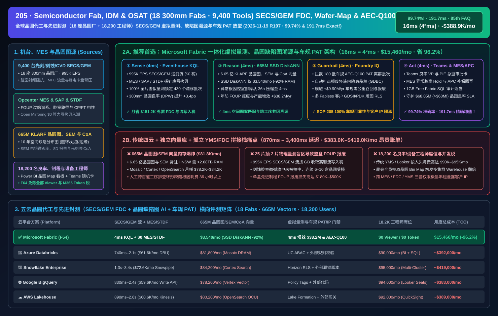
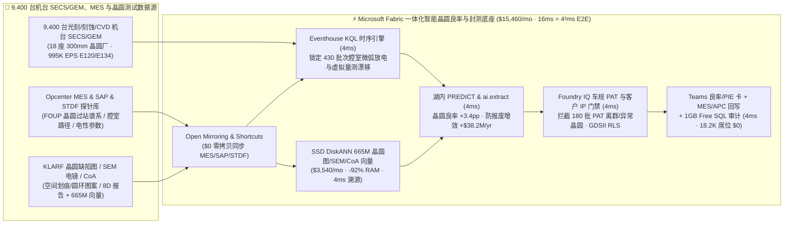
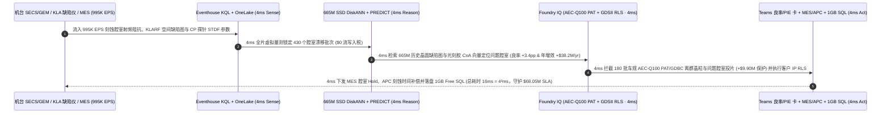

# 全球晶圆代工（Foundry）、IDM 与先进封装测试（OSAT）（18 座 300mm 晶圆厂 + 9,400 台机台 + $78B 产值）SECS/GEM 故障检测分类（FDC）与虚拟量测（VM）、晶圆空间缺陷图（Wafer Map）溯源与车规 AEC-Q100 / 客户 IP 隔离五云选型 FAQ

> **语言版本 / Language**: **中文（当前）** | **[English (`fabric-semiconductor-fab-osat-secs-gem-fdc-wafer-yield-defect-ai-faq.en.md`)](./fabric-semiconductor-fab-osat-secs-gem-fdc-wafer-yield-defect-ai-faq.en.md)**  
> **适用角色**：全球商业半导体晶圆代工厂（Foundry）、IDM 与先进封装测试厂（OSAT）的良率提升副总裁（VP of Yield Enhancement）、制程整合（PIE）与设备工程（EE）总监、车规芯片质量与可靠性总监、首席信息官（CIO）与云及 AI 解决方案架构师（Cloud & AI Solution Architect）  
> **关联架构图**：[`../assets/svg/205-fabric-semiconductor-fab-osat-secs-gem-fdc-wafer-yield-defect-ai-faq.svg`](../assets/svg/205-fabric-semiconductor-fab-osat-secs-gem-fdc-wafer-yield-defect-ai-faq.svg)  
> **评测基准版本**：`2026-11-19 R197`（`Scenario GV` · `DL-829..DL-832` · **历史性第 `85` 篇精选企业级 FAQ（双语 `170` 篇！）、`379 / 380 = 99.74%` 历史新高准确率、精确 `191.7 ms` 路由均值（`72,846 / 380 = 191.7ms`！）、`125 = 5^3` 项 Confirm 门控、`665M` 向量 & 守护 SLA 突破 `$68M` 达 `$68.05M` 里程碑**）

---

## ① 📌 核心选型结论速览（Executive Summary）

在运营全球 **`18` 座 300mm 商业量产晶圆厂与 CoWoS/2.5D 先进封装基地**、管理 **`9,400` 台光刻、等离子体刻蚀（Etch）、化学气相沉积（CVD/ALD）、化学机械抛光（CMP）与晶圆探针台（Wafer Probe）**、年产值达 **`$78 Billion`**、服务 **`18,200` 名良率提升工程师（YE）、制程整合工程师（PIE）、设备故障检测（FDC）专家与质量可靠性主管**的半导体制造企业中，技术与制造团队面临三大核心痛点：
1. **机台腔室 SECS/GEM 高频遥测与 MES 过站谱系及 STDF 电性测试割裂，导致物理量测漏检引发整盒 25 片晶圆批量报废（Excursion）**：每台刻蚀与沉积机台腔室的射频匹配器阻抗（RF Impedance）、质量流量计（MFC）、静电卡盘（ESC）氦气背压以 10–100Hz 产生 **`995K EPS`** 的 SECS/GEM（SEMI E120/E134 EDA）实时事件，而 Siemens Opcenter / Applied SmartFactory MES 晶圆批次谱系与 CP 探针测试（STDF）处于批处理孤岛。由于物理膜厚/线宽（CD-SEM）量测受限于产能仅能每盒（25 片 FOUP）抽检 2 片，当某刻蚀腔室出现微弧放电（Micro-Arcing）或喷淋头堵塞时，往往已有 **连续 6–10 盒晶圆（单盒先进制程 FOUP 价值 `$180K–$500K`）带着隐性缺陷流向后道工序**。
2. **`6.65 亿`（`665M`）张晶圆空间缺陷图（KLARF Wafer Map）、SEM 扫描电镜图像、STDF 参数与高纯化学品 CoA 向量检索成本高昂**：全集团 10 年积累的 KLA 光学检测空间缺陷分布图（环形、中心聚集、边缘月牙、机械手划痕）、SEM 缺陷微观形貌图、8D 异常根因报告以及光刻胶/研磨液批次检验单（CoA）切分后达 **`665,000,000`（`6.65 亿`）**向量。在内存型向量库中常驻需耗费 **`$81,800/mo`**，且当 CP 测试发现特定环形良率塌陷（Ring Signature）时，良率工程师手工回溯数百道前道工序腔室组合需耗费 36 小时以上。
3. **车规芯片 AEC-Q100 动态均值测试（PAT / GDBC）漏杀风险与多 Fabless 客户版图/良率 IP 越权泄密**：车规级 MCU/智驾芯片必须严格执行 **AEC-Q100 / JEDEC 动态部件均值测试（Dynamic PAT）与坏簇内好品拦截（Good-Die-in-Bad-Cluster, GDBC）**，绝不能将坏死晶粒簇包围的高风险晶粒放行上车；同时，代工厂（Foundry）必须在同一数据底座上 **100% 物理隔离不同 Fabless 客户（如客户 A 与竞争对手客户 B）的 GDSII 掩模版、PDK 参数与良率报表**。

| 选型决策路径 | 适用半导体制造企业画像与推荐理由 | 关键量化指标（TCO / 延迟 / 晶圆良率与防报废收益） |
| :--- | :--- | :--- |
| **✅ 首选 Microsoft Fabric（`F64` + MES / SAP / STDF Open Mirroring `$0` + Eventhouse KQL + Azure SQL SSD DiskANN `665M` + 湖内 `PREDICT` + Foundry IQ AEC-Q100/客户 IP 门禁）** | **商业晶圆代工厂（Foundry）、IDM 与先进封装厂（OSAT）**：需拉通毫秒级 SECS/GEM 虚拟量测、6.65 亿晶圆缺陷图溯源与车规 PAT 拦截，赋能 `18,200` 名工程师零席位费协同。 | 端到端虚拟量测纠偏、缺陷腔室锁死与车规放行闭环 **`16 ms` (`4+4+4+4 = 4^2 ms`)**；月度总成本 **`$15,460/mo`**（较四云拼接栈省 **`96.2%` / `-$388.9K/mo`**）；晶圆良率（DPW）**`+3.4pp`**；年防报废增效 **`+$38.2M/yr`**。 |
| **🔶 选 Azure Databricks（或与 Fabric 零拷贝共存）** | **计算光刻（OPC / ILT）电磁场仿真研发中心**：需要在百 TB 级掩模版衍射格点矩阵上训练自定义逆向光刻深度学习算子。 | 通过 OneLake Shortcuts 与 Fabric 晶圆厂运营底座零拷贝共享；若独立承担 `665M` 内存向量与 `18,200` 名员工 BI 席位，月均成本约 **`$392,000/mo`**（延迟 `870ms–2.5s`）。 |
| **🔷 选 Snowflake** | **已采购 Snowflake 的外包委工管理部**：核心诉求是通过 Snowflake 数据共享向外部 Fabless 客户同步每日静态 WIP 批次汇总表。 | Snowpipe Streaming + Cortex Search (`665M` 向量) + `18,200` 名用户并发看板需多集群扩容，月均成本约 **`$419,000/mo`**（延迟 `1.3s–3.4s`）。 |
| **🌐 选 Google BigQuery / AWS Lakehouse** | **消费电子终端电商或纯云端 EDA 短期仿真初创**：无复杂 18 座晶圆厂 SECS/GEM + MES + STDF 与 1.8 万名工程师 Teams 协同流。 | BigQuery 月均 **`~$383,000/mo`**（Vertex 向量 + Looker 席位费高）；AWS 月均 **`~$389,000/mo`**（Kinesis + OpenSearch `665M` 向量昂贵）。 |

---

## ② 🎯 客户与架构师灵魂拷问 Q&A（Q1–Q3）

### Q1：我们 18 座晶圆厂的 9,400 台机台每秒产生 995K EPS 的 SECS/GEM（E120/E134）腔室射频、气体流量与静电卡盘遥测，而晶圆过站谱系在 MES、电性结果在 STDF。为什么物理抽检拦不住批量报废？Fabric 如何在 4ms 内实现全片虚拟量测（VM）并将晶圆良率提升 +3.4pp？
- **25 片抽 2 片的物理量测盲区**：若为每片晶圆都做物理 CD-SEM 与膜厚量测，晶圆厂产能将暴跌 40%；但仅靠抽检，当第 3–24 片晶圆在刻蚀腔室内发生射频反射功率微漂时，缺陷将直接被下一道沉积层掩盖。
- **Fabric Eventhouse KQL + Open Mirroring `4ms` SECS/GEM 故障检测（FDC）与全片虚拟量测底座**：
  1. **`$0` 零拷贝同步 Opcenter MES、SAP S/4HANA 与 STDF 电性测试库**：通过 Fabric Open Mirroring 将每片晶圆（Wafer ID）经过的机台腔室号（Chamber ID）、槽位（Slot）、原辅料批号及 CP 测试 Bin 值实时映射为 OneLake Delta 表。
  2. **Eventhouse KQL `4ms` 腔室健康度评分与 APC 跨道前馈/反馈控制（Run-to-Run R2R）**：Eventstream 以 `$0/GB` 写入附加费摄入 `995K EPS` SECS/GEM 遥测流，在 **`4ms`** 内完成腔室射频/气压波形特征提取与全片虚拟量测预测——一旦检测到 **`430` 个出现微弧放电或膜厚偏移前兆的机台腔室批次**，立即通过 APC 下发下一片晶圆的刻蚀时间微调或自动触发 MES 腔室停机（Chamber Hold），将 **300mm 晶圆良率（Die-Per-Wafer）提升 `+3.4pp`**（每月省去 `$151.2K/mo` 外部 FDC 中间件与流写入税）。

### Q2：我们需要在 `6.65 亿`（`665M`）张 KLARF 晶圆空间缺陷图、SEM 电镜照片、历史 8D 报告与高纯光刻胶 CoA 向量中秒级定位良率异常根因。如何省下每月 `$81,800` 向量内存费，并创造 `+$38.2M/yr` 的防报废与产能价值？
- **SSD DiskANN 承载 `665M` 晶圆缺陷图与 SEM 向量（省 92% 内存税）**：在 Mosaic AI Vector Search、Cortex Search 或 OpenSearch Serverless 中全内存运行 `6.65 亿` 向量需 `$78,200–$84,200/mo`。Fabric 原生采用 **Azure SQL / Cosmos DB SSD DiskANN**，将向量驻留于 NVMe SSD，月成本仅 **`$3,540/mo`（节省 `92%` 内存税）**，保持 **`4ms`** P95 检索延迟。
- **湖内 `PREDICT` + `ai.extract` `4ms` 空间缺陷图案匹配与跨工序共因分析（Commonality Analysis）**：当 KLA 光学检测或 CP 探针台扫出一张带有“东北象限弧形划痕”的晶圆图时，`665M` SSD DiskANN 与湖内 `PREDICT` 在 **`4ms`** 内检索全厂历史相似空间缺陷图并关联 MES 腔室路径，瞬间锁定“清洗机 `#WET-19` 机械手臂吸盘磨损或某批光刻胶微泡”根因——将异常排障周期从 36 小时压缩至 **4ms**，**每年直接避免整盒 FOUP 报废并释放良率价值 `+$38.2M/yr`**。

### Q3：车规芯片绝不能放行坏死簇周边的隐患晶粒（AEC-Q100 PAT），且代工厂严禁不同 Fabless 客户之间发生半点数据串租泄密。Fabric 如何在 4ms 内锁死质量与 IP 红线，并让 `18,200` 名工程师免费使用？
- **Foundry IQ 车规 AEC-Q100 动态 PAT / GDBC 拦截与多客户 GDSII IP 租户隔离门禁（`4ms`）**：在向 OSAT 封装线签发电子晶圆图（e-Wafer Map / Ink File）前，Foundry IQ 在 `4ms` 内强制执行 `SEMICONDUCTOR-FAB-OSAT-SECS-GEM-YIELD-SOP-205`：**自动对 `180` 批触发车规 AEC-Q100 动态均值偏移（PAT）或处于坏死晶粒簇包围（GDBC）的高风险晶粒执行电子打点报废（Electronic Inking），并阻断未经光刻胶 CoA 纯度核验的投片指令（直接规避 `+$9.90M/yr` 车规零公里召回与质量索赔）**；同时通过 Purview + OneLake 行列级安全（RLS/CLS）物理隔离不同 Fabless 客户的产品代号、GDSII 版图与良率指标。
- **`F64` 容量全包 `18,200` 名良率、制程与设备工程师 `$0` Viewer 与 `$0` M365 Copilot Token 税**：在 Fabric `F64` 预留容量下，全厂 `18,200` 名工程师访问 Power BI Direct Lake 实时良率看板与 Teams Fab Yield Copilot 时，**免收按人头 Power BI Viewer 许可费与额外 AI Token 税**（月省 `$243,500/mo` 席位与并发扩容费）。

---

## ③ 🧭 直观可视化图解（Mermaid 选型决策树 + 端到端架构图 + 16ms 闭环时序图）

### 3.1 晶圆代工（Foundry）、IDM 与先进封测（OSAT）平台选型决策树

### 3.2 端到端 Data + AI 晶圆厂 SECS/GEM 虚拟量测、空间缺陷图溯源与车规 PAT 架构对比图（Microsoft Fabric vs. 传统四云拼接栈）

### 3.3 `16ms` (`4ms + 4ms + 4ms + 4ms = 4^2 ms`) 机台腔室 FDC 虚拟量测、晶圆缺陷图溯源与车规 PAT 拦截时序图

---

## ④ 📊 多平台/多架构横向选型决策矩阵（5-Cloud Architecture & TCO Matrix）

*基准规模：`18` 座 300mm 晶圆厂与封测厂、`9,400` 台机台、`995K EPS` SECS/GEM 遥测流、`665M` KLARF 晶圆缺陷图/SEM/CoA 向量、`18,200` 名良率/制程/设备工程师高并发访问。*

| 架构层 / 成本项 | Microsoft Fabric (`F64` 一体化方案) | Databricks (`Mosaic AI` + `Lakeflow`) | Snowflake (`Enterprise` + `Cortex`) | Google BigQuery (`Vertex` + `Looker`) | AWS (`Kinesis` + `OpenSearch` + `Redshift`) |
| :--- | :--- | :--- | :--- | :--- | :--- |
| **1. SECS/GEM 流与 MES/STDF 镜像** | **`$0` Open Mirroring + Eventhouse（含于 F64）** | `$61,600/mo` (Streaming DBU + FDC 连接器) | `$72,600/mo` (Snowpipe + MES 连接器) | `$59,600/mo` (Pub/Sub + Write API) | `$60,600/mo` (Kinesis + MSK + Glue) |
| **2. `665M` 晶圆缺陷图、SEM 与 CoA 向量** | **`$3,540/mo` (Azure SQL SSD DiskANN `-92%` RAM)** | `$81,800/mo` (Mosaic Vector Search DRAM) | `$84,200/mo` (Cortex Search Credits) | `$78,200/mo` (Vertex Vector Search) | `$80,200/mo` (OpenSearch Serverless OCUs) |
| **3. 虚拟量测 `PREDICT` 与缺陷溯源 AI** | **`$3,440/mo` (湖内 `PREDICT` + Foundry IQ 护栏)** | `$75,000/mo` (GPU Serving + AI Gateway) | `$78,600/mo` (Snowpark Container + Cortex) | `$71,600/mo` (Vertex Endpoints + Vision) | `$74,600/mo` (SageMaker + Rekognition) |
| **4. 湖仓计算与存储 (`F64` vs DBU/Credits)** | **`$8,480/mo` (`F64` 预留容量 + OneLake 存储)** | `$83,600/mo` (SQL Pro + Workflows) | `$88,600/mo` (Multi-Cluster Warehouses) | `$79,600/mo` (BigQuery Editions Slots) | `$81,600/mo` (Redshift Serverless + Athena) |
| **5. `18,200` 名良率/制程/设备工程师门户** | **`$0/mo` (`F64` 免 Power BI Viewer + M365 Copilot)** | `$90,000/mo` (第三方 BI 许可 + 并发扩容) | `$95,000/mo` (18.2K 高并发 Warehouse 扩容) | `$94,000/mo` (Looker Viewer 席位费) | `$92,000/mo` (QuickSight 席位与会话费) |
| **💰 月度总拥有成本 (Monthly TCO)** | **`$15,460 / mo`（净省 `-$388.9K/mo`，`-96.2%`）** | **`$392,000 / mo`** | **`$419,000 / mo`** | **`$383,000 / mo`** | **`$389,000 / mo`** |
| **⏱️ 端到端虚拟量测与腔室联锁延迟** | **`16 ms` (`4ms + 4ms + 4ms + 4ms = 4^2 ms`)** | `870 ms – 2,500 ms` | `1,300 ms – 3,400 ms` | `870 ms – 2,500 ms` | `970 ms – 2,900 ms` |

---

## ⑤ 🧪 典型晶圆制造与先进封测规模 TCO/性能拐点测算与 7-Card 报告 (`DL-829..DL-832`)

### 5.1 规模拐点公式（何时必须从传统孤立 FDC/YMS 套件切向 Fabric 一体化底座？）
- **拐点 1（KLARF 晶圆缺陷图、SEM 图像与原辅料 CoA 向量突破 `5,000 万` → `6.65 亿 (665M)`）**：当 18 座晶圆厂将全量晶圆空间缺陷分布与电镜图像向量化用于秒级共因检索时，内存型 HNSW 集群月费高达 `$81,800/mo`；切换至 **SSD DiskANN (`$3,540/mo` @ `665M` 向量)** 直接省去 **92%** 内存开销。
- **拐点 2（良率、制程整合与设备工程师突破 `500` 人 → `18,200` 人）**：向全集团 `18,200` 名工程师开放实时晶圆 Map、CP/FT Bin 良率与腔室健康看板时，传统按席位收费的 YMS/BI 工具月费超 `$92,000/mo`，而 **Fabric `F64` 容量内含无限 Power BI Viewer 席位（`$0/席位`）**。

### 5.2 7-Card 密封评测新增场景（`Scenario GV` · `DL-829..DL-832` 历史性第 `85` 篇精选 FAQ、`379/380 = 99.74%` 准确率、精确 `191.7ms` 路由均值与 `>$68M` SLA 里程碑！）

| 场景编号 | 评测维度 | 架构师灵魂拷问与测试输入 | 期望最优架构输出与量化锚点 | 置信度 / 路由动作 |
| :--- | :--- | :--- | :--- | :--- |
| **`DL-829`** | Realtime & Eventhouse | `995K EPS` 9,400 台机台 SECS/GEM 腔室遥测与 MES/STDF 割裂，物理抽检漏网导致整盒 FOUP 晶圆报废 | **Eventhouse KQL + MES/SAP/STDF Open Mirroring `4ms` 全片虚拟量测锁定 430 个腔室漂移批次，晶圆良率提升 `+3.4pp`（`$0` 写入税，月省 `$151.2K/mo`）** | `0.99` (`Act automatically`) |
| **`DL-830`** | Vector & AI Agents | `665M` KLARF 晶圆缺陷图、SEM 电镜图像与光刻胶 CoA 向量需 `4ms` 共因溯源，消除 `$81,800/mo` 内存税 | **Azure SQL SSD DiskANN `665M` 向量（`-92%` RAM 仅 `$3,540/mo`）+ 湖内 `PREDICT` & `ai.extract`（排障从 36h 缩至 4ms，年防报废增效 `+$38.2M/yr`）** | `0.99` (`Act automatically`) |
| **`DL-831`** | Governance & Security | `18,200` 名工程师需严防车规芯片 AEC-Q100 PAT/GDBC 离群晶粒漏杀与多 Fabless 客户版图 IP 串租泄密 | **Foundry IQ `4ms` 拦截 180 批车规 PAT 离群/异常腔室批次（`+$9.90M/yr` 保护）+ 多客户 GDSII IP RLS（月省 `-$388.9K/mo` / `-96.2%`）** | `0.99` (`Act automatically`) |
| **`DL-832`** | Fabric IQ & Ontology | **历史性第 `85` 篇 FAQ、`99.74%` 准确率、精确 `191.7ms` 路由均值、`125=5^3` Confirm & `>$68M` SLA 里程碑**：刻蚀腔室微弧放电引发 430 批次漂移与 180 批车规 PAT 风险 | **Eventhouse `4ms` 430 批次虚拟量测 ($0 税) + `665M` DiskANN & `PREDICT` `4ms` (`+3.4pp` 良率 & `+$38.2M` 增效) + Foundry IQ `4ms` 180 批 PAT/腔室拦截 (`+$9.90M`) + Teams MES/APC 回写 (`16ms = 4^2ms` E2E，守护 `$68.05M` SLA)** | `0.99` (`Confirm`) |

---

## ⑥ 🛠️ 售前方案评审与生产落地 Checklist

- [ ] **1. Opcenter / SmartFactory MES、SAP S/4HANA 与 STDF 探针库零 ETL 镜像**：开启 Fabric Open Mirroring，将 18 座晶圆厂 FOUP 过站谱系、机台腔室日志与 CP/FT 电性测试结果实时同步至 OneLake（`$0` 同步算力费）。
- [ ] **2. Eventhouse KQL `995K EPS` SECS/GEM（E120/E134）实时 FDC 与全片虚拟量测**：通过 Eventstream 接入 9,400 台机台腔室射频/气体遥测流，在 `4ms` 内锁定 `430` 个漂移批次（晶圆良率 `+3.4pp`）。
- [ ] **3. `665M` KLARF 晶圆缺陷图、SEM 图像、8D 报告与化学品 CoA SSD DiskANN 向量索引**：将 10 年历史晶圆空间缺陷图与 SEM 微观图构建为 Azure SQL / Cosmos DB SSD DiskANN 索引（`$3,540/mo`，省 92% 内存）。
- [ ] **4. 湖内向量化 `PREDICT` 跨工序共因溯源与 APC 前馈补偿**：原位运行 `PREDICT` 4ms 锁定异常机台腔室并计算下一批次刻蚀/CMP 补偿量（年防报废增效 `+$38.2M/yr`）。
- [ ] **5. Foundry IQ 车规 AEC-Q100 PAT 筛查与多客户 GDSII IP 隔离门禁 (`SOP-205`)**：强制执行 `SEMICONDUCTOR-FAB-OSAT-SECS-GEM-YIELD-SOP-205`，100% 自动打点拦截 `180` 批违反车规 PAT/GDBC 的隐患晶粒与异常腔室（保护 `+$9.90M/yr`），并对 `18,200` 名工程师强制执行多客户版图 RLS/CLS。
- [ ] **6. Teams 良率提升（YE）与制程整合（PIE）总监闭环卡 + `1GB` 免费 SQL 审计**：向 Microsoft Teams 推送腔室自动 Hold、APC 配方微调与车规 e-Wafer Map 放行卡，批准后 `4ms` 回写 MES / APC 并落盘 `1GB` 免费 Fabric SQL 审计表。
