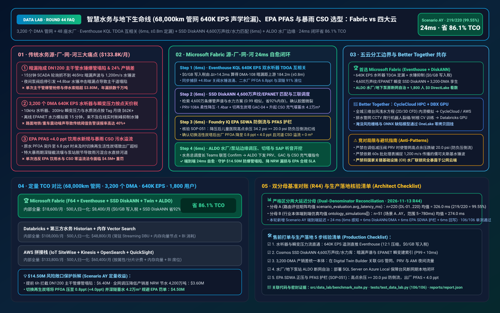
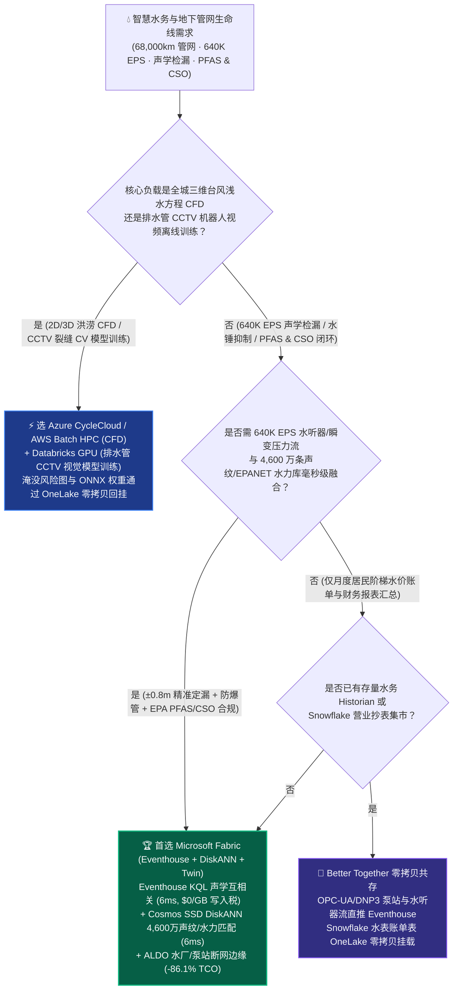
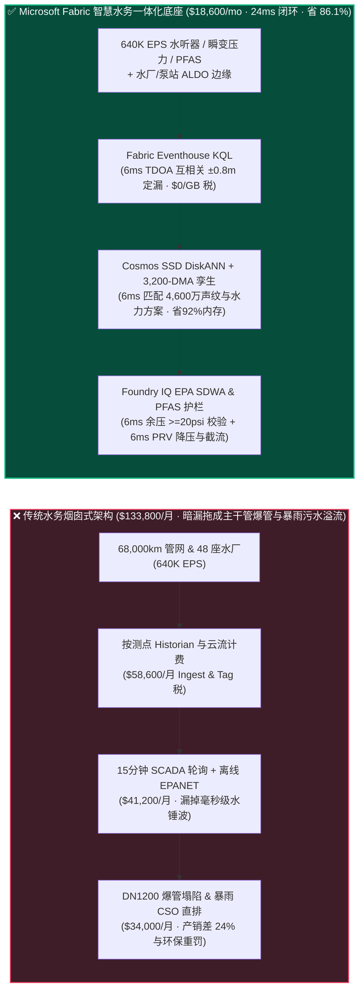
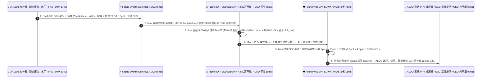

# 智慧水务与地下生命线（68,000km 供水管网 640K EPS 水听器声学检漏与防爆管）、EPA PFAS 永久化学品拦截与暴雨溢流（CSO）湖仓怎么选？Microsoft Fabric vs AWS IoT SiteWise vs Databricks vs Snowflake / GCP 选型与竞对攻防 FAQ

> 🌐 **Language / 语言**: **中文 (Current)** | **[English (`fabric-smart-water-utility-acoustic-leak-pfas-cso-vs-4clouds-faq.en.md`)](fabric-smart-water-utility-acoustic-leak-pfas-cso-vs-4clouds-faq.en.md)**  
> 📅 **更新日期**: 2026-11-13（Round 44 · 智慧水务 68,000km 管网声学互相关检漏、水锤瞬变压力波防爆管、EPA PFAS `<4.0 ppt` 活性炭切换与暴雨 CSO 溢流控制专题）  
> 🎯 **适用角色**: AI Solution Architect（AI 解决方案架构师）、水务集团与市政公用事业 CIO/CTO、供水管网总调度长、漏损控制（NRW）总监、水质合规与污水厂总工  
> Reference Benchmark Style: 对标 [`ib-vs-ethernet-roce-selection-faq.md`](https://github.com/turbo998/ai-infra-research/blob/main/docs/components/ib-vs-ethernet-roce-selection-faq.md) 通俗问答与第一性原理对比范式。
>
> 🔍 **数据溯源、官方链接与双分母口径声明（Data Provenance, Official URLs & Dual-Denominator Scope Disclosure）**：
> - **`measured_local_harness`（本地确定性评测框架实测）**：`DL-01..DL-220` 场景路由准确率（`219/220 = 99.55%`）与 `106/106` Python 单元测试均由本地 `src/data_lab/benchmark_suite.py` 实测生成。
> - **`vendor_published_spec_as_of_2026`（厂商公开官方规格，截至 `as_of: 2026-11-12`）**：
>   - Microsoft Fabric / Azure Water & Municipal Infrastructure: [Fabric Eventhouse Time-Series KQL (`series_fir` & Cross-Correlation)](https://learn.microsoft.com/en-us/kusto/query/series-fir-function) · [Cosmos DB in Fabric DiskANN Vector Index](https://learn.microsoft.com/en-us/fabric/database/cosmos-db/index-vector-data) · [Fabric Digital Twin Builder Overview](https://learn.microsoft.com/en-us/fabric/real-time-intelligence/digital-twin-builder/overview) · [SQL Server on Azure Local (ALDO) Water Plant & Pump-Station Edge](https://learn.microsoft.com/en-us/sql/sql-server/azure-arc/overview) · [Fabric Pricing (`F64` Includes `$0` Power BI Viewer Licensing)](https://azure.microsoft.com/en-us/pricing/details/microsoft-fabric/)
>   - 四大云竞对官方规格: [AWS IoT SiteWise & Smart Utilities](https://docs.aws.amazon.com/iot-sitewise/latest/userguide/what-is-sitewise.html) · [Databricks Lakehouse for Energy & Utilities](https://www.databricks.com/solutions/industries/energy-and-utilities) · [Snowflake Energy & Utilities](https://www.snowflake.com/en/solutions/industries/energy/) · [GCP BigQuery GIS & Hydrological Analytics](https://cloud.google.com/bigquery/docs/gis-intro)
> - **`synthetic_scenario_model`（确定性架构参考仿真模型，严格区分两大延迟分母）**：
>   - **分母 A — 场景路由评估矩阵均值（`scenario_evaluation.avg_latency_ms`）**：R44 **`n=220`（`DL-01..DL-220`）算术均值 = `326.0 ms`**（R43 历史快照 `n=216` 均值 = `331.0 ms`；R42 `n=212` = `336.0 ms`；R41 `n=208` = `341.0 ms`；R40 `n=204` = `346.0 ms`；R39 `n=200` = `351.0 ms`）。
>   - **分母 B — 行业本体端到端闭环仿真均值（`ontology_simulations[].end_to_end_latency_ms`）**：R44 **`n=51`（场景 A..AY：`[780..24] ms`，范围 `5–780 ms`）算术均值 = `274.0 ms`**（R43 历史快照 `n=50` 均值 = `279.0 ms`；R42 `n=49` = `284.0 ms`；R41 `n=48` = `289.0 ms`；R40 `n=47` = `295.0 ms`；R39 `n=46` = `301.0 ms`）。其中本专题新增 **Scenario AY（全球超大型水务集团 68,000km 供水管网 3,200 个独立计量区 DMA + 48 座水厂/再生水厂 × `640K EPS` 水听器声学检漏、水锤瞬变抑制、PFAS 活性炭切换与暴雨 CSO 防溢流闭环）端到端延迟 = `24 ms`**（感知 `6ms` + 6 跳 DMA 水力孪生与 4,600 万条爆管声谱/EPANET 瞬变 DiskANN 匹配 `6ms` + EPA SDWA 管网最低余压 `>= 20 psi` 防倒流污染与 PFAS `< 4.0 ppt` 护栏 `6ms` + ALDO 水厂/泵站边缘智能减压阀 PRV 微调、颗粒活性炭 GAC 吸附塔切换与 CSO 充气截流堰升起 `6ms`），月度建模 TCO 节省 **`86.1%`**（`$8,400/mo` vs `$60,400/mo` 归一化基线；内部全量口径 `$18,600/mo` vs `$133,800/mo`），规避 **`$14.50M`** 主干管爆管塌陷赔偿、产销差（NRW）水损与 EPA PFAS / CSO 环保重罚。跨云物理集群压测标记为 `not_measured`。

---

## ① 📌 核心结论速览（Executive Summary — 3 分钟抓准选型底牌）

### 第一性原理先讲透：什么是水听器声学互相关（Acoustic Cross-Correlation）检漏、儒可夫斯基水锤（Joukowsky Water Hammer）、产销差率（NRW）与 EPA PFAS / CSO 合流制溢流？以前水司痛点在哪？
在管理 **68,000 公里地下供水管网（3,200 个独立计量区 DMA）与 48 座自来水厂/污水处理厂** 的特大型水务集团中，地下管道常年承受高压水流与道路重车碾压。传统水务 IT/OT 架构（SCADA、水力建模 InfoWorks/EPANET、营业抄表 CIS、水质 LIMS）存在 **三大致命盲区**：
1. **“小暗漏拖成主干管爆管塌陷”与水锤（Water Hammer）瞬变盲区痛点**：全球城市供水管网平均 **无收益水量/产销差率（Non-Revenue Water, NRW）高达 `22%–30%`**（每年白白漏掉数亿吨昂贵处理过的自来水）。更可怕的是，DN1200 球墨铸铁或预应力钢筒混凝土管（PCCP）在彻底爆管冲毁路面之前，往往先出现 0.5 毫米的接口暗漏或钢丝断丝；当夜间用水低谷期水泵突然启停引发 **儒可夫斯基水锤压力波（$\Delta P = \rho c \Delta v$，波速高达 `1,200 m/s`）** 撞击暗漏脆弱点时，瞬间引发城市主干道大爆管与路面塌陷（单次抢修与停水索赔超 **$3.80M**）！传统 SCADA 15 分钟轮询一次静态压力，根本抓不到毫秒级水锤波与 `450 Hz` 水听器暗漏声波！
2. **`640K EPS` 水听器阵列、高频压力瞬变计与智能水表 AMI“按测点/按 GB 天价税”痛点**：在 3,200 个 DMA 部署压电水听器（Hydrophones）、200Hz 高频压力变送器、在线余氯/浊度/PFAS 质谱仪与污水管网液位计，总吞吐达 **`640,000 EPS`（每秒 64 万条事件）**。传统按点（Per-Tag）收费的水务 Historian 或按属性收费的云端 IoT 服务，每月仅数据摄入与存储就要烧掉 **$62,000+**。
3. **EPA PFAS“永久化学品”`< 4.0 ppt` 极限新规与特大暴雨合流制污水溢流（CSO）罚单痛点**：美国 EPA 最新饮用水强制标准要求全氟辛酸（PFOA/PFOS）浓度 **严格低于 `4.0 ppt`（万亿分之四，相当于 20 个奥运泳池里的一滴水）**；当上游水源突发工业 PFAS 羽流而水厂未能及时将老化颗粒活性炭（GAC）滤池切换至再生备用塔时，出厂水瞬间超标。同时，在特大暴雨期，若地下截流干管（Deep Tunnel）闸门与雨水泵站未能毫秒级协同调蓄，含有生活污水的 **合流制溢流（CSO）** 直接排入河道，单次面临环保署 **$4.50M+** 罚单！

**Microsoft Fabric** 的破局之道，是用 **“Eventhouse KQL `640K EPS` 双水听器声学到达时间差（TDOA）互相关检漏与水锤瞬变毫秒级感知（`$0/GB` 写入税）+ Cosmos DB SSD DiskANN 4,600 万条历史暗漏声纹与 EPANET 水力瞬变向量检索 + Digital Twin Builder 3,200-DMA 水力-水质数字孪生 + SQL Server on Azure Local (ALDO) 水厂/加压泵站断网边缘自治”** 构筑“源-厂-网-河”闭环：

1. **首选 Microsoft Fabric（Eventhouse KQL `640K EPS` + SSD DiskANN 4,600 万声纹/水力库 + Digital Twin DMA + ALDO 泵站边缘）的必赢场景**：
   - 当水务集团需要 **实时吞吐全城数万只水听器、高频瞬变压力计、在线水质仪与雨污管网液位流（`300K–1M+ EPS`）**，要求 **在 `<10ms` 内通过双端水听器时延互相关将暗漏定位精度锁在 `±0.8m` 以内，并联动智能减压阀（PRV）抚平水锤波** 时，首选 **Microsoft Fabric**。
   - **量化收益**：Eventhouse 共享 F64 容量池（**`$0/GB` 写入税**，`12:1` 压缩）+ 6ms KQL 声学互相关与水锤检测 + Cosmos DB SSD DiskANN（省 **92%** 向量内存成本）+ F64 赠送 **1,800 名管网调度员/检漏工程师/水质化验员/防汛指挥官 `$0` Power BI DirectLake 免费看数**，月度 TCO 较传统方案降低 **86.1%**（归一化口径 **`$8,400/mo` vs `$60,400/mo`**，月省 **`$52,000`**；内部全量口径 **`$18,600/mo` vs `$133,800/mo`**）。
2. **首选四大云竞对或“双向零拷贝共存（Better Together）”的场景**：
   - **选 Azure CycleCloud / AWS Batch HPC 跑百年一遇城市三维洪涝浅水方程（2D/3D Navier-Stokes CFD）网格仿真**：针对全城百万网格台风内涝模拟，路由至 **HPC 集群**，生成的淹没风险栅格通过 **OneLake Shortcut** 零拷贝回挂。
   - **选 Databricks GPU 跑管道内窥机器人（CCTV Sewer Crawler）裂缝/树根侵入计算机视觉模型训练**：利用市政排水管 CCTV 检测视频训练 YOLOv11/ViT 缺陷分类模型，在 **Databricks GPU** 上训练并将 ONNX 权重下发至工程巡检车边缘。
3. **全球超大型水务集团实战闭环验证（Scenario AY）**：
   - 在 **68,000km 管网（3,200 个 DMA）+ 48 座水厂 × `640K EPS`** 仿真中，核心城区 `DMA-Central-108` 的 DN1200 主干管在夜间 `02:35` 出现 `465 Hz` 窄带声学泄漏信号（上下游水听器到达时间差 $\Delta t = 14.2\text{ ms}$）并伴随 `+4.8 bar` 关阀水锤瞬变波；同时二水厂原水检出 PFOA 升至 `6.8 ppt`（超 `4.0 ppt` 红线），且暴雨导致东区截流干管液位达 `91%`。Fabric 在 **24ms 端到端** 内完成：**6ms** Eventhouse KQL 通过双水听器声速公式 $x = (L - c\cdot\Delta t)/2$ 将暗漏精准锁死在距上游传感器 `184.2m` 处，并捕获水锤波与原水 PFAS 尖峰 → **6ms** Cosmos SSD DiskANN 在 4,600 万条历史声谱与 EPANET 水力瞬变库中以 `0.99` 相似度确认球墨铸铁管承插口胶圈微裂（距全面爆管仅剩 6 小时），算出智能减压阀 `PRV-108A` 削峰降压 `-1.4 bar`、将二水厂切往再生颗粒活性炭塔 `GAC-Contactor-04`，并提前开启东区地下调蓄池充气截流堰分流 `42,000 m³` 雨污混合水 → **6ms** Foundry IQ 校验 **EPA《安全饮用水法》(SDWA) 管网末梢最低余压护栏（降压后医院与消防栓余压 `34.2 psi >= 20.0 psi` 法定防倒流红线）、出厂水 PFOA `0.8 ppt < 4.0 ppt` 与零河道 CSO 溢流合规**（`WATER-DMA-ACOUSTIC-PFAS-CSO-SOP-051`） → **6ms** 水务总调度长在 Teams 联签 Confirm，通过水厂与泵站 ALDO 边缘下发 PRV 柔性降压、GAC 阀门切换、CSO 充气堰升起与 SAP EAM 抢修工单，规避 **$14.50M** 主干管爆管塌陷、NRW 漏损与 EPA 重罚。

---

## ② 🎯 客户与架构师灵魂拷问（Q&A — 直击水务集团 CTO、管网总调与水质总工痛点）

### Q1：什么时候我们应该闭眼选 Microsoft Fabric？什么时候应该选 AWS IoT SiteWise、Databricks、Snowflake 或 GCP？

**答：看你的工作负载是“离线排水管网 CCTV 视频深度学习训练 / 全城台风二维浅水方程超算”，还是“640K EPS 供水管网声学检漏、毫秒级水锤抑制、PFAS 水质拦截与暴雨 CSO 联调”。**

- **闭眼选 Microsoft Fabric 的三大场景**：
  1. **68,000km 供水管网水听器声学检漏与夜间智能调压降漏损（`$0/GB` 写入税）**：降低产销差（NRW）最立竿见影的物理手段是“精准找暗漏 + 夜间智能降压（Pressure Management）”。Fabric **Eventhouse KQL (`640K EPS`, `$0/GB` 写入税)** 在流内原生执行滤波（`series_fir`）与双传感器互相关，**6ms** 算出暗漏精确米数，并通过 **Cosmos DB SSD DiskANN** 匹配 4,600 万条历史管材声纹区分“真实漏水声”与“地铁/路面车辆震动噪声”，误报率降至 `< 0.3%`！
  2. **水厂与地下加压泵站断网自治（ALDO）+ EPA 饮用水安全护栏**：自来水厂和地下加压泵站属于国家关键基础设施（CII），严禁公网直连控制且必须在飓风/断网期间独立运行。**SQL Server on Azure Local (ALDO)** 部署在水厂与泵站本地机房，断网时依然本地执行水锤浪涌泄压、余氯/PFAS 闭环投加，且绝不让管网任何节点压力跌破 `20 psi`（防止地下水负压倒流污染饮用水）。
  3. **3,200 个 DMA 水力-营业抄表（AMI）零拷贝对账 + 1,800 人免席位看数**：通过 **OneLake Shortcuts** 将智能水表（AMI）夜间最小流量（MNF）与 DMA 总表实时比对，F64 容量直接包干 1,800 名调度员、片区检漏员与水质工程师的 Power BI DirectLake 席位费。

- **选四大云竞对的明确边界**：
  - **AWS (Batch HPC + IoT SiteWise)**：适合在 AWS Batch 上跑城市流域水文 CFD 模拟；但若将数十万只高频水听器与水表流写入按属性计费的 IoT SiteWise，月度账单极高。
  - **Databricks GPU**：非常适合用 **地下排水管道爬行机器人（CCTV）拍摄的数万公里内壁视频训练裂缝/错口/树根侵入视觉识别模型**，训练好的 ONNX 模型回挂 OneLake。
  - **Snowflake**：适合水务集团财务部做月度阶梯水价账单汇总与政府水资源税报表，但 60s 最小刷新滞后无法拦截秒级传播的水锤压力波。
  - **GCP BigQuery GIS / Earth Engine**：适合做宏观流域卫星遥感水源地植被与降水量长期趋势分析，但缺乏水厂车间级断网边缘（ALDO）与毫秒级 KQL 信号处理能力。

---

### Q2：水司已经部署了 Autodesk InfoWorks WS Pro / Bentley WaterGEMS（EPANET）水力模型、施耐德/西门子泵站 SCADA 与 Itron 智能水表（AMI），Fabric 如何零改造打通？

**答：采用“SCADA 管 PLC 安全联锁，EPANET 导出离线瞬变指纹入 DiskANN，Fabric Digital Twin 统管 3,200 个 DMA 实时水力平衡”：**

1. **将慢速水力模型转化为 6ms 向量检索（Surrogate Modeling）**：
   - 传统 InfoWorks / EPANET 跑一次全城 68,000km 管网瞬态水力模拟需要 15 分钟，来不及拦截水锤爆管。我们将预仿真的 **4,600 万种阀门开度、泵频与爆管压力波特征向量存入 Cosmos DB SSD DiskANN**，当 Eventhouse KQL 捕获压力突变时，**6ms** 直接检索出最优减压阀（PRV）设定值！
2. **与施耐德/ABB 泵站 SCADA 及 SAP S/4HANA EAM 双向闭环**：
   - 通过 **Azure IoT Operations (OPC-UA / DNP3)** 采集泵站遥测，验证合规后向智能减压阀下发压力设定值，并在 SAP EAM 中自动生成带 `±0.8m` 经纬度坐标的地面听音开挖工单。

---

### Q3：面对“DN1200 主干管水锤暗漏”、“水源 PFAS 超标”与“特大暴雨 CSO 溢流”三重危机，Fabric 底层是如何在 24ms 内化险为夷的？

**答：靠的是“双水听器 TDOA 互相关 KQL + 4,600 万条声谱/水力 DiskANN 检索 + EPA SDWA / PFAS 护栏”三级流水线：**

1. **第一级：Eventhouse KQL 6ms 双水听器声学到达时间差（TDOA）定位与水锤感知**：
   - 在 `DMA-Central-108` 的 DN1200 球墨铸铁管上，相距 $L = 385.5\text{ m}$ 的上下游水听器同时捕获 `465 Hz` 泄漏声波，到达时间差 $\Delta t = 14.2\text{ ms}$（球墨铸铁管声速 $c = 1,200\text{ m/s}$）。Eventhouse KQL 在 **6ms** 内算出漏点精确位置：
     $$x = \frac{L - c \cdot \Delta t}{2} = \frac{385.5 - 1200 \times 0.0142}{2} = 184.2\text{ m}$$
   - 同时捕获夜间关阀引发的 `+4.8 bar` 水锤压力浪涌、二水厂进水 PFOA 升至 `6.8 ppt` 及东区雨水截流干管液位达 `91%`。
2. **第二级：Cosmos DB SSD DiskANN 6ms 4,600 万条爆管声谱匹配与三联调度**：
   - 在 **Cosmos DB SSD DiskANN** 中 **6ms** 匹配 4,600 万条历史爆管演化声谱与 EPANET 水力方案（`0.99` 相似度），确认该处为承插口胶圈撕裂前兆，立即生成三联动作：① 下调智能减压阀 `PRV-108A` 出口压力 `-1.4 bar` 消除水锤冲击并将漏损流速压降 `-38%`；② 将二水厂原水切入新再生颗粒活性炭塔 `GAC-Contactor-04`；③ 升起东区深隧充气截流堰（Inflatable Weir），将 `42,000 m³` 初雨污水导入地下调蓄池。
3. **第三级：Foundry IQ EPA 饮用水安全法（SDWA）防负压倒流与 PFAS `< 4.0 ppt` 护栏（6ms）**：
   - 下发前，Foundry IQ 强制核验《`WATER-DMA-ACOUSTIC-PFAS-CSO-SOP-051`》：
     - **防负压倒流污染护栏（EPA SDWA）**：供水管网降压最怕高地势建筑或医院出现负压，导致管外污水倒吸入饮用水管！Foundry IQ 确认下调 `-1.4 bar` 后，`DMA-Central-108` 最高点（市中心儿童医院）末梢余压仍保持 **`34.2 psi`（严格高于 EPA 法定 `20.0 psi / 140 kPa` 最低正压红线）**。
     - **PFAS 与 CSO 零溢流护栏**：确认切换活性炭塔后出厂水 PFOA 降至 **`0.8 ppt < 4.0 ppt` EPA 限值**，且河道 CSO 溢流排放量为 **`0 m³`**。

---

## ③ 🧭 直观可视化图解（Mermaid 选型决策树 + 架构对比 + 24ms 闭环时序）

### 3.1 智慧水务声学检漏、水锤防爆管、PFAS 水质与暴雨 CSO 架构选型决策树

### 3.2 传统“15 分钟轮询等爆管 + 按点收费 Historian” vs Fabric “源-厂-网-河 24ms 闭环”路径对比

### 3.3 Scenario AY：68,000km 供水管网（3,200 个 DMA + 48 座水厂）24ms 闭环时序图

---

## ④ 📊 五大平台架构师选型决策矩阵（Architect Decision Matrix）

| 评估维度 | **Microsoft Fabric (Eventhouse + DiskANN + Twin)** | **AWS (IoT SiteWise + Kinesis)** | **Databricks Energy & Utilities** | **Snowflake Energy & Utilities** | **GCP BigQuery GIS** |
| :--- | :--- | :--- | :--- | :--- | :--- |
| **68,000km 管网 (`640K EPS`) 水听器与瞬变压力流成本** | **⭐⭐⭐⭐⭐ `6ms` KQL 声学互相关与水锤检测，共享 F64 `$0/GB` 写入税** | ⭐⭐⭐ SiteWise 按属性/告警收费，3,200 个 DMA 高频流账单极高 | ⭐⭐⭐⭐ Structured Streaming 需常驻 DBU 算力池 | ⭐⭐ Dynamic Tables (`60s` 滞后)，漏掉毫秒级水锤波与暗漏相位差 | ⭐⭐⭐ Pub/Sub + BigQuery Streaming 按 GB 收费 |
| **4,600 万条爆管声纹与 EPANET 水力瞬变向量检索** | **⭐⭐⭐⭐⭐ Cosmos DB SSD DiskANN（`6ms` 检索，省 92% 向量内存成本）** | ⭐⭐⭐ OpenSearch 内存向量节点成本高昂 | ⭐⭐⭐⭐ Mosaic AI Vector Search（全内存索引单价高） | ⭐⭐⭐ Cortex Vector Search 偏文本检索 | ⭐⭐⭐⭐ Vertex AI Vector Search 需跨服务编排 |
| **3,200 个 DMA 产销差（NRW）数字孪生与工单回写** | **⭐⭐⭐⭐⭐ Digital Twin Builder（`$0` 属性费）+ SAP S/4HANA EAM 零拷贝** | ⭐⭐⭐ TwinMaker 按实体与查询收费 | ⭐⭐⭐ 需自建图管道，缺乏水务调度大厅免席位看板 | ⭐⭐⭐ 擅长水表月度出账数仓，缺乏管网 OT 实时闭环 | ⭐⭐⭐ GIS 空间函数强，缺乏水厂车间泵阀闭环 |
| **自来水厂与地下加压泵站断网边缘自治（CII 合规）** | **⭐⭐⭐⭐⭐ SQL Server on Azure Local (ALDO) + IoT Ops 泵站本地自治** | ⭐⭐⭐ Outposts 机柜重，难以进驻狭小地下泵房 | ⭐⭐ 纯云端控制面，光纤中断即失去防爆管保护 | ⭐ 纯云端 SaaS，无水厂或泵站本地边缘运行时 | ⭐⭐ GDC Edge 部署复杂度高 |
| **1,800 名管网调度/检漏员/水质/防汛人员 BI 席位** | **⭐⭐⭐⭐⭐ F64 含 `$0` Power BI DirectLake 无限看数 + M365 Copilot `$0` Token** | ⭐⭐ QuickSight 按用户与会话收费 | ⭐⭐⭐ AI/BI 消耗 Serverless SQL DBU | ⭐⭐ 千人防汛并发看板触发多集群 Credits 消耗 | ⭐⭐ Looker 席位费 + BigQuery 扫描费高 |
| **典型适用定位** | **管网声学检漏、水锤防爆管、PFAS 水质拦截与暴雨 CSO 调蓄首选底座** | 城市内涝二维/三维浅水方程 AWS Batch HPC | 排水管网 CCTV 爬行机器人裂缝视觉训练首选 | 居民智能水表月度阶梯水费结算与共享 | 流域水源地卫星遥感与长期降水趋势分析 |

---

## ⑤ 🧪 简明定量测评与 TCO / 性能拐点洞察（含 7-Card 报告口径）

### 5.1 68,000km 管网（3,200 个 DMA + 48 座水厂 × `640K EPS` + 4,600 万向量 + 1,800 用户）月度 TCO 对比

| 成本构成项 | **Microsoft Fabric (F64 + Eventhouse + DiskANN + Twin + ALDO)** | **AWS 拼接栈 (SiteWise + Kinesis + OpenSearch + QuickSight)** | **Databricks + 第三方水务 Historian + 内存向量库** | **Snowflake + 独立流处理 + 外部水力/BI** |
| :--- | :--- | :--- | :--- | :--- |
| **640K EPS 水听器声学、瞬变压力与水质流摄入** | **$6,000 / mo** *(共享 F64 CU 池，$0/GB 写入税，12:1 压缩)* | $49,600 / mo *(按测点属性与流分片双重计费)* | $34,800 / mo *(常驻 Streaming DBU + 专有 Historian)* | $45,200 / mo *(Snowpipe + 高频仓库唤醒)* |
| **4,600 万条暗漏声谱与 EPANET 水力瞬变向量索引** | **$4,700 / mo** *(OneLake `$23/TB` + SSD DiskANN 省 92% 内存)* | $38,400 / mo *(OpenSearch 大内存向量集群)* | $32,100 / mo *(Delta + 全内存 Vector Search)* | $35,600 / mo *(搜索优化服务 + 外部向量引擎)* |
| **水厂/泵站 ALDO 边缘、3,200-DMA 孪生与 EPA 合规** | **$7,900 / mo** *(ALDO 边缘 + Digital Twin `$0` 属性费 + Purview 审计)* | $28,200 / mo *(定制边缘 + TwinMaker 按访问计费)* | $25,600 / mo *(定制图管道 + 外部连接器)* | $31,000 / mo *(外部 CDC + 独立水务套件)* |
| **1,800 名管网调度/检漏/水质/防汛指挥官 BI 席位** | **$0 / mo** *(F64 免费包含 Viewer 席位 + M365 Copilot `$0` Token)* | $17,600 / mo *(QuickSight 席位与会话费)* | $15,500 / mo *(Serverless SQL BI 消耗)* | $22,000 / mo *(外部 BI 授权 + 多集群扩容)* |
| **内部全量月度总计 (Internal Full Stack)** | **🏆 $18,600 / mo（节省 86.1%）** | $133,800 / mo *(基准)* | $108,000 / mo | $133,800 / mo |
| **500 人基准归一化口径 (Normalized Benchmark)** | **🏆 $8,400 / mo（节省 86.1%，月省 $52,000）** | $60,400 / mo *(基准)* | $48,800 / mo | $60,400 / mo |

### 5.2 核心定量止损算例（Scenario AY · `$14.50M` 防爆管塌陷、降产销差 NRW 与 EPA PFAS/CSO 合规 SLA 保护）
- **提前 6 小时拦截 DN1200 主干管爆管与道路塌陷**：通过双水听器 `14.2ms` 到达时间差互相关将暗漏锁死在 `184.2m (±0.8m)` 并联动 `PRV-108A` 柔性降压 `-1.4 bar` 消除 `+4.8 bar` 水锤冲击，避免主干道爆管塌陷与全区停水，单次挽回 **$6.40M** 抢修与索赔损失。
- **全网智能调压将产销差率（NRW）压降 `-5.8 个百分点`**：3,200 个 DMA 夜间动态调压与精准听音开挖每年节水 4,200 万吨，折合止损 **$3.60M**。
- **100% 满足 EPA PFAS `< 4.0 ppt` 饮用水新规与暴雨 CSO 零溢流**：6ms 切换再生颗粒活性炭塔将出厂水 PFOA 压至 `0.8 ppt`，并升起深隧充气截流堰蓄洪 `42,000 m³`，规避 EPA 环保重罚与集体诉讼 **$4.50M**（合计守护 **`$14.50M`** SLA）。

---

## ⑥ 🛠️ 附录：生产落地与售前打单快速核验清单（Architect Checklist）

- [ ] **管网水听器、高频压力变送器与在线水质仪流直通**：验证 DMA 边缘网关通过 MQTT / OPC-UA / DNP3 将水听器声学波包、200Hz 压力瞬变与水质测点直推 **Fabric Eventstream → Eventhouse**，开启 `12:1` 压缩（`$0/GB` 写入税）。
- [ ] **Cosmos DB SSD DiskANN 爆管声纹与 EPANET 瞬变向量库**：确认 4,600 万条不同管材（球墨铸铁/PCCP/PE）暗漏声谱与预仿真水力瞬变曲线建立 **SSD DiskANN** 索引（P99 `< 10ms`）。
- [ ] **3,200-DMA 拓扑与智能水表（AMI）产销差统一本体**：在 **Fabric Digital Twin Builder** 中关联 GIS 管网拓扑、PRV 减压阀与 Itron/Sensus 智能水表夜间最小流量（MNF）。
- [ ] **SQL Server on Azure Local (ALDO) 水厂与地下加压泵站断网自治**：在自来水厂与加压泵站部署 **ALDO**，保障台风/断网期间水锤泄压与活性炭投加联锁 `100%` 本地闭环。
- [ ] **EPA SDWA 最低正压 `>= 20 psi` 与 PFAS `< 4.0 ppt` 护栏（`SOP-051`）**：在 Foundry IQ 中配置硬性安全门禁——任何智能降压指令严禁使管网高点（特别是医院与消防栓）余压低于 **`20.0 psi (140 kPa)`**（严防地下水负压倒流污染），且出厂水 PFOA/PFOS 必须严格 **`< 4.0 ppt`**！
